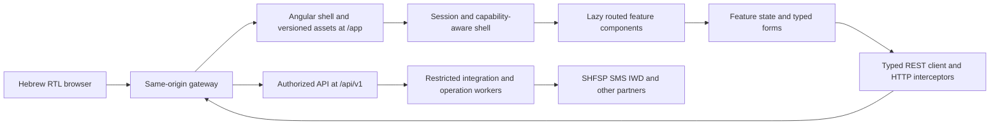
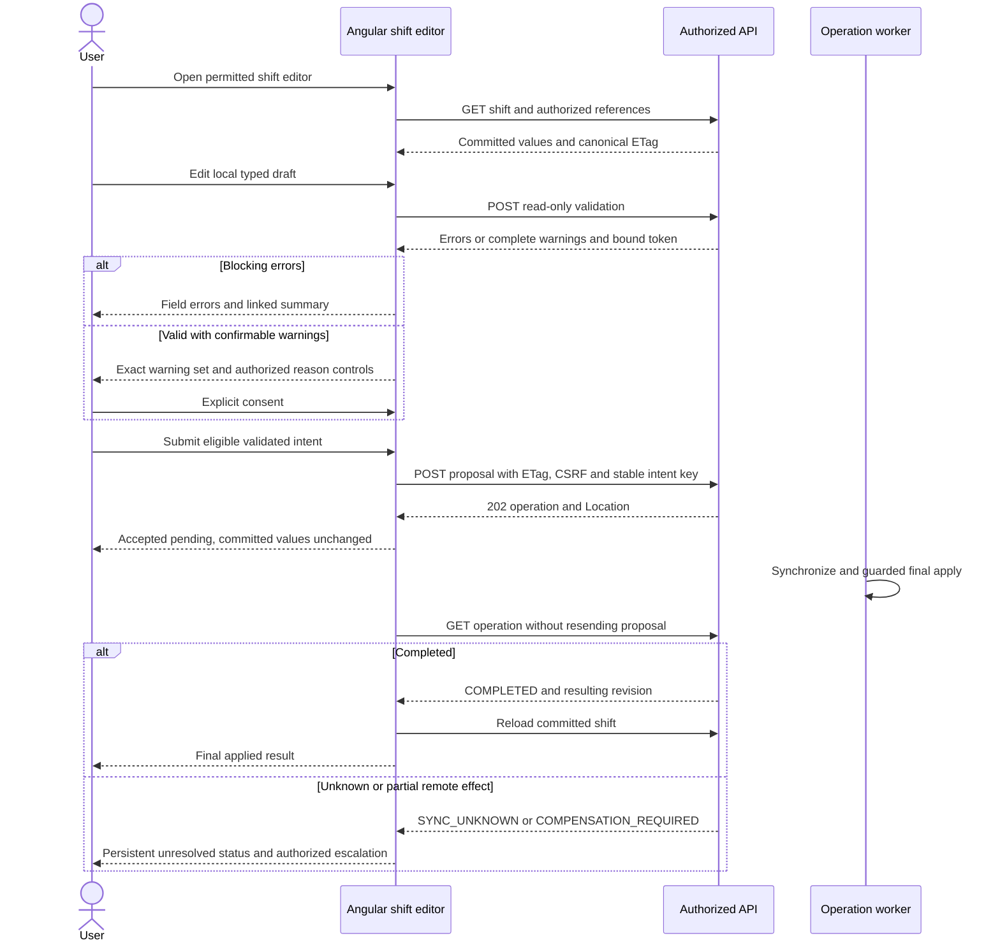

# SHF Angular User Interface Detailed Technical Design

Document date: 2026-10-11. Status: proposed design for review, not an implemented application.

Reading guide:

- [Purpose and evidence](#1-purpose-and-evidence)
- [Existing UI baseline](#2-existing-ui-baseline)
- [Angular architecture](#3-angular-architecture)
- [Routing and navigation](#4-routing-and-navigation)
- [Session and security](#5-session-permissions-and-browser-security)
- [State and API integration](#6-state-and-api-integration)
- [Time and localization](#7-dates-time-precision-and-localization)
- [Shared UI and accessibility](#8-shared-ui-responsive-design-and-accessibility)
- [Detailed screens](#9-detailed-screen-specifications)
- [Shift editor and Angular patterns](#10-shift-editor-reference-flow-and-angular-patterns)
- [Operations and recovery](#11-operations-refresh-and-recovery)
- [Implementation structure](#12-proposed-angular-implementation-structure)
- [Quality and tests](#13-quality-performance-and-test-design)
- [Deployment and migration](#14-deployment-and-incremental-migration)
- [Decision register](#15-decision-and-risk-register)
- [Traceability and verification](#16-source-traceability-and-deliverable-verification)

## 1. Purpose and Evidence

Specify the user interface replacement for SHF, with Angular as the browser
platform. Preserve authorized workforce-management workflows while replacing
Struts/JSP frames, HTML-fragment requests, and DOM-copy mobile behavior with
typed components, explicit commands, and accessible Hebrew/RTL views.

This document complements the [system technical design](SHF_REVERSE_ENGINEERED_TECHNICAL_DESIGN.md),
[REST API design](SHF_REST_API_DETAILED_DESIGN.md),
[source contract catalog](SHF_SOURCE_CONTRACT_CATALOG.md),
[TIBCO/.NET integration design](SHF_TIBCO_DOTNET_INTERFACE_DESIGN.md), and
[read-only schema discovery](SHF_SCHEMA_DISCOVERY_READ_ONLY.sql). The REST design
owns wire contracts; this document owns browser composition and interaction.
No new backend implementation, database change, or live deployment is implied.

### 1.1 Evidence Classes

| Class | Meaning in this document |
| --- | --- |
| Verified | Supported by readable local source or parsed local configuration. |
| Source-derived | A workflow interpretation grounded in source; production behavior still needs characterization. |
| Proposed | Angular routes, components, DTO consumption, UX rules, and delivery decisions to implement. |
| Unverified | Runtime/deployment details, live permissions/data, physical schema, and partner behavior not demonstrated locally. |

All Angular component names and frontend file layouts below are proposed.
Existing Java forms are evidence of legacy behavior, not generated REST DTOs.
Do not treat unavailable physical schema metadata as a frontend field contract.
Do not expose machine-interface payloads, database access, or EMS credentials
to the browser.

### 1.2 Scope and Non-Goals

In scope: application shell, employee workspace, scheduling, attendance,
breaks, reinforcement, time changes, reduction, replacement, exceptions,
forecast/reporting, CTI, learning, scoped administration, operation tracking,
and shared interaction/security/accessibility patterns.

Out of scope: changing payroll/business policy, migrating Java namespaces,
implementing the proposed Node.js API or .NET workers, recreating placeholder
HR/taxi/course functions, replacing SSO without approval, and enabling offline
business writes. No application source is modified by this design task.

## 2. Existing UI Baseline

### 2.1 Presentation and Request Behavior

| Evidence | Observed behavior | Angular design consequence |
| --- | --- | --- |
| [Main shell](../SHFWeb/WebContent/jsp/shf_index.jsp#L6) | Windows-1255 document, frames for branding, main view, right navigation, and message bar; initial main view is messages. | One UTF-8 application shell with normal landmarks and routed views. |
| [Shell mobile branch](../SHFWeb/WebContent/jsp/shf_index.jsp#L14) | Width below 760 hides the navigation frame. | Responsive navigation based on layout constraints, not a separate authorization mode. |
| [Shift action](../SHF/src/bzq/shf/actions/ShiftDataAction.java#L99) | Search initialization restores session form values; result loading calls the shift model and forwards rows to JSP. | Route/query state owns visible filters; typed API reads supply results. |
| [Shift popup](../SHFWeb/WebContent/js/shiftjs.js#L115) | A GET retrieves HTML and assigns it to `innerHTML`. | Angular dialog with typed inputs and data reads; no server-rendered dialog fragments. |
| [Legacy command](../SHFWeb/WebContent/js/shiftjs.js#L169) | Repository deletion is issued through a legacy GET. | Navigation and reads never execute commands; use the explicit command contract. |
| [Responsive helper](../SHFWeb/WebContent/js/shf_responsive.js) | Desktop table HTML is transformed into alternate mobile rows/details. | One data model and stable identities; deliberate compact/mobile templates. |
| [Form/route catalog](SHF_SOURCE_CONTRACT_CATALOG.md#1-complete-struts-route-catalog) | 216 Struts mapping entries and 50 form bindings, including forwarding and duplicate paths. | Migrate business capabilities, not one Angular screen per XML mapping. |

The local baseline is Struts 1-style actions, JSP, IBM Dojo, and a bundled
jQuery 1.12.0 asset. Exact deployed WebSphere/Java/Struts versions and browser
support are unverified. The web deployment descriptor is access-restricted;
servlet/filter/session/security declarations are not assumed to be verified.
Incorrect UTF-8 display of legacy Hebrew is not evidence of source corruption.

### 2.2 Behavior That Must Survive Migration

Preserve employee-versus-manager data scope, per-activity permissions,
baseline/effective schedule provenance, stage-versus-station attendance,
planned-versus-actual breaks, confirmable business warnings, and separate
request/approval/integration states. A saved intent or partner send is not
evidence of a completed schedule change.

Characterize legacy behavior with business owners using sanitized fixtures.
Intentionally remove mutating GETs, unsafe HTML insertion, frame targeting,
client-supplied trusted identity, and silent date/time reinterpretation. These
are replacement design decisions, not claims about a deployed fix.

## 3. Angular Architecture

### 3.1 Platform Decision

Use Angular 22 as the target selected by the parent design, subject to checking
its supported release and the organization's browser/toolchain policy at
implementation kickoff. Pin compatible Angular CLI, core, Material/CDK,
TypeScript, RxJS, and build-time Node.js versions together. No local Angular
workspace or installed version has been established in this repository.

Use standalone components, lazy feature routes, strict TypeScript/template
checking, signals for synchronous view state, typed reactive forms for editors,
and RxJS for asynchronous request cancellation and sequencing. Prefer stable
APIs; experimental signal forms and framework migrations are not prerequisites.
Use OnPush components and immutable server DTOs. Do not introduce a global
state library unless a demonstrated cross-feature state requirement needs it.

Angular Material/CDK provides dialogs, menus, focus management, bidi support,
and standard controls. Start with semantic Material tables plus server paging.
Select a more capable maintained grid only after keyboard/screen-reader,
RTL, performance, licensing, and support evaluation. Do not port the Dojo grid
or custom HTML-copy selection mechanism.

### 3.2 Runtime Boundaries



The static application contains no employee records, session tokens, or rights.
Protected data arrives only after identity bootstrap and server authorization.
Authentication endpoints are backend-owned `/auth/*`; the browser does not
connect directly to Oracle, WFM, JMS, or internal worker endpoints.

Use client-side rendering initially. SSR and a service worker add no proven
business benefit here and require separate sensitive-data/cache review. The
frontend remains API-compatible whether the approved backend is implemented
in Node.js or another platform. Integration transport stays outside Angular.

### 3.3 Component Responsibilities

| Layer | Responsibility | Must not own |
| --- | --- | --- |
| Shell | Session bootstrap, authorized navigation, scope/date context, global notices and operation links. | Domain approval policy or trusted actor selection. |
| Feature page | Read filters, route state, list/detail orchestration and empty/error states. | SQL, partner transport, or global mutable forms. |
| Feature facade | Request lifetimes, server representations, draft transitions and command sequencing. | Reimplementation of authoritative business validation. |
| Editor/dialog | Typed draft, presentation validation, warning display and accessible focus. | Permission authority or optimistic final apply. |
| Typed API client | Contract-based serialization, response headers, problems and pagination. | UI route dispatch or returning HTML fragments. |
| Shared UI primitives | Table state, date/time input, scoped selector, validation summary and operation status. | Feature-specific business rules. |

## 4. Routing and Navigation

### 4.1 Document Requests versus API Calls

`/app` is the proposed Angular document namespace, separate from legacy `/shf`.
An initial browser GET or refresh returns the `text/html` shell; subsequent
navigation uses Angular Router. `/api/v1/*` returns data/problems, not the shell.
Opening an editor or dialog does not execute a write, mark a message read,
reserve a resource, or initiate an export.

Gateway precedence is API/auth/restricted service routing, approved UI
documents, then assets/404 handling. Missing assets and unknown API routes
must return 404 instead of `index.html`. Only GET/HEAD document navigation
receives the approved SPA fallback. The static base URL and router base are
`/app/`; hashes/content versions identify cached assets, not user-specific HTML.

### 4.2 Primary Route Manifest

These 20 proposed document paths reconcile with the
[REST UI-only inventory](SHF_REST_API_DETAILED_DESIGN.md#25-ui-only-navigation-inventory).
Curly-brace parameters are documentation notation; Angular uses `:parameter`
in paths relative to `/app/`. Routes below are never business API endpoints.

| UI document path | Screen ID | Proposed view | Read/command ownership |
| --- | --- | --- | --- |
| `/app` | `UI-001` | `AppShell` and authorized landing selection. | Identity/capability bootstrap. |
| `/app/me/messages` | `UI-002` | `MyMessagesPage`. | Recipient inbox and explicit message commands. |
| `/app/me/shifts` | `UI-003` | `MyShiftsPage`. | Self-scoped schedule and permitted proposals. |
| `/app/employees` | `UI-004` | `EmployeeSearchPage`. | Scoped employee/reference queries. |
| `/app/employees/{employeeId}` | `UI-005` | `EmployeeCardPage`. | Authorized employee sections/preferences/events. |
| `/app/shifts` | `UI-006` | `ShiftSearchPage`. | Effective schedule, creation/cancellation/swap workflows. |
| `/app/shifts/current` | `UI-007` | `CurrentShiftsPage`. | Current-shift operational query. |
| `/app/shifts/{shiftId}/edit` | `UI-008` | `ShiftEditorPage`. | Shift/break reads, validation and change proposals. |
| `/app/attendance` | `UI-009` | `AttendancePage`. | Arrival/exit, reports and reasoned corrections. |
| `/app/breaks` | `UI-010` | `BreaksPage`. | Planned/actual breaks, candidate and offer commands. |
| `/app/reinforcement-requests` | `UI-011` | `ReinforcementRequestsPage`. | Capacity requests, eligibility and assignments. |
| `/app/time-change-requests` | `UI-012` | `TimeChangeRequestsPage`. | Time-window requests, applications and decisions. |
| `/app/reduction-requests` | `UI-013` | `ReductionRequestsPage`. | Reduction requests, applications and decisions. |
| `/app/shift-offers` | `UI-014` | `ShiftOffersPage`. | Offers, candidate proposals and acceptance/rejection. |
| `/app/exceptions` | `UI-015` | `ExceptionsPage`. | Timed/full-day exceptions, cancellation and remarks. |
| `/app/reports` | `UI-016` | `ReportsPage`. | Forecast/report reads and export operations. |
| `/app/cti` | `UI-017` | `CtiWorkspacePage`. | Controlled CTI/completion/correction contracts. |
| `/app/learning` | `UI-018` | `LearningPage`. | Modules, assignments, scheduling and cancellation. |
| `/app/administration` | `UI-019` | `AdministrationPage`. | Scoped configuration, building/team mapping and drafts. |
| `/app/operations/{operationId}` | `UI-020` | `OperationDetailPage`. | Authorized operation status and supported recovery. |

Declare static segments such as `current` before parameterized segments.
Lazy-load by domain; deep links must run the same bootstrap and authorization
flow as menu navigation. Use an explicit not-found route and a distinct
forbidden view; do not redirect failed resource reads to an apparently empty
workspace. Select messages for authorized self-service users and current shifts
for authorized operators; if neither is allowed, show permitted destinations
without inventing a profile-to-role mapping.

### 4.3 Navigation and Draft Ownership

The desktop shell has a top identity/scope bar, right-side navigation, central
work area, and a compact global status region. Tablet/mobile navigation becomes
an accessible drawer. Main content remains outside decorative cards. Filters,
tabs, sort and permitted cursor state belong to route/query state; sensitive
employee identifiers, contact data, and free-text reasons do not.

Dialogs and unsaved editor values remain local feature state. Use a deactivation
guard for dirty drafts and a browser unload warning where supported. Once a
command is durably accepted, track its operation independently of the editor;
navigation must not cancel server work. Route guards improve navigation only:
every API call still needs independent backend capability and scope checks.

## 5. Session, Permissions and Browser Security

### 5.1 Bootstrap and Session Lifecycle

Use the [identity contracts](SHF_REST_API_DETAILED_DESIGN.md#5-identity-and-authorization).
`SessionFacade` has explicit `INITIALIZING`, `AUTHENTICATED`, `EXPIRED`,
`FORBIDDEN`, and `FAILED` states. Protected feature requests wait for a successful
identity/capability bootstrap; an initialization failure is not an empty inbox.

1. Load `GET /api/v1/me`; retain only the current in-memory identity projection.
2. Load `GET /api/v1/me/capabilities` for the chosen permitted unit and obtain
    the CSRF token from `GET /api/v1/me/csrf-token` before non-safe requests.
3. Render permitted navigation and load the active feature. An administrator's
    nullable employee link must not cause a fabricated self-service identity.
4. On a unit change, cancel old reads, clear selection and incompatible drafts,
    refresh scoped capabilities, and load only the new authorized data.
5. On logout/session expiry, stop refresh/polling, clear sensitive caches,
    capabilities, CSRF state and selections, and hide protected data.

The backend owns OIDC/PKCE and the rotated HttpOnly secure cookie. OAuth tokens,
permissions, employee records and command bodies must not be stored in
`localStorage`, `sessionStorage`, IndexedDB, URL fragments, or service-worker
caches. A transient CSRF token is held in memory, never used as identity, and
never logged. The REST design's 90-minute idle lifetime is a proposed parity
baseline, not a verified gateway/session configuration.

An API 401 returns a JSON problem. Coalesce concurrent 401 handling into one
expiry transition, not multiple redirects. Reauthentication uses a full-browser
navigation to `/auth/login` with an allowlisted same-origin `/app` return path.
Warn that an unsaved in-memory draft cannot survive that navigation; do not
silently persist it or resubmit commands after login. Reconcile accepted
operations using authorized server reads after reauthentication.

### 5.2 Permission Display Model

| UI concern | Proposed rule |
| --- | --- |
| Navigation | Display a feature only if an appropriate server capability exists in the current scope. |
| Own employee actions | Use the trusted `Me.employeeId` association; URL/form employee input is never the actor. |
| Row actions | Combine scoped capabilities with the resource's display-only available actions and current workflow state. |
| Registration versus correction | Ordinary arrival/exit controls do not expose correction or backdated-manager fields. |
| Approval/override | Separate grants and reason requirements; a manager label does not automatically authorize them. |
| Sensitive fields | Render only fields returned in the authorized projection; do not fetch broadly and hide in CSS. |
| Changed permissions | Invalidate state on capability-version/scope changes and handle authoritative API denials. |
| Hidden resource | Render an ordinary not-found outcome for scoped 404; do not disclose employee existence. |

The legacy special unit `00020000`, fixed profile units and team-parent rules
remain server policy concerns. Build an owner-approved action mapping rather
than treating legacy `aa`, absent `activity`, or misspelled `ativity` as a grant.
Route guards and structural permission directives are convenience controls,
not security boundaries. No browser flag bypasses a blocking server rule.

### 5.3 Browser Controls

Use same-origin HTTPS for documents, API and authentication. HTTP interceptors
attach the session-bound CSRF header only to approved same-origin API/auth
non-safe requests, including validation POSTs and logout; do not assume
Angular's default cookie/header names match the token-endpoint contract.
Agree the actual header name with the backend and test it. Do not forward
CSRF/revision/idempotency headers to asset or third-party requests.

Render employee names, remarks, messages and problem details as plain text.
Do not use `innerHTML`, sanitizer bypass APIs, `javascript:` URLs, dynamic
template evaluation, or external links supplied by message bodies. Map
server resource references to allowlisted Angular routes. File download URLs
must resolve to the authorized artifact contract, not arbitrary URLs.

Propose CSP with same-origin scripts/assets, no unsafe evaluation, tightly
controlled style policy and `frame-ancestors` restrictions; validate it against
the chosen Angular/Material build before enforcement. Consider Trusted Types
after library compatibility tests. Fonts/icons are packaged locally. Use a
restrictive referrer policy and redact resource paths/query strings in client
telemetry. Never embed integration credentials in frontend build configuration.

## 6. State and API Integration

### 6.1 State Ownership

| State | Owner / lifetime | Invalidation |
| --- | --- | --- |
| Session/capability projection | `SessionFacade`, application memory. | Expiry, logout, scope/version change. |
| Unit/business-date context | Shell context and permitted route query. | Unit change, invalid URL or revoked scope. |
| Filters/tab/sort | Typed feature route-state adapter. | Invalid allowlisted value; filter change resets cursor/selection. |
| Cursor history | Feature memory plus optional non-sensitive route cursor. | Changed filters/scope/sort, 15-minute proposed expiry, API rejection. |
| Server rows/details | Feature facade, immutable DTOs with `asOf` and exact resource ETag. | Reload, mutation result, permission change or feature destruction. |
| Draft and warnings | Typed form/editor memory, tied to original revision. | Relevant input/revision/policy change invalidates validation consent. |
| Row selection | Stable resource-ID set, not row indexes/HTML elements. | Filter/scope change; reconciled against refreshed visible rows. |
| Command intent | Feature command coordinator with frozen body/preconditions/key. | Completed/reconciled outcome; never discard an ambiguous result as failure. |
| Operation status | Shared operation facade keyed by authorized operation ID. | Terminal outcome, lost authority, logout; server operation survives. |
| Reference data | Bounded memory cache keyed by subject/scope/locale/version. | Permission change, logout, version or approved TTL expiry. |

Use signals/computed values for local synchronous state and RxJS for request
streams. Use `switchMap` for replaceable search/validation reads, `exhaustMap`
or an equivalent explicit lock for one command at a time, and
`takeUntilDestroyed` for component subscriptions. Unsubscribing from a command
does not undo a server mutation; operation/intent recovery owns that outcome.
Do not cache sensitive responses with an unbounded global `shareReplay`.

### 6.2 Typed Contract Consumption

Generate the client from the approved OpenAPI 3.1 contract at implementation
time. The attached REST design contains contract examples, not a complete
production OpenAPI artifact. Preserve HTTP headers through `observe: 'response'`
or equivalent generated-client support. Item ETags, 202 Location and
`Retry-After` cannot be discarded by a body-only service wrapper.

Use branded/aliased string types for resource IDs, business dates, revisions,
timestamps and decimal values. Never parse Oracle IDs or national identity
numbers with `Number`/`parseInt`. Separate generated DTOs from presentation
models and form controls. TypeScript interfaces do not validate runtime JSON;
validate critical envelopes/discriminants and fail safely on malformed responses.
Ignore additive unknown response fields; unknown lifecycle values render an
unsupported state with no unsafe action buttons.

### 6.3 Query, Pagination and Selection

The [collection contract](SHF_REST_API_DETAILED_DESIGN.md#33-query-pagination-and-consistency)
uses default limit 50, maximum 200, opaque cursors, approved sort keys and
inclusive `from`/exclusive `to`. Reset pagination on any filter/order/scope
change. Use next/previous cursor history; do not invent arbitrary page-number
jumps without an API contract. `totalCount` is optional, so do not present a
fabricated total or calculate pages from the currently loaded rows.

For live operational lists show `asOf` and `LIVE`, not an implied snapshot.
Cursor expiry restarts the read after an explanatory state, without silently
keeping a cross-page selection. Bulk actions apply only to explicit authorized
IDs or a server-captured immutable selection manifest where the endpoint
supports it. A select-all checkbox means loaded eligible rows by default;
it must never mean every employee in an unbounded filter.

### 6.4 Validation and Command Rules

Presentation validation checks required/allowlisted fields, numeric bounds,
syntax and internally consistent times. Authoritative policy remains on the
server. A read-only validation result can be HTTP 200 with `valid: false`.
Render errors and warnings separately, using stable `code`/`field` and localized
message keys rather than branching on translated text.

Obtain the canonical target ETag from its item read, not from a list timestamp.
Send the exact strong quoted `If-Match` header required by the command; do not
use weak tokens or `*`. Swaps and multi-participant actions also carry every
required participant revision. The token target differs for attendance,
break-actual, message, request and configuration commands; it is not always
the shift ETag.

Generate one ASCII idempotency key, for example `crypto.randomUUID()`, when an
explicit submission freezes one user intent. Freeze its method, route, body,
target ETag and participant revisions together. Disable duplicate submission.
Read-only validation POSTs need CSRF but no idempotency key. Retry a lost
command response only with the original frozen request/key; changing input,
preconditions or warning consent requires a new intent after reconciliation.
Do not automatically retry business mutations with newly generated keys.

Confirmable warnings require explicit acceptance of the displayed warning set
and any authorized override reason. The server confirmation token is bound
to actor, draft fingerprint, revisions, policy and expiry (proposed five
minutes). Any relevant edit invalidates local validation/token/accepted codes.
Final commands revalidate; confirmation and candidate selection reserve nothing.

### 6.5 Error Presentation

| API result | UI behavior |
| --- | --- |
| `400` / `422` | Associate safe field errors with controls and summary; keep editable draft. |
| Validation `200`, `valid: false` | Show blocking errors; never interpret HTTP success as a valid draft. |
| `401` | One session-expiry transition; stop requests and use approved reauthentication flow. |
| `403` | Remove unauthorized controls/data and show denied state without broadening scope. |
| `404` | Not-found/hidden-resource view; distinguish from an authorized empty collection. |
| `409 CONFIRMATION_REQUIRED` | Validate again and collect consent for the current warning set. |
| `409 IDEMPOTENCY_KEY_REUSED` | Stop retry; reconcile original intent instead of changing its fingerprint. |
| `409 REQUEST_IN_PROGRESS` | Respect `Retry-After`; follow an existing authorized operation if supplied. |
| `409 CURSOR_EXPIRED` | Reset list cursor/selection and restart with current filters. |
| `412` | Show server-versus-draft comparison; require deliberate reconciliation and fresh validation. |
| `428` | Missing revision is a client/contract defect; reread the target, never use wildcard overwrite. |
| `410` | Artifact expired; permit a new authorized export, not reuse of an old URL. |
| `413` / `415` | Reject oversized/unsupported import with approved limits/formats. |
| `429` | Pause reads/submission per `Retry-After`; do not create a request storm. |
| `500` / `503` / network timeout | Show sanitized correlation and distinguish unavailable read from ambiguous command outcome. |
| `202` | Show accepted/pending operation; committed business values remain unchanged until final apply. |

Use `application/problem+json`; show a safe localized message and correlation
reference, never a raw stack trace, SQL, partner XML or fetched error-page HTML.
Toast notices supplement persistent inline status; they are not the only
feedback for failed validation or an unresolved operation.

## 7. Dates, Time, Precision and Localization

### 7.1 Time Model

The initial business zone is `Asia/Jerusalem`, supplied by the identity/policy
contract, not inferred from the workstation zone. Keep these values separate:
business date (`YYYY-MM-DD`), editable local calendar/time fields, resolved
instant with offset, and duration. Do not turn a date-only value into UTC
midnight with `new Date(dateString)` and then display a different local day.

Use the selected Angular release's locale registration for Hebrew display and
a maintained IANA-zone-aware date library/approved Temporal adapter for
resolution. Pin its compatible version and verify DST behavior before use.
Material date adapters alone do not define the payroll/business time model.

| Case | Required behavior |
| --- | --- |
| Cross-midnight shift/break | Show both calendar dates and an explicit next-day indicator; submit full timestamps. |
| DST gap | Reject nonexistent local time; do not normalize it silently. |
| DST repeated hour | Require the correct offset/occurrence or server-approved disambiguation. |
| `24:00` | Reject until an owner-approved boundary conversion exists; never silently parse as `00:00`. |
| End <= start | Field error; do not infer next day from a negative interval. |
| Inclusive screen date range | Convert the displayed final date to exclusive `to` exactly once. |
| Server observation time | Display `asOf`; workstation clock is not the authority for eligibility/freshness. |
| CTI/payroll duration/decimal | Preserve API precision/decimal strings; no binary floating-point financial recalculation. |

Split-shift validation must characterize the legacy boundary formed by setting
the start calendar hour to 16 while retaining minutes/seconds; it is not simply
a client rule of 'second part starts at 16:00'. Policy thresholds and break
counts come from approved source-backed policy/reference contracts, not copied
constants in components.

### 7.2 Hebrew, RTL and Encoding

The shell uses `lang="he"`, `dir="rtl"` and UTF-8. Use logical CSS properties
(`margin-inline`, `padding-inline`, `inset-inline-start`) rather than fragile
left/right overrides. Material/CDK bidi direction must include overlays.
Preserve natural numeric/time ordering with LTR isolation and use `bdi` for
mixed-language names/codes. Mirror navigation-direction icons where appropriate,
not clock digits, chart axes or meaningful business sequences automatically.

All accessibility names, field errors and status announcements are Hebrew.
Keep message keys and workflow codes language-neutral; translated descriptions
do not alter request IDs, decimal/date serialization or enum values.
Server `Accept-Language: he`/`Content-Language` and frontend translations must
agree. English is an optional approved locale, not a separate authorization mode.

Convert verified Windows-1255 data/assets only at legacy boundaries. New source,
JSON, templates and styles use UTF-8. Characterization covers Hebrew names,
punctuation, mixed English/Hebrew, leading zeros, quotes and export round trips;
do not 'repair' original strings based on replacement characters in a tool view.

## 8. Shared UI, Responsive Design and Accessibility

### 8.1 Operational Visual System

Use a restrained work-oriented layout: compact header, clear hierarchy,
unframed content bands, dense readable tables and contextual detail panels.
Preserve the established Hebrew/RTL navigation direction without duplicating
legacy frame sizing. No marketing hero, decorative nested cards or oversized
dashboard headings. Use a licensed locally packaged Hebrew-capable font, such
as an approved Noto Sans Hebrew build, and a limited neutral palette with
distinct semantic status colors. Color is never the only state signal.

Proposed tokens: spacing 4/8/12/16/24 px, control height 40 px desktop and
44 px touch, readable table row height at least 40 px, card/dialog corner radius
at most 8 px, normal letter spacing, and visible high-contrast focus outlines.
These are design targets, not measured properties of the existing application.
Use content-based breakpoints: compact below 768 px, intermediate 768-1199 px,
and full operational layout from 1200 px, subject to device/workflow testing.

### 8.2 Reusable Components

| Proposed primitive | Contract / behavior |
| --- | --- |
| `ScopedUnitSelector` | Only authorized units; load children lazily; explicit pending/empty/denied state. |
| `BusinessDateRangeField` | Valid calendar dates, inclusive display/exclusive query adapter and zone-aware summary. |
| `ZonedIntervalField` | Separate start/end dates and times, offset ambiguity support, typed value/validation interface. |
| `OperationalTable` | Stable `track` identity, semantic headers, server sorting/paging and labeled selection controls. |
| `FilterBar` | Typed controls, applied-filter summary, explicit reset and bounded mobile drawer. |
| `ResourceDetailPanel` | Selected authorized item, own loading/errors and canonical item reload before editing. |
| `ValidationSummary` | Linked field errors, full warnings, explicit consent and reason control. |
| `ReasonDialog` | Allowlisted reason code, conditional explanation, correct cancel/submit and focus return. |
| `OperationStatus` | Business outcome distinct from request status; persistent pending/unknown/recovery view. |
| `FreshnessIndicator` | API `asOf`, paused/stale/refreshing status; no false 'live' claim after failed refresh. |
| `ExportStatus` | Export operation, authorized artifact metadata, expiry and download outcome. |

Wrap complex custom fields with the stable reactive-forms value-accessor
contract when reused. Do not create a generic metadata-driven form engine for
every domain; domain editors own conditional meaning and permitted commands.

### 8.3 Controls and Responsive Behavior

Use established Material icons in tool buttons with Hebrew accessible names
and tooltips; tabs for views, menus/selects for option sets, checkboxes/toggles
for binary settings, and appropriate numeric inputs/steppers. Destructive
actions have a clear command label and reason/confirmation where policy needs
it. Hints cannot substitute for a persistent visible form label.

On desktop, show priority operational columns and one detail panel. On compact
screens, keep employee/date/status and primary action visible, move secondary
fields to a detail view, and offer an explicit horizontally scrollable table
when two-dimensional comparison is required. Never duplicate hidden interactive
controls or reconstruct selection from copied HTML. Reserve stable toolbar,
icon-button and row dimensions so loading labels and hover states do not move
targets. Charts require an equivalent readable data table.

### 8.4 WCAG 2.2 AA Acceptance

Provide landmarks and a Hebrew skip-to-main link; logical RTL reading/focus
order; complete keyboard operation; visible focus not hidden under sticky bars;
contrast of at least 4.5:1 for ordinary text and 3:1 for large text/essential
UI boundaries; and target size at least 24 by 24 CSS px or the standard's
permitted spacing exception. Prefer 44 px touch targets for repeated mobile
commands. Support 200% zoom and reflow at 320 CSS px, except genuinely
two-dimensional tables with accessible scroll behavior.

Dialogs trap focus, set an appropriate Hebrew name/description, focus the
first meaningful element, support a safe cancel action and restore focus to
the opener or a surviving logical target. Invalid submit focuses an error
summary linked to controls with associated descriptions and `aria-invalid`.
Use a polite live region for pending/completed status and a restrained urgent
announcement for blocking failures; do not announce every polling tick.

Offer non-drag alternatives for any scheduling movement. Tooltips alone are
not accessible names. Respect reduced motion, avoid flashing, and keep status
text visible independently of icons/color. Automated axe checks are necessary
but not sufficient: Hebrew screen-reader, keyboard, touch, zoom and RTL table
workflows require manual verification.

## 9. Detailed Screen Specifications

Screen IDs identify functional UI coverage, not legacy action numbers. Every
screen uses the shared loading/empty/error/denied/stale/pending rules above.
API calls shown here are canonical proposed contracts from the REST design;
they are not claims that those endpoints currently run.

### 9.1 Shell and Landing: UI-001

`AppShell` composes `SessionBoundary`, `ScopeContextBar`, `PrimaryNavigation`,
`RouterOutlet`, `GlobalNoticeRegion` and an authorized operation-status link.
Show the product identity, current user, selected permitted unit and business
date without a marketing panel. Navigation is a real link/menu structure,
not clickable table cells targeting `top.frMain`.

Read `GET /api/v1/me` and `GET /api/v1/me/capabilities` before protected feature
reads. Obtain CSRF through `GET /api/v1/me/csrf-token`. Logout explicitly calls
`POST /auth/logout`; login/callback remain backend browser navigation.
Display only approved external BI/WFM destinations from trusted configuration,
not hardcoded private URLs or links supplied by employee messages. Open
approved external tools with appropriate isolation and referrer controls.

[The legacy menu](../SHFWeb/WebContent/jsp/right_menu.jsp#L33) mixes viewport
checks, activity tags and frame navigation. The replacement separates viewport
layout from capabilities: compact layout must not silently grant/revoke a
workflow. Acceptance: direct deep link, empty capability set, nullable employee
link, changed scope and session expiry all reach an explicit correct state.

### 9.2 Personal Messages: UI-002

`MyMessagesPage` has recipient-scoped filters, a paged inbox and safe detail
panel. Columns: subject, type, creation time, read state, offer summary when
authorized. Details contain plain text and allowlisted resource links.
No contact/identity fields are loaded merely to paint an inbox row.

Read `GET /api/v1/me/messages` and `GET /api/v1/me/messages/{messageId}`.
Explicit actions call `POST /api/v1/me/messages/{messageId}/read` or
`POST /api/v1/me/messages/{messageId}/deletion`, using the message ETag and
one intent key. Viewing a row or loading details has no write effect.
Offer acceptance opens the replacement workflow; it is not a message update.
Update counters from authoritative results/reloads, not a guessed unread decrement.

Acceptance: another recipient's ID is hidden; deleted/read filters work;
duplicate submission does not duplicate effects; a stale message is reconciled;
an unavailable linked offer does not expose protected participant data.

### 9.3 Personal Schedule: UI-003

`MyShiftsPage` provides day/week navigation and a readable chronological list.
Show date, day type, effective start/end, next-day indicator, site/home/split,
authorized break/attendance summaries, source/override and pending operation.
A calendar presentation is optional; the list remains the accessible baseline.

Read `GET /api/v1/me/shifts`, then canonical
`GET /api/v1/shifts/{shiftId}` before a permitted action. Self identity is
server-derived. Offer/application actions link to the same shared workflows
used elsewhere; no second self-service command implementation. Display source
day classifications explicitly, rather than treating all day types as work.
Keep committed schedule and proposed change values visually separate.

Acceptance: self-only data, canceled-day history, cross-midnight/RTL display,
range pagination and pending-versus-completed updates. Never calculate
payable hours from this presentation instead of the authoritative CTI policy.

### 9.4 Employee Search and Card: UI-004, UI-005

`EmployeeSearchPage` uses permitted unit, name, job, team and active-status
filters with `GET /api/v1/employees`. Legacy national-ID fields are not a
license to add unrestricted identity-number search to the proposed API.
`EmployeeCardPage` loads `GET /api/v1/employees/{employeeId}` and lazily loads
authorized tabs, not all employee details on initial navigation.

| Card section | Fields / interaction | API binding |
| --- | --- | --- |
| Overview | Display name, permitted organizational/job/status data and provenance. | Employee item read. |
| Skills | Skill, effective validity and source-backed proficiency; read-only initially. | `GET /api/v1/employees/{employeeId}/skills`. |
| Shifts | Bounded effective schedule using authorized employee filter. | `GET /api/v1/shifts`. |
| Events | Type, date/interval, reason, state, report/approval provenance and safe remark. | `GET /api/v1/employees/{employeeId}/events`. |
| Add/cancel event | Typed event policy and reason; do not let a client set approved/reported flags. | `POST /api/v1/employees/{employeeId}/events`; `POST /api/v1/employees/{employeeId}/events/{eventId}/cancellations`. |
| Time off | Full-day date range versus timed exception distinction. | `GET /api/v1/employees/{employeeId}/time-off`. |
| Education | Only genuine source-backed authorized records; no invented HR editing. | `GET /api/v1/employees/{employeeId}/education`. |
| Notification preferences | Approved SMS opt-in flags, not upstream phone ownership. | `GET /api/v1/employees/{employeeId}/notification-preferences`; `PATCH /api/v1/employees/{employeeId}/notification-preferences`. |

Do not expose courses/taxi tabs as completed features: the inspected
[employee methods](../SHF/src/bzq/shf/model/EmployeeDataModel.java#L285) return
an empty course collection or have no taxi implementation. Mood and sensitive
remarks need separate field authority. Own-card access must use its approved
capability, not a manager projection with columns hidden after fetching.
Acceptance: each tab's grant, event cancellation history, preference ETag,
masked/omitted sensitive fields and direct employee deep links.

### 9.5 Schedule Search, Current Shifts and Editor: UI-006, UI-007, UI-008

`ShiftSearchPage` composes `ScheduleFilterBar`, `ShiftTable` and
`ShiftDetailPanel`. Filters include unit, bounded dates, employee when permitted,
job/activity/day type, site and home state. `CurrentShiftsPage` uses an explicit
server observation time and operational state/job filters. Reads are
`GET /api/v1/shifts` and `GET /api/v1/shifts/current`; details/provenance use
`GET /api/v1/shifts/{shiftId}` and `GET /api/v1/shifts/{shiftId}/provenance`.

Priority columns: employee, business date, effective interval, day state,
site/home/split, source/override, attendance summary, break summary and
pending-operation indicator. A row click selects detail; it never cancels or
creates a shift. Reconcile selection after refresh and fetch an item ETag
before editing. Failed refresh keeps old data visibly stale, not 'current'.

`ShiftEditorPage` presents baseline and committed effective values, then a
separate local draft. Proposed controls:

| Field/group | Control and rule |
| --- | --- |
| Existing shift identity/day type/activity | Read-only unless the approved specific command DTO allows alteration. |
| Start/end | Zoned date/time fields with full calendar dates and explicit ambiguity handling. |
| Site/location | Scoped option set; never a free private endpoint or inferred unit. |
| Work from home | Boolean with policy-controlled location/extension effects. |
| Split | Explicit enable toggle and one characterized split interval, not an invented multi-segment payroll model. |
| Break plan | Related authorized read; separate break editor/command unless included by an approved create DTO. |
| Reason | Allowlisted code and conditional required explanation. |
| Validation | Blocking error summary, complete warning set, permitted override reason and confirmation consent. |

Draft evaluation calls `POST /api/v1/shifts/validations`. Submit an existing
change through `POST /api/v1/shifts/{shiftId}/change-proposals`; creation through
`POST /api/v1/shifts`; cancellation through
`POST /api/v1/shifts/{shiftId}/cancellations`; location-only changes through
`POST /api/v1/shifts/{shiftId}/location-changes`. All return operations.
Independent remarks use `PATCH /api/v1/shifts/{shiftId}/remark`.
Offer cleanup is explicit `POST /api/v1/shifts/{shiftId}/offer-cleanups`, not
a side effect of opening or validating a dialog. Extension controls use
`GET /api/v1/shifts/{shiftId}/extension-lease` and
`POST /api/v1/shifts/{shiftId}/extension-commands` only with their specific grant.

The inspected [shift validation](../SHF/src/bzq/shf/model/ShiftDataModel.java#L3604)
checks missing reason, date window, minimum duration, offers and split rules;
arrival checks in that path are commented out. Do not add a blanket post-arrival
editing ban merely because swaps have attendance restrictions. Its offer
deletion branch cannot serve a read-only preview. Characterize zero/equal-time
and split boundaries before adopting any stricter target policy.

Acceptance: allowed filter restoration, canonical ETag use, stale-edit comparison,
all warning consent invalidation, duplicate/lost-response recovery, explicit
cancel/location/create states, and no early replacement of committed values.
Bulk shift creation/import uses the staged workflow below, not a hidden loop
of browser POSTs claiming file-level atomicity.

### 9.6 Attendance and Employee Reports: UI-009

`AttendancePage` has a scoped operator table and a separately authorized
self-service interaction using the employee's linked shift. Show planned
interval, stage arrival, station arrival, station departure, late/missing
reason, briefing/approved flags, required report and observation time as
distinct facts. Do not collapse stage and station into a single 'present' flag.

| Interaction | API binding / precondition |
| --- | --- |
| Operator list / item | `GET /api/v1/attendance`; `GET /api/v1/shifts/{shiftId}/attendance`. |
| Ordinary clock registration | `POST /api/v1/shifts/{shiftId}/attendance-events`; attendance ETag, server time for self-service. |
| Reasoned correction | `POST /api/v1/shifts/{shiftId}/attendance-corrections`; separate correction grant and attendance ETag. |
| Flags / briefing | `PATCH /api/v1/shifts/{shiftId}/attendance-flags`; `PUT /api/v1/shifts/{shiftId}/briefing-state`. |
| Report list / detail | `GET /api/v1/attendance-reports`; `GET /api/v1/attendance-reports/{reportId}`. |
| Approval / cancellation | `POST /api/v1/attendance-reports/{reportId}/approvals`; `POST /api/v1/attendance-reports/{reportId}/cancellations`; report ETag. |

Show policy-required early/late/missing reasons in a local dialog. A correction
is a new audited fact, not deletion/overwrite of the original event. Departure
requires station arrival and no recorded departure. Truthful actual events
remain registrable during pending schedule synchronization; the server handles
resulting revision/policy conflicts. Acceptance: stage-versus-station ordering,
server clock, duplicate departure, late/early reasons, permission separation,
report history and keyboard-accessible self-service action.

### 9.7 Break Planning, Actuals and Offers: UI-010

`BreaksPage` separates planned, actual/exceptional and offer views. Columns:
employee, associated shift, planned start/duration, actual exit/return,
late duration, lifecycle/source, location/home and authorized remark.
Read `GET /api/v1/breaks`, `GET /api/v1/breaks/{breakId}` and
`GET /api/v1/shifts/{shiftId}/breaks` as allowed.

`BreakPlanEditor` is a typed `FormArray` keyed by stable break IDs. INSERT,
UPDATE and DELETE are explicit deltas. Do not infer identity from array order
or HH:mm, silently truncate actual seconds, or hardcode three breaks as the
universal domain maximum. The legacy three-field form is one presentation;
the proposed request cap of 20 is a transport bound, not business eligibility.

Evaluate `POST /api/v1/shifts/{shiftId}/break-validations`; submit
`POST /api/v1/shifts/{shiftId}/break-change-proposals` with the shift ETag.
Register actual EXIT/RETURN with `POST /api/v1/breaks/{breakId}/actual-events`
and the break ETag. A notification failure/skip is separate from the validity
of the actual event; do not tell an employee exit failed because SMS failed.

Offers read `GET /api/v1/break-offers`,
`GET /api/v1/break-offers/{offerId}` and
`GET /api/v1/break-offers/{offerId}/candidates`. Create/propose/accept/reject/
cancel use `POST /api/v1/break-offers`,
`POST /api/v1/break-offers/{offerId}/proposals`,
`POST /api/v1/break-offers/{offerId}/acceptances`,
`POST /api/v1/break-offers/{offerId}/rejections` and
`POST /api/v1/break-offers/{offerId}/cancellations` respectively. Acceptance
requires current offer and both participant revisions, then tracks `BREAK_SWAP`.

[Break rules](../SHF/src/bzq/shf/model/BreakDataModel.java#L3176) vary by source
and parameters; the 60-minute gap is not applied universally in inspected code.
Acceptance: source-dependent limits, explicit deletion, split conflicts,
stable ID after time change, return-without-exit, two-party stale offer,
pending/unknown remote outcome and independently reported reminder failures.

### 9.8 Reinforcement Requests: UI-011

`ReinforcementRequestsPage` shows request list, capacity summary, candidate list
and assignment history. Fields: unit/date/interval, requested/committed/reserved/
remaining capacity, activity/site/home, team/job quotas where characterized,
skill/training eligibility, breaks and remark. Request creation is not assignment.

Read `GET /api/v1/reinforcement-requests`,
`GET /api/v1/reinforcement-requests/{requestId}`,
`GET /api/v1/reinforcement-requests/{requestId}/candidates` and
`GET /api/v1/reinforcement-requests/{requestId}/assignments`. Managers with the
specific grant create `POST /api/v1/reinforcement-requests` or edit
`PATCH /api/v1/reinforcement-requests/{requestId}`. An explicit assignment calls
`POST /api/v1/reinforcement-requests/{requestId}/assignments` with request and
participant revisions and tracks `REINFORCEMENT_ASSIGN`.

Candidate selection shows eligibility/evaluation time, not 'reserved' status.
Capacity counts come from the server; unknown operations continue to reserve
capacity. Do not add cancellation/deletion buttons without a contract.
Acceptance: quota combinations, simultaneous last-slot assignments, invalid
capacity reduction, rest/job/site checks and a failed or unknown child operation.

### 9.9 Time-Change Requests: UI-012

`TimeChangeRequestsPage` provides permitted available/own-applications/manager
views. Editor groups: candidate start/end windows, target change type, absolute
target times or extension/shortening minutes, capacity, approval mode and reason.
Use discriminated controls; contradictory legacy start/end/length flags are
not independent booleans to submit. Auto-approval is a separately authorized
policy choice, not an employee-provided flag.

Read `GET /api/v1/time-change-requests`,
`GET /api/v1/time-change-requests/{requestId}`,
`GET /api/v1/time-change-requests/{requestId}/candidates` and
`GET /api/v1/time-change-requests/{requestId}/applications`. Manage via
`POST /api/v1/time-change-requests` and
`PATCH /api/v1/time-change-requests/{requestId}`. Apply via
`POST /api/v1/time-change-requests/{requestId}/applications`; approval via
`POST /api/v1/time-change-requests/{requestId}/approvals`; rejection via
`POST /api/v1/time-change-requests/{requestId}/rejections` or the explicit
`POST /api/v1/time-change-requests/{requestId}/bulk-rejections` manifest flow.

Local application creation, managerial decision and actual shift apply are
three distinct states. Show an auto-approved application's operation as pending
until final apply. Acceptance: characterized option combinations, expired
eligibility, stale application/request/shift revisions, capacity exhaustion,
manifest-only bulk rejection and warning consent.

### 9.10 Reduction Requests: UI-013

`ReductionRequestsPage` separates eligible requests, own applications and
manager decisions. Show window/activity, requested/reserved/approved capacity,
associated shift, reason and decision/apply state. The characterized operation
cancels a shift; do not invent a paid-time-shortening slider based on the name.

Read `GET /api/v1/reduction-requests`,
`GET /api/v1/reduction-requests/{requestId}`,
`GET /api/v1/reduction-requests/{requestId}/candidates` and
`GET /api/v1/reduction-requests/{requestId}/applications`. Manage with
`POST /api/v1/reduction-requests` / `PATCH /api/v1/reduction-requests/{requestId}`;
apply with `POST /api/v1/reduction-requests/{requestId}/applications`; decide
with `POST /api/v1/reduction-requests/{requestId}/approvals`,
`POST /api/v1/reduction-requests/{requestId}/rejections` or
`POST /api/v1/reduction-requests/{requestId}/bulk-rejections`.

Show approved only when the required cancellation/apply is complete, and retain
reserved capacity for unresolved remote outcomes. Acceptance: configured lead
time, correct request/day association, multiple applications for one day,
concurrent last-slot approval and cancel-succeeded/approval-not-completed recovery.

### 9.11 Replacement Offers and Manager Swaps: UI-014

`ShiftOffersPage` contains own/authorized-manager repositories, proposal list,
candidate comparison and a two-participant confirmation dialog. Show both
employees' authorized shifts, dates/intervals, jobs/sites, eligibility reasons,
current revisions, offer expiry and independent proposal/apply state.
Candidate cards never expose unrestricted phone/national identity data.

Read `GET /api/v1/shift-offers`, `GET /api/v1/shift-offers/{offerId}`,
`GET /api/v1/shift-offers/{offerId}/candidates` and
`GET /api/v1/shift-offers/{offerId}/proposals`. Commands are
`POST /api/v1/shift-offers`, `POST /api/v1/shift-offers/{offerId}/proposals`,
`POST /api/v1/shift-offers/{offerId}/acceptances`,
`POST /api/v1/shift-offers/{offerId}/rejections` and
`POST /api/v1/shift-offers/{offerId}/cancellations`. Offer ETag and all required
proposal/participant revisions travel with decisions.

Managers use `POST /api/v1/shift-swaps/validations` followed by
`POST /api/v1/shift-swaps` only with both-resource authority. Display all
blocking errors before any confirmable cleanup/exception/extension warnings.
The replacement's complete two-party evaluation corrects the source validator's
early-warning return and needs owner approval, not an undocumented parity claim.
No generic undo of an applied swap is enabled; cancellation of an uncommitted
offer cannot restore an already-applied schedule.

Acceptance: overlap/rest/site/job/attendance checks, consent for both scopes,
expired/stale candidate, two simultaneous acceptances, partial partner outcome,
competing-offer invalidation and safe message-to-offer navigation.

### 9.12 Exceptions, Time Off and Cancelled Activities: UI-015

`ExceptionsPage` has explicit timed/full-day/cancelled views. Show employee,
source business date or full-day range, typed interval, classification,
baseline/effective provenance, lifecycle, reason and permitted remark.
Read `GET /api/v1/exceptions`, `GET /api/v1/exceptions/{exceptionId}`,
`GET /api/v1/employees/{employeeId}/time-off` and
`GET /api/v1/cancelled-activities` under their respective grants.

Remark editing calls `PATCH /api/v1/exceptions/{exceptionId}/remark` and cannot
change time or classification. Cancellation uses
`POST /api/v1/exceptions/{exceptionId}/cancellations` with exception ETag,
associated shift revision and required consent, then tracks `EXCEPTION_CANCEL`.
Do not invent time-off creation/approval endpoints in the first UI.
Acceptance: full-day versus timed meaning, cancelled history, hidden employee,
managed-break impact, concurrent shift change and pending cancellation.

### 9.13 Forecast, Reports, Exports and Shift Import: UI-016

`ReportsPage` offers authorized report tabs and shared bounded unit/date/site/
job/activity filters. Forecast controls expose only approved baseline/change/
break/exception/metric selections. Show metric units, interval boundaries,
business zone, source, policy/measure version and `asOf`. A chart is a view of
server-calculated measures, with an equivalent data table and accessible legend.

| Report view | API binding |
| --- | --- |
| Calls / staffing | `GET /api/v1/forecasts/calls`; `GET /api/v1/forecasts/staffing`. |
| Staffing interval contributors | `GET /api/v1/forecasts/staffing-contributors`; extra detail authority required. |
| Schedules / sites | `GET /api/v1/reports/schedules`; `GET /api/v1/reports/sites`. |
| Work from home / usage | `GET /api/v1/reports/work-from-home`; `GET /api/v1/reports/client-usage`. |
| Export creation / status / bytes | `POST /api/v1/exports`; `GET /api/v1/exports/{exportId}`; `GET /api/v1/exports/{exportId}/download`. |

Preserve 15-minute overlap and baseline-versus-modified calculations. The
staffing gap sign is calculated staffing minus required staffing. Display
exact decimal/integer results from the server; do not recreate the WFM/BI
calculation engine in chart components. Drill-down requests are bounded and
field-authorized. Report schema metadata is allowlisted, never executable HTML
or a caller-generated SQL/column expression.

Exports capture report/field/filter/locale/zone selection explicitly. Show
generation pending, ready, failed/expired, row count, format, checksum and expiry.
Download only a completed authorized artifact. Real XLSX and documented UTF-8
CSV replace misleading `.xls`-labelled text; defend against spreadsheet formulas.
Do not claim downloading a CTI report marks SAP/payroll data delivered.

The scheduling workspace exposes `ShiftImportDialog` under its existing route,
not an invented new business navigation endpoint. Stages:
`POST /api/v1/shift-imports` uploads file plus typed manifest;
`GET /api/v1/shift-imports/{importId}` and
`GET /api/v1/shift-imports/{importId}/validation` show scanning/row results;
`POST /api/v1/shift-imports/{importId}/commits` explicitly applies the validated
checksum/revision with reason and declared per-group atomicity. Proposed
limits are 10 MiB/10,000 rows, subject to approval. Validation does not write
shifts; a file with partial/unknown child results is not a generic success.

Acceptance: metric flags/units/sign/precision, authorized contributors,
large/empty reports, quoted Hebrew exports, formula-safe cells, expired download,
malformed/oversized upload, row errors, changed checksum/target revisions and
partial import recovery without blind whole-file retry.

### 9.14 CTI and Manual Completions: UI-017

`CtiWorkspacePage` separates CTI actual shifts, manual completions and approved
export-suppression views. Filters include permitted unit/employee/date, code,
source and independent handle/credit/export statuses. Show actual interval,
rewarded interval, credited values, optional planned-day association, source,
policy version, export ownership and correction history without collapsing them.

Read `GET /api/v1/cti/shifts`, `GET /api/v1/cti/shifts/{ctiShiftId}`,
`GET /api/v1/cti/completions` and
`GET /api/v1/cti/completions/{completionId}`. Validate a typed manual draft with
`POST /api/v1/cti/completion-validations`; create
`POST /api/v1/cti/completions`; correct/cancel with
`POST /api/v1/cti/completions/{completionId}/corrections` or
`POST /api/v1/cti/completions/{completionId}/cancellations` and its item ETag.
Corrections/cancellations are tracked asynchronous operations.

Suppression reads `GET /api/v1/shifts/{shiftId}/cti-export-suppression` and writes
`PUT /api/v1/shifts/{shiftId}/cti-export-suppression` with the planned shift ETag.
This is not general shift cancellation or retraction of delivered payroll time.
Rewarded time, SAP status/generation/request ID and creator are read-only,
server-owned fields. Claimed/generated/published/acknowledged payroll rows are
not ordinarily editable; show `EXPORT_IN_PROGRESS`/`EXPORTED_TIME_IMMUTABLE`
as workflow restrictions rather than offering a force-save.

Acceptance: exact significant seconds/decimals, unassociated planned shift,
source/manual separation, all payroll scopes, overlapping completion, export
race, restricted correction and immutable manifest preservation.

### 9.15 Learning and IWD Assignments: UI-018

`LearningPage` separates available modules, scheduled assignments, dispatch
state and source-reported completion. Filters: authorized unit, module/type,
bounded window and lifecycle. Show module/employee, planned timing, completion,
schedule revision, dispatch state and reschedule reason.

Read `GET /api/v1/learning/modules`, `GET /api/v1/learning/assignments` and
`GET /api/v1/learning/assignments/{assignmentId}`. Schedule via
`POST /api/v1/learning/schedules` with approved window/spacing/amount/eligibility;
cancel via `POST /api/v1/learning/assignments/{assignmentId}/cancellations`
with assignment ETag. Both track operations. Do not mark sent as completed,
allow arbitrary employee completion input, or assume a sent partner assignment
can be cancelled before its contract is agreed.

Acceptance: on-shift eligibility, break-conflict rescheduling, end-of-shift
boundary, module/unit routing, pending/sent/break-pending mapping and truthful
unsupported cancellation/completion behavior.

### 9.16 Scoped Administration: UI-019

`AdministrationPage` uses capability-separated sections, not one universal
settings form. Show effective value, inherited/source value, unit/employee
scope, type/unit of measure, approved bounds, version and safe audit metadata.
Each section has local draft, explicit save/discard, reason and stale comparison.

| Section | API binding / important rule |
| --- | --- |
| Unit/system/employee parameters | `GET /api/v1/administration/unit-parameters/{unitId}`; `PATCH /api/v1/administration/unit-parameters/{unitId}`; `GET /api/v1/administration/system-parameters`; `PATCH /api/v1/administration/system-parameters`; `GET /api/v1/administration/employee-parameters/{employeeId}`; `PATCH /api/v1/administration/employee-parameters/{employeeId}`. Typed allowlist, not arbitrary parameter names. |
| Inner jobs | `GET /api/v1/administration/inner-jobs`; `GET /api/v1/administration/inner-jobs/{jobId}`; `POST /api/v1/administration/inner-jobs`; `PATCH /api/v1/administration/inner-jobs/{jobId}`. Approved code/category/compatibility only. |
| Activity aims | `GET /api/v1/administration/activity-aims`; `PUT /api/v1/administration/activity-aims`. Exact scoped complete set and aggregate ETag. |
| SAP job eligibility | `GET /api/v1/administration/sap-job-eligibility`; `PUT /api/v1/administration/sap-job-eligibility`. Mapping authority is not export/replay authority. |
| Managed breaks | `GET /api/v1/administration/managed-break-policies`; `POST /api/v1/administration/managed-break-policy-changes`. Desired boolean plus current policy revision; asynchronous sync, not an ordinary parameter PATCH. |
| Buildings | `GET /api/v1/buildings`; `GET /api/v1/buildings/{buildingId}`; `POST /api/v1/buildings`; `PATCH /api/v1/buildings/{buildingId}`. Scoped site/unit and validated seat count. |
| Building/team assignments | `GET /api/v1/buildings/{buildingId}/teams`; `PUT /api/v1/buildings/{buildingId}/teams`. Do not PUT one loaded page as a complete set or delete inaccessible assignments. |
| Source-backed definitions | `GET /api/v1/administration/reference-definitions/{definitionType}`; `POST /api/v1/administration/reference-definitions/{definitionType}`; `GET /api/v1/administration/reference-definitions/{definitionType}/{definitionId}`; `PATCH /api/v1/administration/reference-definitions/{definitionType}/{definitionId}`. Closed type allowlist and logical retirement only. |

Numeric controls show minutes/hours/counts explicitly instead of passing
legacy strings blindly. Full-set editors require proof that the retrieved
authorized scope is complete before enabling save. Secret/provider/broker
configuration is absent from the UI. Managed-break active versus desired
pending values remain distinct; inverted partner ON/OFF values stay in adapters.
Acceptance: inheritance/provenance, field bounds, wrong scope, stale full set,
pending policy changes, inaccessible assignment preservation and elevated grants.

### 9.17 Operation Detail and Restricted Diagnostics: UI-020

`OperationDetailPage` shows type, associated safe resource, accepted/updated time,
current state, policy version, ordered event timeline and explicit business
result/error. Read `GET /api/v1/operations/{operationId}` and
`GET /api/v1/operations/{operationId}/events`. All initiating feature pages link
to this same view; routine users see only currently authorized operations.

With explicit operator grants, show approved recovery actions using
`POST /api/v1/operations/{operationId}/reconciliations` or
`POST /api/v1/operations/{operationId}/retries`, operation ETag, original intent
and reason/evidence reference. Diagnostics can load
`GET /api/v1/batch-runs`, `GET /api/v1/batch-runs/{runId}`,
`GET /api/v1/integration-status` and `GET /api/v1/audit-events` only with their
separate grants. Batch replay calls `POST /api/v1/batch-runs/{runId}/replays`
with the run ETag and original generation/manifest/checkpoint, not new payroll
selection or an executable command.

The first route manifest provides operation detail links, not an unapproved
standalone monitoring-console route. A broader operator landing/child-route
manifest requires review. Never show raw partner XML, credentials, SQL or
unrestricted logs. Recovery creates a linked operation; it does not erase or
rewrite the original terminal result. Acceptance: hidden operation, ordered
events, unknown/partial outcome, rejected retry eligibility, exact manifest
replay, scope revocation and sanitized diagnostics.

## 10. Shift Editor Reference Flow and Angular Patterns

### 10.1 End-to-End Interaction



The diagram does not permit submission after blocking validation; the eligible
submit action exists only in a valid/consented state. A validation check is not
a lock/reservation, and the command still checks current state under the API's
transaction. An editor destroyed after 202 does not stop that transaction/worker.

### 10.2 Editor State Transitions

| State | Allowed interaction | Transition / invalidation |
| --- | --- | --- |
| `LOADING` | Cancel navigation; no submit. | Canonical item plus required references -> `READY`, or explicit read failure. |
| `READY` | Inspect original/effective data, edit permitted fields. | Input change -> `DIRTY`; conflicting pending operation keeps planned writes unavailable. |
| `DIRTY` | Edit/discard, run presentation/server validation. | Start validation -> `VALIDATING`; consent/token already cleared. |
| `VALIDATING` | Edit can cancel/replace the validation read. | Ignore results for old draft/scope/revision; current result -> `INVALID` or `VALIDATED`. |
| `INVALID` | Fix blocking fields; no submit/override. | Relevant edit -> `DIRTY`. |
| `VALIDATED` | Inspect warnings, collect required consent, explicitly submit. | Any relevant edit/revision/policy change invalidates validation. |
| `SUBMITTING` | No duplicate submit or mutable frozen payload. | Known rejection -> editable/reconcile state; 202 -> `PENDING`; lost response -> `OUTCOME_UNKNOWN`. |
| `PENDING` | View operation or navigate; no incompatible new planned command. | Operation result -> reload/failure/reconciliation view. |
| `OUTCOME_UNKNOWN` | Exact original-key retry or authorized reconciliation. | Never create a replacement key merely because the response was lost. |
| `STALE` | Compare original, current server values and draft; choose each change deliberately. | Reread/reconciled new draft -> validate with new preconditions and intent. |

Do not silently merge a 412 using last-write-wins. Non-overlapping fields may
be offered as explicit merge choices, but the server's full aggregate policy
and all participant revisions still govern the new command.

### 10.3 Typed Reactive-Forms Example

This illustrative reusable group is constructed per editor instance; it is not
an application-global form. It models local calendar input, not API instants.
The zone adapter resolves/validates local times before creating a command DTO.

```typescript
import { FormControl, FormGroup, Validators } from '@angular/forms';

type LocalIntervalControls = {
    startDate: FormControl<string>;
    startTime: FormControl<string>;
    endDate: FormControl<string>;
    endTime: FormControl<string>;
};

export function createLocalIntervalGroup(): FormGroup<LocalIntervalControls> {
    return new FormGroup<LocalIntervalControls>({
        startDate: new FormControl('', {
            nonNullable: true, validators: [Validators.required]
        }),
        startTime: new FormControl('', {
            nonNullable: true, validators: [Validators.required]
        }),
        endDate: new FormControl('', {
            nonNullable: true, validators: [Validators.required]
        }),
        endTime: new FormControl('', {
            nonNullable: true, validators: [Validators.required]
        })
    });
}
```

Compose an editor group from interval, permitted location/home, conditional
split, reason and consent groups. Disable/enable conditional groups deliberately
and serialize an explicit allowlisted DTO; do not blindly submit `form.value`
or `getRawValue()` containing display/disabled/read-only fields. A `FormArray`
for breaks has typed entries and separate stable-ID metadata. Use a JSON
Pointer-to-control registry for API field errors, including escaped path
segments and array entries; never derive a control name from localized text.

### 10.4 Header-Preserving Client Example

The following is the behavior required of a generated-client wrapper. Imported
DTOs stand for the future approved generated models, not existing files in
this repository. CSRF is supplied by the same-origin interceptor; the facade
owns validation, frozen intent creation, problems and operation tracking.

```typescript
import { Injectable, inject } from '@angular/core';
import { HttpClient, HttpHeaders, HttpResponse } from '@angular/common/http';
import { Observable } from 'rxjs';
import { Operation, Shift, ShiftChangeCommand } from './generated/models';

type FrozenShiftIntent = Readonly<{
    shiftId: string;
    etag: string;
    key: string;
    command: Readonly<ShiftChangeCommand>;
}>;

@Injectable({ providedIn: 'root' })
export class ShiftApi {
    private readonly http = inject(HttpClient);

    read(shiftId: string): Observable<HttpResponse<Shift>> {
        return this.http.get<Shift>(
            `/api/v1/shifts/${encodeURIComponent(shiftId)}`,
            { observe: 'response' }
        );
    }

    submit(intent: FrozenShiftIntent): Observable<HttpResponse<Operation>> {
        return this.http.post<Operation>(
            `/api/v1/shifts/${encodeURIComponent(intent.shiftId)}/change-proposals`,
            intent.command,
            {
                observe: 'response',
                headers: new HttpHeaders({
                    'If-Match': intent.etag,
                    'Idempotency-Key': intent.key
                })
            }
        );
    }
}
```

Validate a nonempty body and strong item ETag before enabling submit. Keep
the quoted ETag exactly as read. `Readonly` is compile-time and shallow:
the coordinator must construct and protect an immutable serialized DTO,
including nested split/consent values, rather than retaining mutable form
references. Do not use a global retry interceptor for proposal POSTs. Parse
operation Location through a same-origin allowlist and prefer the authorized
operation body ID for Angular navigation.

### 10.5 Synthetic Contract Fixtures

The first JSON object is a documentation/test envelope, not additional fields
to send in the business body. Codes/IDs are synthetic; approved reference values
must replace them in integration fixtures. CSRF value is deliberately absent.

```json
{
    "screenId": "UI-008",
    "method": "POST",
    "path": "/api/v1/shifts/{shiftId}/change-proposals",
    "headers": {
        "If-Match": "\"shift-900001-r17\"",
        "Idempotency-Key": "example-shift-change-900001-1"
    },
    "body": {
        "start": "2026-10-12T08:00:00+03:00",
        "end": "2026-10-12T16:00:00+03:00",
        "businessTimeZone": "Asia/Jerusalem",
        "locationId": "900010",
        "workFromHome": false,
        "split": null,
        "reasonCode": "EXAMPLE",
        "reason": "Authorized operational change",
        "confirmationToken": null
    },
    "expectedHttpStatus": 202
}
```

An unresolved operation must not overwrite the active schedule or offer a
blind retry. Null error below demonstrates that clients cannot rely on an
error object to recognize an unresolved status.

```json
{
    "id": "8b5555fd-e174-49e3-b53d-ae94fbe65770",
    "type": "SHIFT_CHANGE",
    "status": "SYNC_UNKNOWN",
    "resource": { "type": "shift", "id": "900001" },
    "acceptedAt": "2026-10-11T09:00:00Z",
    "updatedAt": "2026-10-11T09:01:00Z",
    "activeRevision": "shift-900001-r17",
    "result": null,
    "error": null,
    "nextPollAfterSeconds": 5
}
```

An authorized empty live result is distinct from a denied or failed read:

```json
{
    "items": [],
    "page": { "limit": 50, "nextCursor": null },
    "asOf": "2026-10-11T09:00:00Z",
    "consistency": "LIVE"
}
```

## 11. Operations, Refresh and Recovery

### 11.1 Operation Presentation

Use the [canonical API states](SHF_REST_API_DETAILED_DESIGN.md#92-canonical-operation-states)
without conflating transport and business success. The table's descriptions
are design meanings; user-facing labels/announcements are localized Hebrew.

| Status | Display meaning | Permitted UI response |
| --- | --- | --- |
| `VALIDATED` | Durable local intent queued. | Pending, wait for worker outcome. |
| `PENDING_SYNC` | Accepted; awaiting partner synchronization. | Persistent pending; show operation link. |
| `SENT` | Published, not applied. | Continue status reads; no completed indicator. |
| `REMOTE_CONFIRMED` | Partner results confirmed; local apply outstanding. | Still pending business completion. |
| `RUNNING` | Local worker/artifact work underway. | Progress/phase when provided; no invented percentage. |
| `COMPLETED` | The type's required business effect is complete. | Reload affected resource/artifact and show its actual result. |
| `REJECTED` | Definitive rejection with no required effect applied. | Explain safe rejection; fresh intent only after current-state checks. |
| `FAILED` | Known no-effect failure. | Approved recovery only; backend eligibility controls retry. |
| `SYNC_UNKNOWN` | Publish/remote outcome uncertain. | Keep unresolved notice/guards; reconcile, no blind resend. |
| `COMPENSATION_REQUIRED` | Partial/remote effect cannot reach intended local outcome. | Escalate for approved repair/compensation; not ordinary retry. |
| `RECONCILED` | Evidence-backed outcome recorded. | Render APPLIED/NOT_APPLIED/COMPENSATED/approved PARTIAL_APPLY result explicitly. |
| Unknown future status | Unsupported contract state. | Safe read-only fallback and correlation; no action inference. |

The browser neither advances states nor supplies 'force completed'. Do not
hide an unresolved operation because a spinner deadline elapsed. A scheduling
guard can restrict incompatible planned writes without blocking truthful
attendance/break actuals. Related notifications have their own outcome: the
TIBCO design demonstrates SMS publication, not delivery, and IWD dispatch,
not learning completion. No SMS receipt API/UI is invented in this design.

### 11.2 Polling and Refresh Policy

Use JSON polling for the first release. Respect `nextPollAfterSeconds` and
`Retry-After`; proposed initial operation fallback is 2 seconds, with bounded
backoff/jitter on transient read failures. Never poll faster than the server's
advised minimum. At most one request per operation is in flight, and multiple
components share one authorized watcher. Do not resend its business command
as a status check. Stop terminal polling, but retain the authorized result while
needed by the current view.

Pause nonessential reads when the document is hidden, the feature has no
subscribers, or the session is invalid. On visibility/network return, perform
one authorized refresh before showing current status. An online browser event
is not proof the API is reachable. Proposed active-view refresh defaults are
30 seconds for current shifts/attendance/breaks and 60 seconds for inbox;
ordinary searches refresh explicitly. Approve these defaults through capacity
testing, with server policy able to slow them.

Record `updatedAt` separately from the time the browser last observed a
response. A 304 does not mean a business state transition. Failed list refresh
keeps last-known rows only with a visible stale indication and unavailable
unsafe commands; item edits obtain current authoritative preconditions.
Do not let an older request response overwrite newer filters/scope/draft state.
SSE/WebSockets are a future contract decision with permission revocation,
replay/reconnect and proxy tests, not a prerequisite or implied existing service.

### 11.3 Recovery and Cross-Tab Behavior

An accepted operation is durable on the server. Refresh/deep links use its
opaque ID and current authorization; an interrupted editor cannot cancel it.
An unknown HTTP submission outcome retains its frozen request in memory for
exact retry while the session remains valid. If that intent is lost by reload,
do not ask users to repeat it blindly: use resource pending-operation/related
references and authorized operator reconciliation. A first-release general
operation search/recovery-by-key API is not assumed to exist.

Cross-tab notifications may use BroadcastChannel for non-sensitive events such
as logout, capability invalidation and 'resource changed'. Send no employee
records, command body, CSRF token or authentication secret. Each tab rereads
authorized state; a broadcast is never permission proof. Tab close/navigation
does not release server capacity reservations. An approved retry/reconciliation
creates a linked recovery operation and preserves original audit history.

## 12. Proposed Angular Implementation Structure

### 12.1 Workspace Layout

This is a future implementation layout, not files created by this design task.
Keep the Angular application separate from legacy Java/JSP and vendored Dojo.

```text
shf-ui/
    angular.json
    package.json
    package-lock.json
    tsconfig.json
    src/
        index.html
        main.ts
        styles.scss
        app/
            app.config.ts
            app.routes.ts
            shell/
            core/
                api/generated/
                api/http-interceptors/
                session/
                capabilities/
                localization/
                time/
                operations/
                telemetry/
            shared/
                ui/
                forms/
                route-state/
            features/
                self-service/
                employees/
                scheduling/
                attendance/
                breaks/
                reinforcement/
                time-change/
                reduction/
                replacement/
                exceptions/
                reports/
                cti/
                learning/
                administration/
                operations/
        assets/
            i18n/
            fonts/
            brand/
    e2e/
```

Each feature owns its routes, page/components, facade, form-to-command adapter,
route-state parser and neighboring tests. Do not export feature internals
through a giant shared barrel. Generated clients are reproducible from a
versioned approved contract; manual changes go in wrappers, not generated files.
Sensitive fixtures are synthetic, never copied from production employees.

### 12.2 Angular Composition and Dependencies

| Concern | Proposed implementation |
| --- | --- |
| Startup | Standalone application bootstrap and providers; explicit session boundary displays bootstrap failure. |
| Router | Standalone lazy route files and component loading, parameter binding, scoped guards, dirty-draft deactivation. |
| Rendering | OnPush, signals/computed state, stable `@for` identity and supported `@if` templates. |
| Forms | Strict typed reactive forms, domain adapters, shared value-accessor fields and contextual validators. |
| HTTP | Angular HttpClient/generated wrapper, same-origin CSRF, problem normalization and header-preserving responses. |
| Async orchestration | RxJS cancellation/sequencing, DestroyRef lifecycle, isolated command coordinator. |
| Controls | Matching Angular Material/CDK release, locally packaged icons/fonts and RTL overlays. |
| Date/zone | Approved maintained IANA-aware library/adapter; Hebrew Angular locale and explicit instant serialization. |
| Exact numbers | Display API decimal strings; use an approved maintained decimal library only for legitimate client decimal operations. |
| Reporting charts | Lazy-load a supported maintained chart library only after RTL/accessibility/license review; equivalent table mandatory. |
| Tests | CLI-supported runner for the chosen release, Angular TestBed/HTTP mocks, Playwright and axe integration. |
| Lint/build | Strict compilation/templates, compatible Angular ESLint, lockfile, production bundle budgets and dependency policy. |

Root providers own session, stateless transport and shared operation watchers;
route-scoped feature facades own user-specific list/editor state. Avoid effect
loops that copy server values into forms on every poll and erase dirty edits.
Use component inputs/outputs for presentation and explicit facade commands for
mutations. Choose supported zoneless behavior only after selected-library and
test compatibility checks; the target Angular release's standard behavior is
the initial baseline, not a manual Zone.js removal project.

### 12.3 Dependency and Build Rules

Pin an approved compatible version set, including build-time Node.js, before
scaffolding. The Node.js backend version does not automatically select the
Angular build toolchain, and the existing Node 16-era tooling is not evidence
of Angular 22 support. Confirm browsers, enterprise kiosk/proxy constraints,
Material accessibility, package provenance and licensing at kickoff.

Do not reuse jQuery/Dojo, browser XML transports, custom grid DOM parsers or
handwritten time engines. Use build-time environment configuration only for
public settings: same-origin base path, non-sensitive build/contract version
and approved feature display flags. Server write ownership and permissions
cannot depend on a frontend feature flag. Supply an SBOM and dependency/security
scan as required by organization policy.

## 13. Quality, Performance and Test Design

### 13.1 Risk-Based Test Matrix

| ID | Scope | Required evidence before enabling the workflow |
| --- | --- | --- |
| UI-T01 | Session/navigation | Deep-link bootstrap, coalesced 401, allowed return path, null employee, logout and scope invalidation. |
| UI-T02 | Permission/data scope | Self/manager/operator separation, field omission, special/fixed units, hidden 404 and direct-route access. |
| UI-T03 | Route/query state | Approved filters, repeated values, sort allowlist, back/forward, cursor expiry and no sensitive URL values. |
| UI-T04 | Typed forms/time | Required/conditional fields, cross-midnight, date-only round trip, DST gap/fold, `24:00`, split exact boundaries. |
| UI-T05 | Validation/consent | `valid: false` with 200, both-participant blocking checks, expired/changed token, draft edits and override denial. |
| UI-T06 | Revisions/idempotency | Strong quoted ETag, correct parent token, all participants, 412 reconciliation, duplicate click and exact lost-response retry. |
| UI-T07 | Operations | Every known/future state, early/late reply, unknown/partial effect, terminal result reload and no blind resend. |
| UI-T08 | Attendance/break actuals | Stage/station distinction, server time, duplicate/invalid departure/return and actual facts during pending schedule intent. |
| UI-T09 | Capacity/workflow | Concurrent last-slot decisions, no reservation from search, stale candidate/application and manifest-only bulk action. |
| UI-T10 | CTI/payroll | Significant seconds/decimal values, source/manual split, export immutability and no client reward/SAP mutation. |
| UI-T11 | Reporting/artifacts | 15-minute measures/gap sign, source/version/as-of, authorized contributors, Hebrew/formula-safe export and expiry. |
| UI-T12 | Imports | Scanner/format/size/rows/checksum, validation without apply, captured revisions and per-group partial/unknown results. |
| UI-T13 | Learning/configuration | Sent versus completed, eligibility/reschedule, inherited typed values, complete scoped sets and pending managed policy. |
| UI-T14 | Hebrew/accessibility | RTL and mixed-direction data, Hebrew names/errors, keyboard, screen reader, focus, zoom, touch and reduced motion. |
| UI-T15 | Security/deployment | CSRF including validation/logout, plain-text XSS defenses, CSP, missing assets/API 404, private caches and old-build compatibility. |
| UI-T16 | Performance/lifecycle | Request cancellation, bounded paging/polling, lazy bundles, no stale-scope response and no retained sensitive state after repeated navigation. |

Angular unit/component tests cover adapters, facades, controls, state transitions
and header/error behavior with HTTP testing providers. Contract tests check
generated DTO/client compatibility against the complete approved API. Browser
tests use synthetic role/scoped fixtures and real route interaction, not only
component snapshots. Integration runs must exercise the authorized backend and
certified partners/simulators; mocks cannot prove transaction or EMS recovery.

### 13.2 Accessibility and Browser Verification

Proposed browser matrix: organization-approved supported Chrome/Edge desktop,
Safari/iOS and Chrome/Android where business devices require them. Confirm this
matrix against Angular 22 support before promising it; legacy IE/ActiveX is not
supported by the replacement. Test at 1440x900, 1024x768, 390x844 and 320 CSS px
reflow, including 200% zoom, long Hebrew labels and dynamic error/status text.

Use Playwright screenshots for shell, dense tables, dialogs, editor errors,
pending/unknown operation, CTI and report/export states. Run axe checks and
manual keyboard/Hebrew screen-reader checks. No screenshot, Angular compile,
browser test or partner integration run was performed for this documentation
deliverable; these are implementation gates, not reported successes.

### 13.3 Provisional Performance Budgets

These are approval targets on a specified corporate network/device/dataset,
not measurements of SHF or promises about unimplemented APIs.

| Measure | Proposed target / control |
| --- | --- |
| Initial compressed JavaScript | At most 500 KiB; lazy-load features/charts/optional adapters. |
| Individual lazy feature | At most 300 KiB compressed unless an approved justified exception. |
| Usable initial view | p95 within 3 seconds including agreed bootstrap/first read on representative corporate conditions. |
| Warm bounded results | p95 within 2 seconds for the agreed 50-row view; identify API/network/render time separately. |
| Pagination | Default 50, maximum API 200; no unbounded employee/CTI list in browser memory. |
| Refresh | One in-flight request per key, pause hidden views, honor server rate advice and approved active-view defaults. |
| Lifecycle | No duplicate subscriptions or accumulating sensitive DTOs after repeated feature navigation/logout. |
| Table/grid choice | Start with semantic paging; add virtualization only after assistive-technology and performance proof. |

Record non-sensitive timings and build/contract version; redact names, national
IDs, contacts, remarks, command bodies, cursor strings and private resource URLs.
Frontend telemetry never substitutes for immutable server business audit.

### 13.4 Future Executable Gates

In the future Angular workspace, configure scripts for clean lockfile install,
lint, production strict build, unit/component tests and Playwright runs. Typical
commands, subject to the selected compatible CLI/test setup:

```text
npm ci
npm run lint
npx ng build --configuration production
npx ng test --watch=false
npx playwright test
```

These commands are not runnable against an Angular application in the current
legacy workspace because one has not been created. Release requires parity
and security tests, owner-approved API/identity/integration contracts, browser
and accessibility checks, and acceptable measured budgets, not merely a green
TypeScript build.

## 14. Deployment and Incremental Migration

### 14.1 Hosting and Compatibility

Deploy the production Angular build to an approved static host/gateway, with
`/app/` base URL and same-origin `/api/v1` and `/auth`. No Azure/cloud provider
is assumed or required. Legacy `/shf` can coexist behind explicit routing.
Internal worker/machine endpoints are not a public SPA fallback surface.
The legacy deployment descriptor remains unverified; gateway/session/filter
changes require the runtime owners' approved configuration.

Serve HTML with a revalidation/no-store policy that avoids stale incompatible
entry points; content-hashed public code/font/icon assets can use long immutable
caching. Never cache authenticated employee/operation/artifact responses in a
shared CDN. Retain assets needed by supported in-flight old builds across rollout.
Missing assets/API routes remain 404, not HTML 200. Test direct refresh of every
approved document route, auth callback, MIME types, base path and CSP.

Publish non-sensitive UI build and approved API-contract versions. A detected
unsupported contract/build offers controlled reload only after draft/operation
handling; a deployment must not silently lose and then resubmit a user intent.
Review API additive/breaking changes and backwards support as a joint release.
Production uses HTTPS, secure session cookies and a tested CSRF/CSP policy.
Offline cache/write queues are not enabled.

### 14.2 Migration Phases and Exit Gates

| Phase | UI delivery | Required exit gate |
| --- | --- | --- |
| M0: characterize and approve | Role/scoped fixtures, route/action disposition, Hebrew/time rules and contract baseline. | Business/security owners approve mappings, unsupported placeholders and deliberate corrections. |
| M1: shell and read-only workspace | Session, navigation, messages, personal schedule, employee card and scoped searches. | No unintended writes on navigation; authorized data parity, RTL/accessibility and deep links. |
| M2: read-only operations/reporting | Current shifts, attendance/break projections, exceptions, forecast/report results and bounded exports. | Observation/precision/export tests; field-level scope and measured refresh budget. |
| M3: controlled actual/local commands | Message/preference/remark commands, approved attendance/break events and corrections. | CSRF, correct ETags, idempotency, event ordering, audit and authoritative writer ownership. |
| M4: scheduled partner-backed workflows | Shift/break proposals, swaps, reinforcement/time-change/reduction, validated imports. | Certified integration, final-apply recovery, shared revision/locking or exclusive ownership and unknown/partial tests. |
| M5: elevated domains | CTI corrections, learning scheduling, typed admin/managed policies and restricted recovery. | Payroll/learning/admin owner approvals, immutable manifests, supported cancellation and audited replay. |

Feature display flags enable gradual navigation but do not enforce backend
write ownership. Only approved legacy view/bookmark URLs map to UI routes;
never blanket-redirect `.do` routes to business commands. A search-parameter
route becomes local form/navigation plus reference reads; an operation route
becomes an explicit authorized command, not an on-load mutation.

### 14.3 Coexistence and Rollback

Before enabling a capability's writes, guarantee every legacy/new writer uses
the same enforced aggregate revision/locking policy, or transfer exclusive
write ownership for that capability and scope. A new-only revision column or
frontend-disabled button does not prevent legacy races. Block write cutover
if this guarantee is absent.

Rollback can restore approved read-only presentation/links without undoing
server work. Quiesce new command acceptance and inventory pending/unknown
operations before any writer transfer. Workers continue or reconcile accepted
intents with their original identity, preimages and manifests. An Angular
rollback never releases uncertain capacity/guards, retracts partner effects,
deletes audit records or automatically invokes a legacy undo. Keep current and
previous contract/build compatibility until the approved drain/rollback gate.

## 15. Decision and Risk Register

### 15.1 Required Decisions

| ID | Decision / unresolved assumption | Owner | Status / release consequence |
| --- | --- | --- | --- |
| UI-D01 | Angular 22 target, exact supported package/toolchain and enterprise browser matrix. | Frontend/platform owners. | Proposed; verify/pin before implementation, not claimed installed. |
| UI-D02 | Same-origin host/base routing, OIDC/Noga transition, session store/lifetime and exact CSRF header. | Identity/security/runtime owners. | Block protected command rollout until agreed and tested. |
| UI-D03 | Capability-to-legacy activity mapping, special/fixed/team scopes and sensitive fields. | Business/security owners. | Block unauthorized/incomplete capability migration. |
| UI-D04 | Business zone, DST/`24:00`, split boundaries and policy precision changes. | Scheduling/payroll owners. | Characterization required; stricter/normalized rules need approval. |
| UI-D05 | Physical resource keys, field lengths/scales and stable public break identity. | DBA/API owners. | Unverified; recover read-only metadata before committing DTO limits/key mapping. |
| UI-D06 | Complete warning evaluation, consent/override rules and side-effect-free validation. | Business/API owners. | Block preview reuse of mutating legacy validators. |
| UI-D07 | Shared revisions/locks versus exclusive legacy/new write ownership. | API/database/legacy owners. | Block scheduling writes if cross-writer concurrency cannot be enforced. |
| UI-D08 | SHFSP outcome/reconciliation and SMS/IWD evidence/cancellation contracts. | Integration/partner owners. | No invented delivery/completion/undo; block unsupported commands. |
| UI-D09 | CTI/payroll immutability, correction authority and replay approval. | Payroll/finance owners. | Block elevated CTI/replay features until golden tests and manifest policy. |
| UI-D10 | Report metric/rounding policy, import columns/encoding/limits and per-group atomicity. | Reporting/scheduling owners. | Approve manifests and partial/unknown outcome UX before production import/export. |
| UI-D11 | Material/grid/chart/font licenses, Hebrew assistive-technology support and device constraints. | UX/accessibility/procurement owners. | Default to semantic paged tables; approve alternatives using evidence. |
| UI-D12 | Runtime backend ownership: Node.js API design versus .NET application/integration scope. | Architecture/API/integration owners. | Resolve service ownership; Angular consumes one approved versioned wire contract regardless of runtime. |
| UI-D13 | Broader operator routes, course/taxi integration, SSR/offline mode or new business workflows. | Product/architecture owners. | Deferred; not silently added to the first 20-route UI. |

### 15.2 Principal Risks

| Risk | Control / discriminating verification |
| --- | --- |
| Porting JSP fields/parallel arrays as DTOs | Typed domain form adapter plus approved wire schema; reject unknown command fields. |
| Treating a manager/mobile flag as authority | Scoped server capability/resource policies; UI-T02 direct-route/cross-scope tests. |
| Preview deletes offers or allocates integration identity | Extract read-only server policies; UI-T05 validation-without-business-effects integration check. |
| Legacy writer races a new ETag | Shared enforced protocol or exclusive ownership; UI-T06 concurrent legacy/new mutation test. |
| Pending/unknown operation displayed as success | Exhaustive status presentation and immutable active/proposed separation; UI-T07. |
| Lost-response retry repeats a paid/partner effect | Frozen original intent/key, server reconciliation and immutable manifest policy; UI-T06/UI-T10. |
| DST/precision/leading-zero changes alter workforce data | Explicit zone/decimal/string identities and boundary fixtures; UI-T04/UI-T10/UI-T11. |
| Mobile/table refactor breaks selection or accessibility | Stable IDs, one model, semantic responsive views and Hebrew manual tests; UI-T14/UI-T16. |
| Full-set save removes hidden/unloaded assignments | Exact bounded authorized set/manifest and scoped aggregate ETag; UI-T13. |
| Logs/storage/exports leak employee data | In-memory minimized state, redacted telemetry, no shared sensitive cache and field-authorized artifacts; UI-T02/UI-T15. |

## 16. Source Traceability and Deliverable Verification

### 16.1 Evidence-to-Screen Matrix

| Source surface | UI coverage | Main implementation / verification obligation |
| --- | --- | --- |
| [Frameset shell](../SHFWeb/WebContent/jsp/shf_index.jsp), [menu](../SHFWeb/WebContent/jsp/right_menu.jsp), [responsive helper](../SHFWeb/WebContent/js/shf_responsive.js) | UI-001 and all routed views. | Remove frames/DOM-copy layout; preserve Hebrew and separate viewport/capabilities. |
| [Legacy identity policy](../SHF/src/bzq/shf/model/Login.java#L47) | Session and every protected screen. | Characterize employee association, fixed/special units and trusted actor scope. |
| [Messages and employee form bindings](SHF_SOURCE_CONTRACT_CATALOG.md#2-form-binding-catalog) | UI-002, UI-004, UI-005. | Recipient ownership, approved card tabs, explicit message/event/preferences commands. |
| [Employee implementation](../SHF/src/bzq/shf/model/EmployeeDataModel.java#L285) | UI-005. | No fabricated courses/taxi; source-backed sensitive event projections. |
| [Shift action](../SHF/src/bzq/shf/actions/ShiftDataAction.java#L99), [shift model](../SHF/src/bzq/shf/model/ShiftDataModel.java#L3604) | UI-003, UI-006, UI-007, UI-008. | Filter state, effective/proposed separation, pure validation and correct asynchronous proposal semantics. |
| [Split/break containment](../SHF/src/bzq/shf/model/ShiftDataModel.java#L5739) | UI-008, UI-010. | Exact split timing and break boundary characterization. |
| [Attendance departure control](../SHF/src/bzq/shf/model/AttendanceDataModel.java#L1884) | UI-009. | Stage/station distinction, event ordering, reasons and correction/approval grants. |
| [Break range control](../SHF/src/bzq/shf/model/BreakDataModel.java#L3176), [integration business rules](SHF_TIBCO_DOTNET_INTERFACE_DESIGN.md#42-business-validation-and-delta-construction) | UI-008, UI-010. | Source-dependent gaps/lead times, stable identities and explicit deltas. |
| [Reinforcement/time-change forms](SHF_SOURCE_CONTRACT_CATALOG.md#2-form-binding-catalog) | UI-011, UI-012. | Typed quota/option models and request/application/apply separation. |
| [Reduction control](../SHF/src/bzq/shf/model/ReduceDataModel.java#L386) | UI-013. | Cancellation semantics, configured lead time and atomic approval outcome. |
| [Replacement rules](../SHF/src/bzq/shf/model/ReplaceModel.java#L991), [swap validator](../SHF/src/bzq/shf/model/SwitchModel.java#L69) | UI-014. | Two-party evaluation, current revisions, warning consent and no unsupported undo. |
| [Exception/cancelled-activity forms](SHF_SOURCE_CONTRACT_CATALOG.md#2-form-binding-catalog) | UI-015. | Full-day/timed and baseline/effective provenance with audited cancellation. |
| [Forecast overlap](../SHF/src/bzq/shf/model/ForecastModel.java#L1252), [report/import contracts](SHF_REST_API_DETAILED_DESIGN.md#813-exports-and-shift-imports) | UI-016, import within UI-006. | Metric precision/sign, bounded results and captured artifact/import manifest. |
| [CTI/manual completion](../SHF/src/bzq/shf/model/CTICompletion.java#L137) | UI-017. | Separate actual/rewarded/manual/export axes and immutable payroll history. |
| [IWD sender](../SHF/src/bzq/shf/servletListenersTasks/IwdScheduledSenderTask.java#L270) | UI-018. | Planned timing, dispatch versus completion and partner-owned cancellation. |
| [Administration model](../SHF/src/bzq/shf/model/SystemAdminModel.java), [building model](../SHF/src/bzq/shf/model/BuildingModel.java) | UI-019. | Typed scoped values, full-set protection and managed-policy operations. |
| [Reply consumer](../SHFEJB/ejbModule/ejbs/SHFSPMDBBean.java), [operation contract](SHF_REST_API_DETAILED_DESIGN.md#9-operation-resources-and-recovery) | UI-020 and pending status on command screens. | Sanitized normalized outcomes, no browser transport/force-state access. |
| [Adjacent actual-time ingress](SHF_TIBCO_DOTNET_INTERFACE_DESIGN.md#55-adjacent-actual-time-callback-and-reminder-creation) | No human navigation endpoint. | Machine callbacks remain backend-owned; actual facts may refresh UI projections. |

The [complete Struts catalog](SHF_SOURCE_CONTRACT_CATALOG.md#1-complete-struts-route-catalog)
and [REST action coverage matrix](SHF_REST_API_DETAILED_DESIGN.md#151-action-coverage-matrix)
remain the exhaustive legacy route/type inventories. Forwarding/popup routes
become local navigation/dialogs; callbacks and workers do not become screens.
The 20 primary UI paths describe capability-oriented views, not a claim that
216 mapping entries require 216 Angular pages. Child routes/new capabilities
require explicit inventory review.

### 16.2 Documentation Checks

[The existing inspection tool](Inspect-ShfDesign.ps1) validates local links,
source-line references, Markdown section anchors/code fences, legacy coverage,
read-only discovery statements and the existing REST/integration examples.
Its Angular checks additionally reconcile the route manifest with the REST
UI-only inventory, require all 20 screen specifications, check canonical
API method/path references, parse the three JSON fixtures and match operation
states. Negative fixtures exercise duplicate/non-UI routes, missing screen,
unknown API binding, missing operation state and invalid JSON.

Run the source-only check from the workspace root:

```powershell
.\docs\Inspect-ShfDesign.ps1 -Mode Validate
```

This command contacts no database, broker or private application endpoint.
These checks demonstrate documentation consistency only, not Angular
compilation, full JSON-schema/API conformance, security enforcement, runtime
screen parity, database constraints or partner interoperability. The TypeScript
examples depend on the future compatible Angular workspace and approved DTOs.

### 16.3 Delivery Boundaries

Markdown is the authoritative design source. No Angular project, Java/JSP
change, database migration, server deployment, production query or Word export
is included. [The Word helper](Export-ShfWord.ps1) currently lists the system
design and source catalog, so it does not automatically export this new UI
document. Keep optional publishing work separate from UI/API authority.

Implementation readiness requires the decision register and phase-specific
gates above. Unknowns are explicit dependencies to resolve, not fictitious
proof that the modern UI, API or certified transport already exists.