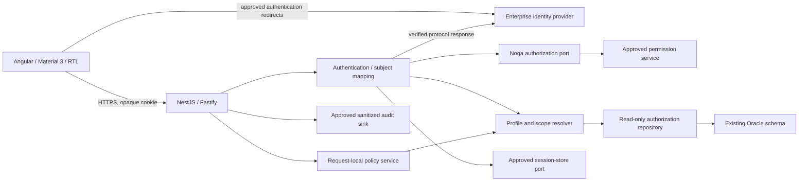

# SHF User Login and Roles: Detailed Design

| Item | Value |
| --- | --- |
| Task | `SHF-IDENTITY-DESIGN-20261013` |
| Version / date | `0.1` / 2026-10-13 |
| Status | **review**: design delivered for review; not an approved implementation or release baseline |
| Contract owner | `system_architect`, with identity/security (SEC), business owner (PO), DBA and operations review |
| Scope | Human login, session lifecycle, application profiles, activities, organizational scope and frontend capability presentation |
| Implementation status | No login, role administration, identity integration or live verification implemented by this task |

## 1. Recommendation and Authority

Use enterprise authentication with a backend-managed session. Resolve SHF
application authorization separately through an approved Noga/Nemo adapter and
the existing Oracle security tables. Enforce an explicit policy for each
operation and resource; do not infer permissions from a job title, a frontend
menu, a submitted user ID or an administrator-looking profile code.

The recommended authentication protocol is OIDC Authorization Code with PKCE.
**OIDC availability, provider selection, protocol adoption, session storage and
all new endpoint contracts require explicit approval.** An authenticated
enterprise gateway is an alternative only after its identity trust boundary is
documented. A Noga permission lookup alone does not authenticate the caller.

This document supplements, rather than replaces, the
[overall technical design](SHF_REVERSE_ENGINEERED_TECHNICAL_DESIGN.md) and uses the
[source contract catalog](SHF_SOURCE_CONTRACT_CATALOG.md) to locate legacy flows.
The existing personal-shifts identity/capability baseline remains unchanged.

### 1.1 Boundaries

- Retain Node.js/TypeScript, modern Angular, Angular Material/CDK and Material 3.
  Reuse the existing NestJS/Fastify foundation; do not scaffold another backend.
- Retain the existing Oracle schema. This design introduces no tables, indexes,
  sequences, DDL, migrations or automatic profile/employee provisioning.
- Legacy source is read-only evidence. Do not build or execute it.
- Do not contact identity services or Oracle without separately approved
  environments, permissions and data scope.
- EMS remains abstract and unavailable. Login has no EMS dependency and must
  neither publish messages nor simulate partner completion.
- Batch processes, role-administration CRUD, password storage/reset and
  impersonation are excluded. Their absence is not permission to bypass policy.
- A mobile browser uses the same authentication and authorization controls as a
  desktop browser. Device classification cannot grant additional rights.
- No token, national identity, password, raw SSO response or personal business
  record belongs in examples, browser storage, application logs or screenshots.

### 1.2 Evidence Classes and Limits

| Class | Meaning in this document |
| --- | --- |
| Source-observed | Readable implementation expresses the behavior; not proof it runs in production |
| Documented | Existing design/catalog describes a contract; approval must be established separately |
| Configured | Dependency manifests declare versions; not a support certification |
| Proposed | Recommendation or new target behavior requiring review |
| Unknown / blocked | Required evidence or approval is unavailable |
| Runtime-verified | None for authentication, Noga, Oracle authorization or legacy login in this task |

The legacy deployment descriptor could not be read because of organization
content-exclusion policy. No alternative access was attempted. Container
security, filter enforcement and the upstream identity assertion cannot be
established by this investigation. Noga service deployment, full WSDL, response
array semantics, provider credentials, physical Oracle metadata and active
profile grants also remain unverified.

## 2. Legacy Login: Controlling Path

### 2.1 Flow and Contract Map

| Step | Source-backed behavior | Migration obligation |
| --- | --- | --- |
| Entry | Catalog maps `/login` to `LoginAction` and `/mPlatform` to `MobileLoginAction`, both using `loginForm`. | Replace navigation with an approved identity flow, not a form that accepts an arbitrary actor. |
| Mobile entry | `MobileLoginAction.perform` sets session `isMobile` and `mobileLogin` when session is new or platform flag is absent, then forwards to login. | Device classification is UX/audit context, not authorization. |
| Identity handoff | `LoginAction.perform` reads `domain_user`; when absent/empty it forwards to the obtain-user JSP. | Authenticate a subject before looking up its application permissions. |
| Obtain-user page | The JSP derives an environment prefix, posts all incoming parameter names/values as hidden fields to an external HTTP identity-handoff page and auto-submits. | Do not reproduce arbitrary parameter forwarding or an unverified plain-HTTP handoff. |
| Application identity | `getNogaSemel` keeps `SHF` for a production prefix; otherwise replaces its third character with the environment's uppercase first character. | Approve explicit per-environment application-code mappings; do not derive deployment security from a hostname or browser value. |
| Permission lookup | The action calls Noga with `domain_user`, application code and `request.getRemoteAddr()`. | Define trusted subject mapping and approved proxy/client-IP handling. |
| Response | The action copies first/last name and `generalAuthorization[0].toUpperCase()`; specific-authorization assignment is commented out. | Validate the response and resolve multiple profiles deliberately; do not silently take the first entry. |
| Profile construction | `Login.load` uses **`LoginForm.user`**, not `domain_user`, as profile identity and employee lookup key. | Verify the relationship between domain account, SSO subject and employee identity. Never trust both independently. |
| Oracle enrichment | Replacement eligibility, activity keys, fixed unit or employee unit, then expanded unit scope are loaded. | Preserve approved rules through a server-owned policy snapshot. |
| Session | Only after `load` returns, profile is stored as session `userProfile`; inactivity interval is set to `5400` seconds. | Preserve the 90-minute idle baseline unless explicitly changed; rotate session identity after login. |
| Mobile audit | For both mobile flags set to `"true"`, action removes `mobileLogin`, resolves the `"APP LOGIN"` reference and invokes mobile audit insertion. | Treat this as a real write dependency requiring separate authorization; do not conceal audit failure. |
| Protected action | `BaseAction.perform` requires session profile, checks configured activity if present and copies server profile fields into the form. | Request-local actor and deny-by-default endpoint policies must replace mutable shared action state. |
| UI visibility | `SecurityTag.doStartTag` includes its body if the activity appears in the session vector. | Capability visibility is advisory only; direct HTTP access must still be authorized. |

Primary sources:
[LoginAction](../old/SHF/src/bzq/shf/actions/LoginAction.java),
[obtain-user JSP](../old/SHFWeb/WebContent/jsp/shf_obtainUserId.jsp),
[LoginForm](../old/SHF/src/bzq/shf/forms/LoginForm.java),
[Login model](../old/SHF/src/bzq/shf/model/Login.java),
[MobileLoginAction](../old/SHF/src/bzq/shf/actions/MobileLoginAction.java),
[BaseAction](../old/SHF/src/bzq/shf/actions/BaseAction.java),
[SecurityTag](../old/SHF/src/bzq/shf/taglib/SecurityTag.java).

### 2.2 Authentication Is Not Established by the Local Login Form

[login.jsp](../old/SHFWeb/WebContent/jsp/login.jsp) submits a `user` field but no
password field. `LoginForm` declares a `password` property, but neither the
traced action nor the login model checks it. The action requires `domain_user`
and consults authorization; the employee lookup uses the different `user`
property. This is **not evidence of a working local password-authentication
mechanism**, nor proof that upstream authentication is absent.

[SSOWebProxyNoga.getAuthorizationBean](../old/SHF/src/bzq/shf/profile/SSOWebProxyNoga.java)
obtains a SOAP port and calls `getAuthorizationBean(id, semel, clientIp)`.
It accepts a response marked successful and otherwise throws a service error.
The readable proxy recognizes environment prefixes but assigns a single
hard-coded HTTP Nemo service endpoint. Effective TLS, network isolation and
runtime overrides are unknown; the target must use owner-approved configuration.

### 2.3 Profile Construction Order and Failure Behavior

Source-observed order in `Login.load`:

1. Read general authorization, first/last name and `user`.
2. Populate `UserProfile.allowedMode`, names and `id`.
3. Query employee replacement eligibility.
4. Try loading activities and the profile's `fixed_unit`.
5. If no fixed unit was returned, query employee unit and employee ID.
6. Expand organizational units, or reject if no nonblank unit is obtained.

Important compatibility details:

- Empty-string validation uses Java reference comparison in several places;
  target validation must use actual string/null checks, not reproduce this defect.
- The fixed-unit query catches database exceptions and treats them as no fixed
  unit. `load` also suppresses a `ShfException` from `setAuthorization` and can
  continue to employee fallback. Target dependency failure must not become
  successful reduced/default authorization.
- A successful fixed-unit branch does **not** execute the employee-ID lookup.
  The profile's primitive employee ID can remain `0`. The target must resolve
  employment independently and represent a missing link as `null`, not employee
  zero or an invented employee.
- Queries select a first employee row without proving identity uniqueness.
  Ambiguous mappings must be explicit errors, not arbitrary selection.
- There is no refresh or session-ID rotation in the traced login path. This does
  not prove none exists in inaccessible upstream/container configuration.
- The action catches `BaseException`, saves errors and returns its result
  variable; no failure forward is assigned in that catch. The catalog's
  `loginFail` forward is not proof that this branch uses it.
- No logout implementation was found in the inspected action/JSP searches.
  Container or upstream logout remains unknown.

### 2.4 Hidden Write: Mobile Audit

[PlatformModel.insertMobileAudit](../old/SHF/src/bzq/shf/model/PlatformModel.java)
inserts identity, action and timestamp into `SHF_MOBILE_AUDIT`.
`LoginAction` resolves the action through the cached mobile reference table.
Insert failures can be logged and swallowed in the legacy model; login may
continue. Commit ownership of the proprietary database wrapper is unverified.

The new login's authorization reads must not invoke this write implicitly.
SEC/PO must decide whether the mobile audit is mandatory, whether a approved
operational audit sink is sufficient, and whether an existing-table insert is
authorized. Until decided, legacy mobile-audit parity is **deferred**, not claimed.

## 3. Roles, Activities and Scope

### 3.1 Roles Are Profile Codes, Not a Hard-Coded Permission Ladder

[AuthorizationConstants](../old/SHF/src/bzq/shf/profile/AuthorizationConstants.java)
declares the following symbols and values:

| Code | Legacy symbol | Target treatment |
| --- | --- | --- |
| `A` | `AGNT` | Profile code; grants must come from approved Oracle mappings |
| `C` | `ACH` | Same |
| `T` | `TMNG` | Same |
| `S` | `SMNG` | Same |
| `M` | `MNG` | Same |
| `H` | `HR` | Same |
| `R` | `SCR` | Same |
| `L` | `ANLS` | Same |
| `K` | `KNLG` | Same |
| `W` | `WFM` | Same |
| `N` | `ADMIN` | No implicit all-access or policy bypass |

These are source symbols, not verified business display titles or a complete
inventory of active database profiles. Hebrew labels and descriptions require
PO approval. Do not conclude that a manager profile inherits an employee profile,
that `N` sees every unit, or that a profile has any particular write permission.

`Login.setAuthorization` resolves:

```text
generalAuthorization -> SHF_USER_PROFILE.USER_PROFILE_CODE
                    -> SHF_SECURITY_PROFILE.ACTIVITY_ID
                    -> SHF_SECURITY_ACTIVITIES.ACTIVITY_KEY
```

The join also includes `SHF_USER_PROFILE.USER_PROFILE_CODE` and filters by the
selected profile. A separate lookup retrieves `FIXED_UNIT`. The source does not
show a user-role assignment table: external authorization supplies the profile.

### 3.2 Proposed Profile Resolution Rules

1. Validate permission-service success, required fields, size bounds and profile
   code representation using the approved service contract.
2. Resolve profile codes only against approved configured/database definitions.
   Source constants alone are not an authoritative allowlist.
3. For the initial target, require exactly one effective profile after duplicate
   removal. Empty or distinct multiple profiles do not create a session with
   business grants. Multiple-profile semantics are a SEC/PO decision.
4. Validate activity keys against the approved operation-policy registry.
   Duplicate keys may be deduplicated; null/invalid join results and broken
   references produce an explicit configuration error.
5. Recognized legacy keys not yet implemented confer no executable capability.
   Unknown keys must be reported to policy owners rather than becoming wildcards.
6. A valid profile with an intentionally empty activity set may create an
   authenticated, no-business-capabilities session only if SEC/PO approve that
   state. A missing profile is not equivalent to an empty grant set.
7. No browser-supplied profile, activity, unit, replacement flag or actor is
   accepted as authority. No user-selectable privilege elevation is introduced.

The single-profile requirement intentionally replaces the legacy first-array
entry selection. It remains proposed; characterize real response shapes with
approved synthetic/anonymized examples before activation.

### 3.3 Exact Source-Observed Organizational Expansion

Unit type constants in
[SHFConstants](../old/SHF/src/bzq/shf/utils/SHFConstants.java):
division `A01`, department `E01`, contact center `G01`, team `J01`.
The hierarchy is loaded into `unitCode` through
[LoadTables.loadOrgUnit](../old/SHF/src/bzq/shf/model/LoadTables.java) and
[ComplexCodeTable.getUnitRows](../old/SHF/src/bzq/shf/utils/ComplexCodeTable.java).
[SHFTableUtils.getUnitByCode](../old/SHF/src/bzq/shf/utils/SHFTableUtils.java)
uses exact string equality and returns null for an unknown code.

| Selected unit | Expansion in `Login.setAllowedUnits` | Context fields |
| --- | --- | --- |
| Special code `00020000` | Every cached unit with both non-null type and parent; no subtree restriction | No explicit center/department assignment in this branch |
| Division `A01` | Selected unit plus descendants reached by three nested parent/child levels | No explicit center/department assignment |
| Department `E01` | Children and grandchildren, selected department and its direct parent | `allowedAgaf` is selected department |
| Contact center `G01` | Direct children, selected center, its parent and grandparent | `allowedMoked` is selected center; `allowedAgaf` is its parent |
| Team `J01` | Recursively calls the same method with the team's parent | Usually becomes center-level scope, not team-only |
| Other type | No matching branch adds units; resulting vector can be empty | No inferred additional rights |

Important: the broad special-code branch checks only non-null fields. Cached
selection placeholders also have non-null type/parent values in `loadOrgUnit`;
their participation must be characterized. They are not automatically legitimate
business units. The expansion is not a generic recursive descendant closure.
Department/center branches include ancestors that can be used for navigation;
their presence must not automatically authorize every descendant of an ancestor.

### 3.4 Target Scope Resolver

Separate three facts:

- **Employment link:** the authenticated actor's unique employee or `null`.
- **Authorization anchor:** valid profile fixed unit; otherwise unique employee
  unit. A fixed-unit query error is not permission to fall back.
- **Resolved business-unit set and navigation context:** explicit units produced
  by the approved legacy-compatibility rule, plus context labels separately.

Use exact string unit codes, preserve leading zeros and apply trimming only
where the approved mapping contract permits it. Do not coerce unit IDs to
numbers or match by prefixes. Resolve hierarchy from a bounded, coherent
read-only snapshot; detect missing parents, unexpected types, cycles and
configured size/depth limits. Fail explicitly rather than returning all units,
an empty success-shaped result, or a partially computed permission set.

Initial compatibility recommendation: characterize and retain valid finite
legacy expansions, including team-to-parent behavior and special-unit semantics.
Do not implement unlimited recursion or team-only restriction without approval.
Deduplication is safe for membership checks; excluding placeholders, changing
ancestor semantics or restricting the broad special unit is a documented
behavior decision for SEC/PO. Invalid configurations must not grant rights.

### 3.5 Replacement Eligibility Is a Separate Business Fact

`Login.setAllowedToReplace` reads `SHF_EMPLOYEES.REPLACE_ALLOWED`.
In the
[shift submenu](../old/SHFWeb/WebContent/jsp/submenu/shift_submenu.jsp), replacement
UI is gated by `(replaceAllowed == "1" OR activity shift_current)` and the
`replace_main` activity; the break-replacement item also requires `break_replace`
and is hidden on mobile. These are **presentation-observed rules**, not proof
that every replacement action enforces the same condition.

Keep `replacementEligibility` distinct from role grants. A future replacement
use case must resolve authoritative eligibility and both affected employees/
shifts, then evaluate its approved policy server-side. Null/unknown eligibility
must not mean allowed. No replacement writes are enabled by this login design.

## 4. Target Components and Trust Boundaries

### 4.1 Components and Owners

| Component | Responsibility | Owner |
| --- | --- | --- |
| Authentication controller/adapter | Login protocol, callback validation, logout; no business-role inference | Backend with SEC |
| Subject mapping service | Trusted issuer/subject -> enterprise account -> approved employee identity mapping | SEC / identity owner |
| Noga authorization port | Typed request/result and faults; environment/application mapping; bounded remote lookup | Backend / identity partner |
| Oracle authorization repository | Bound read-only profile/activity/employee/hierarchy reads | Backend with DBA |
| Profile/scope resolver | Pure, deterministic normalization and characterized unit expansion | Backend / `system_architect` |
| Session service/store port | Opaque session lifecycle, expiry, CSRF secret and revocation | Backend / operations / SEC |
| Policy service | Operation grant AND resource scope AND business eligibility; deny by default | Backend / `system_architect` |
| Capability projector | Minimized UI read/preview/write states; never a permission authority | Backend / UI contract owner |
| Angular identity state/interceptor | Session bootstrap, route UX, expiry and focus handling | Frontend |
| Audit port | Sanitized security events to an approved sink; no implicit Oracle writes | Backend / SEC / operations |

Proposed interfaces belong to these components; they are not new application
files or an approved shared-contract change. `system_architect` owns the eventual
types and API schemas before consumers implement against them.



### 4.2 Authentication Protocol Decision

| Option | Recommendation / constraints |
| --- | --- |
| OIDC Authorization Code + PKCE, backend session | Preferred; verified issuer, discovery metadata, JWKS, audience, signature algorithm allowlist, nonce/state, redirect URI, expiry and subject required. Tokens remain backend-side. |
| Trusted enterprise gateway | Conditional alternative; backend reachable only through the approved gateway, authenticated gateway channel, spoofable identity headers stripped/replaced, assertion integrity/audience/expiry and replay controls verified. |
| Existing HTTP hidden-field handoff | Not an approved target trust mechanism. Requires identity-owner protocol evidence before any compatibility adapter is designed. |
| SHF-local username/password database | Not recommended and outside scope; no existing password-validation contract was observed. |

Never accept arbitrary token URLs, issuers, redirect destinations or forwarded
identity/IP headers from requests. OIDC client secrets, if required, are
operations-managed secrets; PKCE remains required. Provider token verification
must use a maintained, compatible library selected at implementation review,
not hand-written cryptography.

### 4.3 Login Sequence

```mermaid
sequenceDiagram
    participant B as Browser
    participant A as SHF authentication service
    participant I as Enterprise IdP
    participant N as Noga authorization port
    participant O as Oracle authorization repository
    participant S as Approved session store
    B->>A: GET /auth/login with allowlisted return target
    A->>A: Create bounded login transaction, state, nonce, PKCE
    A-->>B: Redirect to approved IdP; transaction cookie
    B->>I: Authenticate using enterprise policy
    I-->>B: Redirect with code and state
    B->>A: GET /auth/callback
    A->>A: Validate browser binding; atomically consume transaction
    A->>I: Exchange code with PKCE; validate identity response
    I-->>A: Verified issuer/subject
    A->>A: Resolve trusted enterprise/employee mapping key
    A->>N: Lookup permissions with approved application context
    N-->>A: Validated profile and display attributes
    A->>O: Read profile, activities, employee link and unit hierarchy
    O-->>A: Consistent bounded facts, or explicit error
    A->>A: Resolve scope; validate complete authorization snapshot
    A->>S: Persist new opaque session; invalidate old session
    S-->>A: Acknowledged, or explicit failure
    A-->>B: Set secure session cookie; redirect without code/tokens
    B->>A: GET /api/v1/me and /api/v1/me/capabilities
    A-->>B: Minimized identity and server-evaluated capability states
```

Only session/login-transaction state and the approved audit sink change here.
The Oracle authorization phase is read-only. No transaction is held while
waiting for IdP/Noga HTTP calls. Do not issue a business-authorized cookie if
mapping, policy resolution or session persistence fails.

Consume the login transaction once before token exchange, after validating its
binding. An exchange failure requires a fresh login; it must not make the old
callback replayable. Limit active transactions per browser; a successful account
switch invalidates previous login transactions and rotates the session.

## 5. Identity, Session and Freshness

### 5.1 Internal Data Model

| Fact | Representation and authority |
| --- | --- |
| `subject` | Pair of trusted issuer and opaque subject; never inferred from a submitted name |
| `actorId` | Opaque application identity with stable owner-approved derivation/mapping; not a national ID |
| Enterprise account | Server-only, identity-owner mapping result; purpose-limited use for Noga |
| Employee identity lookup key | Server-only approved mapping; distinct from account and internal employee ID |
| `employeeId` | Exact internal Oracle identifier serialized as string, or null |
| `profileCode` | Server-resolved SHF profile; no assumed inheritance |
| `activityKeys` | Immutable set from validated Oracle mappings |
| `scope` | Anchor provenance, explicit allowed business units and separate navigation context |
| Replacement eligibility | Explicit allowed/denied/unknown fact with approved source semantics |
| `resolvedAt` / `validUntil` | Server UTC instants controlling authorization freshness |
| `policyVersion` | Approved policy/configuration revision; not a fictitious Oracle version column |
| Session record | Session-secret verifier, subject/actor reference, CSRF secret, issued/last-active/absolute-expiry times and authorization snapshot |

Do not assume full employee identity equals an eight-character day-owner prefix.
The personal-shifts baseline already requires proof of that mapping and
uniqueness. A fixed-unit user may be authorized for manager operations without an
employee link; personal-shifts reads remain disabled until a unique link exists.

### 5.2 Proposed Session Policy

| Setting | Proposed value / rule | Evidence / approval |
| --- | --- | --- |
| Cookie | `__Host-shf-session`; Secure, HttpOnly, Path `/`, no Domain, SameSite=Lax | Proposed production same-origin deployment |
| Session secret | At least 256 bits from platform cryptographic RNG; opaque, not JWT or personal data | Proposed |
| Idle lifetime | 5,400 seconds | Source-observed legacy baseline; preserve pending SEC review |
| Absolute lifetime | 8 hours from authentication, not extended by polling | Proposed; SEC/PO approval required |
| Login transaction lifetime | 5 minutes, one use, browser-bound, bounded count | Proposed |
| Authorization freshness | Maximum 60 seconds; expired snapshots must refresh before protected execution | Proposed; validate service capacity and revocation requirement |
| Clock | Server UTC, injected test clock; explicit provider skew allowance | Proposed; SEC approves skew |
| Store | Approved shared/revocable store for multi-instance operation | **Unselected / blocked**; no new Oracle objects or infrastructure authorized |

The production cookie design requires HTTPS. Existing localhost HTTP development
does not prove it works: use approved local HTTPS or a clearly isolated,
nonproduction development-cookie configuration. Never silently weaken cookie
attributes when production configuration is invalid.

Rotate the session on authentication/account switch and privilege changes that
require reauthentication; revoke its old secret. The previous session cannot
adopt the new actor. Keep session and authorization state server-side; do not
store tokens or trusted grants in localStorage/sessionStorage.

### 5.3 Expiration, Refresh and Revocation

- Check idle and absolute expiration on every protected request. At the exact
  boundary the session is expired (`now >= expiresAt`).
- Define activity narrowly: successful authenticated, user-driven application
  requests may extend idle expiry. Background heartbeat/capability polling,
  failed/denied requests and health checks do not keep a session alive.
- Evaluate operation policy on every request. A fresh validated snapshot may be
  used for the approved 60-second interval; this is bounded staleness, not
  instantaneous revocation.
- At expiry, perform a bounded refresh of application permissions, employee
  mapping and unit hierarchy. Publish the new snapshot atomically; never merge
  newly resolved units with old grants. Coalesce same-session refreshes.
- During a dependency outage an already-fresh snapshot is usable only under an
  explicitly approved bounded-cache policy. After its deadline, return 503 and
  execute no protected work. Never extend freshness on lookup failure.
- Confirmed removal of application access revokes the session and yields 403
  for that evaluated request; later requests with the revoked secret yield 401.
  Removed individual grants replace the snapshot and yield 403 where needed.
  Dependency/configuration errors yield 503, not an invented role removal.
- Local logout revokes the session store record, clears its cookie and makes all
  tabs fail subsequent protected requests. Provider-global logout is separate;
  enable only with an approved IdP contract and allowlisted return destination.
- Immediate enterprise revocation requires an approved notification/introspection
  mechanism and store invalidation. None is implemented or assumed available.

With the proposed cache, a change just after resolution can remain effective for
up to 60 seconds plus a request already authorized. This is a stated risk requiring
SEC agreement. Sensitive future writes may require fresh authorization and
step-up authentication; a login session alone does not approve those writes.

## 6. Authorization Evaluation

### 6.1 Algorithm and Enforcement Placement

```text
1. Validate opaque session and expiry; obtain immutable request-local actor.
2. Resolve a fresh complete authorization snapshot or return explicit failure.
3. Locate the operation's approved policy; absent registration means deny.
4. Check required activity grant(s), without role-name shortcuts.
5. Obtain resource ownership/unit facts through a scoped repository read.
6. Check self ownership OR the operation's explicit manager-unit policy.
7. Check operation-specific eligibility and implementation/integration availability.
8. Execute the bounded use case; minimize/serialize only authorized fields.
```

Self and manager paths are separately registered policies, not a general OR
that grants manager access to all resources. Resource facts come from Oracle,
not caller-submitted unit values. Unit-filter choices are intersected with
authority or rejected; never replace the authority predicate.

Controllers validate transport shape. Authentication guards establish the actor.
Application services enforce policy for the actual operation/resource, including
calls that do not originate in HTTP. Repositories bind exact identifiers and
apply ownership/unit predicates before returning sensitive records. Recheck
affected resources and transaction-time invariants for future writes to prevent
scope/ownership races; this document does not approve write endpoints.

No mutable singleton actor/profile fields. No `activity=aa` wildcard. An operation
without an activity policy is not public by accident. Public health/login routes
must be explicitly classified and return no personal/business data.

### 6.2 Representative Policy Map

| Target operation | Legacy evidence | Required target policy / state |
| --- | --- | --- |
| `GET /api/v1/me` | Session `UserProfile` | Authenticated, unexpired session; minimized identity; no employee link required |
| `GET /api/v1/me/capabilities` | Activity-based menus/tags | Authenticated session; valid snapshot; project availability, not full permission inventory |
| `GET /api/v1/me/shifts` | Catalog `shift_myshifts`; personal-shifts source trace | `shift_myshifts`, unique employee mapping and effective self ownership; existing bounded query contract |
| `GET /api/v1/shifts/{id}` in initial self-service slice | Same personal-shifts baseline | Same grant and current effective ownership; denied/missing resource returns indistinguishable 404 |
| Future employee search | Catalog `card_search`; `EmployeeDataAction.list_param` | Explicit search grant AND resource/unit scope; no endpoint activated here |
| Future own employee card | `card_view` branch calls `getMyId` | Own employee link and view grant; no arbitrary employee override |
| Future manager employee card | Catalog `card_view`; model population | View grant AND resource organizational scope, not view grant alone |
| Future replacement | Submenu combines activities and eligibility | Approved server-side eligibility, grants and scope for all affected resources; deferred |
| Future role administration | No approved modern contract | Deny / not implemented; external/DB-owner workflow only |

Evidence:
[EmployeeDataAction](../old/SHF/src/bzq/shf/actions/EmployeeDataAction.java),
[EmployeeDataModel.getMyId](../old/SHF/src/bzq/shf/model/EmployeeDataModel.java),
and the overall design's
[personal-shifts baseline](SHF_REVERSE_ENGINEERED_TECHNICAL_DESIGN.md#361-r01-personal-shifts-baseline-r01-ps-10).

The employee-list model applies allowed units in one filter branch but also
contains caller-selected unit/team branches. This is not a universal
resource-authorization proof. The target must always retain the authoritative
scope predicate independently of filters.

### 6.3 Capability Projection

Keep the existing capability shape: `personalShifts.read/preview/write` objects
with `enabled` and `reason`, plus `integrationAvailable: false`. Do not add raw
profile codes, national IDs, unit trees or activity arrays to that contract.
Role display may be added later only through a separately approved minimized
contract; it is not necessary for capability-driven navigation.

Proposed reason precedence: `NOT_IMPLEMENTED` / `NOT_APPROVED` for unavailable
features, `FORBIDDEN` for absent grants, `EMPLOYEE_LINK_REQUIRED` for missing
self-service linkage, then `AVAILABLE`. A dependency error fails the capability
request with 503 rather than returning a misleading all-disabled success.
Existing isolated demo reasons remain demo-only.

## 7. Proposed HTTP Contracts

### 7.1 Endpoint Inventory

All new `/auth` paths below are **proposed**. Existing `/api/v1` identity and
capability paths retain the overall design baseline. Angular document routes
are not business API endpoints.

| Method | Path | Request / authorization | Success / failure |
| --- | --- | --- | --- |
| `GET` | `/auth/login` | Optional allowlisted `returnTo` application path; no actor/profile input; bounded public login initiation | 302 to approved IdP; 400 invalid return target; 429 rate limit; 503 unavailable configuration/dependency |
| `GET` | `/auth/callback` | IdP code/state or provider error, exact approved callback URI, valid browser-bound transaction | 303 to safe application route after cookie creation; invalid/replayed transaction 400; denied application access 403; upstream failure 503 |
| `GET` | `/auth/session` | Valid session; no business-data mutation | 200 `{ idleExpiresAt, absoluteExpiresAt, csrfToken }`; 401 expired/missing session; 503 store unavailable |
| `POST` | `/auth/logout` | Valid session, allowed Origin and CSRF token; empty body | 204 only after revocation; 401 already expired; 403 invalid CSRF/origin; 503 revocation unavailable |
| `GET` | `/api/v1/me` | Valid session; no actor override | 200 existing minimized identity; 401 invalid session; 503 session/required mapping service failure |
| `GET` | `/api/v1/me/capabilities` | Valid session and authorization snapshot | 200 existing capability shape; 401 invalid session; 503 resolution unavailable |

Reject unknown parameters, duplicate scalar fields and oversized values. Exact
IdP callback parameter lengths must follow its approved contract and fit the
existing HTTP limits; do not use unlimited query parsing. Login initiation is a
protocol operation that creates transient authentication state, not a business
GET mutation. `/auth/session` and ordinary business GETs do not write Oracle.

`returnTo` must match an approved application route and permitted query shape.
Reject absolute/scheme-relative URLs, encoded bypasses, backslashes, credentials,
and nested redirect values. Prefer a server-side return-target identifier in the
login transaction. Never echo provider codes or tokens in the final URL.

For callback failures, a backend error response or approved same-origin error
view presents only a stable code and correlation ID. Do not reflect arbitrary
provider error text. Callback redirects must not be followed automatically by a
background Angular API request; login is top-level navigation.

### 7.2 Examples: Synthetic Shapes Only

Identity success preserves the approved field set:

```json
{
  "actorId": "synthetic-actor-example",
  "employeeId": "00000001",
  "displayName": "Synthetic example",
  "businessTimeZone": "Asia/Jerusalem"
}
```

The time zone is subject to the existing owner approval, not established by
authentication. If employment is not linked, `employeeId` is null; do not grant
personal-shifts reads based on the display name or role.

```json
{
  "personalShifts": {
    "read": { "enabled": false, "reason": "EMPLOYEE_LINK_REQUIRED" },
    "preview": { "enabled": false, "reason": "NOT_APPROVED" },
    "write": { "enabled": false, "reason": "NOT_APPROVED" }
  },
  "integrationAvailable": false
}
```

Session times are RFC 3339 UTC strings. CSRF material is an opaque secret returned
only to same-origin authenticated callers; examples do not contain usable values.

### 7.3 Errors, Cookies and CSRF

Use `application/problem+json` following RFC 9457 with `type`, `title`, `status`,
stable `code` and safe `correlationId`. Use a controlled problem-type registry at
implementation; do not invent an externally hosted SHF documentation URL.
Do not include Oracle SQL, raw SOAP responses, employee identity or tokens.

| Status / code | Meaning / UI action |
| --- | --- |
| 400 `INVALID_LOGIN_TRANSACTION` | Malformed, expired, mismatched or replayed login; offer fresh login |
| 400 `INVALID_RETURN_TARGET` | Unapproved redirect; do not redirect to supplied value |
| 401 `AUTHENTICATION_REQUIRED` | Missing/expired/revoked session; clear local identity and offer login |
| 403 `APPLICATION_ACCESS_DENIED` | Confirmed lack of SHF access; explain denial without granting fallback |
| 403 `FORBIDDEN` | Authenticated but missing operation grant/scope |
| 403 `CSRF_VALIDATION_FAILED` | Reject without state change; no automatic retry |
| 404 `SHIFT_NOT_FOUND` | Missing or inaccessible self-service resource; no existence disclosure |
| 429 `LOGIN_RATE_LIMITED` | Bounded cooldown; `Retry-After` |
| 503 `IDENTITY_DEPENDENCY_UNAVAILABLE` | Provider/Noga timeout or validated dependency failure |
| 503 `AUTHORIZATION_UNAVAILABLE` | Oracle authorization resolution/configuration unavailable |
| 503 `SESSION_UNAVAILABLE` | Cannot read/persist/revoke required session state |

If no valid employee link exists, follow the existing personal-shifts baseline's
`EMPLOYEE_LINK_REQUIRED` 403 behavior. Ambiguous mappings are logged as an
explicit data/configuration failure and must not enable the capability.

All identity/session/capability/error responses and callback responses use
`Cache-Control: no-store`; callback/error views use `Referrer-Policy: no-referrer`.
Suppress authorization headers, cookies, callback query strings and response
bodies containing secrets in reverse-proxy/access logs.

SameSite is defense in depth, not complete CSRF protection. State-changing
cookie-authenticated routes require an allowed exact Origin and a
session-bound unpredictable CSRF token in `X-CSRF-Token`. The Angular interceptor
attaches it only to same-origin unsafe requests. Do not rely on Angular's default
XSRF cookie names without explicitly aligning the backend contract.
Login callbacks use protocol state/nonce/browser binding, not an API CSRF header.
Cross-origin deployment requires a separately reviewed CORS/cookie design; no
wildcard credentialed CORS is approved.

Logout must not report 204 if store revocation failed. The UI may clear its own
state and show the failure, but must not claim the server session ended. If the
session has already expired, a 401 is treated as signed out locally.

## 8. Oracle and Integration Boundaries

### 8.1 Source-Derived Object Mapping

| Object | Observed fields used here | Target responsibility |
| --- | --- | --- |
| `SHIFTER.SHF_USER_PROFILE` | `USER_PROFILE_CODE`, `FIXED_UNIT` | Resolve profile existence and optional authorization anchor |
| `SHIFTER.SHF_SECURITY_PROFILE` | `USER_PROFILE_CODE`, `ACTIVITY_ID` | Resolve profile/activity assignments |
| `SHIFTER.SHF_SECURITY_ACTIVITIES` | `ACTIVITY_ID`, `ACTIVITY_KEY` | Resolve explicit operation keys |
| `SHIFTER.SHF_EMPLOYEES` | `EMP_ID_NUMBER`, `EMPLOYEE_ID`, `ORG_UNIT_ID`, `REPLACE_ALLOWED` | Trusted employment link, fallback unit and business eligibility |
| `SHIFTER.SHF_ORG_UNIT` | `ORG_UNIT_ID`, `ORG_UNIT_NAME`, `UNIT_TYPE_ID`, `PARENT_UNIT` | Validate/expand unit hierarchy |
| `SHIFTER.SHF_MOBILE_AUDIT_REF` | `ACTION_ID`, `ACTION_NAME` | Deferred legacy mobile-audit mapping |
| `SHIFTER.SHF_MOBILE_AUDIT` | `EMP_ID_NUMBER`, `ACTION_ID`, `ACTION_DATE` | Deferred existing-table write, only if separately authorized |

This is a logical source mapping, not physical metadata. Column types,
constraints, uniqueness, indexes, synonyms, grants, triggers and deployed
contents must be established through separately authorized metadata discovery.
No session, credential, profile-assignment or audit table is proposed.

### 8.2 Repository Contract and Consistency

- Use bind parameters for profile/identity/unit lookups. Bound collection binds
  or generated bind placeholders are required for unit sets; never interpolate
  browser filters or identity values into SQL.
- Distinguish no matching row, multiple matching rows, blank/malformed data and
  query failure. Oracle empty string/null semantics are handled deliberately.
- Resolve the employee link even when a fixed-unit profile exists. A unique
  employment link and authorized fixed unit are independent facts.
- Profile missing, fixed unit null and fixed-unit lookup failed are different
  results. Only an approved genuinely absent fixed unit permits employee fallback.
- Read the relevant authorization facts under an approved bounded consistent
  read strategy. Ordinary multiple SELECTs are not automatically one snapshot.
  DBA must approve the transaction/snapshot mechanism and pooled-connection
  reset behavior before implementation claims coherent refreshes.
- No database locks during remote identity/permission lookups; close/release
  connections on success and failure. Do not invoke business PL/SQL or allocate
  sequences. Audit writes, if approved later, are a separate explicit boundary.
- Keep identifiers exact strings at API boundaries; NUMBER precision and driver
  conversion must be reviewed against physical types. Do not infer eight-digit
  identity formatting from fixture data.

### 8.3 Noga Port: Proposed Semantic Contract

Input: trusted enterprise account identifier, approved application code,
approved client network context and request correlation ID.
Output: validated permission outcome, profile code(s), optional display
attributes and service decision metadata permitted by its contract.

Normalize fault categories into denied, transient unavailable, invalid contract
and configuration failure. Do not convert all faults into access denied or an
empty grant list. Validate response success and expected type; treat null or
malformed arrays explicitly. Do not expose raw partner messages to the browser.

Proposed lookup deadline: 3 seconds, within a 5-second authorization-resolution
budget. Do not perform automatic in-request retry initially; no retry storm or
fallback environment. Endpoint/TLS/client credentials, application mappings,
timeouts and response-size limits require partner/operations approval.
No Node SOAP package is selected by this design.

## 9. Angular Login and Roles UX

### 9.1 State Machine

| State | Rendering / permitted behavior |
| --- | --- |
| `checkingSession` | Hebrew progress text; no prior actor data rendered |
| `anonymous` | Login button; navigate to approved login initiation |
| `redirecting` | Prevent repeated submission; announce redirect; no fake success |
| `authenticatedResolvingCapabilities` | Minimal identity shell; protected routes not yet activated |
| `authenticatedReady` | Capability-based navigation and authorized feature content |
| `authenticatedNoBusinessAccess` | Clear explanation and logout; no fabricated employee context |
| `expired` | Clear private client state, cancel/ignore old requests, offer re-login |
| `accessDenied` | Distinguish application denial from failed identity authentication |
| `dependencyUnavailable` | Recoverable status and explicit retry; never route to a privileged default |
| `loggingOut` / `logoutFailed` | Block duplicate request; do not claim successful server logout on failure |
| `syntheticDemo` | Persistent synthetic/unauthenticated banner; never treated as logged in |

Bootstrap reads `/api/v1/me`, `/auth/session` and capabilities with consistent
error handling; avoid rendering old employee data while a new actor is being
resolved. Route guards improve UX only; server policy remains authoritative.
Refresh identity and capabilities after authentication and privilege changes.
An ordinary 403 does not trigger repeated login loops.

On 401, use one coordinated expiry transition; clear identity, capabilities,
feature caches and CSRF material. Cancel pending requests or ignore results
from an old session generation. Do not automatically replay a write after login.
Cross-tab notification can clear local views promptly; server revocation is the
authority and must work even if that notification is lost.

### 9.2 Hebrew/RTL and Accessibility Acceptance

Use Hebrew visible and assistive text; preserve mixed-direction content with
`bdi` for Latin identifiers and do not display full employee identity.
Suggested wording for review:

| Purpose | Hebrew text |
| --- | --- |
| Login action | כניסה למערכת |
| Checking session | בודקים את מצב ההזדהות |
| Redirect announcement | מעבר להזדהות הארגונית |
| Expired session | תוקף ההזדהות פג. יש להיכנס מחדש. |
| Application denial | אין הרשאה לכניסה לשיפטר. יש לפנות לגורם המורשה בארגון. |
| Dependency error | שירות ההזדהות או ההרשאות אינו זמין כעת. ניתן לנסות שוב. |
| Logout | יציאה מהמערכת |
| Logout failure | לא ניתן לאשר שהיציאה הושלמה. יש לנסות שוב. |

WCAG 2.2 AA acceptance: keyboard-only login/logout/retry; visible unobscured
focus; appropriate heading/status announcements; error text not color-only;
no keyboard trap; adequate target sizes and contrast; RTL reflow at narrow
widths and 200% zoom. Return focus to a meaningful heading after redirect/error,
and to the login action on expiry. A warning dialog before idle expiry must have
managed focus and an actual user action to continue; polling cannot extend it.
Final wording and timing require UI/SEC/PO review; no conformance is claimed.

### 9.3 Present Application Baseline

The inspected
[Angular shell](../apps/web/src/app/app.html) explicitly marks the application
as a local synthetic demo and disables login pending approval.
The
[stub controller](../apps/api/src/stub/stub.module.ts) returns
`mode: "stub"`, `synthetic: true`, `authenticated: false` and demo identity.
[Application creation](../apps/api/src/application.ts) separates stub mode and
Oracle mode and logs that stub authentication is absent.

Do not promote demo actors into sessions, remove synthetic markers to imitate
real login, or wire protected production routes through the stub module.
Authentication must be introduced as a separately approved real mode; demo
contract regression tests must still demonstrate unauthenticated synthetic data.

Declared versions are Node `^24.15.0`, NestJS `12.1.3`, Fastify `5.12.5`,
node-oracledb `26.0.0`, Angular/Material/CDK `22.2.2` and TypeScript `6.0.3`
in the [root manifest](../package.json),
[API manifest](../apps/api/package.json) and
[web manifest](../apps/web/package.json).
These are configured facts, not a new version selection or compatibility
verification. No dependencies are changed or installed by this task.

## 10. Operations, Capacity and Ownership

### 10.1 Security Events and Privacy

Emit structured events for login initiated/succeeded/denied, invalid callback,
session expired/revoked, logout succeeded/failed, authorization refresh failed,
ambiguous employment mapping, invalid hierarchy and forbidden operation.
Record UTC timestamp, safe correlation ID, operation, outcome, approved policy
revision and a purpose-limited pseudonymous actor reference where allowed.

Never log names, national identities, raw domain accounts, cookies, CSRF tokens,
authorization codes, tokens, full SOAP payloads or browser-supplied control text.
Callback routes require access-log query suppression. Retention, access controls,
tamper protection, deletion obligations and whether audit delivery is mandatory
are SEC/operations decisions. If mandatory delivery fails, report failure and
do not claim an audited successful login; no unapproved local-file queue.

### 10.2 Proposed Measurable Targets

| Measure | Initial proposed target / gate |
| --- | --- |
| Warm identity/capability API p95 | <= 300 ms excluding browser/IdP authentication; measured with approved representative load |
| Authorization refresh | <= 5 seconds overall; Noga <= 3 seconds; Oracle work must fit remaining budget |
| Stale authorization | <= 60 seconds plus already-authorized in-flight request, or tighter SEC-approved policy |
| Invalid callback | Reject without session creation or business query after failed transaction validation |
| Login resource bounds | Bounded pending transactions, request fields, response size and dependency concurrency; numeric limits approved before implementation |
| Logout | No success response before store revocation; next protected request with old cookie must fail |
| Scale-out | Shared revocation/expiry semantics proven across at least two instances; no process-local production session assumption |

Rate limits must cover source IP and browser/transaction keys without leaking
account existence. Actual request rate, concurrent sessions, hierarchy sizes,
Noga quotas, store availability/RPO/RTO and peak refresh load are unknown.
Approve numeric sizing after evidence; synchronized expiry must not overload
Noga/Oracle. A new role-management service or worker is not justified here.

Liveness must not depend on Noga availability. Readiness distinguishes startup
configuration/store failures from a transient partner outage. Dependency outage
returns explicit unavailable results for affected operations. Drain requests
on shutdown; session continuity depends on the approved store, not process memory.

## 11. Coexistence and Approval Gates

### 11.1 Role Grant/Change/Removal Process

This design does not authorize an SHF role-administration screen or Oracle
updates. The proposed governance flow is:

1. Authorized business requester specifies subject, business need, profile,
   intended organizational scope and duration.
2. PO/SEC approve least privilege and any required separation of duties.
3. Identity-service owner changes external application assignment using its
   existing approved process. DBA/security owner changes profile/activity/fixed
   unit configuration only through existing authorized mechanisms if necessary.
4. Owners verify the resulting identity/profile/scope using approved test data.
5. New authorization resolution adopts the change; the approved freshness/
   revocation mechanism constrains existing sessions.
6. Audit the approval, execution and validation through the approved audit
   system; removal/reassignment must not leave a stale privileged session.

Source code does not prove an existing workflow, approval system or segregation
policy. Those are proposed governance controls. No self-grant, role picker,
implicit profile creation or default administrator is permitted.

### 11.2 Incremental Migration

1. Review this document with `system_architect`, SEC, PO, DBA and operations.
2. Obtain the approved identity protocol/subject mapping, permission-service
   contract, real profile definitions and hierarchy characterization fixtures.
3. Approve shared API/type baselines and session storage. No unauthorized Oracle
   storage changes.
4. Implement pure profile/scope/policy resolution and isolated adapter doubles.
   Test without live services or legacy execution.
5. Implement approved authentication/session transport and frontend UX with a
   controlled test IdP and synthetic subjects; label isolated results.
6. After explicit environment approval, verify identity/Noga and read-only Oracle
   authorization with least-privilege synthetic/anonymized accounts.
7. Enable the personal-shifts vertical slice only after its existing identity,
   ownership, mapping and query prerequisites are satisfied.
8. Perform controlled cohort cutover with rollback and session revocation tests;
   release requires explicit approval.

Legacy and modern sessions remain separate; do not import a Java session or
trust its cookie as a Node actor. Route authenticated cohorts explicitly rather
than dual-running mutating flows. Rollback disables the new login entry,
revokes new sessions and returns traffic to the owner-approved legacy path.
It does not undo external identity assignments or authorized legacy audit writes.

### 11.3 Open Decisions and Blocker Owners

| ID | Missing decision/evidence | Owner | Blocks |
| --- | --- | --- | --- |
| D01 | OIDC availability/issuer/client or verified gateway assertion contract | SEC / identity owner | Real authentication |
| D02 | Domain account, issuer/subject, `user`, full employee identity and day-prefix mapping/uniqueness | SEC / DBA | Actor resolution and self-service |
| D03 | Noga/Nemo WSDL, environment codes, TLS/auth, timeouts, array and fault semantics | Identity partner / operations | Real permission adapter |
| D04 | Actual profile/activity grants, approved Hebrew titles and multiple-profile behavior | SEC / PO / DBA | Role baseline and capability mapping |
| D05 | Special unit, ancestor navigation vs data access, team expansion and placeholders | SEC / PO | Organizational scope baseline |
| D06 | Read-only metadata/environment permission and coherent snapshot strategy | DBA / data owner | Live Oracle authorization verification |
| D07 | Session storage, HTTPS topology, cookie/CSRF contract and revocation/expiry limits | SEC / operations | Session implementation/scale-out |
| D08 | Mandatory audit, mobile-audit parity, retention and approved sink/write scope | SEC / PO / operations / DBA | Audit acceptance and mobile parity |
| D09 | API/error/capability contracts and frontend state/wording | `system_architect` / UI owner / PO | Consumer implementation |
| D10 | Numeric load/resource limits, support matrix and release/cutover cohort | Operations / SEC / PO | Operational and release approval |

## 12. Verification and Acceptance

### 12.1 Required Test Matrix

All cases below are **planned**, not executed by this documentation task.
Use synthetic identities, injected clocks, isolated ports and controlled test
environments; live validation requires separate authorization.

| ID | Scenario | Measurable expected outcome |
| --- | --- | --- |
| L01 | Valid authenticated subject, single profile, valid fixed unit | One rotated session; exact characterized activity/unit set; independent employment lookup |
| L02 | Valid profile without fixed unit | Unique employee unit supplies anchor; no extra units |
| L03 | Missing `domain_user`/submitted `user` without verified subject | No business session; approved login required; submitted actor ignored/rejected |
| L04 | Mismatched domain account and employee mapping | Explicit mapping failure; zero business grants |
| L05 | Empty/malformed permission response or multiple distinct profiles | No session with arbitrary first-profile authorization |
| L06 | Missing profile vs intentionally empty grants | Distinct reviewed outcomes; never fabricated default/admin |
| L07 | Noga timeout or Oracle failure at each resolution stage | 503; no fallback scope/session; resources released |
| L08 | Duplicate employee identity mappings | Explicit ambiguity; no arbitrary first employee |
| L09 | Fixed-unit user has no employee link | Manager scope only if approved; `employeeId: null`; personal read disabled |
| L10 | All `A01/E01/G01/J01` branches | Exact expected unit memberships and separate navigation context |
| L11 | Team parent resolution, special `00020000`, placeholder units | Characterized owner-approved behavior; no generic descendant closure |
| L12 | Missing parent, cycle, unknown type or exceeded bounds | Explicit failure; no partial/all-units fallback |
| L13 | Administrator symbol without operation grant | 403; no role-name bypass |
| L14 | Missing endpoint policy or absent legacy activity | Deny by default; no wildcard `aa` |
| L15 | Direct HTTP request to hidden menu operation | Same server grant/resource policy as visible UI |
| L16 | User changes employee/unit/query/headers | Actor remains session-derived; scope cannot widen |
| L17 | Own shift vs another employee's shift, including changed owner | Correct current ownership; inaccessible detail 404 without protected fields |
| L18 | Callback wrong state/nonce/issuer/audience/signature, expired or replayed | No session; replay rejected before business authorization reads |
| L19 | External/encoded return target and provider error text | No open redirect or reflected secret/raw error |
| L20 | Session fixation/account switch with two in-flight users | Old session revoked; no cross-user state or stale response rendering |
| L21 | Idle at 5,399 vs 5,400 seconds; absolute boundary | Exact expiry checks; polling/denials do not extend lifetime |
| L22 | Permission removal during active session | Adopt within approved freshness bound; no merge with old grants |
| L23 | Dependency fails before/after snapshot validity deadline | Only approved fresh-cache use; after deadline 503 and zero business execution |
| L24 | CSRF absent/wrong, unapproved Origin, credentialed cross-origin request | Reject logout/unsafe actions without mutation |
| L25 | Logout with multiple tabs/instances; store failure | Successful revocation rejects old cookie everywhere; failure never returns false 204 |
| L26 | Employment/profile/unit change during authorization refresh | Coherent snapshot or explicit failure; no mixed-authority grant |
| L27 | Two concurrent actors/same-session refresh requests | No shared actor mutation; atomic snapshot replacement and bounded refresh load |
| L28 | Optional/must-deliver audit failure per approved policy | Explicit event/outcome; no silent loss or unauthorized Oracle insertion |
| L29 | Synthetic demo after real auth module introduced | Synthetic marker and `authenticated: false` retained; no real dependency access |
| L30 | Keyboard, screen reader, RTL, 200% zoom and expiry UI | Hebrew announcements; managed visible focus; no stale private content |
| L31 | Logs for callback, Noga errors and SQL failures | No cookies/tokens/CSRF/identity/payload leakage; safe correlation available |
| L32 | Approved two-instance load/dependency interruption | Meets approved p95/deadlines/bounds; no refresh storm or process-local revocation gap |

### 12.2 Executed Checks and Explicit Non-Claims

- Read-only investigation traced the selected obtain-user JSP through login,
  profile construction, Noga proxy, Oracle source queries, scope expansion,
  server activity checks, UI gates and mobile audit code.
- Current dependency manifests, synthetic API mode and disabled login shell were
  inspected. These are source/configuration observations, not runtime login tests.
- Documentation tooling was inspected. The existing full design validator has
  unrelated legacy/design checks; it is not an identity contract test.
- The focused static document check validates balanced code fences, embedded
  JSON examples and local link targets. Its actual result is recorded in the
  task delivery summary; it does not establish protocol correctness.
- Authentication tests, application builds, IdP/Noga calls, Oracle queries,
  legacy execution, mobile audit writes, load tests, browser accessibility tests,
  deployment and release validation were **not run**.

No stakeholder approval, physical schema validation, vulnerability audit,
WCAG conformance, provider compatibility or production readiness is claimed.
The excluded deployment descriptor remains inaccessible.

### 12.3 Next Implementation Milestone

After explicit approval of D01-D09 as applicable, implement one bounded
**authenticated personal-shifts read** milestone:

1. Shared reviewed actor/session/capability contract.
2. Pure profile/scope/policy resolution with synthetic characterization cases.
3. Approved authentication and revocable session adapters.
4. Read-only Oracle authorization mapping and existing personal-shifts ownership.
5. Hebrew/RTL login, expiry, denial and logout UX.

Exit criteria: L01-L27 and L29-L31 pass for the relevant isolated and approved
integration scopes; deferred audit/role behaviors are explicitly accepted or
remain blocked; actual expiry, revocation, scope and response shapes are
measured. L28/L32 and operational approval must be resolved before release.
No EMS transport, batch job, role CRUD or schema expansion is included.
