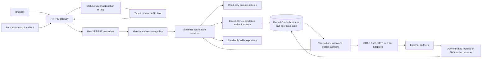
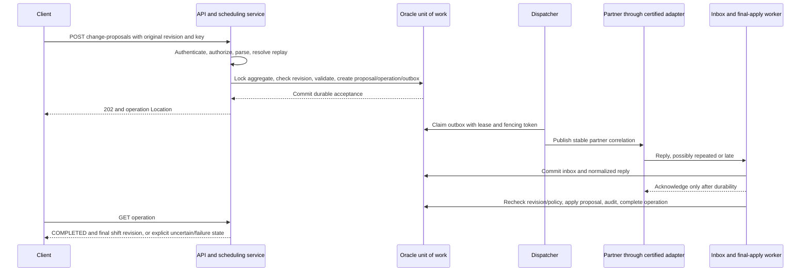
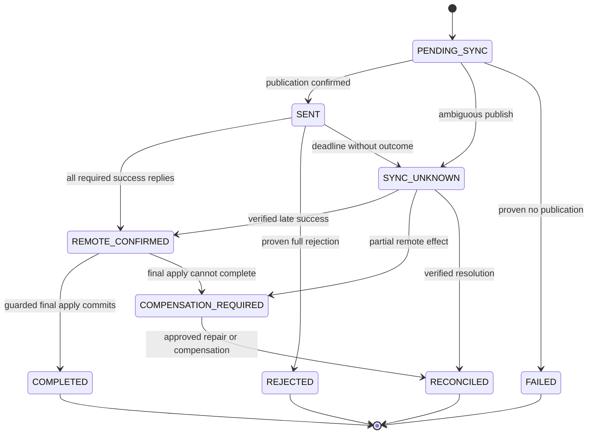

# SHF Node.js REST API Detailed Design

Document date: 2026-10-11

Status: proposed implementation contract; business-owner and platform approval
required before implementation or cutover.

Reading guide:

- [Backend architecture](#2-backend-architecture)
- [UI navigation versus API calls](#24-ui-navigation-versus-api-calls)
- [UI-only route inventory](#25-ui-only-navigation-inventory)
- [Shared HTTP contract](#3-shared-http-contract)
- [Shift change walkthrough](#4-shift-change-walkthrough)
- [Identity and authorization](#5-identity-and-authorization)
- [Concurrency and idempotency](#6-concurrency-idempotency-and-validation)
- [Shared representations](#7-shared-resource-representations)
- [Business endpoint contracts](#8-business-endpoint-contracts)
- [Operations and recovery](#9-operation-resources-and-recovery)
- [Errors](#10-error-contract)
- [Persistence and transaction design](#11-persistence-and-transaction-design)
- [Integration REST boundaries](#12-integration-rest-boundaries)
- [OpenAPI example](#13-openapi-contract-and-implementation-pattern)
- [Node.js solution adaptation](#133-nodejs-solution-adaptation)
- [Operational requirements](#14-operational-and-security-requirements)
- [Legacy migration coverage](#15-legacy-coverage-and-migration)
- [Test and release gates](#16-test-design-and-release-gates)
- [Decisions and verification](#17-approval-register-and-deliverable-verification)

## 1. Purpose and Design Authority

This document specifies the Node.js REST API replacement and its Angular
navigation boundary for the existing SHF Struts application. It complements the [reverse-engineered technical design](SHF_REVERSE_ENGINEERED_TECHNICAL_DESIGN.md),
the [source contract catalog](SHF_SOURCE_CONTRACT_CATALOG.md), and the
[non-Java TIBCO integration design](SHF_TIBCO_DOTNET_INTERFACE_DESIGN.md).
It is a backend design, not a claim that the API, schema migrations, identity
provider, or workers already exist.

Evidence classification:

- **Verified source:** supported by readable local Java, XML, or the generated
  catalog; deployed behavior still requires characterization.
- **Proposed:** a normative replacement contract in this document.
- **Approval required:** an intentional behavior change or unresolved business
  decision that cannot be settled from source alone.
- **Unverified:** physical schema, runtime configuration, partner behavior, or
  support compatibility not demonstrated locally.

All endpoint paths, DTOs, capabilities, limits, and HTTP status assignments below
are **proposed** unless explicitly identified as source evidence. Synthetic IDs
and examples contain no real employee information or integration credentials.
The document does not authorize production writes, partner requests, deployment,
or modification of application source.

### 1.1 Scope

Replace operation-driven forms and JSP forwards with resource reads and explicit
business commands for identity, employees, scheduling, attendance, breaks,
replacement, reinforcement, time changes, reduction, exceptions, reporting, CTI,
learning, messages, administration, imports/exports, and operational monitoring.
Keep Oracle business semantics and external wire protocols behind adapters.
Do not recreate empty course/taxi implementations or a WFM optimization engine.
UI implementation, physical DDL, and vendor transport implementation remain
separate deliverables. This document specifies the UI-to-API boundary so legacy
screen-loading GETs are not mistaken for replacement business endpoints.

### 1.2 Controlling Source Evidence

| Evidence | Verified behavior | REST design consequence |
| --- | --- | --- |
| [BaseAction](../SHF/src/bzq/shf/actions/BaseAction.java#L94) | Reads session identity into an instance field; checks activities only when a mapping supplies one. | Stateless controllers, immutable per-request actor context, deny-by-default capability policies. |
| [Shift validation](../SHF/src/bzq/shf/model/ShiftDataModel.java#L3604) | Loads shift data, checks date/duration/offer/split rules, and can delete break candidates when cancellation is confirmed. | A validation endpoint must use extracted read-only policies, not call the legacy validation method as a supposedly harmless preview. |
| [Shift cancellation](../SHF/src/bzq/shf/model/ShiftDataModel.java#L3704) | Mutates override and exception records inside local database work. | Cancellation is an audited business command, not physical HTTP DELETE of the baseline day. |
| [Response polling](../SHF/src/bzq/shf/model/BreakDataModel.java#L3060) | Polls a separate transaction ledger while managed scheduling changes await a reply. | Durable proposal/operation, asynchronous synchronization, explicit unknown outcome and final apply. |
| [Route catalog](SHF_SOURCE_CONTRACT_CATALOG.md#1-complete-struts-route-catalog) | 216 mapping entries include view-only routes, callbacks, duplicate paths, and commands. | Migrate capabilities, not one controller for each XML mapping entry. |

### 1.3 Compatibility Prerequisites

Use Node.js 24 LTS, TypeScript, NestJS with Fastify, independently deployed workers,
and supported Oracle access with `node-oracledb`, following the parent design.
Pin supported patch versions at implementation kickoff. No JVM or WebSphere is
part of the replacement. A certified .NET/native EMS adapter may be required.
Oracle version/driver compatibility, vendor-supported non-Java EMS transport,
OIDC/Noga trust, physical keys, and transaction ownership are blocking gates,
not assumptions resolved by choosing a REST framework.

## 2. Backend Architecture

### 2.1 Request and Dependency Boundaries



Deploy a modular monolith API and separate workers first. Scheduling, attendance,
breaks, and multi-shift workflows share invariants and an owned database transaction;
they are not independent microservices merely because they have separate routes.
Controllers translate HTTP only. Services own policy checks, deterministic
validation, orchestration, and unit-of-work boundaries. Repositories own explicit
SQL and mapping. Adapters own partner credentials, identity transformations,
schemas, acknowledgment, and transport-specific retries.

### 2.2 Request Context

Create an immutable `ActorContext` containing trusted subject, actor type,
employee link if present, authorized capability/scope version, authenticated
client identity, locale, request ID, and trace context. Derive it from the backend
session or validated machine token. Never bind `actor`, `allowedUnits`, names,
approval status, or integration credentials from a command DTO. Singleton
services must not store the current form, actor, connection, or transaction.

### 2.3 Owning Modules

| Module / application service | Owns | Dependencies and boundary |
| --- | --- | --- |
| `IdentityModule` / `SessionService`, `AuthorizationService` | Trusted sessions, actor-to-employee association, capability/scope decisions. | OIDC adapter, temporary Noga adapter, permission repository; no identity supplied by forms. |
| `EmployeeModule` / `EmployeeService` | Purpose-limited employee views, local events and preferences. | Employee/skill/event repositories; upstream-owned HR fields initially read-only. |
| `SchedulingModule` / `SchedulingService` | Effective shifts, shift proposals, reinforcement/time-change/reduction capacity. | Shared shift projection, attendance, offers, exceptions, policy versions, operation repository. |
| `AttendanceModule` / `AttendanceService` | Arrival/departure facts, corrections, reports, flags and briefing state. | Current effective ownership, append-only event/audit records, legacy attendance projection. |
| `BreakModule` / `BreakService` | Planned/actual breaks, break changes and break offers. | Shift revision, eligibility policies, reminder outbox, managed-break adapter. |
| `ReplacementModule` / `ReplacementService`, `SwapService` | Shift offers, proposals and coordinated two-shift changes. | Both participant revisions/scopes; shares a scheduling unit of work, not a network call between internal services. |
| `ReportingModule` / `ReportService` | Forecast/WFM/attendance projections and report definitions. | Bounded read repositories; no direct partner effects or operational writes. |
| `CtiModule` / `CtiService` | CTI views, manual completions, correction/cancellation and SAP eligibility. | Payroll-sensitive policies, immutable export manifests and restricted recalculation worker. |
| `LearningModule` / `LearningService` | Module assignments, schedules and cancellation. | Shift/break eligibility, IWD schedule revision and dispatch outbox. |
| `AdministrationModule` / `ConfigurationService` | Scoped parameters, reference policies, buildings/team assignments. | Versioned configuration, approval/audit, cache invalidation and managed-policy operation service. |
| `ArtifactModule` / `ExportService`, `ImportService` | Validated imports, authorized export manifests/artifacts. | Allowlisted reports/formats, scanner, restricted storage and immutable checksums. |
| `OperationsModule` / `OperationService`, `BatchRunService` | Operation reads, reconciliation, job runs and controlled replay. | Durable operation/inbox/outbox/run ledgers; not an arbitrary SQL/shell execution API. |
| `InterfaceModule` / `MachineIngressService` | Authenticated partner events and schema/correlation validation. | Separate machine policy; delegates business writes to attendance/break services. |

### 2.4 UI Navigation versus API Calls

**A UI GET loads a screen or asset. An API GET returns authorized resource data.**
Both use HTTP GET when a network request occurs, but they have different owners,
response types, security contracts and migration inventories. A browser making
an API request does not turn that request into a UI route.

| Surface | Proposed address / method | Owner and response | Classification |
| --- | --- | --- | --- |
| UI navigation | `GET /app`, `GET /app/shifts`, `GET /app/shifts/{shiftId}/edit`. | Static host/gateway serves the Angular HTML shell on initial load or refresh; Angular Router handles subsequent in-app navigation. | UI routes, not REST endpoints or NestJS business controllers. |
| UI assets | `GET /app/assets/{assetPath}`. | Static host returns approved JS, CSS, fonts and images with the correct media type. | Asset requests; no business data or command execution. |
| API data read | `GET /api/v1/shifts/{shiftId}`. | NestJS/Fastify authorizes and returns `application/json` with the resource ETag. | Backend query in the API catalogue and OpenAPI. |
| API validation | `POST /api/v1/shifts/validations`. | NestJS/Fastify returns `ValidationResult`; no business writes or partner calls. | Read-only API operation with a complex body, not navigation. |
| API business command | `POST /api/v1/shifts/{shiftId}/change-proposals`. | NestJS/Fastify durably records intent and returns `202 Operation`. | Backend mutation with capability, CSRF, revision and idempotency checks. |
| Browser authentication | `GET /auth/login`, `GET /auth/callback`, `POST /auth/logout`. | Backend session/OIDC service redirects or ends the session as specified in section 5. | Authentication routes, neither Angular views nor JSON business reads. |
| Partner/worker ingress | `/api/v1/interfaces/*`, `/internal/v1/*`. | Authenticated machine controllers/adapters; no HTML shell. | API calls with their separate machine policy. |

The proposed `/app` namespace is distinct from legacy `/shf/*.do`. Preserve legacy
paths only through an explicit cutover mapping; do not install a catch-all `.do`
redirect. The gateway routes `/api/v1/*`, `/auth/*` and restricted health routes
to the Node backend before considering the UI fallback. `/internal/v1/*` is not
publicly routed. An unknown API route returns a JSON problem `404`, never Angular
HTML with status `200`. Missing assets return `404`, not the shell. Only approved
UI document paths receive the SPA fallback; other methods cannot execute a
business command through it.

UI GETs must not mark messages read, cancel shifts, delete offers, allocate an
extension, approve a request or trigger an export. Opening a dialog is local UI
state; it loads authorized reference/resource data only when necessary. The
Node API has no `/searchParam`, `/showDialog` or `/loadJsp` controllers merely
to preserve screen navigation. Source-derived policy/default/reference reads
remain backend responsibilities; only presentation defaults belong in Angular.

The distinction is supported by [ShiftDataAction](../SHF/src/bzq/shf/actions/ShiftDataAction.java#L99):
`param` restores or initializes a search form, while `result` calls
`populateShiftList()` and passes rows to a JSP. In the replacement, the former
becomes Angular route/form state and the latter becomes the authorized shift
query. [The legacy dialog GET](../SHFWeb/WebContent/js/shiftjs.js#L115) inserts
HTML into a popup; it becomes an Angular dialog, not a JSON endpoint that returns
HTML fragments. Section 15.2 records representative split mappings.

UI routes are not counted in the REST endpoint inventory or generated API client.
Sections 5, 8, 9 and 12 catalogue backend calls only. UI route guards and hidden
buttons aid navigation; every API call still requires server authorization.

### 2.5 UI-Only Navigation Inventory

The following proposed document paths belong to Angular, not to NestJS or the
business OpenAPI. `GET` means the initial browser document request; in-app
navigation normally changes Angular Router state without another HTML request.
Each initial request returns the same `text/html` shell, without employee data,
permissions or session tokens embedded in it. The view then invokes the API
reads/commands in the cited section. Feature child routes require a reviewed UI
route manifest; this table is not evidence that a frontend has been implemented.

| UI document path | Initial request | Angular view / state | Backend contract used by the view |
| --- | --- | --- | --- |
| `/app` | `GET` | Shell; choose an authorized initial view. | Identity/capability reads, section 5.2. |
| `/app/me/messages` | `GET` | Recipient inbox and local message details. | Message reads and explicit read/deletion commands, section 8.1. |
| `/app/me/shifts` | `GET` | Personal schedule. | Self-scoped shift reads, section 8.2. |
| `/app/employees` | `GET` | Employee filters/results. | Scoped employee/reference reads, section 8.1. |
| `/app/employees/{employeeId}` | `GET` | Employee card and authorized tabs. | Employee, skills, events and preference contracts, section 8.1. |
| `/app/shifts` | `GET` | Shift search/results, local create/cancel/swap dialogs. | Scheduling reads/commands, sections 8.2 and 8.8. |
| `/app/shifts/current` | `GET` | Current-shift operational view. | Current-shift reads, section 8.2. |
| `/app/shifts/{shiftId}/edit` | `GET` | Shift editor; draft and warning dialogs are local state. | Shift/break reads, validation and proposals, sections 8.2 and 8.4. |
| `/app/attendance` | `GET` | Attendance table and correction/report dialogs. | Attendance/report reads and commands, section 8.3. |
| `/app/breaks` | `GET` | Planned/actual break views and offer dialogs. | Break/offer reads and commands, section 8.4. |
| `/app/reinforcement-requests` | `GET` | Reinforcement requests/candidates. | Request reads, edits and assignments, section 8.5. |
| `/app/time-change-requests` | `GET` | Time-change requests/applications. | Request/application reads and decisions, section 8.6. |
| `/app/reduction-requests` | `GET` | Reduction requests/applications. | Request/application reads and decisions, section 8.7. |
| `/app/shift-offers` | `GET` | Offer/proposal workspace. | Replacement reads and acceptance commands, section 8.8. |
| `/app/exceptions` | `GET` | Exceptions/time-off/cancelled-activity views. | Scoped reads and cancellation/remark commands, section 8.9. |
| `/app/reports` | `GET` | Forecast/report filters, results and export status. | Report reads and export commands, sections 8.9 and 8.13. |
| `/app/cti` | `GET` | Payroll-sensitive CTI/completion workspace. | CTI reads, validation and controlled corrections, section 8.10. |
| `/app/learning` | `GET` | Learning modules/assignments. | Learning reads and scheduling/cancellation commands, section 8.11. |
| `/app/administration` | `GET` | Scoped configuration/building views and drafts. | Configuration reads and approved writes, section 8.12. |
| `/app/operations/{operationId}` | `GET` | Operation progress and authorized recovery controls. | Operation reads and explicit recovery commands, section 9.1. |

Route/query state holds visible filters, tabs and cursors; transient forms and
dialogs remain component state. It never supplies a trusted actor or scope to
the API. Load `/api/v1/me` and authorized capabilities before protected data
requests. An API `401` causes a controlled browser navigation to `/auth/login`
with an allowlisted `/app` return path, not a backend redirect that changes a JSON
response into a login page. Preserve Hebrew/RTL and accessibility requirements
from the parent design; Node.js is the backend runtime, not a replacement for
Angular's browser rendering.

## 3. Shared HTTP Contract

### 3.1 Resource and Representation Rules

- Business API base: `/api/v1`; same-origin browser login endpoints use `/auth`.
  UI documents/assets use `/app` and are outside this HTTP business contract.
- JSON media type: `application/json`; errors use `application/problem+json`.
  UTF-8 is the wire encoding. Dates and numeric IDs are not localized.
- Existing Oracle identifiers are opaque decimal strings. New operation,
  proposal, event, and public break identities may use UUIDs; clients must not
  infer arithmetic, employee identity, or hierarchy from any ID.
- Use explicit command resources for cancellation, approval, correction,
  acceptance, and partner-synchronized proposals. A successful HTTP request is
  not evidence that a partner applied the operation.
- `GET` is read-only, including validation/reference/query helpers. Read-only
  validation with a complex body uses `POST` without business effects.
- Unknown DTO properties and unsupported query keys are rejected. Never merge
  request objects directly into persistence objects or accept arbitrary SQL filters.
- Business dates are `YYYY-MM-DD`. Instants include seconds and an offset.
  `businessTimeZone` is an approved IANA zone, initially `Asia/Jerusalem`.
  Reject invalid local times/offsets; do not silently reinterpret DST or `24:00`.
- Object reads expose a strong opaque `ETag`; commands modifying existing state
  require the target resource's `If-Match`. An aggregate token covers the fields
  and dependencies relevant to that operation, not only one row's modified date.

### 3.2 Response Meaning

| Status | Contract |
| --- | --- |
| `200` | Read, read-only validation result, or completed update with representation. |
| `201` | A local resource/event was durably created; `Location` identifies it. |
| `202` | Durable asynchronous intent exists; `Location` identifies its operation. Active business state is not implied. |
| `204` | A completed command intentionally has no response body. |
| `304` | Authorized conditional read matched its current representation. |
| `400` | Malformed JSON, illegal query/header syntax, or unknown properties. |
| `401` | Missing or expired authentication; no login-page HTML in API responses. |
| `403` | Authenticated actor lacks a capability on an otherwise visible resource. |
| `404` | Resource absent or hidden by organizational/recipient scope. |
| `405` | Unsupported HTTP method; `Allow` identifies supported methods without bypassing authorization. |
| `409` | Valid input conflicts with current workflow, capacity, confirmation, or idempotency state. |
| `410` | An authorized artifact is expired and no longer available. |
| `412` | Existing target no longer matches `If-Match` or a supplied participant revision. |
| `413` | Request/file exceeds its agreed limit. |
| `415` | Unsupported request or upload media type. |
| `422` | Parsed input violates deterministic field/business rules. |
| `428` | Required edit precondition is missing. |
| `429` | Actor/client workload quota exceeded; include `Retry-After`. |
| `500` | Sanitized unexpected failure; correlation only, no implementation details. |
| `503` | Required infrastructure unavailable before durable acceptance. |

Once an operation has been accepted, downstream failures are returned by its
operation representation, not by changing the already completed `202` response.
Retries must use the original idempotency key and body.

### 3.3 Query, Pagination and Consistency

Collection queries use `limit` (default 50, maximum 200), opaque `cursor`, and an
endpoint-specific sort allowlist. Syntax example:
`GET /api/v1/shifts?orgUnitId=900020&from=2026-10-12&to=2026-10-19&limit=50&sort=start,id`.
`from` is inclusive and `to` exclusive; a business-date range is expanded using
the approved business zone. Reject missing required ranges or ranges beyond the
endpoint's limit, rather than truncating results silently. ID-set filters use
repeatable query keys; each set has at most 100 entries. Unknown sort keys are `400`.

Use keyset pagination with an ID tie-breaker. Cursor data is signed and binds
filters, ordering, actor/scope version, last key, and expiry. Proposed expiry is
15 minutes. Tampered/cross-scope cursors return `400 INVALID_CURSOR`; expired
cursors return `409 CURSOR_EXPIRED` and require restarting the read. Revoked
permissions invalidate continued access. A live list may change between pages;
`asOf` records observation time, not an Oracle snapshot guarantee. Do not present
a row count or list revision as evidence of transactionally consistent paging.
Exports and financial comparisons use an explicitly captured manifest/snapshot.

`Page<T>` contains `items`, `page.limit`, `page.nextCursor`, `asOf`, and
`consistency` (`LIVE` or an explicitly supported `SNAPSHOT`). `totalCount` is
optional and returned only when authorized, affordable, and exact for the stated
consistency. Empty authorized collections return `200` with `items: []`.

### 3.4 Caching and Localization

Authenticated operational, identity, employee, operation, and artifact responses
default to `Cache-Control: no-store`. Conditional reads are still allowed for
refresh traffic after authorization. Low-sensitivity, scoped reference data may
use `private, max-age=60` only after review, with `Vary: Accept-Language` and
scope/version-specific cache keys. Never serve one user's scoped response from a
shared gateway/CDN cache. Read replicas expose their lag/as-of policy; do not
validate a write using a lagging replica.

`Accept-Language` supports `he` (default) and `en`. Return `Content-Language`.
Business codes, field paths, IDs, enum values, and timestamps are stable in either
locale. Descriptions/error text can be localized; clients branch on `code`, not
translated text. Hebrew names remain UTF-8 data; HTML/RTL rendering belongs to
the UI. Explicit Windows-1255 conversion is limited to verified legacy adapters.

### 3.5 Version and Compatibility Policy

OpenAPI 3.1 is the approved wire contract. Publish contract changes in CI and
generate clients from the approved version, not from Java forms. Keep internal
domain/repository types separate from DTOs. Within `/api/v1`, additive optional
response properties are permitted; clients ignore unknown response fields. New
required inputs, meaning changes, removed fields, changed time precision, and
changed authorization require an approved breaking-change migration. Status
enums have an explicit unknown-value client fallback; adding one requires review.

The default first release is JSON only: no public GraphQL, unrestricted expansion,
SQL query language, table-per-controller CRUD, or arbitrary batch endpoint.
Deprecation includes the owner, replacement contract, consumer inventory,
announced sunset, compatibility tests, and gateway telemetry. Legacy URL mapping
is explicit; a `.do` route is never blindly redirected to a mutating API command.

## 4. Shift Change Walkthrough

`POST /api/v1/shifts/{shiftId}/change-proposals` requires `scheduling.shift.change`,
organizational resource authorization, `If-Match`, and `Idempotency-Key`.
The service loads effective and baseline ownership, attendance/offer/break state,
and unit policy; validates before writing; and records the proposal, conflict
guard, audit intent, and outbox atomically. It must not publish to EMS or sleep
while holding the request's transaction.

```http
POST /api/v1/shifts/900001/change-proposals
Content-Type: application/json
Accept-Language: en
If-Match: "shift-900001-r17"
Idempotency-Key: example-shift-change-900001-1
```

```json
{
  "start": "2026-10-12T08:00:00+03:00",
  "end": "2026-10-12T16:00:00+03:00",
  "businessTimeZone": "Asia/Jerusalem",
  "locationId": "900010",
  "workFromHome": false,
  "split": null,
  "reasonCode": "EXAMPLE",
  "reason": "Authorized operational change",
  "confirmationToken": null
}
```

```http
HTTP/1.1 202 Accepted
Location: /api/v1/operations/8b5555fd-e174-49e3-b53d-ae94fbe65770
Retry-After: 2
Cache-Control: no-store
```

```json
{
  "id": "8b5555fd-e174-49e3-b53d-ae94fbe65770",
  "type": "SHIFT_CHANGE",
  "status": "PENDING_SYNC",
  "resource": { "type": "shift", "id": "900001" },
  "acceptedAt": "2026-10-11T09:00:00Z",
  "activeRevision": "shift-900001-r17",
  "result": null,
  "error": null
}
```

The API returns the same operation for an authorized same-key/same-body retry.
The committed shift remains at its old revision until final application. A
timeout after publication is `SYNC_UNKNOWN`, not proof of rejection. Revisions
must cover legacy writers through a shared enforced mechanism or exclusive
capability ownership; a new-code-only version column is insufficient.

### 4.1 Request-to-Completion Sequence



The callback can arrive before the dispatcher records `SENT`. Inbox processing
must not require that the local sent marker already exists or regress a later
state to `SENT`. Multi-message operations track each expected partner result and
apply only after all required acknowledgments. Partial remote application is a
reconciliation/compensation case, not an independently committed half-swap.

### 4.2 Browser Navigation and API Request Sequence

1. The user navigates to `/app/shifts/900001/edit`. An initial UI GET loads the
  Angular shell; client-side navigation only activates the editor component.
2. The typed Angular API client calls `GET /api/v1/shifts/900001` to obtain the
  committed shift and its canonical edit ETag, then loads authorized breaks and
  reference data as needed. UI route parameters are untrusted resource inputs.
3. Draft changes remain local. `POST /api/v1/shifts/validations` evaluates the
  draft without modifying a shift, deleting offers or contacting a partner.
4. Explicit user submission invokes the proposal POST in section 4 with the
  original shift ETag, session-bound CSRF token, one intent's idempotency key and
  any required warning consent. Neither opening the editor nor opening a
  confirmation dialog submits this command.
5. On `202`, display pending state and poll `GET /api/v1/operations/{operationId}`
  using the recommended interval. Polling reads state; it does not resend the
  command. An exact retry after a lost HTTP response uses the original key/body.
6. On completion, reload the shift representation. Unknown remote outcome stays
  visibly unresolved; an API error is rendered from problem JSON, not fetched
  as a JSP, success page or message-bar HTML fragment.

## 5. Identity and Authorization

### 5.1 Human and Machine Authentication

The browser uses enterprise OIDC authorization-code login with PKCE through the
backend. Validate issuer, audience, signature, state, nonce, callback URI, and
token lifetime. Keep tokens on the server. Use a rotated opaque secure HttpOnly
session cookie, proposed name `__Host-shf-session`, `Secure`, `Path=/`, no `Domain`,
and an approved SameSite policy compatible with the OIDC callback. Preserve the
legacy 90-minute idle lifetime initially; absolute lifetime is a security decision.
Back session state with the approved shared store and revocation mechanism.

Cookie-authenticated mutations require a session-bound anti-CSRF token and
Origin checks, including logout and read-only POST validation. TLS termination,
trusted forwarded headers, and client-IP derivation are gateway-owned; ignore
arbitrary browser-supplied proxy/IP headers. Do not authenticate by accepting a
domain user ID from a replacement login form.

Machine endpoints accept only a validated service token with narrowly scoped
audience/permissions, optionally combined with mTLS. Do not accept the browser
session as a substitute. Approved non-browser human API clients require a
separate OAuth profile; that capability is not enabled merely by accepting
Bearer tokens anywhere. The session security scheme and machine security scheme
are mutually exclusive on their respective ingress routes.

### 5.2 Identity Endpoints

Paths under `/auth` are outside the `/api/v1` prefix.

| Method | Path | Request | Success | Policy / precondition |
| --- | --- | --- | --- | --- |
| `GET` | `/auth/login` | Allowlisted same-origin `returnPath`; no user identity/password input. | `302` to trusted OIDC authorization endpoint. | Start login only; state/PKCE saved server-side. |
| `GET` | `/auth/callback` | OIDC code/state or provider error. | `303` to sanitized return path after session rotation. | Callback checks; no tokens in redirected URL. |
| `POST` | `/auth/logout` | Empty body. | `204`; revoke session and rotate/clear cookie. | CSRF for active session; repeating with no session returns `204`, an explicit exception to general `401`. |
| `GET` | `/me` | None. | `200 Me`. | Authenticated human; employee link may be null for an administrator. |
| `GET` | `/me/capabilities` | Optional visible `orgUnitId`. | `200 Capabilities`. | Scoped display projection, not an authorization token. |
| `GET` | `/me/csrf-token` | None. | `200` with session-bound `token`, `expiresAt`. | Same-origin authenticated human; `no-store`; never included in logs. |

`Me` fields: opaque `subject`, `displayName`, nullable surrogate `employeeId`,
`locale`, `businessTimeZone`, `session.idleExpiresAt`, and `capabilityVersion`.
`Capabilities` contains `version`, `evaluatedAt`, authorized scope descriptors,
and capability names. It does not return raw Noga authorization strings,
integration credentials, or an unrestricted organizational dump.

### 5.3 Policy Model and Legacy Mapping

Evaluate `authorize(actor, capability, resource, originalScope, effectiveScope)`.
Every controller route declares an explicit policy; CI and startup fail for an
unclassified route. Capability names below are proposed action-level permissions,
not automatic grants to anyone labelled manager. Self-service policies constrain
the employee/recipient to the trusted employee link. Administrative/operator
permissions do not imply unrestricted employee or payroll access.

| Proposed capability family | Legacy evidence / candidate mapping | Required resource restriction |
| --- | --- | --- |
| `employees.read`, `employees.skills.read`, `employees.events.write` | `card_view`, `card_search`, `card_skills`, `card_events_view`; [employee routes](SHF_SOURCE_CONTRACT_CATALOG.md#1-complete-struts-route-catalog). | Visible employee and purpose-specific fields; separate cancellation capability. |
| `scheduling.shifts.read`, `scheduling.shift.change`, `.cancel`, `.create` | `shift_search`, `shift_current`, `shift_update`, `shift_cancel`, add/reinforcement activities. | Both original and effective ownership where association can change. |
| `attendance.read`, `.register`, `.correct`, `.reports.approve` | `attend_*` activities plus routes mapped with `aa`. | Own shift or explicit scoped manager authority; correction is a different grant from registration. |
| `breaks.read`, `.change`, `.actual.register`, `replacement.offers.*`, `scheduling.swaps.create` | Break/replace/switch routes often use `aa` or `replace_*`. | Both parties and revisions; `aa` is not interpreted as unrestricted write authority. |
| `scheduling.reinforcement.*`, `.time-change.*`, `.reduction.*` | `shift_inforce_*`, `addShiftTimeChange`, `agentShiftTimeChange`, `reduce_*`. | Request unit, candidate scope, applicant ownership, and final assignment capacity. |
| `cti.read`, `.completions.*`, `.export-suppression.write` | `login_*`, `completion_*`; some mappings omit `activity` or spell it `ativity`. | Payroll-specific scope and export-state restrictions; spelling omissions never grant access. |
| `administration.*`, `operations.*`, `reports.*`, `exports.create` | Admin/forecast/export/mobile routes and source-specific checks. | Explicit elevated scope, report-specific grant, audited replay/override. |
| `interfaces.softphone.events.write`, `interfaces.shfsp.replies.write` | Callbacks bypass `BaseAction`; MDB is independently configured. | Partner service identity, association, destination/source, and replay checks. |

An owner-approved mapping matrix must cover every migration route, including
routes with absent activity. Preserve and characterize the `00020000` special
unit, fixed profile units, team-parent expansion, and replacement eligibility
from [Login](../SHF/src/bzq/shf/model/Login.java#L47). Do not replace these rules
with a generic hierarchy traversal without parity tests.

Repository predicates enforce scope in the query, not by filtering results after
pagination. A requested filter outside scope is rejected or yields no scoped
matches under a documented endpoint rule; it never expands scope. Resource
reads across an invisible scope return `404`; missing capability on a visible
resource returns `403`. Audit both initiating human and executing worker for
delayed operations. Refresh authority before final application.

## 6. Concurrency, Idempotency and Validation

### 6.1 Edit Preconditions

`If-Match` contains exactly one strong target token; wildcard and weak tokens are
not accepted for business commands. Header tokens are quoted; DTO `revision`
values expose the same opaque token without quotes. Do not use timestamps alone
if they cannot distinguish concurrent changes. Existing parent resources are
the precondition target for nested commands:

| Command family | Token obtained from | Additional participants |
| --- | --- | --- |
| Shift change/cancel/location/remark, planned break changes, extension command | `GET /shifts/{shiftId}`. | Relevant break/offer/attendance dependencies covered by scheduling aggregate revision. |
| Attendance event/correction/flags/briefing | `GET /shifts/{shiftId}/attendance`. | Recheck effective shift ownership/state within the same unit of work. |
| Actual break event | `GET /breaks/{breakId}`. | Current shift/break association and allowed lifecycle. |
| Reinforcement/time-change/reduction request command | The corresponding request item GET. | Candidate/application and affected shift revisions in the command. |
| Shift/break offer command | The corresponding offer item GET. | `participantRevisions` for all affected shifts/breaks. |
| Manager swap | No single existing swap parent; body contains both shift revisions. | Missing any participant revision is `428`; changed participant is `412`. |
| Preference/config/report/message/CTI command | GET of that existing target resource or collection aggregate for full-set PUT. | Exact target is specified in each endpoint section. |

Lock affected aggregate rows in stable ID order and re-evaluate revisions inside
the transaction. The scheduling revision includes invariants across override,
attendance, breaks, offers, and assigned employee. During coexistence, use a
shared enforced revision/locking protocol or transfer exclusive write ownership.
If unavailable, block scheduling-write cutover; hashing a read snapshot alone
does not prevent a legacy writer from racing after the check.

### 6.2 Idempotency-Key Contract

All business mutations require `Idempotency-Key`, including PUT/PATCH and machine
events; read-only validation POSTs are exempt. The key is an application-defined
opaque ASCII value, 8-128 characters from `A-Z`, `a-z`, `0-9`, `.`, `_`, `:`, `-`,
generated once for one user intent. It is
not a trace ID, employee ID, or authorization credential. Scope uniqueness to
environment/application, trusted initiating subject/client, HTTP method,
canonical route, and key. Machine events additionally use permanent partner
event identity so a retry with a different HTTP key still cannot duplicate effects.

Compute a canonical JSON body hash using a maintained implementation of the
approved canonicalization scheme; include media/contract version and the original
edit/participant preconditions. Do not hand-build a JSON string hash or include
volatile trace/CSRF headers in the fingerprint. For upload bytes, use a checksum
plus normalized manifest metadata. Preserve numeric precision during parsing.

1. Authenticate and authorize the route/resource; validate request syntax.
2. Look up the scoped key before checking whether today's revision matches.
   An authorized exact retry returns the recorded status/body/Location even if
   the original operation subsequently changed the resource revision.
3. Same key with another body or edit precondition returns
   `409 IDEMPOTENCY_KEY_REUSED`. An in-progress same-key request returns
   `409 REQUEST_IN_PROGRESS` with `Retry-After`, or the existing operation if
   its acceptance has already committed.
4. Reserve the key under a unique database constraint, check locked revisions,
   validate business state, and commit its response reference with the local
   business write or proposal/operation/outbox. Concurrent requests have one winner.
5. A crash after commit but before the HTTP response is recovered by exact retry.
   Infrastructure failure before durable acceptance returns `503`; no outcome
   is claimed, and the caller retries the original intent/key or reconciles it.

Deterministic recorded rejections replay unchanged; editing input or preconditions
requires a new key. Replays still require current permission to view the original
result. Store response metadata/references, not raw sensitive payloads by default.
Proposed minimum key retention is seven days and, for unresolved asynchronous
operations, their lifetime plus 30 days. Financial/partner deduplication and
immutable manifest retention outlive HTTP-key retention. After expiry clients
must reconcile the operation/event before retrying; expiry is not permission to
repeat a payable export or an ambiguous partner action.

### 6.3 Read-Only Validation and Confirmation

Validation endpoints run only authorization, reads, and extracted deterministic
policies. No business DML, offer deletion, notification, sequence `NEXTVAL`,
application insert function, allocation, or partner call is allowed. Logging and
bounded validation-token metadata may be stored separately, but are not business
effects. Rate-limit validation reads and use the same policy implementation that
the command invokes under lock.

Successful evaluation returns `200 ValidationResult`, even when
`valid: false`; malformed input remains `400`, DTO semantic input errors may be
`422`, and authorization follows normal rules. `ValidationResult` contains
`valid`, `errors`, `warnings`, `participantRevisions`, `policyVersion`,
`evaluatedAt`, and nullable `confirmationToken`. Each error/warning has `code`,
`field`, `messageKey`, safe parameters, and `confirmable`. A blocking rule has
`confirmable: false`; confirmation cannot bypass it.

For confirmable warnings, issue a short-lived signed token bound to actor,
command fingerprint, all revisions, warning set, policy version, and expiry
(proposed five minutes). The command must include `confirmationToken`,
`acceptedWarningCodes`, and an authorized `overrideReason` when needed. Missing
consent is `409 CONFIRMATION_REQUIRED`; stale/changed warnings require validation
again. A confirmation does not reserve capacity and does not replace final checks.

The legacy [swap validator](../SHF/src/bzq/shf/model/SwitchModel.java#L69) can
return a confirmation indicator before checking the second participant's later
conditions. The replacement evaluates both participants fully, reports all
blocking errors before issuing a token, and needs owner approval for this
correction to legacy short-circuit behavior.

## 7. Shared Resource Representations

### 7.1 Primitive and Field Dictionary

| Type / field | Wire contract |
| --- | --- |
| `OracleId` | Nonempty decimal string; preserve full precision; server verifies range for the owning column. |
| `PublicId` | Opaque string; new operation/event/proposal identifiers use UUIDs. Do not assume every resource ID is numeric. |
| `BusinessDate` | ISO date, validated as a calendar date in the approved business zone. |
| `Instant` | ISO 8601/RFC 3339 timestamp with seconds and explicit offset; stored/returned consistently, typically UTC. Milliseconds only where approved. |
| `Interval` | `{start, end, businessTimeZone}` with end greater than start; full timestamps allow crossing midnight. |
| `Revision` | Opaque strong aggregate/resource token; not a user-editable timestamp. |
| `Decimal` | Base-10 decimal string with contract-specific scale, no exponent; use maintained decimal arithmetic where precision matters. |
| `Reason` | Required allowlisted `reasonCode` plus `reason` when that code requires explanation; default text limit 1,000 characters. |
| Nullable editable field | Omitted PATCH property means unchanged; `null` clears only an explicitly clearable field. Empty string is not automatically null on the wire. |
| `ResourceRef` | `{type, id}`; optionally an authorized API `href`. Never contains SQL owner/table or private partner URL. |
| `Candidate` | Employee/shift references, proposed interval, eligibility reasons, current participant revisions and evaluation time. Not a capacity reservation. |

Apply field-specific allowlists/length/scale and DB metadata constraints before
release; limits in this document are defaults, not discovered Oracle declarations.
Reject user input that would truncate when bound. Entity names/descriptions are
plain text, not executable HTML. Sensitive national identity, phone numbers,
employee mood and remarks have separate field-level policies; not every employee
read grant grants every field.

### 7.2 Shift Read Model

`Shift` fields:

| Field | Meaning |
| --- | --- |
| `id`, `revision`, `businessDate` | Stable day identity, aggregate revision, source business date. |
| `employee` | Effective authorized employee `{id, displayName, orgUnitId, innerJobId}`. |
| `originalEmployee` | Baseline association when authorized to view it; not inferred from the effective owner. |
| `baseline` | Nullable source schedule `{source, dayTypeCode, start, end, locationId}`. |
| `effective` | `{status, dayTypeCode, start, end, locationId, activityId, workFromHome, split}`. |
| `provenance` | Source/override indicator, modification time, safe modifier reference; no raw SQL sentinel employee values. |
| `attendanceSummary`, `breakSummary` | Allowed summary fields; detailed records have their own endpoints/revisions. |
| `pendingOperation` | Nullable authorized operation reference; proposal values do not replace `effective`. |
| `remark`, `capabilities` | Authorized plain text and display-only available actions. |

`effective.status` is `SCHEDULED`, `CANCELLED`, or another owner-approved day
classification. Retain the legacy `dayTypeCode` through a typed reference-data
mapping rather than treating all day types 1-7 as worked shifts. A cancelled day
retains its identity and history. `split` represents the verified legacy split
interval using full start/end timestamps; its paid/unpaid and exception meaning
must be characterized before introducing alternative multi-segment semantics.

The [split validator](../SHF/src/bzq/shf/model/ShiftDataModel.java#L5739) checks
that the split interval is inside the shift, first-part duration is at least
120 minutes, and split duration is at least 120 minutes. The second-part boundary
is constructed by setting the original start calendar's hour to 16 while retaining
its minutes/seconds; it is not necessarily exactly 16:00. Preserve this boundary
in characterization, and seek approval before normalizing it. Break overlap
checks also treat split endpoints as conflicts in the inspected path.

```json
{
  "id": "900001",
  "revision": "shift-900001-r17",
  "businessDate": "2026-10-12",
  "employee": {
    "id": "900100",
    "displayName": "Example Employee",
    "orgUnitId": "900020",
    "innerJobId": "900030"
  },
  "originalEmployee": { "id": "900100" },
  "baseline": {
    "source": "WFM",
    "dayTypeCode": "1",
    "start": "2026-10-12T07:00:00+03:00",
    "end": "2026-10-12T15:00:00+03:00",
    "locationId": "900010"
  },
  "effective": {
    "status": "SCHEDULED",
    "dayTypeCode": "1",
    "start": "2026-10-12T07:00:00+03:00",
    "end": "2026-10-12T15:00:00+03:00",
    "locationId": "900010",
    "activityId": "900040",
    "workFromHome": false,
    "split": null
  },
  "provenance": { "source": "WFM", "hasOverride": false },
  "pendingOperation": null
}
```

The example deliberately omits sensitive optional details. A national identity
number is neither the public employee resource ID nor a generic search/log key.
Adapters alone apply the distinct full/short partner identity transformations.

### 7.3 Collection Example

```json
{
  "items": [],
  "page": { "limit": 50, "nextCursor": null },
  "asOf": "2026-10-11T09:00:00Z",
  "consistency": "LIVE"
}
```

## 8. Business Endpoint Contracts

All paths in this section are relative to `/api/v1`. Each table row identifies
one method/path pair. `Page<T>` has the envelope in section 3.3. Item GETs return
an `ETag`; PUT/PATCH and command resources against existing items require the
precondition described in section 6. All writes require an idempotency key.
`Operation` denotes `202` with the durable operation and Location, not active
business success. Capability suffixes are spelled out where permissions differ.

### 8.1 Reference Data and Employee Services

| Method | Path | Request / filters | Success | Capability / scope |
| --- | --- | --- | --- | --- |
| `GET` | `/reference-data` | Allowlisted repeatable `type`, optional `orgUnitId`, `version`; no unrestricted dump. | `200 ReferenceData` with versioned values. | Authenticated; each requested type and unit scoped. |
| `GET` | `/org-units` | `parentId`, `type`, paging. | `200 Page<OrgUnit>`. | `organization.read`; visible hierarchy only. |
| `GET` | `/org-units/{unitId}/children` | Paging; existing visible parent. | `200 Page<OrgUnit>`. | `organization.read`; does not broaden to invisible siblings. |
| `GET` | `/employees` | Required unit or authorized self scope; `name`, `status`, `innerJobId`, `teamId`, paging. | `200 Page<EmployeeSummary>`. | `employees.read`; field-level minimization. |
| `GET` | `/employees/{employeeId}` | Allowlisted detail view. | `200 Employee`. | `employees.read` or explicit own-card capability. |
| `GET` | `/employees/{employeeId}/skills` | Paging; optional active/effective date. | `200 Page<EmployeeSkill>`. | `employees.skills.read`. |
| `GET` | `/employees/{employeeId}/events` | `from`, `to`, event type/state, paging. | `200 Page<EmployeeEvent>`. | `employees.events.read`. |
| `GET` | `/employees/{employeeId}/events/{eventId}` | None. | `200 EmployeeEvent`. | `employees.events.read`; verify employee/event association. |
| `POST` | `/employees/{employeeId}/events` | Event type/reason, business date or interval, optional shift, remark. | `201 EmployeeEvent`. | `employees.events.write`; parent employee ETag and shift validity if associated. |
| `POST` | `/employees/{employeeId}/events/{eventId}/cancellations` | Reason; current event ETag. | `200 EmployeeEvent` in cancelled state. | `employees.events.cancel`; keep history. |
| `GET` | `/employees/{employeeId}/education` | Effective date/paging. | `200 Page<EmployeeEducation>`. | `employees.education.read`; only source-backed data, not invented HR writes. |
| `GET` | `/employees/{employeeId}/notification-preferences` | None. | `200 NotificationPreferences`. | Own preference read or `employees.preferences.read`. |
| `PATCH` | `/employees/{employeeId}/notification-preferences` | Explicit opt-in fields, reason where manager alters consent; preference ETag. | `200 NotificationPreferences`. | Own preference write or `employees.preferences.write`; approved consent policy. |
| `GET` | `/me/messages` | Read/deleted/type filters, paging. | `200 Page<Message>`. | `messages.self.read`; recipient from trusted employee link. |
| `GET` | `/me/messages/{messageId}` | None. | `200 Message`. | Recipient ownership. |
| `POST` | `/me/messages/{messageId}/read` | Empty body; message ETag. | `200 Message`. | `messages.self.write`; idempotent read marker. |
| `POST` | `/me/messages/{messageId}/deletion` | Empty body; message ETag. | `200 Message` with deleted state. | `messages.self.write`; logical deletion, not offer cancellation. |

`OrgUnit` contains `id`, `code`, `name`, typed organizational level, and parent
reference. Organizational code strings preserve leading zeros. `ReferenceData`
contains `version`, `effectiveAt`, and authorized named value sets of
`{id, code, label, active}`.

`EmployeeSummary` contains surrogate ID, display name, authorized unit/job/status;
`Employee` adds authorized source-owned card fields and their provenance.
`EmployeeSkill` contains skill reference, proficiency/validity only where observed.
`EmployeeEvent` contains ID/revision, employee/optional shift, type/reason,
business date/interval, lifecycle, remark, and safe creation/cancellation metadata.
The server determines report-request/report-required flags from event policy;
the client cannot declare an event already approved/reported. Treat mood and
attendance-related sensitive events as a restricted field category.

`NotificationPreferences` contains revision and approved SMS preference flags;
it does not imply SHF owns the upstream employee phone number. `Message` contains
recipient-safe subject/text, read/deleted timestamps, type and an authorized
offer reference. Accepting a message-linked offer invokes the replacement
acceptance endpoint, not a second implementation in the message service.

Courses and taxi orders are excluded from the first API: the inspected
[employee implementation](../SHF/src/bzq/shf/model/EmployeeDataModel.java#L285)
contains placeholders. Do not return fabricated data or expose empty endpoints
as completed integrations.

### 8.2 Scheduling and Shift Commands

| Method | Path | Request / filters | Success | Capability / scope |
| --- | --- | --- | --- | --- |
| `GET` | `/shifts` | Required unit/employee scope and bounded `from`, `to`; day type, job/activity/site/home filters. | `200 Page<ShiftSummary>`. | `scheduling.shifts.read`. |
| `GET` | `/shifts/current` | Required visible unit; optional bounded `at`, status/job filters. | `200 Page<ShiftSummary>` with freshness time. | `scheduling.current.read`; default `at` is server clock. |
| `GET` | `/me/shifts` | Bounded business-date range, paging. | `200 Page<ShiftSummary>`. | `scheduling.self.read`; employee filter is server-derived. |
| `GET` | `/shifts/{shiftId}` | Optional approved summary inclusion. | `200 Shift`. | `scheduling.shifts.read`; original/effective scope protection. |
| `GET` | `/shifts/{shiftId}/provenance` | None. | `200 ShiftProvenance`. | `scheduling.provenance.read`; authorized source/change history. |
| `POST` | `/shifts/validations` | New shift DTO, or existing shift ID/revision and typed proposed change. | `200 ValidationResult`; no business effects. | Same capability/resource scope as the intended command. |
| `POST` | `/shifts` | Employee ID, full interval/zone, day type, activity/location, home/split, breaks and reason. | `202 Operation` of type `SHIFT_CREATE`. | `scheduling.shift.create`; employee/policy checks, natural-key/overlap check under lock. |
| `POST` | `/shifts/{shiftId}/change-proposals` | Change DTO in section 4 plus any required warning consent. | `202 Operation` of type `SHIFT_CHANGE`. | `scheduling.shift.change`; shift ETag. |
| `GET` | `/shifts/{shiftId}/change-proposals/{proposalId}` | None. | `200 ShiftProposal`. | Visible linked shift and proposal; pending values clearly separated. |
| `POST` | `/shifts/{shiftId}/cancellations` | Reason and warning consent where needed. | `202 Operation` of type `SHIFT_CANCEL`. | `scheduling.shift.cancel`; shift ETag. |
| `POST` | `/shifts/{shiftId}/location-changes` | `locationId`, `workFromHome`, reason and current revision. | `202 Operation` of type `SHIFT_LOCATION_CHANGE`. | `scheduling.shift.location.change`; shift ETag, extension/partner impact. |
| `PATCH` | `/shifts/{shiftId}/remark` | `{remark}`; null clears; maximum 1,000 characters. | `200 Shift` with new revision. | `scheduling.shift.remark.write`; shift ETag; deny while conflicting proposal active. |
| `POST` | `/shifts/{shiftId}/offer-cleanups` | Explicit selected offer IDs or all applicable offers, reason/confirmation. | `200 CleanupResult`. | `scheduling.offers.cleanup`; shift ETag and atomic invalidation. |
| `GET` | `/shifts/{shiftId}/extension-lease` | None. | `200 ExtensionLease` or `404` if none. | `telephony.leases.read`; do not expose private pool URL. |
| `POST` | `/shifts/{shiftId}/extension-commands` | `type: ALLOCATE` or `RELEASE`, reason; existing lease reference if release. | `202 Operation`. | `telephony.leases.manage`; shift ETag; unknown existing allocation blocks another acquire. |

`ShiftSummary` is the list subset of the Shift model, including stable ID,
revision, effective employee/interval/state, site/home/split indicators and
authorized attendance/break freshness. `ShiftProposal` contains proposed values,
preimage reference, initiating actor, policy/revision inputs, operation reference
and lifecycle. It is not another active shift row. `CleanupResult` returns only
authorized invalidated offer IDs/count and revised shift state.

The source shift-update checks include a missing reason, configurable date
window and minimum duration, end/start order, existing offers and split rules.
Do not add a blanket arrival-based ban to shift editing simply because swaps
have one; [ShiftDataModel](../SHF/src/bzq/shf/model/ShiftDataModel.java#L3604)
has commented-out arrival checks. Characterize equality, zero-duration and
cross-midnight handling; any stricter rules need owner approval.

All shift create/change/cancel/location commands consistently return `202`, even
if the current unit does not need remote synchronization. A worker can apply
local-only proposals immediately, but clients always inspect their operation.
This avoids an endpoint changing completion semantics when managed-break policy
changes. Independent annotation/preference writes can complete synchronously.

`ExtensionLease` has local public ID, shift/revision association, safe extension
number, allocation/release status and nullable expiry. Remote request/lease keys
are exposed only to authorized operators. No-arrival allocation/release logic
preserves the source's stage-null OR station-null test until owners change it.

### 8.3 Attendance and Reports

| Method | Path | Request / filters | Success | Capability / scope |
| --- | --- | --- | --- | --- |
| `GET` | `/attendance` | Required unit/business date or bounded interval; state/team/employee filters, paging. | `200 Page<Attendance>`. | `attendance.read`; scoped operational view. |
| `GET` | `/shifts/{shiftId}/attendance` | None. | `200 Attendance`, including unregistered state if no row yet. | Own attendance read or `attendance.read`; ETag for current aggregate. |
| `POST` | `/shifts/{shiftId}/attendance-events` | `eventType`, optional authorized `occurredAt`, reason/related event. | `201 AttendanceEvent` with Location. | Own allowed registration or `attendance.register`; attendance ETag. |
| `GET` | `/shifts/{shiftId}/attendance-events/{eventId}` | None. | `200 AttendanceEvent`. | Associated shift and own/scoped attendance read. |
| `POST` | `/shifts/{shiftId}/attendance-corrections` | Target event/field, replacement timestamp or explicit cancellation, reason. | `201 AttendanceCorrection`; new attendance revision. | `attendance.correct`; attendance ETag, not ordinary agent registration. |
| `GET` | `/shifts/{shiftId}/attendance-corrections/{correctionId}` | None. | `200 AttendanceCorrection`. | Associated shift and explicit correction-history read authority. |
| `PATCH` | `/shifts/{shiftId}/attendance-flags` | Allowlisted flag changes only. | `200 Attendance`. | `attendance.flags.write`; attendance ETag. |
| `PUT` | `/shifts/{shiftId}/briefing-state` | Typed approved briefing value and reason if required. | `200 Attendance`. | `attendance.briefing.write`; attendance ETag. |
| `GET` | `/attendance-reports` | Scope/date/status filters, paging. | `200 Page<AttendanceReport>`. | `attendance.reports.read`. |
| `GET` | `/attendance-reports/{reportId}` | None. | `200 AttendanceReport`. | Own/scoped report access. |
| `POST` | `/attendance-reports/{reportId}/approvals` | Reason/approval note; report ETag. | `200 AttendanceReport`. | `attendance.reports.approve`; approved state and server actor. |
| `POST` | `/attendance-reports/{reportId}/cancellations` | Reason; report ETag. | `200 AttendanceReport`. | `attendance.reports.cancel`; preserve prior approval audit. |

`Attendance` contains shift ID/revision, optional stage arrival, station arrival,
station departure, late/missing reason state, approved flags/briefing, report
reference, observation time and source. `AttendanceEvent` contains public event
ID, type (`STAGE_ARRIVAL`, `STATION_ARRIVAL`, `STATION_DEPARTURE`, or approved
missing/early-departure event), effective instant, recorded instant, server actor,
source, reason and resulting attendance revision. Self-service clock events use
server time; arbitrary backdating requires correction or machine-ingress authority.

Departure requires a recorded station arrival and no departure already present,
as enforced by [exitStation](../SHF/src/bzq/shf/model/AttendanceDataModel.java#L1884).
Same event/key replays the outcome; another attempted departure is
`409 DEPARTURE_ALREADY_RECORDED`, not an overwrite. A departure without station
arrival is `409 STATION_ARRIVAL_REQUIRED`. Correction is a reasoned new event,
not deletion of the old fact. Correction, legacy projection and audit commit
together. Source success sometimes travels through `ShfException`; it must map
to HTTP success based on actual outcome, not every thrown exception to `500`.

`AttendanceReport` contains ID/revision, associated employee/shift/event, required
report classification, submitted details, lifecycle and safe approval metadata.
Approval/cancellation grants are explicit even where legacy routes used `aa`.

### 8.4 Break Planning, Actuals and Offers

| Method | Path | Request / filters | Success | Capability / scope |
| --- | --- | --- | --- | --- |
| `GET` | `/breaks` | Required unit/date/window, planned/actual state, employee/job filters, paging. | `200 Page<Break>`. | `breaks.read`; no global break directory. |
| `GET` | `/breaks/{breakId}` | None. | `200 Break`. | Associated visible shift and break access. |
| `GET` | `/shifts/{shiftId}/breaks` | Paging. | `200 Page<Break>`. | Own/scoped break read. |
| `POST` | `/shifts/{shiftId}/break-validations` | Typed insert/update/delete deltas with original break IDs. | `200 ValidationResult`; no offer deletion/publication. | `breaks.change`; proposed shift revision. |
| `POST` | `/shifts/{shiftId}/break-change-proposals` | `changes`, reason, consent; current shift ETag. | `202 Operation` of type `BREAK_CHANGE`. | `breaks.change`; locked shift/break/offer validation. |
| `POST` | `/breaks/{breakId}/actual-events` | `type: EXIT` or `RETURN`; self server time or authorized actual instant/source. | `201 BreakActualEvent`. | `breaks.actual.register`; break ETag; machine traffic uses the separate interface route. |
| `GET` | `/breaks/{breakId}/actual-events/{eventId}` | None. | `200 BreakActualEvent`. | Associated shift/break and own/scoped actual-event read. |
| `GET` | `/break-offers` | Own/manager scope, date/state filters, paging. | `200 Page<BreakOffer>`. | `replacement.break-offers.read`. |
| `GET` | `/break-offers/{offerId}` | None. | `200 BreakOffer`. | Recipient/participant or explicitly scoped manager. |
| `POST` | `/break-offers` | Source break, optional proposed recipient break, current participant revisions. | `201 BreakOffer`. | `replacement.break-offers.create`; source ownership; no immediate planned-break change. |
| `GET` | `/break-offers/{offerId}/candidates` | Allowlisted eligibility filters/paging. | `200 Page<Candidate>`. | `replacement.break-offers.read`; candidate-sensitive fields minimized. |
| `POST` | `/break-offers/{offerId}/proposals` | Candidate break/employee reference, participant revisions, note. | `201 BreakOfferProposal`. | `replacement.break-offers.propose`; offer ETag. |
| `GET` | `/break-offers/{offerId}/proposals/{proposalId}` | None. | `200 BreakOfferProposal`. | Proposal participant or explicitly scoped manager; verify offer association. |
| `POST` | `/break-offers/{offerId}/acceptances` | Selected proposal, both break/shift revisions, consent if required. | `202 Operation` of type `BREAK_SWAP`. | `replacement.break-offers.accept`; offer ETag; accepting participant identity. |
| `POST` | `/break-offers/{offerId}/rejections` | Proposal ID and optional reason. | `200 BreakOffer`. | `replacement.break-offers.reject`; recipient and offer ETag. |
| `POST` | `/break-offers/{offerId}/cancellations` | Reason. | `200 BreakOffer`. | `replacement.break-offers.cancel`; owner/authorized manager, offer ETag, uncommitted state only. |

`Break` separates `planned.start`, `planned.durationMinutes`, and nullable actual
exit/return instants. It includes public ID, shift ID, revision, state, source,
late minutes and an authorized remark. Physical break keys are not verified:
introduce a reviewed identity mapping based on the actual unique key, not an
unstable array index or just HH:mm. Keep public identity stable across a planned
time change. Planned-minute partner lookup is an adapter concern, not a global
time truncation rule for actuals.

`changes` is a bounded list (proposed maximum 20; actual business count is
policy-controlled). Each entry uses `type: INSERT | UPDATE | DELETE`, optional
existing `breakId` as required, and start/duration for inserts/updates. UPDATE is
translated to partner delete/insert delta only inside the adapter. Require
positive integer duration for active breaks; explicit DELETE represents legacy
zero-length removal after owner-approved parity tests. Deletion still runs the
relevant source/shift-range rules, rather than treating zero as universally valid.

Preserve source-dependent gap checks and the configured start/end distance.
[Break validation](../SHF/src/bzq/shf/model/BreakDataModel.java#L3174) uses the
60-minute inter-break constant only in specific paths; a new universal rule
would change behavior. Managed-change lead time is parameterized, not 60 minutes
by assumption. Actual exit and reminder intent commit together; invalid phone
data creates a visible notification failure/skip without rolling back a valid
attendance fact. Actual return keeps significant seconds and late-return policy.

`BreakOffer` contains ID/revision, source break, recipient/proposals, lifecycle,
participant revisions and timestamps. `BreakOfferProposal` contains its own ID,
candidate break/employee and safe note. Accepting reserves affected shift/break
guards and completes only after synchronization/final apply. Cancelling an
already-applied swap requires a separately validated scheduling operation;
offer cancellation never blindly reverses partner state.

### 8.5 Reinforcement Requests and Assignments

| Method | Path | Request / filters | Success | Capability / scope |
| --- | --- | --- | --- | --- |
| `GET` | `/reinforcement-requests` | Unit/date/window, request state/job/team, paging; own candidate view is separately scoped. | `200 Page<ReinforcementRequest>`. | `scheduling.reinforcement.read`. |
| `GET` | `/reinforcement-requests/{requestId}` | None. | `200 ReinforcementRequest`. | Visible request unit; ETag for request/capacity aggregate. |
| `POST` | `/reinforcement-requests` | Request interval/date, unit, capacity, eligibility, planned breaks, remark. | `201 ReinforcementRequest`. | `scheduling.reinforcement.manage`; no shift assigned by creation alone. |
| `PATCH` | `/reinforcement-requests/{requestId}` | Allowlisted capacity/eligibility/timing/remark changes. | `200 ReinforcementRequest`. | `scheduling.reinforcement.manage`; request ETag. |
| `GET` | `/reinforcement-requests/{requestId}/candidates` | Eligibility filters, candidate source, paging. | `200 Page<Candidate>`. | `scheduling.reinforcement.candidates.read`; self projection or explicit manager scope. |
| `GET` | `/reinforcement-requests/{requestId}/assignments` | State/paging. | `200 Page<Assignment>`. | `scheduling.reinforcement.read`; candidate details separately authorized. |
| `POST` | `/reinforcement-requests/{requestId}/assignments` | Employee/candidate reference, proposed interval, participant revisions, reason. | `202 Operation` of type `REINFORCEMENT_ASSIGN`. | `scheduling.reinforcement.assign`; request ETag and employee/shift scope. |

`ReinforcementRequest` contains ID/revision, unit, business date, interval,
requested capacity, committed/reserved/remaining counts, state, eligibility and
creation/modification metadata. Eligibility includes approved team/job sets,
skill/training policy, activity, site and work-from-home selection. If source
team/job-specific quotas are used, model them as explicit
`{teamId, innerJobId, count}` rules; do not collapse them into a single integer
without owner verification. `Assignment` links request, employee, intended shift,
operation and current apply state.

Under lock enforce `committed + reserved <= requested` and any per-job/team quota.
Candidate search is neither capacity reservation nor authorization to assign.
Recheck rest gap, job/skill/site/night compatibility, current employee state,
and competing assignments at acceptance. A unique active request/employee/day
identity and employee interval checks prevent double consumption across requests.
Capacity cannot be lowered below committed plus reserved demand. Keep capacity
reserved for unknown partner outcomes until reconciled, not until a UI timeout.
Final assignment, new/effective shift, capacity, audit and notification intent
commit in one owned transaction after required remote confirmation.

### 8.6 Time-Change Requests and Applications

| Method | Path | Request / filters | Success | Capability / scope |
| --- | --- | --- | --- | --- |
| `GET` | `/time-change-requests` | Unit/date/state and approved view (`AVAILABLE`, `OWN_APPLICATIONS`, `MANAGER`), paging. | `200 Page<TimeChangeRequest>`. | `scheduling.time-change.read`; view cannot broaden actor scope. |
| `GET` | `/time-change-requests/{requestId}` | None. | `200 TimeChangeRequest`. | Visible request; ETag covers policy/capacity/application decisions. |
| `POST` | `/time-change-requests` | Typed eligibility/target timing rules, capacity, unit/date and approval mode. | `201 TimeChangeRequest`. | `scheduling.time-change.manage`; auto-approval configuration requires its own grant. |
| `PATCH` | `/time-change-requests/{requestId}` | Allowlisted request changes. | `200 TimeChangeRequest`. | `scheduling.time-change.manage`; request ETag, no invalidation of active reservations. |
| `GET` | `/time-change-requests/{requestId}/candidates` | Eligible shifts, paging. | `200 Page<Candidate>`. | `scheduling.time-change.candidates.read`; own or authorized managerial view. |
| `GET` | `/time-change-requests/{requestId}/applications` | Applicant/state filters, paging. | `200 Page<TimeChangeApplication>`. | Own application or `scheduling.time-change.applications.read`. |
| `POST` | `/time-change-requests/{requestId}/applications` | Own shift ID/revision and selected allowed target times. | `201 TimeChangeApplication`. | `scheduling.time-change.apply`; request ETag; trusted applicant identity. |
| `GET` | `/time-change-requests/{requestId}/applications/{applicationId}` | None. | `200 TimeChangeApplication`. | Applicant or explicitly scoped manager; verify request association. |
| `POST` | `/time-change-requests/{requestId}/approvals` | Application ID/revision, shift revision, reason/consent. | `202 Operation` of type `TIME_CHANGE_APPLY`. | `scheduling.time-change.approve`; request ETag and application scope. |
| `POST` | `/time-change-requests/{requestId}/rejections` | Application ID/revision, reason. | `200 DecisionResult`. | `scheduling.time-change.reject`; request ETag; uncommitted application only. |
| `POST` | `/time-change-requests/{requestId}/bulk-rejections` | Captured pending selection/filter, reason and request revision. | `202 Operation`; bounded selection manifest. | `scheduling.time-change.reject`; request ETag and audit of each selected application. |

`TimeChangeRequest` contains request ID/revision, unit/business date, capacity
counts, candidate start/end windows, typed target adjustment rules, approval
mode, state and policy version. Represent absolute target times and minute
extension/shortening as discriminated rule types; reject contradictory options.
Do not bind legacy flags and parallel arrays directly. The source
[time-change form](../SHF/src/bzq/shf/forms/ShiftChangeRequestForm.java) records
several different start/end/length option combinations that need owner-approved
test fixtures. The source sets auto-approval defaults in
[ShiftDataModel](../SHF/src/bzq/shf/model/ShiftDataModel.java#L4505); a client
cannot force approval by submitting that legacy flag.

`TimeChangeApplication` contains ID/revision, request/shift/applicant, selected
interval, lifecycle, decision metadata and optional operation. Submission is
local creation, not an approved shift change. If auto-approval is authorized,
create/schedule the same approval operation and return its reference; still
report the application as pending apply until completion. Approval locks request,
application and shift, enforces remaining capacity and current shift rules, then
applies the shift and decision together. Repeated/stale applications never bypass
eligibility. `DecisionResult` contains affected authorized IDs, resulting states
and updated request revision, not a silent success count for rejected rows.

### 8.7 Reduction Requests

| Method | Path | Request / filters | Success | Capability / scope |
| --- | --- | --- | --- | --- |
| `GET` | `/reduction-requests` | Unit/date/window, available/manager view, state, paging. | `200 Page<ReductionRequest>`. | `scheduling.reduction.read`. |
| `GET` | `/reduction-requests/{requestId}` | None. | `200 ReductionRequest`. | Visible request; capacity/application ETag. |
| `POST` | `/reduction-requests` | Unit/business date/window, capacity, eligible activity and approval policy. | `201 ReductionRequest`. | `scheduling.reduction.manage`. |
| `PATCH` | `/reduction-requests/{requestId}` | Allowlisted request changes. | `200 ReductionRequest`. | `scheduling.reduction.manage`; request ETag. |
| `GET` | `/reduction-requests/{requestId}/candidates` | Eligibility filters/paging. | `200 Page<Candidate>`. | `scheduling.reduction.candidates.read`. |
| `GET` | `/reduction-requests/{requestId}/applications` | Own/manager view, state, paging. | `200 Page<ReductionApplication>`. | Own request application or `scheduling.reduction.applications.read`. |
| `POST` | `/reduction-requests/{requestId}/applications` | Own shift ID/revision, reason. | `201 ReductionApplication`. | `scheduling.reduction.apply`; request ETag. |
| `GET` | `/reduction-requests/{requestId}/applications/{applicationId}` | None. | `200 ReductionApplication`. | Applicant or explicitly scoped manager; verify request association. |
| `POST` | `/reduction-requests/{requestId}/approvals` | Application ID/revision, shift revision, reason/consent. | `202 Operation` of type `REDUCTION_APPLY`. | `scheduling.reduction.approve`; request ETag. |
| `POST` | `/reduction-requests/{requestId}/rejections` | Application ID/revision and reason. | `200 DecisionResult`. | `scheduling.reduction.reject`; request ETag. |
| `POST` | `/reduction-requests/{requestId}/bulk-rejections` | Captured pending selection and reason. | `202 Operation`; immutable selected application manifest. | `scheduling.reduction.reject`; request ETag. |

`ReductionRequest` contains unit/date/window, requested/reserved/approved counts,
eligible activity, approval policy and lifecycle. `ReductionApplication` links
request, shift, trusted applicant, revisions, timestamps and decision/operation.
The verified [reduction control path](../SHF/src/bzq/shf/model/ReduceDataModel.java#L386)
checks unit-configured lead time, invokes shift cancellation, then writes approval
separately. Initial target reduction means the characterized cancellation of a
shift; the name alone does not justify inventing a paid-time-shortening rule.

Final apply writes cancellation, exception/break effects, approval, request
capacity, audit and notification intent in one transaction. A pending/unknown
operation reserves the relevant capacity. Failure of approval persistence after
remote change requires reconciliation; never report approved while the shift
remains active, or failed while the partner cancellation is known to have applied.
Verify the candidate's request/day association explicitly: updating by day ID
alone is not sufficient if a day can appear in more than one request.

### 8.8 Replacement and Manager Swaps

| Method | Path | Request / filters | Success | Capability / scope |
| --- | --- | --- | --- | --- |
| `GET` | `/shift-offers` | Own/manager scope, dates, offer/proposal state, paging. | `200 Page<ShiftOffer>`. | `replacement.offers.read`. |
| `GET` | `/shift-offers/{offerId}` | None. | `200 ShiftOffer`. | Participant or explicitly scoped manager. |
| `POST` | `/shift-offers` | Source shift/revision, allowed interval/site/job restrictions, safe note. | `201 ShiftOffer`. | `replacement.offers.create`; source ownership and eligibility. |
| `GET` | `/shift-offers/{offerId}/candidates` | Allowlisted candidate filters/paging. | `200 Page<Candidate>`. | `replacement.candidates.read`; no unrestricted employee contact data. |
| `GET` | `/shift-offers/{offerId}/proposals` | Own/manager view, paging. | `200 Page<ShiftOfferProposal>`. | Participant access or `replacement.offers.read`. |
| `POST` | `/shift-offers/{offerId}/proposals` | Candidate shift/employee, participant revisions, note. | `201 ShiftOfferProposal`. | `replacement.offers.propose`; offer ETag and offer-count policy. |
| `GET` | `/shift-offers/{offerId}/proposals/{proposalId}` | None. | `200 ShiftOfferProposal`. | Proposal participant or explicitly scoped manager. |
| `POST` | `/shift-offers/{offerId}/acceptances` | Selected proposal ID/revision, both shift revisions, consent. | `202 Operation` of type `SHIFT_REPLACEMENT`. | `replacement.offers.accept`; accepting participant and offer ETag. |
| `POST` | `/shift-offers/{offerId}/rejections` | Proposal ID/revision, optional reason. | `200 ShiftOffer`. | `replacement.offers.reject`; recipient and offer ETag. |
| `POST` | `/shift-offers/{offerId}/cancellations` | Offer or selected proposal cancellation, reason. | `200 ShiftOffer`. | `replacement.offers.cancel`; owner/manager and offer ETag; unapplied state only. |
| `POST` | `/shift-swaps/validations` | Both shift IDs/revisions and intended operation. | `200 ValidationResult`; complete two-participant evaluation. | `scheduling.swaps.create` on both scopes. |
| `POST` | `/shift-swaps` | Both IDs/revisions, warning token/codes, override reason if needed. | `202 Operation` of type `SHIFT_SWAP`. | `scheduling.swaps.create`; explicit override capability for each confirmable exception. |
| `GET` | `/shift-swaps/{swapId}` | None. | `200 ShiftSwap`. | Both-participant visibility or approved redacted participant projection. |

`ShiftOffer` contains source shift, owner, lifecycle, proposal references,
participant revisions, expiry and safe notes. `ShiftOfferProposal` contains
offered/candidate shifts, parties, safe note and decision state. `ShiftSwap`
contains both participants, preimage/result references and operation. Search,
proposal, acceptance and manager override are separate permissions and steps.

Revalidate both shifts' rest-gap policy, compatible inner jobs, overlap,
attendance/missing/late restrictions, site/night restrictions, and offer limits.
Validate all participants before issuing confirmable warnings. Confirmed cleanup
of offers, applicable exceptions and extension effects is an explicit audited
part of the accepted operation. Never interpret `SwitchModel.validateReplace()`'s
boolean as simply valid/invalid. Candidate eligibility from
[ReplaceModel](../SHF/src/bzq/shf/model/ReplaceModel.java#L991) is not final proof
that acceptance remains valid.

Concurrent acceptances lock offer, proposal and both shift guards in a stable
order; one active acceptance wins. Mark `PENDING_APPLY`, not accepted, until all
required partner replies and local changes complete. Invalidate competing offers
and create notifications in that final transaction. Undo of an applied swap is
a new validated operation using current revisions; raw restoration of old rows
or cancelling its original offer is forbidden. The exact legacy
`usrCancelForcedSwitch` user-cancellation behavior needs characterization before
an undo feature is approved.

### 8.9 Exceptions, Forecast and Reporting

| Method | Path | Request / filters | Success | Capability / scope |
| --- | --- | --- | --- | --- |
| `GET` | `/exceptions` | Required unit/employee date range, type/full-day/time-off/state, paging. | `200 Page<Exception>`. | `exceptions.read`. |
| `GET` | `/exceptions/{exceptionId}` | None. | `200 Exception`. | Associated employee/shift scope. |
| `GET` | `/employees/{employeeId}/time-off` | Bounded business dates/type, paging. | `200 Page<TimeOff>`. | Own time-off read or `exceptions.time-off.read`. |
| `POST` | `/exceptions/{exceptionId}/cancellations` | Reason/consent, exception ETag and associated shift revision. | `202 Operation` of type `EXCEPTION_CANCEL`. | `exceptions.cancel`; determine any managed-break/schedule effects before apply. |
| `PATCH` | `/exceptions/{exceptionId}/remark` | Plain-text clearable remark; exception ETag. | `200 Exception`. | `exceptions.remark.write`; no time/classification mutation by remark endpoint. |
| `GET` | `/cancelled-activities` | Unit/date, cancellation reason/activity/type filters, paging. | `200 Page<CancelledActivity>`. | `exceptions.cancelled.read`; preserve original/effective distinction. |
| `GET` | `/forecasts/calls` | Unit/business date, activity, interval window, approved forecast selection. | `200 ForecastSeries`. | `reports.forecast.read`. |
| `GET` | `/forecasts/staffing` | Unit/date/window, include baseline/changes/breaks/exceptions and approved metric set. | `200 StaffingSeries`. | `reports.staffing.read`. |
| `GET` | `/forecasts/staffing-contributors` | Unit/date/interval and allowlisted metric, paging. | `200 Page<StaffingContributor>`. | `reports.staffing.read` plus employee detail authority for the projection. |
| `GET` | `/reports/schedules` | Bounded unit/date/schedule/forecast selection, site/job/activity filters, paging. | `200 ReportResult`. | `reports.schedules.read`; read-only WFM where applicable. |
| `GET` | `/reports/sites` | Bounded unit/date/schedule/site filters, paging. | `200 ReportResult`. | `reports.sites.read`. |
| `GET` | `/reports/work-from-home` | Bounded unit/date/job/team/home filters, paging. | `200 ReportResult`. | `reports.work-from-home.read`. |
| `GET` | `/reports/client-usage` | Unit/business dates, approved aggregate grouping, paging. | `200 ReportResult`. | `reports.usage.read`; identifying audit details require a separate elevated grant. |

`Exception` contains ID/revision, employee/optional shift, type, full-day marker
or interval, original/effective provenance, state/reason and authorized remark.
`TimeOff` preserves business-date ranges separately from timed parts.
`CancelledActivity` includes original interval/classification and cancellation
metadata without converting cancelled records into active worked shifts.

`ForecastSeries` and `StaffingSeries` contain interval start/end, unit/source,
business zone, policy/measure version, `asOf`, selection flags and decimal-valued
measures. Baseline, modified, breaks and exceptions are distinct measures.
`ReportResult` contains an allowlisted report ID/schema version, typed column
metadata, bounded rows and paging/freshness; a server-selected schema is not
arbitrary caller-selected SQL. `StaffingContributor` is an authorized employee/
shift contribution to one allowlisted measure/interval, not a claim to reconstruct
a schedule-optimization engine.

Preserve [15-minute overlap calculation](../SHF/src/bzq/shf/model/ForecastModel.java#L1252)
and the baseline-versus-modified arithmetic. Required gap is calculated staffing
minus required staffing, not the reverse. BI net measures subtract the matching
source exceptions and breaks. Preserve legacy integer casts where present until
owners approve precision changes; represent decimal measures explicitly, never
silently lose fractions using JavaScript floating-point conversions. Expensive
or large reports use the export pipeline rather than an unbounded GET.

### 8.10 CTI and Payroll-Sensitive Completions

| Method | Path | Request / filters | Success | Capability / scope |
| --- | --- | --- | --- | --- |
| `GET` | `/cti/shifts` | Unit/employee date range, handle/credit/export status, paging. | `200 Page<CtiShift>`. | `cti.read`; payroll-specific scope. |
| `GET` | `/cti/shifts/{ctiShiftId}` | None. | `200 CtiShift`. | `cti.read`; associated planned day may be null. |
| `GET` | `/cti/completions` | Unit/employee range, code/source/export state, paging. | `200 Page<CtiCompletion>`. | `cti.completions.read`. |
| `GET` | `/cti/completions/{completionId}` | None. | `200 CtiCompletion`. | `cti.completions.read`; ETag includes export ownership. |
| `POST` | `/cti/completions` | Employee ID, completion code, interval/zone, optional associated planned shift, reason. | `201 CtiCompletion`. | `cti.completions.create`; validate employee/interval/policy under lock. |
| `POST` | `/cti/completion-validations` | Typed create/correction/cancellation input and current revisions. | `200 ValidationResult`; no recalculation or export. | Same payroll capability as intended command. |
| `POST` | `/cti/completions/{completionId}/corrections` | Typed replacement interval/code, reason; completion ETag. | `202 Operation` of type `CTI_COMPLETION_CORRECT`. | `cti.completions.correct`; controlled unsent recalculation only. |
| `POST` | `/cti/completions/{completionId}/cancellations` | Reason; completion ETag. | `202 Operation` of type `CTI_COMPLETION_CANCEL`. | `cti.completions.cancel`; immutable export-manifest restrictions. |
| `GET` | `/shifts/{shiftId}/cti-export-suppression` | None. | `200 CtiExportSuppression`, including inactive state. | `cti.export-suppression.read`; planned-shift association. |
| `PUT` | `/shifts/{shiftId}/cti-export-suppression` | `enabled`, reason; planned shift ETag. | `200 CtiExportSuppression`. | `cti.export-suppression.write`; not general shift-cancel authority. |

`CtiShift` separates actual start/end, rewarded start/end, credited minutes,
handle/credit/SAP statuses, planned-shift association and export run ownership.
`CtiCompletion` contains ID/revision, trusted employee association, code, interval,
manual/source classification, policy version, export state and correction history.
`CtiExportSuppression` is a versioned reasoned policy for the associated planned
shift; it cannot retroactively retract already delivered time.

Use exact integer/decimal arithmetic and versioned credit policy. Do not accept
client-supplied rewarded time, SAP status, request ID, processing generation or
creator identity. Preserve significant CTI/SAP seconds; characterize manual
entry's source precision separately. Separate CTI and manual records even when
[CTICompletion](../SHF/src/bzq/shf/model/CTICompletion.java#L137) combines them in
one legacy search. Retain misspelled physical column references behind mapping
until live schema verification; they are not API property names.

Claimed/generated/published/acknowledged export rows cannot be edited by ordinary
correction commands. Return `409 EXPORTED_TIME_IMMUTABLE` or
`409 EXPORT_IN_PROGRESS`; any approved retroactive correction is an audited
payroll workflow with a new manifest and downstream agreement. HTTP export for
a CTI report does not mark payroll rows delivered. Replaying a SAP batch run is
an operator action against its original manifest, never a browser request to
"send all unexported rows again".

### 8.11 Learning Assignments

| Method | Path | Request / filters | Success | Capability / scope |
| --- | --- | --- | --- | --- |
| `GET` | `/learning/modules` | Unit/type/completion availability filters, paging. | `200 Page<LearningModule>`. | `learning.read`; accessible modules only. |
| `GET` | `/learning/assignments` | Own/manager unit, module, state and bounded timing window, paging. | `200 Page<LearningAssignment>`. | Own assignment read or `learning.assignments.read`. |
| `GET` | `/learning/assignments/{assignmentId}` | None. | `200 LearningAssignment`. | Associated employee/module scope. |
| `POST` | `/learning/schedules` | Module/unit selection, approved date/window, spacing, amount per interval and eligibility. | `202 Operation` of type `LEARNING_SCHEDULE`. | `learning.schedule`; bounded captured candidate selection and policy. |
| `POST` | `/learning/assignments/{assignmentId}/cancellations` | Reason; assignment ETag. | `202 Operation` of type `LEARNING_CANCEL`. | `learning.cancel`; partner-sent cancellation needs an agreed contract. |

`LearningModule` contains public ID, authorized title/type, eligibility and
source-reported completion information. `LearningAssignment` contains stable
module/employee identity, planned timing, state, completion, schedule revision,
dispatch status and reschedule reason. Source states none/pending/sent/cancelled/
break-pending map explicitly to API enums; sent is not completed. Revalidate shift
and break eligibility before sending. Type mappings 5-9, unit service overrides,
short employee identity and five-minute treatment window stay in the IWD adapter.
Do not invent completion ingress or sent-request cancellation effects without
the learning owner's authoritative schema and acknowledgment contract.

### 8.12 Configuration and Buildings

| Method | Path | Request / filters | Success | Capability / scope |
| --- | --- | --- | --- | --- |
| `GET` | `/administration/unit-parameters/{unitId}` | Effective date/version if approved. | `200 UnitParameters`; includes value/source/effective version. | `administration.parameters.read`; scoped unit. |
| `PATCH` | `/administration/unit-parameters/{unitId}` | Allowlisted typed local policy changes and reason; aggregate ETag. | `200 UnitParameters`. | `administration.parameters.write`; incompatible pending-operation/policy checks. |
| `GET` | `/administration/system-parameters` | None. | `200 SystemParameters`. | `administration.system.read`; no secret/provider credentials. |
| `PATCH` | `/administration/system-parameters` | Allowlisted typed global parameters, reason; ETag. | `200 SystemParameters`. | `administration.system.write`; elevated global impact review. |
| `GET` | `/administration/employee-parameters/{employeeId}` | None. | `200 EmployeeParameters`. | `administration.employee-parameters.read`; restricted employee scope. |
| `PATCH` | `/administration/employee-parameters/{employeeId}` | Approved local settings only; ETag and reason. | `200 EmployeeParameters`. | `administration.employee-parameters.write`; not arbitrary HR field editing. |
| `GET` | `/administration/inner-jobs` | Unit/category/group/state, paging. | `200 Page<InnerJob>`. | `administration.jobs.read`. |
| `GET` | `/administration/inner-jobs/{jobId}` | None. | `200 InnerJob`. | Visible job definition and compatibility rules. |
| `POST` | `/administration/inner-jobs` | Code/name/category and approved compatibility definition. | `201 InnerJob`. | `administration.jobs.write`; uniqueness and referenced code checks. |
| `PATCH` | `/administration/inner-jobs/{jobId}` | Approved job/compatibility fields and reason; ETag. | `200 InnerJob`. | `administration.jobs.write`; dependency/version validation. |
| `GET` | `/administration/activity-aims` | Required visible unit/activity/effective selection. | `200 ActivityAimSet` with aggregate ETag. | `administration.activity-aims.read`. |
| `PUT` | `/administration/activity-aims` | Complete bounded scoped aim set, effective version and reason. | `200 ActivityAimSet`. | `administration.activity-aims.write`; ETag of same scoped set. |
| `GET` | `/administration/sap-job-eligibility` | Scoped job/unit selection. | `200 SapJobEligibilitySet` with aggregate ETag. | `administration.sap-eligibility.read`. |
| `PUT` | `/administration/sap-job-eligibility` | Complete bounded scoped eligibility set and reason. | `200 SapJobEligibilitySet`. | `administration.sap-eligibility.write`; exact set ETag, no hidden entries removed. |
| `GET` | `/administration/managed-break-policies` | Unit/state selection, paging. | `200 Page<ManagedBreakPolicy>`. | `administration.managed-breaks.read`. |
| `POST` | `/administration/managed-break-policy-changes` | Unit, desired boolean, current policy revision and reason. | `202 Operation` of type `MANAGED_BREAK_POLICY_CHANGE`. | `administration.managed-breaks.write`; expected policy token in body, no single parent header target. |
| `GET` | `/buildings` | Unit/site/name filters, paging. | `200 Page<Building>`. | `administration.buildings.read`. |
| `GET` | `/buildings/{buildingId}` | None. | `200 Building`. | Scoped building read. |
| `POST` | `/buildings` | Name/address/site/unit and nonnegative seat count. | `201 Building`. | `administration.buildings.write`; definition uniqueness. |
| `PATCH` | `/buildings/{buildingId}` | Allowlisted definition fields and reason; building ETag. | `200 Building`. | `administration.buildings.write`. |
| `GET` | `/buildings/{buildingId}/teams` | Paging. | `200 BuildingTeamSet` with aggregate ETag. | `administration.buildings.read`; visible assignments. |
| `PUT` | `/buildings/{buildingId}/teams` | Complete bounded team-ID set and reason. | `200 BuildingTeamSet`. | `administration.buildings.write`; team-set ETag, assignment uniqueness verified under lock. |
| `GET` | `/administration/reference-definitions/{definitionType}` | Allowlisted definition type and scope, paging. | `200 Page<ReferenceDefinition>`. | Definition-specific administrative read. |
| `POST` | `/administration/reference-definitions/{definitionType}` | Typed fields for the selected approved definition. | `201 ReferenceDefinition`. | Definition-specific write; no generic table/column input. |
| `GET` | `/administration/reference-definitions/{definitionType}/{definitionId}` | None. | `200 ReferenceDefinition` with ETag. | Definition-specific administrative read; active/retired state authorized. |
| `PATCH` | `/administration/reference-definitions/{definitionType}/{definitionId}` | Approved type-specific changes and reason; definition ETag. | `200 ReferenceDefinition`. | Definition-specific write and dependency validation. |

`UnitParameters`/`SystemParameters`/`EmployeeParameters` expose an approved typed
parameter schema, effective inherited value, provenance, revision and bounds.
Initial unit keys correspond to characterized shift/rest/break, time-change,
reduction, learning and extension policies; do not expose arbitrary parameter
names as writeable strings. Distinguish minutes, hours, booleans and counts from
legacy string values. Managed-break policy mutations must use the asynchronous
policy-change endpoint; PATCH of unit/system parameters cannot bypass partner
confirmation. Never return SMS passwords or database/broker connection secrets.

`InnerJob` includes ID/revision, code/name/category, active state and approved
compatibility groups. `ActivityAimSet` contains scope, effective date/version and
allowlisted activity/day/time values with exact decimal policy. `SapJobEligibilitySet`
contains only the scoped job eligibility mapping, not export execution authority.
`ManagedBreakPolicy` contains unit, effective boolean, revision, desired pending
value and operation. Preserve active inverted partner ON=`0`, OFF=`1` only in
the adapter, not in the public boolean.

`Building` has ID/revision, name, address, unit/site and seat count;
`BuildingTeamSet` contains building ID, assignment revision and visible team
references. Full-set PUT uses the same explicit scope as its GET and cannot
delete inaccessible assignments. Validate cross-unit/site and duplicate team
assignment rules against the actual schema before approving constraints.

`definitionType` is a closed allowlist for source-backed event reasons/types,
skills and completion types, enabled only after the generic legacy
[AdminAction](../SHF/src/bzq/shf/actions/AdminAction.java) branches and ownership
are characterized. It does not expose a generic administration database API.
Logical retirement of a definition is a typed active-state change; physical
deletion of historical/reference data is not included in the first API.

### 8.13 Exports and Shift Imports

| Method | Path | Request / filters | Success | Capability / scope |
| --- | --- | --- | --- | --- |
| `POST` | `/exports` | Allowlisted report ID, approved format, normalized filters, selected fields and locale/zone. | `202 Operation` of type `EXPORT_GENERATE`, linked to Export. | `exports.create` plus report/field scope; capture selection authorization. |
| `GET` | `/exports/{exportId}` | None. | `200 Export`. | Creator or approved scoped report operator; current permission rechecked. |
| `GET` | `/exports/{exportId}/download` | Optional valid conditional/range request if supported. | `200` artifact bytes; `409 EXPORT_NOT_READY` or `410 EXPORT_EXPIRED`. | Current report/field scope; completed unexpired scanned artifact only. |
| `POST` | `/shift-imports` | Multipart `file` and typed `manifest` containing format version, unit/zone and expected checksum. | `202 Operation` of type `IMPORT_VALIDATE`, linked to ShiftImport. | `imports.shifts.create`; scoped destination, bounded file/rows. |
| `GET` | `/shift-imports/{importId}` | None. | `200 ShiftImport`. | Creator or authorized scoped import operator. |
| `GET` | `/shift-imports/{importId}/validation` | Row/error paging. | `200 ImportValidationResult`. | Same import scope; no business effects. |
| `POST` | `/shift-imports/{importId}/commits` | Validation revision/checksum, explicit commit mode acknowledgment, reason/consent. | `202 Operation` of type `IMPORT_COMMIT`. | `imports.shifts.commit` plus each shift/create capability; import ETag and captured target revisions. |

`Export` contains ID/revision, report/filter/field manifest, captured actor/scope,
state, creation/expiry, row count, format/encoding, checksum, authorized filename
and operation. `ShiftImport` contains ID/revision, immutable staged checksum,
schema/unit/zone, scanner/validation status, row counts, child operations and
apply outcomes. `ImportValidationResult` contains checked manifest revision,
typed row errors/warnings, expected target revisions and eligible row counts.

Initial formats are real XLSX and explicitly specified UTF-8 CSV; select a
maintained serializer and defend against spreadsheet formula injection. XLSX
cells that contain user text are written as text; CSV exports apply an approved
spreadsheet-safe policy without silently changing payroll protocol bytes.
Legacy fixed-width SAP files are generated only by the controlled SAP pipeline,
not by the general report-export format switch. A download does not acknowledge
SAP receipt. Serve authenticated streams by default; an optional short-lived
one-artifact signed link requires explicit bearer-link/privacy approval.

Stage uploads in restricted storage with a generated name; ignore supplied
filesystem paths. Verify content signature/format, size, checksum, malware,
encoding, typed columns, business IDs and row limit. Disallow macros and archive
bombs. Validation does not commit shifts. Proposed first limits are 10 MiB and
10,000 rows; large apply plans are partitioned into bounded employee-day groups.

Every group invokes the scheduling application service, captures its own
revision/idempotency/correlation, and reports its result. The commit confirmation
states the approved per-group atomicity; there is no false all-or-nothing claim
across many partner requests. Parent operation is complete only when all required
groups succeed; partial/unknown partner outcomes require reconciliation and an
explicit partial-result manifest, not a generic success or blind whole-file retry.
Retain original checksum/manifest identity for resume. Review source import
encoding/columns and partial-success behavior before enabling production commits.

## 9. Operation Resources and Recovery

### 9.1 Operator and Operation Endpoints

Paths are relative to `/api/v1`; operator reads are not granted to all managers.

| Method | Path | Request / filters | Success | Capability / scope |
| --- | --- | --- | --- | --- |
| `GET` | `/operations/{operationId}` | Optional authorized conditional read. | `200 Operation`; ETag and recommended poll interval. | Initiator with current resource visibility, or `operations.read` in scope. |
| `GET` | `/operations/{operationId}/events` | Cursor/limit. | `200 Page<OperationEvent>` in sequence order. | Same operation visibility; sensitive partner payloads excluded. |
| `POST` | `/operations/{operationId}/reconciliations` | Typed requested reconciliation, approved evidence reference, reason; operation ETag. | `202` linked recovery Operation. | `operations.reconcile`; no force-state or arbitrary SQL input. |
| `POST` | `/operations/{operationId}/retries` | Exact original intent reference, reason; operation ETag. | `202` linked recovery Operation. | `operations.retry`; only verified safe failure/reconciled partner conditions. |
| `GET` | `/batch-runs` | Job/window/state/generation filters, paging. | `200 Page<BatchRun>`. | `operations.batch.read`; payroll jobs additionally scoped. |
| `GET` | `/batch-runs/{runId}` | None. | `200 BatchRun`. | Authorized job/window; ETag includes active claim/checkpoint. |
| `POST` | `/batch-runs/{runId}/replays` | Approved mode, original generation/manifest, expected checkpoint and reason; run ETag. | `202` linked recovery Operation. | `operations.batch.replay`; payroll-specific approval if SAP/paid time. |
| `GET` | `/integration-status` | Approved interface/status filters. | `200 IntegrationStatus`. | `operations.integrations.read`; sanitized backlog/health only. |
| `GET` | `/audit-events` | Scope/entity/actor reference/time filters, paging. | `200 Page<AuditEvent>`. | `operations.audit.read`; restricted sensitive before/after references. |

`Operation` extends the section 4 example with `updatedAt`, `policyVersion`,
authorized related resource/proposal references, `result`, `error`, and
`nextPollAfterSeconds`. `result` records business outcome and new resource
revisions; `error` contains a stable code/category, safe localized description and
`retryable` decision. It contains neither full XML nor reusable credentials.
The operation's ETag changes when its public state/events/result change.

`OperationEvent` contains sequence, timestamp, type, safe actor/worker reference,
code and state transition. JSON polling is the first-release contract. Optional
SSE can be added only with reconnect/replay, permission revocation, retention and
proxy timeout tests; it is not required for the REST API to function.

`BatchRun` contains job/version, business window/zone, generation, source
watermark, phase/checkpoint, heartbeat, sanitized counters/artifact checksum,
parent replay reference and final state. Replay modes are an allowlist such as
`RESUME`, `RECONCILE`, `REBUILD_UNSENT`, with job-specific eligibility. The client
cannot submit an executable command, output path, SQL, new employee selection or
replacement paid-time window. `IntegrationStatus` and `AuditEvent` are reviewed
operator projections, not unrestricted log/payload access.

### 9.2 Canonical Operation States

| State | Meaning and allowed next action |
| --- | --- |
| `VALIDATED` | Durable local-only intent is queued; may move to RUNNING/COMPLETED or known-no-effect FAILED. |
| `PENDING_SYNC` | Durable partner intent exists; dispatcher may publish. Proposal is not active state. |
| `SENT` | Publication has been confirmed, not business application. Wait for validated reply or reconcile deadline. |
| `REMOTE_CONFIRMED` | All required remote outcomes confirm success. Attempt one guarded local final apply. |
| `RUNNING` | An owned local worker/artifact phase is executing; no partner business-success implication. |
| `COMPLETED` | Requested effect is complete: applied shift, finished report artifact, or the type's explicitly defined result. |
| `REJECTED` | Definitive rejection with no required effect applied; release guards after proving no partial remote application. |
| `FAILED` | Known no-effect local/transport failure; not an ambiguous timeout or a hidden partial write. |
| `SYNC_UNKNOWN` | Publish/remote outcome is uncertain. Keep conflict/capacity guards and reconcile; no blind resubmission. |
| `COMPENSATION_REQUIRED` | Remote/partial business effect is observed but intended local final outcome cannot complete. Operator/partner workflow required. |
| `RECONCILED` | Verified final outcome is recorded with evidence: APPLIED, NOT_APPLIED, COMPENSATED or explicitly approved PARTIAL_APPLY. |

Terminal COMPLETED/REJECTED/FAILED/RECONCILED records do not silently regress.
An approved retry creates a linked recovery operation/attempt; the original
terminal record and original business deduplication identity remain intact.
Unknown and compensation states are unresolved, not terminal success. A deadline
creates an alarm and reconciliation task, not automatic proof that effects ended.



The diagram illustrates a managed mutation, not every local export/run type.
An early reply may move PENDING_SYNC directly to REMOTE_CONFIRMED; the durable
inbox result takes precedence over a later sent marker. Final application checks
revision, initiating actor's current authority, scope, conflict guard/fence and
current applicable policy. Preserve the accepted policy version for audit;
policy changes cannot silently make an unsafe final apply valid.

### 9.3 Recovery Rules

Outbox claims have a lease/fencing token, bounded attempt count and heartbeat.
A stale worker cannot mark a newer claim completed. Retry known pre-publication
failures with bounded exponential backoff and jitter; retry an ambiguous publish
only after partner deduplication or status reconciliation is proven. A transport
gateway's acceptance is not an EMS business reply. Adapter inbox/outbox commits
and Oracle commits are separate unless an actual supported atomic boundary is
demonstrated.

Persist/normalize each reply and its deduplication key before acknowledgment.
Use compare-and-set transitions and expected correlations/processes. Same event
with the same content is a no-op; same identity with contradictory content is
quarantined/escalated. Unknown transaction IDs and malformed/oversized/poison
messages go to reviewed quarantine/DLQ, not silent success. Normalize an absent
status description to the new event's absence instead of retaining an old failure
description, and do not let later stale failure overwrite a completed success.

A scheduling guard blocks incompatible planned edits, not truthful real-time
attendance/break facts. Record authorized actual events even while a proposal is
pending, advance the relevant revision, and require the pending operation to
revalidate/reconcile any new conflict. Do not suppress an employee's arrival
because an EMS request is slow. An unresolved external side effect remains
visible to operators and holds only the appropriate scheduling/capacity claims.

If reply success precedes failed Oracle apply, preserve preimage/proposal and
remote evidence. Attempt an approved retry of final apply only when still safe;
otherwise compensate if the partner supports it or record a verified manual
reconciliation. No unsupported "undo" command is invented. Multi-shift/row
operations track each child result so partial application cannot disappear behind
one HTTP success flag.

## 10. Error Contract

### 10.1 RFC 9457 Representation

Return RFC 9457 problem details with `type`, `title`, `status`, `detail`,
`instance`, and extensions `code`, `requestId`, optional `operationId`,
`fieldErrors`, and safe `currentRevision` when the actor can see it. `type` is a
stable published problem-type URI reference. `instance` is an opaque occurrence
reference, not a private URL/query containing employee data. Field paths are
JSON Pointers; parameters contain only reviewed non-sensitive values.

```http
HTTP/1.1 412 Precondition Failed
Content-Type: application/problem+json
Content-Language: en
Cache-Control: no-store
```

```json
{
  "type": "/problems/stale-revision",
  "title": "The resource changed",
  "status": 412,
  "detail": "Reload the shift and reconcile the proposed change.",
  "instance": "/problem-occurrences/example-request-1",
  "code": "STALE_REVISION",
  "requestId": "example-request-1",
  "currentRevision": "shift-900001-r18",
  "fieldErrors": []
}
```

### 10.2 Business Error Catalogue

| Code | HTTP status / operation meaning | Source concern or required behavior |
| --- | --- | --- |
| `INVALID_REQUEST`, `UNKNOWN_FIELD`, `INVALID_CURSOR` | `400`. | Typed DTO/query/header rejection; no mass assignment. |
| `AUTHENTICATION_REQUIRED`, `SESSION_EXPIRED` | `401`. | No Struts login-page forward for API clients. |
| `CAPABILITY_DENIED`, `OVERRIDE_NOT_ALLOWED` | `403` for visible resource. | Explicit scope/capability decision, not activity omission. |
| `RESOURCE_NOT_FOUND` | `404` including hidden scope. | Do not reveal inaccessible employee/offer existence. |
| `PRECONDITION_REQUIRED` | `428`. | Missing existing-parent/participant revision. |
| `STALE_REVISION` | `412`. | Revision changed; reload/reconcile, new intent/key if modifying request. |
| `IDEMPOTENCY_KEY_REUSED`, `REQUEST_IN_PROGRESS` | `409`. | Same key cannot silently become another mutation. |
| `CURSOR_EXPIRED` | `409`. | Restart live list; no implied continuous snapshot. |
| `SHIFT_MIN_DURATION`, `SHIFT_DATE_WINDOW`, `SPLIT_INVALID` | `422`. | Versioned date/duration/split rules and exact boundaries. |
| `REST_GAP_INVALID`, `INNER_JOB_INCOMPATIBLE`, `BREAK_RANGE_INVALID`, `BREAK_GAP_INVALID` | `422`. | Deterministic assignment/break policy violations. |
| `SHIFT_ATTENDANCE_CONFLICT`, `OFFER_ALREADY_DECIDED`, `CAPACITY_EXHAUSTED`, `PENDING_OPERATION_CONFLICT` | `409`. | State changed or a workflow invariant conflicts. |
| `CONFIRMATION_REQUIRED`, `CONFIRMATION_EXPIRED` | `409`. | Confirmable warnings require an actor/revision-bound token. |
| `STATION_ARRIVAL_REQUIRED`, `DEPARTURE_ALREADY_RECORDED`, `BREAK_RETURN_WITHOUT_EXIT` | `409`. | Actual event ordering/duplicates; separate correction route. |
| `EXPORTED_TIME_IMMUTABLE`, `EXPORT_IN_PROGRESS` | `409`. | Ordinary writes cannot rewrite payroll-owned manifests. |
| `EXPORT_NOT_READY`, `EXPORT_EXPIRED` | `409` / `410`. | Explicit artifact readiness and retention. |
| `IMPORT_FORMAT_INVALID`, `IMPORT_ROW_INVALID` | `422`. | Check immutable uploaded content and each typed row before apply. |
| `PAYLOAD_TOO_LARGE`, `UNSUPPORTED_MEDIA_TYPE`, `RATE_LIMITED` | `413` / `415` / `429`. | Bounded input/workload and safe backpressure. |
| `DATABASE_UNAVAILABLE`, `REQUIRED_DEPENDENCY_UNAVAILABLE` | `503` before acceptance. | Retry original key; never claim durable work without its commit. |
| `PARTNER_REJECTED`, `SYNC_OUTCOME_UNKNOWN`, `LOCAL_APPLY_FAILED` | Operation error after `202`, not a retrospective HTTP status. | Rejection/unknown/compensation semantics in section 9. |
| `INTERNAL_ERROR` | `500`. | Opaque failure and request correlation; no SQL, secrets or stack trace. |

### 10.3 Backend Error Mapping

Use one exception filter to map typed domain outcomes; do not expose Java
`ActionError` keys or SQL errors as the public contract. Known constraint/CAS
conflicts map to the relevant business `409`/`412` only after identifying the
constraint and safe resource context. Unknown Oracle errors remain sanitized
`500` or classified infrastructure `503`. Log restricted diagnostics separately.
Do not map all legacy `ShfException` occurrences to failure, since some source
paths throw them to carry success messages.

Return deterministic validation errors in stable field/rule order. Avoid showing
inaccessible participant details in an error or validation warning. The default
human-facing language is Hebrew; the example explicitly demonstrates English
negotiation. Mobile and desktop use the same stable codes and API behavior.

## 11. Persistence and Transaction Design

### 11.1 Repository and Legacy Object Mapping

Object references are source-derived, not verified physical types/keys.

| Repository | Source-referenced objects / evidence | Ownership rule |
| --- | --- | --- |
| Employee / organization / permission | `SHF_EMPLOYEES`, `SHF_ORG_UNIT`, profile/security tables; [Login](../SHF/src/bzq/shf/model/Login.java). | Scope-aware reads; only approved local fields are writable. |
| EffectiveShift / Scheduling | `SHF_EMPLOYEE_DAY`, `SHF_DAY_CHANGES`, `SHF_SITE`; [ShiftDataModel](../SHF/src/bzq/shf/model/ShiftDataModel.java). | Preserve baseline/override/source association and cancellation; do not flatten with destructive updates. |
| Attendance / event | `SHF_ATTENDANCE`, employee events/reports; [AttendanceDataModel](../SHF/src/bzq/shf/model/AttendanceDataModel.java). | Event/correction, projection, revision and audit in one short transaction. |
| Break / exception | `SHF_EMPLOYEE_EXCEPTIONS`, baseline exception objects, break offers; [BreakDataModel](../SHF/src/bzq/shf/model/BreakDataModel.java). | Verified stable keys and planned/actual mapping; managed deltas remain adapter-owned. |
| Workflow request / offer | Reinforcement, time-change, reduction and replacement object groups in the [data model](SHF_REVERSE_ENGINEERED_TECHNICAL_DESIGN.md#52-source-derived-object-groups). | Request capacity, application/offer state and affected shifts share a unit of work. |
| CTI / export | CTI parts/shifts/credits/completions/SAP objects; [CTICompletion](../SHF/src/bzq/shf/model/CTICompletion.java). | Exact calculations and immutable export ownership; no ordinary recalculation of sent generations. |
| Learning / configuration | PELE assignment/history/service-code objects and parameter tables. | Assignment/history/outbox or configuration/audit/version commit atomically. |
| WFM reporting | Separate `wfm` binding and `WM_*` references; [ScheduleReportModel](../SHF/src/bzq/wfm/report/ScheduleReportModel.java). | Read-only pool and account; no distributed transaction claimed with SHF. |

Implement one effective-shift projection that characterizes NVL/joins/unions,
changed employee/site/activity, null/empty string, source flags and day types.
Bind every value, including organizational IN lists; allowlist SQL identifiers
and sorts. Preserve Oracle sequence precision without passing IDs through JS
Number. Map DATE/TIMESTAMP using explicit legacy business-zone semantics and
session/NLS configuration; do not start writing UTC into legacy local-wall-time
columns without a migration. New operation timestamps use reviewed UTC-capable
columns. Real Oracle integration tests are required, not SQLite approximations.

### 11.2 Unit-of-Work Algorithm

For a local synchronous command: acquire the proper pool connection, begin
explicit work, resolve the scoped idempotency reservation, lock affected rows,
recheck actor/scope/revision and deterministic rules, mutate owned rows, advance
revision, append audit/outbox intents and record outcome, then commit once.
Rollback on failure and release the connection in finally. No external call,
file generation, sleep, or long forecast calculation occurs under that lock.

For a synchronized command: the request transaction commits only proposal,
guard/reservation, operation, outbox, audit intent and idempotency response. The
final-apply transaction commits active changes, capacity/offer decisions,
revision, completion audit and operation result together. Each repository accepts
the same explicit unit of work; it must not silently open/commit another
connection. Shared internal application-service calls are not HTTP calls.

The body/commit/autonomous behavior of `SHF_INS_AND_RETURN_LASTID` and proprietary
DBAccess remains unverified. Use the approved new operation repository for new
intents; any temporary dual ledger linkage needs a DBA-reviewed contract. Do not
invoke that insert function from a supposedly read-only GET or schema inspection.
No XA claim is made from datasource aliases containing `xa`.

### 11.3 Proposed Supporting Data

| Logical structure | Key/content | Required invariant |
| --- | --- | --- |
| API idempotency | Scoped key, canonical hash, original preconditions, outcome reference, retention. | Unique reservation and atomic accepted outcome with its owned write. |
| Operation / proposal | Public ID, type, actor/scope, expected revisions/policy, preimage/proposal, status/result. | Auditable transition; pending values are not active schedule. |
| Conflict/capacity reservation | Resource/operation, guard class, reserved capacity, fence/version. | One incompatible planned writer and no over-allocated request. |
| Outbox | Stable event/operation identity, destination/contract, payload reference, sequence, attempts and lease. | Intent belongs to the same database transaction; duplicate publish is expected. |
| Inbox | Partner/source/event identity, correlation, canonical content hash, processing state. | Unique identity; contradictory duplicates quarantine, valid duplicates no-op. |
| Public identity mapping | Verified legacy unique break/assignment key, stable public ID, current mapping/version. | Planned time change does not change public identity or ambiguously match another break. |
| Audit / policy version | Initiating/executing actor, scope, action, reason, before/after references, parameter version. | Server-derived, append-only, reviewed retention and access. |
| Run / artifact / manifest | Business window/generation, checkpoint/fence, immutable rows, checksum and publication/ack phases. | Replay uses original identity; file visibility and Oracle status are independently reconcilable. |

These names are conceptual, not DDL. Verify types, physical keys, constraints,
indexes, owners, triggers and grants through the
[read-only discovery procedure](SHF_REVERSE_ENGINEERED_TECHNICAL_DESIGN.md#56-read-only-schema-verification-procedure)
before writing migrations. Use expand/contract with tested rollback/recovery.
No source-text-only index recommendation or live schema modification is made.

## 12. Integration REST Boundaries

### 12.1 Authenticated Partner Ingress

External paths are relative to `/api/v1`; these routes require machine identity,
not browser identity or network-location trust.

| Method | Path | Proposed request | Success | Policy |
| --- | --- | --- | --- | --- |
| `POST` | `/interfaces/softphone/break-actual-events` | `eventId`, surrogate `employeeId`, `shiftId`, offset-bearing `plannedStart`, `type: EXIT | RETURN`, `occurredAt`, zone. | `201 IngressReceipt` after inbox/event/projection/audit/reminder intent commit. | `interfaces.softphone.events.write`; association and source/client checks, stable event ID; no browser If-Match required. |
| `POST` | `/interfaces/softphone/logout-events` | Stable `eventId`, approved opaque subject reference, `occurredAt`, allowlisted logout metadata. | `201 IngressReceipt` after audit/event deduplication. | Same narrow service family; logging/audit only, no session termination/CTI close/extension release. |
| `GET` | `/interfaces/softphone/events/{eventId}` | None. | `200 IngressReceipt`. | Same authenticated source/client and event identity; no other client's events. |

`IngressReceipt` contains public receipt/event ID, accepted timestamp, source,
status (`RECORDED` or duplicate original outcome), safe resource reference and
result revision where appropriate. The service computes content hash and source
from authenticated context. Machine events use natural/event deduplication and
state association checks instead of relying on the partner having read a fresh
browser ETag; this is an explicit precondition exception.

Resolve the actual planned break using verified employee/day/planned-time
association. New ingress accepts one explicit event type; both legacy start/end
actual fields supplied together are rejected by the compatibility adapter unless
an authoritative partner rule is approved. Preserve planned-minute lookup and
significant actual seconds. If the legacy partner supplies national/short ID,
an authenticated compatibility adapter maps it to the canonical surrogate with
the interface-specific rule; do not guess a universal substring transformation.
The legacy inbound date-conversion format is unverified and is not inferred from
outbound `yyyyMMddHHmmss` XML.

If the legacy sender cannot provide a stable event ID, establish one with the
partner before claiming strong event idempotency. A content-hash-only fallback
can confuse distinct legitimate events and requires an explicit limited
compatibility contract. Updated HTTP acknowledgment/error behavior also requires
partner agreement; legacy Action returns no JSP and does not specify a modern
receipt DTO. Database failure before commit returns `503`, permitting safe retry.

### 12.2 Certified EMS Adapter HTTP Contract

The optional non-Java adapter is a separate supported deployment, not a Java JMS
bridge. The authoritative wire contracts and vendor gates are in the
[TIBCO detailed design](SHF_TIBCO_DOTNET_INTERFACE_DESIGN.md). Proposed internal
routes below are not exposed by the public gateway. Their HTTP method/path pairs
are counted separately from public `/api/v1` endpoints.

| Method | Path / owner | Request / meaning | Success / acknowledgment |
| --- | --- | --- | --- |
| `POST` | `/internal/v1/ems/publications` on certified adapter | Stable `publicationId`, operation/correlation, allowlisted contract/destination alias, sequence and protected payload reference/content. | `202 AdapterPublication` only after adapter durable acceptance; not EMS business success. Duplicate identity/content returns original acceptance. |
| `GET` | `/internal/v1/ems/publications/{publicationId}` on adapter | Worker-owned publication identity. | `200 AdapterPublication` with accepted/published/unknown/failed metadata; no credentials/XML body by default. |
| `POST` | `/internal/v1/shfsp/replies` on backend | Adapter event identity, legacy transaction correlation, approved status/description, schema version and normalized result. | `204` only after backend inbox/result commit; adapter retains delivery until confirmed. |

Use distinct service audiences/capabilities, TLS/mTLS as approved, bounded
payloads/timeouts, and no cookie auth/CSRF dependency. Worker sends a stable
idempotency key; inbound replies use stable adapter event IDs. Backend verifies
expected partner/process/correlation and computes normalized content hash.
Unresolved correlation stays quarantined for investigation; transient failure
does not acknowledge. Unsupported status values are not coerced to success.

Adapter validates authoritative XML with DTD/external entities disabled, bounded
depth/size/list count and approved schemas. XML field order, no target namespace,
I/D deltas, legacy decimal/string/date representation and transaction IDs remain
wire contracts. Preserve break update action `2` and active ON=`0`, OFF=`1`.
An optional/empty new status description does not preserve an old failure value.
JMS acknowledgment occurs only after the adapter's durable receive boundary;
HTTP/backend durability then governs forwarding. Test both crash boundaries.

### 12.3 Other External Effects

| Boundary | API-level design rule |
| --- | --- |
| Noga | Temporary authorization adapter behind trusted OIDC identity; configured environment/app-code mapping, bounded lookup, fail-closed authority. SOAP/WSDL/auth/TLS still need verification. |
| SMS | Actual-break registration creates durable reminder intent. Worker uses deadline/consent/phone policy, unique notification identity and provider accepted versus delivered state. No full Palo XML logs. |
| IWD | Scheduling/dispatch shares assignment revision/history/outbox; recheck breaks at send time. Obtain missing authoritative schema/completion/cancellation contract. |
| Extension pool | Worker owns allocation/release request/lease identity. Timeout is unknown; reconcile before acquiring again. If legacy GET remains, isolate and redact URL/query PII; never forward it as a browser API. |
| SAP | CTI worker creates immutable exact-width manifest/file and controlled transfer/ack phases. 55-character records, significant seconds, execution-date filename, encoding and line endings need byte-level owner tests. |
| BI | API reports consume reviewed snapshots; worker publication keys/version/rounding/master-detail are approved with BI owner. Insert-only source does not establish safe upsert or rerun. |
| WFM / email / CSM / TKK | WFM is read-only separately scoped data. Email relay/templates/retry need active-use verification. Bundled CSM/TKK artifacts and empty methods do not become invented REST integrations. |

External transfer success and local DB commit are not globally atomic. Record
accepted, generated, published, acknowledged and reconciled as separate phases
appropriate to each interface. No production partner effect is tested by this
documentation task.

## 13. OpenAPI Contract and Implementation Pattern

### 13.1 OpenAPI 3.1 Example

The following is a self-contained, deliberately partial OpenAPI example for the
first shift slice, not the complete generated specification. It defines every
internal reference it uses. The full implementation must expand all catalogue
rows, schemas, limits, status codes, examples and per-route policies from this
document. `x-capability` is a proposed contract extension, not an OAuth grant.

```json
{
  "openapi": "3.1.0",
  "info": { "title": "SHF REST API - shift slice", "version": "1.0.0" },
  "servers": [{ "url": "/api/v1" }],
  "security": [{ "sessionCookie": [] }],
  "paths": {
    "/shifts/{shiftId}": {
      "get": {
        "operationId": "getShift",
        "x-capability": "scheduling.shifts.read",
        "parameters": [{ "$ref": "#/components/parameters/ShiftId" }],
        "responses": {
          "200": {
            "description": "Authorized committed effective shift",
            "headers": { "ETag": { "schema": { "type": "string" } } },
            "content": { "application/json": { "schema": { "$ref": "#/components/schemas/Shift" } } }
          },
          "default": { "$ref": "#/components/responses/Problem" }
        }
      }
    },
    "/shifts/{shiftId}/change-proposals": {
      "post": {
        "operationId": "proposeShiftChange",
        "x-capability": "scheduling.shift.change",
        "security": [{ "sessionCookie": [], "csrfToken": [] }],
        "parameters": [
          { "$ref": "#/components/parameters/ShiftId" },
          { "$ref": "#/components/parameters/IfMatch" },
          { "$ref": "#/components/parameters/IdempotencyKey" }
        ],
        "requestBody": {
          "required": true,
          "content": { "application/json": { "schema": { "$ref": "#/components/schemas/ShiftChangeRequest" } } }
        },
        "responses": {
          "202": {
            "description": "Durable proposal accepted, active shift unchanged",
            "headers": {
              "Location": { "schema": { "type": "string", "format": "uri-reference" } },
              "Retry-After": { "schema": { "type": "integer", "minimum": 1 } }
            },
            "content": { "application/json": { "schema": { "$ref": "#/components/schemas/Operation" } } }
          },
          "409": { "$ref": "#/components/responses/Problem" },
          "412": { "$ref": "#/components/responses/Problem" },
          "422": { "$ref": "#/components/responses/Problem" },
          "428": { "$ref": "#/components/responses/Problem" },
          "503": { "$ref": "#/components/responses/Problem" },
          "default": { "$ref": "#/components/responses/Problem" }
        }
      }
    },
    "/operations/{operationId}": {
      "get": {
        "operationId": "getOperation",
        "x-capability": "operations.read-or-initiator",
        "parameters": [{ "name": "operationId", "in": "path", "required": true, "schema": { "type": "string", "format": "uuid" } }],
        "responses": {
          "200": {
            "description": "Authorized operation state, never inferred partner success",
            "headers": { "ETag": { "schema": { "type": "string" } } },
            "content": { "application/json": { "schema": { "$ref": "#/components/schemas/Operation" } } }
          },
          "default": { "$ref": "#/components/responses/Problem" }
        }
      }
    }
  },
  "components": {
    "securitySchemes": {
      "sessionCookie": { "type": "apiKey", "in": "cookie", "name": "__Host-shf-session" },
      "csrfToken": { "type": "apiKey", "in": "header", "name": "X-CSRF-Token" }
    },
    "parameters": {
      "ShiftId": { "name": "shiftId", "in": "path", "required": true, "schema": { "$ref": "#/components/schemas/OracleId" } },
      "IfMatch": { "name": "If-Match", "in": "header", "required": true, "schema": { "type": "string", "pattern": "^\"[^\"]+\"$" } },
      "IdempotencyKey": { "name": "Idempotency-Key", "in": "header", "required": true, "schema": { "type": "string", "minLength": 8, "maxLength": 128, "pattern": "^[A-Za-z0-9._:-]+$" } }
    },
    "responses": {
      "Problem": {
        "description": "Typed, sanitized RFC 9457 problem",
        "content": { "application/problem+json": { "schema": { "$ref": "#/components/schemas/Problem" } } }
      }
    },
    "schemas": {
      "OracleId": { "type": "string", "pattern": "^[0-9]+$", "minLength": 1 },
      "Instant": { "type": "string", "format": "date-time" },
      "Split": {
        "type": ["object", "null"],
        "additionalProperties": false,
        "required": ["start", "end"],
        "properties": { "start": { "$ref": "#/components/schemas/Instant" }, "end": { "$ref": "#/components/schemas/Instant" } }
      },
      "ShiftChangeRequest": {
        "type": "object",
        "additionalProperties": false,
        "required": ["start", "end", "businessTimeZone", "locationId", "workFromHome", "reasonCode"],
        "properties": {
          "start": { "$ref": "#/components/schemas/Instant" },
          "end": { "$ref": "#/components/schemas/Instant" },
          "businessTimeZone": { "type": "string", "enum": ["Asia/Jerusalem"] },
          "locationId": { "$ref": "#/components/schemas/OracleId" },
          "workFromHome": { "type": "boolean" },
          "split": { "$ref": "#/components/schemas/Split" },
          "reasonCode": { "type": "string", "minLength": 1, "maxLength": 50 },
          "reason": { "type": "string", "maxLength": 1000 },
          "confirmationToken": { "type": ["string", "null"], "maxLength": 4096 },
          "acceptedWarningCodes": { "type": "array", "maxItems": 20, "uniqueItems": true, "items": { "type": "string", "maxLength": 100 } },
          "overrideReason": { "type": "string", "maxLength": 1000 }
        }
      },
      "Shift": {
        "type": "object",
        "required": ["id", "revision", "businessDate", "effective"],
        "properties": {
          "id": { "$ref": "#/components/schemas/OracleId" },
          "revision": { "type": "string" },
          "businessDate": { "type": "string", "format": "date" },
          "effective": { "type": "object", "description": "Expanded in the complete contract using section 7.2" },
          "baseline": { "type": ["object", "null"] },
          "pendingOperation": { "type": ["object", "null"] }
        }
      },
      "Operation": {
        "type": "object",
        "required": ["id", "type", "status", "resource", "acceptedAt", "result", "error"],
        "properties": {
          "id": { "type": "string", "format": "uuid" },
          "type": { "type": "string" },
          "status": { "type": "string", "enum": ["VALIDATED", "PENDING_SYNC", "SENT", "REMOTE_CONFIRMED", "RUNNING", "COMPLETED", "REJECTED", "FAILED", "SYNC_UNKNOWN", "COMPENSATION_REQUIRED", "RECONCILED"] },
          "resource": { "type": "object", "required": ["type", "id"], "properties": { "type": { "type": "string" }, "id": { "type": "string" } } },
          "acceptedAt": { "$ref": "#/components/schemas/Instant" },
          "activeRevision": { "type": ["string", "null"] },
          "result": { "type": ["object", "null"] },
          "error": { "type": ["object", "null"] }
        }
      },
      "Problem": {
        "type": "object",
        "required": ["type", "title", "status", "code", "requestId"],
        "properties": {
          "type": { "type": "string", "format": "uri-reference" },
          "title": { "type": "string" },
          "status": { "type": "integer", "minimum": 400, "maximum": 599 },
          "detail": { "type": "string" },
          "instance": { "type": "string", "format": "uri-reference" },
          "code": { "type": "string" },
          "requestId": { "type": "string" },
          "currentRevision": { "type": "string" },
          "fieldErrors": { "type": "array", "items": { "type": "object" } }
        }
      }
    }
  }
}
```

The snippet intentionally leaves the full Shift/result/error substructure to the
approved full contract. JSON syntax, internal-reference resolution and matching
catalogue paths can be checked locally; that is not a claim of complete OpenAPI
linting or runtime JSON Schema validation. Enforce conditional field requirements,
time-zone validity and domain rules in the service as well as schema constraints.

### 13.2 Backend Implementation Pattern

The controller has typed path/query/body binding, explicit capability metadata,
session/machine guard and request-context extraction. It calls one application
command/query and maps its typed result. Do not use mutable form binding, global
current-user fields or one generic controller that dispatches `param=operation`.

The service uses `authorize -> replay lookup -> unit of work -> locked policy
validation -> owned mutation/proposal -> audit/outbox -> durable outcome`.
Inject a clock and policy-version reader for deterministic tests. Repository
methods receive transaction context explicitly and perform bound SQL only.
Transport errors are adapter-specific; application services see typed outcomes
such as definitive rejection, accepted publication or unknown remote state.

Generate explicit request/response DTOs and clients from the approved OpenAPI;
use a maintained OpenAPI 3.1/JSON Schema-aware toolchain compatible with the
pinned Node/TypeScript/Nest/Fastify versions. CI detects contract breaks and
unclassified controller routes. Tests compare controller operation IDs and
method/path inventory with the approved full specification. JSON Schema validation
does not replace organizational authorization or transactional business checks.

Strong ETags cover the serialized representation variant and its allowed fields,
including locale/projection/capability changes, not only the modified date. The
opaque signed token carries the underlying resource revision and variant so the
service can validate the original authorized representation and perform the
correct locked CAS. The client obtains its edit token from the canonical target
GET, not a different list representation. Changes in pending-operation visibility
or actual facts invalidate the corresponding representation token as needed.

For confirmation, fingerprint the proposed business payload excluding the token
and acceptance-code fields to avoid a circular token hash; the full HTTP
idempotency fingerprint still includes submitted consent and original preconditions.
HEAD follows GET authentication/cache rules and has no effects; OPTIONS uses the
gateway's explicit origin/method allowlist. Unsupported methods return `405` with
`Allow`; no method override may turn a read into a mutation.

### 13.3 Node.js Solution Adaptation

Use the parent design's Angular/Node.js baseline: Node.js 24 LTS, TypeScript,
NestJS with Fastify and independently deployed workers. Pin mutually supported
Angular CLI/Material/compiler and backend package versions at kickoff; browser
and backend builds need not share compiler configuration. Node tooling builds
Angular assets, but the production browser application is static content.
No Nest MVC/JSP renderer or per-screen server-side form controller is required.

Proposed solution ownership, not a scaffold created by this documentation task:

```text
apps/
  web/                         Angular routes, components, forms and API client
  api/src/                     NestJS/Fastify bootstrap and HTTP controllers
  worker/src/                  Claimed jobs, outbox dispatch and final apply
packages/
  api-contracts/               Approved OpenAPI, wire types and generated clients
  application/                 Policies, command/query services and unit of work
  oracle/                      Bound-SQL repositories and connection pools
  integrations/                Node-supported SOAP/HTTP/file adapter boundaries
```

The certified EMS .NET/native service, when required, remains an independent
adapter deployment under section 12.2. It is not an npm JMS library or a JVM
bridge hidden inside `integrations`. The API and worker import the same
scheduling policies/unit-of-work contracts; the browser imports wire contracts
only, never Oracle repositories, partner credentials or server authorization.

| Existing Java/WebSphere mechanism | Node.js replacement | Required separation |
| --- | --- | --- |
| Struts action mapping plus `param=operation` dispatch. | Explicit NestJS `@Get`, `@Post`, `@Put` and `@Patch` handlers by resource/command. | Declare capability and human/machine policy on each API route; no generic operation dispatcher. |
| `ActionForm` and request/session attributes. | Runtime-validated command/query DTOs and immutable `ActorContext`. | Reject unknown fields; TypeScript types alone do not validate JSON; actor/scope come from guards, not DTOs. |
| JSP forward, frames, popup HTML and `success`/`fail` text. | Angular routes/components/dialogs and typed JSON/problem responses. | UI GET paths do not become NestJS business endpoints; completed/pending/error state is data, not navigation HTML. |
| `BaseAction` mutable current-user/form fields. | Stateless injectable services plus per-request authentication/authorization guards. | Never retain a current actor, form or connection on a singleton. |
| Data models and proprietary `DBAccess`. | Application services plus `node-oracledb` repositories sharing one explicit transaction connection. | Preserve Oracle semantics; repositories never open a second hidden transaction for one command. |
| Web listener tasks and `SHFBatch`. | Independent worker entry points with durable runs, leases, fencing and checkpoints. | No timer started for every API replica; no long calculation, sleep or partner polling in a request transaction. |
| SHFSP MDB/JMS consumer. | Certified non-Java EMS adapter plus normalized authenticated inbox ingress. | Preserve correlation and persist-before-ack; an HTTP `202` is not a partner business reply. |
| Global table/form caches. | Reviewed scoped/versioned reference caches and explicit client filter state. | Browser cache/state is not authorization; cache keys include scope/policy version. |

**HTTP bootstrap:** configure Fastify limits and Nest runtime DTO validation,
typed problem mapping, human/machine guards, request context and graceful
shutdown. Register business controllers under `/api/v1`; register `/auth`
separately, and isolate restricted `/internal/v1` ingress and health routes.
If using `setGlobalPrefix`, explicitly exclude these non-business namespaces;
do not accidentally publish `/api/v1/auth/login` or prefix an internal route twice.
Serve `/app` from the static host/gateway, not a wildcard business controller.
Production remains same-origin for the browser; development proxies `/api/v1`
and `/auth` to Node without enabling unrestricted credentialed CORS.

**Data and worker bootstrap:** initialize the approved Oracle driver mode before
creating bounded pools. Thin/Thick mode and supported server/client versions
remain the blocking compatibility gates in the parent design; bundled Oracle
10g artifacts do not establish modern driver support. Preserve ID/decimal
precision and date semantics as specified in section 11. Workers can use a Nest
application context without a public HTTP listener. Await I/O asynchronously;
CPU-heavy CTI/forecast work uses dedicated processes or `worker_threads`, not the
API event loop. Async functions do not make CPU calculations nonblocking.

The full OpenAPI contains backend method/path contracts only, with auth and
machine security classified explicitly; Angular document/asset routes have a
separate UI manifest. Generate the browser's API client from that contract and
test real request/response behavior. Do not generate Node controllers from every
Struts route or copy Java form fields and session state into TypeScript.

## 14. Operational and Security Requirements

### 14.1 Proposed Workload and Resource Budgets

Defaults below require owner/load-test approval; they are not observed production
values and can be revised with a versioned configuration.

| Control | Proposed initial contract / gate |
| --- | --- |
| JSON input / header size | Maximum 1 MiB body and 16 KiB aggregate headers; explicit schema depth/collection limits. |
| List sizes | Default 50, maximum 200 rows; ID sets at most 100 entries. |
| Interactive date range | Maximum 31 business days initially; forecast interval view one business day; larger approved reports use async export. |
| Report range / upload | Maximum 90 days for approved report jobs; 10 MiB/10,000-row imports with smaller transactional apply groups. |
| API latency | Planning target p95 bounded reads under 1 second, accepted async mutations under 500 ms excluding agreed required identity lookup. |
| Request/query deadline | Proposed 10-second total interactive deadline, bounded pool acquisition and DB call time; tune with actual Oracle plans. No long reports in request locks. |
| Request rate | Per-actor/client weighted read/validation/write/export quotas and burst controls; initial values set from measured peak manager refresh and batch contention. |
| Worker retries | Bounded attempt/elapsed-time policy per interface, exponential backoff with jitter only when retry is safe; deadline-aware SMS/IWD expiry. |
| Connection budget | Sum API/worker replica pool maxima must fit the approved Oracle budget with reserved operational headroom. WFM pool is independently read-only. |
| Availability / RPO / RTO | Explicit business/payroll/operations sign-off; no source-count-derived availability claim. |

Bulk CTI/forecast work runs outside the API event loop and write-lock interval.
Acquire bounded DB pools; discard broken connections, cancel expired work and
distinguish cancellation before acceptance from unknown committed outcome.
Scale only within measured Oracle/broker/file-transfer budgets. Server-side
pagination never performs an unbounded employee scan and then filters in memory.

### 14.2 Observability and Runbooks

Return validated/generated `X-Request-Id` and propagate standard trace context;
request IDs contain no employee identity. Record structured method/route template,
status, latency, operation/job reference, safe error code and environment. Mask
PII, cookie/token headers, XML credentials and query strings. Never put raw forms,
XML bodies, national IDs, phone numbers or passwords into trace attributes.

Metrics cover request/DB latency, pool/lock wait, event-loop lag, scope denials,
idempotency conflicts, stale revisions, claim/fence recovery, outbox/inbox age,
reply/DLQ/unknown operations, SMS/IWD expiry, extension leaks and SAP/BI totals.
Alert on unresolved financial/partner divergence with an owner escalation path.
Keep security/business audit separate from debug logging and protect append-only
retention; use external tamper-resistant archival where enterprise policy requires it.

Runbooks cover ambiguous publication, late/conflicting reply, final-apply failure,
poison-message quarantine, expired worker claim, missed reminders, leaked lease,
partial import, SAP generated/published/acknowledged crash boundaries and cutover
rollback. Health probes are network-restricted and sanitized: `/health/live` for
process health, `/health/ready` for required acceptance dependencies/configuration.
Readiness need not reject all read capabilities merely because an optional
partner is down; capability-specific degradation and pending backlog are visible.

### 14.3 Security Release Baseline

Require TLS and trusted gateway configuration, OIDC/session/CSRF/CORS checks,
machine audience/scope validation, certificate rotation, per-object and
field-level authorization, bounded bind-SQL queries, upload scanning and safe
spreadsheet serialization. Disable XML external entities/DTD and unrestricted
JSON binding. Enforce object/operation association on every nested route.

Secrets come from approved vaults at runtime; reject production resource bindings
in nonproduction without explicit approval. API, worker, EMS adapter, WFM reader
and owned SHF writer have least-privilege identities. Encrypt retained sensitive
payloads/artifacts, review employee-data retention and purpose, and delete expired
data without destroying legally required financial/audit manifests.

Release gates include pinned supported runtime/driver/SDK versions, SBOM,
dependency/secret/container scanning, clean contract/type/unit/integration tests,
tested database recovery, deployment rollback and partner acceptance. Framework
selection alone does not certify Oracle 10g, EMS 5.1.2 or an arbitrary modern .NET
runtime. If no supported non-Java EMS transport exists, resolve the partner/broker
upgrade or select a certified supported backend before committing the release plan.

## 15. Legacy Coverage and Migration

### 15.1 Action Coverage Matrix

Counts are XML mapping entries, not unique paths or proven active workflows.
The 26 rows below account for all 216 readable Struts mappings. The generated
[route/form catalog](SHF_SOURCE_CONTRACT_CATALOG.md) remains the detailed path
inventory; the REST catalogue groups it by business capability, not by JSP.

| Legacy action | Mappings | REST owner / target | Treatment |
| --- | --- | --- | --- |
| `bzq.shf.actions.AdminAction` | 1 | Scoped reference definitions, section 8.12. | Characterize generic action branches; no generic SQL administration. |
| `bzq.shf.actions.AttendanceDataAction` | 22 | Attendance events/corrections/reports/flags/briefing, section 8.3. | Replace JSP success/error signaling and mutable forms. |
| `bzq.shf.actions.BreakDataAction` | 17 | Break reads/actuals/changes/offers, section 8.4. | Preserve actual seconds, source-specific policy and synchronization. |
| `bzq.shf.actions.CTIAction` | 15 | CTI/completion/suppression and SAP eligibility, sections 8.10/8.12. | Separate payable calculations, report download and delivery ownership. |
| `bzq.shf.actions.EmployeeDataAction` | 19 | Employees/events/preferences/reference-driven eligibility, sections 8.1/8.5. | Exclude empty courses/taxi; preserve employee/self/team lookup scope. |
| `bzq.shf.actions.ExceptionAction` | 8 | Exceptions/time-off/cancellation/remark, section 8.9. | Preserve original/full-day/timed classification. |
| `bzq.shf.actions.ForecastAction` | 16 | Forecast series/contributors/reports/exports, sections 8.9/8.13. | Parameter/result/drilldown routes become bounded typed reads. |
| `bzq.shf.actions.IWDAction` | 4 | Learning assignment/schedule/cancellation, section 8.11. | Sending is not completion; partner cancellation contract required. |
| `bzq.shf.actions.LoadTablesAction` | 1 | Scoped reference-data service, section 8.1. | Startup/load behavior is not an unauthenticated global cache-control API. |
| `bzq.shf.actions.LoginAction` | 1 | Backend OIDC session and capability lookup, section 5. | Replace caller-supplied identity with trusted authentication. |
| `bzq.shf.actions.ManageBuildingsAction` | 3 | Buildings/team sets, section 8.12. | Scoped revisioned administration. |
| `bzq.shf.actions.MessagesAction` | 4 | Recipient messages and replacement acceptance, sections 8.1/8.8. | Do not implement offer acceptance twice. |
| `bzq.shf.actions.MobileLoginAction` | 1 | Same identity API/session as desktop, section 5. | Remove device-specific authentication branch. |
| `bzq.shf.actions.OptShfSpAction` | 2 | Async managed-break policy change, section 8.12. | Public boolean; inverted flag only in adapter. |
| `bzq.shf.actions.PlatformAction` | 3 | Client-usage report and exports, sections 8.9/8.13. | Responsive client state is not an authorization source. |
| `bzq.shf.actions.ReduceDataAction` | 7 | Reduction request/apply/decision, section 8.7. | Atomic cancellation/approval, guarded capacity. |
| `bzq.shf.actions.ReplaceAction` | 14 | Shift offer/proposal/acceptance, section 8.8. | Repository views and candidate search are not final eligibility. |
| `bzq.shf.actions.ShiftCancelledAction` | 3 | Cancelled activity read projection, section 8.9. | Read/history representation; no restore by deleting override. |
| `bzq.shf.actions.ShiftDataAction` | 49 | Shifts/reinforcement/time changes/imports/leases/suppression, sections 8.2/8.5/8.6/8.10/8.13. | Separate view-only initialization, local annotations and async scheduling commands. |
| `bzq.shf.actions.SoftPhoneAction` | 2 | Machine break/logout ingress, section 12.1. | Authenticate, deduplicate and keep logout audit-only. |
| `bzq.shf.actions.SwitchAction` | 4 | Read-only swap validation and explicit swap, section 8.8. | Full participant validation; user confirmation/cancellation semantics require characterization. |
| `bzq.shf.actions.SystemAdminAction` | 15 | Scoped typed configuration/jobs/aims, section 8.12. | Version/audit/cache invalidation; no secret/raw-form exposure. |
| `bzq.wfm.report.ScheduleForecastAction` | 1 | Authorized forecast/schedule selection, section 8.9. | Read-only upstream projection. |
| `bzq.wfm.report.ScheduleHomeAction` | 2 | WFM schedule/HR report projection, section 8.9. | HR fields are purpose-limited, not every manager's global read. |
| `bzq.wfm.report.ScheduleSitesAction` | 1 | Scoped site selection/report, section 8.9. | Separate read-only WFM binding. |
| `org.apache.struts.actions.ForwardAction` | 1 | Angular shell/message-bar component, section 2.5. | UI navigation only; no `/api/v1/msgBar` or HTML-fragment API. |

### 15.2 Representative Route-to-Contract Mapping

Classify each legacy branch by its effect and response, not its name or observed
HTTP verb. A view with data loading splits into an Angular route and one or more
API queries; a pure view gets no business endpoint. Paths below are proposed
absolute replacements, distinct from legacy paths that acquire `.do` in browser
links. API definitions remain in sections 5, 8, 9 and 12, not in the UI inventory.

| Legacy path / intent | UI navigation or component | Backend API calls | Separation / intentional change |
| --- | --- | --- | --- |
| `/login`, `/mPlatform` | Angular shell after authenticated return to `/app`. | `GET /auth/login`, OIDC callback, then `GET /api/v1/me` and capabilities. | Trusted authentication, not a domain-user form or mobile-specific backend. |
| `/msgBar`, `/shift/shiftMenu` | Local message-bar/navigation components; no fragment GET. | Existing authorized message/capability reads only when the view needs data. | JSP forwarding/menu selection does not require a new API. |
| `/employee/searchParam`, `/employee/searchResult` | UI GET `/app/employees`; filters/results are client route state. | `GET /api/v1/employees`, scoped reference queries as needed. | Parameter and results pages become one view; source-owned defaults stay on the backend. |
| `/employee/showCard` | UI GET `/app/employees/{employeeId}`. | `GET /api/v1/employees/{employeeId}` plus authorized tab reads. | The UI renders the card; the API returns purpose-limited data. |
| `/shift/searchParam`, `/shift/searchResult` | UI GET `/app/shifts`; no separate search-parameter page API. | `GET /api/v1/shifts` with explicit bounded filters. | Replace server-session form/filter restoration, not the scheduling query. |
| `/shift/selectForUpdateShift` | UI GET `/app/shifts/{shiftId}/edit`. | `GET /api/v1/shifts/{shiftId}`, `GET /api/v1/shifts/{shiftId}/breaks`, scoped references. | JSP editor assembly separates into local rendering and resource reads. |
| `/shift/shiftCancelRemarkDialog`, other remark/confirmation popups | Local Angular dialog; no dedicated UI document GET or dialog API. | Existing target/reference GETs only when required. | Opening a popup does not cancel, save a remark or fetch HTML from Node. |
| `/shift/updateShiftExceptions`, `/shift/updateShift` | Local editor and warning-consent state. | `POST /api/v1/shifts/validations`, then `POST /api/v1/shifts/{shiftId}/change-proposals`. | Validation cannot delete offers; `202` is pending, not success. |
| `/shift/updateShiftLocation`, `/shift/addRemark` | Editor/location/remark components. | `POST /api/v1/shifts/{shiftId}/location-changes`; `PATCH /api/v1/shifts/{shiftId}/remark`. | Separate partner-sensitive changes from local annotations. |
| `/shift/deleteFromRepositories` | Explicit cleanup action, not navigation or a read. | `POST /api/v1/shifts/{shiftId}/offer-cleanups`. | Replace a legacy mutating GET with an authorized revision/idempotency-protected command. |
| `/attendance/employeeExit`, `/attendance/cancelExit` | Attendance controls/correction dialog. | `POST /api/v1/shifts/{shiftId}/attendance-events`; `POST /api/v1/shifts/{shiftId}/attendance-corrections`. | Preserve original facts/history; repeated writes detect conflict. |
| `/break/updateShiftBreak`, `/break/acceptBreakOffer` | Break editor/offer acceptance controls. | `POST /api/v1/shifts/{shiftId}/break-change-proposals`; `POST /api/v1/break-offers/{offerId}/acceptances`. | One guarded business operation with remote outcome. |
| `/replace/acceptOffer`, `/messages/acceptOffer` | Offer or inbox acceptance component. | `POST /api/v1/shift-offers/{offerId}/acceptances`. | Shared replacement service; the UI entry point does not create a second effect. |
| `/switch/check`, `/switch/forceSwitch` | Local swap/consent dialog in the scheduling workspace. | `POST /api/v1/shift-swaps/validations`, then `POST /api/v1/shift-swaps`. | Full participant checks, warning consent and both revisions; no swap on UI GET. |
| `/reduce/approveDeclineReduce`, `/reduce/declineAll` | Reduction decision controls. | POST to `/api/v1/reduction-requests/{requestId}/approvals`, `/rejections` or `/bulk-rejections`. | Cancellation, approval and capacity cannot commit separately. |
| `/completion/confirmUpdate`, `/completion/confirmCancel` | CTI correction/cancellation dialog. | POST to `/api/v1/cti/completions/{completionId}/corrections` or `/cancellations`. | Export ownership forbids silent payable-time rewrite. |
| `/sp/break/timeActual`, `/sp/logout` | None: partner ingress is not a browser view. | `POST /api/v1/interfaces/softphone/break-actual-events`; `POST /api/v1/interfaces/softphone/logout-events`. | Machine authentication/deduplication; logout stays audit-only. |
| Report parameter/result routes and export/download links | UI GET `/app/reports`; local filters, table and download control. | Approved report GETs; `POST /api/v1/exports`, export/operation GETs and authorized artifact download GET. | Opening a report or download link must not trigger a new export generation. |

The mutating GET distinction is verified: [shiftjs.js](../SHFWeb/WebContent/js/shiftjs.js#L180)
calls `/shift/deleteFromRepositories.do` with GET; the
[action branch](../SHF/src/bzq/shf/actions/ShiftDataAction.java#L789) invokes
[ShiftDataModel.deleteFromRepositories](../SHF/src/bzq/shf/model/ShiftDataModel.java#L5643),
which cancels shift replacement offers and removes break candidates. This path
cannot become a replacement API GET. Conversely, the
[editor branch](../SHF/src/bzq/shf/actions/ShiftDataAction.java#L629) loads shift,
defaults and breaks before returning a JSP, while its cancellation-popup branch
only selects a forward. Removing the view endpoint must not remove its legitimate
backend resource/policy reads.

This is a migration grouping, not proof of every legacy branch's runtime reachability.
Duplicate mapping entries, including original-shift dialog, are reconciled by
effective runtime configuration before cutover. Route method constraints, global
filters and effective listener registration remain unverified because access to
the web descriptor is restricted; no restriction is bypassed here.

### 15.3 Capability Cutover Plan

1. Recover physical keys/versions/grants, OIDC/Noga trust, broker/SDK certification,
   active jobs/listeners, partner schemas and sanitized fixtures. Establish
   reviewed source control and CI; do not import secrets/profile archives.
2. Build the first API slice: identity/policies, reference data, shift read,
   validation, proposal/operation repositories and transport sandbox. Prove
   source-derived read/authorization parity before writes.
3. Transfer local-only writes by capability with one enforced writer, revision,
   idempotency and audit. Retain legacy read routes only where needed.
4. Prove EMS adapter/inbox/outbox/recovery, then move managed shift/break and
   request-capacity workflows end to end, including pending/unknown client states.
5. Shadow CTI/SAP/BI using non-delivered artifacts; reconcile exact totals and
   bytes. Transfer ownership by business window/generation/manifest, not UI route.
6. Stop legacy writers, listener tasks and MDB consumers for transferred
   capabilities; reconcile active operations/leases/files, retire old routes and
   credentials, and remove Java/WebSphere from the final deployment.

The gateway ownership matrix includes API writes, web listener tasks, standalone
jobs, MDB consumers and upstream writers. Never dual-publish real EMS/SMS/pool/SAP
effects. Gateway rollback is allowed only after pending/remote effects and data
compatibility are reconciled. A revision column used only by new code is not a
coexistence protocol. PostgreSQL migration is optional later work, not a
prerequisite for replacing the REST/application layer.

## 16. Test Design and Release Gates

### 16.1 Required Test Matrix

| Test group | Discriminating cases | Acceptance evidence |
| --- | --- | --- |
| UI/API separation | Initial load/refresh of approved `/app` routes; in-app navigation/dialogs; missing assets; unknown `/api/v1` paths; legacy cleanup via GET; unauthorized API reads. | UI documents return HTML; API reads return JSON/problem JSON; no SPA fallback for API/assets, no mutating GET, and UI routes absent from business OpenAPI. |
| Contract | Backend-only OpenAPI operation/path/schema consistency; unknown fields; media/method/errors; string IDs beyond JS safe integers; response compatibility. | Full OpenAPI 3.1 lint/schema tests and generated Angular-client integration against Node.js. |
| Identity/policy | Wrong issuer/audience/state, session expiry/rotation, CSRF, trusted proxy boundary, special/fixed/team-parent scopes, actor impersonation, absent/misspelled legacy activities. | Deny-by-default route inventory; different-user parallel requests never share actor/form state. |
| Resource association | Foreign employee/day/break/offer/proposal/application/import IDs, hidden scope, creator/recipient permissions and field minimization. | Every nested route rejects cross-resource association and leaks no inaccessible identity. |
| Revisions/idempotency | Missing/weak/stale tokens, parallel same key, same key/different body, changed precondition, commit/response crash, permission revoked on replay. | One effect; exact authorized replay; no legacy-writer overwrite gap. |
| Validation | No DB business write/NEXTVAL/function, no partner calls/offer cleanup, both swap participants checked, expired/forged/token mismatch. | Read-only DB/adapter spies and transaction assertions plus source golden cases. |
| Scheduling/split | Baseline/override/changed owner/source/cancelled/home; date/minimum/rest equality; 120-minute split boundaries; retained minute/second 16-hour boundary; cross-midnight/DST. | Oracle characterization and approved strictness-change decisions. |
| Attendance/breaks | Arrival before departure, duplicate/out-of-order events, corrections preserve facts, planned-minute lookup/actual seconds, source-dependent break gap, zero/delete and split overlap. | Projection/event/audit atomicity; no notification failure discards valid attendance. |
| Capacity/workflows | Last-slot competing assignments/approvals, stale candidate, cross-request same employee/day, partial reduction, both-party offers/warnings/override, bulk captured selection. | No over-allocation, one winner, approved state matches final shift. |
| Partner recovery | Reply before sent marker, duplicate/contradictory/unknown-ID/poison replies, lost/late success, partial swap, published-before-mark crash, remote success/local apply failure. | Persist-before-ack, guarded states and tested reconciliation; no false failure/success. |
| CTI/payroll | Duplicate/time-tied IN/OUT, missing endpoints/final group, late input/lookback, credit once, exact decimals/seconds, unsent correction, export claim/suppression/eligibility. | Legacy golden totals reconcile; delivered manifest immutable. |
| Reports/artifacts | 15-minute partial overlap, baseline/modified net/gap/casts, master/detail sums, live paging versus snapshot, formula injection, encoding, malicious/partial import. | Exact approved arithmetic, immutable checksum/manifest, authorized artifact contents/download. |
| SAP/BI/workers | Exact 55-character records/line endings/encoding/date filename, zero/partial output, same-day rerun, rename/ledger/ack crash, BI rerun key, SMS/IWD expiry, lease unknown/release. | Byte-level partner fixtures, generation totals, safe replay and runbook rehearsal. |
| Performance/operations | Peak manager refresh, reply bursts, forecast/CTI load, pool contention, claim fencing, graceful shutdown, DB/broker outage, backup restore. | Measured SLO/budget, bounded backlog and signed-off RPO/RTO. |

Use frozen clocks/policy versions, sanitized deterministic legacy fixtures,
approved Oracle test data and real transport sandbox tests. Do not substitute
SQLite for Oracle SQL or mock transport for vendor interoperability evidence.
Shadow traffic suppresses external effects; production writes are not a test
harness. API tests complement the parent design's Hebrew/RTL/UI accessibility
acceptance; no browser/UI implementation is part of this deliverable.

### 16.2 Implementation Release Gate

Production cutover requires the full approved specification (not only section
13's excerpt), capability-to-test/owner traceability, reviewed physical migrations,
supported pinned toolchain/driver/SDK, security/contract/integration/load tests,
financial reconciliation, partner acknowledgment tests and recovery/rollback
runbooks. Each unresolved high-impact Oracle/EMS/identity/financial contract
blocks the affected capability. Source counts and passing Markdown checks do not
meet these runtime gates.

## 17. Approval Register and Deliverable Verification

### 17.1 Explicit Decisions and Open Contracts

| Decision / unresolved contract | Required owner / gate |
| --- | --- |
| Node/Nest/Fastify and supported Oracle driver/server combination; non-Java EMS SDK/runtime/OS/broker certification. | Platform/DBA/messaging vendor; blocking support gates. |
| Separate `/app` UI manifest, `/api/v1` business routes, `/auth` exceptions, restricted internal ingress and legacy URL cutover. | Frontend/platform/security; gateway routing, direct-load and JSON-versus-HTML regression gate. |
| OIDC/Noga trust, idle/absolute session lifetime, capability mapping, special hierarchy rules and employee field purposes. | Identity/security/business; unauthorized-actor and scope regression gate. |
| Physical keys/DDL/triggers/synonyms/function commits, stable break identity and shared revision enforcement. | DBA/upstream data owners; blocks guarded writes until proven. |
| `202` scheduling UX, pending visibility, actual-event precedence, safe cancellation/recovery and async import partiality. | Operations/product/partner owners; intentional behavior change. |
| Pure validation, full two-participant blocking checks, confirmation privileges, stricter zero/DST/time rules, split-hour normalization. | Scheduling/business/security; characterize and approve each change. |
| Reinforcement/time-change/reduction quotas, auto-approval, request/day uniqueness and exact option semantics. | Workforce operations; capacity/eligibility gate. |
| SHFSP flags/success/description/ordering/deduplication/compensation; SMS acknowledgment/consent; IWD missing schema/completion; pool lease/status query. | Respective partner owners; integration and uncertain-outcome gate. |
| SAP byte/transfer/ack/payroll correction contract; BI keys/rounding/snapshot rerun; WFM upstream read ownership. | Payroll/SAP/BI/WFM owners; financial/data compatibility gate. |
| Generic admin branch/definition ownership, courses/taxi scope, legacy user-cancel behavior and import format/atomicity. | Product/data owners; do not silently invent or drop business effects. |
| Quotas/query windows/pools, retention/data residency, performance, availability/RPO/RTO, deployment and supported clients. | Security/operations/business; measurable release requirements. |

### 17.2 Documentation Verification

The reproducible local check is:

```powershell
.\docs\Inspect-ShfDesign.ps1 -Mode Validate
```

For this REST deliverable, the checker verifies required sections, all local
Markdown links/anchors/source-line bounds, balanced code fences, JSON example
syntax, the 26-action/216-mapping coverage matrix against readable Struts XML,
separate UI document and backend route inventories, duplicate method/path pairs,
and internal references/catalogue paths in the partial OpenAPI example. UI
inventory entries must be GET document paths under `/app`; UI paths are rejected
in the backend catalogue and business OpenAPI. Counts distinguish UI documents,
business API, authentication and internal contracts. The checker also retains
the existing parent/catalogue/SQL/TIBCO documentation checks. These are static
documentation checks only; they do not exercise Angular or Node.js routing.

The investigation read the controlling authorization, shift/split/break/swap,
attendance, reduction and CTI source paths, and distinguished Struts view/data
branches from the browser's mutating cleanup GET. It did not implement controllers,
create physical tables, initialize a new project, alter existing application
source/configuration, connect to Oracle/EMS/Noga/pool/SAP, deploy code, or run a
backend/browser integration test. No production behavior or vendor support is
certified by this document. Full OpenAPI tooling, runtime tests, physical schema
and owner approvals remain the implementation gates above.