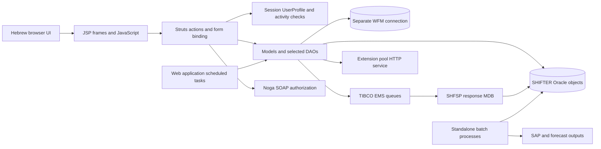
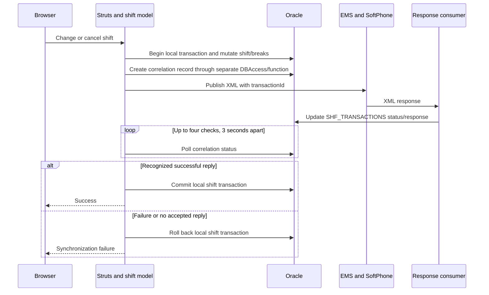
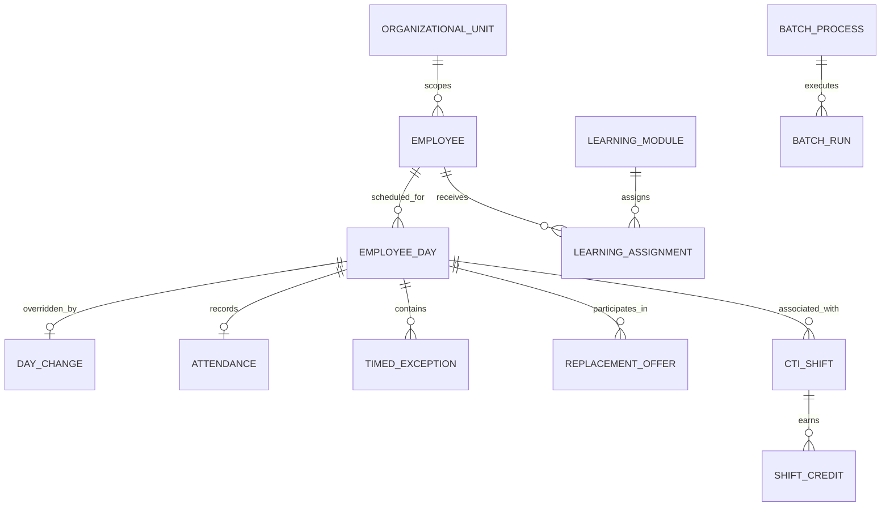
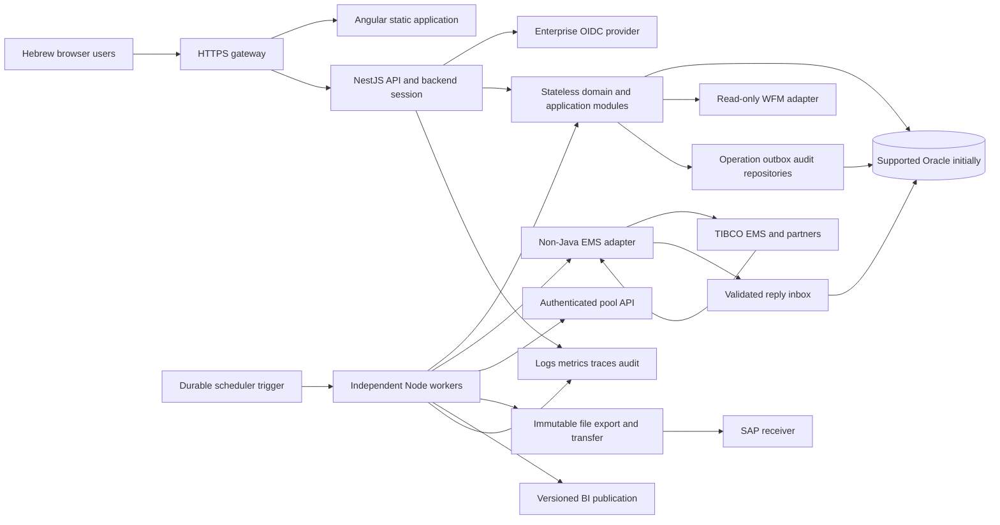

# SHF Reverse-Engineered Technical Design

Document date: 2026-10-11

Reading guide:

- [Existing architecture](#2-existing-architecture)
- [API and application services](#3-api-and-application-services)
- [UI design](#4-ui-design)
- [Database and business rules](#5-database-and-business-rules)
- [Batch processes](#6-batch-processes)
- [Interfaces](#7-interfaces)
- [Security and operational risks](#8-security-and-operational-risks)
- [Modern platform recommendation](#9-proposed-modern-platform)
- [Migration and validation](#10-migration-and-validation)
- [Evidence and open questions](#11-evidence-catalog-and-open-questions)

## 1. Purpose, Scope, and Evidence

This document describes the existing SHF application and a proposed replacement
platform without Java or IBM WebSphere. The design separates API/application
services, UI, batch processes, and external interfaces. Existing behavior and
proposed behavior must not be treated as the same contract.

Evidence labels used throughout the document:

- **Verified source:** directly supported by readable source or configuration.
- **Inferred:** a reasonable interpretation that still needs runtime or owner confirmation.
- **Proposed:** the recommended replacement design, not an existing implementation.
- **Unverified:** unavailable, access-restricted, or not demonstrated in this workspace.

The investigation is read-only with respect to application code, databases,
brokers, and external business services. Credentials and sensitive payloads must
not be copied into this document. No deployed runtime version is assumed merely
from a directory name or an archived deployment.

### 1.1 Initial Verified Baseline

| Observation | Evidence | Design implication |
| --- | --- | --- |
| The application is packaged as a J2EE 1.4 web EAR, with `SHFWeb.war` and context root `shf`. | [EAR descriptor](../SHFEAR/META-INF/application.xml) | Preserve the legacy URL base during incremental migration; do not assume a current REST API. |
| Struts action mappings bind forms to operation-specific actions and JSP forwards. | [Struts mappings](../SHFWeb/WebContent/WEB-INF/struts-config.xml) | Reverse-engineer operation parameters, form fields, authorization, and view state separately from proposed HTTP resources. |
| Login calls Noga authorization, loads a `UserProfile`, stores it in the HTTP session, and sets a 5,400-second inactivity interval. | [LoginAction](../SHF/src/bzq/shf/actions/LoginAction.java) | Identity, application permissions, session lifetime, and mobile audit behavior are migration contracts. |
| An MDB parses an SHFSP XML response and updates `shifter.shf_transactions` using its transaction ID. | [SHFSPMDBBean](../SHFEJB/ejbModule/ejbs/SHFSPMDBBean.java) | Keep message processing separate from request handling and preserve correlation, status, and recovery semantics. |
| The MDB selects Oracle datasource names using `BZQ_CONFIG_ENV`. | [SHFSPMDBBean](../SHFEJB/ejbModule/ejbs/SHFSPMDBBean.java) | Environment selection and datasource ownership require explicit replacement configuration. |

### 1.2 Access and Verification Limits

- The workspace has no Git metadata available for change-history verification.
- Copilot access to the web deployment descriptor is restricted. Its servlet,
  filter, security, and session declarations are not verified by this document.
- Live schema and interface verification will be distinguished from local
  source-derived contracts. Configuration alone does not prove connectivity or
  current production behavior.

## 2. Existing Architecture

### 2.1 Business Purpose

**Inferred from verified operations:** SHF is a workforce and contact-center
operations application. It manages employee information, planned shifts,
attendance, breaks, shift replacement/reinforcement/reduction, exceptions,
forecast-versus-staffing analysis, CTI time processing, SAP attendance exports,
learning-task scheduling, and work-from-home telephone extension allocation.
It is not demonstrated to be the system that originally optimizes WFM schedules.

Terminology used in the source includes division, department (`agaf`), contact
center (`moked`), team, site, inner job, employee day, exception, and completion.
These are business concepts, not interchangeable tenant or authentication roles.

### 2.2 Module and Source Inventory

| Module / surface | Verified contents | Responsibility |
| --- | --- | --- |
| `SHF/src` | 238 Java files; 66,597 lines, including comments and some support/report code. | Struts actions, models with embedded SQL, selected DAOs, forms, beans, tag libraries, permissions, integration helpers, and listener tasks. |
| `SHFWeb` | 185 JSP files and 50 Struts form bindings; 216 mapped actions. | WAR presentation, JavaScript, environment XML, message catalogs, and resource bindings. |
| `SHFBatch/src` | 38 Java files; 11,085 lines. | Standalone CTI/SAP and forecast processes plus batch utilities and persistence. |
| `SHFEJB` | One inspected MDB implementation, 244 lines; EJB 2.1 descriptor. | SHFSP response consumption and transaction-status persistence. |
| `SHFEAR` | J2EE 1.4 application descriptor, web WAR, context root `shf`. | Browser/application deployment. |
| `SHFEJBEAR` | Separate EAR descriptor exists. | Packaging for the message consumer; production topology is not proven. |
| `APPLib` / `SharedLibraries` | Proprietary proxy/JMS/JAXB artifacts and older client-library directories. | Shared dependencies, much of whose implementation and operational contracts are unavailable as readable source. |
| `Deployment`, `Servers`, `ProfileProject` | Historical artifacts and profile exports. | Deployment evidence, not proof of the currently installed production configuration. |

The full route, form, SQL-identifier, and public-method indexes are in the
[source contract catalog](SHF_SOURCE_CONTRACT_CATALOG.md). Counts are reproducible
with [the inspection script](Inspect-ShfDesign.ps1). They do not measure active
code coverage, and comment lines are included in source line counts.

### 2.3 Runtime Compatibility Baseline

| Technology | Verified local evidence | What remains unknown |
| --- | --- | --- |
| Java | Java 5 facet and a WebSphere 6.1 JRE classpath target. | Actual deployed JVM and bytecode level. |
| WebSphere | Eclipse runtime target `was.base.v61`; legacy IBM JNDI factory. | Installed edition, fix pack, topology, security configuration, and current version. |
| J2EE / EJB | EAR descriptor 1.4, EJB descriptor 2.1, `javax.*` APIs. | Effective runtime overrides and resource enlistment. |
| Struts | Struts 1-style `Action.perform`, forms, forwards, and tag libraries. | Exact Struts artifact version and any upstream security patches. |
| Dojo | Local version text `1.3.1-20090504-IBM`. | Supported browser estate and additional deployed customizations. |
| jQuery | A locally bundled asset named `jquery-1.12.0.min.js` is referenced in UI source. | Whether the deployed asset is identical to this workspace. |
| Oracle | Oracle-specific SQL, `bzq.db.DBAccess`, SHIFTER object references, and a separate WFM alias. | Server version, OCI/JDBC version actually loaded, schemas, grants, constraints, and PL/SQL bodies. |
| TIBCO EMS | JMS and TIBCO client usage; historical `v43` and `v5.1.2` library directories. | Broker version, supported non-Java clients, destination policies, persistence overrides, and redelivery/DLQ setup. |

Evidence: [Java facet](../SHF/.settings/org.eclipse.wst.common.project.facet.core.xml),
[classpath](../SHF/.classpath), [Dojo version](../SHFWeb/WebContent/dojo/version.txt),
[EJB descriptor](../SHFEJB/ejbModule/META-INF/ejb-jar.xml).
Do not label the database Oracle 10g solely because a client directory is named `v10`.

### 2.4 Logical Component Diagram



This diagram describes source-visible relationships, not verified network zones
or production deployment instances. EMS connects multiple distinct workflows;
the diagram does not imply a single destination or a single external application.

### 2.5 Request, State, and Resource Ownership

1. Struts binds request parameters into configured form classes.
2. [BaseAction](../SHF/src/bzq/shf/actions/BaseAction.java#L94) obtains `userProfile`
   from the HTTP session, parses mapping parameters, copies identity/scope into
   forms, and checks the optional `activity` key against allowed activities.
3. An action dispatches using the mapping `param`, calls a model, puts results
   into request/session attributes, and returns a JSP or another action forward.
4. Models issue Oracle SQL through `DBAccess`, often directly rather than through
   a complete repository layer. `DBAccess(false)` is used for explicitly committed
   work in inspected paths; the proprietary implementation is not locally proven.
5. Reference data and parameters are accessed through shared `AppResources` /
   `TablesContainer` objects. Their invalidation and cross-node consistency need
   runtime confirmation.

Search criteria are sometimes stored in session attributes such as `shiftsForm`
and `potentialInforceForm`. Request state also appears in action instance fields;
because Struts actions can be reused concurrently, those fields are a security
and correctness risk, not a replacement pattern.

### 2.6 Environment Configuration and Access Findings

Configuration is selected using `BZQ_CONFIG_ENV` and environment folders.
The readable web configuration is XML, not a direct modern connection string.

| Environment | Web SHF default datasource | Web WFM datasource | MDB datasource selected in code |
| --- | --- | --- | --- |
| `local-dvlp` | `jdbc/shfdvlp` | `jdbc/wfmprod` | `jdbc/shfdvlp` |
| `server-dvlp` | `jdbc/shfdvlp` | `jdbc/wfmtest` | `jdbc/shfxadvlp` |
| `server-test` | `jdbc/shftest` | `jdbc/wfmtest` | `jdbc/shfxatest` |
| `server-prod` | `jdbc/shfprod` | `jdbc/wfmprod` | `jdbc/shfxaprod` |

Evidence: the four web environment configurations, including
[test configuration](../SHFWeb/WebContent/WEB-INF/env/server-test/shf-config.xml),
[production configuration](../SHFWeb/WebContent/WEB-INF/env/server-prod/shf-config.xml),
and [MDB initialization](../SHFEJB/ejbModule/ejbs/SHFSPMDBBean.java#L82).
Names containing `xa` do not prove XA enlistment or atomic Oracle/EMS work.
The local development WFM production alias is a verification and isolation risk.

The client metadata at [workspace client metadata](../clientdb.xml) is an IBM
work-item client model, not an Oracle connection definition. No Oracle DSN,
`sqlplus`, Java executable on PATH, or Oracle query tool was available during
this investigation. Therefore no live database login, schema query, or external
business-interface request was executed. JNDI binding targets and credential
resolution still need an authorized environment connection.

## 3. API and Application Services

The [modern REST API detailed design](SHF_REST_API_DETAILED_DESIGN.md) expands
this section into method/path contracts, DTOs, capability policies, revisions,
idempotency, asynchronous operations, transaction boundaries, OpenAPI examples,
legacy migration coverage, and API verification gates. It is a proposed
replacement contract, not an existing API implementation.

### 3.1 Existing Entry-Point Design

The existing browser surface is operation-based Struts, not a documented REST API.
The 216 XML mappings include view initialization, results, exports, commands,
mobile handling, and external callbacks. They must not become 216 new controllers
without considering duplicate workflows and form/view-only operations.
The [complete route catalog](SHF_SOURCE_CONTRACT_CATALOG.md#1-complete-struts-route-catalog)
records each path, action, operation/activity parameter, form/scope, and forward.
HTTP method restrictions are not established by that XML.

| Capability / action | Routes | Existing responsibility and state |
| --- | ---: | --- |
| `ShiftDataAction` | 49 | Planned/current/self shifts, reinforcement requests and candidates, time-change requests, shift add/change/cancel, remarks, locations, file import, and exports. |
| `AttendanceDataAction` | 22 | Stage/station arrival, departure, lateness, missing reasons, attendance reports, flags, and corrections. |
| `EmployeeDataAction` | 19 | Employee card/search, skills, activities, events, education routes, and SMS preferences. Courses/taxi routes exist but their inspected model methods are placeholders. |
| `BreakDataAction` | 17 | Planned and actual breaks, operational tabs, replacement offers, managed-break synchronization, and break correction. |
| `ForecastAction` | 16 | Call forecasts, staffing/schedule aggregation, selection parameters, comparisons, and exports. |
| `SystemAdminAction` | 15 | Unit/system parameters, inner jobs, activity aims, and configuration administration. |
| `CTIAction` | 15 | CTI completion entry, search/correction, cancellation, SAP job eligibility, and reports. |
| `ReplaceAction` | 14 | Candidate repositories, offers, eligibility, acceptance/rejection, and notifications. |
| `ExceptionAction` | 8 | Employee/day exceptions, full-day/time-off views, cancellation, and remarks. |
| `ReduceDataAction` | 7 | Reduction requests, candidates, timing checks, approvals, declines, and counts. |
| `SwitchAction` | 4 | Two-shift validation, confirmation, repository cleanup, and coordinated swaps. |
| `IWDAction` | 4 | Learning-module scheduling, availability, completion/status views, and cancellation. |
| `MessagesAction` | 4 | Employee messages, offer acceptance, and deletion. |
| `PlatformAction` | 3 | Mobile/platform views and mobile audit support. |
| `ManageBuildingsAction` | 3 | Buildings and assigned teams. |
| `ShiftCancelledAction` | 3 | Cancelled activity/shift views. |
| `SoftPhoneAction` | 2 | Actual break-time callback and a logging-only logout operation. |
| `OptShfSpAction` | 2 | Managed-break enable/disable management and partner synchronization. |
| WFM schedule actions | 4 | Schedule home, sites, and forecast report views. |
| Login/mobile login, forward, tables, admin | 5 | Login/session setup, message bar, reference data initialization, and administration. |

Counts sum to 216; functionality is supported by the source method index and
mapped routes. Not every historical branch was executed or proven reachable.

### 3.2 Identity and Authorization Contract

[LoginAction](../SHF/src/bzq/shf/actions/LoginAction.java#L79) sends the requested
domain identity, an environment-adjusted application code, and client IP to the
Noga proxy. It copies returned name and general authorization into the form,
calls [Login.load](../SHF/src/bzq/shf/model/Login.java#L47), and stores the resulting
profile in the session with a 90-minute inactivity interval.

Oracle supplies replacement eligibility, employee-to-unit membership, profile
activities, and optional fixed unit. `Login.setAllowedUnits` expands division,
department, contact-center, and team hierarchy with specific special cases.
The special unit `00020000` receives a broad collection of units; team scope
delegates through its parent. These rules require owner-approved characterization
tests before changing the permission model.

**Proposed:** use an enterprise OIDC identity provider and backend-managed login
session. Preserve application permissions as a server-side policy service that
evaluates `(actor, action, resource, organizational scope)` rather than trusting
browser-supplied allowed units or user names. Keep a Noga SOAP adapter temporarily
if required. Noga authorization lookup is not, by itself, proof that the caller
authenticated the supplied identity; upstream identity enforcement is unverified.

Every read/write/export requires resource-level organizational authorization.
Employee self-service and manager capabilities are different policies. Machine
callbacks require a separate service identity and replay protection, not a
browser session or permission implied by network location.

### 3.3 Business-Rule Inventory

| Rule / owner | Verified behavior | Replacement obligation |
| --- | --- | --- |
| Effective shift, multiple models | Baseline employee-day rows are combined with change rows using `NVL`, joins, and unions. | Centralize effective-shift projection while retaining original/source/modified ownership. Do not flatten baseline and override blindly. |
| `ShiftDataModel.validateUpdate` | Checks missing reason, date window, unit minimum duration, start/end order, existing swap/break offers, and split-shift validation. | Separate deterministic validation from writes and partner effects; preserve parameter lookup and date semantics. |
| `SwitchModel.validateReplace` | Rejects same-time shifts, incompatible inner jobs, attendance/missing/late conditions, and invalid rest gaps; repository/exception/extension conflicts can request confirmation. | Model validation errors and override-required warnings separately; a returned boolean is not a simple valid/invalid result. |
| `ReplaceModel` and DAOs | Candidate filtering includes inter-shift gaps, shift duration difference, compatible jobs, same-time restrictions, and site checks for night shifts. | Revalidate at acceptance under concurrency; search eligibility alone is not authorization or final validity. |
| `BreakDataModel` | Enforces break duration/range, start/end distance from shift, inter-break gap, and managed-change lead time. Some checks depend on source and parameters. | Parameter-versioned policy service; exact boundary tests, including zero-duration/deletion and cross-midnight behavior. |
| `AttendanceDataModel.exitStation` | Departure update requires station arrival and no previously recorded departure. | Idempotent event registration with conflict detection; explicit correction commands with reasons. |
| `ReduceDataModel` | Unit-configured minutes before reduction; cancellation uses shift validation and then updates approval separately. | One business operation with audited outcome; detect and repair cancel-succeeded/approval-failed cases. |
| `IWDModel` / task | Eligible on-shift modules, completion/status categories, end-of-shift constraints, and break-conflict rescheduling. | Preserve module/employee identity, unit routing, and eligibility at send time. |
| `CTICompletion` / CTI batches | Manual completions, CTI pairing/grouping, credited/rewarded time, employee/job SAP eligibility, and suppression statuses. | Financial/attendance-grade golden tests; no lossy rounding or uncontrolled recalculation. |

Evidence: [shift validation](../SHF/src/bzq/shf/model/ShiftDataModel.java#L3604),
[swap validation](../SHF/src/bzq/shf/model/SwitchModel.java#L69),
[replacement rules](../SHF/src/bzq/shf/model/ReplaceModel.java#L991),
[break validation](../SHF/src/bzq/shf/model/BreakDataModel.java#L3174),
[reduction timing](../SHF/src/bzq/shf/model/ReduceDataModel.java#L386),
[departure registration](../SHF/src/bzq/shf/model/AttendanceDataModel.java#L1884).
Constants include day types 1-7, a 60-minute inter-break gap, and four 3-second
SHFSP response-check attempts. Parameter-specific values are not inferred from
constants or comments when a database parameter is used.

### 3.4 Existing Managed-Shift Transaction Flow



Evidence: [cancel flow](../SHF/src/bzq/shf/model/ShiftDataModel.java#L3704),
[upsert flow](../SHF/src/bzq/shf/model/ShiftDataModel.java#L3969),
[response polling](../SHF/src/bzq/shf/model/BreakDataModel.java#L3060),
[correlation function call](../SHF/src/bzq/shf/model/BreakDataModel.java#L3260).
The function body and its commit/autonomous-transaction behavior are unverified.
This is not demonstrated to be an atomic distributed transaction: the partner
may apply a request before timeout or local rollback, or before a failed commit.

### 3.5 Proposed HTTP API Conventions

**Proposed replacement contract, subject to owner approval:** expose JSON under
`/api/v1`; publish OpenAPI 3.1 and generate browser clients from the contract.
Internal DTOs must not expose Java forms, SQL aliases, secret fields, or raw XML.

- `GET` is read-only. Commands use `POST`; direct configuration changes use
  `PATCH` or `PUT`. Legacy GET-like mutation links are not carried forward.
- IDs are opaque decimal strings where Oracle numbers could exceed JavaScript's
  safe integer range. Employee identity numbers remain strings and are minimized.
- Dates use ISO 8601; business dates use `YYYY-MM-DD`. Datetime inputs require an
  offset plus an explicit business zone policy, initially proposed `Asia/Jerusalem`.
- Lists have bounded pagination, allowlisted filters/sorts, and deterministic
  ordering. Current operational lists return `asOf` and revision information.
- Mutations require `Idempotency-Key`; concurrent edits use `If-Match` / ETag.
  Repeated same-key/same-body requests return the original outcome. Same key with
  a different body is rejected. Missing edit precondition returns `428`.
- Use RFC 9457 problem details with stable business codes and field errors.
  Distinguish `400` malformed, `401` unauthenticated, `403` forbidden, `404` absent,
  `409` business/state conflict, `412` stale revision, `422` invalid business input,
  and `503` required infrastructure unavailable. Do not return stack traces.
- Partner-synchronized or long-running work returns `202`, `Location`, and an
  operation resource. A pending proposal is not an active committed shift.
- Audit actor, organizational scope, changed fields, reason, operation ID, and
  final outcome on the server. Re-evaluate permission and invariants on final apply.

### 3.6 Proposed API Resource Inventory

All endpoints below are proposed and are not implemented by this documentation.
Paths sharing one row have the same owning business service, not shared authorization.

| Service | Proposed endpoints | Important contract |
| --- | --- | --- |
| Identity | `GET /me`, `GET /me/capabilities`, backend OIDC login/callback/logout endpoints | Trusted identity, employee link, scoped capabilities; no raw SSO authorization arrays. |
| Reference data | `GET /reference-data`, `GET /org-units`, `GET /org-units/{id}/children` | Versioned reference values and organization scope; no global dump for unauthorized users. |
| Employee | `GET /employees`, `GET /employees/{id}`, `GET /employees/{id}/skills`, `/events`, `/education`; `/courses` and `/taxi-orders` only if approved and specified | Purpose-limited data; upstream fields read-only initially. Do not invent course/taxi integrations to replace empty model methods. |
| Employee commands | `POST /employees/{id}/events`, `PATCH /employees/{id}/notification-preferences` | Validated event reasons and authorized notification preferences. |
| Shift reads | `GET /shifts`, `GET /shifts/{id}`, `GET /me/shifts`, `GET /shifts/current` | Effective and baseline/override provenance, employee/site/job identity, split and work-from-home state. |
| Shift commands | `POST /shifts`, `POST /shifts/{id}/change-proposals`, `/cancellations`, `/location-changes`; `PATCH /shifts/{id}/remark` | Duration/window/swap/attendance validation; synchronization policy; actor/revision audit. |
| Reinforcement | `GET/POST /reinforcement-requests`, `PATCH /reinforcement-requests/{id}`, `GET /reinforcement-requests/{id}/candidates`, `POST /reinforcement-requests/{id}/assignments` | Capacity, team/job/skill/site eligibility, remaining count, competing assignments. |
| Time-change workflow | `GET/POST /time-change-requests`, `GET /time-change-requests/{id}/candidates`, `POST /time-change-requests/{id}/applications`, `/approvals`, `/rejections` | Allowed time ranges, current shift revision, candidate state and notifications. |
| Attendance | `GET /attendance`, `GET /shifts/{id}/attendance`, `POST /shifts/{id}/attendance-events`, `/attendance-corrections` | Event type, timestamp, source, reason and revision; duplicates/out-of-order corrections explicit. |
| Attendance reports | `GET /attendance-reports`, `POST /attendance-reports/{id}/approvals`, `/cancellations` | Report ownership, approval actor, historical state and audit. |
| Breaks | `GET /breaks`, `GET /shifts/{id}/breaks`, `POST /shifts/{id}/break-change-proposals`, `POST /breaks/{id}/actual-events` | Planned and actual times distinct; constraints and partner synchronization. |
| Break offers | `GET/POST /break-offers`, `POST /break-offers/{id}/acceptances`, `/rejections`, `/cancellations` | Both participants' shifts, breaks, scope, revisions, and eligibility rechecked. |
| Replacement | `GET/POST /shift-offers`, `GET /shift-offers/{id}/candidates`, `POST /shift-offers/{id}/proposals`, `/acceptances`, `/rejections`, `/cancellations` | Rest-gap policy, compatible inner jobs, site/night rules, offer limits, and stale-offer invalidation. |
| Manager swap | `POST /shift-swaps/validations`, `POST /shift-swaps` | Both shift IDs/revisions, confirmation warnings, authorized override reason, cleanup and partner effects. |
| Reduction | `GET/POST /reduction-requests`, `PATCH /reduction-requests/{id}`, `GET /reduction-requests/{id}/candidates`, `POST /reduction-requests/{id}/approvals`, `/rejections` | Lead time, request capacity, cancellation/approval consistency, no accidental partial success. |
| Exceptions | `GET /exceptions`, `GET /employees/{id}/time-off`, `POST /exceptions/{id}/cancellations`, `PATCH /exceptions/{id}/remark` | Full-day versus shift-part exceptions, original/source state and cancellation rules. |
| Forecast/reporting | `GET /forecasts/calls`, `GET /forecasts/staffing`, `GET /reports/schedules`, `/sites`, `/work-from-home` | Filter set, interval granularity, baseline/changes/breaks/exceptions options and `asOf`. |
| Exports/imports | `POST /exports`, `GET /exports/{id}`, `GET /exports/{id}/download`, `POST /shift-imports`, `GET /shift-imports/{id}/validation` | Async bounded export; authorized signed download; strict import validation, checksum and commit confirmation. |
| CTI | `GET /cti/shifts`, `GET/POST /cti/completions`, `POST /cti/completions/{id}/corrections`, `/cancellations` | Credited/manual versus actual time; export state prevents unauthorized retroactive resending. |
| IWD | `GET /learning/modules`, `GET /learning/assignments`, `POST /learning/schedules`, `POST /learning/assignments/{id}/cancellations` | Completion, planned timing, sent state, service routing and break overlap. |
| Buildings | `GET/POST /buildings`, `PATCH /buildings/{id}`, `PUT /buildings/{id}/teams` | Unit/site scope, assignment uniqueness, concurrent administration. |
| Administration | `GET/PATCH /administration/unit-parameters/{unitId}`, `GET/POST /administration/inner-jobs`, `PUT /administration/activity-aims`, `PUT /administration/sap-job-eligibility` | Elevated scoped permissions, before/after audit, configuration version and controlled cache invalidation. |
| Managed-break policy | `GET /administration/managed-break-policies`, `POST /administration/managed-break-policy-changes` | Inverted legacy flag mapping stays in partner adapter; async partner-confirmed result. |
| Messages | `GET /me/messages`, `POST /me/messages/{id}/read`, `/deletion` | Message recipient ownership; offer acceptance delegates to replacement service. |
| Operations | `GET /operations/{id}`, `GET /operations/{id}/events` | Authorized operation status; SSE optional; reconnect/replay and terminal outcome supported. |
| Machine ingress | `POST /interfaces/softphone/break-actual-events`, `POST /interfaces/softphone/logout-events` | Service authentication, partner event ID, schema validation, replay protection; logout remains logging-only unless approved otherwise. |
| Batch operations | `GET /batch-runs`, `GET /batch-runs/{id}`, `POST /batch-runs/{id}/replays` | Operator-only run metadata and controlled replay; no arbitrary shell execution. |

### 3.7 Example Change-Proposal DTO

Synthetic example; field types and error behavior are proposed, not a legacy payload:

```http
POST /api/v1/shifts/900001/change-proposals
Content-Type: application/json
If-Match: "revision-17"
Idempotency-Key: example-change-900001-1
```

```json
{
  "start": "2026-10-12T08:00:00+03:00",
  "end": "2026-10-12T16:00:00+03:00",
  "businessTimeZone": "Asia/Jerusalem",
  "locationId": "900010",
  "workFromHome": false,
  "split": null,
  "reasonCode": "EXAMPLE",
  "reason": "Authorized operational change"
}
```

The server derives actor, employee ownership, scope, baseline times, partner
delta, and active revision. Successful validation can return an operation with
`PENDING_SYNC`; the UI must not report completed until final apply succeeds.

### 3.8 Application-Service Boundaries

Controllers handle HTTP contracts only. Stateless application services own
authorization, validation, orchestration, and transaction scope. Domain policies
own shift/rest/break/credit rules. Repositories own SQL and mapping. Integration
adapters own XML, SOAP, EMS, HTTP, and file protocols. Workers invoke the same
application services, not browser controllers or mutable UI forms.

Start with a modular monolith and separate worker deployments. Scheduling,
attendance, breaks, replacement, and reduction are tightly coupled and should
not become distributed microservices before invariants and ownership are stable.

## 4. UI Design

### 4.1 Existing Presentation Architecture

[The main JSP](../SHFWeb/WebContent/jsp/shf_index.jsp) uses HTML 4.01 framesets:
top branding, central `frMain`, right-side navigation, and a message bar. The
initial main frame is the employee messages view. Links target frames, dialogs,
or JSP fragments, and forms depend on session/request attributes.

The page declares Windows-1255 and detects mobile from screen width below 760.
[Responsive JavaScript](../SHFWeb/WebContent/js/shf_responsive.js) hides existing
tables, constructs alternate row/detail tables from their HTML, remaps selection
to the original grid, and manipulates frame sizes. This is a transformed desktop
DOM, not an independent responsive component model.

Shared UI code includes grids, tabs, trees, menus, calendar/time controls,
checkbox/selection handlers, popups, attendance, breaks, shifts, reports,
forecasts, and export helpers. JSP tag libraries and message XML provide
presentation/validation support. Hebrew text returned as replacement characters
by UTF-8 reads must not be interpreted as proof that the original file is corrupt.

### 4.2 Screen and Workflow Map

| Feature area | Existing workflow | Proposed UI feature / API ownership |
| --- | --- | --- |
| Login/platform | Domain identity lookup, profile initialization, mobile detection and audit. | OIDC/session shell with backend capability discovery; no separate mobile login logic. |
| Employee workspace | Messages, personal shifts, employee card, offers, attendance, events and preferences; course/taxi model placeholders. | Self-service routes backed by `/me`, employee, shift, message and attendance services. Placeholder expansion requires a separate business requirement. |
| Operations workspace | Current shifts, attendance and break-status tabs, candidate lists and popups. | Dense operational tables, contextual detail pane, freshness indicator, explicit event/correction commands. |
| Schedule management | Search results, shift edit/split/location, add/cancel, reinforcement and potential candidates. | Date/unit filters, effective schedule view, validated proposal editor, candidate workflow and pending-operation state. |
| Replacement/reduction | Repositories, proposals, accept/reject, manager confirmation and messages. | Explicit workflow status and participant details; both-shift revisions and confirmation warnings visible. |
| Exceptions/time off | Part/day exceptions, cancelled activity views, remarks. | Separate full-day and timed exceptions with provenance and permitted correction actions. |
| Forecast/reporting | Call/statistical and staffing views, WFM schedule/site/home reports, exports. | Shared filter state, precise interval legend, source/as-of metadata, async exports. |
| CTI administration | Manual completions, errors/corrections, SAP eligibility and reports. | Separate actual/rewarded/manual time, export state, reasoned correction and restricted replay. |
| Learning/IWD | Module progress and available/scheduled/sent/completed groups. | Module and assignment views with planned time, completion state and reschedule reason. |
| Configuration | Unit parameters, activity aims, jobs, buildings/team mappings, managed-break flags. | Scoped admin routes with draft/save/validation, audited revision and partner-sync result. |
| Operational monitoring | Batch and integration status are primarily source/database/log oriented. | Proposed operator console for run/operation status, failures, reconciliation and controlled replay. |

### 4.3 Proposed Angular UI Structure

The [Angular UI detailed technical design](SHF_ANGULAR_UI_DETAILED_DESIGN.md)
expands this section with 20 screen specifications, component/state ownership,
typed REST consumption, Hebrew/RTL accessibility, operation recovery, and
incremental migration and verification gates.

Use Angular 22 with standalone feature components, route-based lazy loading,
signals for local state, typed forms, and RxJS for request streams. Use stable
APIs supported by the selected Angular/TypeScript version. Angular Material/CDK
supplies accessible primitives, overlays, focus management, and RTL support.
Choose a maintained data-grid library only after accessibility/licensing review;
do not recreate legacy grid selection by copying HTML.

Feature areas: `shell`, `self-service`, `employees`, `scheduling`, `attendance`,
`breaks`, `replacement`, `forecast`, `cti`, `learning`, `administration`, and
`operations`. Share typed API clients, localization, date policy, permission
display helpers, tables, validation summaries, and operation-status components.
UI route guards improve navigation but never replace backend authorization.

Store filters, selected date/unit, and pagination in route/query state. Keep
transient editing state in feature components. Store neither permissions nor
long-lived tokens in browser storage as an authority. Use server capability
responses for display, and refresh on session/permission changes.

### 4.4 Interaction and Accessibility Requirements

- Hebrew is the primary display language and all accessibility names/labels are
  Hebrew. Use `lang="he"`, RTL layouts, and intentional LTR isolation for times,
  phone numbers, numeric IDs, and technical values.
- Use UTF-8 end-to-end. Convert legacy Windows-1255 assets/data explicitly at
  boundaries, with round-trip tests for Hebrew and mixed-language values.
- Target WCAG 2.2 AA: keyboard operation, visible focus, logical reading order,
  contrast, target sizes, dialog focus return, associated errors, and live status.
- Replace frames with a normal application layout. Maintain table headers,
  stable row selection, server pagination, and discoverable contextual actions.
- Desktop operations remain scan-oriented. Mobile uses deliberate priority
  columns/detail views without duplicate hidden controls or DOM-copy selection.
- Show loading, empty, authorization-denied, failed, stale, pending-sync,
  success, and uncertain-partner states distinctly. Pending is not success.
- Disable unsafe duplicate submission while retaining the same idempotency key
  on retry. For stale edits, show the refreshed values and require reconciliation.
- Date/time and split-shift editors validate early but defer final rules to the
  server. Do not silently reinterpret `24:00`, cross-midnight shifts, or DST.
- Downloads use real XLSX or an explicitly documented CSV/TSV format, with formula
  injection handling. Current `.xls`-labelled text exports are compatibility artifacts.

### 4.5 UI Acceptance Checks

Characterize each current role's navigation and authorized data before replacing
screens. Test agent versus manager scopes, session expiry, multi-tab filters,
selection across pages, confirmation warnings, stale edits, failed/late partner
replies, export contents, Hebrew/RTL, and keyboard/screen-reader workflows.
Use Playwright at desktop and mobile sizes plus automated accessibility checks
and manual keyboard/screen-reader verification. No UI runtime or screenshot
verification was performed in this source-only design task.

## 5. Database and Business Rules

### 5.1 What Is and Is Not a Schema Reconstruction

The database design below is source-derived. Names and column uses are observed
in SQL; physical types, primary/foreign keys, unique constraints, nullability,
triggers, row counts, indexes, and grants are not verified against a live database.
The source catalog contains 89 qualified identifier candidates and 23 unqualified
SQL candidates. Those numbers are not table counts. Candidates include sequences,
a function, view-like names, comments, and a questionable qualified identifier.

The only inspected local application SQL file is a narrow DDL statement adding
`CATEGORY_JOB_ID NUMBER(2,0) NOT NULL` to `SHF_INNER_JOBS`:
[local DDL](../SHF/script1.sql). It is not a baseline schema and was not executed.

### 5.2 Source-Derived Object Groups

Object names in this table are SQL references, not independently verified Oracle
object types. Resolve unqualified names and synonyms on the actual connection.

| Domain | Source-referenced objects | Responsibility / verification |
| --- | --- | --- |
| Workforce hierarchy | `SHF_EMPLOYEES`, `SHF_ORG_UNIT`, `SHF_ORG_UNITS_VIEW`, `SHF_ORG_UNITS_SHF_SITES`, `SHF_INNER_JOBS`, `SHF_CATEGORY_JOB`, `SHF_CATEGORY_TYPE` | Employee identity, organizational hierarchy, jobs and site relationships. Employee ownership may come from upstream systems. |
| Employee detail | `SHF_EMPLOYEE_SKILLS`, `SHF_SKILLS`, `SHF_ACTIVITY_SKILL`, `SHF_EMPLOYEE_EVENTS`, `SHF_EVENT_REASON` | Skills/eligibility and employee events. External course, education, taxi and HR ownership is not fully reconstructed. |
| Schedule baseline/override | `SHF_EMPLOYEE_DAY`, `SHF_DAY_CHANGES`, `SHF_LAST_SHIFTS_VIEW`, `SHF_SITE` | Original WFM-derived day and effective SHF modifications, swap/source/site/home/split information. |
| Attendance | `SHF_ATTENDANCE`, `SHF_EMPLOYEE_REPORTS`, `SHF_EMPLOYEE_ENTRANCE_MOOD` | Stage/station arrival/exit, missing/late reasons, reports and additional employee-entry state. |
| Exceptions | `SHF_EMPLOYEE_EXCEPTIONS`, `SHF_EMPLOYEE_EXCEPTIONS_BASE`, `SHF_EXCEPTION_TYPE`, `SHF_TIMEOFF_TYPES` | Baseline/current shift parts, breaks, exceptions and time-off classification. |
| Reinforcement | `SHF_SHIFT_INFORCE_REQ`, `SHF_SHIFT_INFORCE_TEAM`, `SHF_SHIFT_INFORCE_INNER_JOB` | Requested capacity and team/job eligibility. |
| Time changes | `SHF_TIME_CHANGE_REQUEST`, `SHF_TIME_CHANGE_CANDIDATES` | Time-window requests and employee-day applications. |
| Replacement | `SHF_REPLACE_CANDIDATES`, `SHF_REPLACE_BREAK_CANDIDATES`, `SHF_REPLACE_ACTIVITIES`, `SHF_REPLACE_MASSAGE` | Shift/break offers, compatibility and user messages. Keep legacy spelling at the adapter boundary. |
| Reduction | `SHF_SHIFT_REDUCE_REQ`, `SHF_SHIFT_REDUCE_CANDIDATE` | Requested reduction counts, application, approval and decline timestamps. |
| Forecast/policy | `SHF_FORECAST_ACTIVITIES`, `SHF_FORECAST_DATA`, `SHF_VIRTUAL_ACTIVITIES`, `SHF_ACTIVITY_TYPE`, `SHF_ACTIVITY_CALL_TIME_AIM`, unqualified `SHF_DAY_DATA_FOR_BI` | Activity mapping, forecasts, workload aims and BI output. `SHF_PERF_ACTIVITIES` appears in commented source; active use unverified. |
| Security/config | `SHF_SECURITY_PROFILE`, `SHF_SECURITY_ACTIVITIES`, `SHF_USER_PROFILE`, `SHF_SYSTEM_PARAM`, `SHF_UNIT_PARAM`, `SHF_MOBILE_AUDIT`, `SHF_MOBILE_AUDIT_REF` | Activity rights, fixed/unit scope, parameters and mobile audit. |
| Building/location | `SHF_BUILDING`, `SHF_BUILDING_TEAM` | Building creation and team assignment. |
| CTI input and calculation | `SHF_CTI_BEFORE_HANDLED`, `SHF_CTI_AFTER_HANDLED`, `SHF_CTI_PARTS`, `SHF_CTI_SHIFTS`, `SHF_CTI_SHIFT_CREDIT`, `SHF_CTI_UNIT_CREDITS` | CTI states, paired intervals, grouped shifts and credits. |
| CTI manual/SAP | `SHF_CTI_EMPLOYEE_COMPLETIONS`, `SHF_CTI_COMPLETIONS`, `SHF_CTI_EMP_COMPLETION_PARTS`, `SHF_CTI_JOB_TO_SAP`, `SHF_CTI_CANCEL_LOGIN_SHIFTS` | Manual completions, SAP eligibility and cancellation/suppression. Misspelled completion column references require live verification. |
| Batch ledger | `SHF_BATCH_DOCS`, `SHF_BATCH_PROCESS` | Run status, dates, generation, counters, file names and commit/checkpoint information. |
| Integration ledger | `SHF_TRANSACTIONS`, `SHF_BREAK_SMS`, `SHF_OPT_SHFSP_FLAG` | XML correlation/status, queued break reminders and managed-break flags. |
| Learning | `SHF_PELE_LOMDOT`, `SHF_PELE_EMPLOYEES`, `SHF_PELE_EMPLOYEES_HISTORY`, `SHF_PELE_IWD_SERVICE_CODES` | Module definitions, assignment/completion/timing, send history and unit-specific routing. |
| WFM reporting | `WFM.WM_SCH_REPORT_ACTIVITIES`; unqualified `WM_SCH_SITES`, `WM_SITES` and other `WM_*` candidates | Separate `DBAccess("wfm")` reporting connection; published schema/optimizer ownership not locally established. |

The catalog links each identifier to source locations. Examples of sequences
include `SHF_AGENT_DAY_ID`, `SHF_SHIFT_INFORCE_ID`, `SHF_SHIFT_CHANGE_ID`,
`SHF_CTI_PART_ID`, `SHF_CTI_SHIFT_ID`, `SHF_CTI_SAP_REQ_ID`,
`SHF_TRANSACTIONS_ID`, and `SHF_BREAK_SMS_ID`. Their current values and allocation
properties must be discovered without calling `NEXTVAL` during investigation.

### 5.3 Critical Logical Data Dictionary

Column names below are observed; proposed types are semantic categories, not
verified Oracle declarations. All cardinalities and keys need metadata confirmation.

| Object | Observed important fields | Logical meaning / target representation |
| --- | --- | --- |
| `SHF_EMPLOYEES` | `EMPLOYEE_ID`, `EMP_ID_NUMBER`, `ORG_UNIT_ID`, `FIRST_NAME`, `LAST_NAME`, `INNER_JOB_ID`, `JOB_ID`, `STATUS_ID`, `REPLACE_ALLOWED`, `CELLULAR_PHONE`, `OPTIONAL1` | Surrogate versus business identity, organizational/job eligibility and sensitive contact data. Preserve leading zeros and the full versus shortened identity number. |
| `SHF_EMPLOYEE_DAY` | `SHF_EMPLOYEE_DAY_ID`, `EMP_ID_NUMBER`, `WM_DATE`, `WM_DAY_TYPE`, `WM_SHIFT_START_DATETIME`, `WM_SHIFT_END_DATETIME`, `WORK_FROM_HOME`, `POOL_EXT_NUM` | Original schedule/day identity and planned interval. Treat business date and instant separately; keep source provenance. |
| `SHF_DAY_CHANGES` | `SHF_EMPLOYEE_DAY_ID`, `NEW_EMPLOYEE_ID`, `NEW_DAY_TYPE`, `NEW_SHIFT_START`, `NEW_SHIFT_END`, `NEW_ACTIVITY`, `NEW_SITE_ID`, `SWITCH_DAY_ID`, `MODIFICATION_TIME`, `MODIFICATION_USER`, `NEW_WORK_FROM_HOME`, `NEW_SPLIT_SHIFT`, `NEW_SPLIT_START`, `NEW_SPLIT_END`, `NEW_POOL_EXT_NUM`, cancellation reason fields | Override state rather than an independent unrelated shift; new owner and original owner can differ. Preserve cancellation/swap behavior. |
| `SHF_ATTENDANCE` | `SHF_EMPLOYEE_DAY_ID`, `STAGE_ARRIVAL_TIME`, `STATION_ARRIVAL_TIME`, `STATION_EXIT_TIME`, corresponding users, late/missing fields, `OPTIONAL1`, `TADREECH` | Actual attendance facts and correction/briefing/flag state. Do not confuse actual and planned times. |
| `SHF_EMPLOYEE_EXCEPTIONS` | `AGENT_DAY_ID`, `START_TIME`, `END_TIME`, `STATE_TYPE`, `EXCEPTION_TYPE` and actual break fields used by break models | Timed shift parts and break state. A stable break identity may require day plus planned timestamp until physical keys are verified. |
| `SHF_TRANSACTIONS` | `ID`, `PROCESS_ID`, `SOURCE`, `DESTINATION`, `EMPLOYEE_ID`, request/response XML, creation/update dates, `STATUS`, `STATUS_DESCRIPTION` | Correlation ledger with personal/credential-bearing payload risk. Target metadata plus restricted encrypted payload storage and retention. |
| `SHF_BREAK_SMS` | `SMS_ID`, `AGENT_CEL_NUM`, `AGENT_ID`, `SHIFT_DAY_ID`, `BREAK_END`, `CREATION_DATE`, `SMS_SENT_DATE` | Reminder intent versus delivery marker; add event deduplication and final delivery state in replacement. |
| `SHF_CTI_SHIFTS` | `CTI_SHIFT_ID`, `EMP_ID`, start/end and rewarded start/end, `HANDLE_STATUS`, `CREDIT_STATUS`, `SAP_STATUS`, `SAP_REQ_ID`, `SHF_EMPLOYEE_DAY_ID` | Actual interval, calculation/reward status and export ownership. Keep separate status axes and exact arithmetic. |
| `SHF_BATCH_DOCS` | `PROCESS_DOC_KEY`, `PROCESS_KEY`, `EXEC_DATE`, `TRIGGER_DATE`, `GEN_NUMBER`, `PROCESS_STATUS`, `LAST_COMMIT_REC`, `STEP_IN_PROGRESS`, counters and `FILE_NAME` | Durable run identity/checkpoint/operational reporting. New workers need equivalent or stronger recovery metadata. |
| `SHF_PELE_EMPLOYEES` | `MODULE_ID`, `EMP_ID`, `COMPLETION`, `IWD_TIMING`, `IWD_STATUS` | Per-module employee assignment and scheduling lifecycle. Sending is not demonstrated to mean completed. |

### 5.4 Logical Relationship Diagram

**Inferred from joins, not verified foreign keys:**



Joins often use the first eight characters of `EMP_ID_NUMBER`, and some interfaces
remove the final character. That transformation must be centrally specified and
validated with real anonymized identifiers, not treated as a universally safe
substring operation. Overrides can change employee association independently of
the original day. Diagram cardinalities are intended logical expectations only.

### 5.5 SQL and Transaction Semantics to Preserve

- Oracle `NVL`, `DECODE`, `TRUNC`, date arithmetic using `/1440`, `MINUS`, sequences,
  legacy outer joins, hints, and stored functions appear in important paths.
- Null, empty string, numeric scale, employee-ID substring joins, day-type codes,
  source flags, and dates formatted without zones influence business behavior.
- Some multi-step operations open several `DBAccess` instances and commit
  separately. A cancellation, approval, message, or history update can succeed
  independently of another step. The proprietary close/autocommit implementation
  is not proven and cannot be guessed from a constructor alone.
- `SHIFTER.SHF_INS_AND_RETURN_LASTID` is called by `SELECT ... FROM dual` with
  process/source/destination/time/employee/XML arguments and returns an ID.
  Despite its SQL invocation shape, it is intended to create a transaction record.
  Discover its body, ownership, grants and commit behavior; do not call it during
  read-only schema investigation.
- Windows-1255 UI/mail settings do not establish database character set. Discover
  database and session NLS settings before changing encoding/date mapping.
- Candidate indexes around day IDs, employee IDs, unit/date filtering, pending
  integration records, and CTI processing status must be evaluated with actual
  plans/cardinalities. No new physical indexes are justified by source text alone.

### 5.6 Read-Only Schema Verification Procedure

Use [metadata-only discovery SQL](SHF_SCHEMA_DISCOVERY_READ_ONLY.sql) on an
approved test/read replica connection supplied through existing enterprise secret
management. The SQL contains 15 `SELECT` statements and no business-table scans,
DDL, DML, `NEXTVAL`, outbound network functions, or application function execution.
It has been statically checked here, not executed against Oracle.

1. Resolve actual SHF and WFM JNDI bindings to host/service and driver versions in
   an authorized environment. Verify environment identity before connecting.
2. Use an account with metadata visibility and no business write privileges.
   Access to source/defaults/comments can itself be sensitive; review and redact
   exported results before distributing them.
3. Run identity/version/NLS queries, then object/column/constraint/index/sequence
   metadata, synonyms/dependencies, function signatures/body, triggers and grants.
   `ALL_*` views show only objects visible to that account; missing rows do not
   prove missing schema objects.
4. For referenced names resolved through synonyms or other owners, repeat with
   approved owner filters. Do not assume all WFM `WM_*` tables belong to WFM.
5. Reconcile the results with the source catalog; classify active, commented,
   obsolete, externally owned, dynamically referenced and source-missing objects.
6. Produce a reviewed physical ERD and data dictionary, exact PL/SQL contracts,
   transaction map and grants matrix. Only then authorize schema changes.

### 5.7 Target Database Strategy

**Proposed:** keep the existing business schema on a supported Oracle version for
the first application migration, after driver interoperability is demonstrated.
Use `node-oracledb` with explicit bound SQL, per-service repositories, bounded
pools, timeouts and transaction ownership. Maintain a read-only WFM pool and a
separate writer identity for owned SHF commands. Do not force complex legacy SQL
through an ORM that cannot preserve its semantics.

Add approved operation, outbox, inbox, audit, configuration-version and batch-run
structures in the same transactional database as their owned business writes.
Redis/queue publication cannot atomically substitute for that database transaction.
New schema changes require a reviewed migration and rollback/recovery plan.

PostgreSQL is the recommended later portability target, not a prerequisite for
removing Java/WebSphere. Migrate bounded domains only after PL/SQL, synonyms,
triggers, upstream ownership and Oracle date/null semantics are characterized.
Avoid simultaneously rewriting the application, replacing EMS, and translating
the entire database.

### 5.8 Forecast and BI Calculation Contract

[ForecastModel](../SHF/src/bzq/shf/model/ForecastModel.java#L1252) builds schedule
analysis in 15-minute intervals and accounts for partial overlap of timed breaks
and exceptions. Baseline WFM and modified SHF staffing remain separate measures;
selection flags control inclusion of changes, exceptions, breaks and other data.
This is not proven to be a new schedule-optimization or Erlang engine.

[BI insertion](../SHFBatch/src/bzq/shf/batch/ForcastDataProcess.java#L455) writes
30 columns to unqualified `SHF_DAY_DATA_FOR_BI`: division/department/center/team,
calculation date/time, calculated and required staffing, their gap, baseline and
modified net staffing, breaks, staffing-with-breaks, exceptions, total shifts,
missing, late, cancelled, extra hours, marked, arrivals, future exit, shifting,
extension, shortening, and master/detail row classification.

Observed BI arithmetic includes:

- `CALC_REQ_GAP = calculated staffing - required staffing`.
- `NETO_WFM = baseline staffing - baseline exceptions - baseline breaks`.
- `NETO_SHF = staffing after changes - SHF exceptions - SHF breaks`.
- Staffing-with-breaks subtracts non-break exception totals while retaining breaks.

Some values are explicitly cast to integer/long in the source. Preserve existing
rounding/truncation until owner-approved precision changes are tested. Target
reports need explicit interval bounds, business zone, configuration version,
source snapshot/as-of time and decimal policy. Boundary overlap and aggregation
tests must cover partial intervals, midnight, missing attendance, swapped staff,
master/detail totals and empty forecasts.

## 6. Batch Processes

### 6.1 Separation of Processing Types

There are three distinct processing categories:

- Standalone Java main programs in `SHFBatch`, configured by command-line XML /
  process name and application startup XML.
- Periodic tasks implemented in the web application and registered by a listener
  when that listener is active in the deployed configuration.
- Event-driven SHFSP response consumption in an MDB, described under interfaces.

No cron, enterprise-scheduler job definition, or standalone batch configuration
was found in the readable application/deployment files inspected. Historical
deployment folders contain JARs, not proof of current schedules or invocation
arguments. The web listener's effective registration is unverified because the
web deployment descriptor is access-restricted.

### 6.2 Standalone Batch Lifecycle

[BaseBatchProcess](../SHFBatch/src/bzq/shf/batch/BaseBatchProcess.java#L134) performs
argument parsing, process XML loading through `BatchProcessInitializer`, logger
initialization, application/reference-table startup, and process initialization.
It opens separate `DBAccess(false)` objects for business work and run documents.

The first two arguments are a process-property XML filename and process name.
Application startup separately expects the relative filename `shfbatch-config.xml`.
Those configuration files are runtime dependencies not present in the inspected
workspace. The XML process path is `process-prop/{processName}` and binds to
`ProcessBean`, including process key, directories, filenames and logging settings.

`perform()` executes the process, marks the run complete or errored, and calls
`finish()` in `finally`. `finish()` performs process finalization/statistics,
commits business work and the document connection separately, then closes them.
Error handling attempts rollback and can exit with `-1`. A committed business
connection and failed document commit are not one atomic result.

Run states observed in [batch constants](../SHFBatch/src/bzq/shf/batch/ShfBatchConstants.java)
are `R` ready, `P` processing, `C` complete, and `E` error. `Process` queries ready
documents, last completed generation/date, and checkpoint fields. Those features
do not prove every batch stage implements correct restart or overlap exclusion.

### 6.3 Standalone Job Inventory

| Job | Active source entry / control path | Input | Processing | Output / dependency |
| --- | --- | --- | --- | --- |
| CTI stage 1 | `CTIProcess1.main` constructs `CTIProcess1Copy`; the copy also has its own main. | `SHF_CTI_BEFORE_HANDLED`, employee identity and parameterized lookback. | Adjusts duplicate-state weights, orders employee/time/status events, constructs IN/OUT parts and marks source events handled. | `SHF_CTI_PARTS`, handled-event data/status; stage 2 depends on eligible parts. |
| CTI stage 2 | `CTIProcess2.execute`: `buildCtiShifts`, then `calcRewards`. | CTI parts and shift-gap/maximum-duration parameters. | Groups same-employee intervals, classifies missing start/end/overlong shifts and calculates rewarded time. | `SHF_CTI_SHIFTS` with calculation/export status; part-to-shift associations. |
| CTI stage 3 | `CTIProcess3.execute`: compare CTI with SHF, calculate credits. | CTI shifts, effective planned days, organization/credit configuration and login cancellation data. | Associates planned day, applies system/briefing credits and modifies rewarded start time. | Shift-credit records, rewarded times, credit and SAP suppression statuses. |
| CTI stage 4 / SAP | `CTIProcess4.execute`: eligibility update, shift file, completion file, suppression updates. | Credited CTI shifts, manual completion parts, employee/job eligibility and SAP request sequence. | Selects deliverable records, emits IN/OUT records, updates export status/request correlation and run counters. | `SH{yyMMdd}.txt` in configured output directory; failure copy in configured error directory. File-transfer/acknowledgment owner unverified. |
| Forecast BI | `ForcastDataProcess.execute`: team data and team/contact-center data. | Forecast model, organization/activity/site/reference data; optional business date. | Aggregates interval master/detail measures and inserts BI rows. Virtual-activity and contact-center-only preparation calls are commented out. | `SHF_DAY_DATA_FOR_BI`. A same-pattern text file is opened/closed, but no meaningful text-output writes were observed. |

Evidence: [CTI dispatch](../SHFBatch/src/bzq/shf/batch/CTIProcess1.java#L49),
[active CTI stage 1](../SHFBatch/src/bzq/shf/batch/CTIProcess1Copy.java#L69),
[stage 2](../SHFBatch/src/bzq/shf/batch/CTIProcess2.java#L66),
[stage 3](../SHFBatch/src/bzq/shf/batch/CTIProcess3.java#L80),
[stage 4](../SHFBatch/src/bzq/shf/batch/CTIProcess4.java#L99),
[BI execution](../SHFBatch/src/bzq/shf/batch/ForcastDataProcess.java#L90).
Actual process keys and executable launch choices must be reconciled with runtime XML.

### 6.4 CTI Calculation and Restart Rules

The inspected pipeline treats input `1` as IN and `0` as OUT. Duplicate events
can be reordered using status weight. Stage 1 reads unhandled events within its
parameterized history range and links processed events to part IDs. Missing starts
or ends are represented rather than discarded automatically.

Stage 2 uses handle statuses `0` OK, `1` missing start, `2` missing end, `3` both
missing, and `4` too long. It groups parts by employee and configured time gap,
calculates shift duration/rewards and assigns IDs. Terminal group handling,
incomplete intervals and late-arriving events need characterization tests; do not
infer correct replay simply from processed-status columns.

Stage 3 applies credits and can set:
`rewarded start = actual start - credited minutes / 1440` in Oracle date arithmetic.
It suppresses delivery of selected login-cancelled shifts. Stage 4 further
evaluates employee active state and SAP-eligible job configuration, manual
completion state, credited status and already-associated request IDs.

The replacement must preserve input identity, processing version, lookback /
watermark, event ordering, grouping boundaries, credit policy version and output
request ownership. Retries must not allocate duplicate payable/exportable shifts.

### 6.5 SAP File Contract

[Shift serializer](../SHFBatch/src/bzq/shf/batch/beans/SapCtiShiftLineBean.java#L40)
and [completion serializer](../SHFBatch/src/bzq/shf/batch/beans/SapCompletionLineBean.java#L29)
construct the following positional record:

| Character positions | Width | Value |
| --- | ---: | --- |
| 1-8 | 8 | Spaces. |
| 9-16 | 8, expected | Short employee identity; source concatenation does not comprehensively enforce width. |
| 17-24 | 8 | Event date `yyyyMMdd`. |
| 25-30 | 6 | Event time `HHmmss`. |
| 31-38 | 8 | The same event date again. |
| 39-44 | 6 | The same event time again. |
| 45-47 | 3 | `P10` IN or `P20` OUT. |
| 48-51 | 4 | Clock number `6666`. |
| 52-55 | 4 | Spaces. |

Expected length is 55 characters excluding line ending, provided identity width
is exactly eight. An IN record repeats the selected start datetime; an OUT record
repeats the selected end datetime. It does not put start and end in one record.
Seconds remain significant in the active serializers; old zero-second variants
are commented out.

The filename uses execution date, not necessarily the business date being
processed. `PrintWriter.println` / default stream encoding makes line ending and
encoding dependent on the runtime OS/default charset. Verify actual bytes with
sanitized production-like samples before porting. Do not assume UTF-8/CRLF from
the Java source alone.

[Finalization](../SHFBatch/src/bzq/shf/batch/CTIProcess4.java#L909) records counters,
closes the writer, then checks actual line count. A zero/insufficient line count
copies the file to the error path and throws. Existing zero-record behavior,
overwriting on same-day reruns, and whether consumers can see a partially written
file need owner decisions and tests. The source does not verify SFTP, FTP,
enterprise transfer scheduling or SAP acceptance acknowledgment.

### 6.6 Forecast BI Date and Publication Contract

[Argument parsing](../SHFBatch/src/bzq/shf/batch/ForcastDataProcess.java#L653) accepts
an optional `ddMMyyyy` date. Without it, the process starts from today's date and
subtracts 1,440 minutes, producing yesterday's `00:00:00` to `23:59:59` interval.
The comment mentioning another date format is not the active parsing contract.

The target must use an explicit business date and zone, a versioned measure
definition, snapshot/generation ID, expected row counts and reconciliation totals.
Choose a verified natural key such as business date/interval/unit/master-detail
classification before implementing replace/upsert semantics. Re-running an
insert-only producer without such a key can duplicate BI data. Any change from
current insert behavior needs downstream-owner approval.

### 6.7 Web-Application Scheduled Tasks

[BackgroundJobManager](../SHF/src/bzq/shf/servletListeners/BackgroundJobManager.java#L23)
uses one `ScheduledExecutorService` thread for three fixed-rate tasks:

| Task | Initial delay / period | Selection and effects | Recovery concern |
| --- | --- | --- | --- |
| SMS break-end reminder | 30 seconds / 120 seconds | Unsent reminders whose break ends within the next five minutes; builds SMS XML, creates transaction ledger entry, publishes, then sets sent timestamp. | Publish and sent marker are separate; retry/multiple web nodes can duplicate. Downtime can move reminders outside the selection window. |
| IWD sender | 120 seconds / 120 seconds | Pending module assignments due within five minutes; filters/reschedules break conflicts, publishes module XML, then updates sent status and inserts history. | Publish, assignment state and history are separate; interruption can leave duplicates or inconsistent history. |
| Extension pool | 30 seconds / 240 seconds | Work-from-home shift start/end around now +/- two hours; unit parameters determine allocate/release/no-arrival timing; calls pool HTTP service and persists results. | Shared executor delay, node duplication, remote-success/local-failure, ambiguous timeout and lease leakage. |

One slow task delays the other two. Each web instance could register its own
executor; cluster-wide single execution or durable claims are not demonstrated.
Shutdown calls `scheduler.shutdown()` but durable handover is not established.

### 6.8 Proposed Worker Design

Deploy workers independently from API instances. Use a durable run ledger,
database-backed scheduling/claims and a transactional outbox. An enterprise
scheduler or container scheduler triggers runs; it does not own business progress.
BullMQ/Redis can provide dispatch and retries, but is optional and must not be the
only durable source of truth for Oracle-owned effects.

Each worker has a logical job key, business date/window, versioned configuration,
run ID, partition, attempt, lease/fencing token, heartbeat, checkpoint, counters,
error classification and final outcome. Avoid overlap by verified database claims
and unique keys, not solely by scheduler settings. Size CPU-intensive CTI/forecast
work in separate processes or worker threads; do not block the API event loop.

| Replacement job | Proposed idempotency / checkpoint | Failure policy |
| --- | --- | --- |
| CTI event normalization | Stable partner/source event identity plus processing version; ordered employee/time partitions and bounded lookback. | Quarantine invalid events; tolerate duplicates and late events; preserve incomplete groups. |
| CTI shift/reward calculation | Employee/interval group and generation; exact input watermark/checksum. | Rebuild only controlled unsent generations; never silently recalculate already-exported payable time. |
| CTI credit calculation | Shift ID plus credit policy/version and credit type. | Unique application of credits; audited recalculation/compensation. |
| SAP export | Export run/request ID, immutable selected row manifest, checksum and published filename. | Resume generated/published/acknowledged phases; reconcile ambiguous transfer; never blindly resend. |
| BI aggregation | Business date/interval/scope/measure version plus verified master/detail key. | Stage generation then publish consistent snapshot; compare sums; retain previous snapshot for rollback. |
| Break SMS | Reminder/actual-break identity plus notification type and planned send time. | Deadline-aware retry, duplicate suppression and expiry policy; distinguish accepted from delivered. |
| IWD dispatch | Module, employee, scheduled window and schedule revision. | Revalidate breaks and eligibility before send; retry unknown publish only under partner deduplication contract. |
| Extension allocation | Stable request/lease identity tied to day/revision and request type. | Treat timeout as unknown; reconcile remote state, release stale allocations, prevent duplicate acquisition. |

### 6.9 Atomic File Publication and Replay

For SAP and other owned exports:

1. Claim rows and record an export operation/manifest in a short transaction.
2. Generate a temporary file in a restricted directory; validate encoding, record
   widths, dates/times, exact record count, identifiers and checksum.
3. Record `GENERATED`, file location and immutable checksum in the ledger.
4. Publish by same-filesystem atomic rename or an agreed transfer protocol.
   A crash between publication and ledger update is an explicit recovery state.
5. Transfer using the agreed partner contract; record acceptance/acknowledgment
   separately from local file generation. Reconcile uncertain transfer before retry.
6. Mark selected business rows exported under the same run/request identity,
   with audited reconciliation and no duplicate paid-time records.

No filesystem rename plus Oracle update is claimed to be globally atomic.
An operator replay requires an approved reason and the original manifest/run
identity. It must not rerun arbitrary SQL or bypass partner reconciliation.

## 7. Interfaces

The [.NET TIBCO interface detailed design](SHF_TIBCO_DOTNET_INTERFACE_DESIGN.md)
provides source-backed SHFSP/SMS/IWD contracts, .NET components, recovery rules,
test cases, and compatibility gates for rewriting this integration boundary.

### 7.1 Integration Inventory and Ownership

| ID | Interface / direction | Existing transport and contract source | Target owner |
| --- | --- | --- | --- |
| IF-01 | Identity authorization, outbound | Noga/Nemo SOAP proxy; user/application code/client IP; authorization response. | Identity adapter behind policy/session service. |
| IF-02 | Managed-break commands, outbound | JMS XML `SHFSPBreaks` request schema and EMS request destination. | SHFSP adapter and operation/outbox service. |
| IF-03 | Managed-break replies, inbound | JMS XML `SHFSPBreaks_response`; MDB listener port and transaction ID. | Reliable reply consumer / inbox and operation service. |
| IF-04 | Actual break times / logout, inbound | Struts `/sp/break/timeActual` and `/sp/logout`, `SoftPhoneForm`. | Machine ingress controller and attendance/break application service. |
| IF-05 | SMS, outbound | Direct TIBCO connection, XML `Palo` envelope, configured destination. | Notification adapter and durable reminder worker. |
| IF-06 | Learning/IWD, outbound | JMS XML built from SHFIWD object usage; task/agent/time/service fields. | Learning dispatch worker and IWD adapter. |
| IF-07 | Extension pool, outbound | HTTP GET `/pool/handle` with query parameters; JSON response. | Extension lease adapter and worker. |
| IF-08 | SAP time export, outbound | Fixed positional files and SAP correlation/status in Oracle. | Export worker and enterprise file-transfer owner. |
| IF-09 | BI output, outbound | Oracle `SHF_DAY_DATA_FOR_BI` insert producer. | Reporting worker and BI data owner. |
| IF-10 | WFM reads, outbound | Separate `wfm` datasource; qualified and unqualified report tables. | Read-only WFM repository/adapter. |
| IF-11 | Oracle business/config access | Default SHF datasource plus proprietary DB library and database function. | Explicit database pools/repositories and transactional services. |
| IF-12 | Email, outbound | Mail configuration includes SMTP protocol and Windows-1255 charset; mail lookup/support appears in shift code. | Notification adapter; actual message templates/relay policy need confirmation. |
| IF-13 | Proprietary proxies / employee-detail placeholders | Noga, CSM and TKK JARs are bundled; course/taxi model methods are empty. | Verify active usage with owners; do not infer a live CSM/TKK integration from artifact presence. |

All interface endpoints, credentials and private hosts remain controlled by
environment configuration/secret management. This document records routing
identifiers and source evidence, not reusable production secrets.

### 7.2 Sanitized Resource and Queue Bindings

| Resource | Observed binding | Configuration / uncertainty |
| --- | --- | --- |
| Shared JMS connection factory | `jms/qcf/shfqcf` | Used by `TibcoQueueMessageSender`; actual provider/broker credentials are server resources. |
| SHFSP request | `jms/queue/shf.break.01.update` | Read from `/app-config/jms/shf-sp/request/tibco-info/@queueJndiName`. |
| SHFSP response | `jms/queue/shf.breakreply.01.update` | In readable additional XML; actual MDB destination is governed by listener-port runtime binding. |
| MDB listener port | `SHFSPListenerPort` | IBM EJB binding; effective queue/QCF/ack/redelivery settings must be inspected at runtime. |
| IWD request | `jms/queue/shf.backofficetask.01.update` | Present in local/test/prod additional XML; absent in inspected server-development additional XML. |
| SMS destination | `shf.sendsms.01.update` | Physical queue name rather than the same JNDI workflow; scheme `tcp`, port `7222`, account label `shifter`. |
| Configuration secrets | User/password attributes exist in SMS configuration | Values deliberately withheld; XML payload also carries application credentials. |

Evidence: [test additional configuration](../SHFWeb/WebContent/WEB-INF/env/server-test/additional.xml),
[production additional configuration](../SHFWeb/WebContent/WEB-INF/env/server-prod/additional.xml),
[JMS constants](../SHF/src/bzq/shf/utils/SHFConstants.java#L192),
[EJB binding](../SHFEJB/ejbModule/META-INF/ibm-ejb-jar-bnd.xmi).
Queue name similarity across environments does not prove brokers or network
namespaces are isolated. No live queue or server resource was contacted.

### 7.3 IF-01: Noga/Nemo Authorization

[SSOWebProxyNoga](../SHF/src/bzq/shf/profile/SSOWebProxyNoga.java#L44) creates a
`NogaPermissionsWSLocator`, obtains its SOAP port at an environment-selected URL,
and calls `getAuthorizationBean(id, semel, clientIp)`. It expects an authorization
object with identity/name and general authorization. The readable endpoint code
uses HTTP and a Nemo permission-service path; endpoint selection is code-owned.

The WSDL, complete generated proxy contract, timeouts, authentication to the
service, certificate policy and fault details are not available as a full readable
contract. NogaProxy JAR presence does not prove current production behavior.

**Target:** configure URL and application-code mapping per environment; use
HTTPS with verified certificates where the partner supports it; isolate any
temporary HTTP compatibility network. Authenticate the human via enterprise
OIDC before mapping application permissions. Use bounded lookup timeouts, fail
closed for unknown identity/scope, cache only under an approved permission TTL,
and invalidate on privilege changes. Preserve the existing special unit/profile
semantics until approved for change.

### 7.4 IF-02/03: SHFSP Managed-Break Request/Reply

The local request and response XSDs have no declared target namespace. Element
order, case, optionality and decimal/string formatting are contractual:

| Request field | XSD representation / requirement | Meaning |
| --- | --- | --- |
| `interfaceId`, `userId`, `applicationId` | Optional strings | Interface/application/actor metadata. |
| `user` | Required string | Integration user field; not browser identity proof. |
| `password` | Optional string | Credential-bearing legacy field; protect and redact. |
| `transactionId` | Required string | Application correlation ID; response uses the same ID. |
| `actionId` | Required string | Flag change or break update. |
| `orgUnitId` | Optional string | Unit for flag changes. |
| `breakInfo` | Zero to many ordered complex elements | Break delta list for update action. |
| `breakInfo.mode` | Required string | Source uses `I` insert and `D` delete. |
| `breakInfo.employeeId` | Required string | Employee identity in the partner's full/short format; verify per interface. |
| `breakInfo.agentDayId` | Required `xs:long` | Shift/day identity. |
| `breakInfo.startDatePlanned` | Required string | Source formats `yyyyMMddHHmmss`, without a zone. |
| `breakInfo.duration` | Required `xs:int` | Duration in minutes. |

Response root is `SHFSPBreaks_response`; it has the same optional metadata and
credential fields, required `user`, required `transactionId`, required string
`statusCode`, and optional `statusDesc`. XSD comments indicate `0` success and
`1` failure, but XSD string types do not enforce those enums.

**Compatibility exception:** schema comments describe flag ON=`1`, OFF=`0`.
Active [source constants](../SHF/src/bzq/shf/utils/SHFConstants.java#L180) intentionally
use flag OFF=`1`, ON=`0` following a CTI partner request. Break update is `2`.
Preserve the implemented mapping until partner-approved contract tests establish
the authoritative values. Process IDs 1-6 identify break edit, shift edit,
add/delete shift, shift swap and break swap; call-site use must be verified because
comments and actual process-ID selections need not agree everywhere.

`TibcoQueueMessageSender` creates a non-transacted JMS queue session with
`AUTO_ACKNOWLEDGE` and sends a `TextMessage`. It does not set explicit delivery
mode, expiration or application deduplication in the inspected helper. JMS
producer defaults are not a substitute for verified broker policy.

The MDB descriptor declares bean-managed transactions and auto acknowledgment;
the Java annotation comment instead says container transaction. The inspected
consumer catches XML/database/other failures and does not establish explicit
rollback/redelivery behavior. It updates status/response by transaction ID, and
conditionally writes description only when nonempty. Repeated/out-of-order
responses and retained failure descriptions can affect success interpretation.

Evidence: [request XSD](../SharedLibraries/bzq/bzq/shfsp/request/SHFSPBreaks.xsd),
[response XSD](../SharedLibraries/bzq/bzq/shfsp/response/SHFSPBreaks_response.xsd),
[sender](../SHF/src/bzq/shf/utils/TibcoQueueMessageSender.java#L47),
[consumer](../SHFEJB/ejbModule/ejbs/SHFSPMDBBean.java#L167).

**Target transport contract:** validate XML against the approved schemas, disable
DTD/external-entity resolution, bound payload/depth/collection size, validate
correlation and expected process/state, persist inbox/result durably, and only
then acknowledge. Duplicate replies must not duplicate effects or regress a
terminal operation. Unknown IDs, malformed XML and poison messages require
quarantine/DLQ and operator reconciliation. Use stable message/operation IDs,
bounded retries and documented ordering per shift/unit. Exactly-once business
effects require business deduplication; they are not implied by persistent JMS.

### 7.5 IF-04: Softphone Actual-Time Callbacks

Mapped paths are `/shf/sp/break/timeActual.do` and `/shf/sp/logout.do`; the `.do`
suffix is evidenced by application conventions, while servlet declaration itself
remains restricted. [SoftPhoneAction](../SHF/src/bzq/shf/actions/SoftPhoneAction.java)
extends Struts `Action`, not `BaseAction`, and returns no JSP forward.

`SoftPhoneForm` defines `employee_id`, `agent_day_id`, `start_date_planned`,
`start_date_updated`, `end_date_updated`, and logout fields `uid`, `date`, `param`.
Date setters accept `Date`; the full inherited request date-conversion contract is
not visible. Do not invent an inbound string format from the outbound XSD.

The model requires employee/day/planned time and at least one actual time. It
loads the employee, clears seconds on planned time, finds the planned break and
records exit or return. If start time is supplied it wins over end-time handling.
Actual seconds are not cleared in the active path. On break exit it attempts SMS
reminder creation; on return it evaluates lateness and updates entry.
`logout` only logs the supplied fields; it does not demonstrate HTTP-session
termination, CTI interval closure or extension release.

**Target:** service-authenticated HTTPS event endpoint with partner event ID,
strict date format/zone, both-field ambiguity rejection, resource association
validation, idempotency and explicit success/error acknowledgment. Preserve a
legacy compatibility ingress only through an authenticated isolated adapter.
Changes to callback response behavior and logout effects require partner approval.

### 7.6 IF-05: SMS Envelope and Delivery

[SHFSmsSender](../SHF/src/bzq/shf/utils/SHFSmsSender.java#L179) constructs XML root
`Palo` with `Head`, `Body` and `Optional`. Header includes sender account, `App`
with `User`/`Password` attributes, command `sendsms` and a configured-in-code
confirmation callback URL. Body includes sender, message content and destination
list. Optional content includes a fixed message ID and service name.

Phone conversion prefixes `972` after dropping the first local-number character.
It is not general international-phone validation. Delivery publishes through
`TibjmsConnectionFactory` and a non-transacted session. A successful producer
call is recorded as sent; downstream SMS delivery is not confirmed by this path.
The fixed XML message ID is not a demonstrated per-reminder idempotency key.

**Target:** validate/normalize telephone numbers under an agreed country policy,
avoid sensitive-content logs, retrieve credentials from a vault, use a stable
notification ID and distinguish queued/provider-accepted/delivered/failed.
Reconcile whether the confirmation callback belongs to SHF or another service;
no SHF receiver for it was established. Templates, consent, recipient preferences,
timing, expiry and content retention require business/privacy ownership.

### 7.7 IF-06: Learning/IWD Dispatch

The sender builds a SHFIWD object; a complete standalone IWD XSD/WSDL was not found.
Observed fields are service, task ID/module ID, task type, message time,
start/end treatment time and agent ID. Times use `yyyyMMddHHmmss`. Agent identity
drops its final character. `endTreatTime` is five minutes after the assignment
timing; this send window is not necessarily the module's time-to-complete.

Task type mappings observed are `scorm=5`, `quiz=6`, `questionnaire=7`, `choice=8`,
`sign=9`. Service defaults to `IWD_PELE_LOMDA`, with uppercase unit-specific overrides
from `SHF_PELE_IWD_SERVICE_CODES`. Assignment states observed are `0` none,
`1` pending, `2` sent, `3` cancelled, `4` break-pending.

The worker checks break overlap and either skips until suitable or resets timing
and state for rescheduling, according to unit policy. It publishes messages,
updates sent assignments in another transaction, then writes history separately.
Learning completion input and the owner that populates module/employee tables
are not implemented by the inspected sender and need a separate interface contract.

**Target:** obtain the authoritative schema, identity format and acknowledgment
semantics. Keep assignment state/history/outbox in one owned transaction, use a
schedule revision as the deduplication key, recheck break conflicts and eligibility
before sending, and define cancelled-after-send behavior with the partner.

### 7.8 IF-07: Extension Pool HTTP/JSON

[Pool request construction](../SHF/src/bzq/shf/model/ShiftDataModel.java#L7315)
selects production versus test host from the environment and performs HTTP GET
`/pool/handle`. Parameters are:
`requestId`, `requestType`, `divisionId`, `callCenterId`, `agentId`, `firstName`,
`lastName`, `messageSendTime`. Request type `1` allocates and `2` releases.
Timestamp is `yyyyMMddHHmmss`; request ID comes from `SHF_POOL_EXT_REQID`.

The client sets a 5,000-ms read timeout but no explicit connect timeout in the
inspected method. JSON is mapped with unknown properties allowed. Response bean
fields include request ID, message time, technical code/description, extension ID
and agent ID; some local day/phone/request-type fields are added after parsing.
Empty/error responses can become local technical code `105` and persisted errors.
Success-code and deduplication semantics require the partner contract.

**Target:** agree HTTPS POST with authenticated service identity, request
idempotency, lease/expiry model and status lookup/reconciliation. If the partner
must retain GET, isolate the adapter, disallow caching, redact query strings and
keep PII off general gateway logs. Bound connection/read/total timeouts, validate
JSON schema, preserve correlation and treat timeout as an unknown remote outcome.
Do not blindly allocate again after timeout. Preserve and review the current
no-arrival `stage-null OR station-null` condition rather than silently replacing it.

### 7.9 IF-08/09/10/11/12/13: Data, Files and Dependencies

- SAP: preserve positional record bytes, filename/date policy, suppression and
  request correlation. Verify transfer, acceptance, duplicate handling and payroll
  reconciliation with the SAP owner before production export.
- BI: the verified producer writes Oracle rows, not a demonstrated meaningful
  forecast text feed. Agree keys, snapshot replacement, row counts and late corrections.
- WFM: retain read-only access to separately bound data until upstream schema /
  optimizer ownership is known. Do not assume this repository contains the WFM
  generation/import pipeline or that all needed models exist as source.
- Oracle: replace JNDI/proprietary DB library with explicit supported pools and
  bound SQL. Preserve function and source/override semantics during first cutover.
- Email: configuration shows SMTP and Windows-1255 settings. Verify actual active
  call sites, message templates, relay identity, TLS, retries and bounce handling
  before calling it a completed migration contract.
- CSM/TKK: bundled artifacts alone are insufficient evidence of active interfaces.
  `populateCourses` returns an empty vector and `populateTaxiOrders` is empty in
  [employee source](../SHF/src/bzq/shf/model/EmployeeDataModel.java#L285). Keep them
  classified as placeholders unless owners request new functionality.

### 7.10 Interface Contract Completion Checklist

For every interface obtain an owner, environment endpoints, authoritative
WSDL/XSD/JSON/file definition, authentication, TLS/certificate rotation, maximum
payload, encoding/zone/precision, required ordering, idempotency identity,
acknowledgment, retry/redelivery limits, poison handling, retention, operational
SLO and escalation contact. Record sanitized request/reply golden fixtures and
failure scenarios. Do not test production business effects while gathering metadata.

## 8. Security and Operational Risks

### 8.1 Evidence-Backed Risk Register

Severity reflects potential impact from readable code, not a verified production
exploit or quantified incident. No application fix is made by this documentation.

| Priority | Observation and evidence | Impact / required target control |
| --- | --- | --- |
| High | `BaseAction` stores `userProfile` and mapping parameters in reused action instance fields; `ShiftDataAction` also stores model state. | Concurrent requests can overwrite actor/form context. Make controllers/services stateless with request-local identity and test simultaneous different users. |
| High | Shift/break/swap flows hold local transactions while publishing and polling a partner. | Timeout, late reply or failed local commit can diverge partner and Oracle state. Durable operation/outbox/inbox with reconciliation and compensation. |
| High | MDB descriptor uses bean transactions/auto acknowledgment; consumer catches processing exceptions. | Failed XML/DB processing can be returned as normally handled, without demonstrated retry. Persist before ack, bounded redelivery and DLQ; verify actual listener settings. |
| High | XML schemas/envelopes include credentials; sender/consumer/task code logs complete XML in inspected paths. | Credentials and employee information can enter logs or transaction XML storage. Redaction, vaults, encryption, limited payload retention and access controls. |
| High | Softphone ingress bypasses `BaseAction`; no service authentication is visible in the action. | Unauthorized actual-time writes are a potential risk; global protections are unverified. Authenticate machine ingress and validate ownership/replay. |
| High | HTTP is used for Noga and side-effecting pool GET; SMS configuration uses TCP. | Confidentiality, replay and PII-in-URL exposure; effective network/TLS policies unknown. Supported TLS/mTLS or isolated compatibility adapter with strict logging controls. |
| High | Web background tasks have process-local scheduling, no proven cluster-wide claim or atomic publish/mark-sent boundary. | Duplicate SMS/IWD requests, delayed tasks and repeated allocations. Durable claims, business deduplication, independent workers and explicit unknown outcomes. |
| High | SAP filesystem writes and Oracle/export ledger commits are separate, with same-date file overwrite. | Duplicate/missing payroll feed or partially visible output. Immutable manifest, atomic file publication phases and partner reconciliation. |
| Medium | Some multi-step cancellation/approval/history/run-status updates use separate DB connections/commits. | Partial business state and misleading run completion. Owned short transactions, explicit state machine and repairable audit. |
| Medium | Local-development WFM configuration points at `jdbc/wfmprod`. | Accidental production data access if binding resolves that way. Environment identity checks and read-only isolated development resources. |
| Medium | Action-level CSRF/mandatory activity enforcement is not established for every route; absent activity is not denied in `BaseAction`. | Authorization coverage depends on omitted activity keys, other checks and unverified global filters. Deny-by-default API policies, CSRF and route-by-route tests. |
| Medium | Responsive JS constructs DOM using existing HTML; legacy JSP escaping policy is not comprehensively demonstrated. | Potential output-context/XSS and duplicate-control accessibility issues. Framework escaping, CSP, no untrusted HTML and purposeful responsive components. |
| Medium | Softphone contact check uses non-null OR nonempty, allowing empty values and dereferencing null. | Actual break registration can succeed while SMS creation fails. Explicit validated phone policy and a transactional notification intent. |
| Medium | Response consumer conditionally leaves status description unchanged. | A later success can retain an older failure description; polling success conditions can reject it. Version-aware normalized response handling and out-of-order tests. |
| Medium | BI producer inserts data and casts some measures; rerun key/deduplication not established. | Duplicate snapshots or precision changes during port. Verified keys, immutable generations and golden arithmetic tests. |
| Medium | Exact framework, DB/broker versions, complete runtime settings and build dependency resolution are unverified. | Supportability, security and driver compatibility cannot be signed off. Inventory pinned versions/SBOM, runtime export and compatibility spike. |

Primary evidence: [BaseAction](../SHF/src/bzq/shf/actions/BaseAction.java#L26),
[shift state](../SHF/src/bzq/shf/actions/ShiftDataAction.java#L68),
[MDB handling](../SHFEJB/ejbModule/ejbs/SHFSPMDBBean.java#L167),
[softphone contact handling](../SHF/src/bzq/shf/model/SoftPhoneModel.java#L81),
[scheduler](../SHF/src/bzq/shf/servletListeners/BackgroundJobManager.java), and
the individual interface and batch references above.

### 8.2 Target Security Baseline

Enterprise OIDC, backend-managed secure/HttpOnly/SameSite sessions, session
rotation, CSRF protection for cookie-authenticated mutations, narrowly configured
CORS and CSP, TLS and service authentication are required. Preserve the 90-minute
legacy idle timeout during compatibility testing; security-approved changes to
idle/absolute lifetimes are explicit decisions.

Authorize organizational scope in SQL-backed application services for every
list, object, export and mutation. Never accept browser-supplied actor/allowed
units as authoritative. Scope both original and effective employee ownership in
swaps and changed shifts. Use separate operator, administrative and service identities.

Bind SQL parameters, allowlist sorts/filters, cap queries/payloads, validate file
type/size/rows, and apply safe spreadsheet exports. Disable XML external entities
and DTD resolution, bound XML parsing and validate trusted schemas. Keep secrets
out of documents, source, logs, traces, URLs and browser bundles.

Store only necessary employee data; encrypt sensitive retained payloads and
files, restrict access and define privacy/retention deletion policies. Audit
approvals, overrides, changes, exports and replays with tamper-resistant records.
SBOM, dependency scanning, secret scanning, container scanning and regular
patching form the release gate, not a one-time modernization exercise.

## 9. Proposed Modern Platform

### 9.1 Recommendation

**Recommend Angular 22 + TypeScript + Node.js 24 LTS using NestJS with a Fastify
HTTP adapter, independent Node workers, a supported relational database, and a
vendor-supported non-Java EMS integration adapter if required.** Start as a
modular monolith with separately scalable API and worker processes. Retain Oracle
temporarily to reduce semantic risk, then evaluate PostgreSQL by bounded domain.
The final replacement has no Java runtime, JVM-based JMS bridge, or WebSphere.

As checked on the document date, the official Node release page identifies
Node 24 as LTS and Node 26 as Current. The Angular release page identifies Angular
22 as active. Use supported stable releases, pinned patch versions and the
published Angular/Node/TypeScript compatibility matrix at implementation time.
Do not choose a preview/current release simply because it is newer.

The published Angular 22.0.x compatibility row allows Node `^24.15.0` and
TypeScript `>=6.0.0 <6.1.0`. Pin a current patched Node 24 release satisfying that
minimum and confirm the selected Angular minor, CLI, Material and backend tooling
compatibility before installing. An arbitrary earlier Node 24 patch is not enough.

This recommendation fits the form-heavy Hebrew operations UI and permits shared
TypeScript contract tooling without conflating backend and UI responsibilities.
NestJS provides a consistent module, dependency-injection, validation and test
structure; Fastify supports a focused JSON API. It does not solve database,
authorization, scheduling or distributed-transaction correctness automatically.

### 9.2 Blocking Compatibility Gates

**Oracle gate:** the verified official node-oracledb documentation states Thin
mode requires Oracle Database 12.1+, while Thick mode supports 11.2+ depending on
the client library. Client 19 supports database 11.2+, client 21 supports 12.1+,
and client 23 supports 19+. Feature and vendor support policies still apply.
If the live database is 10g or otherwise unsupported, upgrading the database or
an explicitly supported database-access boundary is required before a supported
Node replacement can write it. Do not solve this with an abandoned driver.

**EMS gate:** a compatible, supported Node/JavaScript transport to the actual EMS
broker has not been demonstrated. JMS is an API, not a generic AMQP/STOMP protocol.
Do not assume a JavaScript RabbitMQ client, raw TCP client or unrelated broker can
consume these destinations. Prove one of:

- Vendor-supported Node/client or supported HTTP gateway for the deployed EMS
  version and required message/acknowledgment semantics.
- A small C# adapter using a vendor-supported EMS .NET SDK and supported runtime /
  OS combination, or a native C/C++ SDK service if that is the certified route.
- A partner-approved upgrade/transport migration that removes the EMS dependency.

A C#/.NET 10 LTS adapter is a preferred candidate only if vendor certification
supports it; existing bundled EMS 5.1.2 client artifacts do not prove compatibility
with modern .NET. Microsoft's checked lifecycle lists .NET 10 as active LTS through
2028-11-14; runtime support does not certify an EMS SDK/OS/broker combination.
A Java bridge is explicitly excluded from the replacement.
If no supported non-Java route can be established, resolve the broker/partner
constraint before committing to the delivery plan.

**Identity/schema gate:** obtain OIDC/Noga contracts, actual actor trust boundary,
complete SHF/WFM schema metadata and application/database transaction ownership.
An ORM scaffold or UI migration cannot substitute for those contracts.

### 9.3 Alternatives Considered

| Option | Benefits | Costs / suitability |
| --- | --- | --- |
| Angular + Node/NestJS, with isolated EMS adapter | Shared TypeScript contracts, strong enterprise UI, flexible workers and small domain modules. | Requires disciplined transaction/CPU handling and proof of EMS/non-Java transport. Recommended under compatibility gates. |
| Angular + ASP.NET Core on supported .NET LTS | Strong typed backend, mature enterprise identity/Oracle ecosystem; potentially simpler vendor EMS integration. | Separate C#/TypeScript contracts; EMS SDK runtime certification still required. Preferred fallback if the organization is .NET-oriented or native EMS support dominates. |
| React + Node/NestJS | Suitable when React skills and a mature accessible design system already exist. | More UI-library choices to standardize for complex forms/grids. Viable, but no demonstrated existing React investment here. |
| Node/Fastify without NestJS | Smaller framework surface. | Requires the team to establish module/policy/validation/test conventions themselves. Suitable only with demonstrated backend discipline. |
| Immediate microservices + new DB + new broker | Independent ownership/scaling after contracts mature. | Highest rewrite and distributed-consistency risk across tightly coupled shift/attendance/break rules. Not recommended as the first step. |

### 9.4 Target Component Diagram



The outbox/inbox/audit structures belong to the same database as their owned
business state; the diagram does not imply an atomic cross-database write.
Network zones, hosting product and gateway must match the enterprise platform
and data-residency requirements. No cloud provider is mandated by this design.

### 9.5 Proposed Repository and Deployment Boundaries

Proposed future structure, not files created by this task:

```text
apps/
  web/                 Angular features and typed API clients
  api/                 HTTP, identity session, policies and application modules
  worker/              CTI, BI, reminders, IWD, export and reconciliation entry points
  ems-adapter/         Optional certified non-Java transport service
packages/
  contracts/           OpenAPI/event DTO schemas and generated clients
  domain/              Shift, break, rest-gap, credit and eligibility policies
  persistence/         Oracle repositories, transaction scopes and migrations
  integrations/        SOAP/XML/HTTP/file protocol adapters
  observability/       Logging redaction, metrics, tracing and correlation
tests/
  characterization/    Sanitized legacy golden cases
  contracts/           Partner and HTTP compatibility suites
  integration/         Oracle, inbox/outbox, concurrency and file recovery
  end-to-end/          Role, Hebrew/RTL and operational workflows
```

Deploy static UI, API, worker and optional EMS adapter independently, with
immutable container images where supported. Use the existing enterprise container
platform; do not introduce Kubernetes solely for this application. A supported
Windows service is acceptable for a vendor SDK that requires it. Database and
broker administration remain distinct operational responsibilities.

### 9.6 Reliable Operation State Machine

For partner-synchronized mutations, proposed states are:

`VALIDATED -> PENDING_SYNC -> SENT -> REMOTE_CONFIRMED -> APPLIED/COMPLETED`.
Failure branches include `REJECTED`, `FAILED`, `SYNC_UNKNOWN`,
`COMPENSATION_REQUIRED`, and `RECONCILED`. Not all partners support compensation;
the contract must define what can actually be undone or queried.

1. Validate identity/scope, current shift revision and all domain invariants.
2. In a short transaction, store proposal/preimage, operation, conflict guard,
   audit intent and outbox message. Keep active schedule unchanged if legacy
   business semantics require remote confirmation before visibility.
3. Dispatcher publishes with stable correlation. A publish/mark-sent crash may
   publish twice; the receiver/adapter deduplicates using the business operation ID.
4. Reply consumer validates and stores inbox/result before acknowledgment.
5. Final-apply transaction verifies revision, permission and state, applies the
   authorized proposal and marks completion. If a partner applied but the local
   final step cannot commit, move to reconciliation/compensation, not false failure
   followed by blind resubmission.
6. A timeout means unknown remote outcome until status/late reply is reconciled.
   The UI shows pending/uncertain and operator escalation as appropriate.

This changes the current synchronous response UX and requires owner approval.
It preserves committed-versus-pending meaning rather than committing all local
changes first and pretending an outbox alone provides atomicity with SoftPhone.
During coexistence, optimistic revisions must cover legacy writers too: use an
approved shared mechanism or transfer exclusive mutation ownership by capability.
A version column checked only by new code cannot prevent old code overwriting it.

### 9.7 Supporting Target Data Structures

| Structure | Proposed key fields | Invariant |
| --- | --- | --- |
| Operation | ID, type, actor/scope, entity IDs, revision, proposal/preimage, status, correlation, timestamps, failure category | One auditable business request; terminal transitions cannot be silently regressed. |
| Outbox | ID, operation ID, contract version, destination, payload reference, sequence, publish/attempt state | Persist intent atomically with owned proposal/business work; duplicate publication tolerated. |
| Inbox | Partner/source, message/event identity, correlation, payload hash, received/processed state | Unique deduplication key; acknowledge only after durable processing. |
| Audit | Operation, actor, action, entity/scope, before/after or restricted references, reason, timestamp | Server-derived actor and append-only reviewed retention controls. |
| Batch run | Job/business date/generation, lease/fence, checkpoint, counters, artifact checksum, final state | Safe restart and overlap exclusion; counts reconcile with published artifacts. |
| Configuration version | Unit/domain, parameter set, effective time, version and approver | Calculations and eligibility can be reproduced using the original policy. |
| Export manifest | Run/request ID, immutable selected row identity, checksum, publish/transfer/ack states | One file's provenance and partner delivery remain independently reconcilable. |
| Extension lease | Day/revision, partner request/lease ID, extension, expiry, allocation/release state | No duplicate active lease and no blind allocation after unknown outcome. |

These are design proposals. No schema migration or DDL for them was executed.
Physical keys/indexes/types require the verified live schema and platform choice.

### 9.8 Configuration, Performance and Operations

Define validated environment configuration for SHF/WFM connection aliases,
timeouts/pool sizes, identity endpoints/client IDs, queue bindings, schemas,
worker schedule/window, partner timeouts, file directories, business zone and
feature/cutover ownership. Resolve secrets at runtime from enterprise vaults.
Reject production resource bindings in nonproduction unless explicitly approved.

Use structured logs with redaction, OpenTelemetry traces, correlation IDs and
metrics for API latency, pool waits, lock waits, event-loop delay, worker leases,
schedule lateness, outbox age, broker delivery/retry/DLQ, unknown operations,
IWD/SMS outcomes, extension leaks and export reconciliation. Keep audit separate
from debug logs and do not use full employee/XML payloads as trace attributes.

Planning targets, not measured existing performance: interactive reads p95 under
one second for agreed bounded result sets; validated async acceptance p95 under
500 ms excluding an agreed required identity lookup; worker dispatch within its
agreed schedule window; no duplicate payable export effects. Availability/RPO/RTO
must be agreed with operations and payroll owners rather than guessed from code.
Load tests must model peak concurrent managers, current-attendance refresh,
forecast aggregation, response bursts and batch/API contention.

Budget total Oracle connections across every API/worker replica; increase
replicas only within a verified DB/broker budget. Separate read/report workloads
from operational writes, avoid unbounded report queries, and measure actual plans
before index/tuning changes. Implement graceful shutdown, bounded task draining,
lease recovery, immutable artifacts, backups and tested disaster recovery.

## 10. Migration and Validation

### 10.1 Migration Strategy

Use staged capability ownership transfer through an HTTPS gateway. During the
transition the legacy application remains where needed, but the final target has
no Java/WebSphere. Do not rewrite all 216 routes or all schemas in one release.
The migration unit is an end-to-end business capability, not merely one JSP.

Establish version control and CI for the recovered, reviewed source and design
baseline before migration. The current workspace lacks Git metadata. Exclude
secrets, runtime/profile exports and generated binaries from an approved repository
import; this task does not initialize Git, make a commit or change application files.

| Phase | Work | Exit / acceptance gate |
| --- | --- | --- |
| 0. Contract and environment recovery | Live schema/version/grants, effective server/QCF/listener resources, broker/identity contracts, active jobs and partner schemas, sanitized fixtures. | Oracle and non-Java EMS compatibility proven; owners and verification gaps resolved for first capability. |
| 1. Foundation | Angular shell, identity/session/policies, API contracts, repositories, tracing/audit, deployment pipeline and characterization harness. | Different-user concurrency, organizational-scope and deployment/security gates pass. |
| 2. Read-only capabilities | Employee details actually implemented, reference data, personal/current shifts, attendance reads and reports. | Read-only comparisons match effective-shift/permission/encoding/rounding behavior; no partner effects from shadow traffic. |
| 3. Owned local writes | Scoped remarks/preferences/reference administration and selected corrections with characterized transaction rules. | One writer per capability, audit/revision/idempotency tests, rollback/recovery and role acceptance. |
| 4. Messaging and workers | EMS non-Java adapter, inbox/outbox, SMS/IWD/pool claims and reconciliation. | Duplicate/redelivery/late reply/crash tests; independent workers and owner-approved delivery contracts. |
| 5. Complex scheduling writes | Shift/break proposals, add/cancel, replacement, reinforcement, reduction and manager swaps. | All cross-shift/break/attendance invariants and uncertain-partner outcomes pass; synchronous-to-async UX approved. |
| 6. CTI/SAP/BI | Reproduce calculations, then shadow immutable non-delivered exports and BI comparisons; cut over by generation/window. | Financial/time totals and byte-level SAP contracts reconcile; partner acceptance and controlled replay proven. |
| 7. Decommission | Disable legacy routes/writers/tasks/listeners, remove Java dependencies and credentials, archive required evidence. | Zero unowned consumers/jobs; audit and recovery validated; no JVM/WebSphere in replacement deployment. |
| 8. Optional database portability | Domain-by-domain Oracle-to-PostgreSQL migration after application ownership is stable. | Schema/PLSQL/date/null/encoding parity, data reconciliation and upstream-owner approval. |

Exact durations/team sizes cannot be responsibly estimated from source counts.
Estimate after phase 0 and a representative end-to-end slice, using capability,
partner and rule complexity rather than lines of code.

### 10.2 Coexistence and Cutover Controls

- Maintain a capability ownership matrix at gateway, application and worker
  levels. Switching UI routes alone does not stop legacy batch/listener writes.
- Choose one writer for each entity/workflow during cutover. If old/new writers
  must coexist, implement a shared enforced revision/locking protocol approved
  for both; otherwise do not claim optimistic concurrency protection.
- Shadow only reads and sandboxed/suppressed effects. Never dual-publish real
  EMS commands, SMS, pool allocations, SAP files or payable-time changes.
- Use expand/contract schema changes, fixtures, versioned contracts and reversible
  feature/capability routing. Reconcile active pending operations before switching.
- Capture cutover watermarks, row counts, last SAP request/generation, outbox/inbox
  state, learning schedules, extension leases and active batch runs.
- Rollback routes only when data contracts remain compatible and partner effects
  are reconciled. Do not reactivate legacy workers while new workers still own
  claims/destinations or replay already-published exports.

### 10.3 Required Characterization and Contract Tests

| Area | Required cases |
| --- | --- |
| Identity/permissions | Missing/invalid identity, environment application code, special unit, team-parent scope, fixed profile unit, agent/manager scopes, per-object access, simultaneous different users, expired session. |
| Effective schedule | Original only, change override, changed employee/site/activity, cancelled day, split shift, work-from-home, swapped day and source transition. |
| Shift rules | Minimum duration, date-window boundaries, missing/late/arrival state, existing shift/break offers, conflicting exceptions, compatible inner jobs, night/site, rest gap equality and overlap. |
| Breaks | Positive/zero duration, start/end gap, 60-minute inter-break edge, managed lead time, changed/deleted/shifted breaks, actual seconds versus planned-minute lookup, late return. |
| Workflows | Concurrent offer acceptance, capacity exhaustion, stale candidate, confirmation/override permissions, cancel-success/approval-failure, duplicate requests and messages. |
| Forecast/BI | 15-minute partial overlaps, master/detail sums, baseline versus modified net measures, integer casts, late/missing/cancelled/extra time, cross-midnight and empty results, repeat snapshot. |
| CTI | Duplicate/time-tied events, IN/OUT order, missing endpoints, final employee/group, cross-run incomplete part, late input, maximum shift length, gap thresholds, credits applied once, cancellation and employee/job eligibility. |
| SAP | Exact width/order/seconds/spacing, encoding and line ending, IN/OUT duplicated event timestamp, filename/date, empty/partial output, same-day rerun, generated/published/ack crash boundaries, suppressed records and financial totals. |
| SHFSP | XSD validation, inverted flags, full/short employee identity, malformed/oversized/unknown-ID reply, duplicate/out-of-order reply, timeout followed by success, retained failure description, remote success/local commit failure, poison/DLQ. |
| IWD/SMS | Break overlap equality, rescheduling policy, module types/service mapping, invalid/empty phones, preference/expiry, publish-before-mark crash, sent/history failure and duplicate delivery. |
| Pool | Allocate/release, no-arrival OR semantics, connect/read timeout, unknown JSON fields, malformed response, unknown remote outcome, repeated request, expired/unreleased extension. |
| UI | Hebrew/RTL and mixed LTR data, keyboard/focus/screen reader, desktop/mobile, stale filters, multi-tab state, loading/empty/error/pending/uncertain outcomes, authorization and exports. |

Use sanitized deterministic golden fixtures, frozen clocks/configuration and
representative Oracle snapshots. Restore a test schema or use approved test data
for mutations; a production account with write privileges is not a test harness.
Use real Oracle integration tests for Oracle SQL, not a substitute SQLite schema.

### 10.4 Release and Operational Gates

Require supported pinned runtimes/dependencies, clean type/lint/unit/contract
checks, database migrations reviewed, authorization/security tests, partner
contract tests, recovery/concurrency/load tests, UI accessibility tests, SBOM and
secret scanning, deployment/rollback runbooks and backup-restore rehearsal.
Track a requirement-to-test-to-owner matrix; unresolved high-priority contract or
financial reconciliation issues block production cutover.

### 10.5 Validation Performed for This Deliverable

The following are documentation/source checks, not application integration tests:

- Parsed the readable Struts XML and verified 216 routes / 50 form bindings.
- Reproduced source counts and generated route/form/method/identifier catalogs.
- Checked baseline login routing and SHFSP transaction-update SQL against source.
- Checked evidence links and required API/UI/database/batch/interface sections.
- Checked metadata-discovery SQL contains only 15 `SELECT` statements and no
  selected side-effect-capable functions or sequence advancement.
- Checked VS Code diagnostics for the design, inspection script and discovery SQL;
  no diagnostics were reported at that checkpoint.

No live Oracle schema query, SOAP/HTTP business request, EMS interaction,
application build/test, deployment or browser workflow was run. Relevant local
clients/runtime were unavailable, direct connection metadata was not usable, and
the web deployment descriptor was restricted. These remain explicit verification
limits, not implicit success claims.

Reproducible commands from workspace root:

```powershell
.\docs\Inspect-ShfDesign.ps1 -Mode Inventory
.\docs\Inspect-ShfDesign.ps1 -Mode Config | Out-String -Width 300
.\docs\Inspect-ShfDesign.ps1 -Mode Export
.\docs\Inspect-ShfDesign.ps1 -Mode Validate
```

`Config` prints allowlisted non-secret bindings; `Export` updates only the
generated source contract appendix. None of these commands connects to a database
or broker or changes application source/configuration.

## 11. Evidence Catalog and Open Questions

### 11.1 Primary Evidence Map

| Design subject | Primary evidence |
| --- | --- |
| Full entry/operation/form/view bindings | [Struts XML](../SHFWeb/WebContent/WEB-INF/struts-config.xml) and [generated source catalog](SHF_SOURCE_CONTRACT_CATALOG.md). |
| Deployment/language baseline | [EAR descriptor](../SHFEAR/META-INF/application.xml), [Java facet](../SHF/.settings/org.eclipse.wst.common.project.facet.core.xml), [classpath](../SHF/.classpath). |
| Login/scope/request state | [LoginAction](../SHF/src/bzq/shf/actions/LoginAction.java), [Login model](../SHF/src/bzq/shf/model/Login.java), [BaseAction](../SHF/src/bzq/shf/actions/BaseAction.java). |
| Shift/swap/replacement rules | [Shift model](../SHF/src/bzq/shf/model/ShiftDataModel.java), [Switch model](../SHF/src/bzq/shf/model/SwitchModel.java), [Replace model](../SHF/src/bzq/shf/model/ReplaceModel.java), [replacement DAO](../SHF/src/bzq/shf/dao/ReplaceByCritrionDao.java). |
| Attendance/breaks/exceptions/reduction | [Attendance model](../SHF/src/bzq/shf/model/AttendanceDataModel.java), [Break model](../SHF/src/bzq/shf/model/BreakDataModel.java), [Exception model](../SHF/src/bzq/shf/model/ExceptionDataModel.java), [Reduce model](../SHF/src/bzq/shf/model/ReduceDataModel.java). |
| UI shell/responsiveness/runtime | [Main JSP](../SHFWeb/WebContent/jsp/shf_index.jsp), [responsive JS](../SHFWeb/WebContent/js/shf_responsive.js), [Dojo version](../SHFWeb/WebContent/dojo/version.txt). |
| Forecast and WFM reporting | [Forecast model](../SHF/src/bzq/shf/model/ForecastModel.java), [Schedule report model](../SHF/src/bzq/wfm/report/ScheduleReportModel.java). |
| Batch lifecycle and CTI/SAP/BI | [Base process](../SHFBatch/src/bzq/shf/batch/BaseBatchProcess.java), [CTI stage 1 copy](../SHFBatch/src/bzq/shf/batch/CTIProcess1Copy.java), [SAP stage](../SHFBatch/src/bzq/shf/batch/CTIProcess4.java), [BI process](../SHFBatch/src/bzq/shf/batch/ForcastDataProcess.java). |
| Scheduled jobs | [Job manager](../SHF/src/bzq/shf/servletListeners/BackgroundJobManager.java), [SMS task](../SHF/src/bzq/shf/servletListenersTasks/SMSBreakEndReminderTask.java), [IWD task](../SHF/src/bzq/shf/servletListenersTasks/IwdScheduledSenderTask.java), [pool task](../SHF/src/bzq/shf/servletListenersTasks/PoolExtensionAllocationTask.java). |
| Messaging consumer/sender/contracts | [MDB](../SHFEJB/ejbModule/ejbs/SHFSPMDBBean.java), [EJB descriptor](../SHFEJB/ejbModule/META-INF/ejb-jar.xml), [JMS sender](../SHF/src/bzq/shf/utils/TibcoQueueMessageSender.java), [request XSD](../SharedLibraries/bzq/bzq/shfsp/request/SHFSPBreaks.xsd), [response XSD](../SharedLibraries/bzq/bzq/shfsp/response/SHFSPBreaks_response.xsd). |
| Machine ingress / SMS / identity | [SoftPhoneAction](../SHF/src/bzq/shf/actions/SoftPhoneAction.java), [SoftPhone model](../SHF/src/bzq/shf/model/SoftPhoneModel.java), [SMS sender](../SHF/src/bzq/shf/utils/SHFSmsSender.java), [Noga proxy](../SHF/src/bzq/shf/profile/SSOWebProxyNoga.java). |
| Database verification tooling | [Metadata SQL](SHF_SCHEMA_DISCOVERY_READ_ONLY.sql), [inspection script](Inspect-ShfDesign.ps1), [source catalog](SHF_SOURCE_CONTRACT_CATALOG.md). |

### 11.2 Modern Platform Support References

Official pages consulted on 2026-10-11; recheck exact patch/support/compatibility
at implementation kickoff:

- [Node.js releases and LTS policy](https://nodejs.org/en/about/previous-releases).
- [Angular release/support policy](https://angular.dev/reference/releases).
- [Angular version compatibility](https://angular.dev/reference/versions).
- [Oracle node-oracledb installation and interoperability](https://node-oracledb.readthedocs.io/en/latest/user_guide/installation.html).
- [.NET support policy for the optional non-Java adapter](https://dotnet.microsoft.com/en-us/platform/support/policy/dotnet-core).

No vendor-certified EMS-to-modern-Node/.NET compatibility matrix was verified.
That is a mandatory proof task, not an unsupported assumption in the recommendation.

### 11.3 Open Questions and Required Owners

| Question / missing contract | Owner / impact |
| --- | --- |
| Actual WebSphere/JVM/Struts/JDBC/Oracle/EMS versions and runtime resource overrides? | Operations/platform; establishes security and support baseline and migration prerequisites. |
| Approved read-only SHF/WFM schema connections, actual owners/synonyms/grants and complete DDL/PLSQL/triggers? | DBA/data owners; validates physical model, write ownership and portability. |
| Commit/autonomous behavior of `SHF_INS_AND_RETURN_LASTID` and proprietary `DBAccess` lifecycle? | DBA/platform; determines current correlation visibility, rollback and connection semantics. |
| Upstream identity trust, Noga WSDL/environment selection, OIDC availability and role/unit hierarchy semantics? | Identity/business security; prevents actor spoofing and scope regressions. |
| Effective web servlet/filter/listener/security mappings and machine ingress protections? | Web/platform; descriptor was restricted and global behavior cannot be established here. |
| Active standalone launch commands, process XML, scheduler times, dependencies, directories and retention? | Batch operations; source main methods do not prove production schedule or deployment choice. |
| SHFSP authoritative flag values, identity formats, success/description rules, deduplication, late reply and compensation? | Softphone/CTI owner; critical cross-system shift correctness. |
| EMS client/runtime support without Java, broker ack/redelivery/persistence/ordering/DLQ policies and upgrade plan? | Messaging/vendor; blocks a supportable no-Java migration if unresolved. |
| IWD authoritative schema, input module/completion owner, service/type maps and delivery/cancellation acknowledgment? | Learning/IWD owner; distinguishes assignment, published request and actual completion. |
| SMS reply/callback ownership, preference/consent, phone policy, credential/TLS support and reminder expiry? | Notification/privacy owner; defines reliable and compliant delivery. |
| Pool status codes, idempotency/status query, lease expiry, no-arrival rule, HTTP-to-HTTPS migration? | Telephony/pool owner; required to avoid duplicate or leaked allocations. |
| SAP byte/filename/date/transfer/ack contract, empty-file behavior, eligibility and payroll reconciliation? | SAP/payroll/file-transfer owners; financial cutover blocker. |
| BI keys, master/detail granularity, rounding, snapshot/rerun semantics and downstream consumer? | BI/reporting owner; prevents duplicate or changed reporting totals. |
| WFM optimizer/import ownership and models/contracts absent as source? | WFM/data owner; avoid accidentally rebuilding an external scheduling engine. |
| Are course/taxi placeholders obsolete or new required capabilities, and are CSM/TKK artifacts actually used? | Product/integration owners; controls scope instead of inventing interfaces. |
| Required concurrency, peak volumes, legal retention, data residency, availability, RPO/RTO and supported browsers? | Business/security/operations; turns planning targets into testable production requirements. |

### 11.4 Design Completion Status

The source-level reverse engineering and proposed API/UI/batch/interface design
are complete for the readable workspace surfaces and explicitly documented gaps.
This is a detailed implementation-planning baseline, not a production-certified
physical schema or a verified live interface specification. Phase 0 resolves
those remaining contracts before a capability is implemented or cut over.