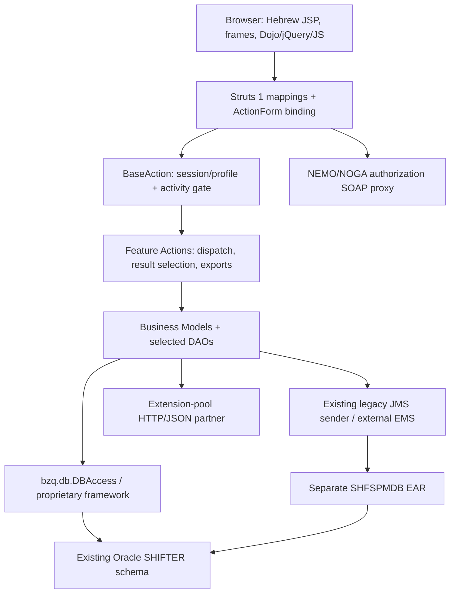
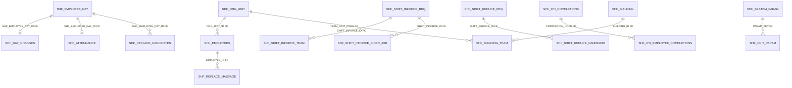
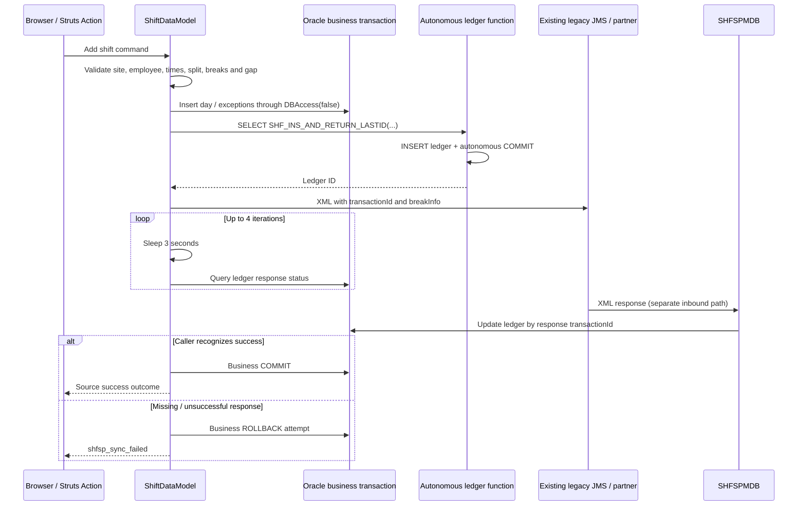

# SHF / Shifter: Reverse Engineering and Design Baseline

**Version:** 1.0  
**Analysis date:** 15 October 2026  
**Document language:** English  
**Task ID:** SHF-RE-2026-10-15  
**Status:** As-is evidence baseline delivered; application-runtime verification and target-contract approval remain open.

## 1. Executive summary

SHF is a workforce-management companion for call-center operations. Its source implements employee and shift inquiries, stage/station attendance, exceptions and breaks, shift replacement, management-forced swaps, additional staffing, shift reduction and time-change requests, staffing forecasts, CTI completion administration, reporting, building assignments, mobile auditing, extension-pool interaction, and IWD training timing.

The recovered application is **Struts 1 / JSP / JavaScript with Java business models and direct Oracle SQL**, not a predominantly session-EJB business tier. A separate message-driven EJB processes managed-break responses. Two EAR descriptors separate the web application from that MDB.

This document combines:

1. An inventory of every Java source, JSP artifact, and non-vendor JavaScript file in the inspected application source roots.
2. Route, form, forward, screen-control, navigation-reference, method, validation-error, parameter-key, and database-use inventories with file/line evidence.
3. Direct examination of business-controlling code for the principal workflows.
4. A read-only dictionary snapshot of the explicitly authorized **SHIFTER test schema through CTIDBT_WFMT**.

The physical test database is **Oracle Database 11g Enterprise Edition 11.2.0.4.0**, not an assumed modern Oracle release. It contains 78 tables, 2 views, 136 indexes, 17 sequences, 4 packages with 4 package bodies, and 1 standalone function. Its database character set is `IW8ISO8859P8`; the national character set is `AL16UTF16`.

The most consequential finding is the integration-ledger function: `SHF_INS_AND_RETURN_LASTID` performs an **autonomous INSERT and COMMIT**, even though callers invoke it in a `SELECT`. Business rollback therefore does not roll back that ledger entry. The legacy managed-break path also waits synchronously for partner responses and attempts local rollback on unsuccessful synchronization. Neither source behavior nor XA-looking JNDI names proves atomic Oracle/EMS completion.

**No application code, legacy artifact, database business record, broker configuration, or schema was modified. No legacy build, job, broker client, application endpoint, or mutating database routine was executed.**

### 1.1 Scope and exclusions

- Primary application evidence: [SHF source](../old/SHF/src/), [web content](../old/SHFWeb/WebContent/), [MDB source](../old/SHFEJB/ejbModule/ejbs/SHFSPMDBBean.java), permitted EAR/facet descriptors, and [managed-break schemas](../old/SharedLibraries/bzq/bzq/shfsp/).
- Existing scope: Node.js backend, modern Angular with Angular Material/CDK and Material 3, existing Oracle schema, abstract EMS ports/DTOs only.
- Batch implementation, execution, scheduling, packaging, and batch-only testing remain excluded. Schema metadata can incidentally identify batch-related objects; that does not authorize their execution or migration.
- Source files under [old](../old/) remain read-only. Generated classes, JARs, vendor Dojo/jQuery, archives, and attached image snapshots were not executed or modified.
- Access-filtered resources were not bypassed. Deployment settings not visible in the permitted evidence are unknown.
- No business-table values, employee records, parameter values, statistics/cardinalities, live plans, or production metadata were requested.
- All target recommendations below are proposals, not approved API/UI contracts or implementation authorization.

### 1.2 Evidence terminology

| Label | Meaning | What it does not establish |
|---|---|---|
| **S: Source-observed** | Executable code, SQL construction, JSP/JS reference, or constant inspected at a cited location. | That the code is deployed, reachable, correct, or executed. |
| **C: Configured** | A local descriptor, facet, binding, or schema declares it. | Actual server/broker settings or an installed runtime. |
| **D: Documented** | Existing project guidance or explanatory comments describe it. | Agreement with controlling code. |
| **T: Test-metadata verified** | Returned by an authorized Oracle dictionary query in this task. | Production equivalence, business data, or application behavior. |
| **I: Inferred** | A reasoned relationship or intended workflow reconstructed from several findings. | A runtime result or an enforced physical FK. |
| **P: Proposed** | A modernization/design recommendation. | User approval or completed implementation. |
| **U: Unknown / not verified** | Evidence was missing, excluded, or outside authorized checks. | Permission to assume a default. |

Local file/line anchors identify the inspected source snapshot. Hashes in the manifest identify the bytes analyzed. Counts from lexical extraction are inventory counts, **not semantic test coverage**.

## 2. Evidence package and reproducibility

The missing source-contract catalog referenced by the [agent brief](AGENT_INSTRUCTION.md) was not treated as available evidence. The following accompanying artifacts establish the source baseline directly.

| Artifact | Contents and interpretation |
|---|---|
| [source-manifest.csv](reverse-engineering/source-manifest.csv) | Relative path, byte count, line count, decoding choice, and SHA-256 for 454 inspected source/config/schema artifacts. |
| [classes.csv](reverse-engineering/classes.csv), [methods.csv](reverse-engineering/methods.csv), [fields.csv](reverse-engineering/fields.csv) | 239 top-level application class records; 3,553 method-declaration candidates and 1,633 field-declaration candidates. |
| [routes.csv](reverse-engineering/routes.csv) | 216 active Struts action-mapping declarations for 215 distinct paths, action source, form type/source, configured dispatch value, matching branch-line candidates, activity, scope and validation attributes. |
| [forms.csv](reverse-engineering/forms.csv), [forwards.csv](reverse-engineering/forwards.csv) | 50 configured form beans; 305 action-local forwards and 4 global forwards. |
| [dispatch-branches.csv](reverse-engineering/dispatch-branches.csv) | 240 literal `param`/`action`/`mode` branch comparisons across scanned Java. Not a control-flow graph. |
| [screens.csv](reverse-engineering/screens.csv) | All 185 JSP artifacts, title, includes, security-activity references, literal targets, and incoming configured forwards. Fragments/copies are not automatically active screens. |
| [screen-controls.csv](reverse-engineering/screen-controls.csv) | 1,705 control/custom-tag candidates, property/name/type/action/activity and line. |
| [navigation.csv](reverse-engineering/navigation.csv) | 397 literal application URL references across JSP and 19 application JS files. A reference is not proof of a traversable transition. |
| [validation-errors.csv](reverse-engineering/validation-errors.csv) | 699 literal `ActionError` construction sites with source owner candidates. Includes some success-shaped messages because legacy uses the same mechanism. |
| [parameter-keys.csv](reverse-engineering/parameter-keys.csv) | Unit/global policy keys recovered from parameter accessors; no business parameter values were read. |
| [database-usage.csv](reverse-engineering/database-usage.csv) | 736 SHF SQL/sequence/function-reference sites; 76 normalized referenced object names. All matched names exist in the test dictionary. |
| [schema-usage-map.csv](reverse-engineering/schema-usage-map.csv) | All 78 tables and 2 views mapped to physical columns/PKs/FK counts and source read/write reference counts. |
| [coverage.json](reverse-engineering/coverage.json) | Machine-readable counts, missing-action-source checks, unmatched-object checks, and test dictionary summary. |
| [extract-evidence.mjs](reverse-engineering/extract-evidence.mjs) | Dependency-free, read-only source extractor and CSV-shape validator. Writes only evidence outputs in its own directory. |
| [oracle-metadata.sql](reverse-engineering/oracle-metadata.sql) | Credential-free SQL*Plus dictionary capture, read-only transaction, error exits, and rollback. Does not connect by itself. |
| [verify-evidence.mjs](reverse-engineering/verify-evidence.mjs), [verification.json](reverse-engineering/verification.json) | Structural verification of local document links/anchors, source hashes, CSV references, route uniqueness, count expectations and Oracle snapshot hashes. Uses the shared [CSV reader](reverse-engineering/csv.mjs). |

### 2.1 Extraction limitations

- Java method/field and branch extraction is lexical, not a Java compiler, type resolver, or verified call graph. Owner attribution uses preceding declaration candidates.
- SQL extraction covers the recognized static `SHF_*` references and selected sequence/function patterns, not arbitrary dynamic SQL, all external schemas, or hidden SQL in proprietary libraries.
- Controls are recognized tag/attribute patterns, primarily double-quoted attributes. Runtime-created controls, every custom-tag expansion, and dynamically assembled URLs are not exhaustively recovered.
- XML comments and Java/JS comments are masked where the extractor supports them. JSP embedded-language/comment combinations can still produce incidental references.
- All non-framework action classes in the extracted Struts mappings resolved to an application source file. This does not verify every branch, form binding, or servlet mapping at runtime.
- Source anomaly: `/shift/viewOriginalShiftDialog` is declared twice, identically, at [mapping line 925](../old/SHFWeb/WebContent/WEB-INF/struts-config.xml#L925) and [mapping line 929](../old/SHFWeb/WebContent/WEB-INF/struts-config.xml#L929). Both declarations are retained in the evidence; startup/runtime duplicate handling was not tested and the source was not changed.
- Oracle dictionary exports containing `LONG` values use text instead of CSV because the installed SQL*Plus CSV formatter produced unterminated quotes for `LONG` fields. The corrected text exports retain defaults, check conditions, index expressions, and view definitions without claiming CSV conformance.

### 2.2 Repeating static extraction

From the repository root, with metadata snapshots already present:

```powershell
node --check docs\reverse-engineering\extract-evidence.mjs
node docs\reverse-engineering\extract-evidence.mjs
node docs\reverse-engineering\verify-evidence.mjs
```

Repeat database discovery only under an approved metadata scope. Authenticate interactively or through approved secret handling, then run:

```sql
@docs\reverse-engineering\oracle-metadata.sql
```

Do not store credentials in the script, command files, connection examples, or documentation. The evidence directory is the persistent output, not a deployment package.

## 3. Application structure and compatibility baseline

### 3.1 Modules

| Module | Recovered responsibility | Evidence/status |
|---|---|---|
| [SHF](../old/SHF/) | Utility project containing Struts actions, forms/beans, models, DAOs, profile logic, tag libraries, helpers and WFM report code. | S/C: [web classpath](../old/SHFWeb/.classpath) references SHF; [SHF classpath](../old/SHF/.classpath) declares source roots. |
| [SHFWeb](../old/SHFWeb/) | JSP, custom tags, JS/CSS/images, Struts mappings, validation and environment configuration references. Its inspected source directory is empty; application Java is in SHF. | S/C: [Struts mappings](../old/SHFWeb/WebContent/WEB-INF/struts-config.xml#L129). |
| [SHFEAR](../old/SHFEAR/) | Web EAR with `SHFWeb.war`, context root `shf`. | C: [application descriptor](../old/SHFEAR/META-INF/application.xml#L10). |
| [SHFEJB](../old/SHFEJB/) | One message-driven bean, SHFSPMDB, processing XML partner responses. | S/C: [MDB descriptor](../old/SHFEJB/ejbModule/META-INF/ejb-jar.xml#L5). |
| [SHFEJBEAR](../old/SHFEJBEAR/) | Separate EAR containing `SHFEJB.jar`. | C: [application descriptor](../old/SHFEJBEAR/META-INF/application.xml#L4). |
| [SharedLibraries](../old/SharedLibraries/), [APPLib](../old/APPLib/) | Proprietary framework/proxy dependencies, Oracle/EMS library directories, and managed-break JAXB/XSD contract evidence. | S/C for visible names/contracts; exact binary implementation/version U. |
| [SHFBatch](../old/SHFBatch/) | Separate batch area. | Identified but excluded from implementation/execution and batch-only behavioral analysis. |
| [Servers](../old/Servers/), [ProfileProject](../old/ProfileProject/) | Workspace/server/profile artifacts. | Existence only; no active deployment/topology established. |

### 3.2 Version evidence

| Technology | Evidence | Conclusion |
|---|---|---|
| WebSphere | [web facets](../old/SHFWeb/.settings/org.eclipse.wst.common.project.facet.core.xml#L3): `was.base.v61`, coexistence/extended-web 6.1. | C: traditional WebSphere 6.1 development target, not Liberty. Deployed edition/fixpack/JVM U. |
| Java | [SHF facets](../old/SHF/.settings/org.eclipse.wst.common.project.facet.core.xml#L6) and web facets declare Java 5.0. | C: historical project setting. Source also uses JAXB, third-party HTTP/JSON/POI APIs and later-looking constructs; a successful compile on Java 5 is not claimed. |
| Servlet/J2EE | Web facet 2.4; EAR 1.4 and EJB 2.1 descriptors; `javax.*` imports. | C/S: historical J2EE API family, not Jakarta EE. |
| Struts | Actions extend Struts `Action` and implement `perform`; web facet `web.struts` 1.0.2. | S/C: Struts 1 family. Exact deployed library version U. |
| Dojo | Facet `rad.dojo` 1.0 and legacy Dojo use in [shift JavaScript](../old/SHFWeb/WebContent/js/shiftjs.js#L34). | C/S: legacy Dojo integration. Facet does not prove bundled/deployed patch version. |
| jQuery | Local file named `jquery-1.12.0.min.js`; responsive code uses `$`. | Source artifact naming only; deployed selection U. Vendor code was excluded from semantic extraction. |
| Oracle client | Executed SQL*Plus/TNSPing report client 19.0.0.0.0. | Tool runtime observed; not the Java application's JDBC driver version. |
| Oracle server | [server version snapshot](reverse-engineering/oracle-server-version.csv). | T: test server 11.2.0.4.0, Enterprise Edition, Solaris TNS component. |
| JDBC/EMS libraries | Local directories named Oracle `v10`, EMS `v43` and `v5.1.2`. | Names only; exact binary/client/broker versions U. |
| Browser support | HTML 4.01 framesets, IE-related code/commentary, mobile adaptation. | S: compatibility intent. A browser support matrix or actual accessibility compliance is U. |

### 3.3 Logical layers



This is a source-reconstructed component diagram, not a verified deployment diagram. Some actions, including login and SoftPhone callbacks, extend Struts `Action` directly and do not traverse BaseAction.

### 3.4 Lifecycle, ownership and framework behavior

- [ActionServlet.initAddConfig](../old/SHF/src/bzq/shf/action/ActionServlet.java#L29) resolves environment-specific configuration using `BZQ_CONFIG_ENV` and stores `addConfigDoc` in servlet context.
- [BaseServletListener](../old/SHF/src/bzq/shf/servletListeners/BaseServletListener.java#L41) resolves logging configuration; actual listener registration is not established from the inspected permitted descriptors.
- [LoadTables](../old/SHF/src/bzq/shf/model/LoadTables.java) and [SHFParameters](../old/SHF/src/bzq/shf/utils/SHFParameters.java#L21) use an application-level `TablesContainer`.
- [BaseAction](../old/SHF/src/bzq/shf/actions/BaseAction.java#L24) holds profile and parsed-parameter state in instance fields. Actions and report actions also contain mutable model/workbook fields. Their concurrency safety is not established.
- [DBAccess usage](reverse-engineering/database-usage.csv) is widespread in models, not isolated to DAOs. Its underlying source/auto-commit contract was not present in the inspected application source; no library decompilation or execution was performed.
- Methods using `new DBAccess(false)` with explicit commit/rollback show **local transaction intent**. Connection enlistment, isolation and every default-constructor commit behavior remain U.

## 4. Actors, authorization and navigation

### 4.1 Recovered actors

The following are inferred business roles, not independently verified role assignments:

| Actor | Capabilities indicated by source |
|---|---|
| Employee/agent | Own shifts, employee-card views, replacement offers, messages, eligible staffing/reduction/time-change applications. |
| Supervisor/manager | Current attendance, shift search/update/cancel, forced swaps, staffing and forecast workflows. |
| Administrator | Reason/type/skill/parameter maintenance, jobs/buildings/team assignments, managed-break enablement and reports. |
| External SoftPhone/CTI partner | Actual break-time and logout callbacks; managed-break request/response interaction. |
| Authorization service | Domain-user identity/profile authorization through NEMO/NOGA SOAP interfaces. |
| Reporting/HR users | Schedule/HR workbook outputs and links to BI/WFM systems. |

### 4.2 Authentication and gates

1. [LoginAction](../old/SHF/src/bzq/shf/actions/LoginAction.java#L31) starts from `domain_user`, requests authorization via [SSOWebProxyNoga](../old/SHF/src/bzq/shf/profile/SSOWebProxyNoga.java#L63), and loads an application profile.
2. [Login.load](../old/SHF/src/bzq/shf/model/Login.java#L38) requires authorization/name/user inputs, retrieves replacement permission, and derives permitted organizational units.
3. The successful path stores `userProfile` in session and sets a **5,400-second** inactivity interval. Mobile-login audit insertion is conditional.
4. [BaseAction.perform](../old/SHF/src/bzq/shf/actions/BaseAction.java#L85) routes absent profiles to platform detection; a configured non-null `activity` must exist in the profile.
5. Form instances receive profile identity and unit permissions through [setUserProfileDetails](../old/SHF/src/bzq/shf/actions/BaseAction.java#L169).
6. [SecurityTag](../old/SHF/src/bzq/shf/taglib/SecurityTag.java#L26) hides JSP bodies when their activity is absent. Hidden controls are not proof of endpoint authorization.

**Important boundary:** the BaseAction rejection of an absent activity is commented out. Several routes have no configured activity; some direct-Action endpoints bypass BaseAction entirely. This is source behavior, not proof of exploitable access or deployed filtering. Required resource-level authorization and upstream protections need separate verification.

The organizational hierarchy uses `A01` division, `E01` department, `G01` call center and `J01` team constants. Hierarchical access expansion is in [Login.setAllowedUnits](../old/SHF/src/bzq/shf/model/Login.java#L157); the test [SHF_ORG_UNITS_VIEW definition](reverse-engineering/oracle-view-definitions.txt) confirms a five-level parent-join view, not every runtime authorization rule.

### 4.3 Shell and menu

[shf_index.jsp](../old/SHFWeb/WebContent/jsp/shf_index.jsp#L26) defines:

- `topLogoBar` for branding/header;
- `frMain` for business content, initially messages;
- `right` for [right_menu.jsp](../old/SHFWeb/WebContent/jsp/right_menu.jsp);
- `frMsgBar` for [message-bar navigation](../old/SHFWeb/WebContent/WEB-INF/struts-config.xml#L153).

The source's mobile threshold is `screen.width / devicePixelRatio < 760`. It hides the right frame and transforms selected result tables into expandable mobile rows. [shf_responsive.js](../old/SHFWeb/WebContent/js/shf_responsive.js#L1) reconstructs result tables and submenus rather than providing a separate mobile SPA.

Principal menu destinations observed in [right_menu.jsp](../old/SHFWeb/WebContent/jsp/right_menu.jsp#L51):

| Area | Destination | Gate/qualification |
|---|---|---|
| Attendance | `/shf/attendance/param.do` | Hidden on source-detected mobile layout. |
| Shifts | `/shf/shift/shiftMenu.do` | Model/action chooses management vs employee destination. |
| Employee card | `/shf/employee/searchParam.do` | Desktop menu branch. |
| Breaks | `/shf/break/searchParam.do` | `break_menu`; desktop branch. |
| Forecast | `/shf/forecast/param.do` | `forecast_menu`. |
| CTI completions | `/shf/completion/menu.do` | `login_menu`. |
| Administration | `/shf/admin.do` | `admin_menu`. |
| Schedule / HR reports | `/shf/wfmReport.do`, `/shf/wfmHRReport.do` | `wfm_reports`; desktop branch. |
| Mobile audit | `/shf/mobile/ReportParam.do` | `admin_menu`. |
| IWD training | `/shf/IWD/peleParam.do` | `lomdot_timing`. |
| BI/WFM portals | External browser links | Source links only; partners not contacted. |

All application URL references are in the [navigation inventory](reverse-engineering/navigation.csv). Relative JSP links, calculated redirects and external navigation are not exhaustively represented there.

## 5. Screen and interaction catalog

The complete artifact list is [screens.csv](reverse-engineering/screens.csv); the complete extracted control list is [screen-controls.csv](reverse-engineering/screen-controls.csv). The table below groups user workflows without asserting that 185 JSP files mean 185 independent screens.

| Screen family | Source artifacts / controlling surface | Interaction and evidence boundary |
|---|---|---|
| Login/platform/error shell | [platformDetect.jsp](../old/SHFWeb/WebContent/jsp/platformDetect.jsp), [shf_index.jsp](../old/SHFWeb/WebContent/jsp/shf_index.jsp); global forwards in [Struts config](../old/SHFWeb/WebContent/WEB-INF/struts-config.xml#L115). | Platform detection, obtain-user/login failure, access-denied and fatal-error outcomes. |
| Messaging | [showMessages_new.jsp](../old/SHFWeb/WebContent/jsp/showMessages_new.jsp), [MessagesAction](../old/SHF/src/bzq/shf/actions/MessagesAction.java). | View messages, delete markers, accept offers, message-icon refresh. |
| Employee card | [employee_card.jsp](../old/SHFWeb/WebContent/jsp/employee_card.jsp), [EmployeeDataAction](../old/SHF/src/bzq/shf/actions/EmployeeDataAction.java). | Search/result/card, activities, shifts, exceptions, skills, education/courses, taxi-order references, SMS preferences. |
| Attendance | [attendance.jsp](../old/SHFWeb/WebContent/jsp/attendance.jsp), [attendance.js](../old/SHFWeb/WebContent/js/attendance.js#L116). | Stage arrival, station entry/exit, missing/late events, briefing indicator, flag, report confirmation and cancellation. JS includes mutating GET requests. |
| Shift search/current/own shifts | [ShiftDataAction](../old/SHF/src/bzq/shf/actions/ShiftDataAction.java#L83), [shiftjs.js](../old/SHFWeb/WebContent/js/shiftjs.js). | Shared search form state, current defaults, employee views, export, dialog opening. Exact JSP forward targets are in the forward inventory. |
| Shift editing/addition/cancellation | [add_shift_popup.jsp](../old/SHFWeb/WebContent/jsp/add_shift_popup.jsp), [cancel_shift_popup.jsp](../old/SHFWeb/WebContent/jsp/cancel_shift_popup.jsp), [ShiftDataModel](../old/SHF/src/bzq/shf/model/ShiftDataModel.java#L3604). | Time/site/activity/employee changes, break/split validation, work-from-home/site changes, reason/remark input. |
| Replacement marketplace | [ReplaceAction](../old/SHF/src/bzq/shf/actions/ReplaceAction.java), [ReplaceModel](../old/SHF/src/bzq/shf/model/ReplaceModel.java#L146). | Eligible-shift checks, repository offers, multiple candidates, accept/reject/cancel, optional SMS. |
| Forced swap | [SwitchAction](../old/SHF/src/bzq/shf/actions/SwitchAction.java#L162). | Precheck, confirmable limitations, limitation-removal command, swap execution. |
| Break management | [break_search_list.jsp](../old/SHFWeb/WebContent/jsp/break_search_list.jsp), [shift_my_breaks.jsp](../old/SHFWeb/WebContent/jsp/shift_my_breaks.jsp), [breakjs.js](../old/SHFWeb/WebContent/js/breakjs.js#L3). | Shift-break inquiry, candidate checks, exchange offers, actual departure/return and lateness. |
| Time-change requests | [agent_change_requests.jsp](../old/SHFWeb/WebContent/jsp/agent_change_requests.jsp), [change_request_options.jsp](../old/SHFWeb/WebContent/jsp/change_request_options.jsp), [change_request_applications.jsp](../old/SHFWeb/WebContent/jsp/change_request_applications.jsp). | Request ranges, eligible options, employee applications and approval. The file named [time_change_requests.js](../old/SHFWeb/WebContent/js/time_change_requests.js) is only a stub, not the business implementation. |
| Reduction / additional staffing | [ReduceDataAction](../old/SHF/src/bzq/shf/actions/ReduceDataAction.java), [ShiftDataAction](../old/SHF/src/bzq/shf/actions/ShiftDataAction.java#L195). | Management request creation, employee options/application and approval/decline. |
| Forecast | [ForecastAction](../old/SHF/src/bzq/shf/actions/ForecastAction.java), [forecast.js](../old/SHFWeb/WebContent/js/forecast.js#L99). | Staffing/call/activity data, quarter-hour/hour aggregation and detail overlays for calls/breaks/exceptions. |
| CTI completions | [cti_main.jsp](../old/SHFWeb/WebContent/jsp/cti_main.jsp), [cti_set_completion.jsp](../old/SHFWeb/WebContent/jsp/cti_set_completion.jsp), [CTIAction](../old/SHF/src/bzq/shf/actions/CTIAction.java). | Employee/time selection, calculation/confirmation, update/cancel, job-to-SAP administration. |
| Catalog/system administration | [admin_main.jsp](../old/SHFWeb/WebContent/jsp/admin_main.jsp), [AdminAction](../old/SHF/src/bzq/shf/actions/AdminAction.java#L57), [SystemAdminAction](../old/SHF/src/bzq/shf/actions/SystemAdminAction.java). | Reasons/types, skills, activities, job groups, parameters and allowed-unit dependent catalogs. |
| Buildings/teams | [BuildingModel](../old/SHF/src/bzq/shf/model/BuildingModel.java#L316), [ManageBuildingsAction](../old/SHF/src/bzq/shf/actions/ManageBuildingsAction.java). | Building CRUD and assignment/unassignment of teams. |
| Managed-break flag | [opt_shf_sp.jsp](../old/SHFWeb/WebContent/jsp/opt_shf_sp.jsp), [OptShfSpModel](../old/SHF/src/bzq/shf/model/OptShfSpModel.java#L138). | Authorized-unit selection, per-unit enablement diff, partner synchronization. |
| IWD timing | [peleIWD.jsp](../old/SHFWeb/WebContent/jsp/peleIWD.jsp), [IWDModel](../old/SHF/src/bzq/shf/model/IWDModel.java#L334). | Select module/call-center/inner job, choose timing quantities/intervals, schedule or cancel. Scheduled transport execution is deferred. |
| WFM/HR reports | [ScheduleHomeAction](../old/SHF/src/bzq/wfm/report/ScheduleHomeAction.java#L35). | Parameters, schedule/site selection, workbook streaming from existing templates. |
| Cancelled items / mobile audit | [ShiftCancelledModel](../old/SHF/src/bzq/shf/model/ShiftCancelledModel.java#L42), [PlatformModel](../old/SHF/src/bzq/shf/model/PlatformModel.java). | Aggregate cancelled shifts/full-day/partial exceptions; mobile activity reporting. |

### 5.1 Input, response and state conventions

- Browser inputs bind to Struts forms/beans, whose field names/types are cataloged in the [field inventory](reverse-engineering/fields.csv). Database mappings and inheritance require inspection of the specific form, not name matching alone.
- Most UI results are JSP forwards. Some actions directly write exports/AJAX responses and return no forward.
- Search forms and forced-swap snapshots are stored in session; many result lists are request attributes.
- Exceptions, warnings, success messages and errors can travel through `ActionErrors`, `ShfException` or message-bar refresh. These are not a stable HTTP status/error contract.
- [validation.xml](../old/SHFWeb/WebContent/WEB-INF/validation.xml) contains only a small subset of form validations and several names differ from the main configured form-bean names. Its presence does not prove execution of every validator.
- Attached assets include icons, backgrounds, branding and generic error artwork. They are supplementary visual evidence, **not full rendered-screen or navigation evidence**. No copying, screenshot-based runtime proof or visual conformance claim is made.

### 5.2 Hebrew, RTL and accessibility

S: inspected JSPs predominantly declare Windows-1255, use right-sided menus and Hebrew labels; the source decoder records legacy encoding in the manifest. The browser layout has frames, clickable table cells, image controls, overlays and rebuilt mobile tables.

U: keyboard order, focus restoration, accessible names, contrast, reflow, screen-reader reading order and WCAG conformance were not tested.

P: any replacement UI must preserve Hebrew and mixed-direction identifiers while providing logical tab order, visible focus, semantic buttons, labelled dialogs and live error feedback. Suggested Hebrew accessible names include `שמירה` (Save), `ביטול` (Cancel), and `סגירת חלון` (Close dialog). These are proposed acceptance labels, not a change to legacy resources.

## 6. End-to-end workflow traceability

Each row identifies a principal flow and its controlling model. Use the route/forward inventories for every mapped operation, and the SQL-use inventory for individual read/write sites.

| ID | Entry / navigation | Controlling source | Data/effects | Outcome and acceptance focus |
|---|---|---|---|---|
| WF-01 | `/login`, `/mPlatform` | [LoginAction](../old/SHF/src/bzq/shf/actions/LoginAction.java#L31), [Login.load](../old/SHF/src/bzq/shf/model/Login.java#L38) | SOAP authorization, employee replacement permission, organizational/profile lookup, conditional mobile audit. | Session profile and application shell; reject incomplete identity/profile. BR-01/02. |
| WF-02 | `/employee/searchParam`, `/employee/searchResult` | [EmployeeDataAction](../old/SHF/src/bzq/shf/actions/EmployeeDataAction.java), [EmployeeDataModel](../old/SHF/src/bzq/shf/model/EmployeeDataModel.java) | Employees, organizational units, skills, events and employee-day/exception data. | Permitted card/result and related tabs; own-vs-management access needs characterization. |
| WF-03 | `/attendance/param`, arrival/event/exit operations | [AttendanceDataModel.registerStation](../old/SHF/src/bzq/shf/model/AttendanceDataModel.java#L1053), [registerStage](../old/SHF/src/bzq/shf/model/AttendanceDataModel.java#L1237), [exitStation](../old/SHF/src/bzq/shf/model/AttendanceDataModel.java#L1884) | Attendance upsert, flags/reports/events, mood/briefing data. | Actual timestamps, late detail or message-bar result; already-exited/no-entry cases. BR-03/04/05. |
| WF-04 | `/shift/searchParam`, `/shift/searchResult`, `/shift/myShiftResult` | [ShiftDataAction](../old/SHF/src/bzq/shf/actions/ShiftDataAction.java#L100), [ShiftDataModel.populateShift](../old/SHF/src/bzq/shf/model/ShiftDataModel.java#L150) | Baseline day + changes + attendance/employee joins. | Effective shifts and export; distinguish original vs current employee and times. BR-06. |
| WF-05 | `/shift/updateShiftExceptions`, `/shift/updateShift` | [validateUpdate](../old/SHF/src/bzq/shf/model/ShiftDataModel.java#L3604) and subsequent update path | Changed-day overlay; may remove exchange candidates during validation if requested. | Reject missing-marked shift, invalid dates, incompatible pending exchanges/split; managed-break synchronization when applicable. BR-07/08. |
| WF-06 | `/shift/viewExtraShiftDialog`, addition/staffing commands | [validate_addShift](../old/SHF/src/bzq/shf/model/ShiftDataModel.java#L5695), [addSingleShift](../old/SHF/src/bzq/shf/model/ShiftDataModel.java#L5801) | New employee day, breaks/exceptions and source markers; optional managed-break command. | Valid employee/site/activity/time; rollback attempt on partner failure. BR-09/10/11. |
| WF-07 | `/shift/addFromFile` | [validateAddShiftsFormFile](../old/SHF/src/bzq/shf/model/ShiftDataModel.java#L7934) | Uploaded CSV and per-row shift-add path. | Nonempty lowercase `.csv`, size <= 1 MiB, header + data and >= 5 columns; characterize row-level partial success separately. BR-12. |
| WF-08 | `/shift/shiftCancelRemarkDialog`, `/shift/cancel` | [checkShiftForCancel](../old/SHF/src/bzq/shf/model/ShiftDataModel.java#L4315), [cancelShift](../old/SHF/src/bzq/shf/model/ShiftDataModel.java#L3704) | Day-change cancellation sentinel, reasons/remarks, exception cancellation; optional partner break deletion. | Reject attendance/exchange/pool extension conflicts; logical cancellation, not deletion. BR-13. |
| WF-09 | Replacement candidate/repository/offer operations | [checkValidShiftCandidate](../old/SHF/src/bzq/shf/model/ReplaceModel.java#L941), [offerReplaceToCandidate](../old/SHF/src/bzq/shf/model/ReplaceModel.java#L146) | Replacement candidates/messages and optional SMS. | Eligible future shift; accept/cancel/reject state lifecycle. BR-14/15. |
| WF-10 | Offer acceptance | [acceptReplaceOffer](../old/SHF/src/bzq/shf/model/ReplaceModel.java#L570), [replacement DAO](../old/SHF/src/bzq/shf/dao/ReplaceByCritrionDao.java) | Gap checks, swap/candidate updates, messages to related offers. | Recheck eligibility at acceptance; competing offers reopen/reject according to DAO logic. BR-15/16. |
| WF-11 | Forced-swap check/confirmation/execution | [SwitchAction](../old/SHF/src/bzq/shf/actions/SwitchAction.java#L43), [validateReplace](../old/SHF/src/bzq/shf/model/SwitchModel.java#L69), [replaceDays](../old/SHF/src/bzq/shf/model/SwitchModel.java#L294) | Session snapshots, limitation removal, day changes, exceptions, partner updates/SMS. | Hard rejection vs confirmable warning must remain distinct; stale-session/concurrent changes not verified. BR-17. |
| WF-12 | `/break/searchParam`, exchange and actual-time operations | [checkValidBreakCandidate](../old/SHF/src/bzq/shf/model/BreakDataModel.java#L961), [checkShiftBreakForm](../old/SHF/src/bzq/shf/model/BreakDataModel.java#L3218) | Breaks represented in employee exceptions; replacement-break candidates; actual entry/exit. | Future/not-started candidate, allowed source and permission, within-shift/spacing validation. BR-18/19/20. |
| WF-13 | Staffing requests/options/application | [validateInforceRequest](../old/SHF/src/bzq/shf/model/ShiftDataModel.java#L1471) | Staffing request, teams/inner jobs, generated employee-day assignments. | Duration/date/capacity and overnight normalization. BR-21. |
| WF-14 | `/reduce/reduceShiftReq`, `/reduce/approveDeclineReduce` | [ReduceDataModel](../old/SHF/src/bzq/shf/model/ReduceDataModel.java#L386) | Reduction request/candidate, logical shift cancellation and notification. | Lead-time policy; cancel and candidate approval use separate model operations, atomicity U. BR-22. |
| WF-15 | Time-change request/options/application | [validateChangeRequest](../old/SHF/src/bzq/shf/model/ShiftDataModel.java#L4524), [addShiftChangeRequest](../old/SHF/src/bzq/shf/model/ShiftDataModel.java#L4575) | Time-change request/candidate, changed-day times and messages. | Range/order/minimum-duration constraints; historical lead-time check is commented out. BR-23. |
| WF-16 | `/forecast/param` and detail routes | [ForecastModel](../old/SHF/src/bzq/shf/model/ForecastModel.java), [sumSchData](../old/SHF/src/bzq/shf/model/ForecastModel.java#L3837) | Forecast activities/data, effective shifts, attendance, exceptions and staffing/reduction effects. | 15-minute values and hourly rollup; quarter completeness and sum-vs-average semantics. BR-24. |
| WF-17 | `/completion/menu`, save/update/cancel commands | [CTICompletion.checkCompletion](../old/SHF/src/bzq/shf/model/CTICompletion.java#L904), [saveCompletions](../old/SHF/src/bzq/shf/model/CTICompletion.java#L959) | CTI completions and employee completion rows; status flags, job/SAP mapping. | Positive duration, maximum length and overlap exclusion; all-selected rollback intent on errors. BR-25/26. |
| WF-18 | Managed-break flag and shift/break synchronization | [OptShfSpModel](../old/SHF/src/bzq/shf/model/OptShfSpModel.java#L138), [createMessageTransaction](../old/SHF/src/bzq/shf/model/BreakDataModel.java#L3260), [MDB](../old/SHFEJB/ejbModule/ejbs/SHFSPMDBBean.java#L162) | Unit flags, independently committed transaction ledger, XML send/reply and business commit/rollback intent. | Pending vs confirmed success vs timeout must not be conflated. BR-27/28/29; see section 9. |
| WF-19 | `/sp/break/timeActual`, `/sp/logout` | [SoftPhoneAction](../old/SHF/src/bzq/shf/actions/SoftPhoneAction.java#L16), [SoftPhoneForm](../old/SHF/src/bzq/shf/forms/SoftPhoneForm.java#L15), [SoftPhoneModel](../old/SHF/src/bzq/shf/model/SoftPhoneModel.java#L40) | Actual break times, break reminder records and logout attendance behavior. | Direct Action path; no declared JSON/OpenAPI response; precise caller/authentication contract U. BR-30. |
| WF-20 | `/IWD/peleSchedule`, cancel | [IWDModel.doSchedule](../old/SHF/src/bzq/shf/model/IWDModel.java#L334) | Employee/module timing, status and history. | Eligible active shift, incomplete module, before-end window, bounded quantities and intervals. Delivery job is deferred. BR-31/32. |
| WF-21 | `/wfmReport`, `/wfmHRReport` | [ScheduleHomeAction](../old/SHF/src/bzq/wfm/report/ScheduleHomeAction.java#L35) | Read-oriented reports and Excel workbook templates. | Correct filters, data/filename/format and failure indication; live business rows not read. |
| WF-22 | Catalog and building/team operations | [AdminAction](../old/SHF/src/bzq/shf/actions/AdminAction.java#L57), [BuildingModel.updateTeamBuilding](../old/SHF/src/bzq/shf/model/BuildingModel.java#L316) | Catalog writes/cache reload; team-building delete/insert transaction. | Assignment > 0 inserts; nonpositive building unassigns. BR-33. |
| WF-23 | Cancelled results/mobile audit | [ShiftCancelledModel.populateCancelled](../old/SHF/src/bzq/shf/model/ShiftCancelledModel.java#L42), [LoginAction mobile audit](../old/SHF/src/bzq/shf/actions/LoginAction.java#L112) | Cancelled overlays/exception unions; mobile activity records. | Include all three cancellation families; audit success/failure is separate from main operation. BR-34. |

WF-19 route spellings and form fields must be taken from the authoritative route inventory, not inferred from the Java class name. These are browser/partner transport entry points, not an approved REST API.

## 7. Business-rule register

The register captures explicit controlling behavior. Parameterized values are **not read from business rows** and remain U. Characterization should check equality boundaries as well as obvious success/failure cases.

| Rule | Source finding | Evidence |
|---|---|---|
| BR-01 | Login requires authorization, name and user fields; the current string-empty checks include reference equality. This is an observed implementation detail, not endorsed validation logic. | [Login.load](../old/SHF/src/bzq/shf/model/Login.java#L38). |
| BR-02 | A configured activity absent from the session profile is denied; missing activity does not trigger the commented rejection. Organizational scope is derived separately. | [BaseAction.perform](../old/SHF/src/bzq/shf/actions/BaseAction.java#L85). |
| BR-03 | Station arrival later than shift start marks the form late. Stage arrival compares `now + minutesArrivalBeforeStation` with shift start. Both persist arrival before raising the late-detail signal. | [registerStation](../old/SHF/src/bzq/shf/model/AttendanceDataModel.java#L1053), [registerStage](../old/SHF/src/bzq/shf/model/AttendanceDataModel.java#L1237). |
| BR-04 | Exit rejects an existing exit or absent attendance; update requires arrival not null and exit null. Successful exit is communicated using a `ShfException` carrying a success key. | [exitStation](../old/SHF/src/bzq/shf/model/AttendanceDataModel.java#L1884). |
| BR-05 | Missing-shift lock evaluation walks prior days and pre-decrements the supplied counter. Exact off-by-one/count sufficiency behavior needs characterization; no reliable numeric threshold can be inferred without policy values. | [checkLock](../old/SHF/src/bzq/shf/model/AttendanceDataModel.java#L2087). |
| BR-06 | Effective employee, start/end and related attributes frequently use `NVL(change, baseline)`. Employee matching frequently normalizes personal identifiers with `SUBSTR(...,1,8)`. Neither is a universal relationship inferred solely from names. | [populateShift](../old/SHF/src/bzq/shf/model/ShiftDataModel.java#L148), [replacement eligibility SQL](../old/SHF/src/bzq/shf/model/EmployeeDataModel.java#L1294). |
| BR-07 | Shift update rejects missing-marked days, dates outside computed surrounding-week bounds, short duration, end-before-start and exchange conflicts. Arrival/exit restrictions and past-start rejection are commented out in this method. | [validateUpdate](../old/SHF/src/bzq/shf/model/ShiftDataModel.java#L3604). |
| BR-08 | `validateUpdate` can delete break-exchange candidates when cancel-break-switch is selected. It is not a purely read-only preview. Replacement validation must separate this command side effect. | [validateUpdate](../old/SHF/src/bzq/shf/model/ShiftDataModel.java#L3666). |
| BR-09 | Shift addition requires site/call-center mapping, activity, employee identifier, permissible min/max duration and an inter-shift check. The bulk staffing variant selects a different gap validator. | [validate_addShift](../old/SHF/src/bzq/shf/model/ShiftDataModel.java#L5695). |
| BR-10 | Inter-shift SQL checks proposed start/end against effective existing bounds expanded by policy hours and excludes the current day ID. Endpoint-only predicates and minute-to-hour integer division in the staffing variant require full-containment/equality tests. | [CheckValidDate](../old/SHF/src/bzq/shf/utils/CheckValidDate.java#L50). |
| BR-11 | Split end must not precede split start; split must lie in shift; first working part >= 120 minutes; split gap >= 120 minutes; second-part start must not precede a Calendar-derived 16:00 threshold. Calendar minute/second retention needs characterization. Break endpoints in the split interval are rejected. | [validateSplitShift](../old/SHF/src/bzq/shf/model/ShiftDataModel.java#L5739), [validateShiftBreaks](../old/SHF/src/bzq/shf/model/ShiftDataModel.java#L5777). |
| BR-12 | Upload permits nonempty lowercase `csv` extension, <= 1,048,576 bytes, at least 2 rows and 5 header columns; each row must match header-column count. Parsing uses `split(",", -1)`, not a quoted-CSV grammar. | [upload validation](../old/SHF/src/bzq/shf/model/ShiftDataModel.java#L7934), [upload constants](../old/SHF/src/bzq/shf/utils/SHFConstants.java#L211). |
| BR-13 | Shift cancellation checks arrival/missing, exchange candidates and allocated pool extension; cancellation writes day-off type plus employee sentinel `99999999` and cancellation reason/remark into the changed-day overlay. | [cancel checks](../old/SHF/src/bzq/shf/model/ShiftDataModel.java#L4315), [cancelShift](../old/SHF/src/bzq/shf/model/ShiftDataModel.java#L3704). |
| BR-14 | Replacement candidate registration rejects stage/station arrival, missing reason, allocated extension, insufficient lead time, exceptions/split, and a break exchange. A source restriction on forced staffing shifts is commented out. | [checkValidShiftCandidate](../old/SHF/src/bzq/shf/model/ReplaceModel.java#L941). |
| BR-15 | Acceptance requires matching formatted week numbers `ww`, lead time for both shifts and gap checks. Formatting depends on locale/calendar and does not itself compare week-year. The two participant gap calls should be characterized against asymmetric schedules. | [checkReplacement](../old/SHF/src/bzq/shf/model/ReplaceModel.java#L514). |
| BR-16 | Gap acceptance uses strict `>` against the configured interval; equality can fail. Actual candidate statuses include `OPEN`, `WAIT_FOR_ANS`, and `CLOSE_REPLACE`, distinct from other constants `WAIT-FOR-ANSWER` and `APPROVED`. | [checkGapBetweenShifts](../old/SHF/src/bzq/shf/model/ReplaceModel.java#L551), [DAO statuses](../old/SHF/src/bzq/shf/dao/SimpleFactoryDao.java#L38). |
| BR-17 | Forced swap hard-rejects identical shift times, missing/non-switchable inner jobs, incompatible inter-shift gaps and attendance states. Repository/break-exchange/exception/extension conditions can return a confirmation-needed flag; `true` is not generic success. | [validateReplace](../old/SHF/src/bzq/shf/model/SwitchModel.java#L69), [SwitchAction](../old/SHF/src/bzq/shf/actions/SwitchAction.java#L162). |
| BR-18 | Break-exchange candidate must be future, not already departed, not already a candidate, sufficiently far from now and allowed for replacement. | [checkValidBreakCandidate](../old/SHF/src/bzq/shf/model/BreakDataModel.java#L961). |
| BR-19 | The accessor named hours-before-switch-break is applied as `value * 60 * 1000`, i.e. minutes in the controlling method. Break source checking rejects non-WFM records. Do not reinterpret units from names alone. | [checkIfBreakTooClose](../old/SHF/src/bzq/shf/model/BreakDataModel.java#L988), [checkBreakSource](../old/SHF/src/bzq/shf/model/BreakDataModel.java#L1049). |
| BR-20 | Break range checks compare start/end to shift margins, use a 60-minute margin when null, and implement up to three form breaks. Positive duration and pairwise 60-minute spacing are conditional on the `source` flag, with different branches for each check. | [break validation](../old/SHF/src/bzq/shf/model/BreakDataModel.java#L3175). |
| BR-21 | Staffing request end earlier than start rolls forward 24 hours. Duration must be within configured bounds, start must not precede today-at-midnight, and requested original headcount cannot fall below already added shifts. | [validateInforceRequest](../old/SHF/src/bzq/shf/model/ShiftDataModel.java#L1471). |
| BR-22 | Reduction application requires configured lead minutes and normal cancellation eligibility. Cancellation and candidate approval are distinct calls and are not shown to share one DB transaction. | [ReduceDataModel](../old/SHF/src/bzq/shf/model/ReduceDataModel.java#L386). |
| BR-23 | Time-change request checks ordered start/end ranges, start-window/end-window compatibility, minimum requested length and new-time ordering. Its historical minimum-lead-time rejection is disabled in source. | [validateChangeRequest](../old/SHF/src/bzq/shf/model/ShiftDataModel.java#L4524). |
| BR-24 | Staffing forecast has 15-minute intervals. Hourly rollup requires all four quarters; staffing-like measures are averaged, while arrivals/future exits are summed. | [forecast constants](../old/SHF/src/bzq/shf/utils/SHFConstants.java#L147), [hourly aggregation](../old/SHF/src/bzq/shf/model/ForecastModel.java#L3925). |
| BR-25 | Completion end must be strictly after start and length <= configured maximum. Selected employees/start/end arrays must exist and have equal length. | [checkCompletion](../old/SHF/src/bzq/shf/model/CTICompletion.java#L904). |
| BR-26 | Completion update excludes its own row and rejects four overlap/containment patterns. Multi-employee save intends rollback for any collected errors, commit otherwise. Completion statuses are 0 open, 1 calculated, 10 closed, 50 cancelled, 99 not sent. | [overlap check](../old/SHF/src/bzq/shf/model/CTICompletion.java#L330), [save](../old/SHF/src/bzq/shf/model/CTICompletion.java#L960), [constants](../old/SHF/src/bzq/shf/utils/SHFConstants.java#L125). |
| BR-27 | Managed-break success checks XML/status/description. Source polling performs up to 4 waits of 3 seconds each; nominal sleep budget is 12 seconds, not a measured response SLA. | [checkMessageResponse](../old/SHF/src/bzq/shf/model/BreakDataModel.java#L3060), [caller success logic](../old/SHF/src/bzq/shf/model/ShiftDataModel.java#L5987). |
| BR-28 | Executable constants map flag ON to `"0"` and OFF to `"1"`; the request-XSD comments describe the opposite mapping. Action `"2"` updates breaks. Comments must not override executable behavior. | [constants](../old/SHF/src/bzq/shf/utils/SHFConstants.java#L181), [request schema](../old/SharedLibraries/bzq/bzq/shfsp/request/SHFSPBreaks.xsd#L13). |
| BR-29 | Test function `SHF_INS_AND_RETURN_LASTID` autonomously inserts a transaction with sequence-derived IDs, commits, then returns its ID. This is verified package-source metadata, not an executed function call. | [function snapshot](reverse-engineering/oracle-transaction-function.csv), [source caller](../old/SHF/src/bzq/shf/model/BreakDataModel.java#L3260). |
| BR-30 | Actual-time callback requires employee/day/planned time plus updated start or end. Planned seconds are truncated. If both start/end updates exist, start branch wins; end is in `else if`. Failures frequently log and return rather than defining a caller-visible error contract. | [SoftPhoneModel.updateTimeActual](../old/SHF/src/bzq/shf/model/SoftPhoneModel.java#L40). |
| BR-31 | IWD timing excludes no-entry, completed, and already-scheduled agents except cancelled status; filters module/call-center/inner job; requires sufficient remaining shift time, using module duration or default. | [IWDModel.doSchedule](../old/SHF/src/bzq/shf/model/IWDModel.java#L334). |
| BR-32 | Timing caps requested quantities to eligible count, sorts by nearest shift end, advances intervals and applies start/end buffers. Zero-quantity division ordering needs characterization. Statuses: 0 none, 1 pending, 2 sent, 3 cancelled, 4 break-pending. Actual dispatch is deferred. | [IWD scheduling](../old/SHF/src/bzq/shf/model/IWDModel.java#L371), [statuses](../old/SHF/src/bzq/shf/utils/SHFConstants.java#L200). |
| BR-33 | Team-building assignment deletes existing assignment then conditionally inserts if building ID > 0, with explicit commit/rollback intent. | [BuildingModel.updateTeamBuilding](../old/SHF/src/bzq/shf/model/BuildingModel.java#L316). |
| BR-34 | Cancelled-result population unions cancelled shifts, full-day exceptions and employee exceptions. It is not only a query for physically deleted days. | [populateCancelled](../old/SHF/src/bzq/shf/model/ShiftCancelledModel.java#L42). |

The register is a principal-rule analysis, not a claim that every possible rule in 3,553 method candidates was semantically proven. The error-site and method inventories preserve the remaining review surface.

## 8. Oracle schema and persistence design

### 8.1 Authorized discovery and evidence boundary

The user's approved test alias was resolved with TNSPing and authenticated with SQL*Plus. Dictionary queries executed inside `SET TRANSACTION READ ONLY`, followed by `ROLLBACK`.

The [context snapshot](reverse-engineering/oracle-context.csv) reports session user/current schema `SHIFTER` and database name `wfmt`. Alias resolution reported TCP port 1521, while the existing brief's historical JDBC reference says 1526. These are different connection references; alias resolution does not prove the web application's JNDI datasource uses this endpoint or port.

No query selected from a SHF business table. Reads were from dictionary/session metadata and the standalone function's stored **definition**. No sequence `NEXTVAL`, `SHF_INS_AND_RETURN_LASTID` invocation, application package procedure, DML, DDL or business action was executed.

### 8.2 Physical test-schema inventory

| Finding | Test result | Evidence |
|---|---:|---|
| Tables / views | 78 / 2 | [objects](reverse-engineering/oracle-objects.csv). |
| Columns across tables/views | 722 | [columns](reverse-engineering/oracle-columns.csv). |
| Indexes | 136 | [indexes](reverse-engineering/oracle-indexes.csv). |
| Sequences | 17 | [sequences](reverse-engineering/oracle-sequences.csv); no values advanced. |
| Packages / bodies / standalone functions | 4 / 4 / 1 | [objects](reverse-engineering/oracle-objects.csv), [procedure inventory](reverse-engineering/oracle-procedures.csv). |
| Constraints | 337 | 59 PK, 10 unique, 29 FK, 239 check/NOT NULL; [constraint rows](reverse-engineering/oracle-constraints.csv) carry column positions and validation state. |
| FK column rows | 30 | 29 constraints; one relationship is composite. Do not count column rows as independent FKs. |
| Owner synonyms / triggers | 0 / 0 returned | [synonyms](reverse-engineering/oracle-synonyms.csv), [triggers](reverse-engineering/oracle-triggers.csv); empty captures mean no returned owner rows, not no external behavior anywhere. |
| Function-based expression | `IDX_EMP_SUB`: `SUBSTR("EMP_ID_NUMBER",1,8)` | [index expressions](reverse-engineering/oracle-index-expressions.txt). Matches a frequent source join shape; no performance benefit was measured. |
| Database/session time zone at capture | `+03:00` / `+03:00` | [time zones](reverse-engineering/oracle-timezones.csv); not a verified named Israel timezone/DST policy. |
| Database / national character set | `IW8ISO8859P8` / `AL16UTF16` | [NLS](reverse-engineering/oracle-nls.csv). |

Object statuses in the captured owner inventory are `VALID`; captured constraints are enabled and validated. This establishes dictionary state only. It does not establish business-rule correctness, deployed schema equivalence, performance, or current contents.

A PK is recorded for 59 tables, not all 78. The [schema map](reverse-engineering/schema-usage-map.csv) identifies empty PK cells. No missing key/index or migration was added.

### 8.3 Domain/data usage groups

| Domain | Principal physical objects | Source ownership / semantics |
|---|---|---|
| Organization/employee | `SHF_EMPLOYEES`, `SHF_ORG_UNIT`, `SHF_SITE`, `SHF_ORG_UNITS_SHF_SITES`, `SHF_EMPLOYEE_SKILLS`, `SHF_SKILLS` | Login, employee/card, filters, effective-day personal-ID joins. |
| Shift baseline/change | `SHF_EMPLOYEE_DAY`, `SHF_DAY_CHANGES` | Imported/planned baseline plus changed-day overlay. `NVL` current values and source/cancellation markers are application semantics. |
| Attendance/events | `SHF_ATTENDANCE`, `SHF_EMPLOYEE_EVENTS`, `SHF_EMPLOYEE_REPORTS`, `SHF_EMPLOYEE_ENTRANCE_MOOD` | Stage/station timestamps, missing/late/flags, reports and mood/briefing records. |
| Exceptions/breaks | `SHF_EMPLOYEE_EXCEPTIONS`, `SHF_EMPLOYEE_EXCEPTIONS_BASE`, `SHF_EXCEPTION_TYPE`, `SHF_EVENT_REASON`, `SHF_TIMEOFF_TYPES` | Partial/full-day exceptions, state type, logical deletion marker `DEL`, reasons, break actual times. |
| Replacement | `SHF_REPLACE_CANDIDATES`, `SHF_REPLACE_BREAK_CANDIDATES`, `SHF_REPLACE_MASSAGE`, `SHF_REPLACE_ACTIVITIES` | Marketplace state and messages. Preserve the physical spelling `MASSAGE`. |
| Additional staffing | `SHF_SHIFT_INFORCE_REQ`, `SHF_SHIFT_INFORCE_TEAM`, `SHF_SHIFT_INFORCE_INNER_JOB`, `SHF_INNER_JOBS` | Request capacity, restrictions and generated extra shifts. |
| Reduction/time change | `SHF_SHIFT_REDUCE_REQ`, `SHF_SHIFT_REDUCE_CANDIDATE`, `SHF_TIME_CHANGE_REQUEST`, `SHF_TIME_CHANGE_CANDIDATES` | Management intent, employee applications and approvals. |
| Forecast | `SHF_FORECAST_DATA`, `SHF_FORECAST_ACTIVITIES`, activity type/skill/aim tables | Demand/performance vs effective staffing and attendance. |
| CTI/completions | `SHF_CTI_COMPLETIONS`, `SHF_CTI_EMPLOYEE_COMPLETIONS`, `SHF_CTI_SHIFTS`, `SHF_CTI_CANCEL_LOGIN_SHIFTS`, `SHF_CTI_JOB_TO_SAP` | Completion administration, record status and reporting/SAP-mapping evidence. Other CTI tables exist without references in the scanned subset. |
| Security/configuration | `SHF_USER_PROFILE`, `SHF_SECURITY_PROFILE`, `SHF_SECURITY_ACTIVITIES`, `SHF_SYSTEM_PARAM`, `SHF_UNIT_PARAM`, `SHF_MOBILE_AUDIT`, `SHF_MOBILE_AUDIT_REF` | Activity membership, cached parameter definitions/unit overrides and mobile auditing. |
| Building/team | `SHF_BUILDING`, `SHF_BUILDING_TEAM`, `SHF_ORG_UNIT` | Physical assignment and organization references. |
| Managed-break/SMS ledger | `SHF_TRANSACTIONS`, `SHF_OPT_SHFSP_FLAG`, `SHF_BREAK_SMS` | Partner correlation/status and reminders. Not an approved general-purpose outbox. |
| IWD training | `SHF_PELE_EMPLOYEES`, `SHF_PELE_EMPLOYEES_HISTORY`, `SHF_PELE_LOMDOT`, `SHF_PELE_IWD_SERVICE_CODES` | Timing/module/history; temporary tables and batch package routines remain deferred. |

The [database-use inventory](reverse-engineering/database-usage.csv) contains the actual source locations and operation tokens. The schema map finds static references to **58 of 78 tables**. The other 20 are **metadata-only in the scanned subset**, not proven unused. They can be used by excluded batch code, external integrations, proprietary libraries, dynamic SQL or unavailable deployments.

### 8.4 Verified FKs versus application joins

The following are examples of dictionary-confirmed relationships. The CSV remains authoritative for every constraint, column position, delete rule, deferrability and validation state.



Cardinality glyphs communicate the intended relationship shape; mandatory participation depends on the nullable/unique/PK entries in the snapshots. Do not infer nullability or exclusivity from the drawing alone.

**Application join, not a verified FK:** employee day to employees through an eight-character personal-ID comparison and changed-employee fallback. Similarly, exception day references, cancellation sentinels, cross-day swap relationships and ledger employee identifiers are not all physically constrained as their names might suggest.

### 8.5 Views and stored routines

- T: [SHF_LAST_SHIFTS_VIEW](reverse-engineering/oracle-view-definitions.txt) left-joins day changes with baseline days and filters `wm_date > SYSDATE - 14`. It exposes original and changed attributes; it does not convert all fields into a single universal effective-shift projection.
- T: [SHF_ORG_UNITS_VIEW](reverse-engineering/oracle-view-definitions.txt) joins five organization levels by parent IDs.
- T: [function definition](reverse-engineering/oracle-transaction-function.csv) and [arguments](reverse-engineering/oracle-arguments.csv) confirm six inputs and a NUMBER result for `SHF_INS_AND_RETURN_LASTID`.
- T: four package names concern renaming/truncating PELE employee/module tables. Their callable signatures and source-line summaries are captured. Their batch/operational behavior was not executed or promoted into the in-scope application design.
- [source summary](reverse-engineering/oracle-source-summary.csv) counts lexical transaction/mutation keywords only; comments/dynamic SQL can affect such counts. It is not a semantic proof of package behavior.

### 8.6 Type, encoding and date obligations

1. Physical precision/scale/length/nullability and BYTE/CHAR semantics come from [oracle-columns.csv](reverse-engineering/oracle-columns.csv), not Java field types.
2. Oracle `DATE` includes time components. Java source often formats `dd/MM/yyyy HH:mm`, `yyyyMMddHHmmss` or explicit Oracle `TO_DATE` masks; some queries use `SYSDATE` while others use JVM `new Date()`.
3. Preserve IDs as domain-specific strings or precision-safe numeric representations. Do not coerce every `NUMBER` or personal identifier into a JavaScript `number`.
4. Empty Oracle strings behave as null for relevant character values. Distinguish omitted inputs, explicit nulls, defaults and unchanged overlay fields.
5. Hebrew transcoding spans Windows-1255 source/browser content and a non-UTF-8 database character set. Unicode round-trip testing is mandatory before target driver/UI acceptance.
6. Fixed `+03:00` capture does not settle DST. Cross-midnight shifts, calendar weeks/year boundaries and mixed database/JVM clock semantics require explicit characterization.
7. Captured [column defaults](reverse-engineering/oracle-column-defaults.txt) include `'N'` home/split flags and report/import defaults. No attempt was made to alter them.

## 9. Interfaces, messaging and transaction boundaries

### 9.1 Interface register

| ID | Interface | Observed contract / source | What remains unknown |
|---|---|---|---|
| IF-01 | Browser Struts transport | [routes](reverse-engineering/routes.csv), forms, JSP forwards, AJAX and downloads. Paths are relative to the `shf` context. | Actual servlet mapping, HTTP method restrictions, filters, session-security deployment settings and upstream routing. |
| IF-02 | NEMO/NOGA authorization SOAP | [SSOWebProxyNoga](../old/SHF/src/bzq/shf/profile/SSOWebProxyNoga.java#L63): user ID, application semel, client IP -> authorization result. | Deployed WSDL, TLS/authentication, availability and server identity policy. No partner call performed. |
| IF-03 | Managed-break command XML/JMS | [request XSD](../old/SharedLibraries/bzq/bzq/shfsp/request/SHFSPBreaks.xsd), [TibcoQueueMessageSender](../old/SHF/src/bzq/shf/utils/TibcoQueueMessageSender.java#L49). | Deployed request queue, broker/client version, persistent-delivery enforcement, expiry/retry/DLQ, TLS and XA resource recovery. |
| IF-04 | Managed-break response XML/MDB | [response XSD](../old/SharedLibraries/bzq/bzq/shfsp/response/SHFSPBreaks_response.xsd), [MDB.onMessage](../old/SHFEJB/ejbModule/ejbs/SHFSPMDBBean.java#L162). | Actual activation destination, acknowledgement behavior on caught exceptions, redelivery and duplicate-response policy. |
| IF-05 | SoftPhone actual-time/logout callback | [SoftPhoneForm](../old/SHF/src/bzq/shf/forms/SoftPhoneForm.java#L15), [SoftPhoneAction](../old/SHF/src/bzq/shf/actions/SoftPhoneAction.java#L16). | Caller authentication, exact date-binding encoding and HTTP response/error semantics. |
| IF-06 | SMS command integration | [SHFSmsSender](../old/SHF/src/bzq/shf/utils/SHFSmsSender.java#L74): queue/config fields, XML construction and recipient/message data. | Actual connection credentials/destination and partner confirmation semantics; sensitive config was not reproduced. |
| IF-07 | Extension-pool HTTP/JSON | [processPoolPopulation](../old/SHF/src/bzq/shf/model/ShiftDataModel.java#L7315): `/pool/handle`, request ID/type, organization, agent and send time; JSON mapped to PoolExtAllocBean. | Live partner schema, timeout/idempotency/service guarantees and authorization. No HTTP partner request performed. |
| IF-08 | IWD training messages | [IWDModel](../old/SHF/src/bzq/shf/model/IWDModel.java), [IWD constants](../old/SHF/src/bzq/shf/utils/SHFConstants.java#L200). | Full usable JAXB source/schema and deployed transport semantics; the local IWD shared-library directory has no visible source files. Sender execution is deferred. |
| IF-09 | WFM/HR/BI/SAP boundaries | [ScheduleHomeAction](../old/SHF/src/bzq/wfm/report/ScheduleHomeAction.java#L35), [menu links](../old/SHFWeb/WebContent/jsp/right_menu.jsp#L156), completion/job-to-SAP source references. | Workbook consumers, external portal behavior and batch-mediated SAP export processes. |
| IF-10 | Oracle access | [DB-use matrix](reverse-engineering/database-usage.csv), [test metadata](reverse-engineering/oracle-context.csv). | Application datasource credentials/permissions, pool settings, isolation, proprietary DBAccess implementation and production schema. |

### 9.2 Managed-break payload

C/S: request root `SHFSPBreaks`, with no target namespace declared in the inspected XSD:

| Field | XSD type / cardinality | Meaning/evidence |
|---|---|---|
| `interfaceId`, `userId`, `applicationId` | string, optional | Envelope/context fields; constants identify application/source. |
| `user` | string, required | Partner envelope field; must not be treated as proof of authorization. |
| `password` | string, optional | Credential-bearing field name; no value is published in this evidence package. |
| `transactionId` | string, required | Application ledger correlation used by the MDB update. |
| `actionId` | string, required | Executable mapping: `"0"` flag ON, `"1"` flag OFF, `"2"` break update. |
| `orgUnitId` | string, optional | Unit flag operations. Conditional requirement is in behavior/comments, not strongly typed by XSD. |
| `breakInfo` | zero to many | `mode` string (`I`/`D` in source), `employeeId` string, `agentDayId` long, planned date string, duration int. |
| `startDatePlanned` | string, required within breakInfo | Source emits `yyyyMMddHHmmss`; XSD itself does not constrain its pattern. |
| `duration` | int, required within breakInfo | Minutes in source/schema commentary; positivity is business validation, not an XSD bound. |

Response root: `SHFSPBreaks_response`. Required `user`, `transactionId`, `statusCode`; optional context/password/status description fields. Source uses success code 0; response schema comments describe 1 as failure.

The XSD does not validate enumerated action/mode/status values, cross-field conditions, positive duration or precise date grammar. A target abstract contract should add runtime validation without silently changing the partner wire schema.

### 9.3 Correlation and transport declarations

- The [transaction function](reverse-engineering/oracle-transaction-function.csv) sets `ID` and `TRANSACTION_ID` from one sequence's NEXTVAL/CURRVAL.
- Outbound managed-break code initially serializes the request, obtains a ledger ID, adds that ID to the payload, and serializes again. The ledger's stored initial request must not be assumed identical to the final sent payload.
- [MDB.onMessage](../old/SHFEJB/ejbModule/ejbs/SHFSPMDBBean.java#L191) updates by table **ID** using response `transactionId`, records XML/status/update time and optionally description.
- The [sender](../old/SHF/src/bzq/shf/utils/TibcoQueueMessageSender.java#L49) uses a JNDI QueueConnectionFactory and a non-transacted `AUTO_ACKNOWLEDGE` QueueSession. A producer call completing is not business confirmation.
- [EJB descriptor](../old/SHFEJB/ejbModule/META-INF/ejb-jar.xml#L8) declares **bean-managed** transaction type and queue/auto-acknowledge activation properties. Bean comments mention Container transaction type instead; descriptor and actual deployment must be distinguished.
- A queue declaration accompanied by `subscriptionDurability=Durable` is not evidence of a topic durable-subscription deployment.
- JNDI names with `xa` in the [MDB environment branch](../old/SHFEJB/ejbModule/ejbs/SHFSPMDBBean.java#L102) do not prove distributed enlistment or recovery.
- JMS message ID, application ledger ID, employee-day ID and any partner business ID are distinct concepts. No JMSCorrelationID convention was verified.

### 9.4 Sequence: adding a shift with managed breaks



This diagram reconstructs [addSingleShift synchronization](../old/SHF/src/bzq/shf/model/ShiftDataModel.java#L5903), [polling](../old/SHF/src/bzq/shf/model/BreakDataModel.java#L3060) and the verified function definition. It is not a captured live sequence. Response arrival is asynchronous and can precede, interrupt or follow polling; diagram placement is illustrative.

### 9.5 Failure and consistency implications

| Window / condition | Evidence-based implication |
|---|---|
| Business changes pending, ledger function committed | Ledger survives outer rollback in the test function definition. Reconciliation must distinguish audit/intent rows from committed business changes. |
| JMS send succeeded, reply lost/late | Partner may have changed state while local code treats timeout as failure and rolls back. A timeout is an uncertain distributed outcome. |
| Business lock held during polling | Source keeps the business transaction open across synchronous waits in the examined add path. Actual lock set/latency U; contention is a design risk, not a measured finding. |
| Invalid XML / unexpected response fields | MDB catches errors and does not show explicit rejection/recovery state management; null/status parsing can fail. Deployment redelivery policy U. |
| Duplicate or stale reply | Update-by-ID is visible, but no verified deduplication, expected-current-state guard, version check or exactly-once business invariant was found in that path. |
| Request/description inconsistency | Caller success predicates are stricter than simply `statusCode=0`; `statusDesc` handling differs between payload, ledger update and caller check. |
| Add-shift process classification | The examined add path constructs the transaction using a delete-shift process constant. Treat this as a source inconsistency to characterize, not the intended new contract. |
| CSV import | Source uses `isSend` to disable managed-break sends for imported additions. This is an intentional-looking integration difference requiring business confirmation. |

**No EMS transport, broker, consumer, bridge, publisher, reconciliation worker, idempotency store or outbox was implemented.** Existing `SHF_TRANSACTIONS` is evidence of a ledger, not proof it can satisfy a new durable-operation contract without further design and approval.

## 10. Design implications within the approved modernization scope

This section is a **proposal only**. The requested deliverable is reverse engineering; a complete new OpenAPI specification, Angular screen contract, framework/version baseline and release design are intentionally not asserted as approved artifacts.

### 10.1 Recommended component responsibilities

Use a modular Node.js/TypeScript application with explicit use-case boundaries, rather than mechanically reproducing every Struts action as an endpoint:

| Proposed component | Responsibilities | Legacy evidence it must preserve |
|---|---|---|
| HTTP transport | Authentication context, runtime input validation, serialization, appropriate status/errors. | Form/branch contracts and distinction between command, inquiry, warning, export and callback. |
| Access-policy layer | Activity + organizational/resource authorization on every use case. | Profile/unit derivation, not just menu hiding. |
| Domain/application modules | Attendance, effective shifts, exchange, breaks, staffing/reduction/time change, forecast, CTI completion, administration and reports. | Rule register; transaction-specific outcomes and confirmation flows. |
| Oracle repositories | Bind-safe SQL, existing columns/sequences, explicit transaction ownership and resource cleanup. | Existing baseline/overlay model, logical cancellation and physical type/null semantics. |
| Abstract partner ports | DTOs, correlation/result semantics and isolated doubles only. | Managed-break XML, callback fields and documented uncertain completion states. |
| Angular UI | Hebrew/RTL navigation, dialogs/forms/tables and loading/empty/error/warning states. | Workflow and screen catalog, not historical frameset architecture. |

Proposed module boundaries are design boundaries, not separate service deployments. NestJS versus Fastify and concrete versions remain decisions for the approved target baseline. No microservices, schema rewrite, new broker transport or .NET replacement is implied.

### 10.2 Oracle driver compatibility gate

Official [node-oracledb installation documentation](https://node-oracledb.readthedocs.io/en/latest/user_guide/installation.html), checked on 15 October 2026, states:

- Thin mode connects to Oracle Database **12.1 or later**.
- Thick mode can connect to **11.2 or later**, depending on Oracle Client version; the documented current client-library requirement is 19 or later.

Because the verified test server is **11.2.0.4.0**, a Thin-mode-only design is incompatible with that server. A Thick-mode/native-client compatibility path must be verified against the finally selected Node/driver/client/OS combination. The successful SQL*Plus connection is not a node-oracledb integration test or deployment support certification.

Do not choose versions from the historical Java/JDBC library directory names or assume upgrading Oracle is authorized.

### 10.3 Behavior and contract changes requiring explicit approval

| Decision | Recommended direction | Approval/evidence still required |
|---|---|---|
| Validation purity | Inquiry/preview/validation must not delete exchange candidates or register autonomous ledger entries. Move writes to explicit commands. | Business/API owner approves externally observable change for BR-08 and integration prechecks. |
| Safe HTTP methods | Use mutation commands rather than preserving mutating GETs. | Consumer/callback compatibility and API baseline. |
| Stable business results | Separate errors, successful exit, late-details-needed and confirmable swap warnings. | Error/result baseline and UI state contract. |
| Partner timeout | Expose pending/unknown outcome rather than equating timeout with confirmed failure. | Partner semantics, operation ownership and reconciliation decision. |
| Concurrency | Revalidate source snapshots at execution and use existing safe row/state guards/locking where feasible. | Approved strategy without unauthorized version columns or new storage. |
| Idempotency/outbox | Evaluate existing schema capability; do not claim ledger equals outbox. | Schema owner must approve any storage/schema additions separately. |
| Rule defects | Characterize boundary problems, asymmetrical gap checks, parameter-null handling, comment/code mismatches and callback error handling before choosing corrected behavior. | Business owner explicitly approves preservation versus correction. |
| Encoding/time | Use Unicode browser/API contracts and explicit business-time semantics while retaining Oracle. | Hebrew round trips, date/DST policy and precision-safe mappings. |
| Excluded automation | Keep IWD dispatch, break-reminder execution and batch feeds deferred. | Separate scope expansion; otherwise document dependent workflows as incomplete. |

### 10.4 Coexistence and operational ownership

- A replacement and legacy application may share the Oracle schema only under an explicit writer-ownership plan. Do not shadow mutation requests or publish duplicate partner commands.
- Read-only effective-shift inquiries are a lower-risk first vertical slice than managed-break/forced-swap commands.
- Abstract EMS contract tests must identify doubles as simulated. They do not prove delivery, partner completion or broker conformance.
- Avoid holding Oracle transactions over partner HTTP waits or response polling; resolving the distributed outcome still requires an approved durable state/ownership design.
- Application owner: recovered rule/result contracts. Database owner: production equivalence, types/permissions/concurrency. Partner owner: correlation/late/duplicate outcome contract. UI owner: Hebrew/RTL interaction and accessibility. Operations owner: actual WebSphere/datasource/broker topology, deployment and recovery.
- Latency, throughput, user concurrency, recovery objectives, retention, export limits and pool sizes are U. No invented targets or performance claims are used.
- Logging proposals must exclude credentials, employee names/personal IDs/phones and full XML/JSON payloads. Use approved opaque operation/correlation identifiers.

## 11. Verification matrix

### 11.1 Checks actually performed

| Check | Result | Scope |
|---|---|---|
| Worktree inspection | Passed; pre-existing modifications/deletions were identified and left untouched. | Local Git status, not a commit/release check. |
| TNS alias resolution | Passed. | Connectivity/name-resolution only; not schema authentication or application behavior. |
| Test-schema authentication/context | Passed. | SQL*Plus session reports SHIFTER / SHIFTER / wfmt. |
| Read-only dictionary capture | Passed. | Objects, columns, defaults, constraints/checks, indexes/expressions, sequences, signatures, dependencies, synonyms, triggers, views, function definition, version/NLS/timezone. |
| Static extractor syntax | Passed on the locally available Node.js runtime. | Tool syntax, not Java/Angular/application build. |
| Static extraction | Passed after correcting an action-mapping lexical boundary. | 454 manifested artifacts and the inventories in section 2. |
| Generated CSV structure | Passed in extractor for Oracle CSV captures. | Quote/column shape; Oracle LONG values deliberately captured as text instead. |
| Action class resolution | No unresolved non-framework mapped action classes. | Source filename/class inventory only. |
| Extracted SHF object-name reconciliation | 76 referenced names matched the test owner dictionary; no unmatched names in the recognized subset. | Object existence, not column-level SQL validity or production equivalence. |
| Legacy route-path uniqueness | Failed: 216 declarations, 215 distinct paths; one identical duplicate at lines 925 and 929. | Source anomaly documented, not silently discarded or fixed. |
| Document/evidence reference verification | Passed with the documented duplicate-source anomaly captured explicitly. | File/line bounds, manifest hashes, inventory row references, count expectations and the exact duplicate baseline. |

The initial extractor failed when `<action-mappings>` matched an overly broad `<action>` pattern. The parser was corrected and rerun. Initial SQL*Plus `LONG`-CSV captures were malformed; they were replaced by text captures, and the remaining CSV shape checks passed. The uniqueness check then exposed an actual duplicate mapping; the verifier now checks the documented anomaly rather than pretending all declarations are unique. These tool corrections did not alter legacy sources or business data.

### 11.2 Not executed / unavailable

| Check | Status and reason |
|---|---|
| Legacy Java/WebSphere build/deployment | Not run: read-only legacy boundary; no authorized execution. |
| Browser/UI workflow execution | Not run: no authorized running legacy environment; icons are not rendered screens. |
| Unit/integration/business scenario tests | Not run: this task produced evidence/design, not a functioning application implementation or authorized business-data fixture. |
| Business parameter values, rows and cardinalities | Not read: metadata-only permission scope. |
| Production metadata comparison | Not run: only the approved test alias was queried. |
| EMS connectivity, publisher/consumer, partner callbacks | Not run: excluded live transport scope. |
| Batch/IWD/reminder execution and batch-only tests | Not run: explicitly excluded. |
| XA/redelivery/poison-message/recovery tests | Not run: actual broker/container settings and transport authorization absent. |
| Query plans/load/locking measurements | Not run: workload and business-data scope not approved. |
| Node Oracle driver integration | Not run: no dependency installation/scaffolding requested; SQL*Plus is not a driver compatibility test. |
| WCAG 2.2 AA assessment | Not run: no live keyboard/screen-reader/contrast/reflow checks. |

### 11.3 Characterization and acceptance cases to execute later

All fixtures must be synthetic or explicitly approved anonymized data. These cases are planned, not passing results.

| Case | Traceability | Measurable expected verification |
|---|---|---|
| AT-01 Identity and organization | WF-01/02; BR-01/02 | Missing identity rejected; user outside allowed unit cannot read or mutate another unit's resource. |
| AT-02 Arrival boundaries | WF-03; BR-03 | Just-before/exact/just-after shift-start and stage-margin cases produce correct timestamp/late outcome. |
| AT-03 Exit idempotence | WF-03; BR-04 | No entry rejected; first exit accepted; repeated exit distinguished; successful result not emitted as an HTTP failure. |
| AT-04 Effective overlay | WF-04; BR-06 | Null change values fall back to baseline; changed employee/time used consistently in card/forecast/report. |
| AT-05 Shift validation purity | WF-05; BR-07/08 | Preview produces zero business writes, candidate deletions and ledger inserts; explicit cancel-exchange command owns writes. |
| AT-06 Shift/split/gap | WF-05/06; BR-09/10/11 | Equality boundaries, fully contained overlap, overnight shift, 120-minute split thresholds and 16:00/calendar behavior checked. |
| AT-07 CSV | WF-07; BR-12 | Size 1 MiB boundary, empty file, uppercase extension, row-count/column-count mismatch and quoted commas have explicitly approved outcomes. |
| AT-08 Cancellation | WF-08; BR-13 | Attendance/pool/exchange conflicts rejected; reasons retained; cancelled marker visible in all relevant queries. |
| AT-09 Replacement lifecycle | WF-09/10; BR-14/15/16 | Two participants independently eligible; equal gap/week-year/competing-accept cases characterized and concurrency outcomes explicit. |
| AT-10 Forced swap | WF-11; BR-17 | Hard rejection separate from warning; confirmation command revalidates snapshots; cancellation has no mutation. |
| AT-11 Breaks | WF-12; BR-18/19/20 | Past/start/duplicate/source restrictions, margin equality and source-flag-dependent spacing tested. |
| AT-12 Staffing/reduction/change | WF-13/14/15; BR-21/22/23 | Headcount cannot fall below filled quantity; overnight normalization and approval atomicity tested; disabled legacy policy not silently re-enabled. |
| AT-13 Forecast | WF-16; BR-24 | Four-quarter average/sum formulas verified; missing quarter handled explicitly; overlay and cancellations reflected. |
| AT-14 Completions | WF-17; BR-25/26 | Positive/max duration, all four overlap patterns, malformed selection arrays and all-selected rollback behavior tested. |
| AT-15 Ledger/partner outcomes | WF-18; BR-27/28/29 | Initial ledger commit, business rollback, late reply, duplicate reply, malformed response, contradictory description and lost reply produce explicit states. Mock checks cannot certify partner success. |
| AT-16 SoftPhone callback | WF-19; BR-30 | Exact field/date contract, both-start/end precedence, duplicate delivery and failure response observable; authorization verified. |
| AT-17 IWD timing | WF-20; BR-31/32 | Eligible status/filter/buffer windows, zero quantities, no eligible agents and history consistency characterized; no scheduled sender test while excluded. |
| AT-18 Unicode/date/precision | All Oracle-backed flows | Hebrew round trip, byte/character limits, null/empty conversion, large NUMBER/IDs, DST and week-year boundaries verified. |
| AT-19 Accessibility | All UI workflows | Keyboard completion, focus restore, Hebrew labels/live errors, mixed-direction reading and WCAG 2.2 AA contrast/reflow acceptance. |

## 12. Gaps, risks and next baseline

| ID | Gap / risk | Owner / next action |
|---|---|---|
| G-01 | Production deployment and test/production schema equivalence unknown. | Operations + database owner: supply approved nonsecret deployment/metadata comparison. |
| G-02 | Proprietary framework DBAccess/form-binding behavior and exact dependency versions not verified. | Legacy application owner: approved source/library provenance and build baseline. |
| G-03 | Full deployed servlet/filter/listener/JNDI/broker configuration not established; some resources are access-filtered. | Operations/access owner: provide permitted sanitized artifacts; no bypass. |
| G-04 | Parameter values and effective unit overrides not read. | Business/database owner: approve synthetic/whitelisted configuration evidence and boundary tests. |
| G-05 | Autonomous ledger + synchronous partner wait has non-atomic/uncertain windows. | Application + partner + database owners: approve result/reconciliation and storage strategy. |
| G-06 | Warning/validation routines can mutate; status families and schema comments conflict. | Business/API owner: characterize and approve intended behavior. |
| G-07 | Shared schema tables without PKs, external writers and metadata-only tables complicate concurrency. | Database owner: writer/integrity strategy without automatic DDL. |
| G-08 | Oracle 11.2 and non-UTF-8 character set constrain Node driver mode and encoding. | Architecture/platform owners: approved supported compatibility matrix and round-trip tests. |
| G-09 | Batch-mediated feeds/exports, IWD delivery and reminders are dependencies but excluded. | Scope owner: retain deferred status or explicitly expand scope later. |
| G-10 | UI runtime/reachability, browser support and accessibility unknown. | UI/QA owners: approved environment and measurable test evidence. |
| G-11 | Full semantic proof of every method/branch remains incomplete despite exhaustive inspected-root inventories. | Business/legacy owners: use method/error/route inventories to review less-characterized edge paths incrementally. |
| G-12 | HTTP callback/error contracts, partner schemas beyond SHFSP and external report consumers incomplete. | Integration owners: versioned partner contract evidence and authorized isolated tests. |

**Recommended next milestone:** approve a read-only effective-shift inquiry baseline derived from WF-04, with organizational authorization, baseline/change/attendance mapping, Hebrew/date/precision examples and synthetic characterization tests. It can establish a verified Node/Oracle Thick-mode and Angular contract without executing batch or EMS transport.

Release, architecture/API/UI contract approval, production access, schema changes and live partner transport remain separate gates. This document is an evidence-backed starting baseline, not a production-readiness or stakeholder-sign-off claim.

---

## 13. First-slice target proposal — v0.1 (SHF-RW-01)

**Date:** 15 October 2026  
**Status:** Review; pending explicit user approval. Implementation, compatibility verification and GitHub publication are blocked separately.  
**Authority:** Everything in this appendix is **P: Proposed** unless explicitly labeled otherwise. Sections 1–12 remain the separate as-is v1.0 evidence baseline; this appendix neither revises their claims nor confers approval. API namespace `v1` denotes the proposed wire major version; proposal revision `v0.1` is not a dependency version.

### 13.1 One bounded inquiry and selection rationale

Select **read one employee-day's effective shift details by its existing day ID, in explicit employee context**. This is a narrow projection of WF-04, not a shift search, employee directory, export, cancellation inquiry or command. The supporting identity endpoint below is infrastructure for this same slice, not another business workflow. There is no employee/day discovery API in v0.1: a caller must supply known synthetic fixture IDs until separately authorized discovery is designed.

The preferred personal-list candidate was inspected, not assumed equivalent. **S:** [personal route](../old/SHFWeb/WebContent/WEB-INF/struts-config.xml#L410), [my_result action](../old/SHF/src/bzq/shf/actions/ShiftDataAction.java#L143), and [populateMyShifts](../old/SHF/src/bzq/shf/model/ShiftDataModel.java#L1166) lead to active baseline-minus-changes and changed-row `UNION ALL` SQL at [line 1231](../old/SHF/src/bzq/shf/model/ShiftDataModel.java#L1231). It is **not** the commented `NVL` query above it. The changed branch joins attendance using `c.new_employee_id=a.shf_employee_day_id`, selects changed values directly, has only a strict lower start bound, and orders by positional column 3 (day start), not necessarily shift start ([changed branch/binds](../old/SHF/src/bzq/shf/model/ShiftDataModel.java#L1292)). Proprietary population and `setDate` behavior remain U. Correcting these anomalies or silently substituting general effective-overlay SQL would be a behavior decision. Defer the personal list rather than adding those decisions, range/pagination policy and employee-login assumptions to the first slice.

**Selected source chain (S; inspected locally, not executed):**

| Evidence | What controls the proposed projection |
|---|---|
| [Route inventory](reverse-engineering/routes.csv) and [duplicate getShift mappings](../old/SHFWeb/WebContent/WEB-INF/struts-config.xml#L925) | `/shift/viewOriginalShiftDialog`, `param=getShift`, no configured activity; identical duplicate remains unchanged. The proposal is a new resource API, not a route-compatibility promise. |
| [ShiftDataAction getShift](../old/SHF/src/bzq/shf/actions/ShiftDataAction.java#L92) | Reads `agentDayId`, calls `populateShift`, sets `originalDay`, selects the forward. No business write in this branch. |
| [populateShift](../old/SHF/src/bzq/shf/model/ShiftDataModel.java#L150), through line 244 | One bind-safe day-ID SELECT; baseline/change/employee/attendance/org-unit joins; employee matched by `SUBSTR(e.emp_id_number,1,8)=NVL(c.NEW_EMPLOYEE_ID,d.emp_id_number)`; `e.employee_id is not null`; no day-type, cancellation, missing-attendance or time-range exclusion. |
| [AgentDayBean field mapping](../old/SHF/src/bzq/shf/bean/AgentDayBean.java#L29) and [effective getters](../old/SHF/src/bzq/shf/bean/AgentDayBean.java#L967) | Start/end/activity/site use changed value when non-null, otherwise baseline. Numeric day-type/paid/work getters have different positive-value fallback rules and are deliberately not exposed. |
| [Popup](../old/SHFWeb/WebContent/jsp/show_original_shift_popup.jsp#L49) | Despite “original” naming, displays effective `shiftStart`/`shiftEnd`, full name and table-derived call-center text. New API explicitly says effective, omits table-derived labels and does not claim to return original-only times. |
| [BaseAction](../old/SHF/src/bzq/shf/actions/BaseAction.java#L85), [profile injection](../old/SHF/src/bzq/shf/actions/BaseAction.java#L169) | Session principal required; missing-activity rejection commented out. No resource scope enforcement was found in the selected model. Target capability/resource checks below are explicit proposed tightening, not legacy-proven authorization. |

**Intentional target differences requiring approval:** mandatory employee context, centralized resource authorization, single-result cardinality verification instead of taking an unordered first joined row, minimal Unicode DTO, explicit errors/no-row handling, and no raw personal identifier or remarks. No source defect is changed in `old/`. Cancelled or non-activity day records are **not automatically filtered**: this selected query has no such filter. A cancelled sentinel without a matching employee naturally produces no result; do not infer a universal cancellation status from that. Do not market this endpoint as “active shifts only.”

### 13.2 Component, execution and isolation contracts

Use one Node.js/TypeScript modular application, not new microservices. No framework, package, OpenAPI tooling version or scaffold is selected in this revision.

```text
Angular/Material 3 view (later, separately approved UI contract)
  -> HTTP adapter (parse/validate, authenticate, serialize)
  -> ReadEmployeeShiftDay application use case
       -> centralized AccessPolicy
       -> EmployeeShiftDayReader port
            -> isolated fixture adapter (next bounded task)
            -> Oracle read adapter (later compatibility/access gate)
```

HTTP owns runtime schema validation and error/status translation, not effective-value selection. Application owns capability checks, employee-context matching, organizational scope and result cardinality. A pure projection maps raw baseline/change fields according to the cited getters; persistence owns bound SQL and exact Oracle conversions, not authorization decisions. No controllers or UI may grant access themselves.

Proposed internal interfaces (also pending approval):

```typescript
interface AuthenticationProvider {
  authenticate(request: AuthenticationRequest): Promise<PrincipalV1>;
}
interface AuthenticationRequest {
  authorization: string | null; // adapter-supplied; never logged
}
interface AccessPolicy {
  requireCapability(principal: PrincipalV1, capability: CapabilityV1): void;
  canReadShiftDay(principal: PrincipalV1,
    context: { employeeId: DecimalId; orgUnitId: string | null }): boolean;
}
interface EmployeeShiftDayReader {
  readByDayId(shiftDayId: ShiftDayId): Promise<ShiftDayReadResult>;
}
interface RawShiftDay {
  shiftDayId: ShiftDayId;
  employeeId: DecimalId;
  firstName: string;
  lastName: string;
  orgUnitId: string | null;
  baselineStartLocal: LocalDateTime | null;
  changedStartLocal: LocalDateTime | null;
  baselineEndLocal: LocalDateTime | null;
  changedEndLocal: LocalDateTime | null;
  baselineActivityData: string | null;
  changedActivityData: string | null;
  baselineSiteId: DecimalId | null;
  changedSiteId: DecimalId | null;
  stageArrivalLocal: LocalDateTime | null;
  stationArrivalLocal: LocalDateTime | null;
  stationExitLocal: LocalDateTime | null;
}
type ShiftDayReadResult =
  | { kind: "not-found" }
  | { kind: "one"; row: RawShiftDay }
  | { kind: "ambiguous" };
```

Authentication errors never return a principal. Provider-specific errors are mapped to the failure cases below. Capability rejection occurs before invoking the reader. The reader fetches at most **two joined rows** to distinguish zero/one/ambiguous; it never chooses among multiple matches. No SQL/user-supplied sort, filter or expression is accepted. After a unique row is read, policy checks its effective employee and unit before any business DTO is returned. Internal rows and identifiers must not appear in error details or logs.

Sequence: validate startup configuration → authenticate → validate input → require capability → bounded read → reject ambiguity → match employee context and authorized unit → project effective values → return. No write, message, acknowledgement, partner wait or autonomous function call exists in this sequence. EMS has **no port call or completion DTO for this slice**; inventing one would expand scope. Future isolated EMS results must be labeled simulated and cannot certify partner completion.

### 13.3 Exact identity/capability seam — approval required before consumers

**Administrator is an application principal, not an employee or Oracle/broker account.** One action is in scope, so the explicit capability set is exactly `["shift-day:read"]`; it covers this inquiry for every in-scope application actor. Do not introduce wildcard/future capabilities or copy all historical menu rights.

```typescript
type DecimalId = string; // canonical positive decimal, 1–38 digits
type ShiftDayId = string; // canonical positive decimal, 1–10 digits
type CapabilityV1 = "shift-day:read";
interface PrincipalV1 {
  subject: string; // nonempty opaque provider subject, <=128 Unicode characters
  provider: "synthetic" | "real";
  synthetic: boolean; // true iff provider === "synthetic"
  displayName: string; // <=128 Unicode characters
  roles: Array<"Administrator">; // [] permitted for future real principal
  capabilities: CapabilityV1[]; // unique, explicit; no implicit role expansion in UI
  employeeId: DecimalId | null; // synthetic principal MUST use null
  resourceScope: { orgUnitIds: string[] }; // unique exact unit IDs, 1–8 characters each
}
interface IdentityResponseV1 {
  principal: PrincipalV1;
  dataSource: "isolated-fixture" | "oracle";
}
```

Supporting **GET `/api/v1/identity`**, no body/query, returns `IdentityResponseV1` with `Cache-Control: no-store`. A synthetic provider always returns subject `synthetic:administrator`, displayName `Synthetic Administrator (local/isolated only)`, provider `synthetic`, synthetic `true`, roles `["Administrator"]`, capabilities `["shift-day:read"]`, employeeId `null`. Its resourceScope is the explicitly configured isolated fixture-unit allowlist, never an employee inferred from the Administrator subject. The frontend must show the synthetic identity and fixture-data labels distinctly. An employee/day is supplied explicitly to the inquiry; there is no `/me` shortcut or impersonated employee claim. Identity responses are display hints, not an authorization token; capability enforcement uses the backend's authenticated principal on every request.

Proposed startup configuration is a discriminated contract, validated before listening:

| Field | Validation and failure behavior |
|---|---|
| `deploymentClass` | Required enum `local-development`, `isolated-test-demo`, `production`. Missing/unknown value fails startup; never default to development. Deployment owner must supply trustworthy classification, not a request header. |
| `authenticationMode` | Required `synthetic` or `real`; no default. |
| `syntheticAdministratorEnabled` | Required boolean, defaulting is forbidden; must be true only with synthetic mode and permitted deploymentClass. A production deployment with true **or** synthetic mode fails startup even if a real provider is also configured. Real mode requires false. |
| `syntheticOrgUnitIds` | Required nonempty unique allowlist only in synthetic mode; exact unit values, no `*`, max 100 units. In v0.1 these are fixture units only. Empty/invalid list fails startup, not “all units.” |
| `realProviderId` | Required nonempty reference in real mode and must resolve to an installed provider; not implemented here. Without one, fail startup explicitly. Provider initialization failure fails startup; per-request missing/invalid credentials are 401 and provider unavailability is 503. Neither permits synthetic fallback. |
| `dataSource` | This revision's next task accepts only `isolated-fixture`. `oracle` is reserved in the wire shape but rejected by that implementation's startup validator until a separate adapter/access gate is approved. Mock mode alone never authorizes live Oracle/broker access. |
| `businessTimeZone` | Required valid IANA zone identifier; no server/browser default. Business owner must confirm intended zone before temporal integration; fixture tests can use an explicitly labeled synthetic setting. |

Backend policy requires the capability plus exact membership of the row's `orgUnitId` in `resourceScope.orgUnitIds`; absent/null unit denies access. The row employee ID must equal the requested employee ID. Administrator role alone does not bypass these checks or infrastructure permissions. Real-provider implementation, credentials, token/session transport, refresh/logout and production identity issuance are excluded; the future provider must return this validated principal or fail. The synthetic service must bind only to loopback or a deployment-owner-approved isolated test network; no publicly exposed demo is authorized.

### 13.4 Business REST contract and DTOs

**GET `/api/v1/employees/{employeeId}/shift-days/{shiftDayId}`**

- No body, query parameters, optional expansions, date defaults or client authorization/unit overrides. Unsupported query parameters or a nonempty body yield 400.
- `employeeId` means `SHF_EMPLOYEES.EMPLOYEE_ID`, **not** the full personal identifier or its eight-character substring. Required canonical `[1-9][0-9]{0,37}`. The 38-digit limit is a proposed wire bound; the historical unconstrained NUMBER does not prove all existing IDs satisfy it. Owner must confirm before live use.
- `shiftDayId` means `SHF_EMPLOYEE_DAY.SHF_EMPLOYEE_DAY_ID`, canonical `[1-9][0-9]{0,9}` (1 through 9999999999, consistent with historical NUMBER(10,0)). Reject signs, whitespace, leading zero, decimal point, exponent, unsafe numeric coercion and repeated/decoded path separators. Numeric IDs are never parsed as JavaScript Number.
- Authenticated capability `shift-day:read` and backend row-level policy are mandatory. IDs cannot establish permission.
- 200 returns **one object**, never a list. 404 for zero result, context mismatch or resource-scope denial. No pagination/sorting/export is needed; max returned business records is one. Cardinality ambiguity is 500, never “first row wins.” Response size cap proposed at 16 KiB; overflow is a sanitized 500, never truncated success.
- `application/json`, UTF-8, `Cache-Control: no-store`; no ETag/conditional-cache or write-precondition semantics in this revision.

```typescript
type LocalDateTime = string; // valid calendar YYYY-MM-DDTHH:mm:ss, years 0001–9999, no offset/Z
interface EmployeeShiftDayResponseV1 {
  employeeId: DecimalId;
  shiftDayId: ShiftDayId;
  employee: {
    firstName: string;
    lastName: string;
    orgUnitId: string; // non-null after policy; <=8 characters
  };
  effectiveShift: {
    startLocal: LocalDateTime | null;
    endLocal: LocalDateTime | null;
    activityData: string | null; // raw <=100-character value; not a resolved enum/label
    siteId: DecimalId | null;
  };
  attendance: {
    stageArrivalLocal: LocalDateTime | null;
    stationArrivalLocal: LocalDateTime | null;
    stationExitLocal: LocalDateTime | null;
  };
  businessTimeZone: string; // explicitly configured interpretation, not DB-proven
  dataSource: "isolated-fixture" | "oracle";
}
interface ProblemV1 {
  type: string; // stable URI-reference: urn:shf:problem:<code>
  title: string; // stable non-sensitive summary
  status: number;
  code: "INVALID_REQUEST" | "UNAUTHENTICATED" | "FORBIDDEN"
    | "SHIFT_DAY_NOT_FOUND" | "DEPENDENCY_UNAVAILABLE"
    | "DEPENDENCY_TIMEOUT" | "AMBIGUOUS_SHIFT_DAY" | "INVALID_SOURCE_DATA"
    | "INTERNAL_ERROR";
  requestId: string; // server-generated opaque correlation, not employee/day identity
  invalidParameters?: Array<{
    name: "employeeId" | "shiftDayId" | "query" | "body";
    reason: "required" | "invalid-format" | "unsupported";
  }>;
}
```

All success fields are required; unavailable values are JSON null rather than omitted/empty. Names are the separate source columns (each at most 40 Unicode characters), with no invented `fullName` concatenation. No personal identifier, remark, attendance user, replacement permission, numeric day-type interpretation, cancellation flag, labels or “can edit” affordance is exposed. `activityData` must not be split on semicolons or translated into a catalog label in this slice.

Oracle DATE has no zone: return exact calendar components at seconds precision, without silently converting via host-local JavaScript Date or appending `Z`. `businessTimeZone` states the proposed interpretation; DST-ambiguous local values stay local and are not disambiguated as instants. Null times, end-before-start and overnight dates are not repaired or duration-normalized. Unsupported date range/conversion, noncanonical numeric source IDs or overbound source fields cause `INVALID_SOURCE_DATA` (500), not loss of precision/truncation.

| HTTP | Code / semantics |
|---|---|
| 400 | `INVALID_REQUEST`: schema/path/query/body validation; no offending values echoed. |
| 401 | `UNAUTHENTICATED`: missing/invalid real credentials or invalid principal; no fallback. Synthetic mode has no real credential verification claim. |
| 403 | `FORBIDDEN`: required capability absent, before reader call. |
| 404 | `SHIFT_DAY_NOT_FOUND`: row absent, employee mismatch or unit denial; identical public shape prevents existence disclosure. |
| 503 | `DEPENDENCY_UNAVAILABLE` or `DEPENDENCY_TIMEOUT`: reader/provider unavailable or read budget exhausted; no raw Oracle/provider details and no automatic application retry. |
| 500 | `AMBIGUOUS_SHIFT_DAY`, `INVALID_SOURCE_DATA`, `INTERNAL_ERROR`: sanitized internal failure; no SQL, credentials or personal data. |

Errors use `application/problem+json`; `type` is `urn:shf:problem:` followed by the exact code. Authentication precedes business validation; capability is checked before persistence. Proposed total request budget is 5 seconds (including provider/reader); persistence acquisition/execution/cancellation capability must be verified before claiming this as a hard Oracle guarantee. Aborted/timed-out reads release or discard unsafe connections; never return a late success. This budget is a design bound, not measured SLA.

### 13.5 Oracle mapping, transactions and coexistence

**T: Historical snapshot inspected, not recaptured or authorization for a query.** [Column snapshot, changes](reverse-engineering/oracle-columns.csv#L192), [employees](reverse-engineering/oracle-columns.csv#L248), [baseline day](reverse-engineering/oracle-columns.csv#L285), [attendance](reverse-engineering/oracle-columns.csv#L17), and [schema usage/keys](reverse-engineering/schema-usage-map.csv) establish historical types/keys only. Day/change/attendance day keys are NUMBER(10,0); employee ID is unconstrained NUMBER; employee unit is nullable VARCHAR2(8 BYTE); names VARCHAR2(40 BYTE); times DATE. Production equivalence, grants, personal-ID prefix uniqueness, current rows and plans remain U.

| Raw reader fields / DTO | Existing Oracle expression or column |
|---|---|
| day ID | `d.SHF_EMPLOYEE_DAY_ID` |
| employee ID, names, unit | Joined `e.EMPLOYEE_ID`, `e.FIRST_NAME`, `e.LAST_NAME`, `e.ORG_UNIT_ID`; source join uses eight-character personal-ID prefix and effective employee reference, not employee PK. Do not expose that reference. |
| raw baseline/change start | `d.WM_SHIFT_START_DATETIME`, `c.NEW_SHIFT_START`; pure projection chooses change iff non-null. |
| raw baseline/change end | `d.WM_SHIFT_END_DATETIME`, `c.NEW_SHIFT_END`; same fallback. |
| raw baseline/change activity | `d.WM_SCH_ACTIVITY_ID_DATA`, `c.NEW_ACTIVITY`; same fallback. |
| raw baseline/change site | `d.WM_SITE_ID`, `c.NEW_SITE_ID`; same fallback, exact decimal text. Zero/nonpositive numeric sites require owner confirmation before live use because v0.1's DecimalId domain is positive; do not coerce them. |
| attendance fields | `a.STAGE_ARRIVAL_TIME`, `a.STATION_ARRIVAL_TIME`, `a.STATION_EXIT_TIME`; absence of attendance returns three nulls. |

The later Oracle adapter must use the **selected populateShift join predicates**, explicit minimal column aliases rather than `d.*`, and a bound day ID, retain `e.employee_id is not null`, and add only a two-row read cap using an Oracle-11.2-compatible outer `ROWNUM <= 2` wrapper. Keep the org-unit join pending equivalence review; do not silently replace employee matching with a guessed FK. No 12c `FETCH FIRST`, DDL, sequence, procedure, function, `FOR UPDATE`, autonomous routine, trigger invocation by DML, or helper with hidden validation writes is allowed. RawShiftDay is exactly the fields in this table; Oracle numerics must be converted losslessly before reaching application code.

One SELECT provides statement-level Oracle read consistency for the joined values under the future approved adapter. No multi-query snapshot, lock, mutation, ETag, command idempotency or partner atomicity is promised. A concurrent legacy writer may change the record immediately after the SELECT; a subsequent GET may legitimately differ. Repeated GETs must cause zero business effects. Never call `validateUpdate`, deletion helpers or broad legacy model initialization on this path.

Historical [autonomous function capture](reverse-engineering/oracle-transaction-function.csv#L10) explicitly contains `PRAGMA AUTONOMOUS_TRANSACTION`, ledger INSERT and COMMIT (PL/SQL source lines 4–9). A SELECT is **not** safe merely because it is a SELECT: calling that function would commit independently and outer rollback could not undo it. The selected source SELECT references no such function, sequence or procedure. The inspected historical trigger capture is empty; that does not prove current/production trigger or security-policy behavior. The adapter is a new minimal read port, not execution of legacy DBAccess, whose close/autocommit behavior remains U.

Connection lifecycle: acquire → bound read without auto-commit → map exact values → close cursor → rollback any adapter-opened transaction → release; release/rollback failure is handled as dependency/internal failure and an unsafe connection discarded. This is cleanup, not a claim that rollback can undo unauthorized autonomous effects. No connection may be held while waiting on HTTP partners or EMS. A separately authorized read-only infrastructure account should have only the necessary SELECT grants; synthetic privileges cannot confer those grants. Shared writers/feed freshness are external dependencies; no batch feed or reconciliation implementation is included.

**Isolated double boundary:** the next task supplies an in-memory fixture reader with the same zero/one/ambiguous contract and raw-column-shaped synthetic data. It must not import Oracle drivers, initialize pools, load credentials, read captured business rows, contact a network or register timers/transport workers. Configure `dataSource=isolated-fixture`; success DTOs and UI must say so. Simulated SQL consistency/cardinality/timeouts test application behavior only, never driver support or real Oracle/partner completion.

### 13.6 Compatibility and UI gates (no concrete versions selected)

This task has read/edit tools only: no public-web retrieval or execution tool. The prior documentation observation in section 10.2 is retained as historical evidence, **not a fresh compatibility verification**. Oracle 11.2 excludes a Thin-only baseline under that documented constraint. A future baseline must use a verified supported Thick-mode combination or report incompatibility; no database upgrade is authorized.

**Architecture/platform owners must provide a dated public-official compatibility matrix** before installing/scaffolding: supported Node release and maintenance horizon; Angular's official Node/TypeScript/RxJS matrix; Angular Material/CDK pairing and Material 3 support; chosen HTTP/validation/test/build tooling and Windows/container OS support; node-oracledb Node/OS/architecture/native requirements; Thick Oracle Client version and database-11.2 interoperability/support constraints; client distribution/licensing; DATE/NUMBER/encoding mappings. Verify current official Node, Angular, Angular Material and Oracle documentation, not old Java library names or successful SQL*Plus metadata capture. Security support of the historical database itself is an explicit database/platform-owner risk. Dependency and live integration approval are separate gates.

The caller should request `ui-designer` review of one read-only detail view, not an entire employee/shift application. Proposed contract requirements: Hebrew `lang`, RTL layout, Material 3/CDK primitives, Hebrew labels such as “פרטי משמרת” and a distinct synthetic/fixture banner, IDs and local times isolated in LTR spans, keyboard navigation and focus restoration, accessible loading/empty(404)/forbidden/error/success states, no mutation controls, WCAG 2.2 AA acceptance. Do not infer “personal” from Administrator, browser zone or hidden controls. Screen layout, exact Hebrew copy, browser support and accessibility evidence remain U/pending that review; this appendix is not UI approval.

### 13.7 Characterization and contract acceptance (planned, not run)

Use synthetic fixtures only. Owner `quality-assurance` reviews expected outcomes with architecture/business owners before tests; `server-side-developer` implements only approved cases.

| ID | Fixture/check | Required outcome |
|---|---|---|
| RW01-01 | Baseline row, no change, no attendance | Exact baseline start/end/activity/site; all attendance fields null; one object and fixture marker. |
| RW01-02 | Each change field independently null/non-null | Per-field non-null fallback exactly matches the cited getters; a change to one field does not erase others. Empty Oracle strings mapped to null at adapter boundary, without application trimming. |
| RW01-03 | Reassigned employee, known day ID | Effective joined employee context succeeds; former employee context gets same 404 as no row. Subject is never substituted for employee ID. |
| RW01-04 | Duplicate eight-character employee prefix / duplicate joined rows | Reader reports ambiguous, 500; never arbitrary first row. Historical key metadata does not prove prefix uniqueness. |
| RW01-05 | No matching employee or no day | 404; neither 200-null nor exception-key-shaped success. |
| RW01-06 | Capability absent; unit outside allowlist; null unit | No reader call for capability denial (403); scoped/unknown-unit row denied with 404; frontend capability edits do not affect backend. |
| RW01-07 | Synthetic config matrix and failing provider | Production + synthetic mode or enabled flag refuses startup; missing/invalid settings refuse startup; real provider missing refuses startup; request provider error never becomes Administrator. Synthetic identity has employeeId null and exact approved capability list. |
| RW01-08 | Malformed/large/leading-zero IDs, injection strings, query/body | 400, no precision loss, no SQL concatenation; day ID bound checked; errors omit offending values. |
| RW01-09 | GET repeated, success/error/timeout/abort | Zero writes/commits/ledger or sequence calls, zero EMS/network calls in isolated mode; cleanup exercised; no automatic application retry or partial success. |
| RW01-10 | Null times, overnight/end-before-start, DST repeated local hour | Preserve raw components/nulls; do not reorder, shift dates or invent an instant. Configured zone echoed. |
| RW01-11 | Hebrew names, semicolon activity, large numeric ID | Exact Unicode fields/raw activity/exact decimal strings; no labels, personal IDs or sensitive logs; later authorized Oracle round-trip remains separate. |
| RW01-12 | Cancelled/non-activity/missing-marked source-shaped row | No invented exclusion or active/cancelled status; selected-query predicates apply. Unmatched sentinel employee is 404. Business owner accepts endpoint naming/limits. |
| RW01-13 | Source invalid numeric/date/size, read/provider unavailable | Sanitized 500 or 503 as specified, never precision coercion/truncation; 16 KiB bound and request-budget behavior tested with doubles. |
| RW01-14 | UI contract review and later isolated UI tests | Synthetic/fixture banner, explicit employee context, Hebrew/RTL mixed-direction and keyboard/error-state acceptance; no claim of actual database or partner completion. |

### 13.8 Checks, blockers, ownership and exact approval gate

**Checks actually performed for SHF-RW-01:** read project instructions, agent brief and full information-system-engineer skill; directory inspection confirms no source-contract catalog in `docs`; consulted existing route/schema inventories; manually traced selected mapping → action → model SELECT → bean mapping/getters → popup; compared the active personal-list SQL; inspected historical column/key and autonomous-function captures. Existing local paths/new linked line ranges were opened with read tools, not hash-verified. The trigger-capture range read reported a zero-line file (no fresh trigger discovery). No source/application/dependency/Oracle runtime was executed.

**Document verifier discovered:** section 2.2 documents `node docs\reverse-engineering\verify-evidence.mjs`; its inspected implementation checks links/anchors, source/capture hashes and inventory counts, then **writes** `docs/reverse-engineering/verification.json` including `document_sha256`. The stored verification is historical and does **not** cover the appended document bytes. Do not advertise it as a current pass. Neither rerunning the extractor nor changing captures/verification output is authorized under this task's single-file ownership. Caller/evidence owner should run the verifier in a separately authorized write scope and report the new hash/result; this task cannot run it because no command tool is exposed. Manual reference review is not equivalent to that verifier.

| Blocker / unresolved decision | Owner and resolution |
|---|---|
| Exact identity, capability, access tightening, DTO/error/temporal and one-record semantics not approved | User through caller; approve named appendix revision or request bounded changes. Broad rewrite request is not approval. |
| Personal-list source anomalies and changed-query mapping | Business/legacy owners; defer to a later characterized workflow, do not repair in this slice. |
| Employee positive-integer bound, site-ID domain, null-unit denial, desired zone, non-activity visibility, prefix ambiguity | Business/database owners; accept proposed behavior for synthetic fixtures; resolve real-data assumptions before live adapter approval. |
| Current support/compatibility matrix unavailable | Architecture/platform owners through caller; official-public research and explicit baseline approval before dependencies/scaffolding. |
| UI design/copy/accessibility contract unavailable | Caller requests UI designer review; no nested delegation from this task. |
| Current document structural/hash verification not executed | Caller/evidence owner with command tool and permission to refresh verifier output; do not modify original captures to make a check pass. |
| GitHub update after this step unavailable | Caller/publication owner: inspect diff and perform separately authorized commit/push. No command tool here; no commit/push attempted. |
| Oracle metadata freshness, business data, grants, plans and driver behavior unknown | Database/operations owners; require separately approved environment/account/data scope and adapter test plan. Historical metadata does not authorize queries. Not required for fixture-only task. |

**Exact approval request:** “Approve SHF-RW-01, section 13 First-slice target proposal v0.1, for the single employee-context shift-day GET and supporting identity seam, including the exact PrincipalV1/capability/resource scope, fail-closed synthetic-mode configuration, minimal DTO/error/temporal contracts, selected-source semantics and explicit differences, and isolated-fixture acceptance cases. Authorize only the next fixture-backed use-case/contract tests after a compatible dependency/tooling baseline and any required scaffold are separately approved; do not authorize live Oracle/EMS, DDL, batch, production deployment or publication by inference.”

**Next bounded implementation task (not yet authorized):** caller assigns `server-side-developer` a fixture-backed `ReadEmployeeShiftDay` use case, pure projection, centralized policy and synthetic-provider startup validation with RW01-01–13 tests; first use existing approved tooling, otherwise return a tooling/scaffold blocker. `quality-assurance` checks exact approved contract revision. HTTP/Angular consumers cannot implement this shape before approval; full UI implementation follows UI contract approval. Oracle adapter, personal-list inquiry, partner transport and live access remain later gates. Task state is **review**, with dependent implementation/compatibility/publication **blocked**, not done or published.

---

## 14. Single shift-day detail UI proposal — v0.1 (SHF-RW-02)

**Date:** 15 October 2026  
**Status:** Review; **pending explicit user approval**. Dependent implementation, concrete technology versions, executable verification and GitHub publication are blocked.  
**Authority and ownership:** This section alone is the assigned UI artifact. Everything here is **P: Proposed** except the explicitly source-observed evidence below. Sections 1–13 remain unchanged. Section 13 v0.1 is an **unapproved dependency**, not an approved API. `system_architect` retains ownership of its endpoint, DTO, identity, capability, authority, error and temporal contracts. UI approval cannot approve or amend those contracts by implication. No application, scaffold, new document or tracker is delivered.

### 14.1 Bounded workflow and source evidence

**Goal:** a locally enabled synthetic Administrator explicitly supplies one known employee ID and one known employee-day ID, then reads one effective shift-day record. The form is a resource locator, not employee search or date-range filtering. All in-scope actors use this same read-only inquiry; the principal is never silently substituted for the employee. There are no list, employee directory, date picker, export, attendance registration, edit, swap, cancellation, EMS or batch controls.

The source-contract catalog is absent from the inspected `docs` directory. Section 13.1 and the baseline inventories were used as locators, followed by direct reads of these controlling files. This is a static source trace, not runtime/reachability verification.

| Evidence inspected for this task | Source-observed behavior and UI consequence |
|---|---|
| [Struts mappings](../old/SHFWeb/WebContent/WEB-INF/struts-config.xml#L925) (lines 925–932) | Two identical `/shift/viewOriginalShiftDialog` mappings dispatch `getShift` and forward to the JSP below. No activity is configured there. Do not copy the duplicate route or infer effective resource authorization from it. |
| [ShiftDataAction](../old/SHF/src/bzq/shf/actions/ShiftDataAction.java#L92) (getShift branch) | Reads the form's `agentDayId`, calls `populateShift`, sets request attribute `originalDay`, selects success. It does not select a logged-in employee in this branch. Employee context in the target is an explicit section 13 proposal. |
| [ShiftDataModel.populateShift](../old/SHF/src/bzq/shf/model/ShiftDataModel.java#L150) (lines 150–244) | Bound day-ID SELECT; baseline/change/employee/attendance/unit joins; employee join uses the eight-character personal-ID prefix with changed-employee fallback. Requires a matched employee, not an active-day filter. `db.next()` takes one row; no-row and exception handling differ. UI must not guess active/cancelled status, choose among duplicates, or repair data. |
| [AgentDayBean mapping](../old/SHF/src/bzq/shf/bean/AgentDayBean.java#L29) and [getters](../old/SHF/src/bzq/shf/bean/AgentDayBean.java#L967) (through line 1055) | Activity, shift start/end and site use changed value when non-null, otherwise baseline. UI displays API-effective values only, with no independent overlay calculation or original-versus-new comparison. |
| [show_original_shift_popup.jsp](../old/SHFWeb/WebContent/jsp/show_original_shift_popup.jsp#L33) (through end of file) | Fixed/absolute 400px fieldset; image and button call `clear_popup('popupDiv')`. Displays `fullName`, date and `HH:mm` from effective `shiftStart`/`shiftEnd`, plus `unitCode` table lookup using `mokedCode`. Source does not specify a keyboard focus trap/restoration here. The file declares Windows-1255; Hebrew literals were not reliably decoded by the read tool, so the Hebrew copy below is new proposed copy, not a claimed transcription. |
| [BaseAction](../old/SHF/src/bzq/shf/actions/BaseAction.java#L85) (through line 180) | Requires a session profile; missing-activity rejection is commented out; profile details/activities/units are injected into forms. This is not proof of row-level authorization in the selected query. |

**Decisions requiring approval, not automatic legacy requirements:** replace the fixed popup with one responsive routed detail page; use the truthful title “effective shift details,” not “original”; show the separate name fields and raw unit/site/activity values available in draft section 13 instead of inventing table labels; expose explicit errors/404 and reject inconsistent responses instead of rendering an empty bean or arbitrary row. Retain section 13's proposed server validation and scope checks. The source's duplicate mapping, unordered first-row selection and weak missing-activity behavior are recorded anomalies, not target requirements. Nothing in `old/` is repaired or executed.

### 14.2 Navigation, context and mock identity

**One client page, two states:** proposed client-only `/shift-day` shows the context form; `/employees/:employeeId/shift-days/:shiftDayId` shows that same form plus the selected detail. These are Angular navigation locations, **not additional API routes**. Both depend only on section 13's two draft GETs. There is no “My shifts” navigation or inferred employee/day default.

1. Enter `/shift-day`, resolve draft `GET /api/v1/identity`, show identity/source labels, then allow manual entry. A caller may instead provide a known pair in the client detail URL; validate it locally and resolve identity before requesting details. Do not derive a day ID from a calendar date.
2. Visible form title: `בחירת עובד ויום עבודה`. Fields: `מזהה עובד` and `מזהה יום עבודה`; hints: `מזהה פנימי של עובד, לא מספר תעודת זהות` and `מזהה רשומת יום עבודה, לא תאריך`. General help: `יש להזין מזהים ידועים מנתוני ההדגמה. אין כאן חיפוש עובדים או ימים.` Test authors may supply a synthetic pair such as employee `1001`, day `2001`; it is not a pre-existing record or discovered directory.
3. Both fields are required text inputs, LTR, with numeric input-mode hint but no numeric coercion. Validate exactly the draft ASCII canonical decimal bounds: employee 1–38 digits, day 1–10 digits, first digit 1–9. Do not trim, accept leading zeros, convert localized digits, parse as Number, or quietly repair pasted values. Preserve rejected input for correction. Error examples: `יש להזין מזהה עובד` / `יש להזין מזהה יום עבודה`; format help: `יש להזין ספרות 0–9 בלבד, ללא אפס מוביל או רווחים, עד 38 ספרות` (day variant: `עד 10 ספרות`).
4. Primary submit `הצגת פרטים` (accessible name `הצגת פרטים — פרטי משמרת לעובד וליום שנבחרו`, retaining the complete visible label). Enter in either field submits. Invalid submit makes zero detail requests, exposes inline errors and focuses the first invalid field. Keep submit enabled for validation when identity/capability is ready; do not hide validation behind a permanently disabled invalid-form button.
5. On valid submit, commit that exact context to the client URL and issue one detail GET, without query/body/unit overrides. Changing either input marks context dirty and immediately removes the old detail from display; show `ההקשר השתנה. יש להציג את הפרטים מחדש.` It does not fetch on keystrokes. Resubmitting the current pair explicitly reloads it; it does not claim a cached result.
6. Detail actions: `טעינה מחדש` for the committed pair, and `שינוי הקשר` to focus the employee input without discarding typed values. No invented “back to list.” Browser Back/Forward restores the URL's pair, clears unrelated detail, and resolves that pair once if valid. A directly entered malformed route shows a local context error with a path back to `/shift-day`, without echoing an untrusted URL in HTML.

Synthetic identity banner: `מצב הדגמה מקומי — מנהל מערכת סינתטי. לא בוצע אימות סיסמה אמיתית.` Separate source banner: `מקור נתונים: נתוני הדגמה מבודדים` for `isolated-fixture`. The identity's opaque subject/display name is not an employee name. `employeeId=null` is expected for synthetic identity. Show allowed unit IDs, if needed for orientation, only as `יחידות מותרות בהדגמה` with raw exact values; this is a principal-scope hint, not a unit catalog or selector. The selected row's unit still comes from its response.

Identity/capability hints never grant access: backend checks every request. Missing `shift-day:read` disables detail submission with `אין הרשאה להצגת פרטי משמרת`; manual URLs still cannot bypass backend policy. Identity loading/failure leaves inputs editable but submission disabled with an associated explanation and an explicit identity retry. Do not build login/password, logout, credential storage, refresh-token flow or impersonation. Mock mode requires backend fail-closed production blocking and isolated deployment per section 13.3; a UI banner is not that security control. This slice expects fixture identity **and** fixture detail: an unexpected `oracle` source, source inconsistency or invalid identity shape blocks detail display with a configuration error, not an unlabeled live-data view.

### 14.3 Hebrew/RTL Material 3 layout and field mapping

Use modern supported Angular, typed reactive forms, semantic HTML/CSS and Angular Material/CDK primitives. Candidate primitives are a simple toolbar, Material form fields/inputs and buttons, bounded sections/cards and a progress indicator; do not introduce a data grid, side navigation tree, tabs or datepicker. Concrete component APIs, Angular/Material/CDK/TypeScript/Node versions, browser/assistive-technology support and Material 3 implementation details remain blocked until a **current dated official compatibility review** is supplied. No claim that this task consulted current official web guidance.

**Layout:** `lang="he"` and page `dir="rtl"`; a skip link `דילוג לתוכן הראשי`, compact header, persistent identity/source notice, one `main`, one h1 `פרטי המשמרת האפקטיבית`, context form, status region, then detail sections. Reading and DOM order match; no CSS-only order reversal. At widths >=768 CSS px, use a centered content region (maximum 1120px), 24px logical padding and two equal detail columns; below 768px use one column, 16px padding and wrapping actions. At 320px no page-level horizontal scroll; long names, raw activities, zone strings and 38-digit IDs wrap without truncation. A definition list suits labeled detail values; this is not interactive tabular data.

**Tokens (design targets, values to be verified):** 4px spacing scale; 16px/1.5 body text, 20px section titles and 24px h1; minimum 48px control target height and at least 8px separation; understated surface/surface-container roles, primary action, on-surface text, outline and error roles. Color values are not selected without measured contrast. Distinguish hover, pressed, keyboard focus, disabled and loading visually; text/icon meaning must accompany error/notice color. Use CSS logical properties and a visible focus outline not clipped by cards. No sticky header covering focus, decorative animation or tooltip-only essential help. Respect reduced motion; loading text remains meaningful if animation is suppressed.

| Draft response field (section 13.4; unchanged) | Hebrew visible label and presentation |
|---|---|
| `employeeId`, `shiftDayId` | `מזהה עובד`, `מזהה יום עבודה`; exact decimal strings, LTR-isolated; repeat in the result's context header so a result cannot be mistaken for another selection. |
| `employee.firstName`, `employee.lastName` | `שם פרטי`, `שם משפחה`; separate text nodes/fields, Hebrew-capable, natural direction (`bdi`/auto as appropriate). Do not invent `fullName` DTO. |
| `employee.orgUnitId` | `מזהה יחידה`; raw unit identifier, no invented call-center name or unit hierarchy. |
| `effectiveShift.startLocal`, `endLocal` | Section `המשמרת האפקטיבית`; labels `תחילת משמרת`, `סיום משמרת`; show complete local date **and** seconds for each endpoint. |
| `effectiveShift.activityData` | `נתוני פעילות (ערך מקור)`; escaped plain text, preserved as one value, including semicolons. No splitting, HTML rendering or enum/catalog lookup. |
| `effectiveShift.siteId` | `מזהה אתר`; exact string, no inferred site name. |
| `attendance.stageArrivalLocal`, `stationArrivalLocal`, `stationExitLocal` | Section `נוכחות`; labels `הגעה לבמה`, `כניסה לעמדה`, `יציאה מהעמדה`; complete local date/time or explicit null text. No punctuality/absence/attendance-user inference. Business owner should review the term `במה`. |
| `businessTimeZone` | `אזור זמן לפרשנות`; exact configured IANA text, LTR-isolated; assistive text `השעות מוצגות כזמן מקומי כפי שהתקבל. לא בוצעה המרה לאזור הזמן של המכשיר.` This is interpretation metadata, not a verified instant/DST resolution. |
| `dataSource` | Persistent visible source marker; fixture copy as above, not “connected to Oracle” or partner-completed messaging. |

Display non-null local values as `DD/MM/YYYY HH:mm:ss` by lossless rearrangement of the validated calendar components, with accessible Hebrew label/context. Never use browser-zone conversion, append a UTC offset, manufacture a duration, reorder end-before-start or collapse overnight dates. Example synthetic start/end `2026-10-15T23:30:00` / `2026-10-16T07:00:00` must retain both dates. Null is `לא זמין`, not midnight, zero or “no attendance.” If all optional fields are null, 200 remains a successful record with explicit unavailable values; it is not empty/404. Whitespace/raw values remain values, not client-normalized nulls. Identifiers, Latin zone text and date/time groups use independent LTR isolation; name/activity content uses direction-aware plain text. Copy/paste must preserve original identifiers and raw activity characters without inserting directional controls into the data.

### 14.4 Screen states, errors and stale responses

Maintain a committed context separate from editable inputs. Every identity/detail attempt gets a local generation marker tied to the exact pair and current identity lifecycle. Cancel superseded work where possible **and** ignore its late completion; cancellation alone is insufficient. These are client state rules, not new wire fields, ETags or server versions. No localStorage/sessionStorage/IndexedDB/service-worker business cache, URL query data dump, sensitive console logs or cached-success fallback.

| State / trigger | Visible behavior, actions and assistive feedback |
|---|---|
| Initial, no context | Instructions and editable fields; no blank result card pretending to be loaded. With ready identity, primary action is available for validation. No detail GET until explicit valid context exists. |
| Identity loading/error | `טוען את פרטי מצב ההדגמה…`; form busy/submission unavailable. On error: `לא ניתן לטעון את פרטי הזהות. לא הוצגו נתוני עובד.` with `ניסיון נוסף`. No synthetic fallback on failure. |
| Detail loading / reload | Clear previous detail; show `טוען פרטי משמרת…` and progress indicator, mark result region busy, announce once politely. Do not expose skeletons as duplicate data to assistive technology. Suppress same-pair duplicate submit/reload while pending; inputs/change-context remain usable. No automatic application retry, polling or background refresh. |
| 200 success | Render exactly one object's mapped fields; announce `פרטי המשמרת נטענו`. On a new committed context focus the result section heading after render; on reload retain the initiating action's focus. State `הנתונים משקפים את הקריאה האחרונה בלבד` beside reload; a client display time, if later added, must never be represented as server update/version time. |
| 404 empty/context denial | `לא נמצאה רשומה זמינה להקשר שנבחר.` Same UI for absent row, employee mismatch and unit denial; no existence/scope diagnosis. Keep IDs for correction, offer change-context/reload. No empty list or 200-null assumption. |
| 400 `INVALID_REQUEST` | `לא ניתן להציג את הפרטים. יש לבדוק את המזהים שהוזנו.` Associate known `employeeId`/`shiftDayId` invalid-parameter entries with their controls; `query`/`body`, missing details or unsupported shapes get a form summary, not a new input. Never echo server-offending values or raw titles. |
| 401 `UNAUTHENTICATED` | Clear identity hints and detail, invalidate pending work; `לא ניתן לאמת את הזהות. יש לטעון מחדש את פרטי הזהות.` Disable detail actions, offer explicit identity retry. No password-verification claim or automatic Administrator fallback. |
| 403 `FORBIDDEN` | Clear detail; `אין הרשאה להצגת פרטי משמרת.` Keep the form readable/editable; disable detail actions for this identity until explicit identity recheck. Do not disclose rows or solve denial by changing a client role. |
| 503 dependency timeout/unavailable, or network failure | `לא ניתן לטעון את הפרטים כעת. אפשר לנסות שוב.` Keep committed/input context; show no stale data as current. Explicit retry only. Browser/network failure is a local state, not an invented ProblemV1 code. |
| 500 ambiguity/source/internal failure | `לא ניתן להציג את הרשומה עקב שגיאה. לא בוצע שינוי בנתונים.` No partial row, duplicate selection, automatic repair or SQL/provider text. Offer explicit retry and safe support reference only if a valid opaque `requestId` exists. Do not log employee/day IDs with it. |
| Invalid/mismatched response | A 200 with different employee/day IDs, invalid required shape or unexpected source must never render. Show `התקבלה תשובה שאינה תואמת לבקשה. לא הוצגו נתונים.` Keep this as a local contract/configuration error; report to API owner, do not invent server codes or silently coerce fields. |
| Changed context, late response, navigation away or identity change | Remove old detail immediately; only the latest active identity/context generation may update data, error, live text or focus. A late A success/error after B starts, or after inputs change, is discarded even if HTTP abort failed. Route destruction disposes pending work. |

HTTP status plus an allowlisted draft code determines safe Hebrew copy. Treat unknown status/code combinations or non-JSON responses as a generic sanitized failure; do not display arbitrary `title`, stack traces or response HTML. Error summaries have a Hebrew heading `לא ניתן להציג את הפרטים`; field errors are linked with `aria-describedby` and invalid state. Keep user input on recoverable errors. Initial/new-context terminal errors focus their summary; reload errors retain the initiator and announce the error. If a state removes the focused element, move focus to the status heading, never the document body. Accessible status/reference text does not need to be in a blocking dialog.

**Freshness limitation:** the draft provides no source version, modified timestamp or ETag. A successful read is a snapshot of that request, not proof that legacy writers have not changed the record. Reload clears the prior record and can return different data. Client generation guards prevent response mix-ups, not database concurrency guarantees.

### 14.5 Keyboard, focus and dialog contract

Tab order follows DOM order: skip link → any identity retry → employee input → day input → show-details → change-context/reload when present → support-reference text if selectable. Static banners, labels and detail values are not gratuitous tab stops. Native Enter/Space button behavior and ordinary text editing must work; no custom arrow-key grid or keyboard shortcuts are necessary. On initial page/deep-link navigation focus h1 (`tabindex="-1"`); do not steal focus when identity loading completes. Invalid submit focuses the first invalid field after errors are associated. Error summary links move to their exact controls without clearing input.

On successful context navigation focus the result heading with employee/day context available in its associated description; same-pair reload never resets the reader to the page top. Browser history restores the URL context, not an unrelated stale result; focus the page heading and re-read, rather than restoring a detached popup element. Announcements use one polite live status region (`role="status"`); errors use a concise alert or focused summary without duplicating the entire content in multiple live regions. Busy/loading states must not trap focus. Avoid removing a focused reload/submit button solely to display a spinner.

**Dialogs/confirmations:** none are in scope. This is a GET-only inquiry with no business mutation or unsaved business edit; closing/changing context requires no destructive confirmation. Do not recreate a browser popup or pretend legacy `clear_popup` supplies accessible modal semantics. If a later approved slice adds a dialog, it needs a separate contract for Hebrew title, initial focus, CDK focus containment, Escape/close access, background inertness and restoration to a surviving opener; that is not permission to add one here.

### 14.6 Measurable acceptance criteria (planned; no conformance claim)

QA must record browser/OS/assistive-technology versions, fixture context, viewport, keyboard sequence and observed results. WCAG references are acceptance targets, not evidence of WCAG 2.2 AA compliance. Automated scans alone cannot establish the following.

| ID | Focused check and measurable expected result |
|---|---|
| UI02-01 Context/identity | With synthetic principal employeeId null, entering synthetic `1001`/`2001` yields one detail request with that exact pair, zero query/body overrides and no `/me`, search/list, date-discovery or catalog requests. Missing capability sends zero detail requests. Fixture banner and non-password-verification notice remain visible in every detail state. Backend authority tests remain RW01-owned. |
| UI02-02 Input bounds | Exercise empty, whitespace, leading zero, signs, exponent, localized digits, employee 38/39-digit and day 10/11-digit strings. Only canonical in-bound pairs pass local validation; malformed pairs cause zero requests, preserve input and expose the exact field error. A 38-digit ID survives entry, URL mapping, rendering and copy/paste unchanged. WCAG 3.3.1–3.3.3, 4.1.2. |
| UI02-03 Keyboard/focus | Using only Tab/Shift+Tab/Enter/Space, reach and operate every action without trap; invalid submit focuses first invalid input, new-context completion focuses result/error heading, reload retains focus, identity failure never falls back. Every focus indicator is visible and fully unobscured at tested widths. WCAG 2.1.1, 2.1.2, 2.4.3, 2.4.7, 2.4.11. |
| UI02-04 Structure/names | Inspect accessibility tree and Hebrew screen-reader output: one h1/main, functioning skip link, persistent visible labels matching accessible names, required/error hints associated with each input; loading and each terminal outcome announced once without reading skeletons. Verify Hebrew page language and appropriate language metadata for Latin identity text. WCAG 1.3.1, 2.4.1, 2.5.3, 3.1.1, 3.1.2, 4.1.2, 4.1.3. |
| UI02-05 Reflow/zoom/text | At 320 CSS px and at 1280px viewport/400% zoom, no page-level horizontal scroll, overlap, clipped field/action or lost content; at 200% text size and with line height 1.5, paragraph spacing 2em, letter spacing 0.12em and word spacing 0.16em overrides, all labels/errors/raw values remain usable. Test 38-digit ID, 40-character Hebrew names, 100-character raw activity and long IANA text. WCAG 1.4.4, 1.4.10, 1.4.12. |
| UI02-06 Contrast/targets | Measure actual approved theme: normal text >=4.5:1, qualifying large text >=3:1; meaningful control boundaries/state indicators >=3:1 against adjacent colors. Every action hit area >=48x48 CSS px (above WCAG 2.5.8's 24px minimum); no color-only error or disabled/loading explanation. Measure keyboard outline contrast >=3:1 as this proposal's additional target. WCAG 1.4.1, 1.4.3, 1.4.11, 2.5.8. |
| UI02-07 RTL/dates | Hebrew labels read RTL; exact IDs and date/time groups stay visually LTR without punctuation reorder. Copy raw IDs/activity and compare exact characters. Overnight, end-before-start and repeated DST-local-hour fixtures show unchanged components, both full dates and seconds, no computed duration/offset. Null fields say `לא זמין`. WCAG 1.3.2; semantic preservation per section 13. |
| UI02-08 States/errors | With isolated doubles cover initial, identity loading/failure, detail loading, 200 partial/all-null fields, 400, 401, 403, indistinguishable 404 causes, both 503 codes, three 500 codes, network failure, invalid/unknown responses and retry. Each produces the specified copy/actions/focus; zero automatic retries, partial rows or raw problem/HTML text. |
| UI02-09 Race/freshness | Delay A; start B, complete B then A (success and error variants). Only B changes data/status/focus. Repeat with input change without submit, route exit and identity invalidation: A never repopulates. Reload clears prior data; a failed reload never silently restores it as current. Test duplicate same-pair activation yields at most one active detail request. |
| UI02-10 Safe rendering/boundaries | Synthetic name/activity fixtures containing markup render as text, not executable HTML. Employee/day mismatch or unexpected `oracle`/inconsistent source yields no detail. Inspect for zero business-data persistent browser cache, credential claims, mutations, Oracle/EMS imports or transports. No real records or secrets enter fixtures/logs/screenshots. |

### 14.7 Draft API dependencies and questions to the owner

This is a **conditional mapping**, not a shared contract revision. The only proposed API dependencies are section 13.3 `GET /api/v1/identity` (`IdentityResponseV1`) and section 13.4 `GET /api/v1/employees/{employeeId}/shift-days/{shiftDayId}` (`EmployeeShiftDayResponseV1` / `ProblemV1`). Both remain pending approval. Client error wording and generation markers require no new API fields. Preserve `Cache-Control: no-store`, exact string IDs, raw activities, local temporal values, identical 404 and all server-side capability/employee/unit checks. Do not add a list endpoint, employee catalog, unit-label API, client role override, timestamp, ETag or retry operation.

| Question / dependency | Owner through caller; bounded disposition |
|---|---|
| Can sections 13 and 14 be approved together at their named revisions, including proposed authorization tightening and source anomalies? | User + `system_architect`: API approval must be explicit and separate in scope from UI approval. Until then no consumer implementation against these DTOs. |
| Are identity failures represented by the same sanitized ProblemV1 envelope, and is explicit retry of identity the only recovery needed in this isolated slice? | `system_architect`: clarify supporting-endpoint failure contract; UI uses generic safe failure if unspecified, invents no token/session mechanism. |
| Which configured synthetic zone and fixture-unit allowlist should the isolated demonstration use? Are `במה` and `המשמרת האפקטיבית` accepted business terms? | Architecture/business owner + Hebrew reviewer: supply explicit synthetic configuration and copy review. No browser-zone or Administrator-as-employee default. |
| Are resolved site/unit/activity names or source freshness information actually required for first-slice acceptance? | Business owner + `system_architect`: v0.1 deliberately omits them because DTO lacks them. If required, return a separately versioned owner proposal; UI designer must not amend DTOs. |
| Current official support/version and browser/AT matrix | Architecture/platform owner with UI/QA: dated verification of Angular, Material/CDK, Material 3, TypeScript/RxJS, Node and test/build tools before concrete versions, installing/scaffolding or implementation. Historical section 10 is not fresh evidence. |

### 14.8 Checks performed, blocked checks and approval gate

**Actually performed (static read/edit review only):** read project instructions, full agent brief and `ui-design-engineer` skill; read section 13 v0.1 and its relevant baseline context; confirmed catalog absence by directory listing; opened every new legacy link in 14.1 at its cited range and followed configured route → action → controlling SELECT → mapping/effective getters → popup, plus BaseAction. Compared every UI field/action/error dependency against draft sections 13.3–13.4; no DTO or authority edits are proposed. All links newly introduced in this section point to files/ranges opened for this task. Inventories were locators only, not runtime checks. Focused static hypothesis: the “original” popup displays effective shift start/end; JSP property references and the non-null fallback getters support that hypothesis without executing legacy code.

**Not run:** no application/legacy execution, installation, build, typecheck, lint, automated UI/API tests, browser rendering, screenshots, screen reader, contrast/reflow measurement, network/API/Oracle/broker/batch/DDL/deployment, live documentation/compatibility research or Git commands. Only read and patch tools are exposed. UI02-01–10 are planned, not passing results. No accessibility compliance, current runtime reachability or current source hash verification is claimed.

The existing `reverse-engineering/verification.json` has a historical document hash and was **not edited**. The known command `node docs\reverse-engineering\verify-evidence.mjs` was not run: no command tool is available, and refreshing its output is outside single-section ownership. Read-only review does not substitute for the verifier, byte/hash comparison or Git diff. A final read-back of the section boundary/new section is the available preservation/structure check; a separate owner must establish byte-level preservation and current verifier results.

| Status / blocker | Owner and required next evidence/action |
|---|---|
| UI proposal ready for review, not approved | User through caller: explicitly approve section 14 UI v0.1 or request bounded changes. Hebrew business-copy review is still pending. |
| API/identity contract and related decisions pending | `system_architect` + user: resolve the questions above and explicitly approve the exact section 13 revision before dependent work. UI approval cannot supply this prerequisite. |
| Concrete versions/scaffold and browser/AT baseline blocked | Architecture/platform + UI/QA owners: current dated official compatibility evidence and separately approved tooling/scaffold scope. This task creates none. |
| Automated document verification and preservation hash/diff blocked | Caller/evidence owner with execution tools and explicit output-write scope: inspect diff, verify only section 14 was appended, run the documented verifier and report its actual result/new document hash. Do not modify captures to obtain a pass. |
| GitHub update after this step blocked | Caller/publication owner with Git execution/authentication: inspect changes, perform authorized commit/push, return commit SHA/publication result. No commit/push was attempted or claimed here. |
| UI behavior/accessibility runtime evidence not yet available | Future UI implementer + QA after approval/tooling gates: run UI02-01–10 with synthetic data and record failures, fixes and exact retest evidence. No live infrastructure access follows from this gate. |

**Exact UI approval request:** “Approve SHF-RW-02, section 14 Single shift-day detail UI proposal v0.1, for one read-only Hebrew/RTL employee-context effective shift-day detail page, including known-ID entry/navigation, the explicit synthetic Administrator/fixture notices, Material 3 layout, field/date mapping, validation, keyboard/focus rules, loading/empty/error/success/stale-response behavior and planned UI02-01–10 acceptance criteria. This approval does not approve or change section 13 API/identity contracts, concrete versions, scaffolding, live Oracle/EMS, batch, DDL, deployment or publication. Authorize implementation only after the exact API baseline and current compatible tooling are separately approved.”

**Next bounded UI implementation task (not authorized now):** after explicit UI/API approval, copy/configuration decisions and the compatibility/tooling gate, assign `ui-developer` one standalone read-only Angular detail page with typed known-ID form, the two approved API seams using isolated synthetic doubles, generation-based stale-response rejection and focused UI02 tests. Reuse existing approved tooling; if none exists, return a separately scoped scaffold request instead of creating one. Do not implement employee/day discovery, real authentication, live Oracle, EMS transport or any business mutation. Caller coordinates this with section 13's separately gated fixture-backed backend use case. Current task is **review**; implementation, runtime verification and GitHub publication remain **blocked**, not done or published.

---

## 15. Explicit contract approval and bounded handoff — SHF-RW-01

**Recorded:** 15 October 2026, following the caller's approval handoff at 12:36 +03:00.  
**Approval evidence (user statement reported by caller):** at **2026-10-15 12:34 +03:00**, the user explicitly stated **“Accept parts 13-14 , Allow access tyo terminal”**.  
**Approved artifacts:** section **13 v0.1** (SHF-RW-01 architecture/API/identity) and section **14 v0.1** (SHF-RW-02 UI contract). This is explicit approval of both named contracts, not an inference from a general rewrite request.

### 15.1 Approval scope and historical status

The approval covers the exact single-record employee-context inquiry, supporting identity seam, DTO/error/local-time contracts, centralized capability/resource checks, fail-closed synthetic Administrator configuration, fixture-only boundary, and the read-only Hebrew/RTL UI, navigation, field mapping, focus/state/race rules and planned acceptance criteria specified in sections 13–14. Their deliberate differences from legacy source and minimal raw-value presentation are accepted for this slice. No extra capability, endpoint, resolved catalog label or discovery workflow is authorized by this record.

Sections 13–14 are preserved verbatim as the proposals that were reviewed: their “pending,” “unapproved dependency,” approval requests and “not authorized now” statements describe the **earlier historical state**. For current contract acceptance only, this approval record supersedes those statements. It does not turn planned tests into passing results or alter the as-is v1.0 evidence in sections 1–12.

The approval **does not select concrete framework/runtime/dependency versions, authorize an application scaffold, grant live Oracle/business-data/broker access, approve schema changes/DDL, EMS transport, batch, release or deployment**. Terminal use is permitted by the user, but actual tool availability, artifact ownership and access boundaries still apply. No Git write is performed by this architecture task; the caller owns publication coordination and preservation of unrelated workspace changes.

Section 14's identity-error question is resolved by the existing section 13 contract: the supporting identity GET uses the same sanitized `ProblemV1` envelope/status semantics where applicable (400 unsupported query/body, 401 authentication/principal failure, 503 provider unavailability/timeout, 500 internal failure); explicit identity retry requires no new API or token/session mechanism. Client generic-safe handling of unrecognized responses remains required. This records the common contract interpretation, not a new response field or capability.

### 15.2 Available environment versus supported tooling

**Caller-reported runtime evidence, SHF-ENV-01:** `devop-manager` successfully executed a shell in its own context and observed **Node v24.21.0, npm 11.19.0 and Git available**. The caller reports no application manifests at the root. Local directory inspection here shows `.git`, `.github`, `docs` and `old`, with no application root supplied. The caller also reports many unrelated modified/deleted/untracked artifacts, including this baseline and the reverse-engineering directory as untracked. Preserve all of them; do not stage an entire workspace or claim this document is already tracked/published.

Installed versions are **runtime observations, not verified support/compatibility or approved target versions**. This architect context still exposes only read/edit tools: no terminal execution or official-web retrieval was available for this update. No Node/Angular/Material/tooling official page was checked here, and no command/test/hash/diff or Git operation was executed. Terminal availability in the devop context does not imply availability in this context.

**Scoped request through caller to devop-manager (public documentation only):**

1. Verify the observed Node release against official Node release/support/security information, and official support for the proposed `node:http`, `node:test`, `node:assert/strict` and `.mjs` execution on the observed platform. Report URLs, check date, findings and unsupported/unknown points. Do not send repository contents, fixtures or configuration to external services. Do not infer support merely from successful `node --version`.
2. Independently verify a proposed Angular + Material/CDK Material 3 baseline against official Angular Node/TypeScript/RxJS and browser matrices, Angular Material/CDK pairing and theming support, CLI/build/test tooling and the actual Windows environment. Return candidate exact versions with evidence for user/tooling approval, not automatic installation.
3. npm is not required for the dependency-free backend harness below; its presence does not select npm as a project baseline. Oracle/node-oracledb/Client compatibility is a **later adapter gate**, not a prerequisite for executing isolated fixture logic.

### 15.3 Smallest dependency-free backend handoff

**Architecture recommendation:** a small Node built-in-only fixture harness is consistent with section 13's layer separation and unselected NestJS/Fastify choice. No web framework, Oracle driver, Angular dependency, validation package or test package is needed for it. Use ordinary `.mjs` plus JSDoc/runtime validation as a temporary executable fixture harness; section 13's TypeScript contract declarations remain the normative shared types. This does not replace the intended TypeScript target or implicitly select a TypeScript compiler/build baseline.

The caller may assign the first increment after explicitly accepting this bounded harness/file scope. Its **only tooling gate** is verification and approval of the Node runtime/built-in tooling to execute it; no Oracle driver/live compatibility, Angular version or real authentication implementation blocks this increment. Source-shaped synthetic fixture preparation and contract/test drafting do not require live access. No `npm install`, root manifest, lockfile, generator, application-wide scaffold or package version selection is necessary.

**Proposed exclusive implementation scope for `server-side-developer` (paths do not exist merely because they are named here):**

| Increment | Proposed file scope | Exact responsibility |
|---|---|---|
| A — pure fixture/use-case harness | `backend/fixture-slice/contract-validation.mjs`, `projection.mjs`, `access-policy.mjs`, `synthetic-identity.mjs`, `fixture-reader.mjs`, `read-employee-shift-day.mjs`; `backend/fixture-slice/test/contract.test.mjs`, `use-case.test.mjs` | Runtime-check approved string-ID/DTO/principal/configuration shapes; per-field overlay projection; capability/unit/context checks; explicit synthetic configuration/startup rejection; zero/one/ambiguous in-memory reader; RW01-01–13 focused cases. No server, sockets, credentials, imports from `old`, DB or broker. The backend owner cannot revise the shared contract. |
| B — optional, separately assigned local HTTP adapter | `backend/fixture-slice/http-adapter.mjs`; `backend/fixture-slice/test/http.test.mjs` | `node:http` wrapper for exactly the two approved GETs, bounded input/output, sanitized errors, no-store headers, request budget and cleanup. Business logic remains in increment A. Bind to loopback only and use isolated fixtures; no CORS/public exposure policy is silently introduced. Caller must authorize local listener-based tests explicitly when assigning this increment. |

One backend owner writes these files; QA reviews/runs tests in the approved execution context rather than concurrently editing them. Test-only fixtures belong inside the listed test files or fixture reader, use synthetic IDs/names/unit values and label source `isolated-fixture`. Caller supplies an explicit IANA test-zone value and nonempty exact fixture-unit allowlist before demonstration; no browser/host-zone or wildcard default. The approved positive-ID/null-unit policy applies to synthetic cases; its real-data suitability remains a later owner check.

**Exact contract handoff:** implement `PrincipalV1`, `IdentityResponseV1`, `RawShiftDay`, `ShiftDayReadResult`, `EmployeeShiftDayResponseV1`, `ProblemV1`, the authentication/policy/reader interfaces and configuration constraints from sections 13.2–13.5 **without additional fields or capabilities**. Synthetic principal has `employeeId=null`, subject `synthetic:administrator`, capability exactly `shift-day:read`, and explicit fixture-unit scope. The employee/day context is separate. Return one DTO or the prescribed error; duplicate matches are not selected arbitrarily. Real mode without an installed provider fails explicitly; this increment implements no real provider.

**Proposed focused commands (not discovered application scripts, not executed here):** after runtime approval and creation of increment A, `node --test backend/fixture-slice/test/contract.test.mjs backend/fixture-slice/test/use-case.test.mjs`; after separate increment B/listener approval, `node --test backend/fixture-slice/test/http.test.mjs`. Use explicit file paths so excluded legacy/batch files are not swept into a test run. Record actual outcomes, not a compatibility or live Oracle certification.

### 15.4 UI handoff and remaining gates

`ui-developer` receives approved **section 14 v0.1**, dependent on approved section 13 v0.1. Implement only `/shift-day` and `/employees/:employeeId/shift-days/:shiftDayId`, the two approved GETs, exact known-ID form, synthetic/fixture notices, raw field mapping, Hebrew/RTL and generation-based stale-response rejection. No client permission grant, real-login UI, catalog/discovery API, source-zone conversion, durable browser business-data cache or mutation controls.

No Angular application/toolchain currently exists in the supplied root. Before UI implementation, the caller must obtain official compatibility evidence, approve exact Angular/Material/CDK/Node/TypeScript/RxJS/build/test choices and explicitly assign a bounded scaffold. Recommended later `ui-developer` write scope is only `frontend/fixture-slice/`: one application shell/router, approved API client/isolated doubles, one detail-page component/template/styles and its focused tests. Shared architecture/contracts and `old/` remain outside that owner's write scope. This is a file-scope recommendation, not scaffold authorization. QA owns UI02-01–10 evidence after the UI can run; approved accessibility targets are not a compliance result.

| Current gate | Owner / exact next action |
|---|---|
| Architecture/API/identity and UI contract approval | **Satisfied** by the explicit 12:34 statement; use sections 13–14 v0.1, not a new wire version. |
| Minimum backend runtime/tooling and harness file scope | Caller + architecture/platform: route the public Node check, approve the minimal built-in harness/runtime and assign increment A. No Nest/Fastify/Oracle/Angular prerequisite. |
| Synthetic demonstration configuration | Caller/business reviewer: provide explicit test zone and fixture-unit allowlist; accepted Hebrew contract copy can be used without silently substituting new terminology. Real business zone remains unknown before live use. |
| Angular/Material/tooling/scaffold | Architecture/platform + caller: current official matrix, exact version approval and bounded UI scaffold assignment before UI code/install/build. |
| Fixture behavior and accessibility checks | Backend/UI owners + QA: run named RW01/UI02 cases only after their tooling/artifacts exist, report failures/retests. No checks have passed by contract approval alone. |
| Oracle driver/client/11.2, precision/encoding, schema freshness/grants and authorized rows | Database/platform/architecture owners: **deferred; not a fixture blocker**. Separate supported Thick-mode matrix and approved access/test scope before any Oracle adapter/live query. |
| Current document verification and publication | Caller/evidence/publication owners: independently establish command capability/write scope; inspect narrow diff and run the known verifier if authorized, preserving captures and unrelated/untracked user changes. Its historical document hash is not current after this record. No Git writes by architect. |
| Live EMS/batch/DDL/production/release | Still excluded or separately gated; nothing in terminal or contract approval opens these gates. |

**SHF-RW-01 update result:** contract approval recorded; architecture handoff ready for caller review. Minimum executable backend work is gated only by its scoped Node/tooling/harness assignment, while concrete Angular implementation, automated document verification and publication remain separately blocked. No feature, dependency, scaffold, live connection, release or nested-agent work was performed in this update.

---

## 16. Implementation evidence and tooling-gate interpretation — v0.1

**Task:** SHF-RW-01 architecture update, 15 October 2026; status **review**. Sections 13–14 v0.1 remain approved as recorded in section 15. New tooling candidates below are **proposed, not approved**. This record preserves all preceding proposal/status/evidence text.

### 16.1 Binding interpretation of the existing approval

The user's acceptance of sections 13–14 approved the exact architecture/API/identity and UI contracts, **including their explicit remaining version/tooling/scaffold gates**; the general request to run the rewrite does not remove those gates. Section 13.6 requires compatibility verification before dependency selection/install/scaffold; section 13.8 conditions the next task on an approved tooling baseline and any required scaffold; sections 14.7–14.8 explicitly require exact tooling/scaffold approval. Section 15.1 records that boundary. The architecture owner cannot retrospectively declare a newly recommended version or scaffold approved.

**Decision:** installing TypeScript **5.9.3** and an `@types/node` 24 package would be new **development-tool dependency selection**, even though it is not a runtime dependency or framework. It remains blocked pending explicit tooling approval. It is appropriate engineering tooling within the selected Node/TypeScript family, but that classification is **not an exemption** from the agreed gate. Neither `npm install` nor an unpinned `npx tsc`/automatic downloader is authorized by this record. An already available approved checker could be used without adding dependencies; none is reported available.

**Decision:** a minimal isolated Angular 21/Material scaffold also remains blocked pending explicit **exact-version baseline and bounded scaffold approval**. UI contract approval is satisfied, but the scaffold/tooling gate is not. Do not change to a different frontend stack or build a substitute UI to bypass it. The caller should request one precise tooling/scaffold decision rather than ask again for the already approved DTOs or UI workflow.

These restrictions **do not block read-only backend review, synthetic fixture preparation, or rerunning the existing dependency-free fixture tests under the caller's assigned scope**. They do not introduce an Oracle driver or live-access prerequisite. Native Node TypeScript execution removes types; passing runtime tests is not a static typecheck.

### 16.2 Reported public compatibility evidence — SHF-ENV-02

The caller reports that `devop-manager` checked public official documentation and package versions/peers on **15 October 2026**. This architect context has no web/command tool and has **not independently retrieved or verified** those pages, registry responses or smoke-test output. The references below identify public evidence sources for the reported findings, not locally captured or independently executed checks.

| Reported finding / candidate | Public reference and evidence limit |
|---|---|
| Installed Node **24.21.0**; Node 24 Active LTS until 20 October 2026, then Maintenance LTS, scheduled end 30 April 2028 | [Official Node releases](https://nodejs.org/en/about/previous-releases), [official Node release schedule](https://github.com/nodejs/Release#release-schedule). Caller-reported schedule/support check, not a newly approved runtime baseline or perpetual support guarantee. |
| Node built-ins stable; smoke **1/1 passed** | [Node HTTP](https://nodejs.org/docs/latest-v24.x/api/http.html), [test runner](https://nodejs.org/docs/latest-v24.x/api/test.html), [native TypeScript](https://nodejs.org/docs/latest-v24.x/api/typescript.html). Native erasable `.mts` execution does not typecheck and does not establish support for every TypeScript syntax/compiler feature. Smoke result is reported, not rerun here. |
| Angular **21**, reported LTS through June 2027; compatibility with Node `^24`, TypeScript `>=5.9 <6`, RxJS `^7.4` | [Angular compatibility matrix](https://angular.dev/reference/versions), [Angular release/support policy](https://angular.dev/reference/releases). Preserve exact official ranges in the eventual approved matrix; the reported Node-24 branch/RxJS branch does not enumerate all supported alternatives. |
| `@angular/core`, `common`, `compiler`, `compiler-cli`, `forms`, `router`, `platform-browser`: **21.2.25**; `@angular/cli`, `@angular/build`: **21.2.27** | Official-publisher package metadata in the [public npm registry](https://registry.npmjs.org/), e.g. [core 21.2.25](https://registry.npmjs.org/@angular%2fcore/21.2.25), [build 21.2.27](https://registry.npmjs.org/@angular%2fbuild/21.2.27). Caller reports HTTP 200 and peer checks for the candidate set. Package existence/peer ranges are not an installed build, audit or Windows/browser verification. |
| Angular Material/CDK **21.2.14** | [Material package metadata](https://registry.npmjs.org/@angular%2fmaterial/21.2.14), [CDK package metadata](https://registry.npmjs.org/@angular%2fcdk/21.2.14), [official Material theming guide](https://material.angular.dev/guide/theming). Reported package/peer recommendation; actual selected Material 3 theme, component behavior and Hebrew/RTL accessibility remain implementation/QA checks. |
| TypeScript **5.9.3**, RxJS **7.8.2**, tslib **2.8.1** | [TypeScript metadata](https://registry.npmjs.org/typescript/5.9.3), [RxJS metadata](https://registry.npmjs.org/rxjs/7.8.2), [tslib metadata](https://registry.npmjs.org/tslib/2.8.1). Reported compatible candidate set, not installation approval. |
| Compatible `@types/node` **24** needed for backend static checking | **Exact patch not supplied or verified in this handoff.** Devop/platform owner must return exact version, compiler/API compatibility and transitive development-tool dependencies using [public metadata](https://registry.npmjs.org/@types%2fnode). Major `24` alone is not an exact approved package baseline. |

Do not send code, credentials, fixtures or project configuration to those services. The caller should retain the ENV02 check details/URLs/outcomes in its existing evidence scope, including the exact browser/build/test candidates and any unresolved peers, rather than create a duplicate architecture inventory here. Candidate support horizons require planned maintenance; approval would not eliminate future update work.

### 16.3 Reported fixture implementation and verification

**Caller-reported SHF-RW-03:** `server-side-developer` created an isolated native TypeScript **`.mts`** fixture backend under `backend/fixture-slice`, using `node:http` and `node:test`, with **no runtime dependencies**, and reported **34/34 focused tests passed**. Static typechecking is blocked because `tsc` is unavailable. This is runtime fixture evidence reported by its owner, **not this architect's independent execution, a static conformance pass, UI result or release approval**.

**S: Local read evidence:** this task inspected the directory, [backend README](../backend/fixture-slice/README.md) and [local contract declarations](../backend/fixture-slice/contracts.mts). `.mts` files and four focused test files are present; the README documents native type stripping, synthetic configuration, ephemeral loopback HTTP tests and no Oracle/EMS. Section 15's `.mjs` recommendation was not mandatory application technology approval: the reported native `.mts` realization retains the selected TypeScript direction without adding a compiler/framework dependency. This observation does not certify every implementation branch or silently amend section 13 contracts.

**Discovered documented command, not executed here:**

```powershell
node --test backend/fixture-slice/test/projection.test.mts backend/fixture-slice/test/contract.test.mts backend/fixture-slice/test/use-case.test.mts backend/fixture-slice/test/http.test.mts
```

Fixture settings `Asia/Jerusalem` and `TEST-U` are explicitly labeled synthetic in the README, not a confirmed live business zone or real unit authorization. No Oracle adapter, driver/client combination, live data, broker, batch, DDL or deployment result is established by these tests. The autonomous-commit/rollback risks in sections 9 and 13.5 remain deferred write-path concerns, not reasons to block this pure fixture work.

### 16.4 Immediate owner actions and precise approval request

| Owner | Ready action / blocked action |
|---|---|
| `quality-assurance` through caller | **Ready:** independently run the README's four-file runtime command in the authorized execution context, check RW01 traceability, fixture boundaries and reported results; inspect without installing packages. No static typecheck/UI/live guarantee follows. |
| `server-side-developer` | **Ready:** preserve native `.mts` implementation, provide focused check evidence and resolve concrete runtime defects within its assigned scope. **Blocked:** install compiler/types, add development manifests/lockfile or claim static conformance until tooling scope/version approval. No contract edits by this owner. |
| `devop-manager` through caller | **Ready:** finish the exact `@types/node` 24 patch and transitive tooling recommendation; report any missing frontend test/build/browser/OS evidence. No install/scaffold/Git permission is inferred from compatibility research. |
| User through caller | **Decision needed:** explicitly approve the exact candidate baseline and bounded backend dev-tool/UI scaffold scopes below, or revise them. No need to reapprove sections 13–14 v0.1. |
| `ui-developer` | **Ready:** contract-to-test planning for approved section 14. **Blocked:** generate/install/build Angular application until tooling and `frontend/fixture-slice/` scaffold approval; then implement only the approved one-page/two-GET slice. |
| Architecture/evidence/publication owners | Review reported evidence and any contract mismatch; retain single contract ownership; refresh document verification only with its output-write scope. Existing hash is stale after this append. Publication remains caller-owned, with unrelated/untracked artifacts preserved. |

**Approval request to present after the missing exact Node-types patch is supplied:** approve a fixture-only tooling baseline comprising Node **24.21.0**, the Angular/CLI/build/Material/CDK/TypeScript/RxJS/tslib exact versions listed in 16.2, plus the separately verified exact `@types/node` 24 patch and disclosed required build/test development tooling. Authorize backend **development-only** typecheck setup confined to `backend/fixture-slice/` (local manifest/lockfile/config as needed, no runtime packages) and a minimal isolated Angular/Material 3 scaffold confined to `frontend/fixture-slice/`. Allow only the install/build/typecheck/focused tests needed for those scopes; do not authorize root-wide scaffold/manifests, live Oracle/EMS, batch, DDL, public deployment or release.

If faster backend static verification is desired, request approval for **only** TypeScript 5.9.3 + the exact verified Node-types/transitive dev-tool set and backend-local setup first; UI tooling approval need not block it. Conversely, Oracle support/access remains a later independent gate for both fixture scopes.

**Checks by this architecture update:** re-read the controlling approval/tooling clauses; inspected backend README/contracts/directory; recorded caller-reported ENV02 and SHF-RW-03 evidence with public citations; appended this interpretation only. No feature implementation, dependency installation, external retrieval, shell/test execution, Git write or nested delegation. Status: **review**; fixture runtime QA **ready**, new dev-tool installation and Angular scaffold **blocked on explicit scoped approval**.

---

## 17. Explicit tooling and bounded scaffold approval — v0.1

**Task:** SHF-RW-01 approval-record update.  
**Approval evidence (user statement reported by caller):** at **15 October 2026, 13:07 +03:00**, the user explicitly stated **“Утверждаю предложенные версии tooling и Angular scaffold”**. Recorded from the caller's handoff at 13:08 +03:00.  
**Current status:** tooling/scaffold approval **satisfied**; backend-local typecheck setup and isolated frontend scaffold **ready within the assigned scopes**. Sections 13–14 v0.1 remain the already approved API/identity and UI contracts; no contract revision or new approval gate is introduced.

### 17.1 Exact approved versions and file scopes

| Scope | Approved baseline |
|---|---|
| Existing execution/tool environment | Node **24.21.0**, npm **11.19.0**. This record does not authorize a machine-wide runtime upgrade. |
| Backend development-only static tooling | TypeScript compiler **5.9.3**, `@types/node` **24.19.2**, `undici-types` **7.24.6**. `undici-types` is type tooling, not authorization for a network client or partner transport. |
| Frontend Angular framework family | `@angular/core`, `@angular/common`, `@angular/compiler`, `@angular/compiler-cli`, `@angular/forms`, `@angular/router`, `@angular/platform-browser` **21.2.25**. |
| Frontend CLI/build | `@angular/cli`, `@angular/build` **21.2.27**. |
| Frontend Material 3/CDK | `@angular/material`, `@angular/cdk` **21.2.14**. |
| Frontend language/runtime/test tooling | TypeScript **5.9.3**, RxJS **7.8.2**, tslib **2.8.1**, Vitest **4.0.8**. |

The approval permits backend-local typecheck setup confined to **`backend/fixture-slice/`** and a limited isolated Angular/Material 3 scaffold confined to **`frontend/fixture-slice/`**, including the scoped dependency setup, local manifests/lockfiles/configuration and install/build/typecheck/focused tests needed for the approved slice. No root-wide application scaffold or edits to legacy evidence are implied.

`server-side-developer` owns the backend scope; `ui-developer` owns the frontend scope. They may work in parallel in these disjoint directories under the caller's assignments. Both consume the unchanged approved sections 13–14 v0.1; neither changes shared API/identity/capability/error/temporal contracts. Architecture ownership remains this existing design document. QA records actual focused verification results against the approved contracts and tooling; success is not presumed from approval.

### 17.2 Historical blockers, exclusions and evidence state

The version/tooling/scaffold approval requests and blocked statuses in sections 13–16 are preserved as **historical statements**. This explicit decision supersedes those particular approval blockers, including the missing exact Node-types patch and the frontend test-tool selection. No further contract approval is required to start the assigned backend-local setup or frontend scaffold. Any concrete installation/build/test failure is an execution issue to report with evidence, not an invented new contract gate.

Approval remains limited to the isolated fixture slice. It **does not authorize live Oracle or business-data access, EMS clients/transport, DDL/schema changes, batch, Docker/container work, deployment or release**. Synthetic Administrator remains explicitly enabled only for local/isolated use, blocked in production and incapable of granting infrastructure access. Oracle driver/client compatibility and live access remain separate deferred concerns, not blockers for the approved fixture implementation.

**Publication evidence reported by caller:** the first checkpoint was pushed to `main` at commit **`727dc5e3d9394862e6e88252cdb1c5ceddd2dff6`**. This architect did not independently inspect Git or the remote; that report does not claim this new section is committed/pushed or covered by that checkpoint.

**Checks for this update:** read the preceding approval/tooling clauses and append this approval record only; perform document readback. No consumer code, dependency installation, scaffold, shell/test/web execution, Git write or agent invocation was performed here. No new backend typecheck, frontend build/test, accessibility or document-verifier result is claimed. Earlier reported 34/34 runtime tests and ENV02 findings retain their evidence labels; the stored document verification hash is not current for this append.

**Immediate next action:** backend owner proceeds with the approved local static tooling and reports the actual typecheck/runtime outcomes; UI owner proceeds with the approved limited scaffold and contract implementation, then reports actual build/focused test outcomes. Caller coordinates QA and subsequent narrow publication while preserving unrelated user changes. SHF-RW-01 approval recording is complete for this prerequisite; implementation and verification results remain owned by their respective tasks.

---

## 18. Original-form field migration comparison — SHF-MAP-01

**Date:** 15 October 2026. **Status:** Source comparison recorded; no API/UI contract revision or new gate.  
**Request:** user explicitly asked “Compare design in old - original project design for right form fields migration,” following a calendar/datepicker preference.  
**Evidence provenance:** the caller directly inspected the original source and current detail template and supplied the comparison below. This architecture task records that source-backed comparison without retracing it. Source inspection does not establish legacy execution, deployed behavior or reliable decoding of unreadable Windows-1255 labels.

### 18.1 Read-only detail popup → approved detail view

Controlling chain: [ShiftDataAction getShift, lines 92–97](../old/SHF/src/bzq/shf/actions/ShiftDataAction.java#L92) sets `originalDay` from `populateShift(agentDayId)`; [AgentDayBean effective getters, around lines 1016–1030](../old/SHF/src/bzq/shf/bean/AgentDayBean.java#L1016) use non-null `newShiftStart`/`newShiftEnd`, otherwise baseline times. Thus “original” in the popup name does **not** mean historical-baseline-only values. The [popup, lines 49–74](../old/SHFWeb/WebContent/jsp/show_original_shift_popup.jsp#L49) is read-only and contains **no date-valued input**.

| Original popup field/control | Current detail mapping in [shift-day-page.html](../frontend/fixture-slice/src/shift-day-page.html) | Migration interpretation |
|---|---|---|
| Read-only `fullName` | `employee.firstName`, `employee.lastName` | Separate source name fields, as approved in section 14; not an editable employee-name form or a new fullName DTO. |
| `shiftStart` formatted as date | Date portion of `effectiveShift.startLocal` | Date is displayed within the complete local timestamp, not a separate date row or date-selection control. |
| `shiftStart` formatted `HH:mm` | Complete `effectiveShift.startLocal` date/time including seconds | Effective value retained; approved presentation adds complete components without timezone conversion. |
| `shiftEnd` formatted `HH:mm` | Complete `effectiveShift.endLocal` date/time including seconds | Full end date remains visible, including overnight dates; no inferred duration or time repair. |
| `unitCode` table label using `originalDay.getMokedCode()` | Raw `employee.orgUnitId` | **Not equivalent:** legacy displays a lookup label derived from call-center code; modern field is an internal unit ID. This is an explicit approved section 14 difference, not proof that labels/catalogs were migrated. Do not invent a label or lookup endpoint. |
| Image/button `clear_popup` | Approved routed detail-page navigation/context actions | Popup dismissal is replaced by the approved page interaction, not a business command or migrated modal. |
| No employee/day locator inputs in this popup | `employeeId`, `shiftDayId` context inputs | **New, already approved resource locator**. They are internal IDs, not migrated dates, personal identifiers or calendar selections. |
| No corresponding displayed fields identified in this popup comparison | Activity/site, attendance and zone fields | Additional approved detail projection from sections 13–14, not a claim these fields existed in this popup. |

The migration is deliberately one detail slice. It does **not** claim that every legacy form, field, unit-label lookup or shift workflow has been migrated.

### 18.2 Actual calendar inputs belong to a separate list/filter workflow

The caller inspected [shifts_list.jsp, lines 128–180](../old/SHFWeb/WebContent/jsp/shifts_list.jsp#L128). Its current-shift **list/filter** controls are distinct from the implemented read-only detail:

| Source control/type | Correct future migration direction; not implemented by this record |
|---|---|
| `shf:calendar` bound to `attendanceDate` | An actual date input: use a calendar/datepicker, consistent with the user's preference, when this separate workflow is implemented. Do not substitute employee/day IDs. |
| `shf:timechooser` bound to `currentTime` | Accessible time input, separate from the date; do not treat it as a date or identifier. |
| `shf:unitselect`, `name=moked`, `tablename=unitCode`, `type=G01`, `all=yes` | Catalog-backed unit/call-center select, preserving the source selection semantics in that workflow's source-backed contract; not the detail DTO's raw `orgUnitId`. |
| `cbChecked` | Source toggles date/time disabled state and submit behavior. Preserve those rules when that workflow's contract is defined/approved; its unreadable label is not evidence for an invented business meaning. |
| `ShiftDataForm.newStartDate`, `newEndDate` (`Date`); `newStartTime`, `newEndTime` (`String`) | Distinct date/time types, as reported from the caller's source comparison of [ShiftDataForm](../old/SHF/src/bzq/shf/forms/ShiftDataForm.java). They are not employee/day locator IDs. No numeric line anchor was supplied for these declarations. |

Record the user's calendar-control preference for **future relevant actual date inputs**, not for read-only timestamps or ID locators. This does not add a datepicker, time input, unit catalog, filter, endpoint or scaffold to the approved detail slice. The separate list/filter workflow follows its own source-backed contract work when selected; no new prerequisite is imposed on the currently approved slice.

### 18.3 Checks and reported implementation state

**This task:** recorded the caller's completed source comparison, read the existing document tail and performed appended-section readback. No repeat source review, legacy execution, label-decoding claim, consumer edit, external retrieval, test execution, agent invocation or Git operation.

**Reported by caller, not independently verified here:** backend static typecheck and 34 focused tests were published at checkpoint **`22c31e9`**; UI owner reports **38 tests, typecheck, build and browser checks passed**. Independent QA remains pending; these reports are not architecture verification, complete migration coverage or release approval. Neither checkpoint/report proves this appended comparison is published. The stored document-verification hash does not cover the new bytes.

**Next action:** caller uses this matrix for migration review; current backend/UI owners retain the approved sections 13–14 scope, and QA validates the implemented detail against it. No additional controls or contract changes are requested by SHF-MAP-01.

---

## 19. Current-shift list target proposal — v0.1 (SHF-NEXT-01)

**Date:** 15 October 2026. **Status:** review; **P: proposed, awaiting explicit baseline approval before consumer edits**.  
**Exclusive scope:** append this architecture/shared-contract section only. Sections 13–14 v0.1 remain approved, tooling/scaffold approval in section 17 remains satisfied, and section 18 remains unchanged. Caller reports the completed first fixture milestone on `main` at `da8834aa10eea65079b403e2aad7aaf330c00f60`; no Git/remote verification was performed here. This is not implementation, publication or release approval.

### 19.1 Selected source chain and recovered behavior

The source-contract catalog is absent from the inspected `docs` directory. Existing baseline/inventories, particularly [routes](reverse-engineering/routes.csv#L55), were used as locators, followed by direct reads of controlling source. All findings below are **S: source-observed**, not runtime verification.

| Controlling evidence | Recovered behavior |
|---|---|
| [struts-config.xml, 403–408](../old/SHFWeb/WebContent/WEB-INF/struts-config.xml#L403) | `/shift/currentParam` uses request-scoped `shiftDataForm`, dispatches `current_param`, then forwards to `/shift/currentResult.do`; that dispatches `current_result` and forwards to `shifts_list.jsp`. Both declare activity `shift_current`. This is not the personal-list route. |
| [BaseAction.perform and setUserProfileDetails](../old/SHF/src/bzq/shf/actions/BaseAction.java#L88) | Requires session profile, checks configured activity, injects `allowedUnits` and `allowedMoked` into the form. Source authorization is more than menu visibility, but not proof of resource-level enforcement for every supplied filter. |
| [ShiftDataAction, 118–132](../old/SHF/src/bzq/shf/actions/ShiftDataAction.java#L118) | `current_param` invokes `setFormDefaults`; `current_result` invokes `setCurrentDefaults` only when `cbChecked` equals `"1"`, then `populateCurrentShift`, setting `shifts_list`. No current-list-specific validation call is visible in these branches. |
| [ShiftDataModel defaults, 277–312](../old/SHF/src/bzq/shf/model/ShiftDataModel.java#L277) | Initial date/time uses host `Calendar`: minute >10 advances one hour, then selected time is that hour at `:00`; rollover also changes date. `allowedMoked`, when non-null, becomes `moked`. Current mode uses host date/hour/minute without rounding to an hour (hour is not zero-padded); query parsing later supplies seconds `:00`. No named business zone is established. |
| [populateCurrentShift / getCurrentShifts, 924–1074](../old/SHF/src/bzq/shf/model/ShiftDataModel.java#L924) | Actual symbol is `populateCurrentShift()`, **not** `populateCurrentShiftList()`. It calls `getCurrentShifts()` and, for nonempty results, the separate summary routine. SQL joins baseline `d`, changes `c`, effective employee `e`, old employee `e_old`, attendance `a`, and unit `u`. Effective employee matching is `substr(e.emp_id_number,1,8)=NVL(c.NEW_EMPLOYEE_ID,d.emp_id_number)`, not a day→employee PK FK. |
| [SQL predicate and binds, 987–1044](../old/SHF/src/bzq/shf/model/ShiftDataModel.java#L987), [constants](../old/SHF/src/bzq/shf/utils/SHFConstants.java#L48) | Matched employee required; `c.CANCEL_REASON_CODE IS NULL`; effective day type equals `DAY_TYPE_ACTIVITY` = 4. At selected local date/minute, **start inclusive, end exclusive**: `at >= NVL(changedStart,baselineStart)` and `at < NVL(changedEnd,baselineEnd)`. No same-start-date constraint: an overnight shift may qualify. Missing-attendance reasons do **not** exclude a row. |
| [unit filter and order, 990–1018](../old/SHF/src/bzq/shf/model/ShiftDataModel.java#L990) | Specific `moked` normally binds `u.PARENT_UNIT = moked`; hidden/inherited non-`"00"` team array instead constructs an `e.org_unit_id IN (...)` clause. All/null `moked` constructs parent-unit IN from profile `allowedUnits`. Specific-parent branch does not independently intersect the parent with allowed units here. Order is **baseline** start, first name, last name, without unique tie-breaker or pagination. |
| [summary routine, 1077–1165](../old/SHF/src/bzq/shf/model/ShiftDataModel.java#L1077) | Builds in-memory unit/activity/skill totals, calls `EmployeeDataModel.populateSkills(1)` per employee. Not needed to decide list membership. This slice deliberately excludes it, including its extra reads. |
| [shifts_list.jsp JS, 25–51](../old/SHFWeb/WebContent/jsp/shifts_list.jsp#L25), [fields, 128–180](../old/SHFWeb/WebContent/jsp/shifts_list.jsp#L128) | Submit calls client `isValidTime`; checking checkbox assigns `"1"` and submits result; unchecking assigns `"0"` and submits parameter route, which resets defaults. Date/time and submit are disabled/read-only in checked state; unit select remains available. No periodic refresh is established by this inspected flow. |
| [unit tag](../old/SHF/src/bzq/shf/taglib/UnitSelectTag.java#L31), [loader](../old/SHF/src/bzq/shf/model/LoadTables.java#L182), [catalog SQL](../old/SHF/src/bzq/shf/utils/ComplexCodeTable.java#L66), [types](../old/SHF/src/bzq/shf/utils/SHFConstants.java#L20) | `unitCode` maps `ORG_UNIT_ID AS CODE`, name as description, type and parent. Tag admits allowed codes of requested type `G01` (MOKED), plus sentinel type `-1`; loader creates all/empty sentinel `-1`. Team type is `J01`. This is a relationship between codes, not equivalence of selected parent and employee's `ORG_UNIT_ID`. |

**Decoding limit:** JSP declares Windows-1255. The available view tool renders non-ASCII legacy labels with replacement/garbled characters and offers no explicit encoding parameter; no shell/decoder tool is exposed in this task. Therefore original Hebrew headings, checkbox wording and button text are **U**, not reconstructed translations. Operational current-mode semantics above come from executable branches, not an assumed meaning of its unreadable label. Section 20 must distinguish proposed Hebrew copy from verified original copy; exact original wording can be recovered later by caller/source owner with explicit Windows-1255 decoding. This does not block the field-type/behavior proposal.

### 19.2 Original field/column matrix and fidelity boundary

| Original input/type | Source backing | Proposed contract mapping (pending approval) |
|---|---|---|
| `attendanceDate`: `Date`; calendar `dd/MM/yyyy` | [AttendanceSearchForm](../old/SHF/src/bzq/shf/forms/AttendanceSearchForm.java#L18), [CalendarTag](../old/SHF/src/bzq/shf/taglib/CalendarTag.java#L42) | Actual calendar input, Angular Material datepicker within the already approved stack; wire `attendanceDate=YYYY-MM-DD`. Not employee/day ID, not read-only detail timestamp. No lenient parsing or fallback-to-today on invalid input. |
| `currentTime`: `String`; time chooser max length 5 | [ShiftDataForm](../old/SHF/src/bzq/shf/forms/ShiftDataForm.java#L23), [TimeChooserTag](../old/SHF/src/bzq/shf/taglib/TimeChooserTag.java#L37) | Separate `currentTime=HH:mm`, 24-hour minute precision. Backend validates even if UI is bypassed. |
| `moked`: `String`; `unitCode`, G01, `all=yes` | [JSP select](../old/SHFWeb/WebContent/jsp/shifts_list.jsp#L156) | `mokedCode` is a **catalog-backed parent code**; omitted means all *authorized* parents. No free-text raw-ID dropdown, no `orgUnitId` alias, no numeric coercion/stripping leading zeroes. |
| `cbChecked`: string `"1"` branch | [action](../old/SHF/src/bzq/shf/actions/ShiftDataAction.java#L128), JSP JS/disabled conditions above | Explicit enum `mode="current" | "at"` replaces fragile checkbox string. Current = evaluate configured-zone server clock once per explicit refresh, minute precision. Not “present employees only”, live subscription or automatic refresh. |
| Submit and Enter; checkbox transition submits | JSP JS above | At-mode explicit search; switching current on fetches once, switching off reloads proposed defaults before search. Current date/time and ordinary submit disabled; a distinct explicit refresh is permitted. No inherited team/activity/job filters accepted. Exact interaction/focus/copy belongs to section 20. |

[shifts_table.jsp, 37–96](../old/SHFWeb/WebContent/jsp/shifts_table.jsp#L37) defines ten headers plus a hidden day-ID cell. Original header wording is undecoded; these are the **data expressions**, in source array order, not a fabricated translation:

| Original visible expression | Proposed row mapping |
|---|---|
| Missing reason icon/lookup if reason >0; otherwise station-arrival time; otherwise dash | `attendanceDisplay` discriminated union, preserving that priority, not an assertion of actual employee presence. No icon HTML in API. |
| `unitCode` label for employee team `orgUnitCode` | `employee.unit` code + catalog label + parent G01 code/label. Not the parent's label presented as the team. |
| `isWorkingFromHome()` | `workingFromHome: boolean | null`, effective change fallback. |
| `getActivityNames(getShiftActivity())` | `activities[]` code/label, tokens in effective source order; separate from unchanged detail's opaque `activityData`. |
| `getInnerJobName(innerJobId)` | `innerJob` code/label or null. |
| Effective shift end; effective shift start; date from effective start | Complete `endLocal`, `startLocal`; UI may split date/time without discarding overnight end date or seconds. |
| Employee link with `employeeId`, first + last name; day of week from effective start | Explicit employee context in row; detail navigation uses its employee/day pair. Day-of-week is a presentation derivation, not a new business field. |
| Hidden `agentDayId` | `shiftDayId` decimal text, never rendered as a date. |

Projection evidence: [AgentDayBean field mapping](../old/SHF/src/bzq/shf/bean/AgentDayBean.java#L29), [effective getters](../old/SHF/src/bzq/shf/bean/AgentDayBean.java#L967), [home getter](../old/SHF/src/bzq/shf/bean/AgentDayBean.java#L1423); labels via [activity helper](../old/SHF/src/bzq/shf/utils/SHFTableUtils.java#L414), [inner-job/reason helpers](../old/SHF/src/bzq/shf/utils/SHFTableUtils.java#L275). Activity helper splits semicolons and emits HTML breaks; new DTO supplies plain Unicode text only. Source home getter can dereference null baseline; missing unit in JSP can also dereference null.

**One bounded vertical slice:** fixture-backed list/filter context → pure list GET → display source-backed columns → navigate to already approved detail with explicit IDs. Catalogs needed for these columns are part of fixture projection, not a new general catalog-management feature. Exclude personal-list, general shift-search, team/job/activity filter expansion, employee directory/card, tree/skill totals, exports, attendance/edit/swap/cancel commands, EMS, Oracle adapters/connections, metadata refresh, DDL, batch and auto-refresh workers. Do not reproduce inherited SQL filter injection or invoke the whole legacy model/loader.

### 19.3 Component boundary, identity and scope — exact additive proposal

Reuse the section 17 approved versions: Node 24.21.0, TypeScript 5.9.3, backend `@types/node` 24.19.2 / `undici-types` 7.24.6; Angular framework 21.2.25, CLI/build 21.2.27, Material/CDK 21.2.14, RxJS 7.8.2, tslib 2.8.1, Vitest 4.0.8. No version change, new scaffold or extra Material-datepicker approval is requested. Support research is the existing section 16–17 evidence, not independently rerun here. Oracle 11.2 historical metadata does not establish a supported Node driver/client combination; that remains deferred and is **not a fixture prerequisite**.

```text
existing Angular shell -> HTTP validation/authentication adapter
  -> GetCurrentShiftFilterContext / ListCurrentShifts application services
     -> existing centralized AccessPolicy + bounded list-scope methods
     -> injected Clock (instant -> configured business-zone civil minute)
     -> CurrentShiftReadPort (isolated immutable relational fixture)
        -> pure effective-value + catalog projection
existing ReadEmployeeShiftDay remains separate and unchanged
```

HTTP owns grammar/serialization only. Application owns validation of cross-field modes, capability, scope, filter membership and resolved minute. Reader owns one consistent fixture dataset read/filter/order/page and catalog joins; projection contains no HTTP or permissions. No messaging port is used; there is no simulated or actual partner-completion claim.

**Identity contract delta, proposed revision v0.2 of the existing v1 seam, pending approval:**

```typescript
// Only this existing alias changes; no PrincipalV1/IdentityResponseV1 fields change.
type CapabilityV1 = "shift-day:read" | "current-shifts:read";
// Synthetic Administrator's exact capability array becomes:
// ["shift-day:read", "current-shifts:read"]
// Proposed additive centralized policy methods:
interface CurrentShiftAccessPolicy {
  requireCurrentShiftRead(principal: PrincipalV1): void;
  authorizedCurrentShiftUnitIds(principal: PrincipalV1): string[];
}
```

Existing `AuthenticationProvider`, detail endpoint/DTO/errors and identity endpoint path/body remain unchanged. The new methods extend the shared policy, not a parallel frontend authorization service. Existing `resourceScope.orgUnitIds` and `syntheticOrgUnitIds` retain **exact employee-unit IDs**, never wildcard/parent inheritance. No new principal field, role, scope config or automatic expansion is proposed. For this slice each granted unit must resolve in the fixture catalog as a J01 team with a direct G01 parent; unresolved/wrong-type grants fail fixture startup. The returned authorized list is an exact copy of those validated IDs, not all children of a selected parent.

Both new GETs require `current-shifts:read`; absent capability → 403 **before reader access**. Catalog options are distinct G01 parents of those authorized teams only. A supplied parent must occur in that derived set; unknown/unauthorized code → identical 403 `FORBIDDEN`, with no option-existence disclosure. List rows must satisfy both exact team scope and the selected-parent predicate; selecting an authorized parent does not authorize its other teams. Empty real-provider scope returns empty options/list for all-mode, not unrestricted access. Detail still independently enforces `shift-day:read`, employee match and exact unit scope; list capability alone does not grant detail access.

Synthetic principal remains clearly labeled Administrator with null employee, only explicitly enabled local-development/isolated-test-demo, fixture data only. All existing startup validation/fail-closed/production rejection rules in 13.3 remain mandatory; missing/invalid config, real-provider initialization failure or authentication error never falls back to Administrator. Outside approved synthetic mode a configured real provider is required or startup fails explicitly; implementing that provider is excluded. Synthetic capabilities confer no DB/broker permissions. Consumers must not implement this capability delta until the user approves its **exact alias, array and unchanged scope meaning**.

### 19.4 Exact REST query and response contracts

All new responses use `Cache-Control: no-store`; successes `application/json`, failures `application/problem+json`. No body is accepted on either GET. Authentication → grammar validation → capability → catalog/scope validation → bounded read → projection. Reject unknown/repeated query keys, empty values, sentinel `-1`, whitespace-normalized IDs, JS arrays/objects and client SQL/sort expressions. No session-held filters.

**GET `/api/v1/current-shifts/filter-context`**, no query/body. Returns:

```typescript
type LocalDateV1 = string; // exact YYYY-MM-DD, Gregorian year 0001–9999, valid date
type MinuteV1 = string;    // exact HH:mm, 00:00–23:59
type UnitCodeV1 = string;  // exact nonempty 1–8 characters, no whitespace/control chars
interface MokedOptionV1 {
  code: UnitCodeV1;
  label: string;          // nonempty Unicode plain text, <=256 code points
  unitType: "G01";
}
interface CurrentShiftFilterContextV1 {
  defaults: {
    mode: "at";
    attendanceDate: LocalDateV1;
    currentTime: MinuteV1;
    mokedCode: UnitCodeV1 | null;
  };
  mokedOptions: MokedOptionV1[];
  businessTimeZone: string;
  dataSource: "isolated-fixture";
}
```

Options sorted by exact code (Unicode code-point order), maximum 100 distinct parents, no silent truncation and no synthetic all-row. UI creates a separately labeled all-authorized selection serialized by **omitting** `mokedCode`; this is not a fabricated catalog entry. Fixture catalog/allowlist exceeding this bound fails startup. Default parent is the sole option if exactly one, otherwise null (all authorized). This explicitly replaces legacy `allowedMoked` default, which is not present in approved identity. Context defaults preserve minute >10 hour advance/`:00` rule, including date rollover, calculated from one configured-zone clock reading. Response never substitutes browser/OS zone. Context is not authorization evidence for subsequent requests.

**GET `/api/v1/current-shifts`** query:

| Key | Exact rule |
|---|---|
| `mode` | Required `"at"` or `"current"`; no implicit mode. |
| `attendanceDate`, `currentTime` | Both required in at-mode; both forbidden in current-mode. Valid date and strict zero-padded minute. No seconds, offsets, UTC date conversion or personal/employee/day IDs in these fields. |
| `mokedCode` | Optional exact catalog code; omitted = all authorized parents; JSON null/literal `"null"` not accepted. |
| `limit` | Optional decimal integer 1–100, default 25; canonical digits, no leading zero, sign, exponent or fractional form. |
| `offset` | Optional canonical nonnegative integer 0–10000, default 0 (`0` permitted); current-mode requires offset 0. |
| `sort` | Optional single enum `"effective-start-asc"`, also default; any other value rejected. |

At-mode resolves `attendanceDate + "T" + currentTime + ":00"`. Current-mode reads server clock **once** per request, converts its instant to configured `businessTimeZone` and truncates seconds to `00`; client dates are forbidden, not ignored. Use civil calendar comparison against source Oracle-DATE-shaped values; no `Z` or invented source offset. Manual at-mode accepts DST-overlap or gap civil minutes as civil query values (not an instant); current-mode is derived from an actual instant and may repeat a local minute at DST fallback. No ambiguity repair or duration calculation. Configuration zone is required/validated; explicitly synthetic `Asia/Jerusalem` fixture configuration is permissible, not proof of real business policy.

```typescript
interface CatalogValueV1 {
  code: string;           // nonempty <=128 code points; no control chars
  label: string | null;   // plain Unicode <=256 code points; null = unresolved
}
type CurrentAttendanceDisplayV1 =
  | { kind: "missing-reason"; reason: CatalogValueV1 }
  | { kind: "station-arrival"; atLocal: LocalDateTime }
  | { kind: "not-recorded" };
interface CurrentShiftRowV1 {
  shiftDayId: ShiftDayId; // existing canonical positive decimal text, 1–10 digits
  employee: {
    employeeId: DecimalId; // existing canonical positive decimal text, 1–38 digits
    firstName: string;     // required, <=40 Unicode characters, as in detail
    lastName: string;      // required, <=40 Unicode characters, as in detail
    unit: {
      code: UnitCodeV1;
      label: string;       // nonempty plain Unicode text, <=256 code points
      moked: MokedOptionV1;
    };
  };
  startLocal: LocalDateTime;
  endLocal: LocalDateTime;
  workingFromHome: boolean | null;
  activities: CatalogValueV1[];
  innerJob: CatalogValueV1 | null;
  attendanceDisplay: CurrentAttendanceDisplayV1;
}
interface CurrentShiftListV1 {
  items: CurrentShiftRowV1[];
  applied: {
    requestedMode: "at" | "current";
    attendanceDate: LocalDateV1;
    currentTime: MinuteV1;
    mokedCode: UnitCodeV1 | null;
    sort: "effective-start-asc";
  };
  page: { limit: number; offset: number; hasMore: boolean; nextOffset: number | null };
  businessTimeZone: string;
  dataSource: "isolated-fixture";
}
```

All declared fields required; unavailable allowed values use null/empty arrays, never omitted properties, empty-label stand-ins or HTML. `LocalDateTime` remains section 13's exact `YYYY-MM-DDTHH:mm:ss` civil value, year 0001–9999, no zone. Effective start/end are non-null for qualifying rows; retain original seconds and overnight calendar dates. IDs never pass through JS Number; only bounded pagination uses numbers. Catalog/unit/row bounds are proposed wire safeguards, not claims of fresh physical schema verification. Names retain section 13 validation; team/parent labels use the new bounds above. Missing authorized team/parent catalog relationship or overbound source field is invalid source data, not a guessed label or silent truncation.

**Exact row projection:** preserve NVL baseline/change fallback, effective employee relationship, cancellation-null and effective activity-type=4, start-inclusive/end-exclusive. Do not add employee-active, same-day-start or attendance-presence filters. Effective activity is split on `;`, empty tokens skipped, original order/duplicates retained; max 100 tokens, code bound above, unresolved label null rather than silently dropping unknown codes. No separate activity catalog endpoint. Inner-job source null/empty/legacy `"00"` → null, otherwise code + nullable label. Missing-reason source null/zero → absent; positive canonical decimal text (up to 38 digits) → reason code/nullable label; negative/nonintegral values → invalid source data. Reason takes display priority over station arrival. Home value selects changed iff non-null, otherwise baseline: null → null, case-insensitive `"y"` → true, any other non-null source text → false, matching non-null legacy behavior without its null dereference.

**Pagination/concurrency:** sort after authorization/filtering by `(effective startLocal ASC, numeric shiftDayId ASC, numeric employeeId ASC)`, no locale-dependent name ordering. Treat multiple joined rows for one qualifying day as `AMBIGUOUS_CURRENT_SHIFT`, not deduplicate or choose a first employee. Fixture is immutable within one request; reader takes at most limit+1 eligible rows after offset. `hasMore` is that extra-row test; `nextOffset = offset + items.length` only when hasMore and <=10000, otherwise null. At the offset ceiling hasMore may be true with nextOffset null; UI explains the window limit and asks for narrower parent/time selection. No total-count query, total tree or export.

For current-mode pagination, subsequent page requests use **at-mode with the returned applied date/time**, same parent/sort/limit; UI retains “current evaluated at …” context. This freezes the evaluation minute, not the dataset. Refresh starts current-mode at offset 0 again. At-mode page requests also retain the applied minute. Concurrent legacy writes can change membership/order between future live GETs, causing offset duplicates/skips; no cross-request snapshot, cursor, ETag or locking guarantee. Fixtures can deterministically characterize changes between reads without claiming live Oracle verification.

### 19.5 Errors, read purity and intentional differences

New endpoints use **separate** `CurrentShiftProblemV1`, not a change to approved detail `ProblemV1`:

```typescript
interface CurrentShiftProblemV1 {
  type: string; // urn:shf:problem:<exact code>
  title: string; // stable sanitized summary, never offending input
  status: number;
  code: "INVALID_REQUEST" | "UNAUTHENTICATED" | "FORBIDDEN"
    | "DEPENDENCY_UNAVAILABLE" | "DEPENDENCY_TIMEOUT"
    | "AMBIGUOUS_CURRENT_SHIFT" | "INVALID_SOURCE_DATA" | "INTERNAL_ERROR";
  requestId: string; // server-generated opaque correlation
  invalidParameters?: Array<{
    name: "mode" | "attendanceDate" | "currentTime" | "mokedCode"
      | "limit" | "offset" | "sort" | "query" | "body";
    reason: "required" | "invalid-format" | "unsupported";
  }>;
}
```

400 `INVALID_REQUEST` for grammar/cross-field validation; 401 `UNAUTHENTICATED` for missing/invalid real credentials or invalid principal; 403 `FORBIDDEN` for capability or unavailable parent scope. Empty valid selection/page → **200, items=[]**, not 404 or a dependency error. 503 dependency unavailable/timeout; 500 ambiguity, invalid source data or internal failure. No SQL, source rows, personal identifier, credentials, remarks or offending values in problems/logs. Inherit 5-second total design budget and no automatic application retry/late success from 13.4; not a measured SLA or proven Oracle cancellation guarantee.

**Observed read surface:** `getCurrentShifts`, selected catalog SELECTs and inspected projection helpers contain no DML, sequence, stored procedure, autonomous-function invocation or EMS call. Summary is local aggregation plus extra skill reads, excluded here. Broad `LoadTables` contains unrelated operations/imports; do not initialize it wholesale. Struts/profile/session and DBAccess behavior are not reused by the new GET. Live runtime effects/current policies remain U.

**Target boundary:** fixture-only immutable reader, no Oracle driver/pool/credentials/network, no writes, sequence allocation, `SELECT FOR UPDATE`, partner waits, timers or command validation helpers. Repeated list/context GETs must produce zero business effects. No Oracle connection or fresh metadata is needed before fixture work. A later Oracle adapter must preserve existing tables/columns and joins, use bound filters, one statement-consistent list projection with a bounded Oracle-11.2-compatible ordered row window, and release resources; it requires separate compatibility/access approval. Catalog-context/list/detail requests are not one transaction and may differ under concurrent updates.

Historical [autonomous function](reverse-engineering/oracle-transaction-function.csv#L10) inserts and commits independently even when invoked in SELECT; rollback cannot undo that ledger entry. This read slice never invokes it. The inspected source SELECTs have no such reference; that is not a claim all possible future SELECTs are pure. No transaction write/commit/rollback business contract or EMS completion semantics is added.

**Explicit differences for approval, not silent legacy fixes:** strict backend date/minute validation instead of leniency/fallback; configured zone instead of host zone; enum instead of `"1"` checkbox; preserved rounded initial default but policy-derived parent default; selected parent always intersected with exact unit scope; inherited team arrays/SQL concatenation rejected; effective-start numeric-tiebreak sort instead of baseline/name sort; bounded pages instead of full vector; no summary/skills/export; ambiguity rejected; null home handled safely; unknown catalog labels explicit null instead of disappearing/blank labels or raw-ID substitution; plain text instead of generated HTML; routed approved detail instead of broader employee-card navigation. Existing detail contract and its UI are not relabeled as a migrated list.

### 19.6 Contract acceptance cases and UI-designer handoff

These are **proposed fixture acceptance tests**, not executed results:

| ID | Required case / outcome |
|---|---|
| NEXT01-01 | Calendar accepts Gregorian leap day, rejects impossible/overflow dates, `dd/MM/yyyy` on wire, blank date, timestamp and numeric employee/day ID. UI parses its displayed `dd/MM/yyyy` explicitly to ISO civil date without browser-zone conversion. Employee/day fields in existing detail remain identifiers without datepickers. |
| NEXT01-02 | `00:00`/`23:59` valid; `24:00`, `9:05`, seconds, offset, exponent, whitespace invalid. Both date/time required in at-mode and forbidden in current-mode; repeated/unknown/body fields 400. |
| NEXT01-03 | Injected clock covers minute 10 vs 11, midnight/hour rollover and named-zone DST. Initial defaults preserve >10 rule; current samples once and truncates seconds. No browser/host fallback, no silent default on invalid config. |
| NEXT01-04 | At exact effective start row included, at exact end excluded; overnight included across date boundary; changed start/end/employee honored; cancelled/type-not-4 excluded; missing attendance reason retained, not filtered out. |
| NEXT01-05 | G01 options derived from allowed J01 teams, labels are catalog labels and codes preserve zeroes. All means authorized union only. Authorized parent cannot expose sibling teams outside exact scope. Unknown/forbidden parent identical 403. No raw team ID masquerades as parent label. |
| NEXT01-06 | New capability checked before read, backend filters even if UI is bypassed. List-only principal cannot open detail; detail still requires exact employee/day and scope. Synthetic Administrator carries both approved capabilities only after delta approval; employee remains null. |
| NEXT01-07 | Startup rejects synthetic production, missing zone/allowlist, invalid hierarchy/overbound catalog and absent real provider outside mock mode; authentication/provider errors never grant Administrator. Existing identity/detail tests remain unchanged except explicitly approved capability-array expectation. |
| NEXT01-08 | Fixed sort stable with equal start/names and >2^53 employee IDs; limit bounds, offset ceiling and one-extra-row hasMore; duplicate qualifying day raises sanitized ambiguity, never silent selection. Current page 2 uses returned at-minute; refresh resets offset and current evaluation. |
| NEXT01-09 | Empty authorized catalog/list and out-of-range-within-bound offset return valid empty 200; 400/401/403/500/503 remain distinct. Provider/read timeout cannot yield late success or trigger automatic retry. |
| NEXT01-10 | All original table data expressions mapped; reason wins over station time; no reason/station yields not-recorded (not “absent”). Home null does not crash; activity tokens retain order with nullable unknown labels; inner-job null/00 handled; overnight end date and seconds preserved. |
| NEXT01-11 | Repeated context/list/search/detail GETs leave raw fixture records byte-for-byte unchanged; zero command/persistence/messaging calls, network clients, timers, autonomous functions or sequence increments. Synthetic data never presented as Oracle or real partner results. |
| NEXT01-12 | Loading/error/empty/catalog failure differentiated; changed filters reset offset and invalidate prior results. Cancel/ignore stale responses by request generation; older response cannot overwrite new filters or re-enable wrong mode. No stale detail link while results are invalid/loading/error. |
| NEXT01-13 | Detail navigation supplies row employeeId + shiftDayId to unchanged approved inquiry, never substitutes Administrator/null employee or guesses from name. Back navigation may restore filters/applied minute, but does not restore stale results as newly fetched data. Re-fetch detail and handle 404 from intervening changes. |
| NEXT01-14 | Hebrew/RTL, mixed-direction ISO dates/times/codes, keyboard calendar/time/select, focus restoration/errors and WCAG 2.2 AA checked under section 20's UI acceptance contract; no invented claim of exact legacy Hebrew copy or completed accessibility verification. |

**Concrete handoff via caller to UI designer (section 20 only):** design the existing-shell list/filter route, real calendar datepicker, separate HH:mm input, catalog G01 parent select/all-authorized state, checked/unchecked current-mode transitions and disabled/refresh behavior above. Define Hebrew proposed labels/assistive text, RTL table/responsive column priority, mixed-direction date/time isolation, original ten-data-expression fidelity, applied evaluation-time/page-window notices, list→existing detail/back context, catalog/loading/empty/error/stale states, keyboard/focus and accessibility tests. Do not redesign section 14, implement consumers, add endpoints/identity fields, introduce a raw-ID unit select or launch agents. Material datepicker needs no new stack gate. Exact original Hebrew-copy fidelity remains pending explicit decoding; proposed copy must be labeled as such.

### 19.7 Checks, genuine remaining decisions and exact approval request

**Actually performed:** read project instructions/brief and information-system-engineer skill; read latest baseline sections 17–18 and prior identity/detail contracts; inspect directories confirming absent source catalog; follow route inventory to actual mappings, BaseAction, ShiftDataAction current branches, actual defaults/getCurrentShifts/summary, forms, JSP table/filter, unit/calendar/time tags, effective/home getters and catalog SQL/helpers. New local Markdown link targets and cited ranges were opened/read for path/range readability; this is manual reference review, not automated link/hash or runtime verification. One exploratory `.../tags` directory read failed (actual directory is `taglib`, subsequently read); no unavailable evidence was invented.

**Discovered, explicitly not run:** `node docs\reverse-engineering\verify-evidence.mjs`. Inspected verifier confirms it writes `docs/reverse-engineering/verification.json`, including document hash; that output belongs to publication/evidence owner and is outside this task. Existing verification cannot cover this append. No extractor, Git, install, public/private network lookup, build, typecheck, fixture/UI/legacy execution, DB/broker/DDL/batch check was run. No shell execution tool is exposed; no claim of Windows-1255 decoding, automated link pass, fresh driver compatibility or test success. Appended-section readback is the only post-edit check in this task.

| Remaining decision / prerequisite | Owner / consequence |
|---|---|
| Exact section 19 v0.1 API, identity additive delta, scope/sort/default/temporal differences and fixture acceptance | User through orchestrator; required before dependent backend/UI consumer edits, not before this draft. |
| Matching section 20 UI contract | UI designer through caller; next design step, followed by explicit joint baseline approval. |
| Decode original Hebrew labels if exact wording is required | Caller/source owner with explicit Windows-1255-capable read; do not fabricate copy. Not a blocker for fixture data/API design or already approved Material tooling. |
| Real business zone, physical-data anomalies/precision, supported Oracle driver/client/database combination and authorized live scope | Business/database/platform owners; deferred until live adapter design/access. **Not blockers for fixture implementation after approval.** |
| Current automated document verification and publication | Evidence/publication owner; authorized verifier run and narrow diff review later, no Git operation by this role. |

**Exact approval request:** “Approve SHF-NEXT-01 section 19 Current-shift list target proposal v0.1, together with the subsequently reviewed section 20 UI version: the two new pure fixture-backed GET contracts, exact queries/DTOs/errors/pagination/current-zone semantics, catalog-backed G01 selection and exact-team scope, the v0.2 additive identity-seam capability alias and synthetic capability array with no PrincipalV1 field/detail-contract change, all listed intentional legacy differences and NEXT01-01–14 acceptance cases. Then authorize the bounded list/filter fixture implementation in existing backend/frontend fixture slices using already approved section 17 tooling. This does not authorize Oracle adapters/connections, real authentication implementation, EMS, DDL, batch, export/commands/tree totals, production deployment or release.”

**Next action / stop:** caller routes this draft to UI designer for section 20; architecture stops after draft 19. No agents launched and no consumer edits. After joint explicit approval, caller assigns backend/UI owners bounded implementation and QA against the named accepted revisions, with publication owned separately.

---

## 20. Current-shift list UI proposal — v0.1 (SHF-NEXT-02)

**Date:** 15 October 2026. **Status:** **review — P: proposed; not approved for implementation**.  
**Ownership:** UI design only; this append does not amend section 19, shared DTOs, endpoints, capabilities or sections 13–18. Consume section 19 v0.1 conditionally, only after its explicit approval. Existing detail/API approvals and section 17 tooling approval remain effective.  
**Deliverable:** one bounded Hebrew/RTL current-shift list/filter UI in the existing fixture application, leading to the existing detail. No application edits, extra catalog/tracking document, new scaffold, dependency selection, installation or running-demo intervention.

### 20.1 Source grounding and fidelity decisions

The source-contract catalog is absent from the inspected `docs` listing. Sections 18–19 and the existing route references located the following controlling source, read directly in this task:

| Evidence (S: inspected, not executed) | UI consequence |
|---|---|
| [struts-config.xml, 403–408](../old/SHFWeb/WebContent/WEB-INF/struts-config.xml#L403); [ShiftDataAction, 118–132](../old/SHF/src/bzq/shf/actions/ShiftDataAction.java#L118) | Current parameter → result → `shifts_list.jsp`, not personal shifts. Parameter route initializes defaults; result switches to server-current defaults only for checkbox `"1"`. |
| [ShiftDataModel, 277–312](../old/SHF/src/bzq/shf/model/ShiftDataModel.java#L277) | Initial hour rounds forward only when minute >10, including date rollover; checked mode uses server minute, not the initial rounded hour. New UI receives defaults/applied values from section 19, never reproduces that clock logic locally. |
| [shifts_list.jsp, 25–51](../old/SHFWeb/WebContent/jsp/shifts_list.jsp#L25), [128–180](../old/SHFWeb/WebContent/jsp/shifts_list.jsp#L128) | Actual date calendar, separate time chooser, G01 parent select/all, current checkbox, submit. Checked state disables manual date/time and ordinary submit; unit remains selectable. Checkbox submits once on transition; inspected flow establishes no periodic polling. |
| [populateCurrentShift/getCurrentShifts, 924–1074](../old/SHF/src/bzq/shf/model/ShiftDataModel.java#L924) | Query uses effective employee/times, cancellation-reason null, effective day type 4 and `[start inclusive, end exclusive]`. Overnight rows can qualify; missing attendance is not exclusion. UI must not recompute membership, cancellation, day type or effective overlay. |
| [shifts_table.jsp, 37–96](../old/SHFWeb/WebContent/jsp/shifts_table.jsp#L37) | Ten visible data expressions, hidden day ID, reason-before-station attendance display and team lookup; detailed migration below. |

**Evidence limits:** legacy files declare Windows-1255; the view tool displays garbled Hebrew and has no decoding option. All Hebrew below is **new proposed copy**, not transcribed original labels. Exact original wording remains unknown. No legacy/runtime/DB evidence is implied. Section 19.1–19.5 retains ownership of catalog joins and projection semantics.

**Intentional changes for joint approval:** modern routed list instead of fixed legacy grid; strict civil-date/minute validation; catalog parent selection intersected with exact team scope; explicit refresh instead of an unusable checked-state submit; deterministic bounded paging rather than all-row name sorting; safe plain-text unknown labels; existing detail rather than employee-card navigation. Legacy defects, null dereferences and weak filter authorization are not target requirements. Tree/summary/skill totals, export and writes are deferred/excluded, not silently migrated.

### 20.2 Navigation, actors and API dependencies

Proposed **client route** `/current-shifts` in the existing shell, link `משמרות בנקודת זמן`. This is not another API endpoint. Existing known-ID entry and `/employees/:employeeId/shift-days/:shiftDayId` detail routes remain unchanged. All in-scope actors represented by the temporary synthetic Administrator can use this bounded inquiry when the **new capability is approved and actually returned**; no additional actor/employee identity is invented.

| Dependency | Exact consumption; no contract extension |
|---|---|
| Approved `GET /api/v1/identity` | Existing `IdentityResponseV1`; section 19 proposes the additive capability alias/array only. Currently approved `shift-day:read` alone does **not** make list ready. |
| Draft `GET /api/v1/current-shifts/filter-context` | `CurrentShiftFilterContextV1`: validated defaults, bounded G01 options, configured business zone and fixture marker. No query/body, independent of browser clock. |
| Draft `GET /api/v1/current-shifts` | Exact section 19.4 query, `CurrentShiftListV1` and separate `CurrentShiftProblemV1`; no new filter, total, token, sort or label endpoint. |
| Approved employee/day detail GET | Row's exact `employee.employeeId` + `shiftDayId`; unchanged detail DTO, errors and policy. Requires `shift-day:read` independently. |

Entry sequence after approval: resolve identity → require actual `current-shifts:read` → fetch context → initialize valid at-mode controls → issue **one** default at-mode list request at offset 0. A context failure makes zero list requests. Returning with retained in-memory list context follows 20.6 instead of resetting defaults. No role-name expansion, wildcard, `/me`, employee inference, impersonation or raw unit-ID entry.

Persistent notices in every state:

- `מצב הדגמה מקומי — מנהל מערכת סינתטי. לא בוצע אימות סיסמה אמיתית.`
- `מקור נתונים: נתוני הדגמה מבודדים`
- Identity remains a principal, not the row employee; synthetic `employeeId=null` is expected. Demo is explicitly local/isolated and backend-blocked in production; a banner is not enforcement. An unexpected nonfixture source, invalid identity or inconsistent zone/source between context/list blocks rendering, with safe configuration error, never a live-data fallback.

**Readiness:** current deployed/demo identity must not be presumed to contain `current-shifts:read`. Before approval this is documentation only, not a new active menu. After implementation, absent list capability shows `אין הרשאה להצגת רשימת המשמרות` and makes zero context/list requests. A list-only principal can read rows but has no enabled detail link; show `אין הרשאה להצגת פרטים`. Backend checks remain authoritative for all requests and direct URLs.

### 20.3 Filter layout, calendar and transitions

Use the already approved Angular 21.2.25, Material/CDK 21.2.14, CLI/build 21.2.27, TypeScript 5.9.3 and Node 24.21.0 baseline; no renewed version/scaffold gate. Reuse existing shell, typed reactive-form/data-access conventions and Material 3 theme. Components: labeled Material form fields, **Material Datepicker**, ordinary Material text input for time, bounded Material select, checkbox, buttons and progress indicator. Semantic HTML table, not an ARIA spreadsheet/grid.

Desktop order (RTL reading/DOM order): h1 → notices → filter fieldset `בחירת נקודת זמן` → current checkbox → date input/toggle → time input → parent select → apply/refresh → applied-context heading/status → results → pager. On wide screens filters share a wrapping CSS Grid row; on narrow screens use one column without reordering the DOM. Date/time remain adjacent in meaning, not a datetime/UTC control.

| Original control → UI | Proposed label, validation and serialization |
|---|---|
| `attendanceDate` calendar → Material Datepicker + editable date input | `תאריך לבדיקה`, hint `יום/חודש/שנה (DD/MM/YYYY), לוח גרגוריאני`. Strict displayed `DD/MM/YYYY`, wire `YYYY-MM-DD`, year 0001–9999. Required in at-mode. Validate actual month length/leap year; no lenient overflow, numeric-ID interpretation, timestamp, silent trim or fallback to today. Preserve invalid text for correction. |
| `currentTime` timechooser → separate LTR text input | `שעה לבדיקה`, hint `שעה ודקה ב־24 שעות, HH:mm (00:00–23:59)`. Required at-mode; exact five ASCII characters, zero-padded hour/minute. No seconds, offsets, whitespace, localized-digit conversion or repair. Examples of errors: `יש להזין שעה תקינה בפורמט HH:mm` and `יש לבחור תאריך תקין בפורמט DD/MM/YYYY`. |
| `moked`, G01/all → bounded select | `מוקד (יחידת אב)`. Options only from `mokedOptions`; show label plus exact isolated code for disambiguation. Separate first selection `כל המוקדים המורשים` means omitted `mokedCode`, **not** code `-1`/`"null"`/empty string. An actual option preserves its exact string including leading zeroes. No employee `orgUnitId` substitution, numeric conversion or free text. |
| `cbChecked` → checkbox | `שימוש בזמן השרת הנוכחי`; help `הזמן נקבע בכל טעינה מפורשת. אין עדכון אוטומטי.` Checked means `mode=current`, not employee-presence status. |
| Submit/Enter → buttons | Unchecked: `הצגת משמרות`; checked: ordinary apply stays visibly disabled with explanation, distinct enabled `טעינה מחדש לפי זמן השרת` when ready. On a manual result offer `טעינה מחדש` for its committed minute. No redundant checked-state action that sends manual fields. |

**Calendar contract:** Hebrew locale `he-IL`, RTL chrome, Gregorian calendar, Sunday (`יום ראשון`) first column; proposed local UI convention, not source-proven business policy. Hebrew month/day labels and full-date accessible cell names (for example `יום חמישי, 15 באוקטובר 2026`). Labels: toggle `פתיחת לוח שנה לתאריך לבדיקה`, previous/next month `החודש הקודם` / `החודש הבא`, month/year selection `בחירת חודש ושנה`, close `סגירת לוח השנה`. Include selected/today states non-visually as well as visually. “Today,” if marked by the library's device date, is only a navigation hint, never a server default; do not call it current business time.

Opening by keyboard places focus on selected valid date, else the context default date. Standard datepicker calendar interaction is required: arrow keys move adjacent day/week in the displayed Gregorian grid (RTL visual direction verified), Home/End week edges, PageUp/PageDown month, modified month navigation/year controls reachable and labeled, Enter/Space choose, Escape cancels and restores focus to opener. Month/year selection must be keyboard usable and expose its heading/selection. Implementation must verify the pinned Material behavior/locale adapter, including year 0001–0099 and range edges, rather than assume a generic JavaScript Date parser works. Month changes announce the new month/year without stealing focus. Calendar overlay retains focus appropriately while open, has no background focus leakage when modal, a keyboard close path and focus restoration; no browser popup.

Use a strict civil-component parser/formatter for input and datepicker adapter boundaries. No `Date.parse`, `toISOString`, UTC-midnight roundtrip, host-zone shift or implicit 1900-year offset; selected day must serialize unchanged in all browser zones. Date display and parsing remain Gregorian despite Hebrew language. Calendar validation is duplicated authoritatively by API. No datepicker on existing ID locators or read-only detail timestamps.

**Time-library limit:** this design deliberately selects a labeled `matInput` text control, not a Material timepicker. No claim that Material 21 timepicker implements arbitrary 24-hour boundaries/minutes has been verified here; no AM/PM picker, step rounding or unsupported component API is required. Normal text editing, selection and keyboard submission are available; optional numeric keyboard hint cannot prevent entering a colon.

**Interaction transitions (local generation guards apply to all):**

1. Initial at-mode uses context defaults exactly, including the server's >10-minute rounding/date rollover and sole-parent/all default. No browser time default.
2. Checking current immediately disables date/time and calendar toggle, invalidates old results/page and issues **one** current request at offset 0 using selected parent. Omit date/time entirely (disabled controls must not leak via raw form serialization). Keep the checkbox mounted and focused for keyboard Space; do not move focus on completion.
3. Disabled manual controls may show the last returned applied date/minute with hint `זמן הבדיקה נקבע בשרת`. While pending, say `ממתין לזמן הבדיקה מהשרת`; never present the prior time as the new evaluation. Their display is not serialized.
4. Unchecking immediately invalidates results, clears current-origin paging, and fetches filter context once to restore at-mode defaults, then performs one default at-mode search. This mirrors source reset behavior, not restoration of an obsolete manual draft. Preserve still-authorized selected parent; use returned default if none was explicitly selected. Keep date/time disabled during reset, checkbox focus retained. Context failure leaves no result and offers explicit context retry.
5. Editing at-mode date/time/parent preserves the new text, clears stale result links, resets offset to 0 and shows `המסננים השתנו. יש להציג את המשמרות מחדש.` No keystroke/change fetch. In current-mode parent remains enabled; changing it invalidates results and requires explicit current refresh. Checkbox transition is the only automatic user-change search.
6. Valid apply commits one exact filter tuple; invalid apply sends zero requests, associates errors and focuses the first invalid field. Keep manual apply available for validation when ready, not permanently disabled merely for invalid input. Enter submits only the filter form, not global key-up handlers; Enter/Space while selecting a calendar date or option performs that component's selection, not a second search.
7. Suppress duplicate same-generation apply/refresh/pager requests while pending, without removing or disabling the focused initiating button in a way that loses keyboard focus (use an announced unavailable/guarded state). Checkbox/inputs stay usable to supersede work. No timer, interval, auto-retry, live subscription or automatic clock tick.

### 20.4 Original table → displayed columns and responsive layout

This matrix covers **all ten original visible expressions** plus hidden day ID. Labels are proposals, not translations of garbled source headers. All values originate in section 19's projection; source-order grid is replaced by task-oriented RTL reading order.

| Original expression | Proposed presentation / fidelity disposition |
|---|---|
| Employee link, first + last name | **Shown** in `עובד`: display escaped name parts with whitespace separator; expose `מזהה עובד` exact decimal text. Detail link `פרטי משמרת` has accessible name including employee/day context. Do not add fullName DTO or employee-card API. |
| Start date | **Merged** into `תחילת משמרת`, complete `DD/MM/YYYY HH:mm:ss`, LTR isolated; never omit the start date. |
| Effective start time | **Shown/merged** with start date from `startLocal`; no independent overlay. |
| Effective end time | **Shown** in `סיום משמרת`, full date/time including seconds even across midnight. No inferred duration. |
| Weekday of effective start | **Merged**, supplemental Hebrew weekday adjacent to start, derived only from valid civil Gregorian components (not converted instant). Full date remains authoritative. Not an invented wire field/status. |
| Employee team `unitCode` lookup | **Shown** in `צוות ומוקד`: team label/code and separately labeled parent `מוקד` label/code from response. Team and G01 parent never substituted for each other. |
| Effective working-from-home | **Shown** in `עבודה מהבית`: true `כן`, false `לא`, null `לא זמין`. Not a remote-attendance inference. |
| Activity names | **Shown** in `פעילויות`: ordered plain-text labels/codes, duplicates retained, empty array `לא זמין`. Unknown label `תיאור לא זמין` with exact code; no local lookup/splitting of detail activityData. |
| Inner-job name | **Shown** in `תפקיד פנימי`: label/code; null `לא זמין`, unresolved nonnull label `תיאור לא זמין` + code. UI does not reinterpret `"00"`; API already projects it. |
| Reason icon else station time else dash | **Shown** in `רישום נוכחות`: missing-reason `סיבת חוסר: …` (nullable description explicit with code); station-arrival `כניסה לעמדה: DD/MM/YYYY HH:mm:ss`; not-recorded `לא נרשם`. Follow union priority, not “present/absent/late,” no colored invented status. Hebrew business term subject to copy review. |
| Hidden `agentDayId` | **Retained** as exact `shiftDayId` for navigation and labeled secondary `מזהה יום עבודה`; not a date or inferred from date. |
| Legacy tree/skills/totals/export/collapse controls outside ten expressions | **Deferred/excluded** as section 19 bounded core; no hidden export or fake summary. Current-page item count is not a total. |

Wide view (target >=960 CSS px): semantic captioned table; logical order employee, start, end, team/parent, attendance, home, activities, inner job. No sortable-header controls: fixed order is explained as `מיון: תחילת משמרת, מזהה יום עבודה, מזהה עובד`. Section 19 numeric ID tiebreaks are server-owned; never lexicographic client resort.

Narrow view (<960px, including 320px): replace the table with an equivalent ordered list of records, one record heading (employee) and labeled description-list fields in the same priority. All fields remain reachable and visible, not hidden behind horizontal scrolling/tooltip or a new detail-only assumption. Only one representation is exposed to accessibility APIs at a time; preserve the active record/link focus when crossing breakpoint. Long names/labels/activity codes wrap using logical CSS; long IDs can wrap visually without changing copied bytes. No page-level horizontal scroll.

Reuse section 14 tokens: 4px spacing scale, 16px/1.5 body, 20px section headings, 24px h1, 48px action targets, minimum 8px target separation. Use existing Material surface/on-surface/primary/outline/error roles, no new arbitrary palette; measure contrast later. Default/hover/pressed/selected/disabled/busy/error/focus must be distinct without color alone. Visible focus cannot be clipped/covered; no sticky overlay obscures controls. Respect reduced motion. `lang=he`, page RTL, CSS logical properties; isolate IDs, unit codes, zone and each date/time group LTR (`bdi`/direction-aware plain text for mixed names). Never inject directional characters into stored/copied data or render catalog text as HTML.

### 20.5 Applied minute, fixed ordering and bounded pagination

Above results show **returned applied context**, separate from draft controls: `נבדק לתאריך … בשעה …`, selected parent/all and `אזור זמן לפרשנות: …` (exact zone isolated). For current-origin result: `זמן שרת שנבדק: … — אין עדכון אוטומטי`. Show `הנתונים משקפים את הקריאה האחרונה בלבד`; never “live,” last-modified time or UTC instant. A device clock crossing midnight changes nothing until explicit refresh.

Default page size 25; bounded choice 25/50/100 uses exact API `limit`. No arbitrary text input. Changing size starts offset 0 with the committed evaluation minute (and guarded search); changing filters invalidates that page. Forward/back buttons `העמוד הבא` / `העמוד הקודם`, Hebrew accessible names, current window text `מוצגות רשומות …–…` only for nonempty response. No total-page count, last-page shortcut or fetched-all sorting. Previous uses retained valid offset history; initial page has no previous.

- Every ordinary page request uses at-mode, **returned applied date/minute**, same parent/sort/limit, canonical offset. Current checkbox remains the **origin/refresh intention**, with notice `דפדוף לפי זמן השרת שנבדק; טעינה מחדש תבחר זמן שרת חדש`. Do not re-evaluate current time on page 2 or incorrectly serialize disabled manual controls. This is local UI state, not an extra wire field.
- Enable next only for `hasMore=true` and nonnull `nextOffset`; use that offset, not a client-invented continuation. At ceiling with hasMore true and nextOffset null: `הגעת לגבול חלון התוצאות. אפשר לצמצם מוקד או לשנות זמן בדיקה.` No request beyond 10000.
- Empty first page: `לא נמצאו משמרות זמינות למסננים שנבחרו`; window count `0 רשומות בעמוד זה`. Valid empty later page: `אין רשומות בעמוד זה. ייתכן שהנתונים השתנו מאז הקריאה הקודמת.` Keep prior-page/first-page actions, never negative or phantom ranges, 404, or automatic backtracking.
- Current refresh samples server anew at offset 0. Manual reload retains committed at-minute but starts offset 0. Pages freeze the minute only: concurrent writes may move rows between GETs; show `דפדוף אינו מבטיח תמונת נתונים אחידה בין קריאות`. No deduplication, stale cache or snapshot/version guarantee.

### 20.6 List → existing detail → return

Each enabled link goes to the unchanged detail route with exact row employee/day IDs as strings, never the Administrator subject/null employee, name, date, personal identifier or unit code. Existing detail independently fetches and may return its indistinguishable 404 after concurrent changes; list success is no detail authorization guarantee.

Keep list draft/committed filters, origin mode, last applied minute, page size/offset and opener row identity in **ephemeral application memory** keyed by a navigation token. No business localStorage/sessionStorage/IndexedDB, service-worker cache, server session filters or URL query data dump. Existing browser Back returns to list; a list-origin `חזרה לרשימת המשמרות` navigation affordance may use that token without altering detail contract or known-ID behavior. Direct detail links with no origin retain existing navigation, not a fabricated prior list.

On return: re-resolve identity/catalog as needed, revalidate saved parent, restore filters/applied-minute page request as at-mode and **re-fetch**, not display stored rows as freshly read. Current origin remains labeled as earlier evaluated time until explicit current refresh. Restore focus to surviving opener after fresh render; if row vanished/denied, focus result heading and announce its unavailability. If in-memory state is gone (full reload/new tab), return to normal context-default entry with notice `הקשר הרשימה הקודם אינו זמין`; no attempt to reconstruct business context from identity. Route focus starts at h1 for unrelated/direct entry.

### 20.7 Screen states, errors, denials and races

Keep draft filters, committed query, current-origin intent and returned applied context separate. Identity lifecycle, context catalog and each list request carry local generation markers; no new API field. Cancel superseded operations **and** ignore late success/error/focus/live announcements if any generation differs. Input edit, mode toggle, catalog refresh, identity invalidation or route exit invalidates prior rows/links immediately; loading/retry never silently restores stale data.

| State | Required UI/actions/focus |
|---|---|
| Identity loading/failure | Show `טוען פרטי זהות…`; no context/list request until ready. Failure `לא ניתן לטעון את פרטי הזהות`, explicit identity retry; no Administrator fallback. Capability missing is a distinct denial, not empty data. |
| Context loading/reset/failure | `טוען מסננים…`; dependent controls/actions unavailable with associated explanation, checkbox stays focus-stable if toggled. Error `לא ניתן לטעון את אפשרויות המוקד`; explicit context retry, no raw-ID substitute, no list request from stale defaults. |
| Valid empty catalog | All-authorized selection only; hint `אין מוקדים מורשים זמינים`; do not invent a selectable parent or unrestricted scope. Permit one valid all-mode read and display its valid empty result. |
| Ready/dirty | Apply is available for validation; dirty notice, no stale rows or detail links. User draft text remains intact across list error/retry. |
| List loading/reload/page | Clear prior rows; `טוען משמרות…`, result region busy, one polite announcement. Keep initiating control mounted/focused; prevent duplicates. New explicit apply success focuses result heading; refresh/pager/checkbox completion retains initiating focus. No result focus jump on Space toggle. |
| 200 success / empty | Render mapped records or distinct empty-page state, one status announcement `נטענו … רשומות בעמוד זה` / empty text. No fake toast claiming a save, attendance update or partner completion. |
| 400 INVALID_REQUEST | `יש לבדוק את מסנני החיפוש`; allowlisted date/time/parent errors associate with controls; mode/limit/offset/sort/query/body or unknown fields use safe summary. Never echo offending values/raw server titles; valid draft preserved. Invalid submit/error summary focuses first invalid control, otherwise summary. |
| 401 | Clear identity/catalog/results, invalidate all generations, `לא ניתן לאמת את הזהות`; disable fetch, explicit identity retry only, no password prompt or synthetic fallback. |
| 403 from context/list | `אין הרשאה להצגת הרשימה או למוקד שנבחר`; same copy for unknown/forbidden parent, no disclosure. Clear results, invalidate catalog readiness; keep denied selected text as unavailable, not silently convert to all. Explicit `בדיקת הרשאות ומסננים מחדש` re-resolves identity/context; if parent disappeared, require explicit available selection/apply. No automatic broader fetch. |
| 503 timeout/unavailable/network | `לא ניתן לטעון משמרות כעת. אפשר לנסות שוב`; keep filters/applied context, no stale rows, explicit same-intent retry only. Network error is local, not a new problem code. |
| 500 ambiguity/source/internal | `לא ניתן להציג את הרשימה עקב שגיאה. לא בוצע שינוי בנתונים`; no partial list, guessed duplicate or local repairs. Optional selectable safe opaque requestId for support, no employee/day logs. |
| Invalid response/configuration | Wrong source/zone/shape, mismatched applied mode/filter/minute, invalid rows/page metadata or unknown status/code → safe local contract error, no partial rendering; report to architect via caller. Current response is server-resolved, so do not compare its time to browser time. Page at-mode must match requested minute even when origin is current. |
| Dynamic catalog/scope change | A fresh context can remove an option; old labels/options do not authorize it. Mark retained selection unavailable, clear rows, require explicit reselection (no auto-all). A server 403 between context and list follows denial path even if option was formerly present. |
| Clock/date boundary or late response | Context default may fall on next day; current applied time may differ from displayed previous minute. Show returned full date and configured zone without client correction. Late A after B, including error/denial, cannot change B rows, checkbox/disabled state, catalog, announcements or focus. |

Use one polite status region; concise errors through a focused summary or alert, not duplicate announcements in multiple live regions. Static values/banners are not tab stops. Known field errors use `aria-invalid` and associated `mat-error`/descriptions; summary links focus exact controls. Hebrew labels remain visible and part of accessible names. Focus never falls to body because a busy action was removed.

**Confirmations/dialogs:** no business confirmation or discard dialog: GET-only inquiry, filter drafts are not unsaved business writes. The datepicker is the only overlay specified and follows 20.3 dismissal/restoration rules. No legacy browser popup, export dialog or command affordance.

### 20.8 Measurable UI acceptance cases (planned, not executed)

Record fixture, request captures, viewport, browser/OS/AT versions, keyboard sequence and observed result. WCAG 2.2 AA references are targets, **not a compliance claim**. Tests use synthetic isolated doubles, not the user's running demo/fixed ports.

| ID | Case and measurable expected result |
|---|---|
| NEXT02-01 Identity/readiness | With existing detail-only capability, zero context/list GETs; denial shown. Only after approved capability delta and actual ready identity does entry send one context and one default at-mode request. Synthetic employee stays null; both mock/fixture notices persist. List-only capability gives zero detail requests/links. Backend policy tested separately under NEXT01-06–07. |
| NEXT02-02 Actual calendar | Keyboard open/navigate month/year/select/close; Hebrew names and Sunday-first Gregorian grid verified in accessibility tree. `29/02/2028` selects/sends `2028-02-29`; `29/02/2027`, `31/04/2026`, blank, timestamp and numeric ID fail with zero list requests. Include years 0001/0099/9999 and valid range edges; input invalid text preserved. Repeat in UTC-negative and UTC-positive browser zones: identical civil day on wire, no UTC shift. |
| NEXT02-03 Strict time | `00:00`, `23:59` valid; `24:00`, `9:05`, `12:60`, seconds, offsets, whitespace and exponent invalid, zero GET, inline Hebrew error and first-invalid focus. Time remains independent of datepicker, no AM/PM rounding. |
| NEXT02-04 Mode/wire/clock | Space-check sends exactly one `mode=current`, offset 0 and no date/time keys; controls/toggle disabled. Returned server minute/date displayed. Space-uncheck sends one context reset then one default at-mode list with both required keys. Checkbox focus remains through loading/success/error; no auto-poll after clock advances. Inject minute 10/11, 23:59 rollover, midnight and configured-zone DST; no browser correction. |
| NEXT02-05 Canonical parent/dynamic denial | Synthetic G01 code `0012` survives select/wire/copy exactly; team code never sent as parent. All omits key, no `-1`/null/empty. Unknown catalog labels show explicit text+code. Remove selected parent between reads: result cleared, safe 403/recheck, no silent all or raw-text input. Empty catalog is bounded all-only/valid empty, not unrestricted authorization. |
| NEXT02-06 Table mapping/semantics | Synthetic fixtures cover all ten expressions and hidden ID: overnight dates/seconds, reason winning over station, not-recorded without absence claim, home true/false/null, ordered duplicate/unknown activity labels and null inner job. At exact start row included/end excluded, day-type 4 and no-cancellation rule are API outcomes (NEXT01-04), not UI filtering/recalculation. No invented status, duration or detail activityData split. |
| NEXT02-07 Paging | Equal-start/large-ID fixtures preserve server numeric-tiebreak order; no client name sort. Page 2 from current sends at-mode with returned minute/parent/limit, refresh returns current offset 0. Empty first/later page shows no negative range, total or 404; previous works. hasMore true/nextOffset null disables next with window-limit explanation, zero out-of-bound request. |
| NEXT02-08 Read-only/no effects | Apply/reload/page/context/detail/back generate only specified GETs; fixture snapshots unchanged, zero command/EMS/DB/write/sequence calls. No export/tree/sums, timers, real credential verification, durable business storage or live-data fallback. Markup fixtures render escaped text. |
| NEXT02-09 Detail/back | Row `1001`/`2001` opens exact unchanged detail route/GET, never synthetic subject. Return revalidates catalog and re-fetches saved applied-minute page without stale rows; restore row-link focus if present, heading if absent. Detail 404 safe; direct detail/no memory uses existing/default navigation, no guessed employee/context. |
| NEXT02-10 Keyboard/focus | Tab/Shift+Tab/Enter/Space reach skip link, all fields/calendar/select, actions, links and pager without traps. Select typeahead/arrows/Enter/Escape work with Hebrew labels. Invalid submit focuses associated field; new apply result heading; refresh/page/Space-checkbox retain focus. Calendar Escape returns opener. Visible focus wholly unobscured, including breakpoint change. WCAG 2.1.1–2.1.2, 2.4.3, 2.4.7, 2.4.11. |
| NEXT02-11 RTL/reflow/contrast | At 320 CSS px and 1280px/400% zoom: no page horizontal scroll, clipping or missing column values; one accessible table/list representation. Test 200% text and WCAG text-spacing overrides, 38-digit IDs/long Hebrew labels/100 activity tokens. Copy IDs/dates unchanged, RTL names and LTR groups ordered correctly. Measure text >=4.5:1 (large >=3:1), controls/focus >=3:1, actions >=48x48px; no color-only meaning. WCAG 1.3.1–1.3.2, 1.4.1, 1.4.3–1.4.4, 1.4.10–1.4.12, 2.5.8. |
| NEXT02-12 State/error associations | Cover identity/context/list loading, success, empty pages, 400, 401, both 403 causes, both 503 codes/network, all 500 codes and malformed responses. Exactly one meaningful outcome announcement; Hebrew label in accessible name, error/help associations, zero automatic retry, stale links, raw problem HTML or offending values. WCAG 2.5.3, 3.1.1, 3.3.1–3.3.3, 4.1.2–4.1.3. |
| NEXT02-13 Late A after B | Delay A, edit/start B, complete B then A success/error/403; only B updates records, catalog, applied minute, checkbox state, busy text or focus. Repeat toggle during context load, dirty edit without submit, identity reset and route exit. Abort failure must not defeat generation checks; duplicate activation yields at most one same-generation request. |

### 20.9 Checks, remaining owners and joint approval request

**Performed:** read project instructions, agent brief, existing UI-design skill; read sections 13–19 including historical approval/tooling interpretation and exact draft 19 contracts; inspect docs directory for absent source catalog; directly inspect current route/action/defaults/controlling query and original filter/table source. Static mapping review supports the focused hypothesis: current-mode is one server-minute evaluation per explicit transition/refresh, with manual date/time disabled, not confirmed periodic polling. Ten visible data expressions plus day ID have explicit shown/merged dispositions. Appended-section readback is the post-edit structural check; no shared-contract change is intended.

**Not run / why:** design-only scope and view/patch tools; no shell, automated diff/hash/link check, build/typecheck/tests, browser/calendar/component execution, screenshots, screen reader, contrast/reflow measurements or network calls. Datepicker adapter/key behavior and accessibility cases remain implementation/QA verification, not new stack approval. No Windows-1255 decode, source execution, DB/EMS/DDL/batch, Git, installs or agents. User's running backend **4310** and Angular **4320** were not contacted, stopped or reconfigured; no test listener/fixed port was used.

Known document verifier `node docs\reverse-engineering\verify-evidence.mjs` was deliberately not run: it writes `docs/reverse-engineering/verification.json`, outside exclusive append ownership. Its old hash does not cover sections 19–20; evidence/publication owner must perform authorized current verification and narrow preservation review later. No new tracking artifact is created.

| Remaining item | Owner / disposition |
|---|---|
| Exact next API/identity and UI baseline approval | User through caller: jointly review **19 v0.1 + 20 v0.1** before consumer changes. Architect owns all contract interpretation/change requests; UI designer does not amend API. |
| Hebrew business-copy/unknown original wording | Business/source owner via caller: review proposed terms (especially attendance reason/team/parent); exact legacy-copy parity needs permitted Windows-1255 decoding. No fabricated transcription; not a new tooling/scaffold gate. |
| Calendar locale/strict adapter/key behavior and accessibility measurement | UI implementer + QA after approval: verify pinned Material, Gregorian year edges, Sunday-first/RTL, calendar focus and NEXT02-01–13, with isolated doubles. No compliance asserted. |
| Dynamic catalog/clock/scope fixture cases | Backend owner + QA after approval: section 19 acceptance and synthetic scenarios; existing detail contract remains unchanged. Missing capabilities or contract needs go to `system_architect` through caller, not local UI inference. |
| Real business zone/physical-data anomalies/live compatibility | Business/database/platform owners: deferred live-adapter decisions, not prerequisites for this isolated fixture proposal/approved tooling. |
| Byte-level preservation, verifier refresh and publication | Caller/evidence/publication owner; no Git or out-of-scope artifact write by designer. |

**Exact combined approval request:** “Approve **SHF-NEXT-01 section 19 Current-shift list target proposal v0.1** and **SHF-NEXT-02 section 20 Current-shift list UI proposal v0.1** together: the two new pure fixture-backed GET contracts and exact queries/DTOs/errors, configured-zone/default/current-minute semantics, catalog-backed G01 parent selection intersected with exact-team scope, deterministic bounded pagination, additive v0.2 identity-seam capability alias and synthetic array (with no PrincipalV1 fields or existing detail-contract change), intentional legacy differences, Hebrew/RTL Material Datepicker plus separate strict HH:mm control, all screen/state/focus/navigation rules, and planned NEXT01-01–14 / NEXT02-01–13 acceptance cases. Then authorize bounded implementation in the existing backend/frontend fixture slices using already approved section 17 tooling. This does not authorize live Oracle/adapters/connections, real authentication implementation, EMS, DDL, batch, exports/tree totals/commands, production deployment or release, and must not disturb the user's running demo.”

**Next action / stop:** draft complete, status **review**. Caller presents this combined request; stop here without agents or implementation. After explicit approval of these exact versions, caller assigns bounded backend/UI work and focused QA, with separate evidence/publication ownership.

---

## 21. Corrected visual design proposal — v0.1 (SHF-UX-DESIGN-01)

**Date:** 15 October 2026. **Status: visual direction accepted; requested timepicker refinement verified and reviewed for publication (SHF-UX-TIME-01).**  
**Actual visual deliverable:** [Open standalone Hebrew/RTL prototype](design/shifter-redesign-v0.1.html#list); [detail preview](design/shifter-redesign-v0.1.html#detail). Open the HTML directly in a browser; no build, server, CDN, external font or network connection is needed. This HTML is a design artifact, **not Angular/application implementation**. Sections 19–20 remain unchanged historical **drafts**, not approved contracts. This proposal replaces their presentation direction and section 14's locator-first composition **only after user acceptance**; it does not supersede approved API behavior or authorize implementation.

### 21.1 Evidence and correction

- **S / existing independent evidence:** original current-list controls are actual `attendanceDate`, separate `currentTime`, named catalog-backed G01 parent `moked`, and current/manual switching: [filter JSP 128–180](../old/SHFWeb/WebContent/jsp/shifts_list.jsp#L128), [action 118–132](../old/SHF/src/bzq/shf/actions/ShiftDataAction.java#L118), [model 924–1074](../old/SHF/src/bzq/shf/model/ShiftDataModel.java#L924). Filter/table JSP ranges were also read directly for this design. The ID locator in section 14 is a different workflow, not a business-date filter. There is **no independently proven datetime-formatter defect**; the confirmed mismatch is the technical-ID-first task flow.
- **S:** [right-side shell](../old/SHFWeb/WebContent/jsp/shf_index.jsp#L25), [right menu](../old/SHFWeb/WebContent/jsp/right_menu.jsp#L72), [shift submenu 143–180](../old/SHFWeb/WebContent/jsp/submenu/shift_submenu.jsp#L143) justify the right navigation and current/search/my-shifts sitemap. Only current-list/detail are operable in this prototype; the other two paths are explicitly planned/unavailable. No unverified menu groups are added.
- **S / deliberate modernization:** [current table 37–96](../old/SHFWeb/WebContent/jsp/shifts_table.jsp#L37) selects a row; it does not itself open detail. The explicit **פרטי משמרת** link is proposed modernization. Employee names are separate employee context, not fake employee-card links: [EmployeeTag](../old/SHF/src/bzq/shf/taglib/EmployeeTag.java#L26). The [original-popup route](../old/SHFWeb/WebContent/WEB-INF/struts-config.xml#L925) belongs to the replacement branch with `switchDayId`, not a proven current-row transition. This design shows effective detail, not swap-origin or historical-baseline comparison.
- **Public-reference evidence, supplied report, not a new browse:** `https://self.bezeq.co.il/` redirected to `/PurchasingProcess/PersonalInformation`, a public six-step purchase wizard, **not a logged-in portal**. Its sidebar/breadcrumbs were not observed. Borrowed visual principles: `#FAFAFA` background, `#16254F` navy, `#056AE5` primary, white 12px surfaces / `#DADADA` borders, 68px header (64px narrow), approximately 49px pill buttons, 8px spacing grid and 16–24px padding. Sidebar is SHF-source-derived. User stated ownership and authorized public resources; this prototype nevertheless embeds no third-party assets/fonts and claims no Bezeq affiliation. Uses Segoe UI / Arial, with a plain SHF wordmark.
- Independent reports SHF-UX-EVIDENCE-01 and SHF-UX-VISUAL-01 were read in their supplied targeted ranges. Local demo refusal reported there is not evidence of the current SHF runtime layout. Legacy Hebrew wording remains undecoded Windows-1255; prototype Hebrew copy is proposed, not claimed transcription.

### 21.2 Screen / state specifications

| Screen or state | Visible proposal and interaction |
|---|---|
| Current-list entry `#list` | Compact header, persistent synthetic-design strip, right desktop sidebar, breadcrumb, title, filter fieldset, applied-minute context, count and semantic results table. No hero, tall identity cards or main-path ID fields. Browser review measured all three desktop rows above the 900px fold and the first narrow-screen row entirely within 844px; see executor evidence below. |
| Filters | Locale-independent LTR text fields visibly show `15/10/2026` and `10:00`, never native US date order or AM/PM. An accessible calendar button opens the existing October 2026 preview in a native modal dialog; 44px day buttons locally choose a date, Escape/close restores the opener. It is a bounded prototype calendar, not Material or a production DateAdapter. Named G01 parent select, current-mode checkbox and one primary **חיפוש משמרות** (current preview: **רענון הדוגמה**) remain. Current-mode disables date, calendar button and time and resets values to the fixed mock minute; no live clock/polling. Production target remains Material Datepicker with strict civil date validation/display DD/MM/YYYY, wire YYYY-MM-DD and independent typed HH:mm (00:00–23:59), not ID substitution or UTC conversion. |
| Results | Three synthetic rows, count and bounded pager; both page buttons truthfully disabled because there is one example page. Two explicit links demonstrate detail; third is visibly “not demonstrated”, not a broken action. No export, edit, tree, sums, sorting or employee-card action is implied. Night row starts `14/10/2026 23:30` and ends `15/10/2026 11:00`, explicitly next day and overlapping the example query minute. |
| Compact detail `#detail` | Read-only employee name, gender-neutral **פרטי עובד/ת** distinct from connected synthetic Administrator, start day/date, start/end HH:mm with full end date, team and parent context from the originating example row; secondary attendance and site, collapsed internal employee/day identifiers. Back button and breadcrumb remain above the card. No arbitrary employee identity inferred from Administrator; no new detail label service is invented. |
| Navigation / return | Real hash/history navigation list → either example detail → list; browser back supported. Preview links prevent automatic fragment scrolling; detail heading receives focus with preventScroll and page scroll is explicitly reset to top so the common header/right menu remain in view. Initial direct-detail opening also resets scroll. In-memory DOM retains filter controls and expanded disclosures; originating row is marked and its link/vertical page scroll restored. Direct `#detail` shows an explicitly synthetic default, with an honest “return to example list” explanation, not a claim to recovered search context. On narrow screens a native modal menu dialog supports close/Escape and focus return; at desktop breakpoint it closes and moves focus to main. |
| Review-only states | Disclosure below results shows loading, empty, validation, error/denial, success and unresolved-label copy without bloating the first screen. These are labeled illustrations, not simulated successful service responses. Native disabled fields/pager show real disabled treatment; hover, pressed and keyboard-focus treatments are defined. |

**Ten-expression preservation matrix** ([source array](../old/SHFWeb/WebContent/jsp/shifts_table.jsp#L77)):

| Source expression | Prototype disposition |
|---|---|
| Attendance indication | Dedicated column: missing-reason text wins over station time; otherwise station HH:mm; otherwise “— לא נרשם”, never automatic absence. All three states illustrated. |
| Team label | Dedicated **צוות**, separate from selected parent מוקד; also shown in detail as originating-list context. |
| Home/site | Dedicated **מיקום**, secondary detail field. |
| Activity labels | Dedicated **פעילות**, ordered multiline example. |
| Inner-job label | Dedicated **תפקיד פנימי**, explicit missing value. |
| End time | Dedicated **סיום**, full end date/next-day marker when crossing midnight. |
| Start time | Dedicated **התחלה** HH:mm. |
| Start date | Combined **יום ותאריך התחלה**, LTR-isolated date. |
| Employee name | Dedicated row-header name, not an invented employee-card route. |
| Weekday | Combined with start date, not dropped. Hidden day ID remains only in technical detail/example navigation mapping. |

**Prototype versus future behavior:** input changes and search activation only announce that the rows remain fixed examples; no filtering/validation success, server readiness, result freshness or API approval is pretended. There are no forms submitted, fetches, storage, authentication, database/broker clients, command calls or automatic refreshes. The small script is limited to preview navigation, focus, drawer, fixed-month day selection, mode-disabled states and honest demonstration messages. It is not application feature code. The screenshot-review correction moves repeated filter explanations into associated assistive text and the secondary design-review disclosure, retaining one persistent design-only notice and a compact fixed-minute summary. Mobile 390×844 target: results heading and at least the first row entry visible without page scrolling; targets stay >=44px and all ten source expressions remain in the contained table. This density target requires executor recapture, not an unmeasured pass claim.

Future approved Angular/Material/CDK implementation must preserve draft versus applied filters, originating mode, exact applied civil minute, selected parent, bounded page, selected-row link and scroll **in transient UI memory**. Back should revalidate/refetch under an approved contract before restoring a row, with heading fallback if removed. Current-mode evaluation is one server-minute request, not “present only”; mode exit/reset follows the source-backed approved behavior, not this fixed-data illustration. Direct detail without list memory must not invent parent/team labels; show “תיאור לא זמין” / omit unavailable context, and offer the actual list entry. Read-only navigation needs no save confirmation or fictitious password dialog.

### 21.3 Accessibility and responsive acceptance — targets, not verified compliance

- Semantic Hebrew `lang`, RTL landmarks/nav/main, labeled fieldset and text/select/button controls, table with caption/column and row headers, detail `dl`, and isolated LTR dates/times/IDs. DOM reading order follows RTL task order; desktop filter groups align consistently without CSS visual/DOM reordering. Hebrew helper/error text must be associated with fields; production invalid submission preserves input, sets `aria-invalid`, links error/help, focuses first invalid field and makes zero requests.
- Keyboard: skip link, Tab/Shift+Tab, Enter/Space on links/buttons/disclosures; selection uses explicit row links, never an ambiguous clickable row. Detail entry focuses its heading without scrolling the shell away; back restores opener, absent opener falls back to list heading. Verify native menu focus containment, Escape, close button, trigger restoration and breakpoint transition; no hidden drawer focus targets. Prototype calendar uses ordinary Tab/Enter day buttons, selected-state names, Escape and opener restoration; it claims no arrow-key grid/month-navigation functionality. At 320px its 44px day targets may scroll inside the calendar, not the page. Future Material calendar additionally needs Hebrew full-date/day labels and verified arrows/month/year controls.
- Planned minimum target sizes: 48px primary controls/navigation, 44px pager/link/checkbox-label targets. Visible 3px focus outline, no color-only attendance/selection, no obscured focused element. Measure text contrast >=4.5:1 (large >=3:1), control boundaries/focus >=3:1; chosen palette is **not a measured AA claim**. Respect reduced motion.
- Verify desktop 1440×900, narrow 390×844 and 320px, 200% text/400% zoom and long mixed-direction values. No **page** horizontal overflow; dense semantic table may scroll inside its named, keyboard-focusable region, retaining every source expression. Detail reflows; filter layout becomes two columns then one at 320px. Measure actual target dimensions, RTL order and table containment in browser.
- Production loading/status should announce one meaningful outcome without focus theft, suppress duplicate submissions, preserve filters on failures and clear stale row actions. Test empty, unavailable labels, 400/401/403/503/network, retry and direct detail-not-found. State-review samples here are intentionally static rather than live alerts. WCAG 2.2 AA keyboard, focus, reflow, contrast, names/errors and status criteria require browser/assistive-technology verification before any compliance statement.

### 21.4 Dependencies, checks and approval handoff

**API boundary:** approved sections 13–14 detail/identity contracts remain unchanged. Named list/parent labels, filter context, source-minute semantics, capability and paging depend on **proposed section 19**, not on an already approved API. No new endpoint, DTO or permission is approved by this design. Caller routes gaps to `system_architect`; no swap-origin identifier, baseline comparison or general label catalog is inferred. Production identity/capability controls and business validation remain server-enforced. Synthetic Administrator is local/isolated-test only, production-blocked, never a real password-verification claim or an arbitrary employee principal.

**Oracle scope:** user TEST read permission is acknowledged for a **later** approved read-only adapter phase; this phase uses only synthetic data and makes no DB connection or personal-data read. No schema changes, mutating routines, EMS/batch or legacy execution. No credentials are included in these artifacts.

**Actual checks:** read instructions/brief/UI-design skill; read supplied evidence reports and targeted baseline/DTO ranges; directly compare filter/table source; create the standalone HTML and append this section only; perform static readback. Inspect the preview source for self-contained assets and absence of network/storage/form-submit code. No automated syntax, hash/diff/link verifier, browser rendering, screenshots, keyboard/AT, contrast/reflow measurements or tests/builds were run: this designer has view/patch tools, not a browser/executor, and application execution is outside the assigned phase. Existing evidence verifier is deliberately not invoked because it writes outside these two owned artifacts. No Git, installs, DB or external retrieval.

**Screenshot-review correction within v0.1:** caller reports reviewing four initial screenshots and finding US-native date/time rendering, gendered Noam copy, excessive mobile filter height and detail fragment-scroll hiding the shell. These are caller-reported visual findings, not this designer's independent browser measurements. Only the HTML and section 21 were corrected; static readback checks deterministic text values/reset values, calendar button/dialog/day wiring, gender-neutral copy, compact helpers and preventScroll/top-reset handling. Screenshots were not edited. No new browser run, measured accessibility claim, API approval or application change accompanies this correction.

**Executor evidence — SHF-UX-SHOW-01, 15 October 2026:** Chrome 155 rendered the synthetic standalone preview and the caller reviewed all four final images: [desktop list](design/previews/current-shifts-desktop.png), [desktop detail](design/previews/shift-detail-desktop.png), [mobile list](design/previews/current-shifts-mobile.png), [mobile detail](design/previews/shift-detail-mobile.png). PNG dimensions are **1440×900** and **390×844**. Visible filters show `15/10/2026` / `10:00`, without AM/PM; mobile primary controls end at y=503.5 and the first row spans y=698.2–774.7. At 320px the page/body width is 305px; the results table alone scrolls within its 271px region. A physical desktop detail-link click, settled fonts and rendered frames leave scrollX/scrollY at zero: the header spans y=0–68, SHF y=12.5–54.5 and the right active menu item y=158.5–211, all inside the viewport. The corrected desktop detail PNG was independently reviewed after an initial capture-origin problem; no prototype edit or forced post-navigation scroll was used for that capture.

Calendar Tab/Enter selected `16/10/2026`; Escape restored calendar-button focus. Menu Escape restored its trigger; list/detail/back restored the originating link and retained edited date/time values. The overnight example explicitly ends the next day. Recorded external/API requests and runtime JS exceptions were zero. These are bounded prototype checks, not production business-rule, API, Material, full keyboard/AT or WCAG conformance evidence; direct-detail deep-link behavior was not independently assessed. Normal GUI launch was attempted successfully and left open; owned loopback CDP Chrome was closed. No application build/test, install, DB, EMS or legacy execution was performed.

**User acceptance and refinement — SHF-UX-TIME-01:** on **15 October 2026 at 14:34 +03:00**, the user said **“Is looking good just add timepicker to time fields”** (caller-reported). This accepts the visual direction with this bounded refinement; it is **not approval of section 19/20 API drafts, full Angular implementation or an Oracle adapter**. Visual v0.1 remains the same baseline, without a new version-approval gate. Earlier pending-acceptance statements in this section describe the preceding review stage.

The editable filter HH:mm field now has a Hebrew-labeled clock button opening a native modal with labeled hour **00–23** and minute **00–59** selects, all values zero-padded, with one-minute precision and no AM/PM, rounding, UTC conversion or date change. Valid typed input seeds both selects; invalid manual text is retained, associated with a Hebrew error/aria-invalid, and focused instead of opening or silently repairing it. Explicit apply commits only a valid selected HH:mm. Cancel/Escape preserves prior input; close restores clock-button focus; an open/disabled guard prevents duplicate opening. Current mode disables both text field and clock button and retains the existing fixed-minute reset. Read-only shift start/end remain displays, not pickers. Native selects/buttons use the existing styles with >=44px targets and a bounded reflowing modal. This is a **local design-prototype timepicker**, not actual Angular Material. The planned Angular Material timepicker presentation/adapter must later verify 24-hour display, arbitrary minute selection and keyboard/focus behavior before implementation; this record makes no component-support claim or shared-contract change.

**Checks for this refinement:** static readback of current controls/calendar/focus patterns, new 24/60 option generation, strict HH:mm validation, apply/cancel/close handlers, mode-disabled/reset wiring and unchanged read-only timestamps. No new browser/JS execution, screenshots, contrast/AT/reflow measurements, Git operation, dependency, API/DB call or application edit by this designer. Earlier SHF-UX-SHOW-01 evidence remains evidence of the preceding preview, not verification of the added picker.

**Executor evidence — SHF-UX-TIME-VERIFY-01:** Chrome 155 checks passed for initial **10:00**, keyboard-applied **23:59 / 00:00 / 08:07**, 24 hour options and all 60 minute options, cancel/Escape preserving uncommitted input and exact focus restoration to `time-open`, unchanged date and no AM/PM. Invalid manual `24:00` / `8:07` / blank were retained with linked Hebrew error, `aria-invalid` and input focus; current mode disabled both input and clock button, with manual return restoring the fixed default. Physical Tab/Space/Enter/Escape operated the picker; no underlying page control received focus while the native modal was open (one Tab position transferred to browser chrome, observed as BODY, before returning to the dialog). Calendar and list/detail/back checks retained values and restored the originating link. At 390px/320px, page widths were 375px/305px and modal widths 351px/281px, with no horizontal overflow; measured picker targets were at least 44×48px. External/API requests and runtime JS exceptions were zero. These are bounded design checks, not full AT/contrast/WCAG or production application evidence.

Updated list/detail previews retain default **15/10/2026 / 10:00**; new [desktop picker](design/previews/timepicker-desktop.png) and [mobile picker](design/previews/timepicker-mobile.png) show the open modal at **1440×900 / 390×844**. Final range-label retest verified visible **00–23 / 00–59**, `bdi` computed direction LTR / unicode-bidi isolate, selected **10/00**, opening via Enter and Escape restoring `time-open`. Only those two PNGs were recaptured after the label-only correction; the other four image hashes were unchanged. The caller reviewed both final picker images and the mobile list and accepted the requested refinement for publication. Application implementation remains outside this approval.

**Known preview-entry limitation:** one initial direct `#list` load settled at scrollY=126. Final picker screenshots and the normal GUI use the HTML without an initial fragment, followed by the actual SHF list link: scrollY=0 and header top=0. Actual desktop list-to-detail click also retained header/right-menu visibility. This pre-existing optional-fragment scroll issue is reported to `ui-designer`, not fixed or claimed passing here. First capture-run failures from same-document state reuse and an off-viewport mobile mouse target were corrected in the capture procedure using a fresh document and actual keyboard navigation, not prototype edits.

**Handoff / owners:** requested prototype checks and screenshot review are complete; the standard static verifier is refreshed for publication. UI implementer/QA own later Material/AT verification; architect owns shared contracts. Normal preview GUI is left open; owned loopback CDP Chrome is closed. No application build/test, dependency install, DB/EMS access or legacy execution was performed.

**Next action:** publish and present the requested timepicker refinement within accepted **visual v0.1**. **Visual acceptance is not approval of draft section 19 APIs or authorization to implement.** Sections 19–20 remain unapproved drafts and are not implemented by this step. No new version approval gate is introduced.

---

## 22. Visual approval record and bounded implementation handoff — SHF-IMPL-GATE-01

**Recorded:** 15 October 2026. **Record revision:** v0.1. **Status:** approval recording done; frontend handoff ready within existing approved contracts.

**Approval evidence, reported by caller:** user at **14:51 +03:00**: “Is looking good! continue to next steps with a design”; at **14:52 +03:00**: “I agree a design. continue to next step”. The exact visible artifact is [shifter-redesign-v0.1.html](design/shifter-redesign-v0.1.html), **visual v0.1 including the timepicker**, reported published on `main` at **`19d02d0`**. Publication was not independently Git-verified here. This approves that visual direction/timepicker for Angular implementation, not draft API/identity changes. Sections 13–14 approval and section 17 exact tooling approval remain unchanged; no new framework/version gate is introduced.

### 22.1 Binding frontend handoff through caller

Owner **`ui-developer`**, with QA coordinated by caller: reuse the existing approved standalone Angular/Material/CDK application to implement a real shell/navigation and compact read-only detail presentation from the accepted visual. Keep Hebrew/RTL, mixed-direction isolation, keyboard/focus, responsive and loading/empty/error behavior. Internal employee/day ID entry becomes a **secondary diagnostic entry**, not the primary visual workflow; preserve `/shift-day` and the existing `/employees/:employeeId/shift-days/:shiftDayId` deep link and explicit context validation.

Use only existing approved **GET `/api/v1/identity`** and **GET `/api/v1/employees/{employeeId}/shift-days/{shiftDayId}`**. Local reads of [routes.ts](../frontend/fixture-slice/src/routes.ts), [api.ts](../frontend/fixture-slice/src/api.ts) and [backend contracts](../backend/fixture-slice/contracts.mts) confirm those seams and the current sole `shift-day:read` capability. Sections 14.1 and 18 provide the controlling legacy detail/projection evidence; no new source behavior is asserted.

Show only fields actually supplied by the approved detail DTO. Do not invent team/parent/site/activity labels, home status or originating-list context from the prototype. Do not copy prototype rows into a working list, create fake current-list API data, call unapproved list endpoints or extend shared DTOs/capabilities. The current-list menu entry must honestly say **planned/unavailable pending API approval**, with no list request. The approved timepicker appearance is available for the relevant future date/time filter; it does not turn detail IDs into date/time inputs or activate the unapproved filter workflow.

**Acceptance:** working shell and existing diagnostic/deep-link navigation; compact detail retains complete local dates/seconds and null/source semantics; notices distinguish synthetic identity and isolated fixtures; no new API requests or business effects; honest unavailable list entry; focused existing detail/state/keyboard/RTL tests and build reported by UI/QA owners. Visual approval is not a runtime or accessibility pass.

### 22.2 Remaining API decision and independent readiness boundary

**Still not explicitly approved:** section **19 v0.1** current-list API and section **20 v0.1** dependent list UI/capability use. Caller is already requesting one exact section 19 decision: fixture-only `GET /api/v1/current-shifts/filter-context` plus `GET /api/v1/current-shifts`, strict at/current date-minute modes, catalog-backed parent options intersected with exact team scope, bounded pagination (default 25, maximum 100; offset ceiling 10000), source-backed row projection and sanitized errors; additive capability alias `"shift-day:read" | "current-shifts:read"` and synthetic array `["shift-day:read", "current-shifts:read"]`, with existing principal fields/scope meaning unchanged. Do not infer this decision from visual approval or ask again for approved detail/tooling.

Identity/security constraints remain: explicitly enabled local/isolated synthetic Administrator only; centralized backend decisions, production startup rejection, fail-closed configuration/provider errors, no Administrator fallback; outside that mode require a configured real provider or fail explicitly. No new credentials or infrastructure authority follows from UI/capabilities.

**Database permission, caller-reported user approval:** full access to the **CTIDBT_WFMT test database** was explicitly permitted for the current workflow; caller restricts actual work to necessary read-only metadata and bounded reads. No DDL, writes, production or EMS actions. This permission does **not** select/approve a node-oracledb version or native Oracle Client. Server owner performs an independent bounded readiness probe without edits; its outcome is unknown here and is **not an Oracle adapter implementation/compatibility approval** or a prerequisite for fixture-based visual work. Autonomous INSERT/COMMIT in `SHF_INS_AND_RETURN_LASTID` remains a rollback risk; this read-only handoff never invokes it.

**Checks:** instructions/brief/skill, existing approval/contracts and section 21 read; appended section readback is the available structural check. No agents, Git, live queries, installs, builds or tests performed in this task. Document verifier not run because it writes outside this single-file scope; no current hash/pass claimed. Remaining list-contract decision belongs to user through caller; UI implementation/QA and readiness results belong to their respective owners. **Next action:** caller hands off the bounded frontend work and completes the already requested section 19 decision separately; this recording task stops here.

### 22.3 Changed prerequisite: exact section 19 approval and canonical contracts

**Approval evidence, reported by caller:** at **15 October 2026 14:55 +03:00**, user explicitly stated **“I Agree part 19”**. **Section 19 v0.1 is now approved**, including both GETs, exact queries/DTOs/errors, pagination, default/current-zone semantics, source-backed projection/intentional differences, exact-team scope and additive capability delta. This supersedes the earlier pending-section-19 statements in 22.1–22.2 and historical section 19 approval requests; visual/timepicker approval remains separately recorded above. Do not request a new gate for this approved baseline. Section 20's earlier draft status is not itself an independently reported explicit acceptance; the accepted visual and approved section 19 provide the present caller-directed implementation boundary.

**Canonical materialization (type-only, no use-case/adapter implementation):**

- [contracts.mts](../backend/fixture-slice/contracts.mts): only `CapabilityV1` extended to `"shift-day:read" | "current-shifts:read"`; existing principal/identity fields, detail DTO and detail errors preserved.
- [current-shifts-contracts.mts](../backend/fixture-slice/current-shifts-contracts.mts): section 19 exact filter-context/list/row/catalog/attendance/problem DTOs, validated at/current query union and shared policy seam. Minimal internal clock, resolved read selection, projected fixture reader and J01→G01 fixture-catalog types realize the documented component boundary; they add no REST/identity fields. Type-only imports/exports are consumable by frontend. Grammar, bounds, cross-field and hierarchy validation still require implementation/tests, not TypeScript alone.

**Updated handoff through caller:** backend owner may now implement pure fixture context/list use cases and HTTP validation using these canonical types, then compile and run NEXT01 focused tests plus detail regression tests. Synthetic identity implementation must return the exact approved array **`["shift-day:read", "current-shifts:read"]`**, retaining null employee and exact team allowlist; this task changes no provider/application files. Frontend owner may consume the canonical types and implement the accepted shell/list-filter/timepicker visual against the now approved GETs, preserving existing detail/deep links/diagnostic entry. Once implemented, the list entry may become functional; until then show honest planned/unavailable state, never prototype rows masquerading as API results. No fake service, extra endpoint, parent-as-team authorization, Oracle adapter or live-data fallback is authorized.

**Checks / status:** manual type-to-section-19 comparison and owned-file readback only; compilation/tests not run (no execution tool), delegated to backend/UI owners by caller. Shared-contract materialization is **done; handoff ready**. No frontend/application files, installed versions, data captures or verifier outputs changed. Readiness probe remains independently owned and unknown here; permission is not driver/client selection or adapter approval. Next action is caller-started backend list implementation and notification to frontend of canonical types; this architecture task stops after recording.

### 22.4 Limited read-only Oracle approval and source delta

**Changed prerequisite, reported by caller:** user at **15 October 2026 15:11 +03:00** said **“Ok”** to the latest explanation of Node Thick/installed Client 19, following the combined proposal **node-oracledb 26.0.0 Thick, reuse existing Oracle Client 19.3 Windows x64, and truthful `oracle-read-only` list source**. Caller records acceptance of that limited integration for **CTIDBT_WFMT test**, necessary metadata and bounded current-workflow reads only. No new native client/system installation, DDL, writes, production or EMS. Section 19 approval at 14:55 and visual/timepicker approval remain satisfied.

**Canonical change:** `CurrentShiftDataSourceV1 = "isolated-fixture" | "oracle-read-only"` now types only the existing `dataSource` fields in `CurrentShiftFilterContextV1` and `CurrentShiftListV1`. No other HTTP shape, principal field, capability, detail DTO/error or version changes. Identity/detail retain their existing `"oracle"` marker; frontend guards must explicitly accept the Oracle combination rather than demand literal marker equality. The source selection must be explicit and must never fall back to fixture on Oracle/config/provider errors.

**Readiness evidence reported by caller, not rerun here:** installed SQL*Plus/OCI 19.3 x64, successful alias check and one SQL*Plus read-only transaction with SELECT 1/limited metadata; actual DB 11.2.0.4 x64, `IW8ISO8859P8`/`AL16UTF16`, no business rows or mutations. Node 24.21.0/npm 11.19; driver was not installed at probe time. Dated official-public research recommends driver 26.0.0 Thick with Client 19 supporting DB 11.2. This acceptance selects the proposed combination, not a passing Node smoke/encoding/cancellation check. Client 19.32 is not installed and is not automatically required by this task.

**Internal port review:** existing `CurrentShiftReadSelection` already carries exact team IDs, parent, resolved date/minute, limit/offset/order. `CurrentShiftReadPort.readRows` returns at most limit+1 projected rows and can reject with existing ambiguity/source/dependency errors; no interface extension or fixture break is needed. Comments now require SQL-side bounds and ambiguity detection before the window, including empty pages. No readAll/whole-schema/employee preload seam is introduced.

**Bounded query handoff to backend owner:**

- Follow the inspected `ShiftDataModel.getCurrentShifts` join/predicate chain (lines 980–1044), explicit minimal aliases, baseline/change NVL fallback and effective employee eight-character-prefix match. Retain/characterize source join multiplicity (including old-employee join), never hide it with DISTINCT/first-row selection. Require matched employee, cancellation null, effective day type **4**, bound civil minute **start-inclusive/end-exclusive**, exact authorized employee-team membership AND optional selected G01 parent. No same-day-start, employee-active or attendance-presence filter.
- Resolve server minute once; bind the complete civil timestamp with an explicit date mask, no host-zone conversion. Null start/end do not qualify through SQL comparison. Preserve raw/null NUMBER/DATE conversion validation; select precision-safe decimal IDs, never JS Number. Team/parent VARCHAR2 codes, including leading zeros, stay exact strings.
- Oracle 11.2: use ordered analytic `ROW_NUMBER()` or correctly nested ordered ROWNUM, **not OFFSET/FETCH**. Sort by effective start, numeric day ID, numeric employee ID. Bind lower offset and upper offset+limit+1; return no more than 101 rows. No public total-count query/field. Detect duplicate qualifying day **before pagination**: a grouped `COUNT(*) > 1` existence probe with outer ROWNUM <=1 is sufficient, in the same read-only snapshot; do not fetch duplicate datasets. Empty/out-of-range pages must not conceal ambiguity.
- Scope-bound team/direct-G01 catalog validation and options use at most configured teams/100 options plus one overflow sentinel, not a whole catalog load. Resolve activity/inner-job/reason labels only for bounded page codes (max 100 activity tokens per row), with capped lookup results and source-field/duplicate validation. Context/list/detail are separate requests; no cross-request snapshot claim.
- Acquire/release one connection with an explicitly established read-only transaction for related list checks/window/catalog reads; rollback/cleanup on every exit, no business commit, row locks, sequence, stored/custom function, PL/SQL or EMS calls. Driver transaction setup is not permission to execute business routines. Timeout/abort must not return late success; Oracle cancellation support remains to be tested.

**Source/config handoff (configuration keys, no credentials):** retain explicit application `dataSource`; Oracle list mode selects `oracle-read-only`, with the already approved deployment/authentication/zone/exact-unit settings. Backend owner supplies required environment-only `SHF_ORACLE_CONNECT_STRING`, `SHF_ORACLE_USER`, `SHF_ORACLE_PASSWORD`, `SHF_ORACLE_CLIENT_LIB_DIR` referencing the installed 19.3 x64 client. These are proposed internal configuration names, not new public DTO fields or actual secret values. Validate required settings before listening/initializing the Oracle reader, reject unknown source or missing/incompatible driver/client, and prohibit production synthetic mode/Administrator fallback. Do not embed brief credentials, log secrets or use fixture data on failure.

**Acceptance / checks / owners:** only canonical source union/comments and this record edited; manual source/port review and readback, no DB/Git/agents/driver installation/build/tests. Backend owner owns installation within approved application dependency scope, Node Thick smoke, bounded SQL/read-purity, NUMBER/date/Hebrew conversion, timeout/cleanup and regression tests; frontend owner adapts source guards/labels; caller coordinates QA. Fixture work continues independently. Oracle runtime support/round-trip performance and cancellation remain unverified, not renewed approval gates. Handoff is ready; no application/consumer file changed here.

---

## 23. Shift-search target proposal v0.1

**Task:** SHF-NEXT-SEARCH-01. **Date:** 18 October 2026. **Status:** review — draft only; explicit search API and subsequent visual-design approval required before application changes.  
**Authority/evidence:** S = inspected source; C = configured descriptor; D = documented/caller-reported approval; P = proposal; U = unknown/unverified. No runtime verification was performed. Sections 1–22 and canonical contracts remain unchanged. Section 22.3 records actual approval of section 19; 22.4 records its read-only source extension. Earlier pending statements are historical, not renewed gates. Retain approved Node 24 / Angular 21 Material/CDK / TypeScript 5.9 / node-oracledb 26 Thick with installed Client 19.3; no stack change, install or new tooling gate is proposed.

### 23.1 Bounded selection and controlling evidence

**D:** caller selects existing navigation **SEARCHSHIFTS / חיפוש משמרות** after current-list/detail. No separate updated plan or source-contract catalog is present in the inspected `docs` listing; use this baseline's linked inventories, not an invented catalog or obsolete SHA. Latest existing handoff in section 22 is consistent with extending inquiry after that milestone; no explicitly approved competing next feature was found in inspected guidance. Current workspace revision/status/testing belongs to caller's separate read-only check; no Git operation here.

| Evidence, workspace-relative under `old/` | Selected behavior (S unless C noted) |
|---|---|
| [struts-config.xml 390–402](../old/SHFWeb/WebContent/WEB-INF/struts-config.xml#L390) | C: manager menu forward → `searchParam`; `searchParam` uses request-scoped `shiftDataForm`, dispatch `param`, activity `shift_search`, forward `searchResult`; result dispatch `result`, same activity, forward `shifts_search_list.jsp`. Not `current_result`, personal shifts or employee-card search. |
| [ShiftDataAction 98–117](../old/SHF/src/bzq/shf/actions/ShiftDataAction.java#L98) | Parameter branch restores session `shiftsForm` via `copyForm` if present, otherwise constructor + `setFormDefaults`. Result stores the submitted form in session, calls `populateShiftList`, sets `shifts_list`. Session replacement is an HTTP/session effect, not a business-table write. Exact proprietary/inherited copy/binding behavior is U. |
| [ShiftDataForm](../old/SHF/src/bzq/shf/forms/ShiftDataForm.java#L22), [AttendanceSearchForm](../old/SHF/src/bzq/shf/forms/AttendanceSearchForm.java#L18), [AttendanceDataForm](../old/SHF/src/bzq/shf/forms/AttendanceDataForm.java#L18) | Inheritance: `ShiftDataForm → AttendanceSearchForm → AttendanceDataForm → AgentDayBean →` base bean. Search fields live primarily in AttendanceSearchForm; inherited employee/day properties do not prove visible search controls. `isSwitchPotential` is a separate caller context, not a checkbox on general search. |
| [ShiftDataModel constructor/defaults 116, 277–295](../old/SHF/src/bzq/shf/model/ShiftDataModel.java#L116) | Constructor only assigns form. Host Calendar minute >10 advances an hour; sets both range times to that hour `:00`, selected date to rounded Calendar date, including midnight rollover. If allowedMoked exists, sets parent and `activity=["00"]`. No source full-day default. |
| [populateShiftList 329–757](../old/SHF/src/bzq/shf/model/ShiftDataModel.java#L329) | Active implementation is **baseline-without-any-change UNION ALL changed rows**, not the commented “ORIGINAL FUNCTION” below it and not the NVL current-list query. Binds one day plus two times at seconds `:00`; both start bounds inclusive. No range-order validation observed; conversion failure uses `shf.error.general`; query failure `shf.error.populateFailed`; no rows returns null. |
| [BaseAction 88–181](../old/SHF/src/bzq/shf/actions/BaseAction.java#L88) | Session profile required, configured `shift_search` checked before dispatch, allowed activities/units/moked/agaf injected. Specific selected parent/team SQL does not independently intersect exact allowed teams; UI filtering is not sufficient resource authorization. |
| [shifts_search_list.jsp 49–75, 250–353](../old/SHFWeb/WebContent/jsp/shifts_search_list.jsp#L250) | One date, two time choosers, parent, internal-job checklist, team checklist, work-location checklist, submit. `sub` calls `isValidTime` for both times; later unconditionally posts searchResult even after choosing a different action in its earlier branch. No periodic refresh/current-mode checkbox. |
| [shifts_search_table.jsp 43–63, 78–190](../old/SHFWeb/WebContent/jsp/shifts_search_table.jsp#L43) | Sixteen visible expressions plus hidden row payload. Selection calls `viewBreak(day)` and puts remark in message bar. Employee link, swap icon and row selection are distinct transitions, detailed below. |
| [shift_submenu.jsp 143–170](../old/SHFWeb/WebContent/jsp/submenu/shift_submenu.jsp#L143) | C/S: current and general search are separate activity-gated destinations (`shift_current`, `shift_search`); keep existing current/search/my-shifts navigation identities. |

**Encoding limit (U):** source JSPs declare `WINDOWS-1255`; current tools expose view/patch only, with no execute/explicit-decoder facility. Original Hebrew literals render with replacement characters. No Windows-1255 decode was performed; no garbled text is promoted to exact Hebrew evidence. Matrix “target label” values below are **P Hebrew copy**, not transcriptions. Exact original literal parity remains with caller/source owner; field names, custom tags, catalog names, SQL and ASCII route/capability strings are directly readable. This uncertainty does not require a new stack gate or business-data query.

### 23.2 Exact source field/control/label semantic matrix

| Source field/control and location | Original label evidence / semantics | Target label and proposed mapping |
|---|---|---|
| `attendanceDate`, `shf:calendar`, JSP 269–274 | Original literal U (1255); **one calendar date**, not from/to dates. | P `תאריך`; `attendanceDate: LocalDateV1`. Gregorian Material datepicker, displayed DD/MM/YYYY, wire YYYY-MM-DD. |
| `timeFrom`, `shf:timechooser`, JSP 278–281 | Original literal U; lower bound on **shift start**, not attendance/current instant. | P `תחילת משמרת — משעה`; `timeFrom: MinuteV1`, strict HH:mm, 24h, every minute available. |
| `timeTo`, `shf:timechooser`, JSP 284–287 | Original literal U; inclusive upper start bound on same selected date. | P `תחילת משמרת — עד שעה`; `timeTo: MinuteV1`, same minute rules. No automatic next-day rollover. |
| `moked`, `shf:unitselect`, `tablename="unitCode"`, `type="G01"`, `all="yes"`, JSP 304–308 | Catalog-backed parent; onchange refreshes multi-team and activity fragments. Legacy all sentinel `-1`. Not employee team ID. | P `מוקד`; optional `mokedCode`, omitted = all authorized parents. Reuse section 19 `MokedOptionV1`, exact codes/leading zeros. |
| `innerJob`, `shf:innerJobCheckList`, `innerJobCode`, JSP 319–323 | Multiple internal roles, distinct from employee `job`. [InnerJobsCheckListTag](../old/SHF/src/bzq/shf/taglib/InnerJobsCheckListTag.java#L17) admits active==1 and job.orgUnit equal explicit agaf or contained in profile allowedUnits; this page supplies no agaf. | P `תפקיד פנימי`; `innerJobCodes` list. Keep this filter; do not replace with JOB_ID. Source catalog [getInnerJobs](../old/SHF/src/bzq/shf/utils/ComplexCodeTable.java#L32): SHF_INNER_JOBS ID/name/ORG_UNIT_ID/ACTIVE/GROUP_ID. |
| `team`, `shf:orgunitCheckList`, `type="J01"`, parent=moked, JSP 326–329 | Multiple teams under selected parent, `unitCode`. [OrgUnitCheckListTag](../old/SHF/src/bzq/shf/taglib/OrgUnitCheckListTag.java#L16) filters parent/type; reads allowedUnits but does not apply it. [set_multi_team.jsp](../old/SHFWeb/WebContent/jsp/set_multi_team.jsp#L1) rebuilds it. | P `צוותים`; `teamCodes` list; always intersect server-side with exact team grants and optional selected parent. All-parent mode permits authorized teams across parents (explicit improvement over ignored team selection in legacy all-parent branch). |
| `workLocation`, `shf:shiftLocationCheckList`, JSP 332–335 | Multiple local options, **not** site catalog IDs. [ShiftLocationCheckListTag](../old/SHF/src/bzq/shf/taglib/ShiftLocationCheckListTag.java#L9) creates home/site codes; SQL maps to Y/N. | P `מיקום עבודה`; `workLocations` list of `"home" | "site"`. Labels P `בית`, `אתר`. Filtering retains branch-specific raw home field, not automatically effective fallback. |
| Checklist “all” checkbox, [CheckListTag 81–143](../old/SHF/src/bzq/shf/taglib/CheckListTag.java#L81) | `"00"` means all; selecting all clears others and selecting an item clears all. **These are filter checkboxes**, not active/cancelled/swap flags. | Omit corresponding list key for all; no sentinels, empty arrays, mixed all/items or literal null. Accessible Material multi-select/listbox with explicit all semantics; no new status checkbox. |
| `job`, `bzq:select tablename="jobCode"`, JSP 293–300 | **Commented out**, though model still supports JOB_ID. | Not exposed; reject `job`/`jobCode` query. |
| `activity`, `shf:activityCheckList`, JSP 312–317; model 455–466, 611–623 | **Commented out** visible control and SQL filter. Parent onchange still names activity AJAX target. Activity labels on rows do not prove an active filter. | No activity selector/query/context catalog. Do not revive a dormant AJAX dependency. |
| Employee/name/ID/context selector; active/cancel/swap status | No such visible general-search input observed in the selected JSP. Employee is a **result** context/link. Cancellation and missing-attendance rules are mandatory SQL, swap is row information/action. | No employee selector, dateFrom/dateTo, employee-active, include-cancelled, swapped-only or current-mode inputs. Reject them rather than ignore them. |
| Submit button and Enter; export icon | Original button/icon text U. Search JS validates times then posts; export submits same form to `/shift/export.do`, target blank. | P `חיפוש משמרות`; explicit apply and refresh only. Export is separately deferred, not silently a download of the current page. |

Defaults and state (P): reuse section 19 configured-zone clock/default rounding policy; both times equal the rounded minute, **not 00:00–23:59**. Sole authorized parent default else null; all three multi-filters default `[]` in context (meaning all). Replace server session form persistence with ephemeral client navigation memory; no durable storage of employee records/filters. Do not retain a stale result after edits. A return from detail may restore committed filters/page but must revalidate context and refetch, not treat saved options as authorization.

### 23.3 Membership, defects and read-only boundary

**S — exact active SQL branches:**

1. Baseline branch joins employee and e_old by eight-character personal-ID prefix to `d.emp_id_number`, attendance and cancel-login rows by day, and unit by employee team. Requires matched employee and `d.WM_DAY_TYPE = DAY_TYPE_ACTIVITY (4)`, `d.wm_shift_start_datetime >= from AND <= to`, `a.miss_reason_id IS NULL`. `MINUS` excludes **every day having any SHF_DAY_CHANGES row**, even a partial/cancelled change.
2. Changed branch joins D to C on day; employee and **e_old both match C.NEW_EMPLOYEE_ID** (not the original employee). Requires matched employee, `c.CANCEL_REASON_CODE IS NULL`, **c.NEW_DAY_TYPE=4**, **c.NEW_SHIFT_START >= from AND <= to**, and missing reason null. Null new employee/day-type/start does not qualify through fallback; do not substitute current-list NVL membership. Attendance joins by changed day ID here (not the personal-list anomaly).
3. Specific parent with teams uses employee team IN and bypasses parent predicate; otherwise binds parent. All/null parent uses parent IN from `myAgafMokedUnits` if nonempty, otherwise profile allowedUnits, and does not apply selected teams. General search does not set the alternate switch-potential unit vector in inspected dispatch.
4. Optional JOB_ID binds remain despite hidden UI. INNER_JOB_ID list is concatenated in both branches. Work location filters `d.WORK_FROM_HOME` in baseline, **c.NEW_WORK_FROM_HOME** in changed branch, Y/N; null changed home does not match a selected location even though displayed home may fall back to baseline. Activity predicates are commented out.
5. SQL `ORDER BY SHIFT_START, FIRST_NAME, LAST_NAME` where SHIFT_START aliases baseline start in branch 1, new start in branch 2. No pagination, unique tiebreak or employee-active predicate. General search is **start-in-window**, not overlap: a shift starting yesterday and still active today does not qualify. Missing reason **0 also excludes** because SQL requires null; do not reinterpret as “no positive reason.”
6. `isSwitchPotential` changes range to a Sunday-based week via `trunc(?+1,'IW')`, but is not set by general-search dispatch. No week mode or swap validation is included here.

**P — keep these membership semantics**, including the surprising null-change/home and missing-reason rules. Projection uses AgentDayBean effective non-null start/end/activity/home getters, separately from branch membership. Do not silently replace search with approved current-shifts query or “fix” partial-change eligibility. The active path builds one SELECT, executes/populates and closes; inspected constructor/default/action/query path contains no DML, sequence, stored/custom function, autonomous call, commit or EMS. Standard SUBSTR/date functions are not the mutating ledger function. DBAccess close/autocommit implementation and deployed policies remain U; no runtime read-purity claim.

**Explicit proposed improvements needing this approval:** bound all inputs/reads; bind every IN element instead of SQL concatenation; exact-team authorization even for selected parent/team; apply team filter also in all-parent mode; reject reversed same-day time range; strict date/minute grammar; stateless GETs; deterministic numeric-ID tiebreak instead of name collation; ambiguity failure instead of duplicate rows; sanitized errors and small read-only row summaries without sensitive free text. **Not approved by existing section 19 approval:** any of these search-specific decisions.

### 23.4 Versioned minimal HTTP/context and capability contract (P)

No new canonical type files or existing DTO changes until approval. Reuse `LocalDateV1`, `MinuteV1`, `UnitCodeV1`, `MokedOptionV1`, `CatalogValueV1`, `CurrentShiftDataSourceV1`, `LocalDateTime`, decimal-ID grammars, page shape and centralized policy from sections 13/19/22.4; references below are documentation-only. `CurrentShiftDataSourceV1` already means `"isolated-fixture" | "oracle-read-only"`; do not invent a third source marker.

**Exact identity delta submitted for approval:** extend only
`CapabilityV1 = "shift-day:read" | "current-shifts:read" | "shift-search:read"`.
Synthetic Administrator capabilities become exactly
`["shift-day:read", "current-shifts:read", "shift-search:read"]`.
Principal/identity/provider/resourceScope shapes remain unchanged, including synthetic `employeeId=null`; no new actor or wildcard scope. New context/search GETs require `shift-search:read`, independently of current/detail capabilities. Row detail still requires `shift-day:read`; a search capability alone grants neither employee card, swap-origin, breaks, export nor commands.

Central backend policy reuses exact authorized J01 `resourceScope.orgUnitIds`, never parent-as-team inheritance. Validate requested teams/parent against scope **on every request** and pass only the intersected exact team IDs to reader. Unknown/unavailable parent or unauthorized team uses generic 403, no existence distinction. Known authorized parent plus mismatching authorized team is 400 invalid-format on `teamCodes`, not silent scope broadening. Empty exact scope yields bounded empty options/results, not all rows.

Retain explicit local-development/isolated-test-demo opt-in, visibly synthetic Administrator, production-startup rejection, configuration validation before listening and no fallback on provider/config errors. Outside mock mode require configured real provider or fail explicitly; implementing it is excluded. Synthetic capabilities do not grant Oracle credentials, broker access or expanded infrastructure permissions. Existing approved stack/source configuration is reused, not reapproved.

**GET `/api/v1/shift-search/filter-context`**: no query/body. Return all required properties:

```typescript
interface ShiftSearchFilterContextV1 {
  defaults: {
    attendanceDate: LocalDateV1;
    timeFrom: MinuteV1;
    timeTo: MinuteV1;
    mokedCode: UnitCodeV1 | null;
    teamCodes: UnitCodeV1[];       // [] = all authorized
    innerJobCodes: string[];      // [] = all
    workLocations: Array<"home" | "site">; // [] = all
  };
  mokedOptions: MokedOptionV1[];
  teamOptions: Array<{
    code: UnitCodeV1; label: string; unitType: "J01";
    parentMokedCode: UnitCodeV1;
  }>;
  innerJobOptions: CatalogValueV1[]; // active/selectable only, nonnull labels
  workLocationOptions: Array<{ code: "home" | "site"; label: string }>;
  businessTimeZone: string;
  dataSource: CurrentShiftDataSourceV1;
}
```

Options are source/catalog-backed, except two source-defined home/site constants. Reuse current hierarchy/catalog service, not duplicate unit inventory/endpoints. moked max 100, teams max 1000, internal roles max 1000; overflow is a sanitized source/configuration failure, never truncation. Team options include only exact authorized J01 with direct G01 relationship. Labels use existing nonempty <=256-code-point plain-text bound, unique code, sorted exact code-point order; location options fixed home then site. `innerJobOptions` uses source active==1 and **job.ORG_UNIT_ID in exact authorized unit IDs**, matching the direct membership test rather than guessing descendant/ancestor grants. Because legacy profile allowedUnits and target exact-team grants may differ, this can produce no role options; no parent/agaf expansion is implicit. A desired wider role-catalog visibility is a future explicit decision, not a reason to query business rows now. Result labels can still resolve inactive/nonselectable existing roles as nullable catalog labels. Empty options remain valid.

**GET `/api/v1/shift-search`**:

| Query key | Exact grammar/meaning |
|---|---|
| `attendanceDate` | Required valid Gregorian YYYY-MM-DD, year 0001–9999, same validation as section 19. |
| `timeFrom`, `timeTo` | Both required zero-padded HH:mm, 00:00–23:59; `timeFrom <= timeTo`. Equal allowed. No seconds/offset/AM-PM/whitespace coercion. |
| `mokedCode` | Optional exact authorized G01 code; omission = all authorized. No -1/null/empty/sentinel. |
| `teamCodes` | Optional **single** comma-delimited value of 1–100 distinct UnitCodeV1 tokens, each authorized and matching parent if supplied. No commas in tokens, empty tokens, duplicates or trimming. Omitted = all authorized teams under optional parent. |
| `innerJobCodes` | Optional single comma-delimited value of 1–100 distinct canonical positive ASCII decimal IDs (1–38 digits), each in selectable context catalog; unknown/inactive/nonselectable = 400 invalid-format. Omitted = no internal-role restriction. |
| `workLocations` | Optional single comma-delimited 1–2 distinct tokens `home`, `site`. Both means source Y/N only, **not** null/all; omission means no location predicate. |
| `limit`, `offset`, `sort` | Reuse bounds/defaults 25 / 0 / `"effective-start-asc"`; limit 1–100, offset 0–10000 canonical integers. No other sort value. |

Only the three listed list keys use comma-separated tokens; query keys themselves may never repeat. Reject unknown keys, arrays/objects, empty values and all bodies. Max raw query 8192 UTF-8 bytes (400 INVALID_REQUEST); decode percent encoding once, malformed encoding rejected, validate decoded tokens, never concatenate them into SQL. Omission means unrestricted **within authorized scope**, not global access. Return normalized list selections sorted by exact code-point order (location home then site) in `applied`; row activity token order stays source order.

Civil time rule: bind selected date + each minute + `:00`; both start bounds inclusive. `09:00–09:00` includes only a start exactly at `09:00:00`, not `09:00:30`; `23:59` is not a whole final minute/end-of-day wildcard. Reversed interval is 400, not overnight expansion. Search can return overnight shifts if their **start** qualifies; full end calendar date is retained. Reuse configured business zone and section 19 civil DST-gap/overlap semantics: no UTC conversion/Z/implicit source offset, browser clock or inferred instant. Defaults read server clock once; query itself has no current mode.

```typescript
type ShiftSearchRowV1 =
  Omit<CurrentShiftRowV1, "attendanceDisplay"> & {
    activityFallback: CatalogValueV1 | null;
    indicators: {
      hasRemark: boolean;
      hasCancelLoginAnnotation: boolean;
      timeOrLocationChanged: boolean;
      split: boolean;
      addedStaffing: boolean;
      employeeReassigned: boolean;
      extensionAllocated: boolean | null;
    };
  };
interface ShiftSearchListV1 {
  items: ShiftSearchRowV1[];
  applied: {
    attendanceDate: LocalDateV1;
    timeFrom: MinuteV1;
    timeTo: MinuteV1;
    mokedCode: UnitCodeV1 | null;
    teamCodes: UnitCodeV1[];
    innerJobCodes: string[];
    workLocations: Array<"home" | "site">;
    sort: "effective-start-asc";
  };
  page: { limit: number; offset: number; hasMore: boolean; nextOffset: number | null };
  businessTimeZone: string;
  dataSource: CurrentShiftDataSourceV1;
}
```

All properties required; allowed unavailable values use null, not omission or HTML. Reused core row includes exact employee/day IDs, separate names, team/parent, effective full local start/end, home, ordered activities and internal role with the existing bounds. No attendance-display column is invented for this table. `activityFallback` is WM_EXCEPTION_TYPE_ID code/nullable SHF_EXCEPTION_TYPE label only when effective activity has no nonempty tokens and baseline exception ID >0; otherwise null. Source uses empty **resolved description** to trigger this fallback; choosing raw-token emptiness instead preserves unknown activity codes visibly (explicit improvement requiring approval).

Indicator projection: remark nonblank → hasRemark; cancel-login **applier name nonblank** → hasCancelLoginAnnotation (not shift cancellation); new start/end nonnull and different from respective baseline, OR legacy location-change condition (baseline employee reference equals changed reference and nonnull changed home differs from baseline) → timeOrLocationChanged. Split uses changed flag iff nonnull else baseline, case-insensitive Y; null → false. Source prefix `shiftSource.startsWith("f")` → addedStaffing, case-sensitive, null → false (null-safety improvement). Nonnull changed employee reference different from baseline → employeeReassigned. Effective home true → extensionAllocated based on nonnull effective extension number, otherwise null. Validate source raw types; compare personal references internally only, never return/log them. No remark bodies, applier/updater names, raw personal IDs, pool extension/error text, arbitrary legacy row query strings, reasons or command permissions in the DTO.

**Exact error contract:** `ShiftSearchProblemV1` has existing problem envelope (`type`, `title`, `status`, `code`, `requestId`, optional `invalidParameters`). Allowed codes: INVALID_REQUEST (400), UNAUTHENTICATED (401), FORBIDDEN (403), DEPENDENCY_UNAVAILABLE / DEPENDENCY_TIMEOUT (503), **AMBIGUOUS_SHIFT_SEARCH** / INVALID_SOURCE_DATA / INTERNAL_ERROR (500). `type=urn:shf:problem:<exact code>`. Parameter names only `attendanceDate | timeFrom | timeTo | mokedCode | teamCodes | innerJobCodes | workLocations | limit | offset | sort | query | body`; reasons reuse `required | invalid-format | unsupported`. No 404 for empty results or unauthorized filter enumeration. Bad cross-field range reports `timeTo/invalid-format`; all-source ambiguity uses new search-specific code, not current-shifts error. Sanitize dependency details and offending values.

Both GETs: Cache-Control no-store; success application/json, errors application/problem+json; authenticate → grammar → capability → catalog/scope → reader → projection. Reuse five-second total request budget, no automatic application retry and no late success after abort/timeout. This is a proposed budget, not a measured Oracle guarantee.

### 23.5 Pagination, ports, Oracle coexistence and transaction risks (P)

HTTP adapter parses/validates/serializes; `GetShiftSearchContext` and `SearchShifts` application use cases own defaults, filter policy and paging; centralized AccessPolicy owns capability/exact scope. Pure projection owns source semantics. A separate search reader port accepts resolved civil bounds, exact authorized teams, optional parent/internal roles/locations and bounded page. Reuse existing catalog/clock/connection/error services; **do not alter CurrentShiftReadPort membership or invoke broad Java models**. Fixture double and a later Oracle adapter share this search selection/projection contract; no EMS port/use is needed.

Order `(qualifying branch start ASC, numeric day ID ASC, numeric employee ID ASC)`, equivalent to effective start for qualifying rows. Authorization and filters precede ordering/windowing. Detect >1 joined qualifying row per day across full scoped selection **before pagination**, including empty page; fail AMBIGUOUS_SHIFT_SEARCH, no DISTINCT/first row/dedup. Include e_old/cancel-login multiplicity in characterization rather than silently hiding join anomalies. Return <=limit+1 eligible rows; consume extra for hasMore. nextOffset is offset+items.length iff hasMore and <=10000, otherwise null; hasMore can remain true at ceiling. No total query, export, cursor, ETag or cross-request snapshot. Concurrent legacy writers can cause duplicates/skips between pages; narrowing filters/reload resets offset, never claims a frozen dataset.

Future adapter: minimal explicit aliases and bound branch predicates from 23.3, not SELECT d.* or general current-list NVL replacement. SQL-side exact scope, optional filters and Oracle-11.2-compatible analytic/nested-ROWNUM window (<=101 rows), bounded ambiguity probe and bounded page-code catalog lookups. No readAll/business-table/catalog preload into Node. Related ambiguity/page/catalog reads share an explicit read-only transaction on one connection; rollback/close/release on every path, discard unsafe connection on cleanup/cancellation failure. Statement/read-only transaction consistency does not extend across HTTP requests. No locks/FOR UPDATE, business commit, custom stored function, procedure, sequence, DML, DDL, batch or transport.

**Risk:** SHF_INS_AND_RETURN_LASTID is source/historical-metadata proven autonomous INSERT+COMMIT (sections 8–9/13.5); invoking it in SELECT would survive outer rollback. It is not referenced in selected search SQL and must never enter search/context/helper lookups. Nearby cancellation/replacement/remark/break-validation handlers are excluded; apparent “checks” can have writes. No claim that rollback repairs autonomous/partner effects. Historical empty trigger inventory does not prove deployed policy purity; adapter review/test must establish the allowed SELECT chain, without new grants or shared DB reads for this design.

**D vs runtime:** reuse approved `oracle-read-only` selection and environment/config fail-closed seam from 22.4. That approval is not permission expansion to execute search SQL today; this task performs no Oracle connection/query or new metadata capture. Caller/backend owner must keep future search adapter inside separately assigned read-only environment/data scope. Runtime driver, Hebrew conversion, cancellation, query performance and deployment behavior were not reverified here and are not new tooling gates.

### 23.6 Source table/navigation matrix and UI-designer handoff

Source array order is left-to-right grid storage, not proposed RTL reading order. **All 16 expressions** from `shifts_search_table.jsp` are accounted for; original header literals remain U. Target labels are P:

| Source expression, in array order | Target presentation / fidelity disposition |
|---|---|
| Cancel-login image when applier nonblank; popup updater/applier/remark | `hasCancelLoginAnnotation`, P `הערת ביטול כניסה`. Information only, **not** cancelled shift/active filter. Sensitive popup text deferred. |
| Remark image + hidden remark, copied to message bar on selection | `hasRemark`, P `קיימת הערה`. Body/message-bar reproduction and editing deferred. |
| Signed shift-length delta if changed times or location; click change-reason popup | `timeOrLocationChanged`, P `שינוי בזמן או במיקום`. **Bounded simplification needing approval:** no numeric delta, original/changed comparison, modifier or reasons popup in v0.1. Do not show false zero or fake history. |
| Split icon → start/split-start/split-end/end/duration popup | `split`, P `משמרת מפוצלת`; full split interval/duration popup deferred, never computed from missing DTO fields. |
| `shiftSource.startsWith("f")` plus icon | `addedStaffing`, P `תגבור`; no inference of a completed request or partner confirmation. |
| Changed-vs-baseline employee icon → viewOriginalShift(switchDayId) | `employeeReassigned`, P `שינוי שיבוץ עובד`; no original-shift action without separately approved scoped lookup. Do not call effective detail with swapDayId as if same employee. |
| Team `unitCode` | Reused employee.unit label/code and separate parent; P `צוות`, `מוקד`. |
| Home-only extension exist/absent icon, tooltip number/error | `extensionAllocated`, P `שיוך שלוחה`; true/false/null, no number/error tooltip or allocate/release command. |
| Effective work-from-home text | Reused workingFromHome; P `מיקום עבודה`, home/site/unknown; not physical site-ID selector. |
| `getActivityNames`, fallback baseline exception name if blank | Ordered activities plus activityFallback; unresolved labels explicit. P `פעילות`; exception fallback explicitly indicated, not a shift status. |
| `innerJobCode` | Reused innerJob, P `תפקיד פנימי`; null/unresolved explicit. |
| Effective end time | endLocal including full calendar end date, P `סיום משמרת`. |
| Effective start time | startLocal, P `תחילת משמרת`. |
| `shf:employee` employee name | Name parts + exact employee result context. [EmployeeTag 26–33](../old/SHF/src/bzq/shf/taglib/EmployeeTag.java#L26) points to `/employee/showCard.do?employeeId=...`, **not effective detail**. Employee-card route/API not added; plain name until separately designed. |
| Start date | Merge with complete start date/time, never omitted. |
| Weekday derived from start | Supplemental Hebrew Gregorian weekday, no instant conversion/new API field. |
| Hidden payload after the 16 columns | Keep only precision-safe employee/day IDs and returned scope/context; discard personal ID, command URLs and source raw query-string payload. |

**Three different legacy paths, not interchangeable:**

- Row selection invokes `onclickFunction → viewBreak(agentDay)` and updates message bar; [breakjs.js 3–33](../old/SHFWeb/WebContent/js/breakjs.js#L3) GETs `/break/breakForShift.do`. Break panel/API is deferred, no hidden call on selection.
- Employee name opens employee card (above). New explicit P `פרטי משמרת` action may reuse unchanged client `/employees/:employeeId/shift-days/:shiftDayId` and existing detail GET only with both exact returned IDs + detail capability. This is intentional modernization, not source employee-card equivalence.
- Swap icon supplies `switchDayId` to original-popup route, C [duplicate getShift mapping](../old/SHFWeb/WebContent/WEB-INF/struts-config.xml#L925), action sets originalDay using populateShift. That popup actually uses effective getters (13.1), not immutable original history. No new original/deep-detail endpoint in this proposal.

Toolbar/submenu evidence: search page 355–427 offers shift_update move/pool, replace_admin replacement/potential, shift_cancel cancel/cancel-login, switch_forced, deleteFromRepositories, shift_add_remark and export; submenu JS calls selected-row actions. They are **documented navigation boundaries, not in-scope actions/capabilities**. `/shift/export` has no configured activity in inspected mapping, calls same unbounded populateShiftList and writes tab-separated `.xls`-named output (ShiftDataAction export branch around 815); target export is deferred, no endpoint/button implying approval. No mutating action is copied into a GET/context/read adapter.

**Caller → UI designer (next bounded assignment, no delegation here):** prepare and **show a standalone search visual before implementation**, based on approved [Bezeq-palette v0.1](design/shifter-redesign-v0.1.html) and section 22 timepicker acceptance. Preserve source-derived sidebar entries; SEARCHSHIFTS becomes selected on proposed client `/shift-search`, current/detail routes remain unchanged, my-shifts stays honestly unavailable. Use approved navy/blue/white surfaces, compact shell, Hebrew RTL, Material 3 contracts. Do not replace internal-role/team/location filters with employee IDs or date ranges.

Only attendanceDate gets datepicker; **both actual time fields** get approved 24-hour minute timepicker interaction plus strict typed HH:mm. Every minute 00–59, no AM/PM or step rounding; null/invalid text stays editable, backend validation authoritative. Parent change clears stale selected teams/results and filters already authorized context team options (no dormant activity AJAX). Display all nine core date/name/time/team/location/activity/internal-role expressions via readable columns/merged dates and six source markers plus extension marker via labeled noninteractive summary; expose the explicit simplifications above for review, not silent disappearance. Do not claim a marker opens deferred text/history. No search current-checkbox.

Design loading/context failure, dirty draft, 400 time/range/filter validation, empty first/later page, 401/403, 503, sanitized ambiguity/source error, paging ceiling and retry states. No automatic polling/retry; clear stale links on edit; ignore late previous-generation responses; Back revalidates context/page and restores originating link focus when present. Keep source/mock notice separate from synthetic identity. Responsive 320px equivalent labeled records, no missing fields/page-wide scroll, LTR-isolated dates/IDs, Hebrew accessible labels, keyboard multi-select/calendar/timepicker/focus behavior and measured WCAG 2.2 AA targets. User reviews visible design separately; this architecture text is not that visual approval.

### 23.7 Contract acceptance cases (planned, not run)

| ID | Synthetic characterization / measurable expected result |
|---|---|
| SEARCH01-01 Route/controls | Context + one search GET only; one date/two times/parent/internal roles/teams/home-site. Employee/dateFrom/dateTo/activity/job/active/cancel/swap/current keys rejected, zero reader calls on invalid grammar. Checklist all omits key; empty/repeated/mixed sentinel values fail. |
| SEARCH01-02 Defaults/session | Clock minute 10 vs 11, 23:59 and rollover yield source hour defaults in configured zone with both times equal. No browser time/full-day invention; session state absent; dirty edits remove stale result. |
| SEARCH01-03 Start range | Inclusive exact lower/upper starts; upper+1 second excluded. Equal minute permits exact second 00 only; reversed fails 400. Yesterday-starting overlap excluded, qualifying overnight-start retained with full end date. DST gap/overlap remain civil values. |
| SEARCH01-04 Two branches | No-change day type 4 qualifies; any change removes baseline. Changed row needs own new employee/type/start and null cancellation, no NVL rescue. Null vs zero missing-reason differ (only null qualifies); no attendance row still qualifies. No employee-active filter. |
| SEARCH01-05 Location/display | Changed home null with baseline Y displays home but fails selected home filter; unfiltered includes. Home+site excludes null raw home, unlike omitted filter. Ensure source branch field, no effective-location rewrite. |
| SEARCH01-06 Scope/catalog | Leading-zero G01/J01 codes preserved; both parent/team predicates plus exact-team grants enforced before pagination. All-parent team selection still narrows. Unknown/forbidden unit → same generic 403; authorized parent/team mismatch →400. Active exact-grant internal-role options only, no guessed ancestor scope; empty scope/options never unrestricted. |
| SEARCH01-07 Identity | Exact proposed capability array in isolated mock; search-only cannot detail/card/export/command, detail-only cannot search. Invalid config/provider never Administrator fallback; production synthetic startup rejected; synthetic employee remains null; no infrastructure grant. |
| SEARCH01-08 Rows/navigation | All sixteen source expressions have stated shown/merged/summarized/deferred dispositions. Fixtures cover remarks/cancel-login distinction, changed times/home, split, staffing prefix, reassigned employee, extension null/false/true, unknown activity/exception fallback. Name not fake card link; explicit effective-detail uses own row IDs, never switchDayId; no breaks/export/command requests. |
| SEARCH01-09 Bounds/concurrency | >100 qualifying rows, equal starts/38-digit employee IDs sort numerically without Number conversion; limit+1, empty later page, offset ceiling semantics. Duplicate qualifying day fails even off requested page. Simulated writer between pages may alter membership; no snapshot claim. Catalog overflow fails, never truncates. |
| SEARCH01-10 Purity/errors | Mock spies show zero DML/custom function/sequence/procedure/EMS calls and unchanged fixture state. Sanitized Problem codes/media/cache; timeout/abort releases/discards connection without late success or fixture fallback. Preserve existing identity/current/detail regression contracts byte-for-byte. |
| SEARCH01-11 UI review/QA | Before coding, actual search mockup shown with approved palette/timepickers and all relevant controls/columns/nav dispositions. Later tests cover keyboard, focus/late-response races, Hebrew/RTL, 320px/zoom, strict date/minute wire, no AM/PM, no automatic calls on selection; accessibility/contrast are measured, not assumed. |

### 23.8 Checks, unknowns, owners and exact approval request

**Performed (static):** instructions/brief/information-system-engineer skill read; inspected current baseline through 22.4 and actual canonical identity/current contracts; direct route/action/form inheritance/defaults/active SQL branches and binds; source JSP filters/16-expression array/submenu; employee/link and break JS; checklist/catalog implementations and approved visual tokens. Manual comparison distinguishes general two-branch start-range membership from approved current overlap membership and commented-out old SQL. No separate source catalog/updated-plan artifact found in inspected docs listing. Only this numbered appendix appended; post-edit view is the available structural readback, not automated preservation proof.

**Not run:** no execute tool available for Windows-1255 decoding, git status/diff/hash, document/link validator, build/typecheck/unit/API/browser/accessibility tests. No legacy execution, DB queries/metadata/shared data, broker/EMS/batch/DDL, installs, agents, fixed-port listeners or runtime demo access. Existing document verifier also writes outside exclusive file ownership and is not authorized here. No passing runtime/compatibility/performance claim. Source-read failures for guessed tag filename were resolved by directory/TLD evidence to actual `InnerJobsCheckListTag`/`OrgUnitCheckListTag`; no missing control was invented.

| Remaining decision/unknown | Owner / next bounded action |
|---|---|
| Exact new search API/capability/scope/range/summary baseline | User via caller: approve **section 23 v0.1**, including both GETs, exact query/DTO/errors, proposed capability array, preserved branch/null semantics, intentional improvements and explicitly deferred adjacent actions. Existing section 19/current/detail/stack approvals remain satisfied. |
| Visible search design before implementation | Caller assigns UI designer the 23.6 handoff to show actual mockup; user approves that visual separately. No API-consuming application/type files until contract approval. |
| Original Hebrew literals / role-catalog visibility expectations | Source/business owner via caller: explicit Windows-1255 decode/copy review and confirmation that exact-grant active-role catalog is the intended visibility (no automatic ancestor expansion). Proposed labels and bounded simplifications remain visibly P meanwhile. |
| Adapter SQL multiplicity, read purity, encoding, cancellation/performance | Backend/QA after separately assigned implementation: reuse approved read-only infrastructure under bounded environment/data scope, synthetic tests first. No shared query needed to approve this design. |
| Actual current Git/test/runtime state | Caller/separate read-only checker; this task neither assumes a 15 October SHA nor overwrites existing approvals/user changes. |

**Approval request:** approve only **Shift-search target proposal v0.1 / section 23**, with `GET /api/v1/shift-search/filter-context`, `GET /api/v1/shift-search`, additive `shift-search:read` and exact synthetic capability array, source-faithful single-date/start-time-window filters, exact-team scope, bounded results and explicitly listed simplifications/deferred navigation. This does not approve employee-card, break, swap-origin, export or write workflows, new tables/grants or live search execution. **Next action:** caller presents this draft and routes the bounded visual handoff; stop after draft, with no implementation or additional artifacts.

---

## 24. Shift-search UI proposal — v0.1 (SHF-SEARCH-DESIGN-18)

**Date:** 18 October 2026. **Status:** review, pending explicit approval of **23 v0.1 + 24 v0.1 and the search visual**. Design artifacts only; no application implementation or canonical contract changes. Existing current/detail visual approvals and working application are not reopened.

**Show the design:** [existing HTML, third screen `#search`](design/shifter-redesign-v0.1.html#search). The same artifact retains `#list` and `#detail`; desktop and mobile menu entries now open this **design-only** search preview. My-shifts remains planned/unavailable. The file version stays v0.1; this appendix versions its bounded search addition. Everything below is P unless explicitly marked S/D. Runtime/browser verification remains not run.

### 24.1 Purpose, source trace and control disposition

**S:** independently inspected [search JSP controls 250–353](../old/SHFWeb/WebContent/jsp/shifts_search_list.jsp#L250), [result expressions 43–190](../old/SHFWeb/WebContent/jsp/shifts_search_table.jsp#L43), [action 98–117](../old/SHF/src/bzq/shf/actions/ShiftDataAction.java#L98), [defaults 277–295](../old/SHF/src/bzq/shf/model/ShiftDataModel.java#L277), [baseline query 329–465](../old/SHF/src/bzq/shf/model/ShiftDataModel.java#L329) and [changed predicates/location/order 565–654](../old/SHF/src/bzq/shf/model/ShiftDataModel.java#L565). Full architecture/source trace and remaining unknowns stay owned by [23.1](#231-bounded-selection-and-controlling-evidence), [23.2](#232-exact-source-fieldcontrollabel-semantic-matrix), [23.3](#233-membership-defects-and-read-only-boundary), [23.6](#236-source-tablenavigation-matrix-and-ui-designer-handoff). No source-contract catalog was present in the inspected docs listing. JSP Hebrew remains unreadable through the current decoder; Hebrew labels below are proposed, not quoted originals.

**Search versus current:** search selects a shift whose qualifying **STARTTIME** is between two inclusive bounds on **one DATE**. It is not date-range or interval-overlap search. A yesterday-starting shift still active today is not a search match; a qualifying overnight-start shift retains its full end date. Approved current-list point-in-time/current-mode behavior stays separate.

| Original field → proposed visible control | Behavior / readonly or deferred disposition |
|---|---|
| `attendanceDate` → `תאריך`, text + existing shared calendar | One Gregorian date, exact DD/MM/YYYY display; no employee/day ID input. Prototype calendar remains explicitly October 2026 only. Target Material Datepicker/approved civil-date adapter, full valid years 0001–9999; wire YYYY-MM-DD, no UTC/locale parsing. |
| `timeFrom` → `תחילת משמרת — משעה`; `timeTo` → `תחילת משמרת — עד שעה` | Two text fields and two opener buttons share **one** existing 24h minute dialog. HH:mm zero-padded, every minute 00–59. Keep invalid manual text and focus its field; no silent normalization/rounding/AM-PM. Same-day from <= to; equality valid. Upper bound is at seconds 00, not the entire final minute. Reversed range associates with timeTo. |
| `moked` → named `מוקד` select | G01 catalog; all authorized represented by omission, not legacy -1. Preserve leading zeros. Changing parent clears all selected teams and old results; restrict choices from already-authorized J01 context, never inherit parent-wide grants. |
| `team` → labeled `צוותים` checkbox group | Multiple exact authorized J01 codes under optional parent. None checked = all within scope; all-parent selections still narrow (pending intentional change in 23). In prototype: synthetic options only, incompatible teams hidden/disabled and deselected. |
| `innerJob` → `תפקיד פנימי` checkbox group | Multiple active catalog roles in exact granted scope; no JOB_ID selector. None checked = no role restriction. Target may use approved Material multi-select/listbox for large catalogs; show unavailable/empty catalog explicitly, never fabricate options or broaden grants. |
| `workLocation` → `מיקום עבודה`, בית / אתר checkboxes | None checked = omitted/no restriction including null; both checked = home/site, excludes raw null. Not physical site IDs. Preserve branch-specific raw filter versus effective display distinction from 23.3. |
| Checklist all sentinel / submit | No sentinel option or mixed all/items; unchecked group explicitly explains all semantics. Enter or `חיפוש משמרות` applies. No business confirmation/discard dialog for read-only inquiry. |
| Commented job/activity; absent employee/status/current controls | Not exposed. No date-to, employee, activity, job, active/cancelled, swapped-only or “now” filters. IDs only in secondary technical detail; no revived dormant AJAX. Export and all writes deferred. |

**Defaults:** target context supplies the configured-zone rounded hour/date once (minute >10 advances hour/date), both times equal, sole authorized parent else all; groups default unselected. Prototype fixed **15/10/2026, 10:00–10:00** is visibly illustrative, not a browser/server clock. No full-day default, periodic refresh or network call. The sole search sample uses synthetic employee/day **1001/3001**, distinct from current-list sample **1001/2001**.

### 24.2 Results, shell and navigation

Reuse navy **#16254F**, blue **#056AE5**, #FAFAFA/white, 12px surfaces and compact existing RTL shell; no marketing cards, new scaffold or dependencies. Desktop right sidebar, mobile modal drawer, breadcrumbs, back action, visible active state and Hebrew headings. Search remains selected while viewing its effective detail; current-list detail retains its own origin.

**All 16 source expressions accounted for** (23.6, not a new DTO): weekday + start date are merged into one labeled day/date cell; start/end each retain time and complete end date; employee name is plain text; team, effective location, ordered activity/explicit exception fallback and internal role remain visible. Seven indicator expressions are consolidated into a **noninteractive labeled summary**: cancel-login annotation, remark present, time/location change, split, staffing addition, employee reassignment, extension allocated yes/no/not-applicable. “Cancel-login annotation” is not shift cancellation. Unknown catalog labels/codes remain explicit rather than silently disappearing. No attendance-report column is imported from current-list.

Intentional pending simplifications: no remark bodies, updater/applier names, duration-change values/reasons, split sub-times, extension numbers/errors or personal references; no fake tooltip/link suggesting those deferred details exist. Source hidden row payload is discarded except precision-safe row IDs/context in the approved target response. Activity fallback follows 23's pending raw-token-emptiness rule. Desktop table can scroll **inside its region**; at <=760px the same semantic table becomes labeled stacked records, retaining every field, not a second duplicate list. Assistive-technology table semantics require browser verification.

The explicit `פרטי משמרת אפקטיבית` link opens existing `#detail` with the **effective result's own employee/day mock context**, never switchDayId or the original-popup path. Existing employee-card, row-selected breaks/message bar, swap-origin popup, export and commands are deferred and have **no active links**. No business requests on row hover/selection.

Prototype hash/history memory keeps each origin's exact opener and scroll; fields/checkboxes/window remain in the same DOM, ephemeral only. Back link/breadcrumb/browser Back returns to `#search` or `#list` according to origin, restoring the selected link focus without scrolling it away. Browser Forward restores saved detail context. Direct `#detail` without recorded context remains the existing clearly labeled example with list return, not an inferred employee identity. Only one history navigation handler plus hashchange is used; this is not the production Angular router.

**Target return obligation:** preserve draft and applied filters/page separately, revalidate context and refetch saved applied query before enabling rows; keep dirty draft unsubmitted. If permission/catalog changed, retain unavailable selections and require explicit reselection, never auto-all. Restore opener when present, otherwise search results/heading with an explanation. No cross-request snapshot promise. Prototype return does **not** simulate successful refetch and says so.

### 24.3 States and API dependencies

The HTML actively demonstrates navigation, parent/team reset, date/time/range errors, dirty-result hiding, shared picker targeting and unchanged-sample resubmission. Other states are visible **review specifications**, not fabricated API outcomes:

| State | Required target presentation / actions |
|---|---|
| Identity/capability/context not ready | Mock identity notice separate from fixture/read-only source notice. Synthetic Administrator has no employee identity; search capability pending. No search request before readiness. Missing search capability: denial, zero GET; missing detail capability: no detail links. Production mock blocked, no credential-verification claim. |
| Loading context or results | One Hebrew polite status; busy region, submit disabled, preserve focus/control drafts, remove old actionable rows. No repeated request, polling or automatic retry. Disabled controls remain understandable. |
| Dirty / stale / competing requests | Immediately clear old results/detail links on edit, mark draft unapplied. New generation invalidates old context/result success/error/denial announcements and focus changes. Same intent only on explicit retry. |
| Success / partial labels | Display returned applied date/window/zone/source and bounded page only, one result announcement. Nulls explicit, no fabricated status/total/query duration or partial ambiguous dataset. Prototype always identifies the unchanged sample date/window, never reports a real query success. |
| Empty first / later page; paging ceiling | 200 empty, not 404; narrow/change filters. Later page keeps previous action. Stable server order, no local name sort; hasMore with null nextOffset disables next and explains narrowing. No total-count claim. |
| 400 | Hebrew associated errors, raw draft unchanged; first invalid field focus; range on timeTo. Unknown/filter-wide issue uses focused summary; do not echo sensitive offending values. |
| 401 / 403 / option disappeared | Clear rows/catalog readiness; retain denied choice as unavailable, generic scope denial, explicit identity/context recheck. No silent all, Administrator fallback or existence disclosure. |
| 503/network / 500 ambiguity/source/contract | Sanitized Hebrew error, filters kept, explicit retry; no partial rows, automatic repair or fixture fallback. Optional safe requestId only. Invalid shape/source/zone/applied values fail closed. |

**Dependencies are proposed, not consumed here:** [23.4](#234-versioned-minimal-httpcontext-and-capability-contract-p) owns `GET /api/v1/shift-search/filter-context`, `GET /api/v1/shift-search`, additive `shift-search:read`, exact scope/catalog, query/DTO/error/temporal contracts; [23.5](#235-pagination-ports-oracle-coexistence-and-transaction-risks-p) owns bounded ordering/paging and server purity. Reuse unchanged approved employee-context detail GET/route with `shift-day:read`. No API additions requested by UI beyond 23; no canonical/shared/backend/frontend files edited. UI approval alone **cannot authorize frontend API consumers**, capability changes, live calls or backend work. Any missing capability goes through caller to `system_architect`, not an invented local endpoint.

### 24.4 Measurable accessibility and browser handoff (planned, not run)

Target modern approved Angular/Material/CDK/Material 3; this HTML is a native-control visual prototype, not Angular implementation. WCAG 2.2 AA is a verification target, **not a compliance claim**. Hebrew accessible names/help/errors, RTL logical layout and LTR-isolated date/time/ID strings are required.

| Case | Executor acceptance evidence |
|---|---|
| SEARCH-UI-01 Shell/reflow | Open HTML `#search` at **1440, 390 and 320 CSS px**, then 200% text/400% zoom and text-spacing overrides. No page-wide horizontal scroll, clipped controls, missing result fields or hidden primary action; desktop inner table scroll available. All 7 indicators and 9 core expressions remain readable. Compare unchanged list/detail surfaces; my-shifts still unavailable. |
| SEARCH-UI-02 Strict date | `15/10/2026`, `29/02/2028`, `01/01/0001` valid; `29/02/2027`, `31/04/2026`, `00/10/2026`, `0001` and US-style `10/15/2026` invalid. No UTC conversion or date-to-ID interpretation. Repeat US browser locale and UTC-negative/positive zones; exact same DD/MM/YYYY and values. |
| SEARCH-UI-03 Two time targets | Open from, choose **00:01**, apply; only from changes. Open to, choose **23:59**, apply; only to changes. Verify options 00–23 and 00–59, including 07/13/59, no step rounding. Escape/cancel preserves value and restores exact opener. `9:05`, `24:00`, `12:60`, whitespace/seconds invalid: typed text untouched, field focused; no dialog guess. |
| SEARCH-UI-04 Range/source boundary | Equal `10:00–10:00` valid; `10:01–10:00` invalid on to; `00:00` and `23:59` valid edges, no overnight expansion. Prototype sample remains unchanged after valid submit with disclosure. Later API fixtures separately prove exact second 00 inclusion, upper+1 second exclusion and yesterday-overlap exclusion under SEARCH01-03; HTML is not a query evaluator. |
| SEARCH-UI-05 Calendar/current regression | Current-list calendar and search calendar share exactly one dialog; choose day 1 → **01/10/2026** in correct target only. Escape/close returns respective opener. October-only limitation remains visible; target full Gregorian month/year and leap-year navigation is later Material verification. Check current-mode locks only current-list date/time/buttons: both search timepickers/calendar still work. Return list and verify minute picker/manual-time errors and fixed current-mode behavior unchanged. |
| SEARCH-UI-06 Keyboard/focus/return | Tab/Shift+Tab follow shell → date/calendar → from/picker → to/picker → parent → teams → roles → locations → submit → results/link. Native selects arrows/typeahead; Space checkboxes; Enter submit. Dialog Tab stays modal, Escape exits and restores exact opener; skip link works. Edit window/selections, submit, scroll, open search detail: day **3001**, back/browser Back returns exact search link/window/selections/scroll. Repeat list row day **2001/2002**, forward, drawer navigation and direct hashes; no body/hidden focus. |
| SEARCH-UI-07 Errors/announcements | Invalid date/time/range retain text, `aria-invalid=true`, error IDs in descriptions, first-invalid focus. One polite outcome announcement, not duplicate alerts. Dirty hides sample links; corrected submit explicitly announces fixed unfiltered sample. Verify Hebrew labels in accessible names and heading/table relationships in accessibility tree/AT. Target API-state fixtures separately exercise every 24.3 row and late A-after-B success/error/403. |
| SEARCH-UI-08 Contrast/targets | Measure text >=4.5:1 (large >=3:1), UI/focus >=3:1, focus wholly visible/unobscured, no color-only markers. Pointer targets >=24x24 CSS px or WCAG spacing exception; main fields/buttons aim >=44px. Calendar 44px days must remain usable inside narrow dialog; checkbox labels >=44px. Record browser/OS/AT, actual ratios and any exception/failure, not assumed conformance. |
| SEARCH-UI-09 Read-only/scope | Browser network shows zero API/Oracle/EMS calls; no localStorage/cookies/business persistence. Synthetic labels/IDs only. Parent change clears teams, omitted/all differs from both locations; no employee/activity/job/status/current filter. Source markers/name do not open deferred functions, effective-detail uses its own IDs, no fake query stats/export. |

### 24.5 Checks, blockers, approval and stop point

**Performed:** read project instructions, brief and existing ui-design-engineer skill; read exact 23 v0.1, existing shell/list/detail/calendar/timepicker script and controlling legacy ranges listed in 24.1; applied bounded edits only to the assigned HTML and appended this section; manual static readback of navigation, target-aware dialogs, strict civil-date/minute validation and unchanged-sample behavior. Existing current action's DOM ID changed to `current-search` solely to free the required unique screen ID `search`; its handlers changed together. This is manual inspection, not automated regression proof.

**Not run:** Git/diff/hash, scripts/build/lint/unit tests, browser/screenshots, DOM/link validator, keyboard/AT/contrast/viewport verification. User requires static edits and separate browser executor; no execution tool used. Baseline verifier also writes outside the two-file assignment. No DB/Oracle/EMS/legacy execution, application/runtime/dependency changes, agents or PNG edits. Original sections 1–23 were not intentionally modified; preservation has not been hash-verified.

**Owners/blockers:** user through caller owns combined contract/UI/visual approval; `system_architect` owns §23 capability/contracts and any returned change requests; business/source owner owns unreadable original Hebrew and role-catalog visibility confirmation; separate browser/QA executor owns SEARCH-UI-01–09 and screenshots. Implementation is blocked on approval, not on a new stack gate. Browser failures must return as specific artifact defects before declaring the design verified.

**Exact approval request:** “Approve **Shift-search target proposal §23 v0.1 together with UI proposal §24 v0.1 and `docs/design/shifter-redesign-v0.1.html#search`**: single civil date, inclusive start-time window, G01/exact-J01/internal-role/home-site filters, additive search capability and both proposed GET contracts, stated branch/null/range/scope improvements and result-summary simplifications, shared calendar/two minute-timepicker interactions, read-only states and origin-aware effective-detail navigation. Preserve existing current/detail approvals. Do not approve employee-card, breaks, swap-origin, remark detail, export, commands, live infrastructure or API-consuming application implementation by visual approval alone.”

**Next bounded action:** caller shows the artifact and hands the above desktop/mobile/boundary/picker/return/regression cases to the separate browser executor, then requests explicit approval of both versions. Stop here; no app implementation, tracking document, source catalog or extra scaffold.
