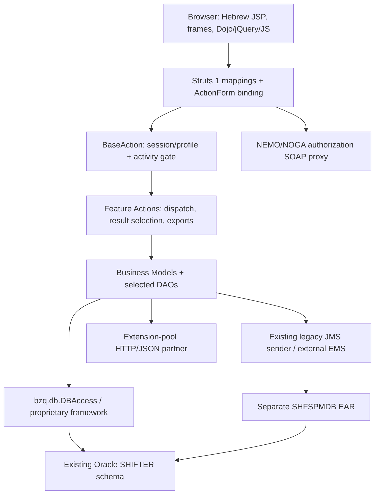
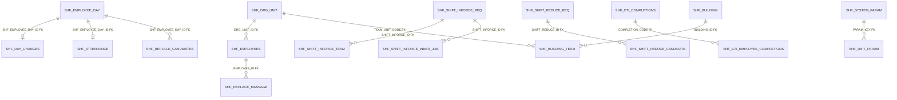
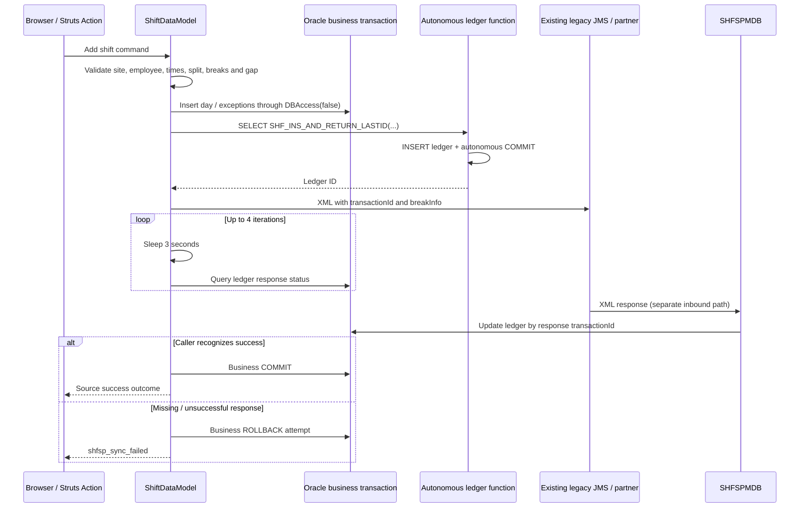

# SHF / Shifter: Reverse Engineering and Design Baseline

**Version:** 1.0  
**Analysis date:** 15 October 2026  
**Document language:** English  
**Task ID:** SHF-RE-2026-10-15  
**Status:** As-is evidence baseline delivered; application-runtime verification and target-contract approval remain open.

## 1. Executive summary

SHF is a workforce-management companion for call-center operations. Its source implements employee and shift inquiries, stage/station attendance, exceptions and breaks, shift replacement, management-forced swaps, additional staffing, shift reduction and time-change requests, staffing forecasts, CTI completion administration, reporting, building assignments, mobile auditing, extension-pool interaction, and IWD training timing.

The recovered application is **Struts 1 / JSP / JavaScript with Java business models and direct Oracle SQL**, not a predominantly session-EJB business tier. A separate message-driven EJB processes managed-break responses. Two EAR descriptors separate the web application from that MDB.

This document combines:

1. An inventory of every Java source, JSP artifact, and non-vendor JavaScript file in the inspected application source roots.
2. Route, form, forward, screen-control, navigation-reference, method, validation-error, parameter-key, and database-use inventories with file/line evidence.
3. Direct examination of business-controlling code for the principal workflows.
4. A read-only dictionary snapshot of the explicitly authorized **SHIFTER test schema through CTIDBT_WFMT**.

The physical test database is **Oracle Database 11g Enterprise Edition 11.2.0.4.0**, not an assumed modern Oracle release. It contains 78 tables, 2 views, 136 indexes, 17 sequences, 4 packages with 4 package bodies, and 1 standalone function. Its database character set is `IW8ISO8859P8`; the national character set is `AL16UTF16`.

The most consequential finding is the integration-ledger function: `SHF_INS_AND_RETURN_LASTID` performs an **autonomous INSERT and COMMIT**, even though callers invoke it in a `SELECT`. Business rollback therefore does not roll back that ledger entry. The legacy managed-break path also waits synchronously for partner responses and attempts local rollback on unsuccessful synchronization. Neither source behavior nor XA-looking JNDI names proves atomic Oracle/EMS completion.

**No application code, legacy artifact, database business record, broker configuration, or schema was modified. No legacy build, job, broker client, application endpoint, or mutating database routine was executed.**

### 1.1 Scope and exclusions

- Primary application evidence: [SHF source](../old/SHF/src/), [web content](../old/SHFWeb/WebContent/), [MDB source](../old/SHFEJB/ejbModule/ejbs/SHFSPMDBBean.java), permitted EAR/facet descriptors, and [managed-break schemas](../old/SharedLibraries/bzq/bzq/shfsp/).
- Existing scope: Node.js backend, modern Angular with Angular Material/CDK and Material 3, existing Oracle schema, abstract EMS ports/DTOs only.
- Batch implementation, execution, scheduling, packaging, and batch-only testing remain excluded. Schema metadata can incidentally identify batch-related objects; that does not authorize their execution or migration.
- Source files under [old](../old/) remain read-only. Generated classes, JARs, vendor Dojo/jQuery, archives, and attached image snapshots were not executed or modified.
- Access-filtered resources were not bypassed. Deployment settings not visible in the permitted evidence are unknown.
- No business-table values, employee records, parameter values, statistics/cardinalities, live plans, or production metadata were requested.
- All target recommendations below are proposals, not approved API/UI contracts or implementation authorization.

### 1.2 Evidence terminology

| Label | Meaning | What it does not establish |
|---|---|---|
| **S: Source-observed** | Executable code, SQL construction, JSP/JS reference, or constant inspected at a cited location. | That the code is deployed, reachable, correct, or executed. |
| **C: Configured** | A local descriptor, facet, binding, or schema declares it. | Actual server/broker settings or an installed runtime. |
| **D: Documented** | Existing project guidance or explanatory comments describe it. | Agreement with controlling code. |
| **T: Test-metadata verified** | Returned by an authorized Oracle dictionary query in this task. | Production equivalence, business data, or application behavior. |
| **I: Inferred** | A reasoned relationship or intended workflow reconstructed from several findings. | A runtime result or an enforced physical FK. |
| **P: Proposed** | A modernization/design recommendation. | User approval or completed implementation. |
| **U: Unknown / not verified** | Evidence was missing, excluded, or outside authorized checks. | Permission to assume a default. |

Local file/line anchors identify the inspected source snapshot. Hashes in the manifest identify the bytes analyzed. Counts from lexical extraction are inventory counts, **not semantic test coverage**.

## 2. Evidence package and reproducibility

The missing source-contract catalog referenced by the [agent brief](AGENT_INSTRUCTION.md) was not treated as available evidence. The following accompanying artifacts establish the source baseline directly.

| Artifact | Contents and interpretation |
|---|---|
| [source-manifest.csv](reverse-engineering/source-manifest.csv) | Relative path, byte count, line count, decoding choice, and SHA-256 for 454 inspected source/config/schema artifacts. |
| [classes.csv](reverse-engineering/classes.csv), [methods.csv](reverse-engineering/methods.csv), [fields.csv](reverse-engineering/fields.csv) | 239 top-level application class records; 3,553 method-declaration candidates and 1,633 field-declaration candidates. |
| [routes.csv](reverse-engineering/routes.csv) | 216 active Struts action-mapping declarations for 215 distinct paths, action source, form type/source, configured dispatch value, matching branch-line candidates, activity, scope and validation attributes. |
| [forms.csv](reverse-engineering/forms.csv), [forwards.csv](reverse-engineering/forwards.csv) | 50 configured form beans; 305 action-local forwards and 4 global forwards. |
| [dispatch-branches.csv](reverse-engineering/dispatch-branches.csv) | 240 literal `param`/`action`/`mode` branch comparisons across scanned Java. Not a control-flow graph. |
| [screens.csv](reverse-engineering/screens.csv) | All 185 JSP artifacts, title, includes, security-activity references, literal targets, and incoming configured forwards. Fragments/copies are not automatically active screens. |
| [screen-controls.csv](reverse-engineering/screen-controls.csv) | 1,705 control/custom-tag candidates, property/name/type/action/activity and line. |
| [navigation.csv](reverse-engineering/navigation.csv) | 397 literal application URL references across JSP and 19 application JS files. A reference is not proof of a traversable transition. |
| [validation-errors.csv](reverse-engineering/validation-errors.csv) | 699 literal `ActionError` construction sites with source owner candidates. Includes some success-shaped messages because legacy uses the same mechanism. |
| [parameter-keys.csv](reverse-engineering/parameter-keys.csv) | Unit/global policy keys recovered from parameter accessors; no business parameter values were read. |
| [database-usage.csv](reverse-engineering/database-usage.csv) | 736 SHF SQL/sequence/function-reference sites; 76 normalized referenced object names. All matched names exist in the test dictionary. |
| [schema-usage-map.csv](reverse-engineering/schema-usage-map.csv) | All 78 tables and 2 views mapped to physical columns/PKs/FK counts and source read/write reference counts. |
| [coverage.json](reverse-engineering/coverage.json) | Machine-readable counts, missing-action-source checks, unmatched-object checks, and test dictionary summary. |
| [extract-evidence.mjs](reverse-engineering/extract-evidence.mjs) | Dependency-free, read-only source extractor and CSV-shape validator. Writes only evidence outputs in its own directory. |
| [oracle-metadata.sql](reverse-engineering/oracle-metadata.sql) | Credential-free SQL*Plus dictionary capture, read-only transaction, error exits, and rollback. Does not connect by itself. |
| [verify-evidence.mjs](reverse-engineering/verify-evidence.mjs), [verification.json](reverse-engineering/verification.json) | Structural verification of local document links/anchors, source hashes, CSV references, route uniqueness, count expectations and Oracle snapshot hashes. Uses the shared [CSV reader](reverse-engineering/csv.mjs). |

### 2.1 Extraction limitations

- Java method/field and branch extraction is lexical, not a Java compiler, type resolver, or verified call graph. Owner attribution uses preceding declaration candidates.
- SQL extraction covers the recognized static `SHF_*` references and selected sequence/function patterns, not arbitrary dynamic SQL, all external schemas, or hidden SQL in proprietary libraries.
- Controls are recognized tag/attribute patterns, primarily double-quoted attributes. Runtime-created controls, every custom-tag expansion, and dynamically assembled URLs are not exhaustively recovered.
- XML comments and Java/JS comments are masked where the extractor supports them. JSP embedded-language/comment combinations can still produce incidental references.
- All non-framework action classes in the extracted Struts mappings resolved to an application source file. This does not verify every branch, form binding, or servlet mapping at runtime.
- Source anomaly: `/shift/viewOriginalShiftDialog` is declared twice, identically, at [mapping line 925](../old/SHFWeb/WebContent/WEB-INF/struts-config.xml#L925) and [mapping line 929](../old/SHFWeb/WebContent/WEB-INF/struts-config.xml#L929). Both declarations are retained in the evidence; startup/runtime duplicate handling was not tested and the source was not changed.
- Oracle dictionary exports containing `LONG` values use text instead of CSV because the installed SQL*Plus CSV formatter produced unterminated quotes for `LONG` fields. The corrected text exports retain defaults, check conditions, index expressions, and view definitions without claiming CSV conformance.

### 2.2 Repeating static extraction

From the repository root, with metadata snapshots already present:

```powershell
node --check docs\reverse-engineering\extract-evidence.mjs
node docs\reverse-engineering\extract-evidence.mjs
node docs\reverse-engineering\verify-evidence.mjs
```

Repeat database discovery only under an approved metadata scope. Authenticate interactively or through approved secret handling, then run:

```sql
@docs\reverse-engineering\oracle-metadata.sql
```

Do not store credentials in the script, command files, connection examples, or documentation. The evidence directory is the persistent output, not a deployment package.

## 3. Application structure and compatibility baseline

### 3.1 Modules

| Module | Recovered responsibility | Evidence/status |
|---|---|---|
| [SHF](../old/SHF/) | Utility project containing Struts actions, forms/beans, models, DAOs, profile logic, tag libraries, helpers and WFM report code. | S/C: [web classpath](../old/SHFWeb/.classpath) references SHF; [SHF classpath](../old/SHF/.classpath) declares source roots. |
| [SHFWeb](../old/SHFWeb/) | JSP, custom tags, JS/CSS/images, Struts mappings, validation and environment configuration references. Its inspected source directory is empty; application Java is in SHF. | S/C: [Struts mappings](../old/SHFWeb/WebContent/WEB-INF/struts-config.xml#L129). |
| [SHFEAR](../old/SHFEAR/) | Web EAR with `SHFWeb.war`, context root `shf`. | C: [application descriptor](../old/SHFEAR/META-INF/application.xml#L10). |
| [SHFEJB](../old/SHFEJB/) | One message-driven bean, SHFSPMDB, processing XML partner responses. | S/C: [MDB descriptor](../old/SHFEJB/ejbModule/META-INF/ejb-jar.xml#L5). |
| [SHFEJBEAR](../old/SHFEJBEAR/) | Separate EAR containing `SHFEJB.jar`. | C: [application descriptor](../old/SHFEJBEAR/META-INF/application.xml#L4). |
| [SharedLibraries](../old/SharedLibraries/), [APPLib](../old/APPLib/) | Proprietary framework/proxy dependencies, Oracle/EMS library directories, and managed-break JAXB/XSD contract evidence. | S/C for visible names/contracts; exact binary implementation/version U. |
| [SHFBatch](../old/SHFBatch/) | Separate batch area. | Identified but excluded from implementation/execution and batch-only behavioral analysis. |
| [Servers](../old/Servers/), [ProfileProject](../old/ProfileProject/) | Workspace/server/profile artifacts. | Existence only; no active deployment/topology established. |

### 3.2 Version evidence

| Technology | Evidence | Conclusion |
|---|---|---|
| WebSphere | [web facets](../old/SHFWeb/.settings/org.eclipse.wst.common.project.facet.core.xml#L3): `was.base.v61`, coexistence/extended-web 6.1. | C: traditional WebSphere 6.1 development target, not Liberty. Deployed edition/fixpack/JVM U. |
| Java | [SHF facets](../old/SHF/.settings/org.eclipse.wst.common.project.facet.core.xml#L6) and web facets declare Java 5.0. | C: historical project setting. Source also uses JAXB, third-party HTTP/JSON/POI APIs and later-looking constructs; a successful compile on Java 5 is not claimed. |
| Servlet/J2EE | Web facet 2.4; EAR 1.4 and EJB 2.1 descriptors; `javax.*` imports. | C/S: historical J2EE API family, not Jakarta EE. |
| Struts | Actions extend Struts `Action` and implement `perform`; web facet `web.struts` 1.0.2. | S/C: Struts 1 family. Exact deployed library version U. |
| Dojo | Facet `rad.dojo` 1.0 and legacy Dojo use in [shift JavaScript](../old/SHFWeb/WebContent/js/shiftjs.js#L34). | C/S: legacy Dojo integration. Facet does not prove bundled/deployed patch version. |
| jQuery | Local file named `jquery-1.12.0.min.js`; responsive code uses `$`. | Source artifact naming only; deployed selection U. Vendor code was excluded from semantic extraction. |
| Oracle client | Executed SQL*Plus/TNSPing report client 19.0.0.0.0. | Tool runtime observed; not the Java application's JDBC driver version. |
| Oracle server | [server version snapshot](reverse-engineering/oracle-server-version.csv). | T: test server 11.2.0.4.0, Enterprise Edition, Solaris TNS component. |
| JDBC/EMS libraries | Local directories named Oracle `v10`, EMS `v43` and `v5.1.2`. | Names only; exact binary/client/broker versions U. |
| Browser support | HTML 4.01 framesets, IE-related code/commentary, mobile adaptation. | S: compatibility intent. A browser support matrix or actual accessibility compliance is U. |

### 3.3 Logical layers



This is a source-reconstructed component diagram, not a verified deployment diagram. Some actions, including login and SoftPhone callbacks, extend Struts `Action` directly and do not traverse BaseAction.

### 3.4 Lifecycle, ownership and framework behavior

- [ActionServlet.initAddConfig](../old/SHF/src/bzq/shf/action/ActionServlet.java#L29) resolves environment-specific configuration using `BZQ_CONFIG_ENV` and stores `addConfigDoc` in servlet context.
- [BaseServletListener](../old/SHF/src/bzq/shf/servletListeners/BaseServletListener.java#L41) resolves logging configuration; actual listener registration is not established from the inspected permitted descriptors.
- [LoadTables](../old/SHF/src/bzq/shf/model/LoadTables.java) and [SHFParameters](../old/SHF/src/bzq/shf/utils/SHFParameters.java#L21) use an application-level `TablesContainer`.
- [BaseAction](../old/SHF/src/bzq/shf/actions/BaseAction.java#L24) holds profile and parsed-parameter state in instance fields. Actions and report actions also contain mutable model/workbook fields. Their concurrency safety is not established.
- [DBAccess usage](reverse-engineering/database-usage.csv) is widespread in models, not isolated to DAOs. Its underlying source/auto-commit contract was not present in the inspected application source; no library decompilation or execution was performed.
- Methods using `new DBAccess(false)` with explicit commit/rollback show **local transaction intent**. Connection enlistment, isolation and every default-constructor commit behavior remain U.

## 4. Actors, authorization and navigation

### 4.1 Recovered actors

The following are inferred business roles, not independently verified role assignments:

| Actor | Capabilities indicated by source |
|---|---|
| Employee/agent | Own shifts, employee-card views, replacement offers, messages, eligible staffing/reduction/time-change applications. |
| Supervisor/manager | Current attendance, shift search/update/cancel, forced swaps, staffing and forecast workflows. |
| Administrator | Reason/type/skill/parameter maintenance, jobs/buildings/team assignments, managed-break enablement and reports. |
| External SoftPhone/CTI partner | Actual break-time and logout callbacks; managed-break request/response interaction. |
| Authorization service | Domain-user identity/profile authorization through NEMO/NOGA SOAP interfaces. |
| Reporting/HR users | Schedule/HR workbook outputs and links to BI/WFM systems. |

### 4.2 Authentication and gates

1. [LoginAction](../old/SHF/src/bzq/shf/actions/LoginAction.java#L31) starts from `domain_user`, requests authorization via [SSOWebProxyNoga](../old/SHF/src/bzq/shf/profile/SSOWebProxyNoga.java#L63), and loads an application profile.
2. [Login.load](../old/SHF/src/bzq/shf/model/Login.java#L38) requires authorization/name/user inputs, retrieves replacement permission, and derives permitted organizational units.
3. The successful path stores `userProfile` in session and sets a **5,400-second** inactivity interval. Mobile-login audit insertion is conditional.
4. [BaseAction.perform](../old/SHF/src/bzq/shf/actions/BaseAction.java#L85) routes absent profiles to platform detection; a configured non-null `activity` must exist in the profile.
5. Form instances receive profile identity and unit permissions through [setUserProfileDetails](../old/SHF/src/bzq/shf/actions/BaseAction.java#L169).
6. [SecurityTag](../old/SHF/src/bzq/shf/taglib/SecurityTag.java#L26) hides JSP bodies when their activity is absent. Hidden controls are not proof of endpoint authorization.

**Important boundary:** the BaseAction rejection of an absent activity is commented out. Several routes have no configured activity; some direct-Action endpoints bypass BaseAction entirely. This is source behavior, not proof of exploitable access or deployed filtering. Required resource-level authorization and upstream protections need separate verification.

The organizational hierarchy uses `A01` division, `E01` department, `G01` call center and `J01` team constants. Hierarchical access expansion is in [Login.setAllowedUnits](../old/SHF/src/bzq/shf/model/Login.java#L157); the test [SHF_ORG_UNITS_VIEW definition](reverse-engineering/oracle-view-definitions.txt) confirms a five-level parent-join view, not every runtime authorization rule.

### 4.3 Shell and menu

[shf_index.jsp](../old/SHFWeb/WebContent/jsp/shf_index.jsp#L26) defines:

- `topLogoBar` for branding/header;
- `frMain` for business content, initially messages;
- `right` for [right_menu.jsp](../old/SHFWeb/WebContent/jsp/right_menu.jsp);
- `frMsgBar` for [message-bar navigation](../old/SHFWeb/WebContent/WEB-INF/struts-config.xml#L153).

The source's mobile threshold is `screen.width / devicePixelRatio < 760`. It hides the right frame and transforms selected result tables into expandable mobile rows. [shf_responsive.js](../old/SHFWeb/WebContent/js/shf_responsive.js#L1) reconstructs result tables and submenus rather than providing a separate mobile SPA.

Principal menu destinations observed in [right_menu.jsp](../old/SHFWeb/WebContent/jsp/right_menu.jsp#L51):

| Area | Destination | Gate/qualification |
|---|---|---|
| Attendance | `/shf/attendance/param.do` | Hidden on source-detected mobile layout. |
| Shifts | `/shf/shift/shiftMenu.do` | Model/action chooses management vs employee destination. |
| Employee card | `/shf/employee/searchParam.do` | Desktop menu branch. |
| Breaks | `/shf/break/searchParam.do` | `break_menu`; desktop branch. |
| Forecast | `/shf/forecast/param.do` | `forecast_menu`. |
| CTI completions | `/shf/completion/menu.do` | `login_menu`. |
| Administration | `/shf/admin.do` | `admin_menu`. |
| Schedule / HR reports | `/shf/wfmReport.do`, `/shf/wfmHRReport.do` | `wfm_reports`; desktop branch. |
| Mobile audit | `/shf/mobile/ReportParam.do` | `admin_menu`. |
| IWD training | `/shf/IWD/peleParam.do` | `lomdot_timing`. |
| BI/WFM portals | External browser links | Source links only; partners not contacted. |

All application URL references are in the [navigation inventory](reverse-engineering/navigation.csv). Relative JSP links, calculated redirects and external navigation are not exhaustively represented there.

## 5. Screen and interaction catalog

The complete artifact list is [screens.csv](reverse-engineering/screens.csv); the complete extracted control list is [screen-controls.csv](reverse-engineering/screen-controls.csv). The table below groups user workflows without asserting that 185 JSP files mean 185 independent screens.

| Screen family | Source artifacts / controlling surface | Interaction and evidence boundary |
|---|---|---|
| Login/platform/error shell | [platformDetect.jsp](../old/SHFWeb/WebContent/jsp/platformDetect.jsp), [shf_index.jsp](../old/SHFWeb/WebContent/jsp/shf_index.jsp); global forwards in [Struts config](../old/SHFWeb/WebContent/WEB-INF/struts-config.xml#L115). | Platform detection, obtain-user/login failure, access-denied and fatal-error outcomes. |
| Messaging | [showMessages_new.jsp](../old/SHFWeb/WebContent/jsp/showMessages_new.jsp), [MessagesAction](../old/SHF/src/bzq/shf/actions/MessagesAction.java). | View messages, delete markers, accept offers, message-icon refresh. |
| Employee card | [employee_card.jsp](../old/SHFWeb/WebContent/jsp/employee_card.jsp), [EmployeeDataAction](../old/SHF/src/bzq/shf/actions/EmployeeDataAction.java). | Search/result/card, activities, shifts, exceptions, skills, education/courses, taxi-order references, SMS preferences. |
| Attendance | [attendance.jsp](../old/SHFWeb/WebContent/jsp/attendance.jsp), [attendance.js](../old/SHFWeb/WebContent/js/attendance.js#L116). | Stage arrival, station entry/exit, missing/late events, briefing indicator, flag, report confirmation and cancellation. JS includes mutating GET requests. |
| Shift search/current/own shifts | [ShiftDataAction](../old/SHF/src/bzq/shf/actions/ShiftDataAction.java#L83), [shiftjs.js](../old/SHFWeb/WebContent/js/shiftjs.js). | Shared search form state, current defaults, employee views, export, dialog opening. Exact JSP forward targets are in the forward inventory. |
| Shift editing/addition/cancellation | [add_shift_popup.jsp](../old/SHFWeb/WebContent/jsp/add_shift_popup.jsp), [cancel_shift_popup.jsp](../old/SHFWeb/WebContent/jsp/cancel_shift_popup.jsp), [ShiftDataModel](../old/SHF/src/bzq/shf/model/ShiftDataModel.java#L3604). | Time/site/activity/employee changes, break/split validation, work-from-home/site changes, reason/remark input. |
| Replacement marketplace | [ReplaceAction](../old/SHF/src/bzq/shf/actions/ReplaceAction.java), [ReplaceModel](../old/SHF/src/bzq/shf/model/ReplaceModel.java#L146). | Eligible-shift checks, repository offers, multiple candidates, accept/reject/cancel, optional SMS. |
| Forced swap | [SwitchAction](../old/SHF/src/bzq/shf/actions/SwitchAction.java#L162). | Precheck, confirmable limitations, limitation-removal command, swap execution. |
| Break management | [break_search_list.jsp](../old/SHFWeb/WebContent/jsp/break_search_list.jsp), [shift_my_breaks.jsp](../old/SHFWeb/WebContent/jsp/shift_my_breaks.jsp), [breakjs.js](../old/SHFWeb/WebContent/js/breakjs.js#L3). | Shift-break inquiry, candidate checks, exchange offers, actual departure/return and lateness. |
| Time-change requests | [agent_change_requests.jsp](../old/SHFWeb/WebContent/jsp/agent_change_requests.jsp), [change_request_options.jsp](../old/SHFWeb/WebContent/jsp/change_request_options.jsp), [change_request_applications.jsp](../old/SHFWeb/WebContent/jsp/change_request_applications.jsp). | Request ranges, eligible options, employee applications and approval. The file named [time_change_requests.js](../old/SHFWeb/WebContent/js/time_change_requests.js) is only a stub, not the business implementation. |
| Reduction / additional staffing | [ReduceDataAction](../old/SHF/src/bzq/shf/actions/ReduceDataAction.java), [ShiftDataAction](../old/SHF/src/bzq/shf/actions/ShiftDataAction.java#L195). | Management request creation, employee options/application and approval/decline. |
| Forecast | [ForecastAction](../old/SHF/src/bzq/shf/actions/ForecastAction.java), [forecast.js](../old/SHFWeb/WebContent/js/forecast.js#L99). | Staffing/call/activity data, quarter-hour/hour aggregation and detail overlays for calls/breaks/exceptions. |
| CTI completions | [cti_main.jsp](../old/SHFWeb/WebContent/jsp/cti_main.jsp), [cti_set_completion.jsp](../old/SHFWeb/WebContent/jsp/cti_set_completion.jsp), [CTIAction](../old/SHF/src/bzq/shf/actions/CTIAction.java). | Employee/time selection, calculation/confirmation, update/cancel, job-to-SAP administration. |
| Catalog/system administration | [admin_main.jsp](../old/SHFWeb/WebContent/jsp/admin_main.jsp), [AdminAction](../old/SHF/src/bzq/shf/actions/AdminAction.java#L57), [SystemAdminAction](../old/SHF/src/bzq/shf/actions/SystemAdminAction.java). | Reasons/types, skills, activities, job groups, parameters and allowed-unit dependent catalogs. |
| Buildings/teams | [BuildingModel](../old/SHF/src/bzq/shf/model/BuildingModel.java#L316), [ManageBuildingsAction](../old/SHF/src/bzq/shf/actions/ManageBuildingsAction.java). | Building CRUD and assignment/unassignment of teams. |
| Managed-break flag | [opt_shf_sp.jsp](../old/SHFWeb/WebContent/jsp/opt_shf_sp.jsp), [OptShfSpModel](../old/SHF/src/bzq/shf/model/OptShfSpModel.java#L138). | Authorized-unit selection, per-unit enablement diff, partner synchronization. |
| IWD timing | [peleIWD.jsp](../old/SHFWeb/WebContent/jsp/peleIWD.jsp), [IWDModel](../old/SHF/src/bzq/shf/model/IWDModel.java#L334). | Select module/call-center/inner job, choose timing quantities/intervals, schedule or cancel. Scheduled transport execution is deferred. |
| WFM/HR reports | [ScheduleHomeAction](../old/SHF/src/bzq/wfm/report/ScheduleHomeAction.java#L35). | Parameters, schedule/site selection, workbook streaming from existing templates. |
| Cancelled items / mobile audit | [ShiftCancelledModel](../old/SHF/src/bzq/shf/model/ShiftCancelledModel.java#L42), [PlatformModel](../old/SHF/src/bzq/shf/model/PlatformModel.java). | Aggregate cancelled shifts/full-day/partial exceptions; mobile activity reporting. |

### 5.1 Input, response and state conventions

- Browser inputs bind to Struts forms/beans, whose field names/types are cataloged in the [field inventory](reverse-engineering/fields.csv). Database mappings and inheritance require inspection of the specific form, not name matching alone.
- Most UI results are JSP forwards. Some actions directly write exports/AJAX responses and return no forward.
- Search forms and forced-swap snapshots are stored in session; many result lists are request attributes.
- Exceptions, warnings, success messages and errors can travel through `ActionErrors`, `ShfException` or message-bar refresh. These are not a stable HTTP status/error contract.
- [validation.xml](../old/SHFWeb/WebContent/WEB-INF/validation.xml) contains only a small subset of form validations and several names differ from the main configured form-bean names. Its presence does not prove execution of every validator.
- Attached assets include icons, backgrounds, branding and generic error artwork. They are supplementary visual evidence, **not full rendered-screen or navigation evidence**. No copying, screenshot-based runtime proof or visual conformance claim is made.

### 5.2 Hebrew, RTL and accessibility

S: inspected JSPs predominantly declare Windows-1255, use right-sided menus and Hebrew labels; the source decoder records legacy encoding in the manifest. The browser layout has frames, clickable table cells, image controls, overlays and rebuilt mobile tables.

U: keyboard order, focus restoration, accessible names, contrast, reflow, screen-reader reading order and WCAG conformance were not tested.

P: any replacement UI must preserve Hebrew and mixed-direction identifiers while providing logical tab order, visible focus, semantic buttons, labelled dialogs and live error feedback. Suggested Hebrew accessible names include `שמירה` (Save), `ביטול` (Cancel), and `סגירת חלון` (Close dialog). These are proposed acceptance labels, not a change to legacy resources.

## 6. End-to-end workflow traceability

Each row identifies a principal flow and its controlling model. Use the route/forward inventories for every mapped operation, and the SQL-use inventory for individual read/write sites.

| ID | Entry / navigation | Controlling source | Data/effects | Outcome and acceptance focus |
|---|---|---|---|---|
| WF-01 | `/login`, `/mPlatform` | [LoginAction](../old/SHF/src/bzq/shf/actions/LoginAction.java#L31), [Login.load](../old/SHF/src/bzq/shf/model/Login.java#L38) | SOAP authorization, employee replacement permission, organizational/profile lookup, conditional mobile audit. | Session profile and application shell; reject incomplete identity/profile. BR-01/02. |
| WF-02 | `/employee/searchParam`, `/employee/searchResult` | [EmployeeDataAction](../old/SHF/src/bzq/shf/actions/EmployeeDataAction.java), [EmployeeDataModel](../old/SHF/src/bzq/shf/model/EmployeeDataModel.java) | Employees, organizational units, skills, events and employee-day/exception data. | Permitted card/result and related tabs; own-vs-management access needs characterization. |
| WF-03 | `/attendance/param`, arrival/event/exit operations | [AttendanceDataModel.registerStation](../old/SHF/src/bzq/shf/model/AttendanceDataModel.java#L1053), [registerStage](../old/SHF/src/bzq/shf/model/AttendanceDataModel.java#L1237), [exitStation](../old/SHF/src/bzq/shf/model/AttendanceDataModel.java#L1884) | Attendance upsert, flags/reports/events, mood/briefing data. | Actual timestamps, late detail or message-bar result; already-exited/no-entry cases. BR-03/04/05. |
| WF-04 | `/shift/searchParam`, `/shift/searchResult`, `/shift/myShiftResult` | [ShiftDataAction](../old/SHF/src/bzq/shf/actions/ShiftDataAction.java#L100), [ShiftDataModel.populateShift](../old/SHF/src/bzq/shf/model/ShiftDataModel.java#L150) | Baseline day + changes + attendance/employee joins. | Effective shifts and export; distinguish original vs current employee and times. BR-06. |
| WF-05 | `/shift/updateShiftExceptions`, `/shift/updateShift` | [validateUpdate](../old/SHF/src/bzq/shf/model/ShiftDataModel.java#L3604) and subsequent update path | Changed-day overlay; may remove exchange candidates during validation if requested. | Reject missing-marked shift, invalid dates, incompatible pending exchanges/split; managed-break synchronization when applicable. BR-07/08. |
| WF-06 | `/shift/viewExtraShiftDialog`, addition/staffing commands | [validate_addShift](../old/SHF/src/bzq/shf/model/ShiftDataModel.java#L5695), [addSingleShift](../old/SHF/src/bzq/shf/model/ShiftDataModel.java#L5801) | New employee day, breaks/exceptions and source markers; optional managed-break command. | Valid employee/site/activity/time; rollback attempt on partner failure. BR-09/10/11. |
| WF-07 | `/shift/addFromFile` | [validateAddShiftsFormFile](../old/SHF/src/bzq/shf/model/ShiftDataModel.java#L7934) | Uploaded CSV and per-row shift-add path. | Nonempty lowercase `.csv`, size <= 1 MiB, header + data and >= 5 columns; characterize row-level partial success separately. BR-12. |
| WF-08 | `/shift/shiftCancelRemarkDialog`, `/shift/cancel` | [checkShiftForCancel](../old/SHF/src/bzq/shf/model/ShiftDataModel.java#L4315), [cancelShift](../old/SHF/src/bzq/shf/model/ShiftDataModel.java#L3704) | Day-change cancellation sentinel, reasons/remarks, exception cancellation; optional partner break deletion. | Reject attendance/exchange/pool extension conflicts; logical cancellation, not deletion. BR-13. |
| WF-09 | Replacement candidate/repository/offer operations | [checkValidShiftCandidate](../old/SHF/src/bzq/shf/model/ReplaceModel.java#L941), [offerReplaceToCandidate](../old/SHF/src/bzq/shf/model/ReplaceModel.java#L146) | Replacement candidates/messages and optional SMS. | Eligible future shift; accept/cancel/reject state lifecycle. BR-14/15. |
| WF-10 | Offer acceptance | [acceptReplaceOffer](../old/SHF/src/bzq/shf/model/ReplaceModel.java#L570), [replacement DAO](../old/SHF/src/bzq/shf/dao/ReplaceByCritrionDao.java) | Gap checks, swap/candidate updates, messages to related offers. | Recheck eligibility at acceptance; competing offers reopen/reject according to DAO logic. BR-15/16. |
| WF-11 | Forced-swap check/confirmation/execution | [SwitchAction](../old/SHF/src/bzq/shf/actions/SwitchAction.java#L43), [validateReplace](../old/SHF/src/bzq/shf/model/SwitchModel.java#L69), [replaceDays](../old/SHF/src/bzq/shf/model/SwitchModel.java#L294) | Session snapshots, limitation removal, day changes, exceptions, partner updates/SMS. | Hard rejection vs confirmable warning must remain distinct; stale-session/concurrent changes not verified. BR-17. |
| WF-12 | `/break/searchParam`, exchange and actual-time operations | [checkValidBreakCandidate](../old/SHF/src/bzq/shf/model/BreakDataModel.java#L961), [checkShiftBreakForm](../old/SHF/src/bzq/shf/model/BreakDataModel.java#L3218) | Breaks represented in employee exceptions; replacement-break candidates; actual entry/exit. | Future/not-started candidate, allowed source and permission, within-shift/spacing validation. BR-18/19/20. |
| WF-13 | Staffing requests/options/application | [validateInforceRequest](../old/SHF/src/bzq/shf/model/ShiftDataModel.java#L1471) | Staffing request, teams/inner jobs, generated employee-day assignments. | Duration/date/capacity and overnight normalization. BR-21. |
| WF-14 | `/reduce/reduceShiftReq`, `/reduce/approveDeclineReduce` | [ReduceDataModel](../old/SHF/src/bzq/shf/model/ReduceDataModel.java#L386) | Reduction request/candidate, logical shift cancellation and notification. | Lead-time policy; cancel and candidate approval use separate model operations, atomicity U. BR-22. |
| WF-15 | Time-change request/options/application | [validateChangeRequest](../old/SHF/src/bzq/shf/model/ShiftDataModel.java#L4524), [addShiftChangeRequest](../old/SHF/src/bzq/shf/model/ShiftDataModel.java#L4575) | Time-change request/candidate, changed-day times and messages. | Range/order/minimum-duration constraints; historical lead-time check is commented out. BR-23. |
| WF-16 | `/forecast/param` and detail routes | [ForecastModel](../old/SHF/src/bzq/shf/model/ForecastModel.java), [sumSchData](../old/SHF/src/bzq/shf/model/ForecastModel.java#L3837) | Forecast activities/data, effective shifts, attendance, exceptions and staffing/reduction effects. | 15-minute values and hourly rollup; quarter completeness and sum-vs-average semantics. BR-24. |
| WF-17 | `/completion/menu`, save/update/cancel commands | [CTICompletion.checkCompletion](../old/SHF/src/bzq/shf/model/CTICompletion.java#L904), [saveCompletions](../old/SHF/src/bzq/shf/model/CTICompletion.java#L959) | CTI completions and employee completion rows; status flags, job/SAP mapping. | Positive duration, maximum length and overlap exclusion; all-selected rollback intent on errors. BR-25/26. |
| WF-18 | Managed-break flag and shift/break synchronization | [OptShfSpModel](../old/SHF/src/bzq/shf/model/OptShfSpModel.java#L138), [createMessageTransaction](../old/SHF/src/bzq/shf/model/BreakDataModel.java#L3260), [MDB](../old/SHFEJB/ejbModule/ejbs/SHFSPMDBBean.java#L162) | Unit flags, independently committed transaction ledger, XML send/reply and business commit/rollback intent. | Pending vs confirmed success vs timeout must not be conflated. BR-27/28/29; see section 9. |
| WF-19 | `/sp/break/timeActual`, `/sp/logout` | [SoftPhoneAction](../old/SHF/src/bzq/shf/actions/SoftPhoneAction.java#L16), [SoftPhoneForm](../old/SHF/src/bzq/shf/forms/SoftPhoneForm.java#L15), [SoftPhoneModel](../old/SHF/src/bzq/shf/model/SoftPhoneModel.java#L40) | Actual break times, break reminder records and logout attendance behavior. | Direct Action path; no declared JSON/OpenAPI response; precise caller/authentication contract U. BR-30. |
| WF-20 | `/IWD/peleSchedule`, cancel | [IWDModel.doSchedule](../old/SHF/src/bzq/shf/model/IWDModel.java#L334) | Employee/module timing, status and history. | Eligible active shift, incomplete module, before-end window, bounded quantities and intervals. Delivery job is deferred. BR-31/32. |
| WF-21 | `/wfmReport`, `/wfmHRReport` | [ScheduleHomeAction](../old/SHF/src/bzq/wfm/report/ScheduleHomeAction.java#L35) | Read-oriented reports and Excel workbook templates. | Correct filters, data/filename/format and failure indication; live business rows not read. |
| WF-22 | Catalog and building/team operations | [AdminAction](../old/SHF/src/bzq/shf/actions/AdminAction.java#L57), [BuildingModel.updateTeamBuilding](../old/SHF/src/bzq/shf/model/BuildingModel.java#L316) | Catalog writes/cache reload; team-building delete/insert transaction. | Assignment > 0 inserts; nonpositive building unassigns. BR-33. |
| WF-23 | Cancelled results/mobile audit | [ShiftCancelledModel.populateCancelled](../old/SHF/src/bzq/shf/model/ShiftCancelledModel.java#L42), [LoginAction mobile audit](../old/SHF/src/bzq/shf/actions/LoginAction.java#L112) | Cancelled overlays/exception unions; mobile activity records. | Include all three cancellation families; audit success/failure is separate from main operation. BR-34. |

WF-19 route spellings and form fields must be taken from the authoritative route inventory, not inferred from the Java class name. These are browser/partner transport entry points, not an approved REST API.

## 7. Business-rule register

The register captures explicit controlling behavior. Parameterized values are **not read from business rows** and remain U. Characterization should check equality boundaries as well as obvious success/failure cases.

| Rule | Source finding | Evidence |
|---|---|---|
| BR-01 | Login requires authorization, name and user fields; the current string-empty checks include reference equality. This is an observed implementation detail, not endorsed validation logic. | [Login.load](../old/SHF/src/bzq/shf/model/Login.java#L38). |
| BR-02 | A configured activity absent from the session profile is denied; missing activity does not trigger the commented rejection. Organizational scope is derived separately. | [BaseAction.perform](../old/SHF/src/bzq/shf/actions/BaseAction.java#L85). |
| BR-03 | Station arrival later than shift start marks the form late. Stage arrival compares `now + minutesArrivalBeforeStation` with shift start. Both persist arrival before raising the late-detail signal. | [registerStation](../old/SHF/src/bzq/shf/model/AttendanceDataModel.java#L1053), [registerStage](../old/SHF/src/bzq/shf/model/AttendanceDataModel.java#L1237). |
| BR-04 | Exit rejects an existing exit or absent attendance; update requires arrival not null and exit null. Successful exit is communicated using a `ShfException` carrying a success key. | [exitStation](../old/SHF/src/bzq/shf/model/AttendanceDataModel.java#L1884). |
| BR-05 | Missing-shift lock evaluation walks prior days and pre-decrements the supplied counter. Exact off-by-one/count sufficiency behavior needs characterization; no reliable numeric threshold can be inferred without policy values. | [checkLock](../old/SHF/src/bzq/shf/model/AttendanceDataModel.java#L2087). |
| BR-06 | Effective employee, start/end and related attributes frequently use `NVL(change, baseline)`. Employee matching frequently normalizes personal identifiers with `SUBSTR(...,1,8)`. Neither is a universal relationship inferred solely from names. | [populateShift](../old/SHF/src/bzq/shf/model/ShiftDataModel.java#L148), [replacement eligibility SQL](../old/SHF/src/bzq/shf/model/EmployeeDataModel.java#L1294). |
| BR-07 | Shift update rejects missing-marked days, dates outside computed surrounding-week bounds, short duration, end-before-start and exchange conflicts. Arrival/exit restrictions and past-start rejection are commented out in this method. | [validateUpdate](../old/SHF/src/bzq/shf/model/ShiftDataModel.java#L3604). |
| BR-08 | `validateUpdate` can delete break-exchange candidates when cancel-break-switch is selected. It is not a purely read-only preview. Replacement validation must separate this command side effect. | [validateUpdate](../old/SHF/src/bzq/shf/model/ShiftDataModel.java#L3666). |
| BR-09 | Shift addition requires site/call-center mapping, activity, employee identifier, permissible min/max duration and an inter-shift check. The bulk staffing variant selects a different gap validator. | [validate_addShift](../old/SHF/src/bzq/shf/model/ShiftDataModel.java#L5695). |
| BR-10 | Inter-shift SQL checks proposed start/end against effective existing bounds expanded by policy hours and excludes the current day ID. Endpoint-only predicates and minute-to-hour integer division in the staffing variant require full-containment/equality tests. | [CheckValidDate](../old/SHF/src/bzq/shf/utils/CheckValidDate.java#L50). |
| BR-11 | Split end must not precede split start; split must lie in shift; first working part >= 120 minutes; split gap >= 120 minutes; second-part start must not precede a Calendar-derived 16:00 threshold. Calendar minute/second retention needs characterization. Break endpoints in the split interval are rejected. | [validateSplitShift](../old/SHF/src/bzq/shf/model/ShiftDataModel.java#L5739), [validateShiftBreaks](../old/SHF/src/bzq/shf/model/ShiftDataModel.java#L5777). |
| BR-12 | Upload permits nonempty lowercase `csv` extension, <= 1,048,576 bytes, at least 2 rows and 5 header columns; each row must match header-column count. Parsing uses `split(",", -1)`, not a quoted-CSV grammar. | [upload validation](../old/SHF/src/bzq/shf/model/ShiftDataModel.java#L7934), [upload constants](../old/SHF/src/bzq/shf/utils/SHFConstants.java#L211). |
| BR-13 | Shift cancellation checks arrival/missing, exchange candidates and allocated pool extension; cancellation writes day-off type plus employee sentinel `99999999` and cancellation reason/remark into the changed-day overlay. | [cancel checks](../old/SHF/src/bzq/shf/model/ShiftDataModel.java#L4315), [cancelShift](../old/SHF/src/bzq/shf/model/ShiftDataModel.java#L3704). |
| BR-14 | Replacement candidate registration rejects stage/station arrival, missing reason, allocated extension, insufficient lead time, exceptions/split, and a break exchange. A source restriction on forced staffing shifts is commented out. | [checkValidShiftCandidate](../old/SHF/src/bzq/shf/model/ReplaceModel.java#L941). |
| BR-15 | Acceptance requires matching formatted week numbers `ww`, lead time for both shifts and gap checks. Formatting depends on locale/calendar and does not itself compare week-year. The two participant gap calls should be characterized against asymmetric schedules. | [checkReplacement](../old/SHF/src/bzq/shf/model/ReplaceModel.java#L514). |
| BR-16 | Gap acceptance uses strict `>` against the configured interval; equality can fail. Actual candidate statuses include `OPEN`, `WAIT_FOR_ANS`, and `CLOSE_REPLACE`, distinct from other constants `WAIT-FOR-ANSWER` and `APPROVED`. | [checkGapBetweenShifts](../old/SHF/src/bzq/shf/model/ReplaceModel.java#L551), [DAO statuses](../old/SHF/src/bzq/shf/dao/SimpleFactoryDao.java#L38). |
| BR-17 | Forced swap hard-rejects identical shift times, missing/non-switchable inner jobs, incompatible inter-shift gaps and attendance states. Repository/break-exchange/exception/extension conditions can return a confirmation-needed flag; `true` is not generic success. | [validateReplace](../old/SHF/src/bzq/shf/model/SwitchModel.java#L69), [SwitchAction](../old/SHF/src/bzq/shf/actions/SwitchAction.java#L162). |
| BR-18 | Break-exchange candidate must be future, not already departed, not already a candidate, sufficiently far from now and allowed for replacement. | [checkValidBreakCandidate](../old/SHF/src/bzq/shf/model/BreakDataModel.java#L961). |
| BR-19 | The accessor named hours-before-switch-break is applied as `value * 60 * 1000`, i.e. minutes in the controlling method. Break source checking rejects non-WFM records. Do not reinterpret units from names alone. | [checkIfBreakTooClose](../old/SHF/src/bzq/shf/model/BreakDataModel.java#L988), [checkBreakSource](../old/SHF/src/bzq/shf/model/BreakDataModel.java#L1049). |
| BR-20 | Break range checks compare start/end to shift margins, use a 60-minute margin when null, and implement up to three form breaks. Positive duration and pairwise 60-minute spacing are conditional on the `source` flag, with different branches for each check. | [break validation](../old/SHF/src/bzq/shf/model/BreakDataModel.java#L3175). |
| BR-21 | Staffing request end earlier than start rolls forward 24 hours. Duration must be within configured bounds, start must not precede today-at-midnight, and requested original headcount cannot fall below already added shifts. | [validateInforceRequest](../old/SHF/src/bzq/shf/model/ShiftDataModel.java#L1471). |
| BR-22 | Reduction application requires configured lead minutes and normal cancellation eligibility. Cancellation and candidate approval are distinct calls and are not shown to share one DB transaction. | [ReduceDataModel](../old/SHF/src/bzq/shf/model/ReduceDataModel.java#L386). |
| BR-23 | Time-change request checks ordered start/end ranges, start-window/end-window compatibility, minimum requested length and new-time ordering. Its historical minimum-lead-time rejection is disabled in source. | [validateChangeRequest](../old/SHF/src/bzq/shf/model/ShiftDataModel.java#L4524). |
| BR-24 | Staffing forecast has 15-minute intervals. Hourly rollup requires all four quarters; staffing-like measures are averaged, while arrivals/future exits are summed. | [forecast constants](../old/SHF/src/bzq/shf/utils/SHFConstants.java#L147), [hourly aggregation](../old/SHF/src/bzq/shf/model/ForecastModel.java#L3925). |
| BR-25 | Completion end must be strictly after start and length <= configured maximum. Selected employees/start/end arrays must exist and have equal length. | [checkCompletion](../old/SHF/src/bzq/shf/model/CTICompletion.java#L904). |
| BR-26 | Completion update excludes its own row and rejects four overlap/containment patterns. Multi-employee save intends rollback for any collected errors, commit otherwise. Completion statuses are 0 open, 1 calculated, 10 closed, 50 cancelled, 99 not sent. | [overlap check](../old/SHF/src/bzq/shf/model/CTICompletion.java#L330), [save](../old/SHF/src/bzq/shf/model/CTICompletion.java#L960), [constants](../old/SHF/src/bzq/shf/utils/SHFConstants.java#L125). |
| BR-27 | Managed-break success checks XML/status/description. Source polling performs up to 4 waits of 3 seconds each; nominal sleep budget is 12 seconds, not a measured response SLA. | [checkMessageResponse](../old/SHF/src/bzq/shf/model/BreakDataModel.java#L3060), [caller success logic](../old/SHF/src/bzq/shf/model/ShiftDataModel.java#L5987). |
| BR-28 | Executable constants map flag ON to `"0"` and OFF to `"1"`; the request-XSD comments describe the opposite mapping. Action `"2"` updates breaks. Comments must not override executable behavior. | [constants](../old/SHF/src/bzq/shf/utils/SHFConstants.java#L181), [request schema](../old/SharedLibraries/bzq/bzq/shfsp/request/SHFSPBreaks.xsd#L13). |
| BR-29 | Test function `SHF_INS_AND_RETURN_LASTID` autonomously inserts a transaction with sequence-derived IDs, commits, then returns its ID. This is verified package-source metadata, not an executed function call. | [function snapshot](reverse-engineering/oracle-transaction-function.csv), [source caller](../old/SHF/src/bzq/shf/model/BreakDataModel.java#L3260). |
| BR-30 | Actual-time callback requires employee/day/planned time plus updated start or end. Planned seconds are truncated. If both start/end updates exist, start branch wins; end is in `else if`. Failures frequently log and return rather than defining a caller-visible error contract. | [SoftPhoneModel.updateTimeActual](../old/SHF/src/bzq/shf/model/SoftPhoneModel.java#L40). |
| BR-31 | IWD timing excludes no-entry, completed, and already-scheduled agents except cancelled status; filters module/call-center/inner job; requires sufficient remaining shift time, using module duration or default. | [IWDModel.doSchedule](../old/SHF/src/bzq/shf/model/IWDModel.java#L334). |
| BR-32 | Timing caps requested quantities to eligible count, sorts by nearest shift end, advances intervals and applies start/end buffers. Zero-quantity division ordering needs characterization. Statuses: 0 none, 1 pending, 2 sent, 3 cancelled, 4 break-pending. Actual dispatch is deferred. | [IWD scheduling](../old/SHF/src/bzq/shf/model/IWDModel.java#L371), [statuses](../old/SHF/src/bzq/shf/utils/SHFConstants.java#L200). |
| BR-33 | Team-building assignment deletes existing assignment then conditionally inserts if building ID > 0, with explicit commit/rollback intent. | [BuildingModel.updateTeamBuilding](../old/SHF/src/bzq/shf/model/BuildingModel.java#L316). |
| BR-34 | Cancelled-result population unions cancelled shifts, full-day exceptions and employee exceptions. It is not only a query for physically deleted days. | [populateCancelled](../old/SHF/src/bzq/shf/model/ShiftCancelledModel.java#L42). |

The register is a principal-rule analysis, not a claim that every possible rule in 3,553 method candidates was semantically proven. The error-site and method inventories preserve the remaining review surface.

## 8. Oracle schema and persistence design

### 8.1 Authorized discovery and evidence boundary

The user's approved test alias was resolved with TNSPing and authenticated with SQL*Plus. Dictionary queries executed inside `SET TRANSACTION READ ONLY`, followed by `ROLLBACK`.

The [context snapshot](reverse-engineering/oracle-context.csv) reports session user/current schema `SHIFTER` and database name `wfmt`. Alias resolution reported TCP port 1521, while the existing brief's historical JDBC reference says 1526. These are different connection references; alias resolution does not prove the web application's JNDI datasource uses this endpoint or port.

No query selected from a SHF business table. Reads were from dictionary/session metadata and the standalone function's stored **definition**. No sequence `NEXTVAL`, `SHF_INS_AND_RETURN_LASTID` invocation, application package procedure, DML, DDL or business action was executed.

### 8.2 Physical test-schema inventory

| Finding | Test result | Evidence |
|---|---:|---|
| Tables / views | 78 / 2 | [objects](reverse-engineering/oracle-objects.csv). |
| Columns across tables/views | 722 | [columns](reverse-engineering/oracle-columns.csv). |
| Indexes | 136 | [indexes](reverse-engineering/oracle-indexes.csv). |
| Sequences | 17 | [sequences](reverse-engineering/oracle-sequences.csv); no values advanced. |
| Packages / bodies / standalone functions | 4 / 4 / 1 | [objects](reverse-engineering/oracle-objects.csv), [procedure inventory](reverse-engineering/oracle-procedures.csv). |
| Constraints | 337 | 59 PK, 10 unique, 29 FK, 239 check/NOT NULL; [constraint rows](reverse-engineering/oracle-constraints.csv) carry column positions and validation state. |
| FK column rows | 30 | 29 constraints; one relationship is composite. Do not count column rows as independent FKs. |
| Owner synonyms / triggers | 0 / 0 returned | [synonyms](reverse-engineering/oracle-synonyms.csv), [triggers](reverse-engineering/oracle-triggers.csv); empty captures mean no returned owner rows, not no external behavior anywhere. |
| Function-based expression | `IDX_EMP_SUB`: `SUBSTR("EMP_ID_NUMBER",1,8)` | [index expressions](reverse-engineering/oracle-index-expressions.txt). Matches a frequent source join shape; no performance benefit was measured. |
| Database/session time zone at capture | `+03:00` / `+03:00` | [time zones](reverse-engineering/oracle-timezones.csv); not a verified named Israel timezone/DST policy. |
| Database / national character set | `IW8ISO8859P8` / `AL16UTF16` | [NLS](reverse-engineering/oracle-nls.csv). |

Object statuses in the captured owner inventory are `VALID`; captured constraints are enabled and validated. This establishes dictionary state only. It does not establish business-rule correctness, deployed schema equivalence, performance, or current contents.

A PK is recorded for 59 tables, not all 78. The [schema map](reverse-engineering/schema-usage-map.csv) identifies empty PK cells. No missing key/index or migration was added.

### 8.3 Domain/data usage groups

| Domain | Principal physical objects | Source ownership / semantics |
|---|---|---|
| Organization/employee | `SHF_EMPLOYEES`, `SHF_ORG_UNIT`, `SHF_SITE`, `SHF_ORG_UNITS_SHF_SITES`, `SHF_EMPLOYEE_SKILLS`, `SHF_SKILLS` | Login, employee/card, filters, effective-day personal-ID joins. |
| Shift baseline/change | `SHF_EMPLOYEE_DAY`, `SHF_DAY_CHANGES` | Imported/planned baseline plus changed-day overlay. `NVL` current values and source/cancellation markers are application semantics. |
| Attendance/events | `SHF_ATTENDANCE`, `SHF_EMPLOYEE_EVENTS`, `SHF_EMPLOYEE_REPORTS`, `SHF_EMPLOYEE_ENTRANCE_MOOD` | Stage/station timestamps, missing/late/flags, reports and mood/briefing records. |
| Exceptions/breaks | `SHF_EMPLOYEE_EXCEPTIONS`, `SHF_EMPLOYEE_EXCEPTIONS_BASE`, `SHF_EXCEPTION_TYPE`, `SHF_EVENT_REASON`, `SHF_TIMEOFF_TYPES` | Partial/full-day exceptions, state type, logical deletion marker `DEL`, reasons, break actual times. |
| Replacement | `SHF_REPLACE_CANDIDATES`, `SHF_REPLACE_BREAK_CANDIDATES`, `SHF_REPLACE_MASSAGE`, `SHF_REPLACE_ACTIVITIES` | Marketplace state and messages. Preserve the physical spelling `MASSAGE`. |
| Additional staffing | `SHF_SHIFT_INFORCE_REQ`, `SHF_SHIFT_INFORCE_TEAM`, `SHF_SHIFT_INFORCE_INNER_JOB`, `SHF_INNER_JOBS` | Request capacity, restrictions and generated extra shifts. |
| Reduction/time change | `SHF_SHIFT_REDUCE_REQ`, `SHF_SHIFT_REDUCE_CANDIDATE`, `SHF_TIME_CHANGE_REQUEST`, `SHF_TIME_CHANGE_CANDIDATES` | Management intent, employee applications and approvals. |
| Forecast | `SHF_FORECAST_DATA`, `SHF_FORECAST_ACTIVITIES`, activity type/skill/aim tables | Demand/performance vs effective staffing and attendance. |
| CTI/completions | `SHF_CTI_COMPLETIONS`, `SHF_CTI_EMPLOYEE_COMPLETIONS`, `SHF_CTI_SHIFTS`, `SHF_CTI_CANCEL_LOGIN_SHIFTS`, `SHF_CTI_JOB_TO_SAP` | Completion administration, record status and reporting/SAP-mapping evidence. Other CTI tables exist without references in the scanned subset. |
| Security/configuration | `SHF_USER_PROFILE`, `SHF_SECURITY_PROFILE`, `SHF_SECURITY_ACTIVITIES`, `SHF_SYSTEM_PARAM`, `SHF_UNIT_PARAM`, `SHF_MOBILE_AUDIT`, `SHF_MOBILE_AUDIT_REF` | Activity membership, cached parameter definitions/unit overrides and mobile auditing. |
| Building/team | `SHF_BUILDING`, `SHF_BUILDING_TEAM`, `SHF_ORG_UNIT` | Physical assignment and organization references. |
| Managed-break/SMS ledger | `SHF_TRANSACTIONS`, `SHF_OPT_SHFSP_FLAG`, `SHF_BREAK_SMS` | Partner correlation/status and reminders. Not an approved general-purpose outbox. |
| IWD training | `SHF_PELE_EMPLOYEES`, `SHF_PELE_EMPLOYEES_HISTORY`, `SHF_PELE_LOMDOT`, `SHF_PELE_IWD_SERVICE_CODES` | Timing/module/history; temporary tables and batch package routines remain deferred. |

The [database-use inventory](reverse-engineering/database-usage.csv) contains the actual source locations and operation tokens. The schema map finds static references to **58 of 78 tables**. The other 20 are **metadata-only in the scanned subset**, not proven unused. They can be used by excluded batch code, external integrations, proprietary libraries, dynamic SQL or unavailable deployments.

### 8.4 Verified FKs versus application joins

The following are examples of dictionary-confirmed relationships. The CSV remains authoritative for every constraint, column position, delete rule, deferrability and validation state.



Cardinality glyphs communicate the intended relationship shape; mandatory participation depends on the nullable/unique/PK entries in the snapshots. Do not infer nullability or exclusivity from the drawing alone.

**Application join, not a verified FK:** employee day to employees through an eight-character personal-ID comparison and changed-employee fallback. Similarly, exception day references, cancellation sentinels, cross-day swap relationships and ledger employee identifiers are not all physically constrained as their names might suggest.

### 8.5 Views and stored routines

- T: [SHF_LAST_SHIFTS_VIEW](reverse-engineering/oracle-view-definitions.txt) left-joins day changes with baseline days and filters `wm_date > SYSDATE - 14`. It exposes original and changed attributes; it does not convert all fields into a single universal effective-shift projection.
- T: [SHF_ORG_UNITS_VIEW](reverse-engineering/oracle-view-definitions.txt) joins five organization levels by parent IDs.
- T: [function definition](reverse-engineering/oracle-transaction-function.csv) and [arguments](reverse-engineering/oracle-arguments.csv) confirm six inputs and a NUMBER result for `SHF_INS_AND_RETURN_LASTID`.
- T: four package names concern renaming/truncating PELE employee/module tables. Their callable signatures and source-line summaries are captured. Their batch/operational behavior was not executed or promoted into the in-scope application design.
- [source summary](reverse-engineering/oracle-source-summary.csv) counts lexical transaction/mutation keywords only; comments/dynamic SQL can affect such counts. It is not a semantic proof of package behavior.

### 8.6 Type, encoding and date obligations

1. Physical precision/scale/length/nullability and BYTE/CHAR semantics come from [oracle-columns.csv](reverse-engineering/oracle-columns.csv), not Java field types.
2. Oracle `DATE` includes time components. Java source often formats `dd/MM/yyyy HH:mm`, `yyyyMMddHHmmss` or explicit Oracle `TO_DATE` masks; some queries use `SYSDATE` while others use JVM `new Date()`.
3. Preserve IDs as domain-specific strings or precision-safe numeric representations. Do not coerce every `NUMBER` or personal identifier into a JavaScript `number`.
4. Empty Oracle strings behave as null for relevant character values. Distinguish omitted inputs, explicit nulls, defaults and unchanged overlay fields.
5. Hebrew transcoding spans Windows-1255 source/browser content and a non-UTF-8 database character set. Unicode round-trip testing is mandatory before target driver/UI acceptance.
6. Fixed `+03:00` capture does not settle DST. Cross-midnight shifts, calendar weeks/year boundaries and mixed database/JVM clock semantics require explicit characterization.
7. Captured [column defaults](reverse-engineering/oracle-column-defaults.txt) include `'N'` home/split flags and report/import defaults. No attempt was made to alter them.

## 9. Interfaces, messaging and transaction boundaries

### 9.1 Interface register

| ID | Interface | Observed contract / source | What remains unknown |
|---|---|---|---|
| IF-01 | Browser Struts transport | [routes](reverse-engineering/routes.csv), forms, JSP forwards, AJAX and downloads. Paths are relative to the `shf` context. | Actual servlet mapping, HTTP method restrictions, filters, session-security deployment settings and upstream routing. |
| IF-02 | NEMO/NOGA authorization SOAP | [SSOWebProxyNoga](../old/SHF/src/bzq/shf/profile/SSOWebProxyNoga.java#L63): user ID, application semel, client IP -> authorization result. | Deployed WSDL, TLS/authentication, availability and server identity policy. No partner call performed. |
| IF-03 | Managed-break command XML/JMS | [request XSD](../old/SharedLibraries/bzq/bzq/shfsp/request/SHFSPBreaks.xsd), [TibcoQueueMessageSender](../old/SHF/src/bzq/shf/utils/TibcoQueueMessageSender.java#L49). | Deployed request queue, broker/client version, persistent-delivery enforcement, expiry/retry/DLQ, TLS and XA resource recovery. |
| IF-04 | Managed-break response XML/MDB | [response XSD](../old/SharedLibraries/bzq/bzq/shfsp/response/SHFSPBreaks_response.xsd), [MDB.onMessage](../old/SHFEJB/ejbModule/ejbs/SHFSPMDBBean.java#L162). | Actual activation destination, acknowledgement behavior on caught exceptions, redelivery and duplicate-response policy. |
| IF-05 | SoftPhone actual-time/logout callback | [SoftPhoneForm](../old/SHF/src/bzq/shf/forms/SoftPhoneForm.java#L15), [SoftPhoneAction](../old/SHF/src/bzq/shf/actions/SoftPhoneAction.java#L16). | Caller authentication, exact date-binding encoding and HTTP response/error semantics. |
| IF-06 | SMS command integration | [SHFSmsSender](../old/SHF/src/bzq/shf/utils/SHFSmsSender.java#L74): queue/config fields, XML construction and recipient/message data. | Actual connection credentials/destination and partner confirmation semantics; sensitive config was not reproduced. |
| IF-07 | Extension-pool HTTP/JSON | [processPoolPopulation](../old/SHF/src/bzq/shf/model/ShiftDataModel.java#L7315): `/pool/handle`, request ID/type, organization, agent and send time; JSON mapped to PoolExtAllocBean. | Live partner schema, timeout/idempotency/service guarantees and authorization. No HTTP partner request performed. |
| IF-08 | IWD training messages | [IWDModel](../old/SHF/src/bzq/shf/model/IWDModel.java), [IWD constants](../old/SHF/src/bzq/shf/utils/SHFConstants.java#L200). | Full usable JAXB source/schema and deployed transport semantics; the local IWD shared-library directory has no visible source files. Sender execution is deferred. |
| IF-09 | WFM/HR/BI/SAP boundaries | [ScheduleHomeAction](../old/SHF/src/bzq/wfm/report/ScheduleHomeAction.java#L35), [menu links](../old/SHFWeb/WebContent/jsp/right_menu.jsp#L156), completion/job-to-SAP source references. | Workbook consumers, external portal behavior and batch-mediated SAP export processes. |
| IF-10 | Oracle access | [DB-use matrix](reverse-engineering/database-usage.csv), [test metadata](reverse-engineering/oracle-context.csv). | Application datasource credentials/permissions, pool settings, isolation, proprietary DBAccess implementation and production schema. |

### 9.2 Managed-break payload

C/S: request root `SHFSPBreaks`, with no target namespace declared in the inspected XSD:

| Field | XSD type / cardinality | Meaning/evidence |
|---|---|---|
| `interfaceId`, `userId`, `applicationId` | string, optional | Envelope/context fields; constants identify application/source. |
| `user` | string, required | Partner envelope field; must not be treated as proof of authorization. |
| `password` | string, optional | Credential-bearing field name; no value is published in this evidence package. |
| `transactionId` | string, required | Application ledger correlation used by the MDB update. |
| `actionId` | string, required | Executable mapping: `"0"` flag ON, `"1"` flag OFF, `"2"` break update. |
| `orgUnitId` | string, optional | Unit flag operations. Conditional requirement is in behavior/comments, not strongly typed by XSD. |
| `breakInfo` | zero to many | `mode` string (`I`/`D` in source), `employeeId` string, `agentDayId` long, planned date string, duration int. |
| `startDatePlanned` | string, required within breakInfo | Source emits `yyyyMMddHHmmss`; XSD itself does not constrain its pattern. |
| `duration` | int, required within breakInfo | Minutes in source/schema commentary; positivity is business validation, not an XSD bound. |

Response root: `SHFSPBreaks_response`. Required `user`, `transactionId`, `statusCode`; optional context/password/status description fields. Source uses success code 0; response schema comments describe 1 as failure.

The XSD does not validate enumerated action/mode/status values, cross-field conditions, positive duration or precise date grammar. A target abstract contract should add runtime validation without silently changing the partner wire schema.

### 9.3 Correlation and transport declarations

- The [transaction function](reverse-engineering/oracle-transaction-function.csv) sets `ID` and `TRANSACTION_ID` from one sequence's NEXTVAL/CURRVAL.
- Outbound managed-break code initially serializes the request, obtains a ledger ID, adds that ID to the payload, and serializes again. The ledger's stored initial request must not be assumed identical to the final sent payload.
- [MDB.onMessage](../old/SHFEJB/ejbModule/ejbs/SHFSPMDBBean.java#L191) updates by table **ID** using response `transactionId`, records XML/status/update time and optionally description.
- The [sender](../old/SHF/src/bzq/shf/utils/TibcoQueueMessageSender.java#L49) uses a JNDI QueueConnectionFactory and a non-transacted `AUTO_ACKNOWLEDGE` QueueSession. A producer call completing is not business confirmation.
- [EJB descriptor](../old/SHFEJB/ejbModule/META-INF/ejb-jar.xml#L8) declares **bean-managed** transaction type and queue/auto-acknowledge activation properties. Bean comments mention Container transaction type instead; descriptor and actual deployment must be distinguished.
- A queue declaration accompanied by `subscriptionDurability=Durable` is not evidence of a topic durable-subscription deployment.
- JNDI names with `xa` in the [MDB environment branch](../old/SHFEJB/ejbModule/ejbs/SHFSPMDBBean.java#L102) do not prove distributed enlistment or recovery.
- JMS message ID, application ledger ID, employee-day ID and any partner business ID are distinct concepts. No JMSCorrelationID convention was verified.

### 9.4 Sequence: adding a shift with managed breaks



This diagram reconstructs [addSingleShift synchronization](../old/SHF/src/bzq/shf/model/ShiftDataModel.java#L5903), [polling](../old/SHF/src/bzq/shf/model/BreakDataModel.java#L3060) and the verified function definition. It is not a captured live sequence. Response arrival is asynchronous and can precede, interrupt or follow polling; diagram placement is illustrative.

### 9.5 Failure and consistency implications

| Window / condition | Evidence-based implication |
|---|---|
| Business changes pending, ledger function committed | Ledger survives outer rollback in the test function definition. Reconciliation must distinguish audit/intent rows from committed business changes. |
| JMS send succeeded, reply lost/late | Partner may have changed state while local code treats timeout as failure and rolls back. A timeout is an uncertain distributed outcome. |
| Business lock held during polling | Source keeps the business transaction open across synchronous waits in the examined add path. Actual lock set/latency U; contention is a design risk, not a measured finding. |
| Invalid XML / unexpected response fields | MDB catches errors and does not show explicit rejection/recovery state management; null/status parsing can fail. Deployment redelivery policy U. |
| Duplicate or stale reply | Update-by-ID is visible, but no verified deduplication, expected-current-state guard, version check or exactly-once business invariant was found in that path. |
| Request/description inconsistency | Caller success predicates are stricter than simply `statusCode=0`; `statusDesc` handling differs between payload, ledger update and caller check. |
| Add-shift process classification | The examined add path constructs the transaction using a delete-shift process constant. Treat this as a source inconsistency to characterize, not the intended new contract. |
| CSV import | Source uses `isSend` to disable managed-break sends for imported additions. This is an intentional-looking integration difference requiring business confirmation. |

**No EMS transport, broker, consumer, bridge, publisher, reconciliation worker, idempotency store or outbox was implemented.** Existing `SHF_TRANSACTIONS` is evidence of a ledger, not proof it can satisfy a new durable-operation contract without further design and approval.

## 10. Design implications within the approved modernization scope

This section is a **proposal only**. The requested deliverable is reverse engineering; a complete new OpenAPI specification, Angular screen contract, framework/version baseline and release design are intentionally not asserted as approved artifacts.

### 10.1 Recommended component responsibilities

Use a modular Node.js/TypeScript application with explicit use-case boundaries, rather than mechanically reproducing every Struts action as an endpoint:

| Proposed component | Responsibilities | Legacy evidence it must preserve |
|---|---|---|
| HTTP transport | Authentication context, runtime input validation, serialization, appropriate status/errors. | Form/branch contracts and distinction between command, inquiry, warning, export and callback. |
| Access-policy layer | Activity + organizational/resource authorization on every use case. | Profile/unit derivation, not just menu hiding. |
| Domain/application modules | Attendance, effective shifts, exchange, breaks, staffing/reduction/time change, forecast, CTI completion, administration and reports. | Rule register; transaction-specific outcomes and confirmation flows. |
| Oracle repositories | Bind-safe SQL, existing columns/sequences, explicit transaction ownership and resource cleanup. | Existing baseline/overlay model, logical cancellation and physical type/null semantics. |
| Abstract partner ports | DTOs, correlation/result semantics and isolated doubles only. | Managed-break XML, callback fields and documented uncertain completion states. |
| Angular UI | Hebrew/RTL navigation, dialogs/forms/tables and loading/empty/error/warning states. | Workflow and screen catalog, not historical frameset architecture. |

Proposed module boundaries are design boundaries, not separate service deployments. NestJS versus Fastify and concrete versions remain decisions for the approved target baseline. No microservices, schema rewrite, new broker transport or .NET replacement is implied.

### 10.2 Oracle driver compatibility gate

Official [node-oracledb installation documentation](https://node-oracledb.readthedocs.io/en/latest/user_guide/installation.html), checked on 15 October 2026, states:

- Thin mode connects to Oracle Database **12.1 or later**.
- Thick mode can connect to **11.2 or later**, depending on Oracle Client version; the documented current client-library requirement is 19 or later.

Because the verified test server is **11.2.0.4.0**, a Thin-mode-only design is incompatible with that server. A Thick-mode/native-client compatibility path must be verified against the finally selected Node/driver/client/OS combination. The successful SQL*Plus connection is not a node-oracledb integration test or deployment support certification.

Do not choose versions from the historical Java/JDBC library directory names or assume upgrading Oracle is authorized.

### 10.3 Behavior and contract changes requiring explicit approval

| Decision | Recommended direction | Approval/evidence still required |
|---|---|---|
| Validation purity | Inquiry/preview/validation must not delete exchange candidates or register autonomous ledger entries. Move writes to explicit commands. | Business/API owner approves externally observable change for BR-08 and integration prechecks. |
| Safe HTTP methods | Use mutation commands rather than preserving mutating GETs. | Consumer/callback compatibility and API baseline. |
| Stable business results | Separate errors, successful exit, late-details-needed and confirmable swap warnings. | Error/result baseline and UI state contract. |
| Partner timeout | Expose pending/unknown outcome rather than equating timeout with confirmed failure. | Partner semantics, operation ownership and reconciliation decision. |
| Concurrency | Revalidate source snapshots at execution and use existing safe row/state guards/locking where feasible. | Approved strategy without unauthorized version columns or new storage. |
| Idempotency/outbox | Evaluate existing schema capability; do not claim ledger equals outbox. | Schema owner must approve any storage/schema additions separately. |
| Rule defects | Characterize boundary problems, asymmetrical gap checks, parameter-null handling, comment/code mismatches and callback error handling before choosing corrected behavior. | Business owner explicitly approves preservation versus correction. |
| Encoding/time | Use Unicode browser/API contracts and explicit business-time semantics while retaining Oracle. | Hebrew round trips, date/DST policy and precision-safe mappings. |
| Excluded automation | Keep IWD dispatch, break-reminder execution and batch feeds deferred. | Separate scope expansion; otherwise document dependent workflows as incomplete. |

### 10.4 Coexistence and operational ownership

- A replacement and legacy application may share the Oracle schema only under an explicit writer-ownership plan. Do not shadow mutation requests or publish duplicate partner commands.
- Read-only effective-shift inquiries are a lower-risk first vertical slice than managed-break/forced-swap commands.
- Abstract EMS contract tests must identify doubles as simulated. They do not prove delivery, partner completion or broker conformance.
- Avoid holding Oracle transactions over partner HTTP waits or response polling; resolving the distributed outcome still requires an approved durable state/ownership design.
- Application owner: recovered rule/result contracts. Database owner: production equivalence, types/permissions/concurrency. Partner owner: correlation/late/duplicate outcome contract. UI owner: Hebrew/RTL interaction and accessibility. Operations owner: actual WebSphere/datasource/broker topology, deployment and recovery.
- Latency, throughput, user concurrency, recovery objectives, retention, export limits and pool sizes are U. No invented targets or performance claims are used.
- Logging proposals must exclude credentials, employee names/personal IDs/phones and full XML/JSON payloads. Use approved opaque operation/correlation identifiers.

## 11. Verification matrix

### 11.1 Checks actually performed

| Check | Result | Scope |
|---|---|---|
| Worktree inspection | Passed; pre-existing modifications/deletions were identified and left untouched. | Local Git status, not a commit/release check. |
| TNS alias resolution | Passed. | Connectivity/name-resolution only; not schema authentication or application behavior. |
| Test-schema authentication/context | Passed. | SQL*Plus session reports SHIFTER / SHIFTER / wfmt. |
| Read-only dictionary capture | Passed. | Objects, columns, defaults, constraints/checks, indexes/expressions, sequences, signatures, dependencies, synonyms, triggers, views, function definition, version/NLS/timezone. |
| Static extractor syntax | Passed on the locally available Node.js runtime. | Tool syntax, not Java/Angular/application build. |
| Static extraction | Passed after correcting an action-mapping lexical boundary. | 454 manifested artifacts and the inventories in section 2. |
| Generated CSV structure | Passed in extractor for Oracle CSV captures. | Quote/column shape; Oracle LONG values deliberately captured as text instead. |
| Action class resolution | No unresolved non-framework mapped action classes. | Source filename/class inventory only. |
| Extracted SHF object-name reconciliation | 76 referenced names matched the test owner dictionary; no unmatched names in the recognized subset. | Object existence, not column-level SQL validity or production equivalence. |
| Legacy route-path uniqueness | Failed: 216 declarations, 215 distinct paths; one identical duplicate at lines 925 and 929. | Source anomaly documented, not silently discarded or fixed. |
| Document/evidence reference verification | Passed with the documented duplicate-source anomaly captured explicitly. | File/line bounds, manifest hashes, inventory row references, count expectations and the exact duplicate baseline. |

The initial extractor failed when `<action-mappings>` matched an overly broad `<action>` pattern. The parser was corrected and rerun. Initial SQL*Plus `LONG`-CSV captures were malformed; they were replaced by text captures, and the remaining CSV shape checks passed. The uniqueness check then exposed an actual duplicate mapping; the verifier now checks the documented anomaly rather than pretending all declarations are unique. These tool corrections did not alter legacy sources or business data.

### 11.2 Not executed / unavailable

| Check | Status and reason |
|---|---|
| Legacy Java/WebSphere build/deployment | Not run: read-only legacy boundary; no authorized execution. |
| Browser/UI workflow execution | Not run: no authorized running legacy environment; icons are not rendered screens. |
| Unit/integration/business scenario tests | Not run: this task produced evidence/design, not a functioning application implementation or authorized business-data fixture. |
| Business parameter values, rows and cardinalities | Not read: metadata-only permission scope. |
| Production metadata comparison | Not run: only the approved test alias was queried. |
| EMS connectivity, publisher/consumer, partner callbacks | Not run: excluded live transport scope. |
| Batch/IWD/reminder execution and batch-only tests | Not run: explicitly excluded. |
| XA/redelivery/poison-message/recovery tests | Not run: actual broker/container settings and transport authorization absent. |
| Query plans/load/locking measurements | Not run: workload and business-data scope not approved. |
| Node Oracle driver integration | Not run: no dependency installation/scaffolding requested; SQL*Plus is not a driver compatibility test. |
| WCAG 2.2 AA assessment | Not run: no live keyboard/screen-reader/contrast/reflow checks. |

### 11.3 Characterization and acceptance cases to execute later

All fixtures must be synthetic or explicitly approved anonymized data. These cases are planned, not passing results.

| Case | Traceability | Measurable expected verification |
|---|---|---|
| AT-01 Identity and organization | WF-01/02; BR-01/02 | Missing identity rejected; user outside allowed unit cannot read or mutate another unit's resource. |
| AT-02 Arrival boundaries | WF-03; BR-03 | Just-before/exact/just-after shift-start and stage-margin cases produce correct timestamp/late outcome. |
| AT-03 Exit idempotence | WF-03; BR-04 | No entry rejected; first exit accepted; repeated exit distinguished; successful result not emitted as an HTTP failure. |
| AT-04 Effective overlay | WF-04; BR-06 | Null change values fall back to baseline; changed employee/time used consistently in card/forecast/report. |
| AT-05 Shift validation purity | WF-05; BR-07/08 | Preview produces zero business writes, candidate deletions and ledger inserts; explicit cancel-exchange command owns writes. |
| AT-06 Shift/split/gap | WF-05/06; BR-09/10/11 | Equality boundaries, fully contained overlap, overnight shift, 120-minute split thresholds and 16:00/calendar behavior checked. |
| AT-07 CSV | WF-07; BR-12 | Size 1 MiB boundary, empty file, uppercase extension, row-count/column-count mismatch and quoted commas have explicitly approved outcomes. |
| AT-08 Cancellation | WF-08; BR-13 | Attendance/pool/exchange conflicts rejected; reasons retained; cancelled marker visible in all relevant queries. |
| AT-09 Replacement lifecycle | WF-09/10; BR-14/15/16 | Two participants independently eligible; equal gap/week-year/competing-accept cases characterized and concurrency outcomes explicit. |
| AT-10 Forced swap | WF-11; BR-17 | Hard rejection separate from warning; confirmation command revalidates snapshots; cancellation has no mutation. |
| AT-11 Breaks | WF-12; BR-18/19/20 | Past/start/duplicate/source restrictions, margin equality and source-flag-dependent spacing tested. |
| AT-12 Staffing/reduction/change | WF-13/14/15; BR-21/22/23 | Headcount cannot fall below filled quantity; overnight normalization and approval atomicity tested; disabled legacy policy not silently re-enabled. |
| AT-13 Forecast | WF-16; BR-24 | Four-quarter average/sum formulas verified; missing quarter handled explicitly; overlay and cancellations reflected. |
| AT-14 Completions | WF-17; BR-25/26 | Positive/max duration, all four overlap patterns, malformed selection arrays and all-selected rollback behavior tested. |
| AT-15 Ledger/partner outcomes | WF-18; BR-27/28/29 | Initial ledger commit, business rollback, late reply, duplicate reply, malformed response, contradictory description and lost reply produce explicit states. Mock checks cannot certify partner success. |
| AT-16 SoftPhone callback | WF-19; BR-30 | Exact field/date contract, both-start/end precedence, duplicate delivery and failure response observable; authorization verified. |
| AT-17 IWD timing | WF-20; BR-31/32 | Eligible status/filter/buffer windows, zero quantities, no eligible agents and history consistency characterized; no scheduled sender test while excluded. |
| AT-18 Unicode/date/precision | All Oracle-backed flows | Hebrew round trip, byte/character limits, null/empty conversion, large NUMBER/IDs, DST and week-year boundaries verified. |
| AT-19 Accessibility | All UI workflows | Keyboard completion, focus restore, Hebrew labels/live errors, mixed-direction reading and WCAG 2.2 AA contrast/reflow acceptance. |

## 12. Gaps, risks and next baseline

| ID | Gap / risk | Owner / next action |
|---|---|---|
| G-01 | Production deployment and test/production schema equivalence unknown. | Operations + database owner: supply approved nonsecret deployment/metadata comparison. |
| G-02 | Proprietary framework DBAccess/form-binding behavior and exact dependency versions not verified. | Legacy application owner: approved source/library provenance and build baseline. |
| G-03 | Full deployed servlet/filter/listener/JNDI/broker configuration not established; some resources are access-filtered. | Operations/access owner: provide permitted sanitized artifacts; no bypass. |
| G-04 | Parameter values and effective unit overrides not read. | Business/database owner: approve synthetic/whitelisted configuration evidence and boundary tests. |
| G-05 | Autonomous ledger + synchronous partner wait has non-atomic/uncertain windows. | Application + partner + database owners: approve result/reconciliation and storage strategy. |
| G-06 | Warning/validation routines can mutate; status families and schema comments conflict. | Business/API owner: characterize and approve intended behavior. |
| G-07 | Shared schema tables without PKs, external writers and metadata-only tables complicate concurrency. | Database owner: writer/integrity strategy without automatic DDL. |
| G-08 | Oracle 11.2 and non-UTF-8 character set constrain Node driver mode and encoding. | Architecture/platform owners: approved supported compatibility matrix and round-trip tests. |
| G-09 | Batch-mediated feeds/exports, IWD delivery and reminders are dependencies but excluded. | Scope owner: retain deferred status or explicitly expand scope later. |
| G-10 | UI runtime/reachability, browser support and accessibility unknown. | UI/QA owners: approved environment and measurable test evidence. |
| G-11 | Full semantic proof of every method/branch remains incomplete despite exhaustive inspected-root inventories. | Business/legacy owners: use method/error/route inventories to review less-characterized edge paths incrementally. |
| G-12 | HTTP callback/error contracts, partner schemas beyond SHFSP and external report consumers incomplete. | Integration owners: versioned partner contract evidence and authorized isolated tests. |

**Recommended next milestone:** approve a read-only effective-shift inquiry baseline derived from WF-04, with organizational authorization, baseline/change/attendance mapping, Hebrew/date/precision examples and synthetic characterization tests. It can establish a verified Node/Oracle Thick-mode and Angular contract without executing batch or EMS transport.

Release, architecture/API/UI contract approval, production access, schema changes and live partner transport remain separate gates. This document is an evidence-backed starting baseline, not a production-readiness or stakeholder-sign-off claim.

---

## 13. First-slice target proposal — v0.1 (SHF-RW-01)

**Date:** 15 October 2026  
**Status:** Review; pending explicit user approval. Implementation, compatibility verification and GitHub publication are blocked separately.  
**Authority:** Everything in this appendix is **P: Proposed** unless explicitly labeled otherwise. Sections 1–12 remain the separate as-is v1.0 evidence baseline; this appendix neither revises their claims nor confers approval. API namespace `v1` denotes the proposed wire major version; proposal revision `v0.1` is not a dependency version.

### 13.1 One bounded inquiry and selection rationale

Select **read one employee-day's effective shift details by its existing day ID, in explicit employee context**. This is a narrow projection of WF-04, not a shift search, employee directory, export, cancellation inquiry or command. The supporting identity endpoint below is infrastructure for this same slice, not another business workflow. There is no employee/day discovery API in v0.1: a caller must supply known synthetic fixture IDs until separately authorized discovery is designed.

The preferred personal-list candidate was inspected, not assumed equivalent. **S:** [personal route](../old/SHFWeb/WebContent/WEB-INF/struts-config.xml#L410), [my_result action](../old/SHF/src/bzq/shf/actions/ShiftDataAction.java#L143), and [populateMyShifts](../old/SHF/src/bzq/shf/model/ShiftDataModel.java#L1166) lead to active baseline-minus-changes and changed-row `UNION ALL` SQL at [line 1231](../old/SHF/src/bzq/shf/model/ShiftDataModel.java#L1231). It is **not** the commented `NVL` query above it. The changed branch joins attendance using `c.new_employee_id=a.shf_employee_day_id`, selects changed values directly, has only a strict lower start bound, and orders by positional column 3 (day start), not necessarily shift start ([changed branch/binds](../old/SHF/src/bzq/shf/model/ShiftDataModel.java#L1292)). Proprietary population and `setDate` behavior remain U. Correcting these anomalies or silently substituting general effective-overlay SQL would be a behavior decision. Defer the personal list rather than adding those decisions, range/pagination policy and employee-login assumptions to the first slice.

**Selected source chain (S; inspected locally, not executed):**

| Evidence | What controls the proposed projection |
|---|---|
| [Route inventory](reverse-engineering/routes.csv) and [duplicate getShift mappings](../old/SHFWeb/WebContent/WEB-INF/struts-config.xml#L925) | `/shift/viewOriginalShiftDialog`, `param=getShift`, no configured activity; identical duplicate remains unchanged. The proposal is a new resource API, not a route-compatibility promise. |
| [ShiftDataAction getShift](../old/SHF/src/bzq/shf/actions/ShiftDataAction.java#L92) | Reads `agentDayId`, calls `populateShift`, sets `originalDay`, selects the forward. No business write in this branch. |
| [populateShift](../old/SHF/src/bzq/shf/model/ShiftDataModel.java#L150), through line 244 | One bind-safe day-ID SELECT; baseline/change/employee/attendance/org-unit joins; employee matched by `SUBSTR(e.emp_id_number,1,8)=NVL(c.NEW_EMPLOYEE_ID,d.emp_id_number)`; `e.employee_id is not null`; no day-type, cancellation, missing-attendance or time-range exclusion. |
| [AgentDayBean field mapping](../old/SHF/src/bzq/shf/bean/AgentDayBean.java#L29) and [effective getters](../old/SHF/src/bzq/shf/bean/AgentDayBean.java#L967) | Start/end/activity/site use changed value when non-null, otherwise baseline. Numeric day-type/paid/work getters have different positive-value fallback rules and are deliberately not exposed. |
| [Popup](../old/SHFWeb/WebContent/jsp/show_original_shift_popup.jsp#L49) | Despite “original” naming, displays effective `shiftStart`/`shiftEnd`, full name and table-derived call-center text. New API explicitly says effective, omits table-derived labels and does not claim to return original-only times. |
| [BaseAction](../old/SHF/src/bzq/shf/actions/BaseAction.java#L85), [profile injection](../old/SHF/src/bzq/shf/actions/BaseAction.java#L169) | Session principal required; missing-activity rejection commented out. No resource scope enforcement was found in the selected model. Target capability/resource checks below are explicit proposed tightening, not legacy-proven authorization. |

**Intentional target differences requiring approval:** mandatory employee context, centralized resource authorization, single-result cardinality verification instead of taking an unordered first joined row, minimal Unicode DTO, explicit errors/no-row handling, and no raw personal identifier or remarks. No source defect is changed in `old/`. Cancelled or non-activity day records are **not automatically filtered**: this selected query has no such filter. A cancelled sentinel without a matching employee naturally produces no result; do not infer a universal cancellation status from that. Do not market this endpoint as “active shifts only.”

### 13.2 Component, execution and isolation contracts

Use one Node.js/TypeScript modular application, not new microservices. No framework, package, OpenAPI tooling version or scaffold is selected in this revision.

```text
Angular/Material 3 view (later, separately approved UI contract)
  -> HTTP adapter (parse/validate, authenticate, serialize)
  -> ReadEmployeeShiftDay application use case
       -> centralized AccessPolicy
       -> EmployeeShiftDayReader port
            -> isolated fixture adapter (next bounded task)
            -> Oracle read adapter (later compatibility/access gate)
```

HTTP owns runtime schema validation and error/status translation, not effective-value selection. Application owns capability checks, employee-context matching, organizational scope and result cardinality. A pure projection maps raw baseline/change fields according to the cited getters; persistence owns bound SQL and exact Oracle conversions, not authorization decisions. No controllers or UI may grant access themselves.

Proposed internal interfaces (also pending approval):

```typescript
interface AuthenticationProvider {
  authenticate(request: AuthenticationRequest): Promise<PrincipalV1>;
}
interface AuthenticationRequest {
  authorization: string | null; // adapter-supplied; never logged
}
interface AccessPolicy {
  requireCapability(principal: PrincipalV1, capability: CapabilityV1): void;
  canReadShiftDay(principal: PrincipalV1,
    context: { employeeId: DecimalId; orgUnitId: string | null }): boolean;
}
interface EmployeeShiftDayReader {
  readByDayId(shiftDayId: ShiftDayId): Promise<ShiftDayReadResult>;
}
interface RawShiftDay {
  shiftDayId: ShiftDayId;
  employeeId: DecimalId;
  firstName: string;
  lastName: string;
  orgUnitId: string | null;
  baselineStartLocal: LocalDateTime | null;
  changedStartLocal: LocalDateTime | null;
  baselineEndLocal: LocalDateTime | null;
  changedEndLocal: LocalDateTime | null;
  baselineActivityData: string | null;
  changedActivityData: string | null;
  baselineSiteId: DecimalId | null;
  changedSiteId: DecimalId | null;
  stageArrivalLocal: LocalDateTime | null;
  stationArrivalLocal: LocalDateTime | null;
  stationExitLocal: LocalDateTime | null;
}
type ShiftDayReadResult =
  | { kind: "not-found" }
  | { kind: "one"; row: RawShiftDay }
  | { kind: "ambiguous" };
```

Authentication errors never return a principal. Provider-specific errors are mapped to the failure cases below. Capability rejection occurs before invoking the reader. The reader fetches at most **two joined rows** to distinguish zero/one/ambiguous; it never chooses among multiple matches. No SQL/user-supplied sort, filter or expression is accepted. After a unique row is read, policy checks its effective employee and unit before any business DTO is returned. Internal rows and identifiers must not appear in error details or logs.

Sequence: validate startup configuration → authenticate → validate input → require capability → bounded read → reject ambiguity → match employee context and authorized unit → project effective values → return. No write, message, acknowledgement, partner wait or autonomous function call exists in this sequence. EMS has **no port call or completion DTO for this slice**; inventing one would expand scope. Future isolated EMS results must be labeled simulated and cannot certify partner completion.

### 13.3 Exact identity/capability seam — approval required before consumers

**Administrator is an application principal, not an employee or Oracle/broker account.** One action is in scope, so the explicit capability set is exactly `["shift-day:read"]`; it covers this inquiry for every in-scope application actor. Do not introduce wildcard/future capabilities or copy all historical menu rights.

```typescript
type DecimalId = string; // canonical positive decimal, 1–38 digits
type ShiftDayId = string; // canonical positive decimal, 1–10 digits
type CapabilityV1 = "shift-day:read";
interface PrincipalV1 {
  subject: string; // nonempty opaque provider subject, <=128 Unicode characters
  provider: "synthetic" | "real";
  synthetic: boolean; // true iff provider === "synthetic"
  displayName: string; // <=128 Unicode characters
  roles: Array<"Administrator">; // [] permitted for future real principal
  capabilities: CapabilityV1[]; // unique, explicit; no implicit role expansion in UI
  employeeId: DecimalId | null; // synthetic principal MUST use null
  resourceScope: { orgUnitIds: string[] }; // unique exact unit IDs, 1–8 characters each
}
interface IdentityResponseV1 {
  principal: PrincipalV1;
  dataSource: "isolated-fixture" | "oracle";
}
```

Supporting **GET `/api/v1/identity`**, no body/query, returns `IdentityResponseV1` with `Cache-Control: no-store`. A synthetic provider always returns subject `synthetic:administrator`, displayName `Synthetic Administrator (local/isolated only)`, provider `synthetic`, synthetic `true`, roles `["Administrator"]`, capabilities `["shift-day:read"]`, employeeId `null`. Its resourceScope is the explicitly configured isolated fixture-unit allowlist, never an employee inferred from the Administrator subject. The frontend must show the synthetic identity and fixture-data labels distinctly. An employee/day is supplied explicitly to the inquiry; there is no `/me` shortcut or impersonated employee claim. Identity responses are display hints, not an authorization token; capability enforcement uses the backend's authenticated principal on every request.

Proposed startup configuration is a discriminated contract, validated before listening:

| Field | Validation and failure behavior |
|---|---|
| `deploymentClass` | Required enum `local-development`, `isolated-test-demo`, `production`. Missing/unknown value fails startup; never default to development. Deployment owner must supply trustworthy classification, not a request header. |
| `authenticationMode` | Required `synthetic` or `real`; no default. |
| `syntheticAdministratorEnabled` | Required boolean, defaulting is forbidden; must be true only with synthetic mode and permitted deploymentClass. A production deployment with true **or** synthetic mode fails startup even if a real provider is also configured. Real mode requires false. |
| `syntheticOrgUnitIds` | Required nonempty unique allowlist only in synthetic mode; exact unit values, no `*`, max 100 units. In v0.1 these are fixture units only. Empty/invalid list fails startup, not “all units.” |
| `realProviderId` | Required nonempty reference in real mode and must resolve to an installed provider; not implemented here. Without one, fail startup explicitly. Provider initialization failure fails startup; per-request missing/invalid credentials are 401 and provider unavailability is 503. Neither permits synthetic fallback. |
| `dataSource` | This revision's next task accepts only `isolated-fixture`. `oracle` is reserved in the wire shape but rejected by that implementation's startup validator until a separate adapter/access gate is approved. Mock mode alone never authorizes live Oracle/broker access. |
| `businessTimeZone` | Required valid IANA zone identifier; no server/browser default. Business owner must confirm intended zone before temporal integration; fixture tests can use an explicitly labeled synthetic setting. |

Backend policy requires the capability plus exact membership of the row's `orgUnitId` in `resourceScope.orgUnitIds`; absent/null unit denies access. The row employee ID must equal the requested employee ID. Administrator role alone does not bypass these checks or infrastructure permissions. Real-provider implementation, credentials, token/session transport, refresh/logout and production identity issuance are excluded; the future provider must return this validated principal or fail. The synthetic service must bind only to loopback or a deployment-owner-approved isolated test network; no publicly exposed demo is authorized.

### 13.4 Business REST contract and DTOs

**GET `/api/v1/employees/{employeeId}/shift-days/{shiftDayId}`**

- No body, query parameters, optional expansions, date defaults or client authorization/unit overrides. Unsupported query parameters or a nonempty body yield 400.
- `employeeId` means `SHF_EMPLOYEES.EMPLOYEE_ID`, **not** the full personal identifier or its eight-character substring. Required canonical `[1-9][0-9]{0,37}`. The 38-digit limit is a proposed wire bound; the historical unconstrained NUMBER does not prove all existing IDs satisfy it. Owner must confirm before live use.
- `shiftDayId` means `SHF_EMPLOYEE_DAY.SHF_EMPLOYEE_DAY_ID`, canonical `[1-9][0-9]{0,9}` (1 through 9999999999, consistent with historical NUMBER(10,0)). Reject signs, whitespace, leading zero, decimal point, exponent, unsafe numeric coercion and repeated/decoded path separators. Numeric IDs are never parsed as JavaScript Number.
- Authenticated capability `shift-day:read` and backend row-level policy are mandatory. IDs cannot establish permission.
- 200 returns **one object**, never a list. 404 for zero result, context mismatch or resource-scope denial. No pagination/sorting/export is needed; max returned business records is one. Cardinality ambiguity is 500, never “first row wins.” Response size cap proposed at 16 KiB; overflow is a sanitized 500, never truncated success.
- `application/json`, UTF-8, `Cache-Control: no-store`; no ETag/conditional-cache or write-precondition semantics in this revision.

```typescript
type LocalDateTime = string; // valid calendar YYYY-MM-DDTHH:mm:ss, years 0001–9999, no offset/Z
interface EmployeeShiftDayResponseV1 {
  employeeId: DecimalId;
  shiftDayId: ShiftDayId;
  employee: {
    firstName: string;
    lastName: string;
    orgUnitId: string; // non-null after policy; <=8 characters
  };
  effectiveShift: {
    startLocal: LocalDateTime | null;
    endLocal: LocalDateTime | null;
    activityData: string | null; // raw <=100-character value; not a resolved enum/label
    siteId: DecimalId | null;
  };
  attendance: {
    stageArrivalLocal: LocalDateTime | null;
    stationArrivalLocal: LocalDateTime | null;
    stationExitLocal: LocalDateTime | null;
  };
  businessTimeZone: string; // explicitly configured interpretation, not DB-proven
  dataSource: "isolated-fixture" | "oracle";
}
interface ProblemV1 {
  type: string; // stable URI-reference: urn:shf:problem:<code>
  title: string; // stable non-sensitive summary
  status: number;
  code: "INVALID_REQUEST" | "UNAUTHENTICATED" | "FORBIDDEN"
    | "SHIFT_DAY_NOT_FOUND" | "DEPENDENCY_UNAVAILABLE"
    | "DEPENDENCY_TIMEOUT" | "AMBIGUOUS_SHIFT_DAY" | "INVALID_SOURCE_DATA"
    | "INTERNAL_ERROR";
  requestId: string; // server-generated opaque correlation, not employee/day identity
  invalidParameters?: Array<{
    name: "employeeId" | "shiftDayId" | "query" | "body";
    reason: "required" | "invalid-format" | "unsupported";
  }>;
}
```

All success fields are required; unavailable values are JSON null rather than omitted/empty. Names are the separate source columns (each at most 40 Unicode characters), with no invented `fullName` concatenation. No personal identifier, remark, attendance user, replacement permission, numeric day-type interpretation, cancellation flag, labels or “can edit” affordance is exposed. `activityData` must not be split on semicolons or translated into a catalog label in this slice.

Oracle DATE has no zone: return exact calendar components at seconds precision, without silently converting via host-local JavaScript Date or appending `Z`. `businessTimeZone` states the proposed interpretation; DST-ambiguous local values stay local and are not disambiguated as instants. Null times, end-before-start and overnight dates are not repaired or duration-normalized. Unsupported date range/conversion, noncanonical numeric source IDs or overbound source fields cause `INVALID_SOURCE_DATA` (500), not loss of precision/truncation.

| HTTP | Code / semantics |
|---|---|
| 400 | `INVALID_REQUEST`: schema/path/query/body validation; no offending values echoed. |
| 401 | `UNAUTHENTICATED`: missing/invalid real credentials or invalid principal; no fallback. Synthetic mode has no real credential verification claim. |
| 403 | `FORBIDDEN`: required capability absent, before reader call. |
| 404 | `SHIFT_DAY_NOT_FOUND`: row absent, employee mismatch or unit denial; identical public shape prevents existence disclosure. |
| 503 | `DEPENDENCY_UNAVAILABLE` or `DEPENDENCY_TIMEOUT`: reader/provider unavailable or read budget exhausted; no raw Oracle/provider details and no automatic application retry. |
| 500 | `AMBIGUOUS_SHIFT_DAY`, `INVALID_SOURCE_DATA`, `INTERNAL_ERROR`: sanitized internal failure; no SQL, credentials or personal data. |

Errors use `application/problem+json`; `type` is `urn:shf:problem:` followed by the exact code. Authentication precedes business validation; capability is checked before persistence. Proposed total request budget is 5 seconds (including provider/reader); persistence acquisition/execution/cancellation capability must be verified before claiming this as a hard Oracle guarantee. Aborted/timed-out reads release or discard unsafe connections; never return a late success. This budget is a design bound, not measured SLA.

### 13.5 Oracle mapping, transactions and coexistence

**T: Historical snapshot inspected, not recaptured or authorization for a query.** [Column snapshot, changes](reverse-engineering/oracle-columns.csv#L192), [employees](reverse-engineering/oracle-columns.csv#L248), [baseline day](reverse-engineering/oracle-columns.csv#L285), [attendance](reverse-engineering/oracle-columns.csv#L17), and [schema usage/keys](reverse-engineering/schema-usage-map.csv) establish historical types/keys only. Day/change/attendance day keys are NUMBER(10,0); employee ID is unconstrained NUMBER; employee unit is nullable VARCHAR2(8 BYTE); names VARCHAR2(40 BYTE); times DATE. Production equivalence, grants, personal-ID prefix uniqueness, current rows and plans remain U.

| Raw reader fields / DTO | Existing Oracle expression or column |
|---|---|
| day ID | `d.SHF_EMPLOYEE_DAY_ID` |
| employee ID, names, unit | Joined `e.EMPLOYEE_ID`, `e.FIRST_NAME`, `e.LAST_NAME`, `e.ORG_UNIT_ID`; source join uses eight-character personal-ID prefix and effective employee reference, not employee PK. Do not expose that reference. |
| raw baseline/change start | `d.WM_SHIFT_START_DATETIME`, `c.NEW_SHIFT_START`; pure projection chooses change iff non-null. |
| raw baseline/change end | `d.WM_SHIFT_END_DATETIME`, `c.NEW_SHIFT_END`; same fallback. |
| raw baseline/change activity | `d.WM_SCH_ACTIVITY_ID_DATA`, `c.NEW_ACTIVITY`; same fallback. |
| raw baseline/change site | `d.WM_SITE_ID`, `c.NEW_SITE_ID`; same fallback, exact decimal text. Zero/nonpositive numeric sites require owner confirmation before live use because v0.1's DecimalId domain is positive; do not coerce them. |
| attendance fields | `a.STAGE_ARRIVAL_TIME`, `a.STATION_ARRIVAL_TIME`, `a.STATION_EXIT_TIME`; absence of attendance returns three nulls. |

The later Oracle adapter must use the **selected populateShift join predicates**, explicit minimal column aliases rather than `d.*`, and a bound day ID, retain `e.employee_id is not null`, and add only a two-row read cap using an Oracle-11.2-compatible outer `ROWNUM <= 2` wrapper. Keep the org-unit join pending equivalence review; do not silently replace employee matching with a guessed FK. No 12c `FETCH FIRST`, DDL, sequence, procedure, function, `FOR UPDATE`, autonomous routine, trigger invocation by DML, or helper with hidden validation writes is allowed. RawShiftDay is exactly the fields in this table; Oracle numerics must be converted losslessly before reaching application code.

One SELECT provides statement-level Oracle read consistency for the joined values under the future approved adapter. No multi-query snapshot, lock, mutation, ETag, command idempotency or partner atomicity is promised. A concurrent legacy writer may change the record immediately after the SELECT; a subsequent GET may legitimately differ. Repeated GETs must cause zero business effects. Never call `validateUpdate`, deletion helpers or broad legacy model initialization on this path.

Historical [autonomous function capture](reverse-engineering/oracle-transaction-function.csv#L10) explicitly contains `PRAGMA AUTONOMOUS_TRANSACTION`, ledger INSERT and COMMIT (PL/SQL source lines 4–9). A SELECT is **not** safe merely because it is a SELECT: calling that function would commit independently and outer rollback could not undo it. The selected source SELECT references no such function, sequence or procedure. The inspected historical trigger capture is empty; that does not prove current/production trigger or security-policy behavior. The adapter is a new minimal read port, not execution of legacy DBAccess, whose close/autocommit behavior remains U.

Connection lifecycle: acquire → bound read without auto-commit → map exact values → close cursor → rollback any adapter-opened transaction → release; release/rollback failure is handled as dependency/internal failure and an unsafe connection discarded. This is cleanup, not a claim that rollback can undo unauthorized autonomous effects. No connection may be held while waiting on HTTP partners or EMS. A separately authorized read-only infrastructure account should have only the necessary SELECT grants; synthetic privileges cannot confer those grants. Shared writers/feed freshness are external dependencies; no batch feed or reconciliation implementation is included.

**Isolated double boundary:** the next task supplies an in-memory fixture reader with the same zero/one/ambiguous contract and raw-column-shaped synthetic data. It must not import Oracle drivers, initialize pools, load credentials, read captured business rows, contact a network or register timers/transport workers. Configure `dataSource=isolated-fixture`; success DTOs and UI must say so. Simulated SQL consistency/cardinality/timeouts test application behavior only, never driver support or real Oracle/partner completion.

### 13.6 Compatibility and UI gates (no concrete versions selected)

This task has read/edit tools only: no public-web retrieval or execution tool. The prior documentation observation in section 10.2 is retained as historical evidence, **not a fresh compatibility verification**. Oracle 11.2 excludes a Thin-only baseline under that documented constraint. A future baseline must use a verified supported Thick-mode combination or report incompatibility; no database upgrade is authorized.

**Architecture/platform owners must provide a dated public-official compatibility matrix** before installing/scaffolding: supported Node release and maintenance horizon; Angular's official Node/TypeScript/RxJS matrix; Angular Material/CDK pairing and Material 3 support; chosen HTTP/validation/test/build tooling and Windows/container OS support; node-oracledb Node/OS/architecture/native requirements; Thick Oracle Client version and database-11.2 interoperability/support constraints; client distribution/licensing; DATE/NUMBER/encoding mappings. Verify current official Node, Angular, Angular Material and Oracle documentation, not old Java library names or successful SQL*Plus metadata capture. Security support of the historical database itself is an explicit database/platform-owner risk. Dependency and live integration approval are separate gates.

The caller should request `ui-designer` review of one read-only detail view, not an entire employee/shift application. Proposed contract requirements: Hebrew `lang`, RTL layout, Material 3/CDK primitives, Hebrew labels such as “פרטי משמרת” and a distinct synthetic/fixture banner, IDs and local times isolated in LTR spans, keyboard navigation and focus restoration, accessible loading/empty(404)/forbidden/error/success states, no mutation controls, WCAG 2.2 AA acceptance. Do not infer “personal” from Administrator, browser zone or hidden controls. Screen layout, exact Hebrew copy, browser support and accessibility evidence remain U/pending that review; this appendix is not UI approval.

### 13.7 Characterization and contract acceptance (planned, not run)

Use synthetic fixtures only. Owner `quality-assurance` reviews expected outcomes with architecture/business owners before tests; `server-side-developer` implements only approved cases.

| ID | Fixture/check | Required outcome |
|---|---|---|
| RW01-01 | Baseline row, no change, no attendance | Exact baseline start/end/activity/site; all attendance fields null; one object and fixture marker. |
| RW01-02 | Each change field independently null/non-null | Per-field non-null fallback exactly matches the cited getters; a change to one field does not erase others. Empty Oracle strings mapped to null at adapter boundary, without application trimming. |
| RW01-03 | Reassigned employee, known day ID | Effective joined employee context succeeds; former employee context gets same 404 as no row. Subject is never substituted for employee ID. |
| RW01-04 | Duplicate eight-character employee prefix / duplicate joined rows | Reader reports ambiguous, 500; never arbitrary first row. Historical key metadata does not prove prefix uniqueness. |
| RW01-05 | No matching employee or no day | 404; neither 200-null nor exception-key-shaped success. |
| RW01-06 | Capability absent; unit outside allowlist; null unit | No reader call for capability denial (403); scoped/unknown-unit row denied with 404; frontend capability edits do not affect backend. |
| RW01-07 | Synthetic config matrix and failing provider | Production + synthetic mode or enabled flag refuses startup; missing/invalid settings refuse startup; real provider missing refuses startup; request provider error never becomes Administrator. Synthetic identity has employeeId null and exact approved capability list. |
| RW01-08 | Malformed/large/leading-zero IDs, injection strings, query/body | 400, no precision loss, no SQL concatenation; day ID bound checked; errors omit offending values. |
| RW01-09 | GET repeated, success/error/timeout/abort | Zero writes/commits/ledger or sequence calls, zero EMS/network calls in isolated mode; cleanup exercised; no automatic application retry or partial success. |
| RW01-10 | Null times, overnight/end-before-start, DST repeated local hour | Preserve raw components/nulls; do not reorder, shift dates or invent an instant. Configured zone echoed. |
| RW01-11 | Hebrew names, semicolon activity, large numeric ID | Exact Unicode fields/raw activity/exact decimal strings; no labels, personal IDs or sensitive logs; later authorized Oracle round-trip remains separate. |
| RW01-12 | Cancelled/non-activity/missing-marked source-shaped row | No invented exclusion or active/cancelled status; selected-query predicates apply. Unmatched sentinel employee is 404. Business owner accepts endpoint naming/limits. |
| RW01-13 | Source invalid numeric/date/size, read/provider unavailable | Sanitized 500 or 503 as specified, never precision coercion/truncation; 16 KiB bound and request-budget behavior tested with doubles. |
| RW01-14 | UI contract review and later isolated UI tests | Synthetic/fixture banner, explicit employee context, Hebrew/RTL mixed-direction and keyboard/error-state acceptance; no claim of actual database or partner completion. |

### 13.8 Checks, blockers, ownership and exact approval gate

**Checks actually performed for SHF-RW-01:** read project instructions, agent brief and full information-system-engineer skill; directory inspection confirms no source-contract catalog in `docs`; consulted existing route/schema inventories; manually traced selected mapping → action → model SELECT → bean mapping/getters → popup; compared the active personal-list SQL; inspected historical column/key and autonomous-function captures. Existing local paths/new linked line ranges were opened with read tools, not hash-verified. The trigger-capture range read reported a zero-line file (no fresh trigger discovery). No source/application/dependency/Oracle runtime was executed.

**Document verifier discovered:** section 2.2 documents `node docs\reverse-engineering\verify-evidence.mjs`; its inspected implementation checks links/anchors, source/capture hashes and inventory counts, then **writes** `docs/reverse-engineering/verification.json` including `document_sha256`. The stored verification is historical and does **not** cover the appended document bytes. Do not advertise it as a current pass. Neither rerunning the extractor nor changing captures/verification output is authorized under this task's single-file ownership. Caller/evidence owner should run the verifier in a separately authorized write scope and report the new hash/result; this task cannot run it because no command tool is exposed. Manual reference review is not equivalent to that verifier.

| Blocker / unresolved decision | Owner and resolution |
|---|---|
| Exact identity, capability, access tightening, DTO/error/temporal and one-record semantics not approved | User through caller; approve named appendix revision or request bounded changes. Broad rewrite request is not approval. |
| Personal-list source anomalies and changed-query mapping | Business/legacy owners; defer to a later characterized workflow, do not repair in this slice. |
| Employee positive-integer bound, site-ID domain, null-unit denial, desired zone, non-activity visibility, prefix ambiguity | Business/database owners; accept proposed behavior for synthetic fixtures; resolve real-data assumptions before live adapter approval. |
| Current support/compatibility matrix unavailable | Architecture/platform owners through caller; official-public research and explicit baseline approval before dependencies/scaffolding. |
| UI design/copy/accessibility contract unavailable | Caller requests UI designer review; no nested delegation from this task. |
| Current document structural/hash verification not executed | Caller/evidence owner with command tool and permission to refresh verifier output; do not modify original captures to make a check pass. |
| GitHub update after this step unavailable | Caller/publication owner: inspect diff and perform separately authorized commit/push. No command tool here; no commit/push attempted. |
| Oracle metadata freshness, business data, grants, plans and driver behavior unknown | Database/operations owners; require separately approved environment/account/data scope and adapter test plan. Historical metadata does not authorize queries. Not required for fixture-only task. |

**Exact approval request:** “Approve SHF-RW-01, section 13 First-slice target proposal v0.1, for the single employee-context shift-day GET and supporting identity seam, including the exact PrincipalV1/capability/resource scope, fail-closed synthetic-mode configuration, minimal DTO/error/temporal contracts, selected-source semantics and explicit differences, and isolated-fixture acceptance cases. Authorize only the next fixture-backed use-case/contract tests after a compatible dependency/tooling baseline and any required scaffold are separately approved; do not authorize live Oracle/EMS, DDL, batch, production deployment or publication by inference.”

**Next bounded implementation task (not yet authorized):** caller assigns `server-side-developer` a fixture-backed `ReadEmployeeShiftDay` use case, pure projection, centralized policy and synthetic-provider startup validation with RW01-01–13 tests; first use existing approved tooling, otherwise return a tooling/scaffold blocker. `quality-assurance` checks exact approved contract revision. HTTP/Angular consumers cannot implement this shape before approval; full UI implementation follows UI contract approval. Oracle adapter, personal-list inquiry, partner transport and live access remain later gates. Task state is **review**, with dependent implementation/compatibility/publication **blocked**, not done or published.

---

## 14. Single shift-day detail UI proposal — v0.1 (SHF-RW-02)

**Date:** 15 October 2026  
**Status:** Review; **pending explicit user approval**. Dependent implementation, concrete technology versions, executable verification and GitHub publication are blocked.  
**Authority and ownership:** This section alone is the assigned UI artifact. Everything here is **P: Proposed** except the explicitly source-observed evidence below. Sections 1–13 remain unchanged. Section 13 v0.1 is an **unapproved dependency**, not an approved API. `system_architect` retains ownership of its endpoint, DTO, identity, capability, authority, error and temporal contracts. UI approval cannot approve or amend those contracts by implication. No application, scaffold, new document or tracker is delivered.

### 14.1 Bounded workflow and source evidence

**Goal:** a locally enabled synthetic Administrator explicitly supplies one known employee ID and one known employee-day ID, then reads one effective shift-day record. The form is a resource locator, not employee search or date-range filtering. All in-scope actors use this same read-only inquiry; the principal is never silently substituted for the employee. There are no list, employee directory, date picker, export, attendance registration, edit, swap, cancellation, EMS or batch controls.

The source-contract catalog is absent from the inspected `docs` directory. Section 13.1 and the baseline inventories were used as locators, followed by direct reads of these controlling files. This is a static source trace, not runtime/reachability verification.

| Evidence inspected for this task | Source-observed behavior and UI consequence |
|---|---|
| [Struts mappings](../old/SHFWeb/WebContent/WEB-INF/struts-config.xml#L925) (lines 925–932) | Two identical `/shift/viewOriginalShiftDialog` mappings dispatch `getShift` and forward to the JSP below. No activity is configured there. Do not copy the duplicate route or infer effective resource authorization from it. |
| [ShiftDataAction](../old/SHF/src/bzq/shf/actions/ShiftDataAction.java#L92) (getShift branch) | Reads the form's `agentDayId`, calls `populateShift`, sets request attribute `originalDay`, selects success. It does not select a logged-in employee in this branch. Employee context in the target is an explicit section 13 proposal. |
| [ShiftDataModel.populateShift](../old/SHF/src/bzq/shf/model/ShiftDataModel.java#L150) (lines 150–244) | Bound day-ID SELECT; baseline/change/employee/attendance/unit joins; employee join uses the eight-character personal-ID prefix with changed-employee fallback. Requires a matched employee, not an active-day filter. `db.next()` takes one row; no-row and exception handling differ. UI must not guess active/cancelled status, choose among duplicates, or repair data. |
| [AgentDayBean mapping](../old/SHF/src/bzq/shf/bean/AgentDayBean.java#L29) and [getters](../old/SHF/src/bzq/shf/bean/AgentDayBean.java#L967) (through line 1055) | Activity, shift start/end and site use changed value when non-null, otherwise baseline. UI displays API-effective values only, with no independent overlay calculation or original-versus-new comparison. |
| [show_original_shift_popup.jsp](../old/SHFWeb/WebContent/jsp/show_original_shift_popup.jsp#L33) (through end of file) | Fixed/absolute 400px fieldset; image and button call `clear_popup('popupDiv')`. Displays `fullName`, date and `HH:mm` from effective `shiftStart`/`shiftEnd`, plus `unitCode` table lookup using `mokedCode`. Source does not specify a keyboard focus trap/restoration here. The file declares Windows-1255; Hebrew literals were not reliably decoded by the read tool, so the Hebrew copy below is new proposed copy, not a claimed transcription. |
| [BaseAction](../old/SHF/src/bzq/shf/actions/BaseAction.java#L85) (through line 180) | Requires a session profile; missing-activity rejection is commented out; profile details/activities/units are injected into forms. This is not proof of row-level authorization in the selected query. |

**Decisions requiring approval, not automatic legacy requirements:** replace the fixed popup with one responsive routed detail page; use the truthful title “effective shift details,” not “original”; show the separate name fields and raw unit/site/activity values available in draft section 13 instead of inventing table labels; expose explicit errors/404 and reject inconsistent responses instead of rendering an empty bean or arbitrary row. Retain section 13's proposed server validation and scope checks. The source's duplicate mapping, unordered first-row selection and weak missing-activity behavior are recorded anomalies, not target requirements. Nothing in `old/` is repaired or executed.

### 14.2 Navigation, context and mock identity

**One client page, two states:** proposed client-only `/shift-day` shows the context form; `/employees/:employeeId/shift-days/:shiftDayId` shows that same form plus the selected detail. These are Angular navigation locations, **not additional API routes**. Both depend only on section 13's two draft GETs. There is no “My shifts” navigation or inferred employee/day default.

1. Enter `/shift-day`, resolve draft `GET /api/v1/identity`, show identity/source labels, then allow manual entry. A caller may instead provide a known pair in the client detail URL; validate it locally and resolve identity before requesting details. Do not derive a day ID from a calendar date.
2. Visible form title: `בחירת עובד ויום עבודה`. Fields: `מזהה עובד` and `מזהה יום עבודה`; hints: `מזהה פנימי של עובד, לא מספר תעודת זהות` and `מזהה רשומת יום עבודה, לא תאריך`. General help: `יש להזין מזהים ידועים מנתוני ההדגמה. אין כאן חיפוש עובדים או ימים.` Test authors may supply a synthetic pair such as employee `1001`, day `2001`; it is not a pre-existing record or discovered directory.
3. Both fields are required text inputs, LTR, with numeric input-mode hint but no numeric coercion. Validate exactly the draft ASCII canonical decimal bounds: employee 1–38 digits, day 1–10 digits, first digit 1–9. Do not trim, accept leading zeros, convert localized digits, parse as Number, or quietly repair pasted values. Preserve rejected input for correction. Error examples: `יש להזין מזהה עובד` / `יש להזין מזהה יום עבודה`; format help: `יש להזין ספרות 0–9 בלבד, ללא אפס מוביל או רווחים, עד 38 ספרות` (day variant: `עד 10 ספרות`).
4. Primary submit `הצגת פרטים` (accessible name `הצגת פרטים — פרטי משמרת לעובד וליום שנבחרו`, retaining the complete visible label). Enter in either field submits. Invalid submit makes zero detail requests, exposes inline errors and focuses the first invalid field. Keep submit enabled for validation when identity/capability is ready; do not hide validation behind a permanently disabled invalid-form button.
5. On valid submit, commit that exact context to the client URL and issue one detail GET, without query/body/unit overrides. Changing either input marks context dirty and immediately removes the old detail from display; show `ההקשר השתנה. יש להציג את הפרטים מחדש.` It does not fetch on keystrokes. Resubmitting the current pair explicitly reloads it; it does not claim a cached result.
6. Detail actions: `טעינה מחדש` for the committed pair, and `שינוי הקשר` to focus the employee input without discarding typed values. No invented “back to list.” Browser Back/Forward restores the URL's pair, clears unrelated detail, and resolves that pair once if valid. A directly entered malformed route shows a local context error with a path back to `/shift-day`, without echoing an untrusted URL in HTML.

Synthetic identity banner: `מצב הדגמה מקומי — מנהל מערכת סינתטי. לא בוצע אימות סיסמה אמיתית.` Separate source banner: `מקור נתונים: נתוני הדגמה מבודדים` for `isolated-fixture`. The identity's opaque subject/display name is not an employee name. `employeeId=null` is expected for synthetic identity. Show allowed unit IDs, if needed for orientation, only as `יחידות מותרות בהדגמה` with raw exact values; this is a principal-scope hint, not a unit catalog or selector. The selected row's unit still comes from its response.

Identity/capability hints never grant access: backend checks every request. Missing `shift-day:read` disables detail submission with `אין הרשאה להצגת פרטי משמרת`; manual URLs still cannot bypass backend policy. Identity loading/failure leaves inputs editable but submission disabled with an associated explanation and an explicit identity retry. Do not build login/password, logout, credential storage, refresh-token flow or impersonation. Mock mode requires backend fail-closed production blocking and isolated deployment per section 13.3; a UI banner is not that security control. This slice expects fixture identity **and** fixture detail: an unexpected `oracle` source, source inconsistency or invalid identity shape blocks detail display with a configuration error, not an unlabeled live-data view.

### 14.3 Hebrew/RTL Material 3 layout and field mapping

Use modern supported Angular, typed reactive forms, semantic HTML/CSS and Angular Material/CDK primitives. Candidate primitives are a simple toolbar, Material form fields/inputs and buttons, bounded sections/cards and a progress indicator; do not introduce a data grid, side navigation tree, tabs or datepicker. Concrete component APIs, Angular/Material/CDK/TypeScript/Node versions, browser/assistive-technology support and Material 3 implementation details remain blocked until a **current dated official compatibility review** is supplied. No claim that this task consulted current official web guidance.

**Layout:** `lang="he"` and page `dir="rtl"`; a skip link `דילוג לתוכן הראשי`, compact header, persistent identity/source notice, one `main`, one h1 `פרטי המשמרת האפקטיבית`, context form, status region, then detail sections. Reading and DOM order match; no CSS-only order reversal. At widths >=768 CSS px, use a centered content region (maximum 1120px), 24px logical padding and two equal detail columns; below 768px use one column, 16px padding and wrapping actions. At 320px no page-level horizontal scroll; long names, raw activities, zone strings and 38-digit IDs wrap without truncation. A definition list suits labeled detail values; this is not interactive tabular data.

**Tokens (design targets, values to be verified):** 4px spacing scale; 16px/1.5 body text, 20px section titles and 24px h1; minimum 48px control target height and at least 8px separation; understated surface/surface-container roles, primary action, on-surface text, outline and error roles. Color values are not selected without measured contrast. Distinguish hover, pressed, keyboard focus, disabled and loading visually; text/icon meaning must accompany error/notice color. Use CSS logical properties and a visible focus outline not clipped by cards. No sticky header covering focus, decorative animation or tooltip-only essential help. Respect reduced motion; loading text remains meaningful if animation is suppressed.

| Draft response field (section 13.4; unchanged) | Hebrew visible label and presentation |
|---|---|
| `employeeId`, `shiftDayId` | `מזהה עובד`, `מזהה יום עבודה`; exact decimal strings, LTR-isolated; repeat in the result's context header so a result cannot be mistaken for another selection. |
| `employee.firstName`, `employee.lastName` | `שם פרטי`, `שם משפחה`; separate text nodes/fields, Hebrew-capable, natural direction (`bdi`/auto as appropriate). Do not invent `fullName` DTO. |
| `employee.orgUnitId` | `מזהה יחידה`; raw unit identifier, no invented call-center name or unit hierarchy. |
| `effectiveShift.startLocal`, `endLocal` | Section `המשמרת האפקטיבית`; labels `תחילת משמרת`, `סיום משמרת`; show complete local date **and** seconds for each endpoint. |
| `effectiveShift.activityData` | `נתוני פעילות (ערך מקור)`; escaped plain text, preserved as one value, including semicolons. No splitting, HTML rendering or enum/catalog lookup. |
| `effectiveShift.siteId` | `מזהה אתר`; exact string, no inferred site name. |
| `attendance.stageArrivalLocal`, `stationArrivalLocal`, `stationExitLocal` | Section `נוכחות`; labels `הגעה לבמה`, `כניסה לעמדה`, `יציאה מהעמדה`; complete local date/time or explicit null text. No punctuality/absence/attendance-user inference. Business owner should review the term `במה`. |
| `businessTimeZone` | `אזור זמן לפרשנות`; exact configured IANA text, LTR-isolated; assistive text `השעות מוצגות כזמן מקומי כפי שהתקבל. לא בוצעה המרה לאזור הזמן של המכשיר.` This is interpretation metadata, not a verified instant/DST resolution. |
| `dataSource` | Persistent visible source marker; fixture copy as above, not “connected to Oracle” or partner-completed messaging. |

Display non-null local values as `DD/MM/YYYY HH:mm:ss` by lossless rearrangement of the validated calendar components, with accessible Hebrew label/context. Never use browser-zone conversion, append a UTC offset, manufacture a duration, reorder end-before-start or collapse overnight dates. Example synthetic start/end `2026-10-15T23:30:00` / `2026-10-16T07:00:00` must retain both dates. Null is `לא זמין`, not midnight, zero or “no attendance.” If all optional fields are null, 200 remains a successful record with explicit unavailable values; it is not empty/404. Whitespace/raw values remain values, not client-normalized nulls. Identifiers, Latin zone text and date/time groups use independent LTR isolation; name/activity content uses direction-aware plain text. Copy/paste must preserve original identifiers and raw activity characters without inserting directional controls into the data.

### 14.4 Screen states, errors and stale responses

Maintain a committed context separate from editable inputs. Every identity/detail attempt gets a local generation marker tied to the exact pair and current identity lifecycle. Cancel superseded work where possible **and** ignore its late completion; cancellation alone is insufficient. These are client state rules, not new wire fields, ETags or server versions. No localStorage/sessionStorage/IndexedDB/service-worker business cache, URL query data dump, sensitive console logs or cached-success fallback.

| State / trigger | Visible behavior, actions and assistive feedback |
|---|---|
| Initial, no context | Instructions and editable fields; no blank result card pretending to be loaded. With ready identity, primary action is available for validation. No detail GET until explicit valid context exists. |
| Identity loading/error | `טוען את פרטי מצב ההדגמה…`; form busy/submission unavailable. On error: `לא ניתן לטעון את פרטי הזהות. לא הוצגו נתוני עובד.` with `ניסיון נוסף`. No synthetic fallback on failure. |
| Detail loading / reload | Clear previous detail; show `טוען פרטי משמרת…` and progress indicator, mark result region busy, announce once politely. Do not expose skeletons as duplicate data to assistive technology. Suppress same-pair duplicate submit/reload while pending; inputs/change-context remain usable. No automatic application retry, polling or background refresh. |
| 200 success | Render exactly one object's mapped fields; announce `פרטי המשמרת נטענו`. On a new committed context focus the result section heading after render; on reload retain the initiating action's focus. State `הנתונים משקפים את הקריאה האחרונה בלבד` beside reload; a client display time, if later added, must never be represented as server update/version time. |
| 404 empty/context denial | `לא נמצאה רשומה זמינה להקשר שנבחר.` Same UI for absent row, employee mismatch and unit denial; no existence/scope diagnosis. Keep IDs for correction, offer change-context/reload. No empty list or 200-null assumption. |
| 400 `INVALID_REQUEST` | `לא ניתן להציג את הפרטים. יש לבדוק את המזהים שהוזנו.` Associate known `employeeId`/`shiftDayId` invalid-parameter entries with their controls; `query`/`body`, missing details or unsupported shapes get a form summary, not a new input. Never echo server-offending values or raw titles. |
| 401 `UNAUTHENTICATED` | Clear identity hints and detail, invalidate pending work; `לא ניתן לאמת את הזהות. יש לטעון מחדש את פרטי הזהות.` Disable detail actions, offer explicit identity retry. No password-verification claim or automatic Administrator fallback. |
| 403 `FORBIDDEN` | Clear detail; `אין הרשאה להצגת פרטי משמרת.` Keep the form readable/editable; disable detail actions for this identity until explicit identity recheck. Do not disclose rows or solve denial by changing a client role. |
| 503 dependency timeout/unavailable, or network failure | `לא ניתן לטעון את הפרטים כעת. אפשר לנסות שוב.` Keep committed/input context; show no stale data as current. Explicit retry only. Browser/network failure is a local state, not an invented ProblemV1 code. |
| 500 ambiguity/source/internal failure | `לא ניתן להציג את הרשומה עקב שגיאה. לא בוצע שינוי בנתונים.` No partial row, duplicate selection, automatic repair or SQL/provider text. Offer explicit retry and safe support reference only if a valid opaque `requestId` exists. Do not log employee/day IDs with it. |
| Invalid/mismatched response | A 200 with different employee/day IDs, invalid required shape or unexpected source must never render. Show `התקבלה תשובה שאינה תואמת לבקשה. לא הוצגו נתונים.` Keep this as a local contract/configuration error; report to API owner, do not invent server codes or silently coerce fields. |
| Changed context, late response, navigation away or identity change | Remove old detail immediately; only the latest active identity/context generation may update data, error, live text or focus. A late A success/error after B starts, or after inputs change, is discarded even if HTTP abort failed. Route destruction disposes pending work. |

HTTP status plus an allowlisted draft code determines safe Hebrew copy. Treat unknown status/code combinations or non-JSON responses as a generic sanitized failure; do not display arbitrary `title`, stack traces or response HTML. Error summaries have a Hebrew heading `לא ניתן להציג את הפרטים`; field errors are linked with `aria-describedby` and invalid state. Keep user input on recoverable errors. Initial/new-context terminal errors focus their summary; reload errors retain the initiator and announce the error. If a state removes the focused element, move focus to the status heading, never the document body. Accessible status/reference text does not need to be in a blocking dialog.

**Freshness limitation:** the draft provides no source version, modified timestamp or ETag. A successful read is a snapshot of that request, not proof that legacy writers have not changed the record. Reload clears the prior record and can return different data. Client generation guards prevent response mix-ups, not database concurrency guarantees.

### 14.5 Keyboard, focus and dialog contract

Tab order follows DOM order: skip link → any identity retry → employee input → day input → show-details → change-context/reload when present → support-reference text if selectable. Static banners, labels and detail values are not gratuitous tab stops. Native Enter/Space button behavior and ordinary text editing must work; no custom arrow-key grid or keyboard shortcuts are necessary. On initial page/deep-link navigation focus h1 (`tabindex="-1"`); do not steal focus when identity loading completes. Invalid submit focuses the first invalid field after errors are associated. Error summary links move to their exact controls without clearing input.

On successful context navigation focus the result heading with employee/day context available in its associated description; same-pair reload never resets the reader to the page top. Browser history restores the URL context, not an unrelated stale result; focus the page heading and re-read, rather than restoring a detached popup element. Announcements use one polite live status region (`role="status"`); errors use a concise alert or focused summary without duplicating the entire content in multiple live regions. Busy/loading states must not trap focus. Avoid removing a focused reload/submit button solely to display a spinner.

**Dialogs/confirmations:** none are in scope. This is a GET-only inquiry with no business mutation or unsaved business edit; closing/changing context requires no destructive confirmation. Do not recreate a browser popup or pretend legacy `clear_popup` supplies accessible modal semantics. If a later approved slice adds a dialog, it needs a separate contract for Hebrew title, initial focus, CDK focus containment, Escape/close access, background inertness and restoration to a surviving opener; that is not permission to add one here.

### 14.6 Measurable acceptance criteria (planned; no conformance claim)

QA must record browser/OS/assistive-technology versions, fixture context, viewport, keyboard sequence and observed results. WCAG references are acceptance targets, not evidence of WCAG 2.2 AA compliance. Automated scans alone cannot establish the following.

| ID | Focused check and measurable expected result |
|---|---|
| UI02-01 Context/identity | With synthetic principal employeeId null, entering synthetic `1001`/`2001` yields one detail request with that exact pair, zero query/body overrides and no `/me`, search/list, date-discovery or catalog requests. Missing capability sends zero detail requests. Fixture banner and non-password-verification notice remain visible in every detail state. Backend authority tests remain RW01-owned. |
| UI02-02 Input bounds | Exercise empty, whitespace, leading zero, signs, exponent, localized digits, employee 38/39-digit and day 10/11-digit strings. Only canonical in-bound pairs pass local validation; malformed pairs cause zero requests, preserve input and expose the exact field error. A 38-digit ID survives entry, URL mapping, rendering and copy/paste unchanged. WCAG 3.3.1–3.3.3, 4.1.2. |
| UI02-03 Keyboard/focus | Using only Tab/Shift+Tab/Enter/Space, reach and operate every action without trap; invalid submit focuses first invalid input, new-context completion focuses result/error heading, reload retains focus, identity failure never falls back. Every focus indicator is visible and fully unobscured at tested widths. WCAG 2.1.1, 2.1.2, 2.4.3, 2.4.7, 2.4.11. |
| UI02-04 Structure/names | Inspect accessibility tree and Hebrew screen-reader output: one h1/main, functioning skip link, persistent visible labels matching accessible names, required/error hints associated with each input; loading and each terminal outcome announced once without reading skeletons. Verify Hebrew page language and appropriate language metadata for Latin identity text. WCAG 1.3.1, 2.4.1, 2.5.3, 3.1.1, 3.1.2, 4.1.2, 4.1.3. |
| UI02-05 Reflow/zoom/text | At 320 CSS px and at 1280px viewport/400% zoom, no page-level horizontal scroll, overlap, clipped field/action or lost content; at 200% text size and with line height 1.5, paragraph spacing 2em, letter spacing 0.12em and word spacing 0.16em overrides, all labels/errors/raw values remain usable. Test 38-digit ID, 40-character Hebrew names, 100-character raw activity and long IANA text. WCAG 1.4.4, 1.4.10, 1.4.12. |
| UI02-06 Contrast/targets | Measure actual approved theme: normal text >=4.5:1, qualifying large text >=3:1; meaningful control boundaries/state indicators >=3:1 against adjacent colors. Every action hit area >=48x48 CSS px (above WCAG 2.5.8's 24px minimum); no color-only error or disabled/loading explanation. Measure keyboard outline contrast >=3:1 as this proposal's additional target. WCAG 1.4.1, 1.4.3, 1.4.11, 2.5.8. |
| UI02-07 RTL/dates | Hebrew labels read RTL; exact IDs and date/time groups stay visually LTR without punctuation reorder. Copy raw IDs/activity and compare exact characters. Overnight, end-before-start and repeated DST-local-hour fixtures show unchanged components, both full dates and seconds, no computed duration/offset. Null fields say `לא זמין`. WCAG 1.3.2; semantic preservation per section 13. |
| UI02-08 States/errors | With isolated doubles cover initial, identity loading/failure, detail loading, 200 partial/all-null fields, 400, 401, 403, indistinguishable 404 causes, both 503 codes, three 500 codes, network failure, invalid/unknown responses and retry. Each produces the specified copy/actions/focus; zero automatic retries, partial rows or raw problem/HTML text. |
| UI02-09 Race/freshness | Delay A; start B, complete B then A (success and error variants). Only B changes data/status/focus. Repeat with input change without submit, route exit and identity invalidation: A never repopulates. Reload clears prior data; a failed reload never silently restores it as current. Test duplicate same-pair activation yields at most one active detail request. |
| UI02-10 Safe rendering/boundaries | Synthetic name/activity fixtures containing markup render as text, not executable HTML. Employee/day mismatch or unexpected `oracle`/inconsistent source yields no detail. Inspect for zero business-data persistent browser cache, credential claims, mutations, Oracle/EMS imports or transports. No real records or secrets enter fixtures/logs/screenshots. |

### 14.7 Draft API dependencies and questions to the owner

This is a **conditional mapping**, not a shared contract revision. The only proposed API dependencies are section 13.3 `GET /api/v1/identity` (`IdentityResponseV1`) and section 13.4 `GET /api/v1/employees/{employeeId}/shift-days/{shiftDayId}` (`EmployeeShiftDayResponseV1` / `ProblemV1`). Both remain pending approval. Client error wording and generation markers require no new API fields. Preserve `Cache-Control: no-store`, exact string IDs, raw activities, local temporal values, identical 404 and all server-side capability/employee/unit checks. Do not add a list endpoint, employee catalog, unit-label API, client role override, timestamp, ETag or retry operation.

| Question / dependency | Owner through caller; bounded disposition |
|---|---|
| Can sections 13 and 14 be approved together at their named revisions, including proposed authorization tightening and source anomalies? | User + `system_architect`: API approval must be explicit and separate in scope from UI approval. Until then no consumer implementation against these DTOs. |
| Are identity failures represented by the same sanitized ProblemV1 envelope, and is explicit retry of identity the only recovery needed in this isolated slice? | `system_architect`: clarify supporting-endpoint failure contract; UI uses generic safe failure if unspecified, invents no token/session mechanism. |
| Which configured synthetic zone and fixture-unit allowlist should the isolated demonstration use? Are `במה` and `המשמרת האפקטיבית` accepted business terms? | Architecture/business owner + Hebrew reviewer: supply explicit synthetic configuration and copy review. No browser-zone or Administrator-as-employee default. |
| Are resolved site/unit/activity names or source freshness information actually required for first-slice acceptance? | Business owner + `system_architect`: v0.1 deliberately omits them because DTO lacks them. If required, return a separately versioned owner proposal; UI designer must not amend DTOs. |
| Current official support/version and browser/AT matrix | Architecture/platform owner with UI/QA: dated verification of Angular, Material/CDK, Material 3, TypeScript/RxJS, Node and test/build tools before concrete versions, installing/scaffolding or implementation. Historical section 10 is not fresh evidence. |

### 14.8 Checks performed, blocked checks and approval gate

**Actually performed (static read/edit review only):** read project instructions, full agent brief and `ui-design-engineer` skill; read section 13 v0.1 and its relevant baseline context; confirmed catalog absence by directory listing; opened every new legacy link in 14.1 at its cited range and followed configured route → action → controlling SELECT → mapping/effective getters → popup, plus BaseAction. Compared every UI field/action/error dependency against draft sections 13.3–13.4; no DTO or authority edits are proposed. All links newly introduced in this section point to files/ranges opened for this task. Inventories were locators only, not runtime checks. Focused static hypothesis: the “original” popup displays effective shift start/end; JSP property references and the non-null fallback getters support that hypothesis without executing legacy code.

**Not run:** no application/legacy execution, installation, build, typecheck, lint, automated UI/API tests, browser rendering, screenshots, screen reader, contrast/reflow measurement, network/API/Oracle/broker/batch/DDL/deployment, live documentation/compatibility research or Git commands. Only read and patch tools are exposed. UI02-01–10 are planned, not passing results. No accessibility compliance, current runtime reachability or current source hash verification is claimed.

The existing `reverse-engineering/verification.json` has a historical document hash and was **not edited**. The known command `node docs\reverse-engineering\verify-evidence.mjs` was not run: no command tool is available, and refreshing its output is outside single-section ownership. Read-only review does not substitute for the verifier, byte/hash comparison or Git diff. A final read-back of the section boundary/new section is the available preservation/structure check; a separate owner must establish byte-level preservation and current verifier results.

| Status / blocker | Owner and required next evidence/action |
|---|---|
| UI proposal ready for review, not approved | User through caller: explicitly approve section 14 UI v0.1 or request bounded changes. Hebrew business-copy review is still pending. |
| API/identity contract and related decisions pending | `system_architect` + user: resolve the questions above and explicitly approve the exact section 13 revision before dependent work. UI approval cannot supply this prerequisite. |
| Concrete versions/scaffold and browser/AT baseline blocked | Architecture/platform + UI/QA owners: current dated official compatibility evidence and separately approved tooling/scaffold scope. This task creates none. |
| Automated document verification and preservation hash/diff blocked | Caller/evidence owner with execution tools and explicit output-write scope: inspect diff, verify only section 14 was appended, run the documented verifier and report its actual result/new document hash. Do not modify captures to obtain a pass. |
| GitHub update after this step blocked | Caller/publication owner with Git execution/authentication: inspect changes, perform authorized commit/push, return commit SHA/publication result. No commit/push was attempted or claimed here. |
| UI behavior/accessibility runtime evidence not yet available | Future UI implementer + QA after approval/tooling gates: run UI02-01–10 with synthetic data and record failures, fixes and exact retest evidence. No live infrastructure access follows from this gate. |

**Exact UI approval request:** “Approve SHF-RW-02, section 14 Single shift-day detail UI proposal v0.1, for one read-only Hebrew/RTL employee-context effective shift-day detail page, including known-ID entry/navigation, the explicit synthetic Administrator/fixture notices, Material 3 layout, field/date mapping, validation, keyboard/focus rules, loading/empty/error/success/stale-response behavior and planned UI02-01–10 acceptance criteria. This approval does not approve or change section 13 API/identity contracts, concrete versions, scaffolding, live Oracle/EMS, batch, DDL, deployment or publication. Authorize implementation only after the exact API baseline and current compatible tooling are separately approved.”

**Next bounded UI implementation task (not authorized now):** after explicit UI/API approval, copy/configuration decisions and the compatibility/tooling gate, assign `ui-developer` one standalone read-only Angular detail page with typed known-ID form, the two approved API seams using isolated synthetic doubles, generation-based stale-response rejection and focused UI02 tests. Reuse existing approved tooling; if none exists, return a separately scoped scaffold request instead of creating one. Do not implement employee/day discovery, real authentication, live Oracle, EMS transport or any business mutation. Caller coordinates this with section 13's separately gated fixture-backed backend use case. Current task is **review**; implementation, runtime verification and GitHub publication remain **blocked**, not done or published.

---

## 15. Explicit contract approval and bounded handoff — SHF-RW-01

**Recorded:** 15 October 2026, following the caller's approval handoff at 12:36 +03:00.  
**Approval evidence (user statement reported by caller):** at **2026-10-15 12:34 +03:00**, the user explicitly stated **“Accept parts 13-14 , Allow access tyo terminal”**.  
**Approved artifacts:** section **13 v0.1** (SHF-RW-01 architecture/API/identity) and section **14 v0.1** (SHF-RW-02 UI contract). This is explicit approval of both named contracts, not an inference from a general rewrite request.

### 15.1 Approval scope and historical status

The approval covers the exact single-record employee-context inquiry, supporting identity seam, DTO/error/local-time contracts, centralized capability/resource checks, fail-closed synthetic Administrator configuration, fixture-only boundary, and the read-only Hebrew/RTL UI, navigation, field mapping, focus/state/race rules and planned acceptance criteria specified in sections 13–14. Their deliberate differences from legacy source and minimal raw-value presentation are accepted for this slice. No extra capability, endpoint, resolved catalog label or discovery workflow is authorized by this record.

Sections 13–14 are preserved verbatim as the proposals that were reviewed: their “pending,” “unapproved dependency,” approval requests and “not authorized now” statements describe the **earlier historical state**. For current contract acceptance only, this approval record supersedes those statements. It does not turn planned tests into passing results or alter the as-is v1.0 evidence in sections 1–12.

The approval **does not select concrete framework/runtime/dependency versions, authorize an application scaffold, grant live Oracle/business-data/broker access, approve schema changes/DDL, EMS transport, batch, release or deployment**. Terminal use is permitted by the user, but actual tool availability, artifact ownership and access boundaries still apply. No Git write is performed by this architecture task; the caller owns publication coordination and preservation of unrelated workspace changes.

Section 14's identity-error question is resolved by the existing section 13 contract: the supporting identity GET uses the same sanitized `ProblemV1` envelope/status semantics where applicable (400 unsupported query/body, 401 authentication/principal failure, 503 provider unavailability/timeout, 500 internal failure); explicit identity retry requires no new API or token/session mechanism. Client generic-safe handling of unrecognized responses remains required. This records the common contract interpretation, not a new response field or capability.

### 15.2 Available environment versus supported tooling

**Caller-reported runtime evidence, SHF-ENV-01:** `devop-manager` successfully executed a shell in its own context and observed **Node v24.21.0, npm 11.19.0 and Git available**. The caller reports no application manifests at the root. Local directory inspection here shows `.git`, `.github`, `docs` and `old`, with no application root supplied. The caller also reports many unrelated modified/deleted/untracked artifacts, including this baseline and the reverse-engineering directory as untracked. Preserve all of them; do not stage an entire workspace or claim this document is already tracked/published.

Installed versions are **runtime observations, not verified support/compatibility or approved target versions**. This architect context still exposes only read/edit tools: no terminal execution or official-web retrieval was available for this update. No Node/Angular/Material/tooling official page was checked here, and no command/test/hash/diff or Git operation was executed. Terminal availability in the devop context does not imply availability in this context.

**Scoped request through caller to devop-manager (public documentation only):**

1. Verify the observed Node release against official Node release/support/security information, and official support for the proposed `node:http`, `node:test`, `node:assert/strict` and `.mjs` execution on the observed platform. Report URLs, check date, findings and unsupported/unknown points. Do not send repository contents, fixtures or configuration to external services. Do not infer support merely from successful `node --version`.
2. Independently verify a proposed Angular + Material/CDK Material 3 baseline against official Angular Node/TypeScript/RxJS and browser matrices, Angular Material/CDK pairing and theming support, CLI/build/test tooling and the actual Windows environment. Return candidate exact versions with evidence for user/tooling approval, not automatic installation.
3. npm is not required for the dependency-free backend harness below; its presence does not select npm as a project baseline. Oracle/node-oracledb/Client compatibility is a **later adapter gate**, not a prerequisite for executing isolated fixture logic.

### 15.3 Smallest dependency-free backend handoff

**Architecture recommendation:** a small Node built-in-only fixture harness is consistent with section 13's layer separation and unselected NestJS/Fastify choice. No web framework, Oracle driver, Angular dependency, validation package or test package is needed for it. Use ordinary `.mjs` plus JSDoc/runtime validation as a temporary executable fixture harness; section 13's TypeScript contract declarations remain the normative shared types. This does not replace the intended TypeScript target or implicitly select a TypeScript compiler/build baseline.

The caller may assign the first increment after explicitly accepting this bounded harness/file scope. Its **only tooling gate** is verification and approval of the Node runtime/built-in tooling to execute it; no Oracle driver/live compatibility, Angular version or real authentication implementation blocks this increment. Source-shaped synthetic fixture preparation and contract/test drafting do not require live access. No `npm install`, root manifest, lockfile, generator, application-wide scaffold or package version selection is necessary.

**Proposed exclusive implementation scope for `server-side-developer` (paths do not exist merely because they are named here):**

| Increment | Proposed file scope | Exact responsibility |
|---|---|---|
| A — pure fixture/use-case harness | `backend/fixture-slice/contract-validation.mjs`, `projection.mjs`, `access-policy.mjs`, `synthetic-identity.mjs`, `fixture-reader.mjs`, `read-employee-shift-day.mjs`; `backend/fixture-slice/test/contract.test.mjs`, `use-case.test.mjs` | Runtime-check approved string-ID/DTO/principal/configuration shapes; per-field overlay projection; capability/unit/context checks; explicit synthetic configuration/startup rejection; zero/one/ambiguous in-memory reader; RW01-01–13 focused cases. No server, sockets, credentials, imports from `old`, DB or broker. The backend owner cannot revise the shared contract. |
| B — optional, separately assigned local HTTP adapter | `backend/fixture-slice/http-adapter.mjs`; `backend/fixture-slice/test/http.test.mjs` | `node:http` wrapper for exactly the two approved GETs, bounded input/output, sanitized errors, no-store headers, request budget and cleanup. Business logic remains in increment A. Bind to loopback only and use isolated fixtures; no CORS/public exposure policy is silently introduced. Caller must authorize local listener-based tests explicitly when assigning this increment. |

One backend owner writes these files; QA reviews/runs tests in the approved execution context rather than concurrently editing them. Test-only fixtures belong inside the listed test files or fixture reader, use synthetic IDs/names/unit values and label source `isolated-fixture`. Caller supplies an explicit IANA test-zone value and nonempty exact fixture-unit allowlist before demonstration; no browser/host-zone or wildcard default. The approved positive-ID/null-unit policy applies to synthetic cases; its real-data suitability remains a later owner check.

**Exact contract handoff:** implement `PrincipalV1`, `IdentityResponseV1`, `RawShiftDay`, `ShiftDayReadResult`, `EmployeeShiftDayResponseV1`, `ProblemV1`, the authentication/policy/reader interfaces and configuration constraints from sections 13.2–13.5 **without additional fields or capabilities**. Synthetic principal has `employeeId=null`, subject `synthetic:administrator`, capability exactly `shift-day:read`, and explicit fixture-unit scope. The employee/day context is separate. Return one DTO or the prescribed error; duplicate matches are not selected arbitrarily. Real mode without an installed provider fails explicitly; this increment implements no real provider.

**Proposed focused commands (not discovered application scripts, not executed here):** after runtime approval and creation of increment A, `node --test backend/fixture-slice/test/contract.test.mjs backend/fixture-slice/test/use-case.test.mjs`; after separate increment B/listener approval, `node --test backend/fixture-slice/test/http.test.mjs`. Use explicit file paths so excluded legacy/batch files are not swept into a test run. Record actual outcomes, not a compatibility or live Oracle certification.

### 15.4 UI handoff and remaining gates

`ui-developer` receives approved **section 14 v0.1**, dependent on approved section 13 v0.1. Implement only `/shift-day` and `/employees/:employeeId/shift-days/:shiftDayId`, the two approved GETs, exact known-ID form, synthetic/fixture notices, raw field mapping, Hebrew/RTL and generation-based stale-response rejection. No client permission grant, real-login UI, catalog/discovery API, source-zone conversion, durable browser business-data cache or mutation controls.

No Angular application/toolchain currently exists in the supplied root. Before UI implementation, the caller must obtain official compatibility evidence, approve exact Angular/Material/CDK/Node/TypeScript/RxJS/build/test choices and explicitly assign a bounded scaffold. Recommended later `ui-developer` write scope is only `frontend/fixture-slice/`: one application shell/router, approved API client/isolated doubles, one detail-page component/template/styles and its focused tests. Shared architecture/contracts and `old/` remain outside that owner's write scope. This is a file-scope recommendation, not scaffold authorization. QA owns UI02-01–10 evidence after the UI can run; approved accessibility targets are not a compliance result.

| Current gate | Owner / exact next action |
|---|---|
| Architecture/API/identity and UI contract approval | **Satisfied** by the explicit 12:34 statement; use sections 13–14 v0.1, not a new wire version. |
| Minimum backend runtime/tooling and harness file scope | Caller + architecture/platform: route the public Node check, approve the minimal built-in harness/runtime and assign increment A. No Nest/Fastify/Oracle/Angular prerequisite. |
| Synthetic demonstration configuration | Caller/business reviewer: provide explicit test zone and fixture-unit allowlist; accepted Hebrew contract copy can be used without silently substituting new terminology. Real business zone remains unknown before live use. |
| Angular/Material/tooling/scaffold | Architecture/platform + caller: current official matrix, exact version approval and bounded UI scaffold assignment before UI code/install/build. |
| Fixture behavior and accessibility checks | Backend/UI owners + QA: run named RW01/UI02 cases only after their tooling/artifacts exist, report failures/retests. No checks have passed by contract approval alone. |
| Oracle driver/client/11.2, precision/encoding, schema freshness/grants and authorized rows | Database/platform/architecture owners: **deferred; not a fixture blocker**. Separate supported Thick-mode matrix and approved access/test scope before any Oracle adapter/live query. |
| Current document verification and publication | Caller/evidence/publication owners: independently establish command capability/write scope; inspect narrow diff and run the known verifier if authorized, preserving captures and unrelated/untracked user changes. Its historical document hash is not current after this record. No Git writes by architect. |
| Live EMS/batch/DDL/production/release | Still excluded or separately gated; nothing in terminal or contract approval opens these gates. |

**SHF-RW-01 update result:** contract approval recorded; architecture handoff ready for caller review. Minimum executable backend work is gated only by its scoped Node/tooling/harness assignment, while concrete Angular implementation, automated document verification and publication remain separately blocked. No feature, dependency, scaffold, live connection, release or nested-agent work was performed in this update.

---

## 16. Implementation evidence and tooling-gate interpretation — v0.1

**Task:** SHF-RW-01 architecture update, 15 October 2026; status **review**. Sections 13–14 v0.1 remain approved as recorded in section 15. New tooling candidates below are **proposed, not approved**. This record preserves all preceding proposal/status/evidence text.

### 16.1 Binding interpretation of the existing approval

The user's acceptance of sections 13–14 approved the exact architecture/API/identity and UI contracts, **including their explicit remaining version/tooling/scaffold gates**; the general request to run the rewrite does not remove those gates. Section 13.6 requires compatibility verification before dependency selection/install/scaffold; section 13.8 conditions the next task on an approved tooling baseline and any required scaffold; sections 14.7–14.8 explicitly require exact tooling/scaffold approval. Section 15.1 records that boundary. The architecture owner cannot retrospectively declare a newly recommended version or scaffold approved.

**Decision:** installing TypeScript **5.9.3** and an `@types/node` 24 package would be new **development-tool dependency selection**, even though it is not a runtime dependency or framework. It remains blocked pending explicit tooling approval. It is appropriate engineering tooling within the selected Node/TypeScript family, but that classification is **not an exemption** from the agreed gate. Neither `npm install` nor an unpinned `npx tsc`/automatic downloader is authorized by this record. An already available approved checker could be used without adding dependencies; none is reported available.

**Decision:** a minimal isolated Angular 21/Material scaffold also remains blocked pending explicit **exact-version baseline and bounded scaffold approval**. UI contract approval is satisfied, but the scaffold/tooling gate is not. Do not change to a different frontend stack or build a substitute UI to bypass it. The caller should request one precise tooling/scaffold decision rather than ask again for the already approved DTOs or UI workflow.

These restrictions **do not block read-only backend review, synthetic fixture preparation, or rerunning the existing dependency-free fixture tests under the caller's assigned scope**. They do not introduce an Oracle driver or live-access prerequisite. Native Node TypeScript execution removes types; passing runtime tests is not a static typecheck.

### 16.2 Reported public compatibility evidence — SHF-ENV-02

The caller reports that `devop-manager` checked public official documentation and package versions/peers on **15 October 2026**. This architect context has no web/command tool and has **not independently retrieved or verified** those pages, registry responses or smoke-test output. The references below identify public evidence sources for the reported findings, not locally captured or independently executed checks.

| Reported finding / candidate | Public reference and evidence limit |
|---|---|
| Installed Node **24.21.0**; Node 24 Active LTS until 20 October 2026, then Maintenance LTS, scheduled end 30 April 2028 | [Official Node releases](https://nodejs.org/en/about/previous-releases), [official Node release schedule](https://github.com/nodejs/Release#release-schedule). Caller-reported schedule/support check, not a newly approved runtime baseline or perpetual support guarantee. |
| Node built-ins stable; smoke **1/1 passed** | [Node HTTP](https://nodejs.org/docs/latest-v24.x/api/http.html), [test runner](https://nodejs.org/docs/latest-v24.x/api/test.html), [native TypeScript](https://nodejs.org/docs/latest-v24.x/api/typescript.html). Native erasable `.mts` execution does not typecheck and does not establish support for every TypeScript syntax/compiler feature. Smoke result is reported, not rerun here. |
| Angular **21**, reported LTS through June 2027; compatibility with Node `^24`, TypeScript `>=5.9 <6`, RxJS `^7.4` | [Angular compatibility matrix](https://angular.dev/reference/versions), [Angular release/support policy](https://angular.dev/reference/releases). Preserve exact official ranges in the eventual approved matrix; the reported Node-24 branch/RxJS branch does not enumerate all supported alternatives. |
| `@angular/core`, `common`, `compiler`, `compiler-cli`, `forms`, `router`, `platform-browser`: **21.2.25**; `@angular/cli`, `@angular/build`: **21.2.27** | Official-publisher package metadata in the [public npm registry](https://registry.npmjs.org/), e.g. [core 21.2.25](https://registry.npmjs.org/@angular%2fcore/21.2.25), [build 21.2.27](https://registry.npmjs.org/@angular%2fbuild/21.2.27). Caller reports HTTP 200 and peer checks for the candidate set. Package existence/peer ranges are not an installed build, audit or Windows/browser verification. |
| Angular Material/CDK **21.2.14** | [Material package metadata](https://registry.npmjs.org/@angular%2fmaterial/21.2.14), [CDK package metadata](https://registry.npmjs.org/@angular%2fcdk/21.2.14), [official Material theming guide](https://material.angular.dev/guide/theming). Reported package/peer recommendation; actual selected Material 3 theme, component behavior and Hebrew/RTL accessibility remain implementation/QA checks. |
| TypeScript **5.9.3**, RxJS **7.8.2**, tslib **2.8.1** | [TypeScript metadata](https://registry.npmjs.org/typescript/5.9.3), [RxJS metadata](https://registry.npmjs.org/rxjs/7.8.2), [tslib metadata](https://registry.npmjs.org/tslib/2.8.1). Reported compatible candidate set, not installation approval. |
| Compatible `@types/node` **24** needed for backend static checking | **Exact patch not supplied or verified in this handoff.** Devop/platform owner must return exact version, compiler/API compatibility and transitive development-tool dependencies using [public metadata](https://registry.npmjs.org/@types%2fnode). Major `24` alone is not an exact approved package baseline. |

Do not send code, credentials, fixtures or project configuration to those services. The caller should retain the ENV02 check details/URLs/outcomes in its existing evidence scope, including the exact browser/build/test candidates and any unresolved peers, rather than create a duplicate architecture inventory here. Candidate support horizons require planned maintenance; approval would not eliminate future update work.

### 16.3 Reported fixture implementation and verification

**Caller-reported SHF-RW-03:** `server-side-developer` created an isolated native TypeScript **`.mts`** fixture backend under `backend/fixture-slice`, using `node:http` and `node:test`, with **no runtime dependencies**, and reported **34/34 focused tests passed**. Static typechecking is blocked because `tsc` is unavailable. This is runtime fixture evidence reported by its owner, **not this architect's independent execution, a static conformance pass, UI result or release approval**.

**S: Local read evidence:** this task inspected the directory, [backend README](../backend/fixture-slice/README.md) and [local contract declarations](../backend/fixture-slice/contracts.mts). `.mts` files and four focused test files are present; the README documents native type stripping, synthetic configuration, ephemeral loopback HTTP tests and no Oracle/EMS. Section 15's `.mjs` recommendation was not mandatory application technology approval: the reported native `.mts` realization retains the selected TypeScript direction without adding a compiler/framework dependency. This observation does not certify every implementation branch or silently amend section 13 contracts.

**Discovered documented command, not executed here:**

```powershell
node --test backend/fixture-slice/test/projection.test.mts backend/fixture-slice/test/contract.test.mts backend/fixture-slice/test/use-case.test.mts backend/fixture-slice/test/http.test.mts
```

Fixture settings `Asia/Jerusalem` and `TEST-U` are explicitly labeled synthetic in the README, not a confirmed live business zone or real unit authorization. No Oracle adapter, driver/client combination, live data, broker, batch, DDL or deployment result is established by these tests. The autonomous-commit/rollback risks in sections 9 and 13.5 remain deferred write-path concerns, not reasons to block this pure fixture work.

### 16.4 Immediate owner actions and precise approval request

| Owner | Ready action / blocked action |
|---|---|
| `quality-assurance` through caller | **Ready:** independently run the README's four-file runtime command in the authorized execution context, check RW01 traceability, fixture boundaries and reported results; inspect without installing packages. No static typecheck/UI/live guarantee follows. |
| `server-side-developer` | **Ready:** preserve native `.mts` implementation, provide focused check evidence and resolve concrete runtime defects within its assigned scope. **Blocked:** install compiler/types, add development manifests/lockfile or claim static conformance until tooling scope/version approval. No contract edits by this owner. |
| `devop-manager` through caller | **Ready:** finish the exact `@types/node` 24 patch and transitive tooling recommendation; report any missing frontend test/build/browser/OS evidence. No install/scaffold/Git permission is inferred from compatibility research. |
| User through caller | **Decision needed:** explicitly approve the exact candidate baseline and bounded backend dev-tool/UI scaffold scopes below, or revise them. No need to reapprove sections 13–14 v0.1. |
| `ui-developer` | **Ready:** contract-to-test planning for approved section 14. **Blocked:** generate/install/build Angular application until tooling and `frontend/fixture-slice/` scaffold approval; then implement only the approved one-page/two-GET slice. |
| Architecture/evidence/publication owners | Review reported evidence and any contract mismatch; retain single contract ownership; refresh document verification only with its output-write scope. Existing hash is stale after this append. Publication remains caller-owned, with unrelated/untracked artifacts preserved. |

**Approval request to present after the missing exact Node-types patch is supplied:** approve a fixture-only tooling baseline comprising Node **24.21.0**, the Angular/CLI/build/Material/CDK/TypeScript/RxJS/tslib exact versions listed in 16.2, plus the separately verified exact `@types/node` 24 patch and disclosed required build/test development tooling. Authorize backend **development-only** typecheck setup confined to `backend/fixture-slice/` (local manifest/lockfile/config as needed, no runtime packages) and a minimal isolated Angular/Material 3 scaffold confined to `frontend/fixture-slice/`. Allow only the install/build/typecheck/focused tests needed for those scopes; do not authorize root-wide scaffold/manifests, live Oracle/EMS, batch, DDL, public deployment or release.

If faster backend static verification is desired, request approval for **only** TypeScript 5.9.3 + the exact verified Node-types/transitive dev-tool set and backend-local setup first; UI tooling approval need not block it. Conversely, Oracle support/access remains a later independent gate for both fixture scopes.

**Checks by this architecture update:** re-read the controlling approval/tooling clauses; inspected backend README/contracts/directory; recorded caller-reported ENV02 and SHF-RW-03 evidence with public citations; appended this interpretation only. No feature implementation, dependency installation, external retrieval, shell/test execution, Git write or nested delegation. Status: **review**; fixture runtime QA **ready**, new dev-tool installation and Angular scaffold **blocked on explicit scoped approval**.

---

## 17. Explicit tooling and bounded scaffold approval — v0.1

**Task:** SHF-RW-01 approval-record update.  
**Approval evidence (user statement reported by caller):** at **15 October 2026, 13:07 +03:00**, the user explicitly stated **“Утверждаю предложенные версии tooling и Angular scaffold”**. Recorded from the caller's handoff at 13:08 +03:00.  
**Current status:** tooling/scaffold approval **satisfied**; backend-local typecheck setup and isolated frontend scaffold **ready within the assigned scopes**. Sections 13–14 v0.1 remain the already approved API/identity and UI contracts; no contract revision or new approval gate is introduced.

### 17.1 Exact approved versions and file scopes

| Scope | Approved baseline |
|---|---|
| Existing execution/tool environment | Node **24.21.0**, npm **11.19.0**. This record does not authorize a machine-wide runtime upgrade. |
| Backend development-only static tooling | TypeScript compiler **5.9.3**, `@types/node` **24.19.2**, `undici-types` **7.24.6**. `undici-types` is type tooling, not authorization for a network client or partner transport. |
| Frontend Angular framework family | `@angular/core`, `@angular/common`, `@angular/compiler`, `@angular/compiler-cli`, `@angular/forms`, `@angular/router`, `@angular/platform-browser` **21.2.25**. |
| Frontend CLI/build | `@angular/cli`, `@angular/build` **21.2.27**. |
| Frontend Material 3/CDK | `@angular/material`, `@angular/cdk` **21.2.14**. |
| Frontend language/runtime/test tooling | TypeScript **5.9.3**, RxJS **7.8.2**, tslib **2.8.1**, Vitest **4.0.8**. |

The approval permits backend-local typecheck setup confined to **`backend/fixture-slice/`** and a limited isolated Angular/Material 3 scaffold confined to **`frontend/fixture-slice/`**, including the scoped dependency setup, local manifests/lockfiles/configuration and install/build/typecheck/focused tests needed for the approved slice. No root-wide application scaffold or edits to legacy evidence are implied.

`server-side-developer` owns the backend scope; `ui-developer` owns the frontend scope. They may work in parallel in these disjoint directories under the caller's assignments. Both consume the unchanged approved sections 13–14 v0.1; neither changes shared API/identity/capability/error/temporal contracts. Architecture ownership remains this existing design document. QA records actual focused verification results against the approved contracts and tooling; success is not presumed from approval.

### 17.2 Historical blockers, exclusions and evidence state

The version/tooling/scaffold approval requests and blocked statuses in sections 13–16 are preserved as **historical statements**. This explicit decision supersedes those particular approval blockers, including the missing exact Node-types patch and the frontend test-tool selection. No further contract approval is required to start the assigned backend-local setup or frontend scaffold. Any concrete installation/build/test failure is an execution issue to report with evidence, not an invented new contract gate.

Approval remains limited to the isolated fixture slice. It **does not authorize live Oracle or business-data access, EMS clients/transport, DDL/schema changes, batch, Docker/container work, deployment or release**. Synthetic Administrator remains explicitly enabled only for local/isolated use, blocked in production and incapable of granting infrastructure access. Oracle driver/client compatibility and live access remain separate deferred concerns, not blockers for the approved fixture implementation.

**Publication evidence reported by caller:** the first checkpoint was pushed to `main` at commit **`727dc5e3d9394862e6e88252cdb1c5ceddd2dff6`**. This architect did not independently inspect Git or the remote; that report does not claim this new section is committed/pushed or covered by that checkpoint.

**Checks for this update:** read the preceding approval/tooling clauses and append this approval record only; perform document readback. No consumer code, dependency installation, scaffold, shell/test/web execution, Git write or agent invocation was performed here. No new backend typecheck, frontend build/test, accessibility or document-verifier result is claimed. Earlier reported 34/34 runtime tests and ENV02 findings retain their evidence labels; the stored document verification hash is not current for this append.

**Immediate next action:** backend owner proceeds with the approved local static tooling and reports the actual typecheck/runtime outcomes; UI owner proceeds with the approved limited scaffold and contract implementation, then reports actual build/focused test outcomes. Caller coordinates QA and subsequent narrow publication while preserving unrelated user changes. SHF-RW-01 approval recording is complete for this prerequisite; implementation and verification results remain owned by their respective tasks.

---

## 18. Original-form field migration comparison — SHF-MAP-01

**Date:** 15 October 2026. **Status:** Source comparison recorded; no API/UI contract revision or new gate.  
**Request:** user explicitly asked “Compare design in old - original project design for right form fields migration,” following a calendar/datepicker preference.  
**Evidence provenance:** the caller directly inspected the original source and current detail template and supplied the comparison below. This architecture task records that source-backed comparison without retracing it. Source inspection does not establish legacy execution, deployed behavior or reliable decoding of unreadable Windows-1255 labels.

### 18.1 Read-only detail popup → approved detail view

Controlling chain: [ShiftDataAction getShift, lines 92–97](../old/SHF/src/bzq/shf/actions/ShiftDataAction.java#L92) sets `originalDay` from `populateShift(agentDayId)`; [AgentDayBean effective getters, around lines 1016–1030](../old/SHF/src/bzq/shf/bean/AgentDayBean.java#L1016) use non-null `newShiftStart`/`newShiftEnd`, otherwise baseline times. Thus “original” in the popup name does **not** mean historical-baseline-only values. The [popup, lines 49–74](../old/SHFWeb/WebContent/jsp/show_original_shift_popup.jsp#L49) is read-only and contains **no date-valued input**.

| Original popup field/control | Current detail mapping in [shift-day-page.html](../frontend/fixture-slice/src/shift-day-page.html) | Migration interpretation |
|---|---|---|
| Read-only `fullName` | `employee.firstName`, `employee.lastName` | Separate source name fields, as approved in section 14; not an editable employee-name form or a new fullName DTO. |
| `shiftStart` formatted as date | Date portion of `effectiveShift.startLocal` | Date is displayed within the complete local timestamp, not a separate date row or date-selection control. |
| `shiftStart` formatted `HH:mm` | Complete `effectiveShift.startLocal` date/time including seconds | Effective value retained; approved presentation adds complete components without timezone conversion. |
| `shiftEnd` formatted `HH:mm` | Complete `effectiveShift.endLocal` date/time including seconds | Full end date remains visible, including overnight dates; no inferred duration or time repair. |
| `unitCode` table label using `originalDay.getMokedCode()` | Raw `employee.orgUnitId` | **Not equivalent:** legacy displays a lookup label derived from call-center code; modern field is an internal unit ID. This is an explicit approved section 14 difference, not proof that labels/catalogs were migrated. Do not invent a label or lookup endpoint. |
| Image/button `clear_popup` | Approved routed detail-page navigation/context actions | Popup dismissal is replaced by the approved page interaction, not a business command or migrated modal. |
| No employee/day locator inputs in this popup | `employeeId`, `shiftDayId` context inputs | **New, already approved resource locator**. They are internal IDs, not migrated dates, personal identifiers or calendar selections. |
| No corresponding displayed fields identified in this popup comparison | Activity/site, attendance and zone fields | Additional approved detail projection from sections 13–14, not a claim these fields existed in this popup. |

The migration is deliberately one detail slice. It does **not** claim that every legacy form, field, unit-label lookup or shift workflow has been migrated.

### 18.2 Actual calendar inputs belong to a separate list/filter workflow

The caller inspected [shifts_list.jsp, lines 128–180](../old/SHFWeb/WebContent/jsp/shifts_list.jsp#L128). Its current-shift **list/filter** controls are distinct from the implemented read-only detail:

| Source control/type | Correct future migration direction; not implemented by this record |
|---|---|
| `shf:calendar` bound to `attendanceDate` | An actual date input: use a calendar/datepicker, consistent with the user's preference, when this separate workflow is implemented. Do not substitute employee/day IDs. |
| `shf:timechooser` bound to `currentTime` | Accessible time input, separate from the date; do not treat it as a date or identifier. |
| `shf:unitselect`, `name=moked`, `tablename=unitCode`, `type=G01`, `all=yes` | Catalog-backed unit/call-center select, preserving the source selection semantics in that workflow's source-backed contract; not the detail DTO's raw `orgUnitId`. |
| `cbChecked` | Source toggles date/time disabled state and submit behavior. Preserve those rules when that workflow's contract is defined/approved; its unreadable label is not evidence for an invented business meaning. |
| `ShiftDataForm.newStartDate`, `newEndDate` (`Date`); `newStartTime`, `newEndTime` (`String`) | Distinct date/time types, as reported from the caller's source comparison of [ShiftDataForm](../old/SHF/src/bzq/shf/forms/ShiftDataForm.java). They are not employee/day locator IDs. No numeric line anchor was supplied for these declarations. |

Record the user's calendar-control preference for **future relevant actual date inputs**, not for read-only timestamps or ID locators. This does not add a datepicker, time input, unit catalog, filter, endpoint or scaffold to the approved detail slice. The separate list/filter workflow follows its own source-backed contract work when selected; no new prerequisite is imposed on the currently approved slice.

### 18.3 Checks and reported implementation state

**This task:** recorded the caller's completed source comparison, read the existing document tail and performed appended-section readback. No repeat source review, legacy execution, label-decoding claim, consumer edit, external retrieval, test execution, agent invocation or Git operation.

**Reported by caller, not independently verified here:** backend static typecheck and 34 focused tests were published at checkpoint **`22c31e9`**; UI owner reports **38 tests, typecheck, build and browser checks passed**. Independent QA remains pending; these reports are not architecture verification, complete migration coverage or release approval. Neither checkpoint/report proves this appended comparison is published. The stored document-verification hash does not cover the new bytes.

**Next action:** caller uses this matrix for migration review; current backend/UI owners retain the approved sections 13–14 scope, and QA validates the implemented detail against it. No additional controls or contract changes are requested by SHF-MAP-01.

---

## 19. Current-shift list target proposal — v0.1 (SHF-NEXT-01)

**Date:** 15 October 2026. **Status:** review; **P: proposed, awaiting explicit baseline approval before consumer edits**.  
**Exclusive scope:** append this architecture/shared-contract section only. Sections 13–14 v0.1 remain approved, tooling/scaffold approval in section 17 remains satisfied, and section 18 remains unchanged. Caller reports the completed first fixture milestone on `main` at `da8834aa10eea65079b403e2aad7aaf330c00f60`; no Git/remote verification was performed here. This is not implementation, publication or release approval.

### 19.1 Selected source chain and recovered behavior

The source-contract catalog is absent from the inspected `docs` directory. Existing baseline/inventories, particularly [routes](reverse-engineering/routes.csv#L55), were used as locators, followed by direct reads of controlling source. All findings below are **S: source-observed**, not runtime verification.

| Controlling evidence | Recovered behavior |
|---|---|
| [struts-config.xml, 403–408](../old/SHFWeb/WebContent/WEB-INF/struts-config.xml#L403) | `/shift/currentParam` uses request-scoped `shiftDataForm`, dispatches `current_param`, then forwards to `/shift/currentResult.do`; that dispatches `current_result` and forwards to `shifts_list.jsp`. Both declare activity `shift_current`. This is not the personal-list route. |
| [BaseAction.perform and setUserProfileDetails](../old/SHF/src/bzq/shf/actions/BaseAction.java#L88) | Requires session profile, checks configured activity, injects `allowedUnits` and `allowedMoked` into the form. Source authorization is more than menu visibility, but not proof of resource-level enforcement for every supplied filter. |
| [ShiftDataAction, 118–132](../old/SHF/src/bzq/shf/actions/ShiftDataAction.java#L118) | `current_param` invokes `setFormDefaults`; `current_result` invokes `setCurrentDefaults` only when `cbChecked` equals `"1"`, then `populateCurrentShift`, setting `shifts_list`. No current-list-specific validation call is visible in these branches. |
| [ShiftDataModel defaults, 277–312](../old/SHF/src/bzq/shf/model/ShiftDataModel.java#L277) | Initial date/time uses host `Calendar`: minute >10 advances one hour, then selected time is that hour at `:00`; rollover also changes date. `allowedMoked`, when non-null, becomes `moked`. Current mode uses host date/hour/minute without rounding to an hour (hour is not zero-padded); query parsing later supplies seconds `:00`. No named business zone is established. |
| [populateCurrentShift / getCurrentShifts, 924–1074](../old/SHF/src/bzq/shf/model/ShiftDataModel.java#L924) | Actual symbol is `populateCurrentShift()`, **not** `populateCurrentShiftList()`. It calls `getCurrentShifts()` and, for nonempty results, the separate summary routine. SQL joins baseline `d`, changes `c`, effective employee `e`, old employee `e_old`, attendance `a`, and unit `u`. Effective employee matching is `substr(e.emp_id_number,1,8)=NVL(c.NEW_EMPLOYEE_ID,d.emp_id_number)`, not a day→employee PK FK. |
| [SQL predicate and binds, 987–1044](../old/SHF/src/bzq/shf/model/ShiftDataModel.java#L987), [constants](../old/SHF/src/bzq/shf/utils/SHFConstants.java#L48) | Matched employee required; `c.CANCEL_REASON_CODE IS NULL`; effective day type equals `DAY_TYPE_ACTIVITY` = 4. At selected local date/minute, **start inclusive, end exclusive**: `at >= NVL(changedStart,baselineStart)` and `at < NVL(changedEnd,baselineEnd)`. No same-start-date constraint: an overnight shift may qualify. Missing-attendance reasons do **not** exclude a row. |
| [unit filter and order, 990–1018](../old/SHF/src/bzq/shf/model/ShiftDataModel.java#L990) | Specific `moked` normally binds `u.PARENT_UNIT = moked`; hidden/inherited non-`"00"` team array instead constructs an `e.org_unit_id IN (...)` clause. All/null `moked` constructs parent-unit IN from profile `allowedUnits`. Specific-parent branch does not independently intersect the parent with allowed units here. Order is **baseline** start, first name, last name, without unique tie-breaker or pagination. |
| [summary routine, 1077–1165](../old/SHF/src/bzq/shf/model/ShiftDataModel.java#L1077) | Builds in-memory unit/activity/skill totals, calls `EmployeeDataModel.populateSkills(1)` per employee. Not needed to decide list membership. This slice deliberately excludes it, including its extra reads. |
| [shifts_list.jsp JS, 25–51](../old/SHFWeb/WebContent/jsp/shifts_list.jsp#L25), [fields, 128–180](../old/SHFWeb/WebContent/jsp/shifts_list.jsp#L128) | Submit calls client `isValidTime`; checking checkbox assigns `"1"` and submits result; unchecking assigns `"0"` and submits parameter route, which resets defaults. Date/time and submit are disabled/read-only in checked state; unit select remains available. No periodic refresh is established by this inspected flow. |
| [unit tag](../old/SHF/src/bzq/shf/taglib/UnitSelectTag.java#L31), [loader](../old/SHF/src/bzq/shf/model/LoadTables.java#L182), [catalog SQL](../old/SHF/src/bzq/shf/utils/ComplexCodeTable.java#L66), [types](../old/SHF/src/bzq/shf/utils/SHFConstants.java#L20) | `unitCode` maps `ORG_UNIT_ID AS CODE`, name as description, type and parent. Tag admits allowed codes of requested type `G01` (MOKED), plus sentinel type `-1`; loader creates all/empty sentinel `-1`. Team type is `J01`. This is a relationship between codes, not equivalence of selected parent and employee's `ORG_UNIT_ID`. |

**Decoding limit:** JSP declares Windows-1255. The available view tool renders non-ASCII legacy labels with replacement/garbled characters and offers no explicit encoding parameter; no shell/decoder tool is exposed in this task. Therefore original Hebrew headings, checkbox wording and button text are **U**, not reconstructed translations. Operational current-mode semantics above come from executable branches, not an assumed meaning of its unreadable label. Section 20 must distinguish proposed Hebrew copy from verified original copy; exact original wording can be recovered later by caller/source owner with explicit Windows-1255 decoding. This does not block the field-type/behavior proposal.

### 19.2 Original field/column matrix and fidelity boundary

| Original input/type | Source backing | Proposed contract mapping (pending approval) |
|---|---|---|
| `attendanceDate`: `Date`; calendar `dd/MM/yyyy` | [AttendanceSearchForm](../old/SHF/src/bzq/shf/forms/AttendanceSearchForm.java#L18), [CalendarTag](../old/SHF/src/bzq/shf/taglib/CalendarTag.java#L42) | Actual calendar input, Angular Material datepicker within the already approved stack; wire `attendanceDate=YYYY-MM-DD`. Not employee/day ID, not read-only detail timestamp. No lenient parsing or fallback-to-today on invalid input. |
| `currentTime`: `String`; time chooser max length 5 | [ShiftDataForm](../old/SHF/src/bzq/shf/forms/ShiftDataForm.java#L23), [TimeChooserTag](../old/SHF/src/bzq/shf/taglib/TimeChooserTag.java#L37) | Separate `currentTime=HH:mm`, 24-hour minute precision. Backend validates even if UI is bypassed. |
| `moked`: `String`; `unitCode`, G01, `all=yes` | [JSP select](../old/SHFWeb/WebContent/jsp/shifts_list.jsp#L156) | `mokedCode` is a **catalog-backed parent code**; omitted means all *authorized* parents. No free-text raw-ID dropdown, no `orgUnitId` alias, no numeric coercion/stripping leading zeroes. |
| `cbChecked`: string `"1"` branch | [action](../old/SHF/src/bzq/shf/actions/ShiftDataAction.java#L128), JSP JS/disabled conditions above | Explicit enum `mode="current" | "at"` replaces fragile checkbox string. Current = evaluate configured-zone server clock once per explicit refresh, minute precision. Not “present employees only”, live subscription or automatic refresh. |
| Submit and Enter; checkbox transition submits | JSP JS above | At-mode explicit search; switching current on fetches once, switching off reloads proposed defaults before search. Current date/time and ordinary submit disabled; a distinct explicit refresh is permitted. No inherited team/activity/job filters accepted. Exact interaction/focus/copy belongs to section 20. |

[shifts_table.jsp, 37–96](../old/SHFWeb/WebContent/jsp/shifts_table.jsp#L37) defines ten headers plus a hidden day-ID cell. Original header wording is undecoded; these are the **data expressions**, in source array order, not a fabricated translation:

| Original visible expression | Proposed row mapping |
|---|---|
| Missing reason icon/lookup if reason >0; otherwise station-arrival time; otherwise dash | `attendanceDisplay` discriminated union, preserving that priority, not an assertion of actual employee presence. No icon HTML in API. |
| `unitCode` label for employee team `orgUnitCode` | `employee.unit` code + catalog label + parent G01 code/label. Not the parent's label presented as the team. |
| `isWorkingFromHome()` | `workingFromHome: boolean | null`, effective change fallback. |
| `getActivityNames(getShiftActivity())` | `activities[]` code/label, tokens in effective source order; separate from unchanged detail's opaque `activityData`. |
| `getInnerJobName(innerJobId)` | `innerJob` code/label or null. |
| Effective shift end; effective shift start; date from effective start | Complete `endLocal`, `startLocal`; UI may split date/time without discarding overnight end date or seconds. |
| Employee link with `employeeId`, first + last name; day of week from effective start | Explicit employee context in row; detail navigation uses its employee/day pair. Day-of-week is a presentation derivation, not a new business field. |
| Hidden `agentDayId` | `shiftDayId` decimal text, never rendered as a date. |

Projection evidence: [AgentDayBean field mapping](../old/SHF/src/bzq/shf/bean/AgentDayBean.java#L29), [effective getters](../old/SHF/src/bzq/shf/bean/AgentDayBean.java#L967), [home getter](../old/SHF/src/bzq/shf/bean/AgentDayBean.java#L1423); labels via [activity helper](../old/SHF/src/bzq/shf/utils/SHFTableUtils.java#L414), [inner-job/reason helpers](../old/SHF/src/bzq/shf/utils/SHFTableUtils.java#L275). Activity helper splits semicolons and emits HTML breaks; new DTO supplies plain Unicode text only. Source home getter can dereference null baseline; missing unit in JSP can also dereference null.

**One bounded vertical slice:** fixture-backed list/filter context → pure list GET → display source-backed columns → navigate to already approved detail with explicit IDs. Catalogs needed for these columns are part of fixture projection, not a new general catalog-management feature. Exclude personal-list, general shift-search, team/job/activity filter expansion, employee directory/card, tree/skill totals, exports, attendance/edit/swap/cancel commands, EMS, Oracle adapters/connections, metadata refresh, DDL, batch and auto-refresh workers. Do not reproduce inherited SQL filter injection or invoke the whole legacy model/loader.

### 19.3 Component boundary, identity and scope — exact additive proposal

Reuse the section 17 approved versions: Node 24.21.0, TypeScript 5.9.3, backend `@types/node` 24.19.2 / `undici-types` 7.24.6; Angular framework 21.2.25, CLI/build 21.2.27, Material/CDK 21.2.14, RxJS 7.8.2, tslib 2.8.1, Vitest 4.0.8. No version change, new scaffold or extra Material-datepicker approval is requested. Support research is the existing section 16–17 evidence, not independently rerun here. Oracle 11.2 historical metadata does not establish a supported Node driver/client combination; that remains deferred and is **not a fixture prerequisite**.

```text
existing Angular shell -> HTTP validation/authentication adapter
  -> GetCurrentShiftFilterContext / ListCurrentShifts application services
     -> existing centralized AccessPolicy + bounded list-scope methods
     -> injected Clock (instant -> configured business-zone civil minute)
     -> CurrentShiftReadPort (isolated immutable relational fixture)
        -> pure effective-value + catalog projection
existing ReadEmployeeShiftDay remains separate and unchanged
```

HTTP owns grammar/serialization only. Application owns validation of cross-field modes, capability, scope, filter membership and resolved minute. Reader owns one consistent fixture dataset read/filter/order/page and catalog joins; projection contains no HTTP or permissions. No messaging port is used; there is no simulated or actual partner-completion claim.

**Identity contract delta, proposed revision v0.2 of the existing v1 seam, pending approval:**

```typescript
// Only this existing alias changes; no PrincipalV1/IdentityResponseV1 fields change.
type CapabilityV1 = "shift-day:read" | "current-shifts:read";
// Synthetic Administrator's exact capability array becomes:
// ["shift-day:read", "current-shifts:read"]
// Proposed additive centralized policy methods:
interface CurrentShiftAccessPolicy {
  requireCurrentShiftRead(principal: PrincipalV1): void;
  authorizedCurrentShiftUnitIds(principal: PrincipalV1): string[];
}
```

Existing `AuthenticationProvider`, detail endpoint/DTO/errors and identity endpoint path/body remain unchanged. The new methods extend the shared policy, not a parallel frontend authorization service. Existing `resourceScope.orgUnitIds` and `syntheticOrgUnitIds` retain **exact employee-unit IDs**, never wildcard/parent inheritance. No new principal field, role, scope config or automatic expansion is proposed. For this slice each granted unit must resolve in the fixture catalog as a J01 team with a direct G01 parent; unresolved/wrong-type grants fail fixture startup. The returned authorized list is an exact copy of those validated IDs, not all children of a selected parent.

Both new GETs require `current-shifts:read`; absent capability → 403 **before reader access**. Catalog options are distinct G01 parents of those authorized teams only. A supplied parent must occur in that derived set; unknown/unauthorized code → identical 403 `FORBIDDEN`, with no option-existence disclosure. List rows must satisfy both exact team scope and the selected-parent predicate; selecting an authorized parent does not authorize its other teams. Empty real-provider scope returns empty options/list for all-mode, not unrestricted access. Detail still independently enforces `shift-day:read`, employee match and exact unit scope; list capability alone does not grant detail access.

Synthetic principal remains clearly labeled Administrator with null employee, only explicitly enabled local-development/isolated-test-demo, fixture data only. All existing startup validation/fail-closed/production rejection rules in 13.3 remain mandatory; missing/invalid config, real-provider initialization failure or authentication error never falls back to Administrator. Outside approved synthetic mode a configured real provider is required or startup fails explicitly; implementing that provider is excluded. Synthetic capabilities confer no DB/broker permissions. Consumers must not implement this capability delta until the user approves its **exact alias, array and unchanged scope meaning**.

### 19.4 Exact REST query and response contracts

All new responses use `Cache-Control: no-store`; successes `application/json`, failures `application/problem+json`. No body is accepted on either GET. Authentication → grammar validation → capability → catalog/scope validation → bounded read → projection. Reject unknown/repeated query keys, empty values, sentinel `-1`, whitespace-normalized IDs, JS arrays/objects and client SQL/sort expressions. No session-held filters.

**GET `/api/v1/current-shifts/filter-context`**, no query/body. Returns:

```typescript
type LocalDateV1 = string; // exact YYYY-MM-DD, Gregorian year 0001–9999, valid date
type MinuteV1 = string;    // exact HH:mm, 00:00–23:59
type UnitCodeV1 = string;  // exact nonempty 1–8 characters, no whitespace/control chars
interface MokedOptionV1 {
  code: UnitCodeV1;
  label: string;          // nonempty Unicode plain text, <=256 code points
  unitType: "G01";
}
interface CurrentShiftFilterContextV1 {
  defaults: {
    mode: "at";
    attendanceDate: LocalDateV1;
    currentTime: MinuteV1;
    mokedCode: UnitCodeV1 | null;
  };
  mokedOptions: MokedOptionV1[];
  businessTimeZone: string;
  dataSource: "isolated-fixture";
}
```

Options sorted by exact code (Unicode code-point order), maximum 100 distinct parents, no silent truncation and no synthetic all-row. UI creates a separately labeled all-authorized selection serialized by **omitting** `mokedCode`; this is not a fabricated catalog entry. Fixture catalog/allowlist exceeding this bound fails startup. Default parent is the sole option if exactly one, otherwise null (all authorized). This explicitly replaces legacy `allowedMoked` default, which is not present in approved identity. Context defaults preserve minute >10 hour advance/`:00` rule, including date rollover, calculated from one configured-zone clock reading. Response never substitutes browser/OS zone. Context is not authorization evidence for subsequent requests.

**GET `/api/v1/current-shifts`** query:

| Key | Exact rule |
|---|---|
| `mode` | Required `"at"` or `"current"`; no implicit mode. |
| `attendanceDate`, `currentTime` | Both required in at-mode; both forbidden in current-mode. Valid date and strict zero-padded minute. No seconds, offsets, UTC date conversion or personal/employee/day IDs in these fields. |
| `mokedCode` | Optional exact catalog code; omitted = all authorized parents; JSON null/literal `"null"` not accepted. |
| `limit` | Optional decimal integer 1–100, default 25; canonical digits, no leading zero, sign, exponent or fractional form. |
| `offset` | Optional canonical nonnegative integer 0–10000, default 0 (`0` permitted); current-mode requires offset 0. |
| `sort` | Optional single enum `"effective-start-asc"`, also default; any other value rejected. |

At-mode resolves `attendanceDate + "T" + currentTime + ":00"`. Current-mode reads server clock **once** per request, converts its instant to configured `businessTimeZone` and truncates seconds to `00`; client dates are forbidden, not ignored. Use civil calendar comparison against source Oracle-DATE-shaped values; no `Z` or invented source offset. Manual at-mode accepts DST-overlap or gap civil minutes as civil query values (not an instant); current-mode is derived from an actual instant and may repeat a local minute at DST fallback. No ambiguity repair or duration calculation. Configuration zone is required/validated; explicitly synthetic `Asia/Jerusalem` fixture configuration is permissible, not proof of real business policy.

```typescript
interface CatalogValueV1 {
  code: string;           // nonempty <=128 code points; no control chars
  label: string | null;   // plain Unicode <=256 code points; null = unresolved
}
type CurrentAttendanceDisplayV1 =
  | { kind: "missing-reason"; reason: CatalogValueV1 }
  | { kind: "station-arrival"; atLocal: LocalDateTime }
  | { kind: "not-recorded" };
interface CurrentShiftRowV1 {
  shiftDayId: ShiftDayId; // existing canonical positive decimal text, 1–10 digits
  employee: {
    employeeId: DecimalId; // existing canonical positive decimal text, 1–38 digits
    firstName: string;     // required, <=40 Unicode characters, as in detail
    lastName: string;      // required, <=40 Unicode characters, as in detail
    unit: {
      code: UnitCodeV1;
      label: string;       // nonempty plain Unicode text, <=256 code points
      moked: MokedOptionV1;
    };
  };
  startLocal: LocalDateTime;
  endLocal: LocalDateTime;
  workingFromHome: boolean | null;
  activities: CatalogValueV1[];
  innerJob: CatalogValueV1 | null;
  attendanceDisplay: CurrentAttendanceDisplayV1;
}
interface CurrentShiftListV1 {
  items: CurrentShiftRowV1[];
  applied: {
    requestedMode: "at" | "current";
    attendanceDate: LocalDateV1;
    currentTime: MinuteV1;
    mokedCode: UnitCodeV1 | null;
    sort: "effective-start-asc";
  };
  page: { limit: number; offset: number; hasMore: boolean; nextOffset: number | null };
  businessTimeZone: string;
  dataSource: "isolated-fixture";
}
```

All declared fields required; unavailable allowed values use null/empty arrays, never omitted properties, empty-label stand-ins or HTML. `LocalDateTime` remains section 13's exact `YYYY-MM-DDTHH:mm:ss` civil value, year 0001–9999, no zone. Effective start/end are non-null for qualifying rows; retain original seconds and overnight calendar dates. IDs never pass through JS Number; only bounded pagination uses numbers. Catalog/unit/row bounds are proposed wire safeguards, not claims of fresh physical schema verification. Names retain section 13 validation; team/parent labels use the new bounds above. Missing authorized team/parent catalog relationship or overbound source field is invalid source data, not a guessed label or silent truncation.

**Exact row projection:** preserve NVL baseline/change fallback, effective employee relationship, cancellation-null and effective activity-type=4, start-inclusive/end-exclusive. Do not add employee-active, same-day-start or attendance-presence filters. Effective activity is split on `;`, empty tokens skipped, original order/duplicates retained; max 100 tokens, code bound above, unresolved label null rather than silently dropping unknown codes. No separate activity catalog endpoint. Inner-job source null/empty/legacy `"00"` → null, otherwise code + nullable label. Missing-reason source null/zero → absent; positive canonical decimal text (up to 38 digits) → reason code/nullable label; negative/nonintegral values → invalid source data. Reason takes display priority over station arrival. Home value selects changed iff non-null, otherwise baseline: null → null, case-insensitive `"y"` → true, any other non-null source text → false, matching non-null legacy behavior without its null dereference.

**Pagination/concurrency:** sort after authorization/filtering by `(effective startLocal ASC, numeric shiftDayId ASC, numeric employeeId ASC)`, no locale-dependent name ordering. Treat multiple joined rows for one qualifying day as `AMBIGUOUS_CURRENT_SHIFT`, not deduplicate or choose a first employee. Fixture is immutable within one request; reader takes at most limit+1 eligible rows after offset. `hasMore` is that extra-row test; `nextOffset = offset + items.length` only when hasMore and <=10000, otherwise null. At the offset ceiling hasMore may be true with nextOffset null; UI explains the window limit and asks for narrower parent/time selection. No total-count query, total tree or export.

For current-mode pagination, subsequent page requests use **at-mode with the returned applied date/time**, same parent/sort/limit; UI retains “current evaluated at …” context. This freezes the evaluation minute, not the dataset. Refresh starts current-mode at offset 0 again. At-mode page requests also retain the applied minute. Concurrent legacy writes can change membership/order between future live GETs, causing offset duplicates/skips; no cross-request snapshot, cursor, ETag or locking guarantee. Fixtures can deterministically characterize changes between reads without claiming live Oracle verification.

### 19.5 Errors, read purity and intentional differences

New endpoints use **separate** `CurrentShiftProblemV1`, not a change to approved detail `ProblemV1`:

```typescript
interface CurrentShiftProblemV1 {
  type: string; // urn:shf:problem:<exact code>
  title: string; // stable sanitized summary, never offending input
  status: number;
  code: "INVALID_REQUEST" | "UNAUTHENTICATED" | "FORBIDDEN"
    | "DEPENDENCY_UNAVAILABLE" | "DEPENDENCY_TIMEOUT"
    | "AMBIGUOUS_CURRENT_SHIFT" | "INVALID_SOURCE_DATA" | "INTERNAL_ERROR";
  requestId: string; // server-generated opaque correlation
  invalidParameters?: Array<{
    name: "mode" | "attendanceDate" | "currentTime" | "mokedCode"
      | "limit" | "offset" | "sort" | "query" | "body";
    reason: "required" | "invalid-format" | "unsupported";
  }>;
}
```

400 `INVALID_REQUEST` for grammar/cross-field validation; 401 `UNAUTHENTICATED` for missing/invalid real credentials or invalid principal; 403 `FORBIDDEN` for capability or unavailable parent scope. Empty valid selection/page → **200, items=[]**, not 404 or a dependency error. 503 dependency unavailable/timeout; 500 ambiguity, invalid source data or internal failure. No SQL, source rows, personal identifier, credentials, remarks or offending values in problems/logs. Inherit 5-second total design budget and no automatic application retry/late success from 13.4; not a measured SLA or proven Oracle cancellation guarantee.

**Observed read surface:** `getCurrentShifts`, selected catalog SELECTs and inspected projection helpers contain no DML, sequence, stored procedure, autonomous-function invocation or EMS call. Summary is local aggregation plus extra skill reads, excluded here. Broad `LoadTables` contains unrelated operations/imports; do not initialize it wholesale. Struts/profile/session and DBAccess behavior are not reused by the new GET. Live runtime effects/current policies remain U.

**Target boundary:** fixture-only immutable reader, no Oracle driver/pool/credentials/network, no writes, sequence allocation, `SELECT FOR UPDATE`, partner waits, timers or command validation helpers. Repeated list/context GETs must produce zero business effects. No Oracle connection or fresh metadata is needed before fixture work. A later Oracle adapter must preserve existing tables/columns and joins, use bound filters, one statement-consistent list projection with a bounded Oracle-11.2-compatible ordered row window, and release resources; it requires separate compatibility/access approval. Catalog-context/list/detail requests are not one transaction and may differ under concurrent updates.

Historical [autonomous function](reverse-engineering/oracle-transaction-function.csv#L10) inserts and commits independently even when invoked in SELECT; rollback cannot undo that ledger entry. This read slice never invokes it. The inspected source SELECTs have no such reference; that is not a claim all possible future SELECTs are pure. No transaction write/commit/rollback business contract or EMS completion semantics is added.

**Explicit differences for approval, not silent legacy fixes:** strict backend date/minute validation instead of leniency/fallback; configured zone instead of host zone; enum instead of `"1"` checkbox; preserved rounded initial default but policy-derived parent default; selected parent always intersected with exact unit scope; inherited team arrays/SQL concatenation rejected; effective-start numeric-tiebreak sort instead of baseline/name sort; bounded pages instead of full vector; no summary/skills/export; ambiguity rejected; null home handled safely; unknown catalog labels explicit null instead of disappearing/blank labels or raw-ID substitution; plain text instead of generated HTML; routed approved detail instead of broader employee-card navigation. Existing detail contract and its UI are not relabeled as a migrated list.

### 19.6 Contract acceptance cases and UI-designer handoff

These are **proposed fixture acceptance tests**, not executed results:

| ID | Required case / outcome |
|---|---|
| NEXT01-01 | Calendar accepts Gregorian leap day, rejects impossible/overflow dates, `dd/MM/yyyy` on wire, blank date, timestamp and numeric employee/day ID. UI parses its displayed `dd/MM/yyyy` explicitly to ISO civil date without browser-zone conversion. Employee/day fields in existing detail remain identifiers without datepickers. |
| NEXT01-02 | `00:00`/`23:59` valid; `24:00`, `9:05`, seconds, offset, exponent, whitespace invalid. Both date/time required in at-mode and forbidden in current-mode; repeated/unknown/body fields 400. |
| NEXT01-03 | Injected clock covers minute 10 vs 11, midnight/hour rollover and named-zone DST. Initial defaults preserve >10 rule; current samples once and truncates seconds. No browser/host fallback, no silent default on invalid config. |
| NEXT01-04 | At exact effective start row included, at exact end excluded; overnight included across date boundary; changed start/end/employee honored; cancelled/type-not-4 excluded; missing attendance reason retained, not filtered out. |
| NEXT01-05 | G01 options derived from allowed J01 teams, labels are catalog labels and codes preserve zeroes. All means authorized union only. Authorized parent cannot expose sibling teams outside exact scope. Unknown/forbidden parent identical 403. No raw team ID masquerades as parent label. |
| NEXT01-06 | New capability checked before read, backend filters even if UI is bypassed. List-only principal cannot open detail; detail still requires exact employee/day and scope. Synthetic Administrator carries both approved capabilities only after delta approval; employee remains null. |
| NEXT01-07 | Startup rejects synthetic production, missing zone/allowlist, invalid hierarchy/overbound catalog and absent real provider outside mock mode; authentication/provider errors never grant Administrator. Existing identity/detail tests remain unchanged except explicitly approved capability-array expectation. |
| NEXT01-08 | Fixed sort stable with equal start/names and >2^53 employee IDs; limit bounds, offset ceiling and one-extra-row hasMore; duplicate qualifying day raises sanitized ambiguity, never silent selection. Current page 2 uses returned at-minute; refresh resets offset and current evaluation. |
| NEXT01-09 | Empty authorized catalog/list and out-of-range-within-bound offset return valid empty 200; 400/401/403/500/503 remain distinct. Provider/read timeout cannot yield late success or trigger automatic retry. |
| NEXT01-10 | All original table data expressions mapped; reason wins over station time; no reason/station yields not-recorded (not “absent”). Home null does not crash; activity tokens retain order with nullable unknown labels; inner-job null/00 handled; overnight end date and seconds preserved. |
| NEXT01-11 | Repeated context/list/search/detail GETs leave raw fixture records byte-for-byte unchanged; zero command/persistence/messaging calls, network clients, timers, autonomous functions or sequence increments. Synthetic data never presented as Oracle or real partner results. |
| NEXT01-12 | Loading/error/empty/catalog failure differentiated; changed filters reset offset and invalidate prior results. Cancel/ignore stale responses by request generation; older response cannot overwrite new filters or re-enable wrong mode. No stale detail link while results are invalid/loading/error. |
| NEXT01-13 | Detail navigation supplies row employeeId + shiftDayId to unchanged approved inquiry, never substitutes Administrator/null employee or guesses from name. Back navigation may restore filters/applied minute, but does not restore stale results as newly fetched data. Re-fetch detail and handle 404 from intervening changes. |
| NEXT01-14 | Hebrew/RTL, mixed-direction ISO dates/times/codes, keyboard calendar/time/select, focus restoration/errors and WCAG 2.2 AA checked under section 20's UI acceptance contract; no invented claim of exact legacy Hebrew copy or completed accessibility verification. |

**Concrete handoff via caller to UI designer (section 20 only):** design the existing-shell list/filter route, real calendar datepicker, separate HH:mm input, catalog G01 parent select/all-authorized state, checked/unchecked current-mode transitions and disabled/refresh behavior above. Define Hebrew proposed labels/assistive text, RTL table/responsive column priority, mixed-direction date/time isolation, original ten-data-expression fidelity, applied evaluation-time/page-window notices, list→existing detail/back context, catalog/loading/empty/error/stale states, keyboard/focus and accessibility tests. Do not redesign section 14, implement consumers, add endpoints/identity fields, introduce a raw-ID unit select or launch agents. Material datepicker needs no new stack gate. Exact original Hebrew-copy fidelity remains pending explicit decoding; proposed copy must be labeled as such.

### 19.7 Checks, genuine remaining decisions and exact approval request

**Actually performed:** read project instructions/brief and information-system-engineer skill; read latest baseline sections 17–18 and prior identity/detail contracts; inspect directories confirming absent source catalog; follow route inventory to actual mappings, BaseAction, ShiftDataAction current branches, actual defaults/getCurrentShifts/summary, forms, JSP table/filter, unit/calendar/time tags, effective/home getters and catalog SQL/helpers. New local Markdown link targets and cited ranges were opened/read for path/range readability; this is manual reference review, not automated link/hash or runtime verification. One exploratory `.../tags` directory read failed (actual directory is `taglib`, subsequently read); no unavailable evidence was invented.

**Discovered, explicitly not run:** `node docs\reverse-engineering\verify-evidence.mjs`. Inspected verifier confirms it writes `docs/reverse-engineering/verification.json`, including document hash; that output belongs to publication/evidence owner and is outside this task. Existing verification cannot cover this append. No extractor, Git, install, public/private network lookup, build, typecheck, fixture/UI/legacy execution, DB/broker/DDL/batch check was run. No shell execution tool is exposed; no claim of Windows-1255 decoding, automated link pass, fresh driver compatibility or test success. Appended-section readback is the only post-edit check in this task.

| Remaining decision / prerequisite | Owner / consequence |
|---|---|
| Exact section 19 v0.1 API, identity additive delta, scope/sort/default/temporal differences and fixture acceptance | User through orchestrator; required before dependent backend/UI consumer edits, not before this draft. |
| Matching section 20 UI contract | UI designer through caller; next design step, followed by explicit joint baseline approval. |
| Decode original Hebrew labels if exact wording is required | Caller/source owner with explicit Windows-1255-capable read; do not fabricate copy. Not a blocker for fixture data/API design or already approved Material tooling. |
| Real business zone, physical-data anomalies/precision, supported Oracle driver/client/database combination and authorized live scope | Business/database/platform owners; deferred until live adapter design/access. **Not blockers for fixture implementation after approval.** |
| Current automated document verification and publication | Evidence/publication owner; authorized verifier run and narrow diff review later, no Git operation by this role. |

**Exact approval request:** “Approve SHF-NEXT-01 section 19 Current-shift list target proposal v0.1, together with the subsequently reviewed section 20 UI version: the two new pure fixture-backed GET contracts, exact queries/DTOs/errors/pagination/current-zone semantics, catalog-backed G01 selection and exact-team scope, the v0.2 additive identity-seam capability alias and synthetic capability array with no PrincipalV1 field/detail-contract change, all listed intentional legacy differences and NEXT01-01–14 acceptance cases. Then authorize the bounded list/filter fixture implementation in existing backend/frontend fixture slices using already approved section 17 tooling. This does not authorize Oracle adapters/connections, real authentication implementation, EMS, DDL, batch, export/commands/tree totals, production deployment or release.”

**Next action / stop:** caller routes this draft to UI designer for section 20; architecture stops after draft 19. No agents launched and no consumer edits. After joint explicit approval, caller assigns backend/UI owners bounded implementation and QA against the named accepted revisions, with publication owned separately.

---

## 20. Current-shift list UI proposal — v0.1 (SHF-NEXT-02)

**Date:** 15 October 2026. **Status:** **review — P: proposed; not approved for implementation**.  
**Ownership:** UI design only; this append does not amend section 19, shared DTOs, endpoints, capabilities or sections 13–18. Consume section 19 v0.1 conditionally, only after its explicit approval. Existing detail/API approvals and section 17 tooling approval remain effective.  
**Deliverable:** one bounded Hebrew/RTL current-shift list/filter UI in the existing fixture application, leading to the existing detail. No application edits, extra catalog/tracking document, new scaffold, dependency selection, installation or running-demo intervention.

### 20.1 Source grounding and fidelity decisions

The source-contract catalog is absent from the inspected `docs` listing. Sections 18–19 and the existing route references located the following controlling source, read directly in this task:

| Evidence (S: inspected, not executed) | UI consequence |
|---|---|
| [struts-config.xml, 403–408](../old/SHFWeb/WebContent/WEB-INF/struts-config.xml#L403); [ShiftDataAction, 118–132](../old/SHF/src/bzq/shf/actions/ShiftDataAction.java#L118) | Current parameter → result → `shifts_list.jsp`, not personal shifts. Parameter route initializes defaults; result switches to server-current defaults only for checkbox `"1"`. |
| [ShiftDataModel, 277–312](../old/SHF/src/bzq/shf/model/ShiftDataModel.java#L277) | Initial hour rounds forward only when minute >10, including date rollover; checked mode uses server minute, not the initial rounded hour. New UI receives defaults/applied values from section 19, never reproduces that clock logic locally. |
| [shifts_list.jsp, 25–51](../old/SHFWeb/WebContent/jsp/shifts_list.jsp#L25), [128–180](../old/SHFWeb/WebContent/jsp/shifts_list.jsp#L128) | Actual date calendar, separate time chooser, G01 parent select/all, current checkbox, submit. Checked state disables manual date/time and ordinary submit; unit remains selectable. Checkbox submits once on transition; inspected flow establishes no periodic polling. |
| [populateCurrentShift/getCurrentShifts, 924–1074](../old/SHF/src/bzq/shf/model/ShiftDataModel.java#L924) | Query uses effective employee/times, cancellation-reason null, effective day type 4 and `[start inclusive, end exclusive]`. Overnight rows can qualify; missing attendance is not exclusion. UI must not recompute membership, cancellation, day type or effective overlay. |
| [shifts_table.jsp, 37–96](../old/SHFWeb/WebContent/jsp/shifts_table.jsp#L37) | Ten visible data expressions, hidden day ID, reason-before-station attendance display and team lookup; detailed migration below. |

**Evidence limits:** legacy files declare Windows-1255; the view tool displays garbled Hebrew and has no decoding option. All Hebrew below is **new proposed copy**, not transcribed original labels. Exact original wording remains unknown. No legacy/runtime/DB evidence is implied. Section 19.1–19.5 retains ownership of catalog joins and projection semantics.

**Intentional changes for joint approval:** modern routed list instead of fixed legacy grid; strict civil-date/minute validation; catalog parent selection intersected with exact team scope; explicit refresh instead of an unusable checked-state submit; deterministic bounded paging rather than all-row name sorting; safe plain-text unknown labels; existing detail rather than employee-card navigation. Legacy defects, null dereferences and weak filter authorization are not target requirements. Tree/summary/skill totals, export and writes are deferred/excluded, not silently migrated.

### 20.2 Navigation, actors and API dependencies

Proposed **client route** `/current-shifts` in the existing shell, link `משמרות בנקודת זמן`. This is not another API endpoint. Existing known-ID entry and `/employees/:employeeId/shift-days/:shiftDayId` detail routes remain unchanged. All in-scope actors represented by the temporary synthetic Administrator can use this bounded inquiry when the **new capability is approved and actually returned**; no additional actor/employee identity is invented.

| Dependency | Exact consumption; no contract extension |
|---|---|
| Approved `GET /api/v1/identity` | Existing `IdentityResponseV1`; section 19 proposes the additive capability alias/array only. Currently approved `shift-day:read` alone does **not** make list ready. |
| Draft `GET /api/v1/current-shifts/filter-context` | `CurrentShiftFilterContextV1`: validated defaults, bounded G01 options, configured business zone and fixture marker. No query/body, independent of browser clock. |
| Draft `GET /api/v1/current-shifts` | Exact section 19.4 query, `CurrentShiftListV1` and separate `CurrentShiftProblemV1`; no new filter, total, token, sort or label endpoint. |
| Approved employee/day detail GET | Row's exact `employee.employeeId` + `shiftDayId`; unchanged detail DTO, errors and policy. Requires `shift-day:read` independently. |

Entry sequence after approval: resolve identity → require actual `current-shifts:read` → fetch context → initialize valid at-mode controls → issue **one** default at-mode list request at offset 0. A context failure makes zero list requests. Returning with retained in-memory list context follows 20.6 instead of resetting defaults. No role-name expansion, wildcard, `/me`, employee inference, impersonation or raw unit-ID entry.

Persistent notices in every state:

- `מצב הדגמה מקומי — מנהל מערכת סינתטי. לא בוצע אימות סיסמה אמיתית.`
- `מקור נתונים: נתוני הדגמה מבודדים`
- Identity remains a principal, not the row employee; synthetic `employeeId=null` is expected. Demo is explicitly local/isolated and backend-blocked in production; a banner is not enforcement. An unexpected nonfixture source, invalid identity or inconsistent zone/source between context/list blocks rendering, with safe configuration error, never a live-data fallback.

**Readiness:** current deployed/demo identity must not be presumed to contain `current-shifts:read`. Before approval this is documentation only, not a new active menu. After implementation, absent list capability shows `אין הרשאה להצגת רשימת המשמרות` and makes zero context/list requests. A list-only principal can read rows but has no enabled detail link; show `אין הרשאה להצגת פרטים`. Backend checks remain authoritative for all requests and direct URLs.

### 20.3 Filter layout, calendar and transitions

Use the already approved Angular 21.2.25, Material/CDK 21.2.14, CLI/build 21.2.27, TypeScript 5.9.3 and Node 24.21.0 baseline; no renewed version/scaffold gate. Reuse existing shell, typed reactive-form/data-access conventions and Material 3 theme. Components: labeled Material form fields, **Material Datepicker**, ordinary Material text input for time, bounded Material select, checkbox, buttons and progress indicator. Semantic HTML table, not an ARIA spreadsheet/grid.

Desktop order (RTL reading/DOM order): h1 → notices → filter fieldset `בחירת נקודת זמן` → current checkbox → date input/toggle → time input → parent select → apply/refresh → applied-context heading/status → results → pager. On wide screens filters share a wrapping CSS Grid row; on narrow screens use one column without reordering the DOM. Date/time remain adjacent in meaning, not a datetime/UTC control.

| Original control → UI | Proposed label, validation and serialization |
|---|---|
| `attendanceDate` calendar → Material Datepicker + editable date input | `תאריך לבדיקה`, hint `יום/חודש/שנה (DD/MM/YYYY), לוח גרגוריאני`. Strict displayed `DD/MM/YYYY`, wire `YYYY-MM-DD`, year 0001–9999. Required in at-mode. Validate actual month length/leap year; no lenient overflow, numeric-ID interpretation, timestamp, silent trim or fallback to today. Preserve invalid text for correction. |
| `currentTime` timechooser → separate LTR text input | `שעה לבדיקה`, hint `שעה ודקה ב־24 שעות, HH:mm (00:00–23:59)`. Required at-mode; exact five ASCII characters, zero-padded hour/minute. No seconds, offsets, whitespace, localized-digit conversion or repair. Examples of errors: `יש להזין שעה תקינה בפורמט HH:mm` and `יש לבחור תאריך תקין בפורמט DD/MM/YYYY`. |
| `moked`, G01/all → bounded select | `מוקד (יחידת אב)`. Options only from `mokedOptions`; show label plus exact isolated code for disambiguation. Separate first selection `כל המוקדים המורשים` means omitted `mokedCode`, **not** code `-1`/`"null"`/empty string. An actual option preserves its exact string including leading zeroes. No employee `orgUnitId` substitution, numeric conversion or free text. |
| `cbChecked` → checkbox | `שימוש בזמן השרת הנוכחי`; help `הזמן נקבע בכל טעינה מפורשת. אין עדכון אוטומטי.` Checked means `mode=current`, not employee-presence status. |
| Submit/Enter → buttons | Unchecked: `הצגת משמרות`; checked: ordinary apply stays visibly disabled with explanation, distinct enabled `טעינה מחדש לפי זמן השרת` when ready. On a manual result offer `טעינה מחדש` for its committed minute. No redundant checked-state action that sends manual fields. |

**Calendar contract:** Hebrew locale `he-IL`, RTL chrome, Gregorian calendar, Sunday (`יום ראשון`) first column; proposed local UI convention, not source-proven business policy. Hebrew month/day labels and full-date accessible cell names (for example `יום חמישי, 15 באוקטובר 2026`). Labels: toggle `פתיחת לוח שנה לתאריך לבדיקה`, previous/next month `החודש הקודם` / `החודש הבא`, month/year selection `בחירת חודש ושנה`, close `סגירת לוח השנה`. Include selected/today states non-visually as well as visually. “Today,” if marked by the library's device date, is only a navigation hint, never a server default; do not call it current business time.

Opening by keyboard places focus on selected valid date, else the context default date. Standard datepicker calendar interaction is required: arrow keys move adjacent day/week in the displayed Gregorian grid (RTL visual direction verified), Home/End week edges, PageUp/PageDown month, modified month navigation/year controls reachable and labeled, Enter/Space choose, Escape cancels and restores focus to opener. Month/year selection must be keyboard usable and expose its heading/selection. Implementation must verify the pinned Material behavior/locale adapter, including year 0001–0099 and range edges, rather than assume a generic JavaScript Date parser works. Month changes announce the new month/year without stealing focus. Calendar overlay retains focus appropriately while open, has no background focus leakage when modal, a keyboard close path and focus restoration; no browser popup.

Use a strict civil-component parser/formatter for input and datepicker adapter boundaries. No `Date.parse`, `toISOString`, UTC-midnight roundtrip, host-zone shift or implicit 1900-year offset; selected day must serialize unchanged in all browser zones. Date display and parsing remain Gregorian despite Hebrew language. Calendar validation is duplicated authoritatively by API. No datepicker on existing ID locators or read-only detail timestamps.

**Time-library limit:** this design deliberately selects a labeled `matInput` text control, not a Material timepicker. No claim that Material 21 timepicker implements arbitrary 24-hour boundaries/minutes has been verified here; no AM/PM picker, step rounding or unsupported component API is required. Normal text editing, selection and keyboard submission are available; optional numeric keyboard hint cannot prevent entering a colon.

**Interaction transitions (local generation guards apply to all):**

1. Initial at-mode uses context defaults exactly, including the server's >10-minute rounding/date rollover and sole-parent/all default. No browser time default.
2. Checking current immediately disables date/time and calendar toggle, invalidates old results/page and issues **one** current request at offset 0 using selected parent. Omit date/time entirely (disabled controls must not leak via raw form serialization). Keep the checkbox mounted and focused for keyboard Space; do not move focus on completion.
3. Disabled manual controls may show the last returned applied date/minute with hint `זמן הבדיקה נקבע בשרת`. While pending, say `ממתין לזמן הבדיקה מהשרת`; never present the prior time as the new evaluation. Their display is not serialized.
4. Unchecking immediately invalidates results, clears current-origin paging, and fetches filter context once to restore at-mode defaults, then performs one default at-mode search. This mirrors source reset behavior, not restoration of an obsolete manual draft. Preserve still-authorized selected parent; use returned default if none was explicitly selected. Keep date/time disabled during reset, checkbox focus retained. Context failure leaves no result and offers explicit context retry.
5. Editing at-mode date/time/parent preserves the new text, clears stale result links, resets offset to 0 and shows `המסננים השתנו. יש להציג את המשמרות מחדש.` No keystroke/change fetch. In current-mode parent remains enabled; changing it invalidates results and requires explicit current refresh. Checkbox transition is the only automatic user-change search.
6. Valid apply commits one exact filter tuple; invalid apply sends zero requests, associates errors and focuses the first invalid field. Keep manual apply available for validation when ready, not permanently disabled merely for invalid input. Enter submits only the filter form, not global key-up handlers; Enter/Space while selecting a calendar date or option performs that component's selection, not a second search.
7. Suppress duplicate same-generation apply/refresh/pager requests while pending, without removing or disabling the focused initiating button in a way that loses keyboard focus (use an announced unavailable/guarded state). Checkbox/inputs stay usable to supersede work. No timer, interval, auto-retry, live subscription or automatic clock tick.

### 20.4 Original table → displayed columns and responsive layout

This matrix covers **all ten original visible expressions** plus hidden day ID. Labels are proposals, not translations of garbled source headers. All values originate in section 19's projection; source-order grid is replaced by task-oriented RTL reading order.

| Original expression | Proposed presentation / fidelity disposition |
|---|---|
| Employee link, first + last name | **Shown** in `עובד`: display escaped name parts with whitespace separator; expose `מזהה עובד` exact decimal text. Detail link `פרטי משמרת` has accessible name including employee/day context. Do not add fullName DTO or employee-card API. |
| Start date | **Merged** into `תחילת משמרת`, complete `DD/MM/YYYY HH:mm:ss`, LTR isolated; never omit the start date. |
| Effective start time | **Shown/merged** with start date from `startLocal`; no independent overlay. |
| Effective end time | **Shown** in `סיום משמרת`, full date/time including seconds even across midnight. No inferred duration. |
| Weekday of effective start | **Merged**, supplemental Hebrew weekday adjacent to start, derived only from valid civil Gregorian components (not converted instant). Full date remains authoritative. Not an invented wire field/status. |
| Employee team `unitCode` lookup | **Shown** in `צוות ומוקד`: team label/code and separately labeled parent `מוקד` label/code from response. Team and G01 parent never substituted for each other. |
| Effective working-from-home | **Shown** in `עבודה מהבית`: true `כן`, false `לא`, null `לא זמין`. Not a remote-attendance inference. |
| Activity names | **Shown** in `פעילויות`: ordered plain-text labels/codes, duplicates retained, empty array `לא זמין`. Unknown label `תיאור לא זמין` with exact code; no local lookup/splitting of detail activityData. |
| Inner-job name | **Shown** in `תפקיד פנימי`: label/code; null `לא זמין`, unresolved nonnull label `תיאור לא זמין` + code. UI does not reinterpret `"00"`; API already projects it. |
| Reason icon else station time else dash | **Shown** in `רישום נוכחות`: missing-reason `סיבת חוסר: …` (nullable description explicit with code); station-arrival `כניסה לעמדה: DD/MM/YYYY HH:mm:ss`; not-recorded `לא נרשם`. Follow union priority, not “present/absent/late,” no colored invented status. Hebrew business term subject to copy review. |
| Hidden `agentDayId` | **Retained** as exact `shiftDayId` for navigation and labeled secondary `מזהה יום עבודה`; not a date or inferred from date. |
| Legacy tree/skills/totals/export/collapse controls outside ten expressions | **Deferred/excluded** as section 19 bounded core; no hidden export or fake summary. Current-page item count is not a total. |

Wide view (target >=960 CSS px): semantic captioned table; logical order employee, start, end, team/parent, attendance, home, activities, inner job. No sortable-header controls: fixed order is explained as `מיון: תחילת משמרת, מזהה יום עבודה, מזהה עובד`. Section 19 numeric ID tiebreaks are server-owned; never lexicographic client resort.

Narrow view (<960px, including 320px): replace the table with an equivalent ordered list of records, one record heading (employee) and labeled description-list fields in the same priority. All fields remain reachable and visible, not hidden behind horizontal scrolling/tooltip or a new detail-only assumption. Only one representation is exposed to accessibility APIs at a time; preserve the active record/link focus when crossing breakpoint. Long names/labels/activity codes wrap using logical CSS; long IDs can wrap visually without changing copied bytes. No page-level horizontal scroll.

Reuse section 14 tokens: 4px spacing scale, 16px/1.5 body, 20px section headings, 24px h1, 48px action targets, minimum 8px target separation. Use existing Material surface/on-surface/primary/outline/error roles, no new arbitrary palette; measure contrast later. Default/hover/pressed/selected/disabled/busy/error/focus must be distinct without color alone. Visible focus cannot be clipped/covered; no sticky overlay obscures controls. Respect reduced motion. `lang=he`, page RTL, CSS logical properties; isolate IDs, unit codes, zone and each date/time group LTR (`bdi`/direction-aware plain text for mixed names). Never inject directional characters into stored/copied data or render catalog text as HTML.

### 20.5 Applied minute, fixed ordering and bounded pagination

Above results show **returned applied context**, separate from draft controls: `נבדק לתאריך … בשעה …`, selected parent/all and `אזור זמן לפרשנות: …` (exact zone isolated). For current-origin result: `זמן שרת שנבדק: … — אין עדכון אוטומטי`. Show `הנתונים משקפים את הקריאה האחרונה בלבד`; never “live,” last-modified time or UTC instant. A device clock crossing midnight changes nothing until explicit refresh.

Default page size 25; bounded choice 25/50/100 uses exact API `limit`. No arbitrary text input. Changing size starts offset 0 with the committed evaluation minute (and guarded search); changing filters invalidates that page. Forward/back buttons `העמוד הבא` / `העמוד הקודם`, Hebrew accessible names, current window text `מוצגות רשומות …–…` only for nonempty response. No total-page count, last-page shortcut or fetched-all sorting. Previous uses retained valid offset history; initial page has no previous.

- Every ordinary page request uses at-mode, **returned applied date/minute**, same parent/sort/limit, canonical offset. Current checkbox remains the **origin/refresh intention**, with notice `דפדוף לפי זמן השרת שנבדק; טעינה מחדש תבחר זמן שרת חדש`. Do not re-evaluate current time on page 2 or incorrectly serialize disabled manual controls. This is local UI state, not an extra wire field.
- Enable next only for `hasMore=true` and nonnull `nextOffset`; use that offset, not a client-invented continuation. At ceiling with hasMore true and nextOffset null: `הגעת לגבול חלון התוצאות. אפשר לצמצם מוקד או לשנות זמן בדיקה.` No request beyond 10000.
- Empty first page: `לא נמצאו משמרות זמינות למסננים שנבחרו`; window count `0 רשומות בעמוד זה`. Valid empty later page: `אין רשומות בעמוד זה. ייתכן שהנתונים השתנו מאז הקריאה הקודמת.` Keep prior-page/first-page actions, never negative or phantom ranges, 404, or automatic backtracking.
- Current refresh samples server anew at offset 0. Manual reload retains committed at-minute but starts offset 0. Pages freeze the minute only: concurrent writes may move rows between GETs; show `דפדוף אינו מבטיח תמונת נתונים אחידה בין קריאות`. No deduplication, stale cache or snapshot/version guarantee.

### 20.6 List → existing detail → return

Each enabled link goes to the unchanged detail route with exact row employee/day IDs as strings, never the Administrator subject/null employee, name, date, personal identifier or unit code. Existing detail independently fetches and may return its indistinguishable 404 after concurrent changes; list success is no detail authorization guarantee.

Keep list draft/committed filters, origin mode, last applied minute, page size/offset and opener row identity in **ephemeral application memory** keyed by a navigation token. No business localStorage/sessionStorage/IndexedDB, service-worker cache, server session filters or URL query data dump. Existing browser Back returns to list; a list-origin `חזרה לרשימת המשמרות` navigation affordance may use that token without altering detail contract or known-ID behavior. Direct detail links with no origin retain existing navigation, not a fabricated prior list.

On return: re-resolve identity/catalog as needed, revalidate saved parent, restore filters/applied-minute page request as at-mode and **re-fetch**, not display stored rows as freshly read. Current origin remains labeled as earlier evaluated time until explicit current refresh. Restore focus to surviving opener after fresh render; if row vanished/denied, focus result heading and announce its unavailability. If in-memory state is gone (full reload/new tab), return to normal context-default entry with notice `הקשר הרשימה הקודם אינו זמין`; no attempt to reconstruct business context from identity. Route focus starts at h1 for unrelated/direct entry.

### 20.7 Screen states, errors, denials and races

Keep draft filters, committed query, current-origin intent and returned applied context separate. Identity lifecycle, context catalog and each list request carry local generation markers; no new API field. Cancel superseded operations **and** ignore late success/error/focus/live announcements if any generation differs. Input edit, mode toggle, catalog refresh, identity invalidation or route exit invalidates prior rows/links immediately; loading/retry never silently restores stale data.

| State | Required UI/actions/focus |
|---|---|
| Identity loading/failure | Show `טוען פרטי זהות…`; no context/list request until ready. Failure `לא ניתן לטעון את פרטי הזהות`, explicit identity retry; no Administrator fallback. Capability missing is a distinct denial, not empty data. |
| Context loading/reset/failure | `טוען מסננים…`; dependent controls/actions unavailable with associated explanation, checkbox stays focus-stable if toggled. Error `לא ניתן לטעון את אפשרויות המוקד`; explicit context retry, no raw-ID substitute, no list request from stale defaults. |
| Valid empty catalog | All-authorized selection only; hint `אין מוקדים מורשים זמינים`; do not invent a selectable parent or unrestricted scope. Permit one valid all-mode read and display its valid empty result. |
| Ready/dirty | Apply is available for validation; dirty notice, no stale rows or detail links. User draft text remains intact across list error/retry. |
| List loading/reload/page | Clear prior rows; `טוען משמרות…`, result region busy, one polite announcement. Keep initiating control mounted/focused; prevent duplicates. New explicit apply success focuses result heading; refresh/pager/checkbox completion retains initiating focus. No result focus jump on Space toggle. |
| 200 success / empty | Render mapped records or distinct empty-page state, one status announcement `נטענו … רשומות בעמוד זה` / empty text. No fake toast claiming a save, attendance update or partner completion. |
| 400 INVALID_REQUEST | `יש לבדוק את מסנני החיפוש`; allowlisted date/time/parent errors associate with controls; mode/limit/offset/sort/query/body or unknown fields use safe summary. Never echo offending values/raw server titles; valid draft preserved. Invalid submit/error summary focuses first invalid control, otherwise summary. |
| 401 | Clear identity/catalog/results, invalidate all generations, `לא ניתן לאמת את הזהות`; disable fetch, explicit identity retry only, no password prompt or synthetic fallback. |
| 403 from context/list | `אין הרשאה להצגת הרשימה או למוקד שנבחר`; same copy for unknown/forbidden parent, no disclosure. Clear results, invalidate catalog readiness; keep denied selected text as unavailable, not silently convert to all. Explicit `בדיקת הרשאות ומסננים מחדש` re-resolves identity/context; if parent disappeared, require explicit available selection/apply. No automatic broader fetch. |
| 503 timeout/unavailable/network | `לא ניתן לטעון משמרות כעת. אפשר לנסות שוב`; keep filters/applied context, no stale rows, explicit same-intent retry only. Network error is local, not a new problem code. |
| 500 ambiguity/source/internal | `לא ניתן להציג את הרשימה עקב שגיאה. לא בוצע שינוי בנתונים`; no partial list, guessed duplicate or local repairs. Optional selectable safe opaque requestId for support, no employee/day logs. |
| Invalid response/configuration | Wrong source/zone/shape, mismatched applied mode/filter/minute, invalid rows/page metadata or unknown status/code → safe local contract error, no partial rendering; report to architect via caller. Current response is server-resolved, so do not compare its time to browser time. Page at-mode must match requested minute even when origin is current. |
| Dynamic catalog/scope change | A fresh context can remove an option; old labels/options do not authorize it. Mark retained selection unavailable, clear rows, require explicit reselection (no auto-all). A server 403 between context and list follows denial path even if option was formerly present. |
| Clock/date boundary or late response | Context default may fall on next day; current applied time may differ from displayed previous minute. Show returned full date and configured zone without client correction. Late A after B, including error/denial, cannot change B rows, checkbox/disabled state, catalog, announcements or focus. |

Use one polite status region; concise errors through a focused summary or alert, not duplicate announcements in multiple live regions. Static values/banners are not tab stops. Known field errors use `aria-invalid` and associated `mat-error`/descriptions; summary links focus exact controls. Hebrew labels remain visible and part of accessible names. Focus never falls to body because a busy action was removed.

**Confirmations/dialogs:** no business confirmation or discard dialog: GET-only inquiry, filter drafts are not unsaved business writes. The datepicker is the only overlay specified and follows 20.3 dismissal/restoration rules. No legacy browser popup, export dialog or command affordance.

### 20.8 Measurable UI acceptance cases (planned, not executed)

Record fixture, request captures, viewport, browser/OS/AT versions, keyboard sequence and observed result. WCAG 2.2 AA references are targets, **not a compliance claim**. Tests use synthetic isolated doubles, not the user's running demo/fixed ports.

| ID | Case and measurable expected result |
|---|---|
| NEXT02-01 Identity/readiness | With existing detail-only capability, zero context/list GETs; denial shown. Only after approved capability delta and actual ready identity does entry send one context and one default at-mode request. Synthetic employee stays null; both mock/fixture notices persist. List-only capability gives zero detail requests/links. Backend policy tested separately under NEXT01-06–07. |
| NEXT02-02 Actual calendar | Keyboard open/navigate month/year/select/close; Hebrew names and Sunday-first Gregorian grid verified in accessibility tree. `29/02/2028` selects/sends `2028-02-29`; `29/02/2027`, `31/04/2026`, blank, timestamp and numeric ID fail with zero list requests. Include years 0001/0099/9999 and valid range edges; input invalid text preserved. Repeat in UTC-negative and UTC-positive browser zones: identical civil day on wire, no UTC shift. |
| NEXT02-03 Strict time | `00:00`, `23:59` valid; `24:00`, `9:05`, `12:60`, seconds, offsets, whitespace and exponent invalid, zero GET, inline Hebrew error and first-invalid focus. Time remains independent of datepicker, no AM/PM rounding. |
| NEXT02-04 Mode/wire/clock | Space-check sends exactly one `mode=current`, offset 0 and no date/time keys; controls/toggle disabled. Returned server minute/date displayed. Space-uncheck sends one context reset then one default at-mode list with both required keys. Checkbox focus remains through loading/success/error; no auto-poll after clock advances. Inject minute 10/11, 23:59 rollover, midnight and configured-zone DST; no browser correction. |
| NEXT02-05 Canonical parent/dynamic denial | Synthetic G01 code `0012` survives select/wire/copy exactly; team code never sent as parent. All omits key, no `-1`/null/empty. Unknown catalog labels show explicit text+code. Remove selected parent between reads: result cleared, safe 403/recheck, no silent all or raw-text input. Empty catalog is bounded all-only/valid empty, not unrestricted authorization. |
| NEXT02-06 Table mapping/semantics | Synthetic fixtures cover all ten expressions and hidden ID: overnight dates/seconds, reason winning over station, not-recorded without absence claim, home true/false/null, ordered duplicate/unknown activity labels and null inner job. At exact start row included/end excluded, day-type 4 and no-cancellation rule are API outcomes (NEXT01-04), not UI filtering/recalculation. No invented status, duration or detail activityData split. |
| NEXT02-07 Paging | Equal-start/large-ID fixtures preserve server numeric-tiebreak order; no client name sort. Page 2 from current sends at-mode with returned minute/parent/limit, refresh returns current offset 0. Empty first/later page shows no negative range, total or 404; previous works. hasMore true/nextOffset null disables next with window-limit explanation, zero out-of-bound request. |
| NEXT02-08 Read-only/no effects | Apply/reload/page/context/detail/back generate only specified GETs; fixture snapshots unchanged, zero command/EMS/DB/write/sequence calls. No export/tree/sums, timers, real credential verification, durable business storage or live-data fallback. Markup fixtures render escaped text. |
| NEXT02-09 Detail/back | Row `1001`/`2001` opens exact unchanged detail route/GET, never synthetic subject. Return revalidates catalog and re-fetches saved applied-minute page without stale rows; restore row-link focus if present, heading if absent. Detail 404 safe; direct detail/no memory uses existing/default navigation, no guessed employee/context. |
| NEXT02-10 Keyboard/focus | Tab/Shift+Tab/Enter/Space reach skip link, all fields/calendar/select, actions, links and pager without traps. Select typeahead/arrows/Enter/Escape work with Hebrew labels. Invalid submit focuses associated field; new apply result heading; refresh/page/Space-checkbox retain focus. Calendar Escape returns opener. Visible focus wholly unobscured, including breakpoint change. WCAG 2.1.1–2.1.2, 2.4.3, 2.4.7, 2.4.11. |
| NEXT02-11 RTL/reflow/contrast | At 320 CSS px and 1280px/400% zoom: no page horizontal scroll, clipping or missing column values; one accessible table/list representation. Test 200% text and WCAG text-spacing overrides, 38-digit IDs/long Hebrew labels/100 activity tokens. Copy IDs/dates unchanged, RTL names and LTR groups ordered correctly. Measure text >=4.5:1 (large >=3:1), controls/focus >=3:1, actions >=48x48px; no color-only meaning. WCAG 1.3.1–1.3.2, 1.4.1, 1.4.3–1.4.4, 1.4.10–1.4.12, 2.5.8. |
| NEXT02-12 State/error associations | Cover identity/context/list loading, success, empty pages, 400, 401, both 403 causes, both 503 codes/network, all 500 codes and malformed responses. Exactly one meaningful outcome announcement; Hebrew label in accessible name, error/help associations, zero automatic retry, stale links, raw problem HTML or offending values. WCAG 2.5.3, 3.1.1, 3.3.1–3.3.3, 4.1.2–4.1.3. |
| NEXT02-13 Late A after B | Delay A, edit/start B, complete B then A success/error/403; only B updates records, catalog, applied minute, checkbox state, busy text or focus. Repeat toggle during context load, dirty edit without submit, identity reset and route exit. Abort failure must not defeat generation checks; duplicate activation yields at most one same-generation request. |

### 20.9 Checks, remaining owners and joint approval request

**Performed:** read project instructions, agent brief, existing UI-design skill; read sections 13–19 including historical approval/tooling interpretation and exact draft 19 contracts; inspect docs directory for absent source catalog; directly inspect current route/action/defaults/controlling query and original filter/table source. Static mapping review supports the focused hypothesis: current-mode is one server-minute evaluation per explicit transition/refresh, with manual date/time disabled, not confirmed periodic polling. Ten visible data expressions plus day ID have explicit shown/merged dispositions. Appended-section readback is the post-edit structural check; no shared-contract change is intended.

**Not run / why:** design-only scope and view/patch tools; no shell, automated diff/hash/link check, build/typecheck/tests, browser/calendar/component execution, screenshots, screen reader, contrast/reflow measurements or network calls. Datepicker adapter/key behavior and accessibility cases remain implementation/QA verification, not new stack approval. No Windows-1255 decode, source execution, DB/EMS/DDL/batch, Git, installs or agents. User's running backend **4310** and Angular **4320** were not contacted, stopped or reconfigured; no test listener/fixed port was used.

Known document verifier `node docs\reverse-engineering\verify-evidence.mjs` was deliberately not run: it writes `docs/reverse-engineering/verification.json`, outside exclusive append ownership. Its old hash does not cover sections 19–20; evidence/publication owner must perform authorized current verification and narrow preservation review later. No new tracking artifact is created.

| Remaining item | Owner / disposition |
|---|---|
| Exact next API/identity and UI baseline approval | User through caller: jointly review **19 v0.1 + 20 v0.1** before consumer changes. Architect owns all contract interpretation/change requests; UI designer does not amend API. |
| Hebrew business-copy/unknown original wording | Business/source owner via caller: review proposed terms (especially attendance reason/team/parent); exact legacy-copy parity needs permitted Windows-1255 decoding. No fabricated transcription; not a new tooling/scaffold gate. |
| Calendar locale/strict adapter/key behavior and accessibility measurement | UI implementer + QA after approval: verify pinned Material, Gregorian year edges, Sunday-first/RTL, calendar focus and NEXT02-01–13, with isolated doubles. No compliance asserted. |
| Dynamic catalog/clock/scope fixture cases | Backend owner + QA after approval: section 19 acceptance and synthetic scenarios; existing detail contract remains unchanged. Missing capabilities or contract needs go to `system_architect` through caller, not local UI inference. |
| Real business zone/physical-data anomalies/live compatibility | Business/database/platform owners: deferred live-adapter decisions, not prerequisites for this isolated fixture proposal/approved tooling. |
| Byte-level preservation, verifier refresh and publication | Caller/evidence/publication owner; no Git or out-of-scope artifact write by designer. |

**Exact combined approval request:** “Approve **SHF-NEXT-01 section 19 Current-shift list target proposal v0.1** and **SHF-NEXT-02 section 20 Current-shift list UI proposal v0.1** together: the two new pure fixture-backed GET contracts and exact queries/DTOs/errors, configured-zone/default/current-minute semantics, catalog-backed G01 parent selection intersected with exact-team scope, deterministic bounded pagination, additive v0.2 identity-seam capability alias and synthetic array (with no PrincipalV1 fields or existing detail-contract change), intentional legacy differences, Hebrew/RTL Material Datepicker plus separate strict HH:mm control, all screen/state/focus/navigation rules, and planned NEXT01-01–14 / NEXT02-01–13 acceptance cases. Then authorize bounded implementation in the existing backend/frontend fixture slices using already approved section 17 tooling. This does not authorize live Oracle/adapters/connections, real authentication implementation, EMS, DDL, batch, exports/tree totals/commands, production deployment or release, and must not disturb the user's running demo.”

**Next action / stop:** draft complete, status **review**. Caller presents this combined request; stop here without agents or implementation. After explicit approval of these exact versions, caller assigns bounded backend/UI work and focused QA, with separate evidence/publication ownership.

---

## 21. Corrected visual design proposal — v0.1 (SHF-UX-DESIGN-01)

**Date:** 15 October 2026. **Status: visual direction accepted; requested timepicker refinement verified and reviewed for publication (SHF-UX-TIME-01).**  
**Actual visual deliverable:** [Open standalone Hebrew/RTL prototype](design/shifter-redesign-v0.1.html#list); [detail preview](design/shifter-redesign-v0.1.html#detail). Open the HTML directly in a browser; no build, server, CDN, external font or network connection is needed. This HTML is a design artifact, **not Angular/application implementation**. Sections 19–20 remain unchanged historical **drafts**, not approved contracts. This proposal replaces their presentation direction and section 14's locator-first composition **only after user acceptance**; it does not supersede approved API behavior or authorize implementation.

### 21.1 Evidence and correction

- **S / existing independent evidence:** original current-list controls are actual `attendanceDate`, separate `currentTime`, named catalog-backed G01 parent `moked`, and current/manual switching: [filter JSP 128–180](../old/SHFWeb/WebContent/jsp/shifts_list.jsp#L128), [action 118–132](../old/SHF/src/bzq/shf/actions/ShiftDataAction.java#L118), [model 924–1074](../old/SHF/src/bzq/shf/model/ShiftDataModel.java#L924). Filter/table JSP ranges were also read directly for this design. The ID locator in section 14 is a different workflow, not a business-date filter. There is **no independently proven datetime-formatter defect**; the confirmed mismatch is the technical-ID-first task flow.
- **S:** [right-side shell](../old/SHFWeb/WebContent/jsp/shf_index.jsp#L25), [right menu](../old/SHFWeb/WebContent/jsp/right_menu.jsp#L72), [shift submenu 143–180](../old/SHFWeb/WebContent/jsp/submenu/shift_submenu.jsp#L143) justify the right navigation and current/search/my-shifts sitemap. Only current-list/detail are operable in this prototype; the other two paths are explicitly planned/unavailable. No unverified menu groups are added.
- **S / deliberate modernization:** [current table 37–96](../old/SHFWeb/WebContent/jsp/shifts_table.jsp#L37) selects a row; it does not itself open detail. The explicit **פרטי משמרת** link is proposed modernization. Employee names are separate employee context, not fake employee-card links: [EmployeeTag](../old/SHF/src/bzq/shf/taglib/EmployeeTag.java#L26). The [original-popup route](../old/SHFWeb/WebContent/WEB-INF/struts-config.xml#L925) belongs to the replacement branch with `switchDayId`, not a proven current-row transition. This design shows effective detail, not swap-origin or historical-baseline comparison.
- **Public-reference evidence, supplied report, not a new browse:** `https://self.bezeq.co.il/` redirected to `/PurchasingProcess/PersonalInformation`, a public six-step purchase wizard, **not a logged-in portal**. Its sidebar/breadcrumbs were not observed. Borrowed visual principles: `#FAFAFA` background, `#16254F` navy, `#056AE5` primary, white 12px surfaces / `#DADADA` borders, 68px header (64px narrow), approximately 49px pill buttons, 8px spacing grid and 16–24px padding. Sidebar is SHF-source-derived. User stated ownership and authorized public resources; this prototype nevertheless embeds no third-party assets/fonts and claims no Bezeq affiliation. Uses Segoe UI / Arial, with a plain SHF wordmark.
- Independent reports SHF-UX-EVIDENCE-01 and SHF-UX-VISUAL-01 were read in their supplied targeted ranges. Local demo refusal reported there is not evidence of the current SHF runtime layout. Legacy Hebrew wording remains undecoded Windows-1255; prototype Hebrew copy is proposed, not claimed transcription.

### 21.2 Screen / state specifications

| Screen or state | Visible proposal and interaction |
|---|---|
| Current-list entry `#list` | Compact header, persistent synthetic-design strip, right desktop sidebar, breadcrumb, title, filter fieldset, applied-minute context, count and semantic results table. No hero, tall identity cards or main-path ID fields. Browser review measured all three desktop rows above the 900px fold and the first narrow-screen row entirely within 844px; see executor evidence below. |
| Filters | Locale-independent LTR text fields visibly show `15/10/2026` and `10:00`, never native US date order or AM/PM. An accessible calendar button opens the existing October 2026 preview in a native modal dialog; 44px day buttons locally choose a date, Escape/close restores the opener. It is a bounded prototype calendar, not Material or a production DateAdapter. Named G01 parent select, current-mode checkbox and one primary **חיפוש משמרות** (current preview: **רענון הדוגמה**) remain. Current-mode disables date, calendar button and time and resets values to the fixed mock minute; no live clock/polling. Production target remains Material Datepicker with strict civil date validation/display DD/MM/YYYY, wire YYYY-MM-DD and independent typed HH:mm (00:00–23:59), not ID substitution or UTC conversion. |
| Results | Three synthetic rows, count and bounded pager; both page buttons truthfully disabled because there is one example page. Two explicit links demonstrate detail; third is visibly “not demonstrated”, not a broken action. No export, edit, tree, sums, sorting or employee-card action is implied. Night row starts `14/10/2026 23:30` and ends `15/10/2026 11:00`, explicitly next day and overlapping the example query minute. |
| Compact detail `#detail` | Read-only employee name, gender-neutral **פרטי עובד/ת** distinct from connected synthetic Administrator, start day/date, start/end HH:mm with full end date, team and parent context from the originating example row; secondary attendance and site, collapsed internal employee/day identifiers. Back button and breadcrumb remain above the card. No arbitrary employee identity inferred from Administrator; no new detail label service is invented. |
| Navigation / return | Real hash/history navigation list → either example detail → list; browser back supported. Preview links prevent automatic fragment scrolling; detail heading receives focus with preventScroll and page scroll is explicitly reset to top so the common header/right menu remain in view. Initial direct-detail opening also resets scroll. In-memory DOM retains filter controls and expanded disclosures; originating row is marked and its link/vertical page scroll restored. Direct `#detail` shows an explicitly synthetic default, with an honest “return to example list” explanation, not a claim to recovered search context. On narrow screens a native modal menu dialog supports close/Escape and focus return; at desktop breakpoint it closes and moves focus to main. |
| Review-only states | Disclosure below results shows loading, empty, validation, error/denial, success and unresolved-label copy without bloating the first screen. These are labeled illustrations, not simulated successful service responses. Native disabled fields/pager show real disabled treatment; hover, pressed and keyboard-focus treatments are defined. |

**Ten-expression preservation matrix** ([source array](../old/SHFWeb/WebContent/jsp/shifts_table.jsp#L77)):

| Source expression | Prototype disposition |
|---|---|
| Attendance indication | Dedicated column: missing-reason text wins over station time; otherwise station HH:mm; otherwise “— לא נרשם”, never automatic absence. All three states illustrated. |
| Team label | Dedicated **צוות**, separate from selected parent מוקד; also shown in detail as originating-list context. |
| Home/site | Dedicated **מיקום**, secondary detail field. |
| Activity labels | Dedicated **פעילות**, ordered multiline example. |
| Inner-job label | Dedicated **תפקיד פנימי**, explicit missing value. |
| End time | Dedicated **סיום**, full end date/next-day marker when crossing midnight. |
| Start time | Dedicated **התחלה** HH:mm. |
| Start date | Combined **יום ותאריך התחלה**, LTR-isolated date. |
| Employee name | Dedicated row-header name, not an invented employee-card route. |
| Weekday | Combined with start date, not dropped. Hidden day ID remains only in technical detail/example navigation mapping. |

**Prototype versus future behavior:** input changes and search activation only announce that the rows remain fixed examples; no filtering/validation success, server readiness, result freshness or API approval is pretended. There are no forms submitted, fetches, storage, authentication, database/broker clients, command calls or automatic refreshes. The small script is limited to preview navigation, focus, drawer, fixed-month day selection, mode-disabled states and honest demonstration messages. It is not application feature code. The screenshot-review correction moves repeated filter explanations into associated assistive text and the secondary design-review disclosure, retaining one persistent design-only notice and a compact fixed-minute summary. Mobile 390×844 target: results heading and at least the first row entry visible without page scrolling; targets stay >=44px and all ten source expressions remain in the contained table. This density target requires executor recapture, not an unmeasured pass claim.

Future approved Angular/Material/CDK implementation must preserve draft versus applied filters, originating mode, exact applied civil minute, selected parent, bounded page, selected-row link and scroll **in transient UI memory**. Back should revalidate/refetch under an approved contract before restoring a row, with heading fallback if removed. Current-mode evaluation is one server-minute request, not “present only”; mode exit/reset follows the source-backed approved behavior, not this fixed-data illustration. Direct detail without list memory must not invent parent/team labels; show “תיאור לא זמין” / omit unavailable context, and offer the actual list entry. Read-only navigation needs no save confirmation or fictitious password dialog.

### 21.3 Accessibility and responsive acceptance — targets, not verified compliance

- Semantic Hebrew `lang`, RTL landmarks/nav/main, labeled fieldset and text/select/button controls, table with caption/column and row headers, detail `dl`, and isolated LTR dates/times/IDs. DOM reading order follows RTL task order; desktop filter groups align consistently without CSS visual/DOM reordering. Hebrew helper/error text must be associated with fields; production invalid submission preserves input, sets `aria-invalid`, links error/help, focuses first invalid field and makes zero requests.
- Keyboard: skip link, Tab/Shift+Tab, Enter/Space on links/buttons/disclosures; selection uses explicit row links, never an ambiguous clickable row. Detail entry focuses its heading without scrolling the shell away; back restores opener, absent opener falls back to list heading. Verify native menu focus containment, Escape, close button, trigger restoration and breakpoint transition; no hidden drawer focus targets. Prototype calendar uses ordinary Tab/Enter day buttons, selected-state names, Escape and opener restoration; it claims no arrow-key grid/month-navigation functionality. At 320px its 44px day targets may scroll inside the calendar, not the page. Future Material calendar additionally needs Hebrew full-date/day labels and verified arrows/month/year controls.
- Planned minimum target sizes: 48px primary controls/navigation, 44px pager/link/checkbox-label targets. Visible 3px focus outline, no color-only attendance/selection, no obscured focused element. Measure text contrast >=4.5:1 (large >=3:1), control boundaries/focus >=3:1; chosen palette is **not a measured AA claim**. Respect reduced motion.
- Verify desktop 1440×900, narrow 390×844 and 320px, 200% text/400% zoom and long mixed-direction values. No **page** horizontal overflow; dense semantic table may scroll inside its named, keyboard-focusable region, retaining every source expression. Detail reflows; filter layout becomes two columns then one at 320px. Measure actual target dimensions, RTL order and table containment in browser.
- Production loading/status should announce one meaningful outcome without focus theft, suppress duplicate submissions, preserve filters on failures and clear stale row actions. Test empty, unavailable labels, 400/401/403/503/network, retry and direct detail-not-found. State-review samples here are intentionally static rather than live alerts. WCAG 2.2 AA keyboard, focus, reflow, contrast, names/errors and status criteria require browser/assistive-technology verification before any compliance statement.

### 21.4 Dependencies, checks and approval handoff

**API boundary:** approved sections 13–14 detail/identity contracts remain unchanged. Named list/parent labels, filter context, source-minute semantics, capability and paging depend on **proposed section 19**, not on an already approved API. No new endpoint, DTO or permission is approved by this design. Caller routes gaps to `system_architect`; no swap-origin identifier, baseline comparison or general label catalog is inferred. Production identity/capability controls and business validation remain server-enforced. Synthetic Administrator is local/isolated-test only, production-blocked, never a real password-verification claim or an arbitrary employee principal.

**Oracle scope:** user TEST read permission is acknowledged for a **later** approved read-only adapter phase; this phase uses only synthetic data and makes no DB connection or personal-data read. No schema changes, mutating routines, EMS/batch or legacy execution. No credentials are included in these artifacts.

**Actual checks:** read instructions/brief/UI-design skill; read supplied evidence reports and targeted baseline/DTO ranges; directly compare filter/table source; create the standalone HTML and append this section only; perform static readback. Inspect the preview source for self-contained assets and absence of network/storage/form-submit code. No automated syntax, hash/diff/link verifier, browser rendering, screenshots, keyboard/AT, contrast/reflow measurements or tests/builds were run: this designer has view/patch tools, not a browser/executor, and application execution is outside the assigned phase. Existing evidence verifier is deliberately not invoked because it writes outside these two owned artifacts. No Git, installs, DB or external retrieval.

**Screenshot-review correction within v0.1:** caller reports reviewing four initial screenshots and finding US-native date/time rendering, gendered Noam copy, excessive mobile filter height and detail fragment-scroll hiding the shell. These are caller-reported visual findings, not this designer's independent browser measurements. Only the HTML and section 21 were corrected; static readback checks deterministic text values/reset values, calendar button/dialog/day wiring, gender-neutral copy, compact helpers and preventScroll/top-reset handling. Screenshots were not edited. No new browser run, measured accessibility claim, API approval or application change accompanies this correction.

**Executor evidence — SHF-UX-SHOW-01, 15 October 2026:** Chrome 155 rendered the synthetic standalone preview and the caller reviewed all four final images: [desktop list](design/previews/current-shifts-desktop.png), [desktop detail](design/previews/shift-detail-desktop.png), [mobile list](design/previews/current-shifts-mobile.png), [mobile detail](design/previews/shift-detail-mobile.png). PNG dimensions are **1440×900** and **390×844**. Visible filters show `15/10/2026` / `10:00`, without AM/PM; mobile primary controls end at y=503.5 and the first row spans y=698.2–774.7. At 320px the page/body width is 305px; the results table alone scrolls within its 271px region. A physical desktop detail-link click, settled fonts and rendered frames leave scrollX/scrollY at zero: the header spans y=0–68, SHF y=12.5–54.5 and the right active menu item y=158.5–211, all inside the viewport. The corrected desktop detail PNG was independently reviewed after an initial capture-origin problem; no prototype edit or forced post-navigation scroll was used for that capture.

Calendar Tab/Enter selected `16/10/2026`; Escape restored calendar-button focus. Menu Escape restored its trigger; list/detail/back restored the originating link and retained edited date/time values. The overnight example explicitly ends the next day. Recorded external/API requests and runtime JS exceptions were zero. These are bounded prototype checks, not production business-rule, API, Material, full keyboard/AT or WCAG conformance evidence; direct-detail deep-link behavior was not independently assessed. Normal GUI launch was attempted successfully and left open; owned loopback CDP Chrome was closed. No application build/test, install, DB, EMS or legacy execution was performed.

**User acceptance and refinement — SHF-UX-TIME-01:** on **15 October 2026 at 14:34 +03:00**, the user said **“Is looking good just add timepicker to time fields”** (caller-reported). This accepts the visual direction with this bounded refinement; it is **not approval of section 19/20 API drafts, full Angular implementation or an Oracle adapter**. Visual v0.1 remains the same baseline, without a new version-approval gate. Earlier pending-acceptance statements in this section describe the preceding review stage.

The editable filter HH:mm field now has a Hebrew-labeled clock button opening a native modal with labeled hour **00–23** and minute **00–59** selects, all values zero-padded, with one-minute precision and no AM/PM, rounding, UTC conversion or date change. Valid typed input seeds both selects; invalid manual text is retained, associated with a Hebrew error/aria-invalid, and focused instead of opening or silently repairing it. Explicit apply commits only a valid selected HH:mm. Cancel/Escape preserves prior input; close restores clock-button focus; an open/disabled guard prevents duplicate opening. Current mode disables both text field and clock button and retains the existing fixed-minute reset. Read-only shift start/end remain displays, not pickers. Native selects/buttons use the existing styles with >=44px targets and a bounded reflowing modal. This is a **local design-prototype timepicker**, not actual Angular Material. The planned Angular Material timepicker presentation/adapter must later verify 24-hour display, arbitrary minute selection and keyboard/focus behavior before implementation; this record makes no component-support claim or shared-contract change.

**Checks for this refinement:** static readback of current controls/calendar/focus patterns, new 24/60 option generation, strict HH:mm validation, apply/cancel/close handlers, mode-disabled/reset wiring and unchanged read-only timestamps. No new browser/JS execution, screenshots, contrast/AT/reflow measurements, Git operation, dependency, API/DB call or application edit by this designer. Earlier SHF-UX-SHOW-01 evidence remains evidence of the preceding preview, not verification of the added picker.

**Executor evidence — SHF-UX-TIME-VERIFY-01:** Chrome 155 checks passed for initial **10:00**, keyboard-applied **23:59 / 00:00 / 08:07**, 24 hour options and all 60 minute options, cancel/Escape preserving uncommitted input and exact focus restoration to `time-open`, unchanged date and no AM/PM. Invalid manual `24:00` / `8:07` / blank were retained with linked Hebrew error, `aria-invalid` and input focus; current mode disabled both input and clock button, with manual return restoring the fixed default. Physical Tab/Space/Enter/Escape operated the picker; no underlying page control received focus while the native modal was open (one Tab position transferred to browser chrome, observed as BODY, before returning to the dialog). Calendar and list/detail/back checks retained values and restored the originating link. At 390px/320px, page widths were 375px/305px and modal widths 351px/281px, with no horizontal overflow; measured picker targets were at least 44×48px. External/API requests and runtime JS exceptions were zero. These are bounded design checks, not full AT/contrast/WCAG or production application evidence.

Updated list/detail previews retain default **15/10/2026 / 10:00**; new [desktop picker](design/previews/timepicker-desktop.png) and [mobile picker](design/previews/timepicker-mobile.png) show the open modal at **1440×900 / 390×844**. Final range-label retest verified visible **00–23 / 00–59**, `bdi` computed direction LTR / unicode-bidi isolate, selected **10/00**, opening via Enter and Escape restoring `time-open`. Only those two PNGs were recaptured after the label-only correction; the other four image hashes were unchanged. The caller reviewed both final picker images and the mobile list and accepted the requested refinement for publication. Application implementation remains outside this approval.

**Known preview-entry limitation:** one initial direct `#list` load settled at scrollY=126. Final picker screenshots and the normal GUI use the HTML without an initial fragment, followed by the actual SHF list link: scrollY=0 and header top=0. Actual desktop list-to-detail click also retained header/right-menu visibility. This pre-existing optional-fragment scroll issue is reported to `ui-designer`, not fixed or claimed passing here. First capture-run failures from same-document state reuse and an off-viewport mobile mouse target were corrected in the capture procedure using a fresh document and actual keyboard navigation, not prototype edits.

**Handoff / owners:** requested prototype checks and screenshot review are complete; the standard static verifier is refreshed for publication. UI implementer/QA own later Material/AT verification; architect owns shared contracts. Normal preview GUI is left open; owned loopback CDP Chrome is closed. No application build/test, dependency install, DB/EMS access or legacy execution was performed.

**Next action:** publish and present the requested timepicker refinement within accepted **visual v0.1**. **Visual acceptance is not approval of draft section 19 APIs or authorization to implement.** Sections 19–20 remain unapproved drafts and are not implemented by this step. No new version approval gate is introduced.

---

## 22. Visual approval record and bounded implementation handoff — SHF-IMPL-GATE-01

**Recorded:** 15 October 2026. **Record revision:** v0.1. **Status:** approval recording done; frontend handoff ready within existing approved contracts.

**Approval evidence, reported by caller:** user at **14:51 +03:00**: “Is looking good! continue to next steps with a design”; at **14:52 +03:00**: “I agree a design. continue to next step”. The exact visible artifact is [shifter-redesign-v0.1.html](design/shifter-redesign-v0.1.html), **visual v0.1 including the timepicker**, reported published on `main` at **`19d02d0`**. Publication was not independently Git-verified here. This approves that visual direction/timepicker for Angular implementation, not draft API/identity changes. Sections 13–14 approval and section 17 exact tooling approval remain unchanged; no new framework/version gate is introduced.

### 22.1 Binding frontend handoff through caller

Owner **`ui-developer`**, with QA coordinated by caller: reuse the existing approved standalone Angular/Material/CDK application to implement a real shell/navigation and compact read-only detail presentation from the accepted visual. Keep Hebrew/RTL, mixed-direction isolation, keyboard/focus, responsive and loading/empty/error behavior. Internal employee/day ID entry becomes a **secondary diagnostic entry**, not the primary visual workflow; preserve `/shift-day` and the existing `/employees/:employeeId/shift-days/:shiftDayId` deep link and explicit context validation.

Use only existing approved **GET `/api/v1/identity`** and **GET `/api/v1/employees/{employeeId}/shift-days/{shiftDayId}`**. Local reads of [routes.ts](../frontend/fixture-slice/src/routes.ts), [api.ts](../frontend/fixture-slice/src/api.ts) and [backend contracts](../backend/fixture-slice/contracts.mts) confirm those seams and the current sole `shift-day:read` capability. Sections 14.1 and 18 provide the controlling legacy detail/projection evidence; no new source behavior is asserted.

Show only fields actually supplied by the approved detail DTO. Do not invent team/parent/site/activity labels, home status or originating-list context from the prototype. Do not copy prototype rows into a working list, create fake current-list API data, call unapproved list endpoints or extend shared DTOs/capabilities. The current-list menu entry must honestly say **planned/unavailable pending API approval**, with no list request. The approved timepicker appearance is available for the relevant future date/time filter; it does not turn detail IDs into date/time inputs or activate the unapproved filter workflow.

**Acceptance:** working shell and existing diagnostic/deep-link navigation; compact detail retains complete local dates/seconds and null/source semantics; notices distinguish synthetic identity and isolated fixtures; no new API requests or business effects; honest unavailable list entry; focused existing detail/state/keyboard/RTL tests and build reported by UI/QA owners. Visual approval is not a runtime or accessibility pass.

### 22.2 Remaining API decision and independent readiness boundary

**Still not explicitly approved:** section **19 v0.1** current-list API and section **20 v0.1** dependent list UI/capability use. Caller is already requesting one exact section 19 decision: fixture-only `GET /api/v1/current-shifts/filter-context` plus `GET /api/v1/current-shifts`, strict at/current date-minute modes, catalog-backed parent options intersected with exact team scope, bounded pagination (default 25, maximum 100; offset ceiling 10000), source-backed row projection and sanitized errors; additive capability alias `"shift-day:read" | "current-shifts:read"` and synthetic array `["shift-day:read", "current-shifts:read"]`, with existing principal fields/scope meaning unchanged. Do not infer this decision from visual approval or ask again for approved detail/tooling.

Identity/security constraints remain: explicitly enabled local/isolated synthetic Administrator only; centralized backend decisions, production startup rejection, fail-closed configuration/provider errors, no Administrator fallback; outside that mode require a configured real provider or fail explicitly. No new credentials or infrastructure authority follows from UI/capabilities.

**Database permission, caller-reported user approval:** full access to the **CTIDBT_WFMT test database** was explicitly permitted for the current workflow; caller restricts actual work to necessary read-only metadata and bounded reads. No DDL, writes, production or EMS actions. This permission does **not** select/approve a node-oracledb version or native Oracle Client. Server owner performs an independent bounded readiness probe without edits; its outcome is unknown here and is **not an Oracle adapter implementation/compatibility approval** or a prerequisite for fixture-based visual work. Autonomous INSERT/COMMIT in `SHF_INS_AND_RETURN_LASTID` remains a rollback risk; this read-only handoff never invokes it.

**Checks:** instructions/brief/skill, existing approval/contracts and section 21 read; appended section readback is the available structural check. No agents, Git, live queries, installs, builds or tests performed in this task. Document verifier not run because it writes outside this single-file scope; no current hash/pass claimed. Remaining list-contract decision belongs to user through caller; UI implementation/QA and readiness results belong to their respective owners. **Next action:** caller hands off the bounded frontend work and completes the already requested section 19 decision separately; this recording task stops here.

### 22.3 Changed prerequisite: exact section 19 approval and canonical contracts

**Approval evidence, reported by caller:** at **15 October 2026 14:55 +03:00**, user explicitly stated **“I Agree part 19”**. **Section 19 v0.1 is now approved**, including both GETs, exact queries/DTOs/errors, pagination, default/current-zone semantics, source-backed projection/intentional differences, exact-team scope and additive capability delta. This supersedes the earlier pending-section-19 statements in 22.1–22.2 and historical section 19 approval requests; visual/timepicker approval remains separately recorded above. Do not request a new gate for this approved baseline. Section 20's earlier draft status is not itself an independently reported explicit acceptance; the accepted visual and approved section 19 provide the present caller-directed implementation boundary.

**Canonical materialization (type-only, no use-case/adapter implementation):**

- [contracts.mts](../backend/fixture-slice/contracts.mts): only `CapabilityV1` extended to `"shift-day:read" | "current-shifts:read"`; existing principal/identity fields, detail DTO and detail errors preserved.
- [current-shifts-contracts.mts](../backend/fixture-slice/current-shifts-contracts.mts): section 19 exact filter-context/list/row/catalog/attendance/problem DTOs, validated at/current query union and shared policy seam. Minimal internal clock, resolved read selection, projected fixture reader and J01→G01 fixture-catalog types realize the documented component boundary; they add no REST/identity fields. Type-only imports/exports are consumable by frontend. Grammar, bounds, cross-field and hierarchy validation still require implementation/tests, not TypeScript alone.

**Updated handoff through caller:** backend owner may now implement pure fixture context/list use cases and HTTP validation using these canonical types, then compile and run NEXT01 focused tests plus detail regression tests. Synthetic identity implementation must return the exact approved array **`["shift-day:read", "current-shifts:read"]`**, retaining null employee and exact team allowlist; this task changes no provider/application files. Frontend owner may consume the canonical types and implement the accepted shell/list-filter/timepicker visual against the now approved GETs, preserving existing detail/deep links/diagnostic entry. Once implemented, the list entry may become functional; until then show honest planned/unavailable state, never prototype rows masquerading as API results. No fake service, extra endpoint, parent-as-team authorization, Oracle adapter or live-data fallback is authorized.

**Checks / status:** manual type-to-section-19 comparison and owned-file readback only; compilation/tests not run (no execution tool), delegated to backend/UI owners by caller. Shared-contract materialization is **done; handoff ready**. No frontend/application files, installed versions, data captures or verifier outputs changed. Readiness probe remains independently owned and unknown here; permission is not driver/client selection or adapter approval. Next action is caller-started backend list implementation and notification to frontend of canonical types; this architecture task stops after recording.

### 22.4 Limited read-only Oracle approval and source delta

**Changed prerequisite, reported by caller:** user at **15 October 2026 15:11 +03:00** said **“Ok”** to the latest explanation of Node Thick/installed Client 19, following the combined proposal **node-oracledb 26.0.0 Thick, reuse existing Oracle Client 19.3 Windows x64, and truthful `oracle-read-only` list source**. Caller records acceptance of that limited integration for **CTIDBT_WFMT test**, necessary metadata and bounded current-workflow reads only. No new native client/system installation, DDL, writes, production or EMS. Section 19 approval at 14:55 and visual/timepicker approval remain satisfied.

**Canonical change:** `CurrentShiftDataSourceV1 = "isolated-fixture" | "oracle-read-only"` now types only the existing `dataSource` fields in `CurrentShiftFilterContextV1` and `CurrentShiftListV1`. No other HTTP shape, principal field, capability, detail DTO/error or version changes. Identity/detail retain their existing `"oracle"` marker; frontend guards must explicitly accept the Oracle combination rather than demand literal marker equality. The source selection must be explicit and must never fall back to fixture on Oracle/config/provider errors.

**Readiness evidence reported by caller, not rerun here:** installed SQL*Plus/OCI 19.3 x64, successful alias check and one SQL*Plus read-only transaction with SELECT 1/limited metadata; actual DB 11.2.0.4 x64, `IW8ISO8859P8`/`AL16UTF16`, no business rows or mutations. Node 24.21.0/npm 11.19; driver was not installed at probe time. Dated official-public research recommends driver 26.0.0 Thick with Client 19 supporting DB 11.2. This acceptance selects the proposed combination, not a passing Node smoke/encoding/cancellation check. Client 19.32 is not installed and is not automatically required by this task.

**Internal port review:** existing `CurrentShiftReadSelection` already carries exact team IDs, parent, resolved date/minute, limit/offset/order. `CurrentShiftReadPort.readRows` returns at most limit+1 projected rows and can reject with existing ambiguity/source/dependency errors; no interface extension or fixture break is needed. Comments now require SQL-side bounds and ambiguity detection before the window, including empty pages. No readAll/whole-schema/employee preload seam is introduced.

**Bounded query handoff to backend owner:**

- Follow the inspected `ShiftDataModel.getCurrentShifts` join/predicate chain (lines 980–1044), explicit minimal aliases, baseline/change NVL fallback and effective employee eight-character-prefix match. Retain/characterize source join multiplicity (including old-employee join), never hide it with DISTINCT/first-row selection. Require matched employee, cancellation null, effective day type **4**, bound civil minute **start-inclusive/end-exclusive**, exact authorized employee-team membership AND optional selected G01 parent. No same-day-start, employee-active or attendance-presence filter.
- Resolve server minute once; bind the complete civil timestamp with an explicit date mask, no host-zone conversion. Null start/end do not qualify through SQL comparison. Preserve raw/null NUMBER/DATE conversion validation; select precision-safe decimal IDs, never JS Number. Team/parent VARCHAR2 codes, including leading zeros, stay exact strings.
- Oracle 11.2: use ordered analytic `ROW_NUMBER()` or correctly nested ordered ROWNUM, **not OFFSET/FETCH**. Sort by effective start, numeric day ID, numeric employee ID. Bind lower offset and upper offset+limit+1; return no more than 101 rows. No public total-count query/field. Detect duplicate qualifying day **before pagination**: a grouped `COUNT(*) > 1` existence probe with outer ROWNUM <=1 is sufficient, in the same read-only snapshot; do not fetch duplicate datasets. Empty/out-of-range pages must not conceal ambiguity.
- Scope-bound team/direct-G01 catalog validation and options use at most configured teams/100 options plus one overflow sentinel, not a whole catalog load. Resolve activity/inner-job/reason labels only for bounded page codes (max 100 activity tokens per row), with capped lookup results and source-field/duplicate validation. Context/list/detail are separate requests; no cross-request snapshot claim.
- Acquire/release one connection with an explicitly established read-only transaction for related list checks/window/catalog reads; rollback/cleanup on every exit, no business commit, row locks, sequence, stored/custom function, PL/SQL or EMS calls. Driver transaction setup is not permission to execute business routines. Timeout/abort must not return late success; Oracle cancellation support remains to be tested.

**Source/config handoff (configuration keys, no credentials):** retain explicit application `dataSource`; Oracle list mode selects `oracle-read-only`, with the already approved deployment/authentication/zone/exact-unit settings. Backend owner supplies required environment-only `SHF_ORACLE_CONNECT_STRING`, `SHF_ORACLE_USER`, `SHF_ORACLE_PASSWORD`, `SHF_ORACLE_CLIENT_LIB_DIR` referencing the installed 19.3 x64 client. These are proposed internal configuration names, not new public DTO fields or actual secret values. Validate required settings before listening/initializing the Oracle reader, reject unknown source or missing/incompatible driver/client, and prohibit production synthetic mode/Administrator fallback. Do not embed brief credentials, log secrets or use fixture data on failure.

**Acceptance / checks / owners:** only canonical source union/comments and this record edited; manual source/port review and readback, no DB/Git/agents/driver installation/build/tests. Backend owner owns installation within approved application dependency scope, Node Thick smoke, bounded SQL/read-purity, NUMBER/date/Hebrew conversion, timeout/cleanup and regression tests; frontend owner adapts source guards/labels; caller coordinates QA. Fixture work continues independently. Oracle runtime support/round-trip performance and cancellation remain unverified, not renewed approval gates. Handoff is ready; no application/consumer file changed here.

---

## 23. Shift-search target proposal v0.1

**Task:** SHF-NEXT-SEARCH-01. **Date:** 18 October 2026. **Status:** review — draft only; explicit search API and subsequent visual-design approval required before application changes.  
**Authority/evidence:** S = inspected source; C = configured descriptor; D = documented/caller-reported approval; P = proposal; U = unknown/unverified. No runtime verification was performed. Sections 1–22 and canonical contracts remain unchanged. Section 22.3 records actual approval of section 19; 22.4 records its read-only source extension. Earlier pending statements are historical, not renewed gates. Retain approved Node 24 / Angular 21 Material/CDK / TypeScript 5.9 / node-oracledb 26 Thick with installed Client 19.3; no stack change, install or new tooling gate is proposed.

### 23.1 Bounded selection and controlling evidence

**D:** caller selects existing navigation **SEARCHSHIFTS / חיפוש משמרות** after current-list/detail. No separate updated plan or source-contract catalog is present in the inspected `docs` listing; use this baseline's linked inventories, not an invented catalog or obsolete SHA. Latest existing handoff in section 22 is consistent with extending inquiry after that milestone; no explicitly approved competing next feature was found in inspected guidance. Current workspace revision/status/testing belongs to caller's separate read-only check; no Git operation here.

| Evidence, workspace-relative under `old/` | Selected behavior (S unless C noted) |
|---|---|
| [struts-config.xml 390–402](../old/SHFWeb/WebContent/WEB-INF/struts-config.xml#L390) | C: manager menu forward → `searchParam`; `searchParam` uses request-scoped `shiftDataForm`, dispatch `param`, activity `shift_search`, forward `searchResult`; result dispatch `result`, same activity, forward `shifts_search_list.jsp`. Not `current_result`, personal shifts or employee-card search. |
| [ShiftDataAction 98–117](../old/SHF/src/bzq/shf/actions/ShiftDataAction.java#L98) | Parameter branch restores session `shiftsForm` via `copyForm` if present, otherwise constructor + `setFormDefaults`. Result stores the submitted form in session, calls `populateShiftList`, sets `shifts_list`. Session replacement is an HTTP/session effect, not a business-table write. Exact proprietary/inherited copy/binding behavior is U. |
| [ShiftDataForm](../old/SHF/src/bzq/shf/forms/ShiftDataForm.java#L22), [AttendanceSearchForm](../old/SHF/src/bzq/shf/forms/AttendanceSearchForm.java#L18), [AttendanceDataForm](../old/SHF/src/bzq/shf/forms/AttendanceDataForm.java#L18) | Inheritance: `ShiftDataForm → AttendanceSearchForm → AttendanceDataForm → AgentDayBean →` base bean. Search fields live primarily in AttendanceSearchForm; inherited employee/day properties do not prove visible search controls. `isSwitchPotential` is a separate caller context, not a checkbox on general search. |
| [ShiftDataModel constructor/defaults 116, 277–295](../old/SHF/src/bzq/shf/model/ShiftDataModel.java#L116) | Constructor only assigns form. Host Calendar minute >10 advances an hour; sets both range times to that hour `:00`, selected date to rounded Calendar date, including midnight rollover. If allowedMoked exists, sets parent and `activity=["00"]`. No source full-day default. |
| [populateShiftList 329–757](../old/SHF/src/bzq/shf/model/ShiftDataModel.java#L329) | Active implementation is **baseline-without-any-change UNION ALL changed rows**, not the commented “ORIGINAL FUNCTION” below it and not the NVL current-list query. Binds one day plus two times at seconds `:00`; both start bounds inclusive. No range-order validation observed; conversion failure uses `shf.error.general`; query failure `shf.error.populateFailed`; no rows returns null. |
| [BaseAction 88–181](../old/SHF/src/bzq/shf/actions/BaseAction.java#L88) | Session profile required, configured `shift_search` checked before dispatch, allowed activities/units/moked/agaf injected. Specific selected parent/team SQL does not independently intersect exact allowed teams; UI filtering is not sufficient resource authorization. |
| [shifts_search_list.jsp 49–75, 250–353](../old/SHFWeb/WebContent/jsp/shifts_search_list.jsp#L250) | One date, two time choosers, parent, internal-job checklist, team checklist, work-location checklist, submit. `sub` calls `isValidTime` for both times; later unconditionally posts searchResult even after choosing a different action in its earlier branch. No periodic refresh/current-mode checkbox. |
| [shifts_search_table.jsp 43–63, 78–190](../old/SHFWeb/WebContent/jsp/shifts_search_table.jsp#L43) | Sixteen visible expressions plus hidden row payload. Selection calls `viewBreak(day)` and puts remark in message bar. Employee link, swap icon and row selection are distinct transitions, detailed below. |
| [shift_submenu.jsp 143–170](../old/SHFWeb/WebContent/jsp/submenu/shift_submenu.jsp#L143) | C/S: current and general search are separate activity-gated destinations (`shift_current`, `shift_search`); keep existing current/search/my-shifts navigation identities. |

**Encoding limit (U):** source JSPs declare `WINDOWS-1255`; current tools expose view/patch only, with no execute/explicit-decoder facility. Original Hebrew literals render with replacement characters. No Windows-1255 decode was performed; no garbled text is promoted to exact Hebrew evidence. Matrix “target label” values below are **P Hebrew copy**, not transcriptions. Exact original literal parity remains with caller/source owner; field names, custom tags, catalog names, SQL and ASCII route/capability strings are directly readable. This uncertainty does not require a new stack gate or business-data query.

### 23.2 Exact source field/control/label semantic matrix

| Source field/control and location | Original label evidence / semantics | Target label and proposed mapping |
|---|---|---|
| `attendanceDate`, `shf:calendar`, JSP 269–274 | Original literal U (1255); **one calendar date**, not from/to dates. | P `תאריך`; `attendanceDate: LocalDateV1`. Gregorian Material datepicker, displayed DD/MM/YYYY, wire YYYY-MM-DD. |
| `timeFrom`, `shf:timechooser`, JSP 278–281 | Original literal U; lower bound on **shift start**, not attendance/current instant. | P `תחילת משמרת — משעה`; `timeFrom: MinuteV1`, strict HH:mm, 24h, every minute available. |
| `timeTo`, `shf:timechooser`, JSP 284–287 | Original literal U; inclusive upper start bound on same selected date. | P `תחילת משמרת — עד שעה`; `timeTo: MinuteV1`, same minute rules. No automatic next-day rollover. |
| `moked`, `shf:unitselect`, `tablename="unitCode"`, `type="G01"`, `all="yes"`, JSP 304–308 | Catalog-backed parent; onchange refreshes multi-team and activity fragments. Legacy all sentinel `-1`. Not employee team ID. | P `מוקד`; optional `mokedCode`, omitted = all authorized parents. Reuse section 19 `MokedOptionV1`, exact codes/leading zeros. |
| `innerJob`, `shf:innerJobCheckList`, `innerJobCode`, JSP 319–323 | Multiple internal roles, distinct from employee `job`. [InnerJobsCheckListTag](../old/SHF/src/bzq/shf/taglib/InnerJobsCheckListTag.java#L17) admits active==1 and job.orgUnit equal explicit agaf or contained in profile allowedUnits; this page supplies no agaf. | P `תפקיד פנימי`; `innerJobCodes` list. Keep this filter; do not replace with JOB_ID. Source catalog [getInnerJobs](../old/SHF/src/bzq/shf/utils/ComplexCodeTable.java#L32): SHF_INNER_JOBS ID/name/ORG_UNIT_ID/ACTIVE/GROUP_ID. |
| `team`, `shf:orgunitCheckList`, `type="J01"`, parent=moked, JSP 326–329 | Multiple teams under selected parent, `unitCode`. [OrgUnitCheckListTag](../old/SHF/src/bzq/shf/taglib/OrgUnitCheckListTag.java#L16) filters parent/type; reads allowedUnits but does not apply it. [set_multi_team.jsp](../old/SHFWeb/WebContent/jsp/set_multi_team.jsp#L1) rebuilds it. | P `צוותים`; `teamCodes` list; always intersect server-side with exact team grants and optional selected parent. All-parent mode permits authorized teams across parents (explicit improvement over ignored team selection in legacy all-parent branch). |
| `workLocation`, `shf:shiftLocationCheckList`, JSP 332–335 | Multiple local options, **not** site catalog IDs. [ShiftLocationCheckListTag](../old/SHF/src/bzq/shf/taglib/ShiftLocationCheckListTag.java#L9) creates home/site codes; SQL maps to Y/N. | P `מיקום עבודה`; `workLocations` list of `"home" | "site"`. Labels P `בית`, `אתר`. Filtering retains branch-specific raw home field, not automatically effective fallback. |
| Checklist “all” checkbox, [CheckListTag 81–143](../old/SHF/src/bzq/shf/taglib/CheckListTag.java#L81) | `"00"` means all; selecting all clears others and selecting an item clears all. **These are filter checkboxes**, not active/cancelled/swap flags. | Omit corresponding list key for all; no sentinels, empty arrays, mixed all/items or literal null. Accessible Material multi-select/listbox with explicit all semantics; no new status checkbox. |
| `job`, `bzq:select tablename="jobCode"`, JSP 293–300 | **Commented out**, though model still supports JOB_ID. | Not exposed; reject `job`/`jobCode` query. |
| `activity`, `shf:activityCheckList`, JSP 312–317; model 455–466, 611–623 | **Commented out** visible control and SQL filter. Parent onchange still names activity AJAX target. Activity labels on rows do not prove an active filter. | No activity selector/query/context catalog. Do not revive a dormant AJAX dependency. |
| Employee/name/ID/context selector; active/cancel/swap status | No such visible general-search input observed in the selected JSP. Employee is a **result** context/link. Cancellation and missing-attendance rules are mandatory SQL, swap is row information/action. | No employee selector, dateFrom/dateTo, employee-active, include-cancelled, swapped-only or current-mode inputs. Reject them rather than ignore them. |
| Submit button and Enter; export icon | Original button/icon text U. Search JS validates times then posts; export submits same form to `/shift/export.do`, target blank. | P `חיפוש משמרות`; explicit apply and refresh only. Export is separately deferred, not silently a download of the current page. |

Defaults and state (P): reuse section 19 configured-zone clock/default rounding policy; both times equal the rounded minute, **not 00:00–23:59**. Sole authorized parent default else null; all three multi-filters default `[]` in context (meaning all). Replace server session form persistence with ephemeral client navigation memory; no durable storage of employee records/filters. Do not retain a stale result after edits. A return from detail may restore committed filters/page but must revalidate context and refetch, not treat saved options as authorization.

### 23.3 Membership, defects and read-only boundary

**S — exact active SQL branches:**

1. Baseline branch joins employee and e_old by eight-character personal-ID prefix to `d.emp_id_number`, attendance and cancel-login rows by day, and unit by employee team. Requires matched employee and `d.WM_DAY_TYPE = DAY_TYPE_ACTIVITY (4)`, `d.wm_shift_start_datetime >= from AND <= to`, `a.miss_reason_id IS NULL`. `MINUS` excludes **every day having any SHF_DAY_CHANGES row**, even a partial/cancelled change.
2. Changed branch joins D to C on day; employee and **e_old both match C.NEW_EMPLOYEE_ID** (not the original employee). Requires matched employee, `c.CANCEL_REASON_CODE IS NULL`, **c.NEW_DAY_TYPE=4**, **c.NEW_SHIFT_START >= from AND <= to**, and missing reason null. Null new employee/day-type/start does not qualify through fallback; do not substitute current-list NVL membership. Attendance joins by changed day ID here (not the personal-list anomaly).
3. Specific parent with teams uses employee team IN and bypasses parent predicate; otherwise binds parent. All/null parent uses parent IN from `myAgafMokedUnits` if nonempty, otherwise profile allowedUnits, and does not apply selected teams. General search does not set the alternate switch-potential unit vector in inspected dispatch.
4. Optional JOB_ID binds remain despite hidden UI. INNER_JOB_ID list is concatenated in both branches. Work location filters `d.WORK_FROM_HOME` in baseline, **c.NEW_WORK_FROM_HOME** in changed branch, Y/N; null changed home does not match a selected location even though displayed home may fall back to baseline. Activity predicates are commented out.
5. SQL `ORDER BY SHIFT_START, FIRST_NAME, LAST_NAME` where SHIFT_START aliases baseline start in branch 1, new start in branch 2. No pagination, unique tiebreak or employee-active predicate. General search is **start-in-window**, not overlap: a shift starting yesterday and still active today does not qualify. Missing reason **0 also excludes** because SQL requires null; do not reinterpret as “no positive reason.”
6. `isSwitchPotential` changes range to a Sunday-based week via `trunc(?+1,'IW')`, but is not set by general-search dispatch. No week mode or swap validation is included here.

**P — keep these membership semantics**, including the surprising null-change/home and missing-reason rules. Projection uses AgentDayBean effective non-null start/end/activity/home getters, separately from branch membership. Do not silently replace search with approved current-shifts query or “fix” partial-change eligibility. The active path builds one SELECT, executes/populates and closes; inspected constructor/default/action/query path contains no DML, sequence, stored/custom function, autonomous call, commit or EMS. Standard SUBSTR/date functions are not the mutating ledger function. DBAccess close/autocommit implementation and deployed policies remain U; no runtime read-purity claim.

**Explicit proposed improvements needing this approval:** bound all inputs/reads; bind every IN element instead of SQL concatenation; exact-team authorization even for selected parent/team; apply team filter also in all-parent mode; reject reversed same-day time range; strict date/minute grammar; stateless GETs; deterministic numeric-ID tiebreak instead of name collation; ambiguity failure instead of duplicate rows; sanitized errors and small read-only row summaries without sensitive free text. **Not approved by existing section 19 approval:** any of these search-specific decisions.

### 23.4 Versioned minimal HTTP/context and capability contract (P)

No new canonical type files or existing DTO changes until approval. Reuse `LocalDateV1`, `MinuteV1`, `UnitCodeV1`, `MokedOptionV1`, `CatalogValueV1`, `CurrentShiftDataSourceV1`, `LocalDateTime`, decimal-ID grammars, page shape and centralized policy from sections 13/19/22.4; references below are documentation-only. `CurrentShiftDataSourceV1` already means `"isolated-fixture" | "oracle-read-only"`; do not invent a third source marker.

**Exact identity delta submitted for approval:** extend only
`CapabilityV1 = "shift-day:read" | "current-shifts:read" | "shift-search:read"`.
Synthetic Administrator capabilities become exactly
`["shift-day:read", "current-shifts:read", "shift-search:read"]`.
Principal/identity/provider/resourceScope shapes remain unchanged, including synthetic `employeeId=null`; no new actor or wildcard scope. New context/search GETs require `shift-search:read`, independently of current/detail capabilities. Row detail still requires `shift-day:read`; a search capability alone grants neither employee card, swap-origin, breaks, export nor commands.

Central backend policy reuses exact authorized J01 `resourceScope.orgUnitIds`, never parent-as-team inheritance. Validate requested teams/parent against scope **on every request** and pass only the intersected exact team IDs to reader. Unknown/unavailable parent or unauthorized team uses generic 403, no existence distinction. Known authorized parent plus mismatching authorized team is 400 invalid-format on `teamCodes`, not silent scope broadening. Empty exact scope yields bounded empty options/results, not all rows.

Retain explicit local-development/isolated-test-demo opt-in, visibly synthetic Administrator, production-startup rejection, configuration validation before listening and no fallback on provider/config errors. Outside mock mode require configured real provider or fail explicitly; implementing it is excluded. Synthetic capabilities do not grant Oracle credentials, broker access or expanded infrastructure permissions. Existing approved stack/source configuration is reused, not reapproved.

**GET `/api/v1/shift-search/filter-context`**: no query/body. Return all required properties:

```typescript
interface ShiftSearchFilterContextV1 {
  defaults: {
    attendanceDate: LocalDateV1;
    timeFrom: MinuteV1;
    timeTo: MinuteV1;
    mokedCode: UnitCodeV1 | null;
    teamCodes: UnitCodeV1[];       // [] = all authorized
    innerJobCodes: string[];      // [] = all
    workLocations: Array<"home" | "site">; // [] = all
  };
  mokedOptions: MokedOptionV1[];
  teamOptions: Array<{
    code: UnitCodeV1; label: string; unitType: "J01";
    parentMokedCode: UnitCodeV1;
  }>;
  innerJobOptions: CatalogValueV1[]; // active/selectable only, nonnull labels
  workLocationOptions: Array<{ code: "home" | "site"; label: string }>;
  businessTimeZone: string;
  dataSource: CurrentShiftDataSourceV1;
}
```

Options are source/catalog-backed, except two source-defined home/site constants. Reuse current hierarchy/catalog service, not duplicate unit inventory/endpoints. moked max 100, teams max 1000, internal roles max 1000; overflow is a sanitized source/configuration failure, never truncation. Team options include only exact authorized J01 with direct G01 relationship. Labels use existing nonempty <=256-code-point plain-text bound, unique code, sorted exact code-point order; location options fixed home then site. `innerJobOptions` uses source active==1 and **job.ORG_UNIT_ID in exact authorized unit IDs**, matching the direct membership test rather than guessing descendant/ancestor grants. Because legacy profile allowedUnits and target exact-team grants may differ, this can produce no role options; no parent/agaf expansion is implicit. A desired wider role-catalog visibility is a future explicit decision, not a reason to query business rows now. Result labels can still resolve inactive/nonselectable existing roles as nullable catalog labels. Empty options remain valid.

**GET `/api/v1/shift-search`**:

| Query key | Exact grammar/meaning |
|---|---|
| `attendanceDate` | Required valid Gregorian YYYY-MM-DD, year 0001–9999, same validation as section 19. |
| `timeFrom`, `timeTo` | Both required zero-padded HH:mm, 00:00–23:59; `timeFrom <= timeTo`. Equal allowed. No seconds/offset/AM-PM/whitespace coercion. |
| `mokedCode` | Optional exact authorized G01 code; omission = all authorized. No -1/null/empty/sentinel. |
| `teamCodes` | Optional **single** comma-delimited value of 1–100 distinct UnitCodeV1 tokens, each authorized and matching parent if supplied. No commas in tokens, empty tokens, duplicates or trimming. Omitted = all authorized teams under optional parent. |
| `innerJobCodes` | Optional single comma-delimited value of 1–100 distinct canonical positive ASCII decimal IDs (1–38 digits), each in selectable context catalog; unknown/inactive/nonselectable = 400 invalid-format. Omitted = no internal-role restriction. |
| `workLocations` | Optional single comma-delimited 1–2 distinct tokens `home`, `site`. Both means source Y/N only, **not** null/all; omission means no location predicate. |
| `limit`, `offset`, `sort` | Reuse bounds/defaults 25 / 0 / `"effective-start-asc"`; limit 1–100, offset 0–10000 canonical integers. No other sort value. |

Only the three listed list keys use comma-separated tokens; query keys themselves may never repeat. Reject unknown keys, arrays/objects, empty values and all bodies. Max raw query 8192 UTF-8 bytes (400 INVALID_REQUEST); decode percent encoding once, malformed encoding rejected, validate decoded tokens, never concatenate them into SQL. Omission means unrestricted **within authorized scope**, not global access. Return normalized list selections sorted by exact code-point order (location home then site) in `applied`; row activity token order stays source order.

Civil time rule: bind selected date + each minute + `:00`; both start bounds inclusive. `09:00–09:00` includes only a start exactly at `09:00:00`, not `09:00:30`; `23:59` is not a whole final minute/end-of-day wildcard. Reversed interval is 400, not overnight expansion. Search can return overnight shifts if their **start** qualifies; full end calendar date is retained. Reuse configured business zone and section 19 civil DST-gap/overlap semantics: no UTC conversion/Z/implicit source offset, browser clock or inferred instant. Defaults read server clock once; query itself has no current mode.

```typescript
type ShiftSearchRowV1 =
  Omit<CurrentShiftRowV1, "attendanceDisplay"> & {
    activityFallback: CatalogValueV1 | null;
    indicators: {
      hasRemark: boolean;
      hasCancelLoginAnnotation: boolean;
      timeOrLocationChanged: boolean;
      split: boolean;
      addedStaffing: boolean;
      employeeReassigned: boolean;
      extensionAllocated: boolean | null;
    };
  };
interface ShiftSearchListV1 {
  items: ShiftSearchRowV1[];
  applied: {
    attendanceDate: LocalDateV1;
    timeFrom: MinuteV1;
    timeTo: MinuteV1;
    mokedCode: UnitCodeV1 | null;
    teamCodes: UnitCodeV1[];
    innerJobCodes: string[];
    workLocations: Array<"home" | "site">;
    sort: "effective-start-asc";
  };
  page: { limit: number; offset: number; hasMore: boolean; nextOffset: number | null };
  businessTimeZone: string;
  dataSource: CurrentShiftDataSourceV1;
}
```

All properties required; allowed unavailable values use null, not omission or HTML. Reused core row includes exact employee/day IDs, separate names, team/parent, effective full local start/end, home, ordered activities and internal role with the existing bounds. No attendance-display column is invented for this table. `activityFallback` is WM_EXCEPTION_TYPE_ID code/nullable SHF_EXCEPTION_TYPE label only when effective activity has no nonempty tokens and baseline exception ID >0; otherwise null. Source uses empty **resolved description** to trigger this fallback; choosing raw-token emptiness instead preserves unknown activity codes visibly (explicit improvement requiring approval).

Indicator projection: remark nonblank → hasRemark; cancel-login **applier name nonblank** → hasCancelLoginAnnotation (not shift cancellation); new start/end nonnull and different from respective baseline, OR legacy location-change condition (baseline employee reference equals changed reference and nonnull changed home differs from baseline) → timeOrLocationChanged. Split uses changed flag iff nonnull else baseline, case-insensitive Y; null → false. Source prefix `shiftSource.startsWith("f")` → addedStaffing, case-sensitive, null → false (null-safety improvement). Nonnull changed employee reference different from baseline → employeeReassigned. Effective home true → extensionAllocated based on nonnull effective extension number, otherwise null. Validate source raw types; compare personal references internally only, never return/log them. No remark bodies, applier/updater names, raw personal IDs, pool extension/error text, arbitrary legacy row query strings, reasons or command permissions in the DTO.

**Exact error contract:** `ShiftSearchProblemV1` has existing problem envelope (`type`, `title`, `status`, `code`, `requestId`, optional `invalidParameters`). Allowed codes: INVALID_REQUEST (400), UNAUTHENTICATED (401), FORBIDDEN (403), DEPENDENCY_UNAVAILABLE / DEPENDENCY_TIMEOUT (503), **AMBIGUOUS_SHIFT_SEARCH** / INVALID_SOURCE_DATA / INTERNAL_ERROR (500). `type=urn:shf:problem:<exact code>`. Parameter names only `attendanceDate | timeFrom | timeTo | mokedCode | teamCodes | innerJobCodes | workLocations | limit | offset | sort | query | body`; reasons reuse `required | invalid-format | unsupported`. No 404 for empty results or unauthorized filter enumeration. Bad cross-field range reports `timeTo/invalid-format`; all-source ambiguity uses new search-specific code, not current-shifts error. Sanitize dependency details and offending values.

Both GETs: Cache-Control no-store; success application/json, errors application/problem+json; authenticate → grammar → capability → catalog/scope → reader → projection. Reuse five-second total request budget, no automatic application retry and no late success after abort/timeout. This is a proposed budget, not a measured Oracle guarantee.

### 23.5 Pagination, ports, Oracle coexistence and transaction risks (P)

HTTP adapter parses/validates/serializes; `GetShiftSearchContext` and `SearchShifts` application use cases own defaults, filter policy and paging; centralized AccessPolicy owns capability/exact scope. Pure projection owns source semantics. A separate search reader port accepts resolved civil bounds, exact authorized teams, optional parent/internal roles/locations and bounded page. Reuse existing catalog/clock/connection/error services; **do not alter CurrentShiftReadPort membership or invoke broad Java models**. Fixture double and a later Oracle adapter share this search selection/projection contract; no EMS port/use is needed.

Order `(qualifying branch start ASC, numeric day ID ASC, numeric employee ID ASC)`, equivalent to effective start for qualifying rows. Authorization and filters precede ordering/windowing. Detect >1 joined qualifying row per day across full scoped selection **before pagination**, including empty page; fail AMBIGUOUS_SHIFT_SEARCH, no DISTINCT/first row/dedup. Include e_old/cancel-login multiplicity in characterization rather than silently hiding join anomalies. Return <=limit+1 eligible rows; consume extra for hasMore. nextOffset is offset+items.length iff hasMore and <=10000, otherwise null; hasMore can remain true at ceiling. No total query, export, cursor, ETag or cross-request snapshot. Concurrent legacy writers can cause duplicates/skips between pages; narrowing filters/reload resets offset, never claims a frozen dataset.

Future adapter: minimal explicit aliases and bound branch predicates from 23.3, not SELECT d.* or general current-list NVL replacement. SQL-side exact scope, optional filters and Oracle-11.2-compatible analytic/nested-ROWNUM window (<=101 rows), bounded ambiguity probe and bounded page-code catalog lookups. No readAll/business-table/catalog preload into Node. Related ambiguity/page/catalog reads share an explicit read-only transaction on one connection; rollback/close/release on every path, discard unsafe connection on cleanup/cancellation failure. Statement/read-only transaction consistency does not extend across HTTP requests. No locks/FOR UPDATE, business commit, custom stored function, procedure, sequence, DML, DDL, batch or transport.

**Risk:** SHF_INS_AND_RETURN_LASTID is source/historical-metadata proven autonomous INSERT+COMMIT (sections 8–9/13.5); invoking it in SELECT would survive outer rollback. It is not referenced in selected search SQL and must never enter search/context/helper lookups. Nearby cancellation/replacement/remark/break-validation handlers are excluded; apparent “checks” can have writes. No claim that rollback repairs autonomous/partner effects. Historical empty trigger inventory does not prove deployed policy purity; adapter review/test must establish the allowed SELECT chain, without new grants or shared DB reads for this design.

**D vs runtime:** reuse approved `oracle-read-only` selection and environment/config fail-closed seam from 22.4. That approval is not permission expansion to execute search SQL today; this task performs no Oracle connection/query or new metadata capture. Caller/backend owner must keep future search adapter inside separately assigned read-only environment/data scope. Runtime driver, Hebrew conversion, cancellation, query performance and deployment behavior were not reverified here and are not new tooling gates.

### 23.6 Source table/navigation matrix and UI-designer handoff

Source array order is left-to-right grid storage, not proposed RTL reading order. **All 16 expressions** from `shifts_search_table.jsp` are accounted for; original header literals remain U. Target labels are P:

| Source expression, in array order | Target presentation / fidelity disposition |
|---|---|
| Cancel-login image when applier nonblank; popup updater/applier/remark | `hasCancelLoginAnnotation`, P `הערת ביטול כניסה`. Information only, **not** cancelled shift/active filter. Sensitive popup text deferred. |
| Remark image + hidden remark, copied to message bar on selection | `hasRemark`, P `קיימת הערה`. Body/message-bar reproduction and editing deferred. |
| Signed shift-length delta if changed times or location; click change-reason popup | `timeOrLocationChanged`, P `שינוי בזמן או במיקום`. **Bounded simplification needing approval:** no numeric delta, original/changed comparison, modifier or reasons popup in v0.1. Do not show false zero or fake history. |
| Split icon → start/split-start/split-end/end/duration popup | `split`, P `משמרת מפוצלת`; full split interval/duration popup deferred, never computed from missing DTO fields. |
| `shiftSource.startsWith("f")` plus icon | `addedStaffing`, P `תגבור`; no inference of a completed request or partner confirmation. |
| Changed-vs-baseline employee icon → viewOriginalShift(switchDayId) | `employeeReassigned`, P `שינוי שיבוץ עובד`; no original-shift action without separately approved scoped lookup. Do not call effective detail with swapDayId as if same employee. |
| Team `unitCode` | Reused employee.unit label/code and separate parent; P `צוות`, `מוקד`. |
| Home-only extension exist/absent icon, tooltip number/error | `extensionAllocated`, P `שיוך שלוחה`; true/false/null, no number/error tooltip or allocate/release command. |
| Effective work-from-home text | Reused workingFromHome; P `מיקום עבודה`, home/site/unknown; not physical site-ID selector. |
| `getActivityNames`, fallback baseline exception name if blank | Ordered activities plus activityFallback; unresolved labels explicit. P `פעילות`; exception fallback explicitly indicated, not a shift status. |
| `innerJobCode` | Reused innerJob, P `תפקיד פנימי`; null/unresolved explicit. |
| Effective end time | endLocal including full calendar end date, P `סיום משמרת`. |
| Effective start time | startLocal, P `תחילת משמרת`. |
| `shf:employee` employee name | Name parts + exact employee result context. [EmployeeTag 26–33](../old/SHF/src/bzq/shf/taglib/EmployeeTag.java#L26) points to `/employee/showCard.do?employeeId=...`, **not effective detail**. Employee-card route/API not added; plain name until separately designed. |
| Start date | Merge with complete start date/time, never omitted. |
| Weekday derived from start | Supplemental Hebrew Gregorian weekday, no instant conversion/new API field. |
| Hidden payload after the 16 columns | Keep only precision-safe employee/day IDs and returned scope/context; discard personal ID, command URLs and source raw query-string payload. |

**Three different legacy paths, not interchangeable:**

- Row selection invokes `onclickFunction → viewBreak(agentDay)` and updates message bar; [breakjs.js 3–33](../old/SHFWeb/WebContent/js/breakjs.js#L3) GETs `/break/breakForShift.do`. Break panel/API is deferred, no hidden call on selection.
- Employee name opens employee card (above). New explicit P `פרטי משמרת` action may reuse unchanged client `/employees/:employeeId/shift-days/:shiftDayId` and existing detail GET only with both exact returned IDs + detail capability. This is intentional modernization, not source employee-card equivalence.
- Swap icon supplies `switchDayId` to original-popup route, C [duplicate getShift mapping](../old/SHFWeb/WebContent/WEB-INF/struts-config.xml#L925), action sets originalDay using populateShift. That popup actually uses effective getters (13.1), not immutable original history. No new original/deep-detail endpoint in this proposal.

Toolbar/submenu evidence: search page 355–427 offers shift_update move/pool, replace_admin replacement/potential, shift_cancel cancel/cancel-login, switch_forced, deleteFromRepositories, shift_add_remark and export; submenu JS calls selected-row actions. They are **documented navigation boundaries, not in-scope actions/capabilities**. `/shift/export` has no configured activity in inspected mapping, calls same unbounded populateShiftList and writes tab-separated `.xls`-named output (ShiftDataAction export branch around 815); target export is deferred, no endpoint/button implying approval. No mutating action is copied into a GET/context/read adapter.

**Caller → UI designer (next bounded assignment, no delegation here):** prepare and **show a standalone search visual before implementation**, based on approved [Bezeq-palette v0.1](design/shifter-redesign-v0.1.html) and section 22 timepicker acceptance. Preserve source-derived sidebar entries; SEARCHSHIFTS becomes selected on proposed client `/shift-search`, current/detail routes remain unchanged, my-shifts stays honestly unavailable. Use approved navy/blue/white surfaces, compact shell, Hebrew RTL, Material 3 contracts. Do not replace internal-role/team/location filters with employee IDs or date ranges.

Only attendanceDate gets datepicker; **both actual time fields** get approved 24-hour minute timepicker interaction plus strict typed HH:mm. Every minute 00–59, no AM/PM or step rounding; null/invalid text stays editable, backend validation authoritative. Parent change clears stale selected teams/results and filters already authorized context team options (no dormant activity AJAX). Display all nine core date/name/time/team/location/activity/internal-role expressions via readable columns/merged dates and six source markers plus extension marker via labeled noninteractive summary; expose the explicit simplifications above for review, not silent disappearance. Do not claim a marker opens deferred text/history. No search current-checkbox.

Design loading/context failure, dirty draft, 400 time/range/filter validation, empty first/later page, 401/403, 503, sanitized ambiguity/source error, paging ceiling and retry states. No automatic polling/retry; clear stale links on edit; ignore late previous-generation responses; Back revalidates context/page and restores originating link focus when present. Keep source/mock notice separate from synthetic identity. Responsive 320px equivalent labeled records, no missing fields/page-wide scroll, LTR-isolated dates/IDs, Hebrew accessible labels, keyboard multi-select/calendar/timepicker/focus behavior and measured WCAG 2.2 AA targets. User reviews visible design separately; this architecture text is not that visual approval.

### 23.7 Contract acceptance cases (planned, not run)

| ID | Synthetic characterization / measurable expected result |
|---|---|
| SEARCH01-01 Route/controls | Context + one search GET only; one date/two times/parent/internal roles/teams/home-site. Employee/dateFrom/dateTo/activity/job/active/cancel/swap/current keys rejected, zero reader calls on invalid grammar. Checklist all omits key; empty/repeated/mixed sentinel values fail. |
| SEARCH01-02 Defaults/session | Clock minute 10 vs 11, 23:59 and rollover yield source hour defaults in configured zone with both times equal. No browser time/full-day invention; session state absent; dirty edits remove stale result. |
| SEARCH01-03 Start range | Inclusive exact lower/upper starts; upper+1 second excluded. Equal minute permits exact second 00 only; reversed fails 400. Yesterday-starting overlap excluded, qualifying overnight-start retained with full end date. DST gap/overlap remain civil values. |
| SEARCH01-04 Two branches | No-change day type 4 qualifies; any change removes baseline. Changed row needs own new employee/type/start and null cancellation, no NVL rescue. Null vs zero missing-reason differ (only null qualifies); no attendance row still qualifies. No employee-active filter. |
| SEARCH01-05 Location/display | Changed home null with baseline Y displays home but fails selected home filter; unfiltered includes. Home+site excludes null raw home, unlike omitted filter. Ensure source branch field, no effective-location rewrite. |
| SEARCH01-06 Scope/catalog | Leading-zero G01/J01 codes preserved; both parent/team predicates plus exact-team grants enforced before pagination. All-parent team selection still narrows. Unknown/forbidden unit → same generic 403; authorized parent/team mismatch →400. Active exact-grant internal-role options only, no guessed ancestor scope; empty scope/options never unrestricted. |
| SEARCH01-07 Identity | Exact proposed capability array in isolated mock; search-only cannot detail/card/export/command, detail-only cannot search. Invalid config/provider never Administrator fallback; production synthetic startup rejected; synthetic employee remains null; no infrastructure grant. |
| SEARCH01-08 Rows/navigation | All sixteen source expressions have stated shown/merged/summarized/deferred dispositions. Fixtures cover remarks/cancel-login distinction, changed times/home, split, staffing prefix, reassigned employee, extension null/false/true, unknown activity/exception fallback. Name not fake card link; explicit effective-detail uses own row IDs, never switchDayId; no breaks/export/command requests. |
| SEARCH01-09 Bounds/concurrency | >100 qualifying rows, equal starts/38-digit employee IDs sort numerically without Number conversion; limit+1, empty later page, offset ceiling semantics. Duplicate qualifying day fails even off requested page. Simulated writer between pages may alter membership; no snapshot claim. Catalog overflow fails, never truncates. |
| SEARCH01-10 Purity/errors | Mock spies show zero DML/custom function/sequence/procedure/EMS calls and unchanged fixture state. Sanitized Problem codes/media/cache; timeout/abort releases/discards connection without late success or fixture fallback. Preserve existing identity/current/detail regression contracts byte-for-byte. |
| SEARCH01-11 UI review/QA | Before coding, actual search mockup shown with approved palette/timepickers and all relevant controls/columns/nav dispositions. Later tests cover keyboard, focus/late-response races, Hebrew/RTL, 320px/zoom, strict date/minute wire, no AM/PM, no automatic calls on selection; accessibility/contrast are measured, not assumed. |

### 23.8 Checks, unknowns, owners and exact approval request

**Performed (static):** instructions/brief/information-system-engineer skill read; inspected current baseline through 22.4 and actual canonical identity/current contracts; direct route/action/form inheritance/defaults/active SQL branches and binds; source JSP filters/16-expression array/submenu; employee/link and break JS; checklist/catalog implementations and approved visual tokens. Manual comparison distinguishes general two-branch start-range membership from approved current overlap membership and commented-out old SQL. No separate source catalog/updated-plan artifact found in inspected docs listing. Only this numbered appendix appended; post-edit view is the available structural readback, not automated preservation proof.

**Not run:** no execute tool available for Windows-1255 decoding, git status/diff/hash, document/link validator, build/typecheck/unit/API/browser/accessibility tests. No legacy execution, DB queries/metadata/shared data, broker/EMS/batch/DDL, installs, agents, fixed-port listeners or runtime demo access. Existing document verifier also writes outside exclusive file ownership and is not authorized here. No passing runtime/compatibility/performance claim. Source-read failures for guessed tag filename were resolved by directory/TLD evidence to actual `InnerJobsCheckListTag`/`OrgUnitCheckListTag`; no missing control was invented.

| Remaining decision/unknown | Owner / next bounded action |
|---|---|
| Exact new search API/capability/scope/range/summary baseline | User via caller: approve **section 23 v0.1**, including both GETs, exact query/DTO/errors, proposed capability array, preserved branch/null semantics, intentional improvements and explicitly deferred adjacent actions. Existing section 19/current/detail/stack approvals remain satisfied. |
| Visible search design before implementation | Caller assigns UI designer the 23.6 handoff to show actual mockup; user approves that visual separately. No API-consuming application/type files until contract approval. |
| Original Hebrew literals / role-catalog visibility expectations | Source/business owner via caller: explicit Windows-1255 decode/copy review and confirmation that exact-grant active-role catalog is the intended visibility (no automatic ancestor expansion). Proposed labels and bounded simplifications remain visibly P meanwhile. |
| Adapter SQL multiplicity, read purity, encoding, cancellation/performance | Backend/QA after separately assigned implementation: reuse approved read-only infrastructure under bounded environment/data scope, synthetic tests first. No shared query needed to approve this design. |
| Actual current Git/test/runtime state | Caller/separate read-only checker; this task neither assumes a 15 October SHA nor overwrites existing approvals/user changes. |

**Approval request:** approve only **Shift-search target proposal v0.1 / section 23**, with `GET /api/v1/shift-search/filter-context`, `GET /api/v1/shift-search`, additive `shift-search:read` and exact synthetic capability array, source-faithful single-date/start-time-window filters, exact-team scope, bounded results and explicitly listed simplifications/deferred navigation. This does not approve employee-card, break, swap-origin, export or write workflows, new tables/grants or live search execution. **Next action:** caller presents this draft and routes the bounded visual handoff; stop after draft, with no implementation or additional artifacts.

---

## 24. Shift-search UI proposal — v0.1 (SHF-SEARCH-DESIGN-18)

**Date:** 18 October 2026. **Status:** review, pending explicit approval of **23 v0.1 + 24 v0.1 and the search visual**. Design artifacts only; no application implementation or canonical contract changes. Existing current/detail visual approvals and working application are not reopened.

**Show the design:** [existing HTML, third screen `#search`](design/shifter-redesign-v0.1.html#search). The same artifact retains `#list` and `#detail`; desktop and mobile menu entries now open this **design-only** search preview. My-shifts remains planned/unavailable. The file version stays v0.1; this appendix versions its bounded search addition. Everything below is P unless explicitly marked S/D. Runtime/browser verification remains not run.

### 24.1 Purpose, source trace and control disposition

**S:** independently inspected [search JSP controls 250–353](../old/SHFWeb/WebContent/jsp/shifts_search_list.jsp#L250), [result expressions 43–190](../old/SHFWeb/WebContent/jsp/shifts_search_table.jsp#L43), [action 98–117](../old/SHF/src/bzq/shf/actions/ShiftDataAction.java#L98), [defaults 277–295](../old/SHF/src/bzq/shf/model/ShiftDataModel.java#L277), [baseline query 329–465](../old/SHF/src/bzq/shf/model/ShiftDataModel.java#L329) and [changed predicates/location/order 565–654](../old/SHF/src/bzq/shf/model/ShiftDataModel.java#L565). Full architecture/source trace and remaining unknowns stay owned by [23.1](#231-bounded-selection-and-controlling-evidence), [23.2](#232-exact-source-fieldcontrollabel-semantic-matrix), [23.3](#233-membership-defects-and-read-only-boundary), [23.6](#236-source-tablenavigation-matrix-and-ui-designer-handoff). No source-contract catalog was present in the inspected docs listing. JSP Hebrew remains unreadable through the current decoder; Hebrew labels below are proposed, not quoted originals.

**Search versus current:** search selects a shift whose qualifying **STARTTIME** is between two inclusive bounds on **one DATE**. It is not date-range or interval-overlap search. A yesterday-starting shift still active today is not a search match; a qualifying overnight-start shift retains its full end date. Approved current-list point-in-time/current-mode behavior stays separate.

| Original field → proposed visible control | Behavior / readonly or deferred disposition |
|---|---|
| `attendanceDate` → `תאריך`, text + existing shared calendar | One Gregorian date, exact DD/MM/YYYY display; no employee/day ID input. Prototype calendar remains explicitly October 2026 only. Target Material Datepicker/approved civil-date adapter, full valid years 0001–9999; wire YYYY-MM-DD, no UTC/locale parsing. |
| `timeFrom` → `תחילת משמרת — משעה`; `timeTo` → `תחילת משמרת — עד שעה` | Two text fields and two opener buttons share **one** existing 24h minute dialog. HH:mm zero-padded, every minute 00–59. Keep invalid manual text and focus its field; no silent normalization/rounding/AM-PM. Same-day from <= to; equality valid. Upper bound is at seconds 00, not the entire final minute. Reversed range associates with timeTo. |
| `moked` → named `מוקד` select | G01 catalog; all authorized represented by omission, not legacy -1. Preserve leading zeros. Changing parent clears all selected teams and old results; restrict choices from already-authorized J01 context, never inherit parent-wide grants. |
| `team` → labeled `צוותים` checkbox group | Multiple exact authorized J01 codes under optional parent. None checked = all within scope; all-parent selections still narrow (pending intentional change in 23). In prototype: synthetic options only, incompatible teams hidden/disabled and deselected. |
| `innerJob` → `תפקיד פנימי` checkbox group | Multiple active catalog roles in exact granted scope; no JOB_ID selector. None checked = no role restriction. Target may use approved Material multi-select/listbox for large catalogs; show unavailable/empty catalog explicitly, never fabricate options or broaden grants. |
| `workLocation` → `מיקום עבודה`, בית / אתר checkboxes | None checked = omitted/no restriction including null; both checked = home/site, excludes raw null. Not physical site IDs. Preserve branch-specific raw filter versus effective display distinction from 23.3. |
| Checklist all sentinel / submit | No sentinel option or mixed all/items; unchecked group explicitly explains all semantics. Enter or `חיפוש משמרות` applies. No business confirmation/discard dialog for read-only inquiry. |
| Commented job/activity; absent employee/status/current controls | Not exposed. No date-to, employee, activity, job, active/cancelled, swapped-only or “now” filters. IDs only in secondary technical detail; no revived dormant AJAX. Export and all writes deferred. |

**Defaults:** target context supplies the configured-zone rounded hour/date once (minute >10 advances hour/date), both times equal, sole authorized parent else all; groups default unselected. Prototype fixed **15/10/2026, 10:00–10:00** is visibly illustrative, not a browser/server clock. No full-day default, periodic refresh or network call. The sole search sample uses synthetic employee/day **1001/3001**, distinct from current-list sample **1001/2001**.

### 24.2 Results, shell and navigation

Reuse navy **#16254F**, blue **#056AE5**, #FAFAFA/white, 12px surfaces and compact existing RTL shell; no marketing cards, new scaffold or dependencies. Desktop right sidebar, mobile modal drawer, breadcrumbs, back action, visible active state and Hebrew headings. Search remains selected while viewing its effective detail; current-list detail retains its own origin.

**All 16 source expressions accounted for** (23.6, not a new DTO): weekday + start date are merged into one labeled day/date cell; start/end each retain time and complete end date; employee name is plain text; team, effective location, ordered activity/explicit exception fallback and internal role remain visible. Seven indicator expressions are consolidated into a **noninteractive labeled summary**: cancel-login annotation, remark present, time/location change, split, staffing addition, employee reassignment, extension allocated yes/no/not-applicable. “Cancel-login annotation” is not shift cancellation. Unknown catalog labels/codes remain explicit rather than silently disappearing. No attendance-report column is imported from current-list.

Intentional pending simplifications: no remark bodies, updater/applier names, duration-change values/reasons, split sub-times, extension numbers/errors or personal references; no fake tooltip/link suggesting those deferred details exist. Source hidden row payload is discarded except precision-safe row IDs/context in the approved target response. Activity fallback follows 23's pending raw-token-emptiness rule. Desktop table can scroll **inside its region**; at <=760px the same semantic table becomes labeled stacked records, retaining every field, not a second duplicate list. Assistive-technology table semantics require browser verification.

The explicit `פרטי משמרת אפקטיבית` link opens existing `#detail` with the **effective result's own employee/day mock context**, never switchDayId or the original-popup path. Existing employee-card, row-selected breaks/message bar, swap-origin popup, export and commands are deferred and have **no active links**. No business requests on row hover/selection.

Prototype hash/history memory keeps each origin's exact opener and scroll; fields/checkboxes/window remain in the same DOM, ephemeral only. Back link/breadcrumb/browser Back returns to `#search` or `#list` according to origin, restoring the selected link focus without scrolling it away. Browser Forward restores saved detail context. Direct `#detail` without recorded context remains the existing clearly labeled example with list return, not an inferred employee identity. Only one history navigation handler plus hashchange is used; this is not the production Angular router.

**Target return obligation:** preserve draft and applied filters/page separately, revalidate context and refetch saved applied query before enabling rows; keep dirty draft unsubmitted. If permission/catalog changed, retain unavailable selections and require explicit reselection, never auto-all. Restore opener when present, otherwise search results/heading with an explanation. No cross-request snapshot promise. Prototype return does **not** simulate successful refetch and says so.

### 24.3 States and API dependencies

The HTML actively demonstrates navigation, parent/team reset, date/time/range errors, dirty-result hiding, shared picker targeting and unchanged-sample resubmission. Other states are visible **review specifications**, not fabricated API outcomes:

| State | Required target presentation / actions |
|---|---|
| Identity/capability/context not ready | Mock identity notice separate from fixture/read-only source notice. Synthetic Administrator has no employee identity; search capability pending. No search request before readiness. Missing search capability: denial, zero GET; missing detail capability: no detail links. Production mock blocked, no credential-verification claim. |
| Loading context or results | One Hebrew polite status; busy region, submit disabled, preserve focus/control drafts, remove old actionable rows. No repeated request, polling or automatic retry. Disabled controls remain understandable. |
| Dirty / stale / competing requests | Immediately clear old results/detail links on edit, mark draft unapplied. New generation invalidates old context/result success/error/denial announcements and focus changes. Same intent only on explicit retry. |
| Success / partial labels | Display returned applied date/window/zone/source and bounded page only, one result announcement. Nulls explicit, no fabricated status/total/query duration or partial ambiguous dataset. Prototype always identifies the unchanged sample date/window, never reports a real query success. |
| Empty first / later page; paging ceiling | 200 empty, not 404; narrow/change filters. Later page keeps previous action. Stable server order, no local name sort; hasMore with null nextOffset disables next and explains narrowing. No total-count claim. |
| 400 | Hebrew associated errors, raw draft unchanged; first invalid field focus; range on timeTo. Unknown/filter-wide issue uses focused summary; do not echo sensitive offending values. |
| 401 / 403 / option disappeared | Clear rows/catalog readiness; retain denied choice as unavailable, generic scope denial, explicit identity/context recheck. No silent all, Administrator fallback or existence disclosure. |
| 503/network / 500 ambiguity/source/contract | Sanitized Hebrew error, filters kept, explicit retry; no partial rows, automatic repair or fixture fallback. Optional safe requestId only. Invalid shape/source/zone/applied values fail closed. |

**Dependencies are proposed, not consumed here:** [23.4](#234-versioned-minimal-httpcontext-and-capability-contract-p) owns `GET /api/v1/shift-search/filter-context`, `GET /api/v1/shift-search`, additive `shift-search:read`, exact scope/catalog, query/DTO/error/temporal contracts; [23.5](#235-pagination-ports-oracle-coexistence-and-transaction-risks-p) owns bounded ordering/paging and server purity. Reuse unchanged approved employee-context detail GET/route with `shift-day:read`. No API additions requested by UI beyond 23; no canonical/shared/backend/frontend files edited. UI approval alone **cannot authorize frontend API consumers**, capability changes, live calls or backend work. Any missing capability goes through caller to `system_architect`, not an invented local endpoint.

### 24.4 Measurable accessibility and browser handoff (planned, not run)

Target modern approved Angular/Material/CDK/Material 3; this HTML is a native-control visual prototype, not Angular implementation. WCAG 2.2 AA is a verification target, **not a compliance claim**. Hebrew accessible names/help/errors, RTL logical layout and LTR-isolated date/time/ID strings are required.

| Case | Executor acceptance evidence |
|---|---|
| SEARCH-UI-01 Shell/reflow | Open HTML `#search` at **1440, 390 and 320 CSS px**, then 200% text/400% zoom and text-spacing overrides. No page-wide horizontal scroll, clipped controls, missing result fields or hidden primary action; desktop inner table scroll available. All 7 indicators and 9 core expressions remain readable. Compare unchanged list/detail surfaces; my-shifts still unavailable. |
| SEARCH-UI-02 Strict date | `15/10/2026`, `29/02/2028`, `01/01/0001` valid; `29/02/2027`, `31/04/2026`, `00/10/2026`, `0001` and US-style `10/15/2026` invalid. No UTC conversion or date-to-ID interpretation. Repeat US browser locale and UTC-negative/positive zones; exact same DD/MM/YYYY and values. |
| SEARCH-UI-03 Two time targets | Open from, choose **00:01**, apply; only from changes. Open to, choose **23:59**, apply; only to changes. Verify options 00–23 and 00–59, including 07/13/59, no step rounding. Escape/cancel preserves value and restores exact opener. `9:05`, `24:00`, `12:60`, whitespace/seconds invalid: typed text untouched, field focused; no dialog guess. |
| SEARCH-UI-04 Range/source boundary | Equal `10:00–10:00` valid; `10:01–10:00` invalid on to; `00:00` and `23:59` valid edges, no overnight expansion. Prototype sample remains unchanged after valid submit with disclosure. Later API fixtures separately prove exact second 00 inclusion, upper+1 second exclusion and yesterday-overlap exclusion under SEARCH01-03; HTML is not a query evaluator. |
| SEARCH-UI-05 Calendar/current regression | Current-list calendar and search calendar share exactly one dialog; choose day 1 → **01/10/2026** in correct target only. Escape/close returns respective opener. October-only limitation remains visible; target full Gregorian month/year and leap-year navigation is later Material verification. Check current-mode locks only current-list date/time/buttons: both search timepickers/calendar still work. Return list and verify minute picker/manual-time errors and fixed current-mode behavior unchanged. |
| SEARCH-UI-06 Keyboard/focus/return | Tab/Shift+Tab follow shell → date/calendar → from/picker → to/picker → parent → teams → roles → locations → submit → results/link. Native selects arrows/typeahead; Space checkboxes; Enter submit. Dialog Tab stays modal, Escape exits and restores exact opener; skip link works. Edit window/selections, submit, scroll, open search detail: day **3001**, back/browser Back returns exact search link/window/selections/scroll. Repeat list row day **2001/2002**, forward, drawer navigation and direct hashes; no body/hidden focus. |
| SEARCH-UI-07 Errors/announcements | Invalid date/time/range retain text, `aria-invalid=true`, error IDs in descriptions, first-invalid focus. One polite outcome announcement, not duplicate alerts. Dirty hides sample links; corrected submit explicitly announces fixed unfiltered sample. Verify Hebrew labels in accessible names and heading/table relationships in accessibility tree/AT. Target API-state fixtures separately exercise every 24.3 row and late A-after-B success/error/403. |
| SEARCH-UI-08 Contrast/targets | Measure text >=4.5:1 (large >=3:1), UI/focus >=3:1, focus wholly visible/unobscured, no color-only markers. Pointer targets >=24x24 CSS px or WCAG spacing exception; main fields/buttons aim >=44px. Calendar 44px days must remain usable inside narrow dialog; checkbox labels >=44px. Record browser/OS/AT, actual ratios and any exception/failure, not assumed conformance. |
| SEARCH-UI-09 Read-only/scope | Browser network shows zero API/Oracle/EMS calls; no localStorage/cookies/business persistence. Synthetic labels/IDs only. Parent change clears teams, omitted/all differs from both locations; no employee/activity/job/status/current filter. Source markers/name do not open deferred functions, effective-detail uses its own IDs, no fake query stats/export. |

### 24.5 Checks, blockers, approval and stop point

**Performed:** read project instructions, brief and existing ui-design-engineer skill; read exact 23 v0.1, existing shell/list/detail/calendar/timepicker script and controlling legacy ranges listed in 24.1; applied bounded edits only to the assigned HTML and appended this section; manual static readback of navigation, target-aware dialogs, strict civil-date/minute validation and unchanged-sample behavior. Existing current action's DOM ID changed to `current-search` solely to free the required unique screen ID `search`; its handlers changed together. This is manual inspection, not automated regression proof.

**Not run:** Git/diff/hash, scripts/build/lint/unit tests, browser/screenshots, DOM/link validator, keyboard/AT/contrast/viewport verification. User requires static edits and separate browser executor; no execution tool used. Baseline verifier also writes outside the two-file assignment. No DB/Oracle/EMS/legacy execution, application/runtime/dependency changes, agents or PNG edits. Original sections 1–23 were not intentionally modified; preservation has not been hash-verified.

**Owners/blockers:** user through caller owns combined contract/UI/visual approval; `system_architect` owns §23 capability/contracts and any returned change requests; business/source owner owns unreadable original Hebrew and role-catalog visibility confirmation; separate browser/QA executor owns SEARCH-UI-01–09 and screenshots. Implementation is blocked on approval, not on a new stack gate. Browser failures must return as specific artifact defects before declaring the design verified.

**Exact approval request:** “Approve **Shift-search target proposal §23 v0.1 together with UI proposal §24 v0.1 and `docs/design/shifter-redesign-v0.1.html#search`**: single civil date, inclusive start-time window, G01/exact-J01/internal-role/home-site filters, additive search capability and both proposed GET contracts, stated branch/null/range/scope improvements and result-summary simplifications, shared calendar/two minute-timepicker interactions, read-only states and origin-aware effective-detail navigation. Preserve existing current/detail approvals. Do not approve employee-card, breaks, swap-origin, remark detail, export, commands, live infrastructure or API-consuming application implementation by visual approval alone.”

**Next bounded action:** caller shows the artifact and hands the above desktop/mobile/boundary/picker/return/regression cases to the separate browser executor, then requests explicit approval of both versions. Stop here; no app implementation, tracking document, source catalog or extra scaffold.

---

## 25. Explicit search approval and canonical contract handoff

**Task:** SHF-SEARCH-IMPL-GATE-18. **Date:** 18 October 2026. **Status:** done — approval recorded and canonical types materialized; application implementation belongs to the next caller-started assignment.

**D — explicit approval supplied by user through caller:** at **18 October 2026 10:11 +03:00**, **“Agree, continue next step”** answers the exact combined request in 24.5 for **§23 v0.1 + §24 v0.1 + `docs/design/shifter-redesign-v0.1.html#search`**, reported published at **`e09bc72a0bacc4f48a48fe72e9ca259a84d8294d`**. This is explicit acceptance, not inferred silence. The publication SHA is caller-provided, not Git-verified in this task. Historical proposal/pending statements in §§23–24 are preserved as history and superseded by this approval entry; they are not renewed approval gates. Accepted Hebrew target labels, exact-grant role visibility, branch/null/range/scope improvements, summary simplifications and deferred actions remain as specified, without claiming original Windows-1255 literal parity or browser verification.

**Canonical v0.1 materialization (type-only):**

- [contracts.mts](../backend/fixture-slice/contracts.mts): the only delta is additive `CapabilityV1` member **`shift-search:read`**. Principal/provider/identity/resource scope and current/detail DTOs remain unchanged.
- [shift-search-contracts.mts](../backend/fixture-slice/shift-search-contracts.mts): exports `ShiftSearchWorkLocationV1`, `ShiftSearchFilterContextV1`, `ShiftSearchRequestV1`, `ShiftSearchRowV1`, `ShiftSearchListV1`, `ShiftSearchProblemV1`, `ShiftSearchAccessPolicy`, `ShiftSearchCatalogV1`, `ShiftSearchReadSelection`, `ShiftSearchReadPort`. Reuses existing date/minute/unit/catalog/core-row/page/source types; no new source marker, endpoint or wire field. Request is validated application input (three optional arrays), not the raw comma-delimited HTTP query. Internal catalog/selection/ports realize 23.5 without raw personal references, readAll or fixture-shaped unbounded database fetches.

**Exact identity handoff — backend owner:** synthetic Administrator capabilities must now be exactly **`["shift-day:read", "current-shifts:read", "shift-search:read"]`**, in that order, with `employeeId=null`, unchanged exact J01 grants and visibly synthetic identity. This task deliberately does **not** edit provider, principal validators, runtime, tests or frontend. Their current two-capability implementation is not claimed updated: backend owner must update provider plus exact-capability validation/tests together before enabling consumers. Centralized backend search policy requires the independent search capability, revalidates scope/catalog each request and narrows exact teams; detail still independently requires `shift-day:read`. No new employee-card/break/export/swap/command capability is granted.

**Endpoint/config/error handoff:** implement exactly `GET /api/v1/shift-search/filter-context` and `GET /api/v1/shift-search` from 23.4; no body, no context query, strict single-date/two-minute bounds and the approved three comma-list filters. Reuse no-store, JSON/problem media, five-second total budget/abort seam and sanitized 400/401/403/503/500 mappings, with **`AMBIGUOUS_SHIFT_SEARCH`** for joined-day ambiguity. Empty results are 200. Source stays **`"isolated-fixture" | "oracle-read-only"`**, while identity/detail retain their existing `"isolated-fixture" | "oracle"` convention. Reuse existing explicit runtime deployment/authentication/zone/exact-team configuration and Oracle environment-only names from 22.4; add no config protocol or stack gate. Validate configuration before listening, reject synthetic production startup, require configured real provider outside approved mock mode, never fallback to Administrator or fixture. Synthetic capabilities grant no infrastructure access.

**SQL/transaction handoff — backend owner:** follow inspected `ShiftDataModel.populateShiftList` active UNION ALL branches, not current-list overlap/NVL membership. The port permits bound exact-scope/filter SQL, Oracle 11.2 analytic/nested-ROWNUM pagination (<=limit+1, <=101), ambiguity detection over the full qualifying selection **before** pagination, bounded scoped catalogs and page-label reads. Preserve baseline exclusion by any change, changed own employee/type/start, null cancellation/missing reason and raw branch-specific home filtering; effective display uses approved source pairs. Keep one explicit read-only snapshot for related reads, cleanup on every exit, no cross-request snapshot guarantee. No DB access is performed/expanded by this task. Autonomous `SHF_INS_AND_RETURN_LASTID` INSERT+COMMIT cannot be repaired by outer rollback and is forbidden anywhere in this SELECT chain; no custom routines, writes, locks, sequences or EMS.

**Acceptance / checks:** manual type-to-exact-23.4/23.5 comparison, unchanged current/detail shape review, direct source reads at `ShiftDataModel.java` 329–450 and 475–645, and owned-file readback. Canonical request/context/row/applied/page/problem fields match the approved shape; internal ports bound Oracle reads without changing current membership. Reuse **SEARCH01-01–11** and **SEARCH-UI-01–09** for downstream focused checks, including capability regressions, before-page ambiguity, exact-second inclusive starts, null home/missing-reason behavior, catalog limits, purity, timeout/cleanup and RTL/navigation. TypeScript types are not runtime validation.

**Not run / owners:** no execution tool available for compilation/typecheck/tests/diff/hash/browser/encoding checks; no Git commands, installs, driver/data queries, live Oracle, legacy execution or agents. Manual checks do not establish runtime/browser/driver conformance. Backend owner owns SQL, principal validation/provider alignment, HTTP/config/error implementation and focused fixture/regression tests; UI owner consumes the completed canonical types and approved §24/visual; caller coordinates QA/browser checks and separately bounded infrastructure access. Original Hebrew literal decoding and runtime multiplicity/encoding/cancellation/performance remain verification work, not unresolved API decisions or new approval gates.

**Stop / next action:** no unresolved canonical contract issue found; no further user approval requested for this already accepted baseline. Caller may now start the assigned backend/UI implementation against these types. This task stops at these two canonical contract files and this approval record; no application/frontend/DB/runtime/manifest changes or release/deployment approval.

---

## 26. My-shifts target proposal v0.1

**Task:** SHF-NEXT-MYSHIFTS-18. **Date:** 18 October 2026. **Status:** review — proposed architecture/shared contract, **not approved for implementation**. Exclusive change: append this section; §§1–25, canonical types, application code and visual baseline remain untouched.

**D — caller milestone:** search publication `5ec6942bcb8567a42c80d839edafb48b1a131f6b`, backend 96/frontend 100 checks, typechecks/build/QA and actual Oracle GUI search PASS were supplied by caller, not rerun or Git/runtime-verified here. User's “continue to next step” authorizes this bounded design, not the new public contract. §25 remains the approved search handoff. Preserve the approved Node 24 / Angular 21 / Material 3 and pinned tooling / node-oracledb Thick / Client 19.3 baseline; this proposal introduces no version selection or compatibility gate. Existing TESTDB read permission does not require a live query to design this workflow.

### 26.1 Boundary and evidence

**P — bounded outcome:** the planned MYSHIFTS menu becomes a **read-only employee schedule**, retaining a future genuinely personal/self identity seam. In current explicitly enabled local/isolated synthetic mode, the Administrator has `employeeId=null`; it is not a logged-in employee and cannot honestly have “my shifts.” The menu must explain this, offer existing current/search row selection, and then caption the selected schedule **“משמרות העובד/ת”** with employee name, team and parent labels, never claim impersonation. A future real provider can supply a validated employee link for **“המשמרות שלי”**. Real-provider implementation is excluded.

This is a distinct path, not an alias of current-shifts or search: those select many employees at a point/minute or by a same-day start interval; personal legacy SQL instead fixes the actor's full identifier and lists subsequent shifts. Reusing their DTO fragments, labels and infrastructure does **not** justify reusing their membership query or synthesizing an employee from a returned row without explicit selection.

Evidence is **S** source-observed / **C** configured / **D** documented / **P** proposed / **U** unknown per §1.2. No runtime evidence was collected. The docs directory has no source-contract catalog; §2 inventories (`routes.csv`, `forms.csv`, `screens.csv`, `database-usage.csv`) are navigation evidence only. The controlling files below were read directly. Hebrew Windows-1255 literals appear undecoded in the view tool; no execution/decode tool is available, so original wording parity is **U**. Hebrew target copy below is **P**, not fabricated transcription. No business-data examples are reproduced.

| Journey step / anchor | Actual evidence and consequence |
|---|---|
| Menu and active Struts routes | `old/SHFWeb/WebContent/jsp/submenu/shift_submenu.jsp:135–195` guards personal link with `shift_myshifts` and navigates to `/shf/shift/myShiftParam.do`. `WEB-INF/struts-config.xml:394–415` configures request-scoped `shiftDataForm`, `ShiftDataAction`, **`param=my_param , activity=shift_myshifts`**, forward `/shift/myShiftResult.do`; result uses **`param=my_result , activity=shift_myshifts`**, forward `/jsp/shifts_my_shifts_list.jsp`. These are active mappings, not names guessed from JSP. `ShiftDataAction.performAction:84–96` prefers manager current view over personal when both activities exist. Target menu remains explicit. |
| Profile/security | `old/SHF/src/bzq/shf/actions/BaseAction.java:85–139,165–178` requires a session `userProfile`, checks configured activity, and copies **profile.id into form.userId**, plus names/activities/units. `LoginAction.java:47–108` obtains external authorization and installs `Login.load()` result. `model/Login.java:37–81,85–158` sets profile.id from `loginForm.getUser()`, queries employee full `EMP_ID_NUMBER`, and only in fallback `setAllowedUnit` sets profile.employeeId. `profile/UserProfile.java:10–23,130–145` declares an integer employeeId; its presence does not prove universal successful binding. **Personal SQL uses form.userId, not profile.employeeId or an arbitrary employee selection.** No target copying of domain user, national/personal reference or legacy profile ID into API employeeId. |
| Defaults/form | `ShiftDataAction.java:138–161` sets `newShiftStart = new Date()` in **my_param**; `weekAGo=1` and old last-week expression are unused/commented. **my_result** calls `populateMyShifts`, exposes `shifts_list`, and sets `replaceAllowed` from the **first** row (false for no rows). `forms/ShiftDataForm.java:22` extends AttendanceSearchForm → AttendanceDataForm → AgentDayBean. `shifts_my_shifts_list.jsp:119–145` has exactly one calendar **newShiftStart**, profile first/last-name caption and submit to myShiftResult. No actual period/date-to or editable time inputs in this personal form. Shared search fields are not personal controls. Calendar date binding / DBAccess.setDate retention of clock time is U; initial Java Date includes current clock time. |
| Baseline SQL branch | `model/ShiftDataModel.java:1166–1289`, **populateMyShifts**: ignore the commented earlier NVL query. Active first UNION ALL branch selects baseline columns, joins employee by `substr(e.emp_id_number,1,8)=d.emp_id_number`, requires full `e.EMP_ID_NUMBER = form.userId`, employee nonnull, matching org-unit row, `WM_DAY_TYPE = DAY_TYPE_ACTIVITY`, **wm_shift_start_datetime > newShiftStart**, and excludes day IDs having **any** SHF_DAY_CHANGES row using MINUS. Attendance LEFT JOIN is by day ID. No upper date bound, exact-team grants predicate, cancellation or missing-reason predicate. |
| Changed SQL branch | `ShiftDataModel.java:1290–1380`: active changed branch reads **c.NEW_*** directly into UNION positions; it does not join baseline d or NVL missing changed values. Requires full employee ID match, substring reference match to **c.NEW_EMPLOYEE_ID**, org-unit match, **c.NEW_DAY_TYPE = DAY_TYPE_ACTIVITY**, **c.NEW_SHIFT_START > newShiftStart**. Null changed employee/type/start does not qualify. It has **no CANCEL_REASON_CODE predicate**. Attendance join is literally **c.new_employee_id = a.shf_employee_day_id**, not c.shf_employee_day_id. This anomalous join is still present today; no claim it was fixed or deployed. Ends **ORDER BY 3 desc**: column 3 is baseline WM_START_DATETIME / changed NEW_DAY_START, **not shift start**. |
| Binding/projection | Same method `:1345–1380` binds day type, form.userId and newShiftStart twice and populates AgentDayBean. `bean/AgentDayBean.java:29–121` maps baseline and changed column labels; UNION result uses first-branch labels, so changed values occupy baseline-labeled slots. `:963–1060` getters choose nonnull changed activity/start/end/site when both pairs are actually populated, but personal UNION does not supply those pairs. Proprietary DBAccess metadata/populate behavior remains U, including duplicate WM_WORK_MINUTES labels; source positional shape is not proof of exact deployed mapping. |
| Visible table | `shifts_my_shifts_table.jsp:64–141` renders seven expressions: **team label, activity labels, end time, start time, employee name, shift-start date, shift-start day-of-week**; hidden row payload contains day/site/time/activity/employee/unit and a personal reference. Several attendance variables are read into JSP locals but **not displayed**. Target must not publish the hidden personal reference, raw JS query payload or invent attendance/status/exception columns. |
| Row, breaks and adjacent commands | Same table onclick calls **viewBreak(day)** and reloads msgBar, not an effective-detail route. `js/breakjs.js:1–44` GETs `/shf/break/breakForShift.do?agentDayId=...`; Struts `:562–565` dispatches `break_shift`, activity **aa**, to `shift_my_breaks.jsp`. `BreakDataAction.java:157–171` calls `BreakDataModel.populateBreaksForShift`, supplies `resVec`; `shift_my_breaks.jsp:55–117` displays ordinal/date/start/end/duration and an activity-guarded change link. `breakjs.js:45–81` invokes checkForChangeBreak then goForChangeBreak. This display-to-management chain is not imported into target GETs. The called model's complete transitive effects were not verified in this task; never execute it as a safe helper on the strength of GET or “populate” naming. |
| Swap/export/requests | `shifts_my_shifts_list.jsp:30–51,153–174` conditionally offers regular/potential replacement from first-row replaceAllowed, plus export. `js/shiftjs.js:1–49` POSTs `/replace/checkForChangeShift.do`, then navigates to `/replace/searchForCandidate.do` on text matching success; selectedRow supplies parameters. `ShiftDataAction.java:162–201` export calls the same unbounded populateMyShifts and writes an Excel-shaped response. Struts `:426–440` addShift request can return to myShiftParam; this does not make requests part of list loading. Submenu also links separate exceptions/replacement/request operations. **All these commands, checks, break display/management, request status/history and export are deferred**. No generic “legacy checks are pure” assertion. |

The list's inspected SQL is SELECT-only and calls no custom routines; this is not a proof that all legacy menu/link targets are pure. The earlier §13 deferral of personal-list remains valid history. The proposal below resolves its ambiguities explicitly rather than assuming it was approved then.

### 26.2 Intentional compatibility decisions requiring approval

1. **P — finite civil-date range**, not legacy unbounded `>` Date: use two Gregorian date controls, inclusive dateFrom/dateTo, maximum **31 calendar dates**. Default **today through today+13** (14 dates), server configured business zone sampled once; clamp default end to 9999-12-31 if needed. DateFrom at 00:00:00 and dateTo at 23:59:59 are inclusive against Oracle DATE second precision. No interval-overlap membership: a shift whose start precedes dateFrom is excluded even if still running. Historical ranges are allowed, no undocumented past/future horizon. New date-to is an intentional target addition, **not a discovered legacy input**. No time-edit pickers.
2. **P — personal branch membership retained where meaningful:** baseline only when no ANY day change; changed branch requires its **own** nonnull new employee, day type 4 and start, with no membership rescue from baseline for nulls. Resolve selected/self `SHF_EMPLOYEES.EMPLOYEE_ID` internally to the existing full personal reference and its legacy eight-character prefix; these stay inside adapter, never response/log/fixture API fields. Employee reassignments appear only under qualifying new employee, not old employee; no employee-active filter is added without evidence.
3. **P — canceled changed rows excluded** (`CANCEL_REASON_CODE IS NULL`), unlike personal source; preserve search/detail cancellation interpretation, rather than accidentally expose canceled work as scheduled. Cancellation-login annotation is not cancellation. No missing-reason/attendance predicate: absence records do not remove personal schedule rows.
4. **P — effective display consistent with existing detail**: join baseline by day ID for changed display; use nonnull changed start/end/activity and baseline fallback for null display fields as in approved detail projection. Changed start must already qualify, so a null changed start remains excluded, even when baseline has a start. Null changed end/activity may display baseline values, **unlike direct personal UNION positions**. Effective end may remain null if both are null; unknown activity labels remain visible by code, no invented exception fallback. Changed rows missing baseline are invalid source data, not silently imported orphan days.
5. **P — remove the anomalous attendance join from schedule entirely**, not replace it with another attendance filter. Schedule exposes no attendance values and does not query SHF_ATTENDANCE or cancellation-login annotations. Existing effective detail independently retrieves attendance with its own approved day-ID semantics and authorization. Multiple attendance records do not duplicate/block this list; they may produce existing detail ambiguity. This is a deliberate deviation from accidental legacy join multiplicity, not a source correction assertion.
6. **P — deterministic ascending effective shift-start, numeric day ID, numeric employee ID**, replacing positional day-start-desc. IDs remain strings, no JS Number coercion. Detect duplicate qualifying day IDs from employee-reference collisions / multiple changes across the full actor+scope+range selection **before pagination**, including off-page duplicates. Do not DISTINCT, choose latest, prefer first, or count each duplicate as another shift. Read timeout is not evidence of no rows.
7. **P — narrow actor scope:** exact authorized **J01** grants on every context/list request and current effective employee unit, no parent/ancestor inheritance or Administrator bypass. This intentionally tightens legacy personal query, which did not use allowedUnits. No name matching or profile fallback. Labels use existing catalog resolution; codes are secondary disambiguation, never the primary UX.
8. **P — simplify to schedule → existing effective detail**, not legacy row → breaks, sensitive hidden payload, first-row replacement gate, download or actions. No command capability comes from the schedule capability. These are explicit deferred areas, not forgotten parity.

### 26.3 Layering, transactions and bounded persistence seam

Reuse the modular slice rather than scaffold a second app:

`GET adapter / runtime principal validation → ReadMyShifts context/list application use cases → centralized actor/exact-team policy + Clock → MyShiftsReadPort → fixture projection OR OracleReadSession adapter`.

HTTP owns wire parsing/media/status only. Application owns actor resolution, date default/bounds, capability policy, budget and paging. Pure projection owns display fallbacks/catalog mapping. Oracle adapter owns parameterized membership, internal personal-reference linkage, ambiguity/count checks, bounded catalogs/page reads and consistent snapshot. Frontend owns display/navigation only; selected row or URL is an untrusted selector, not a grant.

**P internal port (not an additional public API):**

```typescript
interface MyShiftsReadPort {
  // Reuse CurrentShiftRowV1["employee"] labels/catalog bounds.
  // Exact ID + exact J01 intersection; no full employee-directory read.
  // 0 => unavailable; >1 matching employee => invalid source data.
  readEmployeeContext(employeeId: DecimalId, exactTeamIds: readonly UnitCodeV1[]):
    Promise<CurrentShiftRowV1["employee"] | null>;
  readRows(selection: {
    employeeId: DecimalId;
    authorizedTeamUnitIds: readonly UnitCodeV1[];
    dateFrom: LocalDateV1; dateTo: LocalDateV1;
    limit: number; offset: number; sort: "effective-start-asc";
  }): Promise<MyShiftRowV1[]>; // at most limit+1, <=101
}
```

Port method signatures are a design seam; context resolution, duplicate detection, page and page-label reads for **one** operation must share one read-only snapshot (unit-of-work wrapper using existing `OracleReadSession.read`), not one independently opened transaction per method. Membership predicates and exact-scope restriction happen in SQL before paging; no Node readAll/sort/slice or database-wide employee catalogs. Resolve only requested actor (max 2 rows for uniqueness); page-label lookups are limited to returned page codes, reusing existing catalogs and 100-activity-token row bound. Employee lookup ambiguity is `INVALID_SOURCE_DATA`; duplicate qualifying shift is `AMBIGUOUS_MY_SHIFTS`. Empty exact scope makes selected actor unavailable; never removes scope predicate. Source-specific adapter must produce explicit isolated-fixture/oracle-read-only markers without fallback.

Oracle 11.2-compatible bound SQL / analytic or nested ROWNUM window, not OFFSET FETCH. Use `NOT EXISTS` equivalent to legacy no-change membership, bind dates and IDs (including internal reference), cancellation null check and explicit column aliases; avoid personal UNION duplicate-column-label mapping. Bounds can bind from `YYYY-MM-DDT00:00:00` to `YYYY-MM-DDT23:59:59` with explicit conversion format, supporting final year without adding a day outside Oracle range. All qualifying starts/ends retain full date and second precision, including overnight; reject malformed source dates and end-before-start, not midnight-wrap repair. Civil DST overlap/gap values remain civil labels, not inferred instants or offsets, using existing date/time representation and configured zone.

**Transaction boundary:** one explicitly read-only Oracle snapshot per GET; always rollback/end snapshot and release/drop lease using existing session cleanup/budget seam. No row locks, business commits, DML, DDL, stored helpers, sequences, autonomous functions or EMS. Snapshot does not survive page/detail/back requests; reassignment/deletion/scope may change between reads and must be reauthorized. Timeout abort/native break/cleanup must not return late success or a busy pooled connection. Logical limit and deadline bound API work, not a claim about live query plans; performance remains U until separately scoped verification.

**Write risk retained:** §9/§25 document `SHF_INS_AND_RETURN_LASTID` autonomous INSERT+COMMIT; outer rollback cannot undo its ledger write. A SQL-prefix SELECT guard alone is insufficient to prohibit mutating functions. This schedule uses an allowlisted plain-table/catalog SELECT chain and no such function. No request/swap/break-validation helper may be called to decorate a row. Future writes require separate transaction/concurrency/completion design and approval; no outbox/DDL/infrastructure access is implied.

### 26.4 Exact proposed v0.1 identity/capability and REST contract

**Approval first; do not edit canonical contracts/provider/validators yet.** Retain `PrincipalV1`, `IdentityResponseV1`, `AuthenticationRequest`, `AuthenticationProvider.authenticate`, resourceScope and all three existing capabilities unchanged. **Only proposed additive member:** `"my-shifts:read"`. After explicit approval, synthetic Administrator's exact capabilities would be:

```typescript
["shift-day:read", "current-shifts:read", "shift-search:read", "my-shifts:read"]
```

Synthetic `subject="synthetic:administrator"`, provider/synthetic flags, display label, Administrator role, **employeeId=null**, exact configured team grants remain unchanged. No selected employee is written into principal, identity endpoint, session authentication, role or durable storage. One new capability covers the read-only schedule, with additional centralized actor rules, rather than adding a privilege per route:

- Both new GETs require **my-shifts:read**.
- `mode="self"` resolves **only** validated real principal.employeeId. Synthetic or unlinked real principal cannot acquire self through query, profile names, a default row or administrator status. Context returns selection-needed state; list returns 409 as below. A linked real self still requires exact-team scope. Real self can have the schedule capability independently of current/search.
- `mode="selected"` is enabled **only** when startup deploymentClass is local-development/isolated-test-demo, provider is explicitly enabled synthetic, principal is validated synthetic Administrator and has my-shifts:read. It requires explicit employeeId and exact team authorization. A real provider cannot use this local demo selection rule, even with Administrator role; real administrative browsing needs a later explicit policy approval.
- Row detail remains the unchanged `/api/v1/employees/{employeeId}/shift-days/{shiftDayId}` and **shift-day:read** policy; the new capability grants no detail by itself. Current/search discovery retains its independent existing capabilities. Navigation visibility never authorizes a call.

Reuse existing environment-only deployment/authentication/zone/exact-grant configuration. Validate before listening; explicit opt-in only in local/isolated mode; **reject production startup with mock enabled**; outside mock mode require configured real provider or fail explicitly. Authentication/configuration errors never become Administrator; no silent fixture or employee fallback. A malformed provider principal fails existing validation; an unlinked but otherwise valid real principal is distinguishable from authentication failure. Real-provider implementation and any new claims issuance are out of scope. Synthetic application privileges authorize no Oracle account, network, broker or infrastructure permission.

**Only two new GETs**; no employee directory/selections endpoint is essential for this slice:

| Endpoint | Query / behavior |
|---|---|
| `GET /api/v1/my-shifts/context` | Required `mode=self|selected`. `employeeId` **required only selected**, forbidden self. No other keys/body. Validated actor lookup, name/unit labels, allowed actor modes and date defaults. Self with no real employee link returns 200 with employee null, not fabricated identity. |
| `GET /api/v1/my-shifts` | Same actor keys plus **required dateFrom/dateTo**, optional limit/offset/sort. Self without real link → 409 `EMPLOYEE_CONTEXT_REQUIRED`. Selected/self actor unknown, vanished, out of exact scope or missing valid unit → generic 403 `FORBIDDEN`, no existence disclosure. Empty valid actor schedule → 200 empty items, not 404. |

`employeeId` is SHF_EMPLOYEES.EMPLOYEE_ID, canonical positive ASCII decimal string 1–38 digits, not a personal identifier. Dates: strict valid Gregorian YYYY-MM-DD, years 0001–9999, dateFrom <= dateTo, inclusive date count <=31; invalid/reversed/oversized range reports `dateTo/invalid-format`. Defaults returned by context are not implicit list inputs: both dates must be sent. `limit`: canonical integer 1–100, default 25. `offset`: 0–10000, default 0. `sort`: only `"effective-start-asc"`, default same.

Each key at most once, decode percent encoding once, reject malformed UTF-8/escapes, unknown keys, arrays/objects, null/empty/sentinel values, whitespace coercion, fragment syntax and all nonempty bodies. Max raw query **8192 UTF-8 bytes**. Mode and employeeId from a browser route are revalidated on backend every time.

**Exact response shapes (all properties required unless marked optional in the Problem only):**

```typescript
// Reuse DecimalId/LocalDateTime, LocalDateV1, CurrentShiftRowV1,
// CatalogValueV1, CurrentShiftListV1["page"], CurrentShiftDataSourceV1.
type ScheduleModeV1 = "self" | "selected";
interface MyShiftsActorV1 {
  mode: ScheduleModeV1;
  employee: CurrentShiftRowV1["employee"] | null;
}
interface MyShiftsContextV1 {
  actor: MyShiftsActorV1;
  selectionRequired: boolean;
  canSelectEmployee: boolean;
  defaults: { dateFrom: LocalDateV1; dateTo: LocalDateV1 };
  businessTimeZone: string;
  dataSource: CurrentShiftDataSourceV1;
}
type MyShiftRowV1 =
  Pick<CurrentShiftRowV1, "shiftDayId" | "employee" | "startLocal" | "activities"> & {
    endLocal: LocalDateTime | null;
  };
interface MyShiftsListV1 {
  actor: MyShiftsActorV1; // employee NONNULL on every 200 list, including empty
  items: MyShiftRowV1[];
  applied: {
    mode: ScheduleModeV1;
    employeeId: DecimalId; // resolved actor, including real-self
    dateFrom: LocalDateV1; dateTo: LocalDateV1;
    sort: "effective-start-asc";
  };
  page: CurrentShiftListV1["page"];
  businessTimeZone: string;
  dataSource: CurrentShiftDataSourceV1;
}
interface MyShiftsProblemV1 {
  type: string; title: string; status: number; code:
    "INVALID_REQUEST" | "UNAUTHENTICATED" | "FORBIDDEN"
    | "EMPLOYEE_CONTEXT_REQUIRED" | "DEPENDENCY_UNAVAILABLE"
    | "DEPENDENCY_TIMEOUT" | "AMBIGUOUS_MY_SHIFTS"
    | "INVALID_SOURCE_DATA" | "INTERNAL_ERROR";
  requestId: string;
  invalidParameters?: Array<{
    name: "mode" | "employeeId" | "dateFrom" | "dateTo"
      | "limit" | "offset" | "sort" | "query" | "body";
    reason: "required" | "invalid-format" | "unsupported";
  }>;
}
```

Runtime invariants (not merely TypeScript): context employee null **iff** selectionRequired; null actor allowed only self without validated real link. canSelectEmployee equals centralized local synthetic selection policy, independent of whether actor exists. Selected context always has employee nonnull or fails; linked self context has employee nonnull or fails. Every list row employeeId equals applied.employeeId and actor.employee.employeeId; mismatch fails sanitized source validation, never client-side filtering. Actor/team labels and names use existing core bounds (names <=40 Unicode characters; team/parent labels nonempty <=256), exact codes and direct J01→G01 hierarchy. No duplicate label inventory, national identifiers, phone, profile ID, hidden row query string, raw attendance, remarks, replacement flags, internal-job/home indicators or business exception/request bodies. Activities reuse ordered code/nullable-label values, <=100 tokens, unknown labels explicit; [] is no activity data, not absence. endLocal null is explicit unavailable, not an inferred duration or automatic next-day end.

**Page/runtime/error rules:** same page shape as current/search, no total, no cross-request snapshot. Reader returns <=limit+1; application strips lookahead, hasMore from lookahead; nextOffset=offset+items.length iff hasMore and <=10000, otherwise null. At window cap explain hasMore with disabled next; no out-of-range fetch. Empty later page is 200 with previous navigation. No arbitrary client sort/group recomputation.

Authenticate → strict grammar → capability/actor-mode permission → scoped actor lookup/range → read/projection. Reuse **5000 ms total** budget, including authentication/body/actor/catalog/list, cancellation, no automatic retry/late success, sanitized requestId and cleanup semantics from `http-adapter.mts`, `request-budget-context.mts`, `oracle-session.mts`. Success application/json UTF-8; errors application/problem+json, type=`urn:shf:problem:<code>` and stable sanitized title; **no-store for both**, nosniff. Reuse 2 MiB list/context serialized bound (overflow 500 INTERNAL_ERROR, never partial/truncated success), existing identity/detail limits unchanged. 400 INVALID_REQUEST; 401 UNAUTHENTICATED; 403 FORBIDDEN; **409 EMPLOYEE_CONTEXT_REQUIRED**; dependencies 503; ambiguity/source/internal 500. No SQL, offending input, personal linkage, driver message or existence details in problems/logs. Explicit retry only.

**Discovery choice:** reuse actual `CurrentShiftRowV1.employee` / search row employee, not an arbitrary ID text box or new bulk employee catalog. A visible “employee schedule” action selects that employee, not the synthetic principal, then context revalidates it. Employee with no discoverable current/search row may not be reachable through this first local-demo slice; this is an explicit bounded UX limitation, not permission to fetch all employees. Future broader discovery would need a separately approved scoped bounded catalog contract; none is invented now. A direct selected URL remains valid only after the same backend checks.

### 26.5 Angular/Material 3 Hebrew/RTL handoff (through caller)

UI designer owns the next bounded visual/interaction proposal, not API changes; use this §26 v0.1 and approved existing shell, date adapter/Material datepicker and list-navigation patterns. No implementation or new framework work is authorized by this handoff.

- Proposed routes **`/my-shifts`** for self/no-link state and **`/my-shifts/selected/:employeeId`** for explicit selected demo context; dates/paging are volatile UI state as existing lists. Do not change existing `/current-shifts`, `/shift-search` or `/employees/:employeeId/shift-days/:shiftDayId`. Context loads before schedule list. Never query list for null actor or auto-select first employee. Without prior context, synthetic menu shows explanation and links to current/search, not empty-result claim, disabled fake self list or a raw ID prompt.
- Preserve planned menu wording “המשמרות שלי”, but current synthetic page heading **“משמרות העובד/ת”**, explicit synthetic/local identity banner and text explaining no employee link. Selected page shows separate employee first/last name, team/parent names; optional secondary codes disambiguate duplicate names. Proposed empty-selection instruction: **“יש לבחור עובד/ת מתוצאות חיפוש המשמרות או מהמשמרות הנוכחיות”**. Real unlinked self explains missing identity link; cannot silently offer the synthetic selected rule.
- Filters: labeled **מתאריך / עד תאריך**, two actual Gregorian date controls with existing Hebrew/RTL Material datepicker; default 14 dates, helper maximum 31, no time pickers/shift editors. Date-only wire unchanged by browser zone. Display dd/MM/yyyy and weekday derived from start civil date; full dates on both start/end for overnight/multiday shifts, HH:mm display with seconds available as precision help when nonzero, not rounded membership. Null end explicit **“לא זמין”**. No client inference of attendance, completion, swap eligibility or duration.
- Render the seven legacy data expressions with honest merging on small screens: weekday+start date; employee; labeled start/end; activities; team. Every value remains accessible; preserve activity order/duplicates and unknown-code text. Team and parent labels from response, no ID-as-name. No attendance/break/request tab masquerading as implemented. Show “read-only schedule” boundary; do not wire deferred controls or call legacy URLs.
- Navigation chain **current/search → selected employee schedule → unchanged effective detail → schedule → originating current/search**. Keep two-level **volatile** origin (source applied query including evaluated current minute, offset, scroll/opener; schedule actor/range/page/opener). Do not overwrite current/search origin when opening detail. Each return reauthenticates/revalidates context and refetches, restores opener focus if still present, otherwise heading. Detail may 404 after reassignment or reject attendance ambiguity; preserve truthful error/back path rather than substitute another employee. No stored personal data or trusted authorization cache in localStorage/history state.
- Handle loading, null-link, valid empty, invalid range, forbidden/revoked selection, 409, dependency/source errors, capped pagination and race/cancellation independently. Clear stale rows/links on actor/range/scope change; newer request generation wins even if abort is ineffective. Error messages and announcements Hebrew, text escaped, mixed-direction codes/dates isolated LTR.
- Keyboard-only date/calendar/select/apply/pager/detail/back; associated field help/errors, focus invalid field or new result heading, paging/refresh retain relevant control focus. WCAG 2.2 AA checks: visible unobscured focus, no trap, Hebrew accessible names/live outcomes, 320px/400% reflow without page overflow or lost values, 200% text/text-spacing, contrast >=4.5:1 text and >=3:1 controls/focus, non-color cues and existing 48px interaction target convention. These are acceptance requirements, not claimed browser verification.

### 26.6 Acceptance cases for approval and downstream implementation

| ID | Required characterization/target acceptance |
|---|---|
| MY18-01 Identity and null | Existing three-capability identities continue unchanged until approved delta; after approval test exact four-member synthetic array, employeeId remains null. Self context gives selectionRequired true / canSelect true for enabled synthetic; self list gives 409 and performs zero schedule query. Real null-link gives same selectionRequired but canSelect false; malformed principal/auth failure remains 401/503, never synthetic fallback. |
| MY18-02 Selection mode | Local/isolated explicit selected actor succeeds only with new capability plus synthetic Administrator and exact scope. Self employeeId injection, missing selected ID, signs/leading zero/personal reference/overlong ID, repeated/unknown keys/body → 400. Real selected mode → 403. No first-employee default or employee reassignment in identity; no raw ID primary UX or directory scan. Production mock startup fails before listening; real mode without provider fails explicitly. |
| MY18-03 Exact scope/revocation | Exact authorized J01 only; parent grant alone and empty grants cannot broaden. Unknown/out-of-scope/unlabelable-unit actor → generic 403 without existence distinction. Revoke/move employee between context/list/detail/back → recheck, clear stale rows, no scope cache or inherited grant. Duplicate names retain exact selected ID with name/unit caption. |
| MY18-04 Clock/range | Inject configured-zone clock near midnight/year boundary; context samples once, default today..+13 (clamped at final year), not search next-hour rounding, browser now or last-week comment. Both required dates, leap day, reversed interval, 31 accepted/32 rejected, year 0001/9999, malformed dates; start at from00 and to23:59:59 included, just outside excluded. DST civil labels do not become UTC; no clock refresh changes already applied range. |
| MY18-05 Membership/reassignment | Baseline type4/no ANY change; any change suppresses baseline. Changed own employee/type4/start required; changed-null employee/type/start excluded even with baseline fallback. Moved employee old schedule loses row/new gains if authorized. Null cancellation included; cancellation code excludes despite source personal inclusion; cancel-login annotation alone does not exclude. Do not add active/missing-reason filter. |
| MY18-06 Changed display/null | Nonnull changed start/end/activity wins; null end/activity falls back to baseline deliberately unlike personal UNION; both end null → explicit unavailable; orphan changed day → invalid source. Source end before start invalid, no fabricated rollover. Detail displays same effective source pairs for qualifying day; detail's existing shape and permissions unchanged. |
| MY18-07 Anomalous join/duplicates | Sanitized fixtures characterize legacy c.new_employee_id→attendance day join and ORDER BY3 day-start-desc, without running it. Target list makes zero attendance queries, unaffected by unmatched/multiple attendance; detail retains correct day-ID read and may fail AMBIGUOUS_SHIFT_DAY. Duplicate employee reference/change qualifying day anywhere in range, including beyond page or empty requested page → 500 AMBIGUOUS_MY_SHIFTS, not dedup/first-row. |
| MY18-08 Layout/precision/catalogs | Seven visible expressions accounted for; distinct shift/day starts verify new ascending shift order. Overnight end shows next date, not misleading same-day time. Unknown/duplicate activities, Hebrew names, exact codes/labels, null end and source invalid dates/labels exercise bounds; no personal references/attendance/request bodies in JSON, DOM, logs or hidden link payloads. |
| MY18-09 Paging/concurrency | Stable start/numeric-ID tie ordering including large IDs; limit1/100, offset0/10000, lookahead/hasMore/nextOffset, empty later page and window cap. SQL narrows actor/scope/range before pagination, <=101 returned rows, before-page ambiguity. Concurrent reassignment/removal between pages causes fresh results, not claimed snapshot continuity or a write conflict. |
| MY18-10 Errors/bounds/purity | Cover every 400/401/403/409/503/500, >8192 raw query, >2MiB response, timeout during actor lookup/page and abort/cleanup failure; no late success/raw Oracle text/auto retry/fallback. All success/error responses no-store with correct media/requestId. Snapshot rollback/release on every exit, no locks/DML/helper/custom function/sequence/EMS calls or legacy execution; fixture state unchanged. |
| MY18-11 Navigation/races | Current and search each open selected employee schedule, then exact existing detail; back re-fetches saved range/page and origin applied query/minute, restores focus. Missing row/detail404 remains honest. Delay actor A/range A success/error after B; only B updates data, caption, paging, busy state/focus. Direct link/null context/route exit never guesses employee or retains stale authorization. |
| MY18-12 UI/accessibility/regression | Designer/QA verify Hebrew copy, RTL mixed dates, calendar keyboard, two date fields (no edit-time picker), loading/empty/null-link/error distinctions, reflow/contrast/focus/screen-reader announcements. Existing identity/current/search/detail capabilities, DTOs, routes, source markers and return workflows unchanged; schedule capability alone cannot invoke detail/current/search/commands. No legacy break/swap/export/request calls. |

### 26.7 Checks, unknowns, owners and explicit approval request

**Performed:** read project instructions/brief and existing information-system-engineer skill; locate §25 as document end and no §26; inspect actual backend contracts/access/runtime/HTTP/Oracle-session seams, frontend routes/list-navigation/shell, active Struts mappings, BaseAction/profile/login linkage, personal Action/defaults and **active** populateMyShifts SQL, bean mappings/getters, actual personal filter/table, break display/action/JS and swap JS. Manual shape review against existing DTOs/source markers/page/error/deadline conventions and source-to-proposal disposition of all seven visible expressions. Appended-section readback is the available static structure check. Source reads do not establish deployed metadata, successful query execution or runtime conformance.

**Not run / why:** design-only assignment; available tools are view/apply_patch, no command execution interface for CP1255 decoding, automated diff/hash/link checks, tests/typechecks/build/browser. No tests/status broad review rerun: caller reports that milestone already complete. No Git, install, app/server contact, Oracle query (business or metadata), DDL, broker, EMS, batch, legacy execution or agents. Existing `verify-evidence.mjs` is not run: it writes verification.json outside exclusive append ownership and would not prove a new target contract. No automated/static PASS, byte-for-byte preservation proof or Hebrew original-copy parity is asserted.

| Unknown / remaining decision | Owner / disposition |
|---|---|
| Approval of this exact public/identity contract and intentional differences | User through caller. **Implementation approval blocker**, not a reason to stop design. Existing approved search/current/detail continue unaffected. |
| UI visual/interaction baseline and Hebrew business copy | UI designer/business owner through caller; next bounded design handoff §26.5, no API invention. Original CP1255 literal parity needs permitted decoding with an execution-capable tool; proposed copy is explicitly labeled. |
| Real provider verified employee linking and authorization for real administrative selection | Identity/security owner, future scope. No real implementation, implicit profile binding or infrastructure grant here; current demo path remains explicitly selected only. |
| DBAccess UNION metadata mapping, setDate/date-calendar clock retention, deployed constraints/reference collisions/orphan changes/attendance cardinality | Source/database owner for separately authorized characterization. Not assumed repaired. Proposal consciously avoids metadata-dependent personal mapping and bad attendance join; fixture design can proceed after approval without new live reads. |
| Live plan/cost, charset/catalog completeness and production schema/runtime | Backend/database/platform owners in later bounded verification; historical dictionary/current search PASS do not prove this new query or deployed parity. Reuse approved driver/client stack; no new compatibility research required by this proposal. |
| Scoped actor/snapshot implementation, principal validator delta, UI navigation and focused tests | Backend/UI/QA owners **only after approval**. Architect owns contract changes via caller; do not extend canonical types or capabilities ad hoc. |
| Publication/preservation verification | Caller/document owner may perform authorized narrow append/diff review; no new tracking artifacts or inventories created here. |

**Exact approval request:** approve **§26 “My-shifts target proposal v0.1”** as the architecture/API baseline: read-only schedule only; two exact GETs/DTOs/problems; the single proposed **my-shifts:read** capability with unchanged PrincipalV1 and synthetic employeeId=null; explicitly selected local/isolated synthetic employee context via existing current/search row selection, distinct from future real-self identity; exact J01 scope; finite inclusive <=31-date range/default14; branch-specific changed membership, cancellation exclusion, effective display fallback, no attendance list join, ascending deterministic order and before-page ambiguity; runtime/pagination/snapshot limits; deferred commands/breaks/requests/export; and MY18-01–12. Separately authorize the caller-mediated UI-design step against §26.5. Public API remains **unapproved until the user accepts**; UI visual approval and dependent implementation are not inferred from this document or a handoff.

**Next action / stop:** caller presents proposal and sends bounded UI-design handoff; collect explicit contract/identity and later UI approval before canonical materialization or feature implementation. This task stops after the appended proposal; no application changes, release/deployment or infrastructure action.

---

## 27. My-shifts UI proposal — v0.1 (SHF-MYSHIFTS-UI-DESIGN-18)

**Date:** 18 October 2026. **Status:** review — pending explicit approval of **§26 v0.1 + §27 v0.1 + the `#my-shifts` visual**. This is a design-artifact addition, not Angular/backend implementation or API approval. Previously approved current/search/detail screens and their contract baselines remain in force. No canonical contract file is changed.

**Show before implementation:** [existing HTML, fourth screen `#my-shifts`](design/shifter-redesign-v0.1.html#my-shifts). In a fresh document this opens the **no-selected-employee** instruction. To inspect selected mode, use the separate **משמרות העובד/ת** action beside an existing row's detail link in `#list` or `#search`. All three current-list synthetic employees and the existing search example are selectable. No whole-row navigation or employee-account impersonation is introduced. HTML baseline filename/version remains v0.1; this section versions the bounded addition.

### 27.1 Evidence and intentional field migration

**S:** directly reread `ShiftDataAction.java:134–162` (`my_param`, new Date, `my_result`, first-row replaceAllowed), active `ShiftDataModel.populateMyShifts:1250–1385` (baseline/changed predicates, incorrect changed attendance join, binds, descending order), `shifts_my_shifts_list.jsp:119–146` (single calendar and profile caption), and `shifts_my_shifts_table.jsp:64–145` (seven visible expressions, hidden personal reference, row-to-break transition). Reuse the full source/route/profile trace in [26.1](#261-boundary-and-evidence), the explicit compatibility decisions in [26.2](#262-intentional-compatibility-decisions-requiring-approval), exact shared contracts in [26.4](#264-exact-proposed-v01-identitycapability-and-rest-contract), and [26.5 handoff](#265-angularmaterial-3-hebrewrtl-handoff-through-caller). No source-contract catalog appears in the inspected docs directory. Source Hebrew appears undecoded; visible Hebrew is proposed copy, not verified legacy transcription. No deployed/runtime behavior is asserted.

| Source field / expression | Proposed UI and disposition |
|---|---|
| One `newShiftStart`, initialized with Java Date, strict unbounded `>` | **Intentional difference awaiting §26 approval:** two date-only fields **מתאריך / עד תאריך**, exactly `dateFrom/dateTo`; inclusive shift-START calendar-date membership, not interval overlap. Context defaults today..today+13 in configured business zone, clamped at year 9999; max 31 inclusive dates. Historical dates allowed. Wire YYYY-MM-DD, visible DD/MM/YYYY; years 0001–9999; no UTC/DST elapsed-time arithmetic or inferred legacy date-to. |
| Profile first/last name caption / form.userId | Synthetic principal remains Administrator, **employeeId=null**. Show selected employee name, team, parent and source as separate readonly context. Internal employeeId comes from the explicitly clicked effective row, never profile ID, name matching, arbitrary default, national identifier or ID form. |
| Start weekday + date; start/end time | Merge weekday/date, preserve both full civil dates and HH:mm start/end; overnight next-day text. `endLocal=null` → **לא זמין**, not an invented duration or rollover. Target nonzero seconds available as assistive precision text, never rounded membership. No time inputs/pickers on this screen. |
| Employee, team, ordered activities | Dedicated semantic columns / narrow-screen labeled cards. Name is not an account/card link. Team and parent are response labels; codes only secondary disambiguation. Ordered activities retain duplicates; unknown label shows code, [] means no activity data, not absence. |
| Hidden day/employee/site/personal payload | Only exact internal employee/day selectors for existing detail; employee ID in collapsed synthetic technical context, day ID in detail. No personal reference, site/home indicator, inner job, attendance or seven search flags in schedule results: not fields of MyShiftRowV1. |
| Whole row → breaks; first-row replacement/export | Deliberately replace only with explicit effective-detail link, independently authorized. No break, swap, request, absence, drag/drop, editing, export, time-off or command controls. |

The prototype labels its samples **fixed synthetic examples**, including a known activity, unknown activity code, null end and (for the selected night-row employee) overnight end. They are not filtered by form controls and are never announced as server results. Exclusion of cancelled changed rows, effective fallback for changed null end/activity, removal of attendance join, exact-team narrowing and ascending deterministic order are **proposed §26 decisions**, not already preserved/fixed legacy behavior.

### 27.2 Screens, states and navigation

| Screen/state | Visible design and interaction contract |
|---|---|
| Menu / no selection | Desktop right sidebar and native mobile drawer retain **המשמרות שלי**, marked design-only, highlight fourth working design page. Heading is honestly **משמרות העובד/ת**. Persistent local/synthetic notice explains null principal employee. Instruction: **יש לבחור עובד/ת מתוצאות חיפוש המשמרות או מהמשמרות הנוכחיות**; two working links. No list request for null actor and no fabricated empty-result state. |
| Selected employee | Separate name + team/parent + source (“current row” or “search result”), fixed synthetic notice, upstream back link, two dates and explicit Apply/Reload, compact readonly schedule. Context does not change principal/session/provider. No arbitrary employee directory or ID entry. Employee without a discoverable current/search row is outside this first demo discovery slice. |
| Future real self / unlinked real | A future validated real employee link is distinct and not implemented. Real unlinked identity gets missing-link guidance, not the synthetic employee-selection privilege. Production blocks synthetic mode; no real password-verification claim or provider fallback. |
| Editing range / validation | Changing either field hides fixed examples; valid Apply restores the same clearly labeled samples without filtering or requests. Strict civil validation preserves typed text; invalid `dateFrom` associates to first field, invalid/reversed/>31 `dateTo` to second. Focus first invalid field; success demonstration focuses result heading with truthful Hebrew status. Equal bounds valid, 31 dates valid, 32 invalid. No confirmation/discard dialog needed for readonly inquiry. |
| Loading / success / empty | Target: context before list; busy announcement and disabled submit during request, remove stale links. Success shows applied actor/range, not unsent edits; empty says no shift starts in range, not absent employee. Review disclosure illustrates these states, does not simulate service completion. |
| Errors / scope changes | 400 associated field help; 401 authentication failure; generic 403 unavailable/forbidden selection without existence disclosure; 409 employee context required. 503 unavailable/timeout and 500 ambiguity/source/internal: sanitized requestId, manual retry only, never partial/empty success or automatic fallback. Remove stale rows on scope/actor/range change; target abort + generation guard prevents old responses updating caption/results/focus. Detail 404 or attendance ambiguity retains its back path, never substitutes another employee/day. |
| Pagination | Single fixed example page has native disabled buttons and no total claim. Target reuses §26 page shape: previous on empty later page, hasMore/nextOffset only, capped-next disabled with range-narrowing help; no arbitrary client sorting or weekly scheduler. |
| Two-level return | **Current/search → employee schedule → existing effective detail → schedule → original current/search**. Schedule detail uses its own row employee/day IDs, not upstream day ID. Existing list/search direct detail still works. Separate volatile upstream and detail-origin memories retain filters, current/manual mode/evaluated minute, page, disclosures, scroll and exact opener; in HTML these stay in existing DOM/in-memory objects. New explicit employee selection resets schedule-only range to fixed 14-date example, not upstream filters. Detail back/breadcrumb remembers all three origins; browser hash Back is supported for this active in-memory journey. Cold `#my-shifts` never reconstructs or guesses employee. No localStorage, authentication cache or personal linkage in history. |

**Prototype date limits:** existing current/search October-2026 calendar and shared HH:mm picker are untouched. A **separate native dialog following the same calendar pattern** serves only the new range: month + year selectors, all months in **2024–2028**, 44px day buttons, leap-year calendar grid, Tab/Enter and Escape with opener focus restoration. Opening a typed year outside that preview range shows 2026 without changing the text until explicit day selection. Text entry supports valid years 0001–9999. This is expressly a limited prototype, **not a production Material datepicker**. It can demonstrate 19/10/2026..01/11/2026 (14 inclusive dates) and leap cases. Fixed default is 18/10/2026..31/10/2026, not a browser clock or API-derived default. Future Angular 21 / Material 3 implementation reuses the approved civil-date adapter and Material/CDK focus patterns; no version, dependency or new framework selection.

### 27.3 Accessibility and browser handoff acceptance

Requirements target **WCAG 2.2 AA**, not a compliance claim. Reuse approved navy/blue/background/border tokens. Hebrew accessible names/help/status/error associations, semantic table headers, LTR-isolated dates/times/IDs and collapsed technical details. Keyboard order: navigation → upstream return → dates/calendar openers → Apply → result/detail links → pager → disclosures. Native dialogs trap modal focus, offer close/Escape without changing value, restore opener; route changes focus heading, returns restore exact still-visible opener or heading. No hover-only information; no color-only status; visible unobscured focus. Verify text contrast >=4.5:1 and control/focus >=3:1, 200% text/text spacing and 400%/320px reflow, no page-wide overflow or lost fields. Targets >=44px (existing primary controls approximately 48px). Mobile schedule uses existing labeled table-to-cards pattern; any preview-calendar overflow is confined to its local region, not page.

**Caller → separate browser/PNG executor:** open **only this static synthetic HTML**, never the real Oracle-connected application on port 4320; do not stop/contact that application or capture its data. PNG creation is not owned or performed by this task. Use widths **1440, 390 and 320**; report actual height/zoom/browser used. Capture cold/no-selected and selected states separately; select from both list and search; include overnight/null-end examples and validate context captions. Record keyboard/dialog/focus and return checks, not just screenshots.

| ID | Exact downstream acceptance case |
|---|---|
| MYUI18-01 | Fresh `#my-shifts` at all three widths: no employee default/ID form/result table; honest null Administrator, two working source links; correct sidebar/drawer highlight. |
| MYUI18-02 | Each current-row schedule action and search-row action selects that row's employee ID/name/team/source, not synthetic actor or upstream shift-day. Detail links remain separate. Switching employee clears old rows and resets only schedule example range; upstream fields unchanged. |
| MYUI18-03 | Text dates: 18/10/2026..31/10/2026 =14; 19/10/2026..01/11/2026 =14; equal bounds =1; 01/10..31/10 =31 accepted; 01/10..01/11 =32 rejected on dateTo. Reversed, blank, US order, 31/04 invalid; typed text retained. |
| MYUI18-04 | Leap cases: 28/02/2024..01/03/2024 =3; 29/02/2024 valid; 29/02/2026 and 29/02/2100 invalid; 29/02/2000 valid. Years 0001/9999 accepted, 0000 rejected. Calendar changes month/year to November and February 2024/2028; no UTC/local-zone date drift. |
| MYUI18-05 | New calendar: keyboard-only month/year/day selection, selected-day state, Enter, Escape/close no edit, exact opener restored; retained old October calendar and time picker still select dates/minutes exactly, respect current-mode disable/reset. |
| MYUI18-06 | Dirty date hides samples; invalid Apply announces errors and focuses first invalid field; valid Apply explicitly states same fixed samples/no filtering/API. No poll/fetch/storage/mutation or fabricated attendance/absence. Overnight end has full date; null end says unavailable; activity code visible. |
| MYUI18-07 | List → schedule → both detail rows → schedule → list and equivalent search path; verify exact employee/day technical IDs, retained date edits, upstream filters, teams, time bounds, current-mode/minute, single-page state, scroll/disclosures and exact opener. Repeat via browser Back/Forward within active document; reload loses volatile context safely. |
| MYUI18-08 | Review error/state copy separately: no-selection ≠ valid empty ≠ forbidden ≠ timeout. Target API tests later cover revocation/races/409/detail404/ambiguity, no partial/late success; static disclosure is not an executed test. |
| MYUI18-09 | At 390/320 plus zoom/text-spacing: no page-wide overflow, labeled schedule cards keep every field/action; drawer Escape/focus restoration, >=44px targets, readable Hebrew/LTR, screen-reader labels/status/errors, contrast measurements and focus not obscured. Record defects rather than claim conformance. |
| MYUI18-10 | Regression: original current/search/detail navigation, filters, menu, picker/calendar and direct detail path; direct origins still list/search, new origin schedule preserves upstream separately. No production menu/capability change, real-provider claim, live API or legacy command. |

### 27.4 Dependencies, actual checks and approval stop

**Proposed dependencies only, unchanged from §26:** exact `GET /api/v1/my-shifts/context` and `GET /api/v1/my-shifts` contracts, modes self/selected, required selected employeeId and list dateFrom/dateTo; defaults only from context; exact DTO/problem/page/source/zone shapes, `effective-start-asc` and limits. Reuse current/search employee fragments for explicit discovery and unchanged `GET /api/v1/employees/{employeeId}/shift-days/{shiftDayId}` for detail. Proposed additive **my-shifts:read**, exact four-capability synthetic allowlist and local/isolated selected-actor policy require user approval; detail still independently requires shift-day:read. Exact J01 checks on every request, no Administrator bypass. No additional endpoint, selector catalog, new shared type or policy invented by UI. Missing/changed capabilities go to **system_architect through caller**. Canonical materialization and application work stay blocked until approval.

**Actually checked (manual/static readback only):** read project instructions/brief/ui-design-engineer skill, exact §26 including §26.5 and prior HTML; reread controlling legacy action/SQL/JSP ranges above. Reviewed added anchor/section/nav selectors, internal row mappings, seven-expression coverage, independent calendar wiring, date-only ordinal formula and strict leap/range validation, separate upstream/detail memories and Hebrew error/help references. Readback exposed range-calendar initialization accidentally nested in the navigation handler; corrected it to one-time top-level initialization before proceeding. Inclusive arithmetic was manually reasoned (31/32 and leap examples), **not executed**. Only assigned HTML edited and §27 appended through scoped patches; no automated byte-preservation proof asserted.

**Not run:** no command/browser execution tool is exposed, so no JS parser, automated static/link/diff/hash check, runtime/browser screenshots, accessibility/contrast measurements, build/typecheck/unit/API tests or Git operation. Document evidence verifier also writes outside assigned files; not run. No app contact (including 4320), Oracle/DB data or metadata access, legacy execution, dependency changes, EMS/batch or agents. Existing live app not stopped or used. No runtime PASS, WCAG certification, PNG delivery or production readiness asserted.

**Owners/blockers:** user via caller owns explicit §26+§27+visual approval; system_architect owns canonical contracts/policy after approval; separate executor/QA owns static-browser review, new PNGs and MYUI18 checks; business owner reviews proposed Hebrew copy/intentional legacy deviations. Real identity linking and real administrative browsing remain deferred to identity/security owner, not a blocker to showing this synthetic proposal.

**Exact approval request:** “Approve **§26 My-shifts target proposal v0.1 + §27 My-shifts UI proposal v0.1 + existing HTML `#my-shifts` visual** for the bounded read-only employee schedule: explicit current/search row selection under local/isolated synthetic Administrator with employeeId=null, distinct future real self, two exact GETs and DTO/errors/page semantics, additive **my-shifts:read** and exact selected-actor/J01 policy, inclusive default14/max31 date range, cancellation exclusion/effective fallback/no attendance join/deterministic order decisions, three-origin detail/two-level return navigation and MY18/MYUI18 acceptance cases. Do not infer authorization for real provider, live data access, commands, schema changes, deployment or release.”

**Next bounded action / stop:** caller shows this static visual (separate browser executor supplies synthetic PNGs) and obtains explicit approval or bounded corrections. **Stop here**; no application/backend/canonical implementation follows from this artifact edit.

---

## 28. My-shifts approval record and canonical handoff — v0.1 (SHF-SCHEDULE-GATE-18)

**Date:** 18 October 2026. **Status:** done — approved baseline materialized; ready for caller-managed, disjoint backend/UI implementation. This record supersedes only the pending-approval/stop state of §§26–27, not their historical text. **D — explicit user authority supplied by caller:** user response at **18 October 12:02**, **“Agree continue”**, explicitly answers the exact request to approve **§26 v0.1 + §27 v0.1 + existing HTML `#my-shifts` visual**, including mock identity/capability/actor policy and intentional legacy differences. This is not inferred from silence or a generic continuation. Caller identifies latest published baseline `3e59d5e7404bad54830c8ba626b8c92baf60e5de`; no Git/hash verification was available or performed here.

### 28.1 Accepted scope and exact identity delta

Approval covers the bounded read-only employee schedule, MY18-01–12 and MYUI18-01–10: explicitly selected current/search employee in enabled local/isolated synthetic mode, distinct future verified real-self, exact J01 backend authorization, two exact GETs, DTOs/errors/paging, Hebrew/RTL Material 3 workflow and two-level return through unchanged effective detail. Accepted intentional differences are finite inclusive calendar-start range **default14/max31**, changed cancellation exclusion, effective display fallback consistent with detail, no attendance join, ascending deterministic effective-start/numeric-ID order and full-selection ambiguity failure before pagination. These decisions are accepted, not reopened.

The **only existing public type delta** is additive `CapabilityV1` member **`"my-shifts:read"`**. Approved synthetic Administrator capabilities, in exact order, are:

```typescript
["shift-day:read", "current-shifts:read", "shift-search:read", "my-shifts:read"]
```

`PrincipalV1`, identity/provider/authentication/resourceScope shapes remain unchanged; synthetic **employeeId=null** and subject/provider/role/display remain unchanged. Selection never rewrites identity or establishes impersonation. Both schedule GETs require `my-shifts:read`; existing current/search/detail capabilities remain independent. Backend capability/actor-mode permission must precede every DB/hierarchy read. Only explicit local-development/isolated-test-demo synthetic opt-in + validated synthetic Administrator permits selected mode; real selected mode is 403 even with Administrator. Future self requires verified real principal.employeeId plus exact current J01 scope. Unknown/vanished/out-of-scope/unlabelable actor is generic 403; no parent inheritance or role bypass.

Production startup rejects enabled mock mode; config validation occurs before listening; missing real provider outside mock mode fails explicitly. No authentication-error fallback, implicit profile/personal-reference linking, first employee selection or infrastructure grant. Synthetic rights do not authorize Oracle/broker/network access. Real-provider implementation, commands/breaks/swaps/requests/export, DDL, EMS transport, batch, deployment and release remain excluded.

### 28.2 Canonical artifacts, exports and consumer paths

Only these three artifacts are written for this gate; §§1–27 and other user changes, including the caller-reported 23 dirty files, are preserved by targeted patch scope (no automated byte-preservation proof):

| Artifact | Version / exact change |
|---|---|
| `backend/fixture-slice/contracts.mts` | Existing v1 contract: only additive CapabilityV1 union member; no other existing type edits. |
| `backend/fixture-slice/my-shifts-contracts.mts` | New canonical type-only **v0.1**, materializing §26; no implementation. |
| `docs/SHF_REVERSE_ENGINEERING_DESIGN.md` | Append this **§28 v0.1** approval/handoff record; historical proposals unchanged. |

**Exact new exports:** `ScheduleModeV1`, `MyShiftsActorV1`, `MyShiftsContextV1`, `MyShiftRowV1`, `MyShiftsListV1`, `MyShiftsContextRequestV1`, `MyShiftsRequestV1`, `MyShiftsProblemV1`, `MyShiftsAccessPolicy`, `MyShiftsReadSelection`, `MyShiftsReadPort`. Reuse existing precision-safe IDs/civil dates, employee/catalog row fragments, page and source types, and `ProblemV1` envelope with explicit common-code allowlist plus only `EMPLOYEE_CONTEXT_REQUIRED` / `AMBIGUOUS_MY_SHIFTS`. No new code/status in underlying ProblemV1; no detail-only error leakage.

| Consumer path | Exact contract |
|---|---|
| `GET /api/v1/my-shifts/context` | Required mode `self|selected`; employeeId required only selected and forbidden self; no list keys. Returns MyShiftsContextV1. Unlinked self returns null actor employee/selectionRequired=true; canSelectEmployee reflects centralized demo policy. |
| `GET /api/v1/my-shifts` | Same actor keys + **required dateFrom/dateTo**, optional limit/offset/sort. Returns MyShiftsListV1; unlinked self 409 EMPLOYEE_CONTEXT_REQUIRED without schedule query. Empty authorized schedule is 200. |
| UI `/my-shifts`, `/my-shifts/selected/:employeeId` | Honest null-link/explicit selected schedule, context before list, two civil-date controls, no ID prompt/directory scan or inferred employee. Existing current/search explicit row action discovers actor. |
| Existing `/api/v1/employees/{employeeId}/shift-days/{shiftDayId}` and `/employees/:employeeId/shift-days/:shiftDayId` | Unchanged detail API/UI and independent shift-day:read; schedule uses its own row day ID. Current/search/detail direct routes and public shapes stay unchanged. |

No fuzzy mode/range defaults: mode always explicit; context defaults today..today+13 from one configured-zone clock sample (end clamped at 9999-12-31); list always sends both strict Gregorian YYYY-MM-DD dates, years 0001–9999, inclusive <=31 dates. Start membership from00:00:00..to23:59:59, not overlap; no time-picker inputs or browser-clock inference. Limit/offset/sort remain 25/0/effective-start-asc defaults within 1–100/0–10000. Wire grammar, bounds, actor/null invariants, sanitized error status map (400/401/403/**409**/503/500), 8192-byte query, 2MiB context/list limit, no-store/nosniff and 5000ms total budget are §26 rules, not additions.

Context/list sources are **isolated-fixture | oracle-read-only**; existing identity/detail retain **isolated-fixture | oracle**. No silent source fallback or changes to existing source contracts.

### 28.3 Read boundary, acceptance and handoff owners

Internal port exports exactly `readEmployeeContext(employeeId, exactTeamIds)` and `readRows(selection)`. Actor lookup is requested-ID/exact-current-J01 scoped, **once per resource operation**, <=2 rows for uniqueness; no full employee or hierarchy read. One context/list operation uses one existing read-only snapshot/unit of work for lookup, duplicate probe, page and bounded page-label resolution; no independent transaction per method or reliance on previous HTTP context. Adapter binds internal employee reference/prefix without exposing them. All actor/scope/range predicates and Oracle-11.2-compatible bounded pagination are SQL-side, <=limit+1/101 returned rows, no readAll/Node sort/slice. Full qualifying-selection duplicate detection precedes windowing, including off-page and empty-page cases. Permission denial makes zero DB/hierarchy calls; empty scope never becomes all.

**Transaction risks retained:** related reads require one snapshot; later page/detail/back requests reauthorize and may see concurrent changes, with no cross-request snapshot promise. Always end/rollback snapshot and release/drop lease; await abort/native-break cleanup, no retry/late success/busy pooled lease. No locks/business commit/DML/DDL/stored helpers/sequences/EMS. `SHF_INS_AND_RETURN_LASTID` has autonomous INSERT+COMMIT per baseline; outer rollback cannot undo its ledger entry. SELECT-prefix filtering alone is not purity enforcement; schedule requires allowlisted plain-table/catalog reads and must not invoke legacy break/swap/request validation.

**Backend consumer owner, after this handoff:** implement approved application/policy/projection/fixture and bounded Oracle adapters/HTTP wiring in separately assigned files. Align synthetic provider, principal validator and exact-capability tests to the four-member array; those runtime files are intentionally **not changed here**, so this gate does not claim an active new capability/endpoint. Retain startup fail-closed behavior, existing request-budget/session/error seams and explicit common-problem allowlist; existing Oracle dependency wrapping currently recognizes existing error classes only, so preserve/map new schedule-specific errors without leaking or misclassifying them. Test MY18-01–10 and regressions: exact capability independence; permission-before-DB; self/selected/null cases; strict grammar/date bounds; own changed membership; cancellation/fallback/no attendance; labels/precision; before-page ambiguity; query bounds/snapshot/cleanup/timeout/purity.

**UI consumer owner, through caller:** implement §27 approved visual/interactions in assigned frontend files against these canonical types, independent discovery/detail capabilities and two-level volatile return state. No consumer-owned API expansion. Test MY18-11–12 / MYUI18-01–10, including Hebrew/RTL date/calendar keyboard/focus, distinct null/empty/error states, races/revocation, reflow/contrast and unchanged current/search/detail navigation. Static prototype examples/preview-calendar limits are not production defaults or server completion.

**Caller/QA:** start disjoint backend/UI assignments only after this canonical handoff, then coordinate focused compilation/tests/browser/static-diff checks and separately authorized publication/infrastructure checks. No delegation, consumer implementation or Git action was performed by this gate.

### 28.4 Evidence, actual checks, unknowns and stop

**S — read directly for this gate:** project instructions/brief and full information-system-engineer skill; exact §§26–27 plus existing canonical contracts/current/search/error/precision/provider-validation/session seams; active `old/SHF/src/bzq/shf/model/ShiftDataModel.java:1250–1385` personal baseline/changed SQL (including wrong attendance join and ORDER BY3), `actions/ShiftDataAction.java:134–162` defaults/first-row replacement, and `bean/AgentDayBean.java:963–1040` effective getters. Source catalog is absent from docs listing; baseline §26.1 and its linked §2 inventories remain the navigation evidence, not invented catalog/runtime proof. Earlier source/metadata and autonomous-function findings remain historical baseline evidence; none was re-executed.

**Manual/static checks:** compare canonical fields/names/nullability/modes against exact §26.4 and §27 dependencies; check request union forbids self employeeId and requires selected ID, required list dates, exact problem-code allowlist and approved status meanings; review reuse of existing employee/catalog/precision/page/source patterns and absence of existing current/search/detail shape edits; inspect port SQL-pushdown/bounds/one-operation snapshot/early-permission comments. Owned-file readback is the final available consistency check. Type-only contracts do not implement runtime validation or prove runtime behavior.

**Not run / reason:** tools expose file reads/patches only, no execution interface for compilation/tests/typecheck/build, automated diff/hash/link verifier, Git or browser. Evidence verifier also writes outside the three-artifact scope. No compilation PASS, preservation hash or WCAG/runtime/driver conformance is claimed. No installs, app/server contact, live Oracle/metadata queries, old execution, EMS, batch, agents or Git operations. Existing approved Node/Angular/Material/tooling/driver-client baseline is reused unchanged; no new version selection or renewed compatibility gate.

**Genuine contract ambiguities: none identified.** No renewed user approval is requested for the accepted §§26–27 baseline. Future real identity linkage/administrative browsing remains deferred to identity/security owner. Live plans/encoding/reference collisions/orphans/cancellation cleanup/performance and original Hebrew literal parity remain verification unknowns owned by backend/database/platform/business/QA, not missing API decisions or authorization for live access. Runtime-provider/validator alignment and executable checks belong to subsequent consumers/caller, not a blocker to delivering these canonical artifacts.

**Stop / next action:** canonical v0.1 + approval record ready; return to caller to begin disjoint backend/UI implementation under the accepted baseline. No further application edits, approval reopening, publication, deployment or release in this task.

---

## 29. Selected-shift breaks and partial exceptions inquiry target proposal v0.1

**Task:** SHF-NEXT-BREAKS-18. **Date:** 18 October 2026. **Status:** review — source/design preparation complete; **not approved for implementation**. Exclusive change: append this section; §§1–28 remain historical records. **D:** caller reports schedule completion/publication at `e80450572f0b00e7f2a176f192aa1dc09b8fc097`, backend123/UI141 and QA/native-Oracle loopback evidence. Those results/hash were not independently executed/verified here. §28's four-capability identity and approved schedule remain binding. Approved Node 24 / Angular 21 / Material-CDK/Material 3 / node-oracledb 26 Thick with Client 19.3 stack is unchanged; no new tooling/version gate.

**Decision P:** ONE inquiry, for ONE explicitly selected employee/day: **current stored planned breaks and partial exception/time-off rows linked to that day**, with readable remarks and recorded break exit/return times. Do not promise “all exceptions”: whole-day exception/time-off records, attendance anomalies/missing reasons, reports/approval and break-exchange management have different ownership and are deferred. One bounded resource combines only `SHF_EMPLOYEE_EXCEPTIONS` rows. No application, canonical-type, prototype, legacy, schema or integration implementation in this task.

### 29.1 Controlling evidence and actual navigation (S/C, not runtime)

Catalog not present in the docs directory listing. Use §2 linked routes/forms/navigation/database/schema inventories, followed to controlling code below; no invented source catalog. Paths in this section are workspace-relative; line ranges identify inspected source, not deployed reachability.

| Evidence chain | Observed behavior and consequence |
|---|---|
| `old/SHFWeb/WebContent/WEB-INF/struts-config.xml:393–430`; `jsp/shifts_my_shifts_list.jsp:1–210`, `shifts_my_shifts_table.jsp:60–145`; `js/shfgrid.js:92–203` | Active personal `/shift/myShiftParam` → `/shift/myShiftResult` → personal list/table. Grid stores the final hidden array member in `selectedRow`; unmodified click invokes `onclickFunction` when enabled. Personal handler extracts `shiftId` from the legacy query-string payload and calls `viewBreak(agentDay)`, then refreshes the message frame. Payload also contains personal reference/site/employee/times/activity: **not** a safe target DTO. |
| `jsp/shifts_search_table.jsp:55–145`; search route above and `shifts_search_list.jsp` entry identified in config | Active search table click similarly extracts `shiftId` → `viewBreak`; copies hidden shift remark into message frame. This is not an exception-list query. |
| `jsp/shifts_table.jsp:1–116`, `shifts_list.jsp:1–120`; current route above | **Important correction to a possible assumption:** inspected current table stores the numeric day ID but declares neither `onclickActive` nor `onclickFunction`; current page includes grid/attendance JS, not breakjs. No direct current-row→break handler is established by these active artifacts. Current origin in the new UI is **P**, an explicit row action, not claimed legacy parity. Do not use an inactive/copy JSP as proof. |
| `js/breakjs.js:1–80` → config `:562–590` | `viewBreak` makes AJAX **GET** `/shf/break/breakForShift.do?agentDayId=...`, injects response into `myExceptionsDiv` even without checking HTTP success. Route uses `BreakDataAction`, `param=break_shift`, `activity=aa`, request `breakBeanForm` (`BreakBean`). Success forward is **`/jsp/shift_my_breaks.jsp`**. Despite the container name, this returns breaks only. |
| `actions/BreakDataAction.java:164–185` → `model/BreakDataModel.java:617–690` → `jsp/shift_my_breaks.jsp:45–115` | Action calls `populateBreaksForShift(dayId)`; SELECT exceptions A, day C, changes E, employees B via `SUBSTR(B.EMP_ID_NUMBER,1,8)=NVL(E.NEW_EMPLOYEE_ID,C.EMP_ID_NUMBER)`, org D. Predicates: nonnull resolved employee, **A.CANCEL_REASON_CODE IS NULL, STATE_TYPE=STATE_BREAK(4), exact AGENT_DAY_ID**; ORDER BY A.START_TIME. No missing-attendance predicate, date range, paging, source='DEL' exclusion, or resource scope in this model SQL. Action swallows `ShfException`; target must not turn failure into empty success. |
| Same JSP and `js/breakjs.js:36–80` | Rendered controls: row number; break start calendar date; start/end `shftime`; stored duration with minute suffix; conditional `shift_myshifts` link calling `checkBreak(day,start,end,employee,duration)`. **No calendar/time input on this fragment.** Link GETs `checkForChangeBreak`, then response-length heuristic (>200) navigates `goForChangeBreak` with candidate/new flag. Both are command-eligibility/candidate workflow, not required for inquiry. |
| Config `:945–1005`; `actions/ExceptionAction.java:45–92,142–200`; `model/ExceptionDataModel.java:304–375,378–530,641–768`; `jsp/exception_list.jsp:30–195,220–240`, `exceptions_table.jsp:38–105` | Separate `/exceptions/param`→`result` report route, `exceptionSearchForm`; `populateAllExceptions` concatenates partial-list, full-day exceptions and time-off days. Partial SQL joins effective employee, filters `STATE_TYPE>0 AND <>4`, cancel reason null, start within date/time bounds; no ORDER BY. Full-day sources instead synthesize WM_DATE..WM_DATE+1 and duration1440 from day, use `NVL(new_day_type,wm_day_type)=3/2`, baseline exception/time-off type/remark. **No inspected selected-shift break handler calls this report.** Its actual calendar/timechooser and unit/team/role/type filtering belong to the report, not to this selected-day view. |
| `model/ExceptionDataModel.java:326–375`; `actions/ShiftDataAction.java:386–475` | `populateUserExceptionsNoBreaks(day)` is an update-conflict helper, not a screen route: exact day, state<>4, source<>'DEL', cancel reason null, no order. SQL null source is excluded. Update action compares proposed hours, excludes split exception types and may forward directly to the write action. Reuse predicates only deliberately; do not call this workflow as a GET. |
| `exceptions_table.jsp:69–105`; `ExceptionBean.java:19–58`, `BreakBean.java:19–57,165–185` | Report cells: remark indicator/hidden text; type name (state2→time-off catalog, otherwise exception catalog); exact team; inner job; end/start; employee; start date/weekday. Hidden key `day:fullDay:state:ddMMyyyyHHmm` loses seconds. Bean mapping provides `AGENT_DAY_ID,STATE_TYPE,EXCEPTION_TYPE,START_TIME,END_TIME,DURATION,EXIT_TIME,ENTRY_TIME,SOURCE,REMARK`; Java primitive int duration is not evidence that a database null means zero. |

**Catalog names/types S:** `utils/ComplexCodeTable.java:26–102`, `model/LoadTables.java:109–160`, `utils/SHFTableUtils.java:45–100`, `utils/SHFConstants.java:21–76`: exact J01 team = employee `ORG_UNIT_ID`; parent G01 = מוקד, **not** site. Inner job uses `SHF_INNER_JOBS.INNER_JOB_ID/INNER_JOB_NAME`, not employee `JOB_NAME`. Activity uses `SHF_ACTIVITY_TYPE.ACTIVITY_TYPE_ID/ACTIVITY_TYPE_NAME`; exception uses `SHF_EXCEPTION_TYPE.EXCEPTION_TYPE_ID/EXCEPTION_TYPE_NAME`; state2 time-off uses `SHF_TIMEOFF_TYPES.WM_TIMEOFF_TYPE_ID/WM_NAME`. Attendance event reasons instead use `SHF_EVENT_REASON.REASON_ID/REASON_DESC` with reason-type distinctions. An exception type is **not** a missing/late/cancellation reason. Site remains approved effective `siteId`, not a fabricated site/parent label. Catalog-site flags, paid/full-day/split flags do not establish actor approval or partner completion.

**Hebrew evidence U:** JSPs declare WINDOWS-1255; the available viewer replaces original Hebrew bytes. No execution/decode tool is exposed, so no CP1255 decode performed and no original heading/action-string parity claimed. Hebrew terms below are **P copy** for business/UI review, not recovered literal translations. Identifiers/ASCII expressions/controls above remain source-observed.

### 29.2 Ownership, membership, dates and excluded meanings

**S/T-historical:** `docs/reverse-engineering/oracle-columns.csv` SHF_EMPLOYEE_EXCEPTIONS rows (around 323–355) record NUMBER duration/state/type/day, DATE start/end (required), DATE exit/entry/modification (nullable), SOURCE VARCHAR2(10), REMARK VARCHAR2(1000), cancel code VARCHAR2(10). `oracle-constraints.csv:153–168` records **unique (AGENT_DAY_ID,START_TIME)**, not a surrogate item ID and not a three-column day/state/time PK. These are previous authorized test metadata, **not current/live guarantees**. START_TIME_OLD/END_TIME_OLD are VARCHAR2(10); DURATION_OLD is nullable NUMBER. `_BASE` has separate rows and no inspected unique constraint here. They must not be parsed as full local dates, coalesced with current rows or advertised as complete history.

**P membership:** after exact effective employee/day resolution and authorization, select only A.AGENT_DAY_ID=requested day, A.STATE_TYPE>0 and A.CANCEL_REASON_CODE IS NULL. State4 is `break`; state2 is `timeoff`; other positive states are `exception`, retaining their exact numeric code (including uncommon state7; do not equate STATE_FULL_DAY_EXCEPTION=7 with the report's synthetic fullDay flag). No new claim that an unknown state code has a known business label. Fail invalid raw types; no silent omission/dedup. Preserve the break/report cancellation rule: even source='DEL' with null cancellation code is included and shown with raw source; this is not called “active”. This deliberately does **not** adopt the update helper's source<>'DEL' condition. Any later active-only/history policy needs approval, not hidden filtering.

**Day association, not timestamp matching:** exceptions belong to `AGENT_DAY_ID` (the internal shift-day ID, not WM_DATE, schedule ID or a datetime). No join by employee+calendar date, no overlap search, no clipping to shift bounds, no same-day restriction, and no ±hour matching. Linked rows can start on a different civil date, cross midnight, lie outside changed shift times or overlap each other; show actual full dates and do not repair them. No personal-reference exposure. Items have **no own employee owner**; they follow the currently resolved day employee. Reassignment changes access to all attached items; do not carry original employee's permission forward. Never follow SWITCH_DAY_ID to another day or relink rows across days.

**Baseline/change overlay:** reuse the approved detail `RawShiftDay` validation and projection: nonnull changed employee/start/end/activity/site overrides corresponding baseline; null change falls back, not “clear”; ordered activities use existing token/catalog semantics. Detail does not add schedule membership/cancellation filters. If the selected effective context still resolves, even an unusual cancelled/day-type context is an inquiry, not an eligible working shift. Vanished/sentinel/non-resolving employee fails the unchanged detail not-found policy. Current exception rows are already stored intervals: **do not shift/recalculate breaks** when day start changes; no `_BASE` fallback, `_OLD` interpretation, exception-type overlay substitution or synthetic full-day row.

**Time contract:** Oracle DATE → existing Gregorian business-local `YYYY-MM-DDTHH:mm:ss`, year0001–9999, no Z/offset, milliseconds, JS Date/UTC conversion or guessed DST instant. This preserves seconds and overnight dates. Exit/return null = no recorded value, not “not yet”, missing employee, zero or partner failure. Stored duration is minutes (JSP suffix and `updateShiftBreaks` insertion `start + length/1440`, S); preserve stored integer **as precision-safe signed decimal string** (up to38 digits, zero allowed), not JS number or recomputed elapsed time. Negative/zero or duration-vs-endpoint differences remain visibly source values, not silently fixed. Required start/end null or malformed DATE conversion fails INVALID_SOURCE_DATA; no invented end/rollover. End earlier than start remains displayed with full dates and neutral inconsistency help, not converted into next day.

**Not the same data:** whole-day WM exception/timeoff/WM_DATE is outside this row resource; attendance MISSING_TIME/MISS_REASON_ID/MISSING_REMARK, late/early-exit events and day remark belong to other resources. Existing detail retains only its approved three arrival/exit timestamps; this proposal does not add those reasons/remarks. Partial item REMARK is separate from day REMARK and cancellation remark. No joining employee events/reports to “fill gaps”. Null/empty item remark → null; preserve nonempty whitespace/text without HTML execution, maxlength1000 Unicode code points. No modifier identity/cancel reason body exposed.

**Approval/status:** selected break JSP has no approval or EMS status. `SHF_EMPLOYEE_REPORTS.APPROVED` is a separate attendance report (historical metadata), not break approval. `STATUS_OPEN/WAIT/APPROVED` constants, break candidate offer states and management report tab names are not item completion. No derived “approved”, “synchronized”, “ended OK”, “eligible”, “late” or “partner completed” field. Stored EXIT_TIME/ENTRY_TIME are recorded facts only. Synthetic fixtures must be persistently labelled simulated/isolated, never actual partner completion.

### 29.3 Safe-read versus legacy command boundary

| Legacy entry/helper | Effect evidence / disposition |
|---|---|
| `breakForShift` → `populateBreaksForShift` | Inspected chain is table SELECT + result projection. No explicit DML, ledger or EMS call found in that method. **Not** proof of deployed VPD/policy/helper purity; no runtime verification. Rewrite a bounded allowlisted reader, not invoke Java. |
| `checkForChangeBreak` → `checkValidBreakCandidate` (`BreakDataModel:961–1048`); `goForChangeBreak` → candidate population | Inspected candidate check reads break/lead-time/candidate/switch/replace eligibility; do **not** claim this inspected check itself writes. Still irrelevant command eligibility, excluded from GET. Candidate-management branches/new-candidate flags are not an item read API. |
| `/shift/updateShiftExceptions` (config `:467–476`, param `upsert_shift_check_exceptions`) → confirmation/no-conflict forwards → `/shift/updateShift` | A route named check/validation can continue into `upsert_shift`. `ShiftDataAction:386–535` then calls `validateUpdate` and `upsertShift`, optionally cancels conflicting exceptions. `ShiftDataModel:3604–3703` **validateUpdate deletes break candidates** on cancelBreakSwitch. Must never promote this legacy validation/forward chain to GET, HEAD, preview or automatic inquiry initialization. |
| `/exceptions/addRemark` AJAX GET; `/exceptions/cancel`; `/exception/cancel` | `exception_list.jsp:130–194`, `ExceptionAction:80–92,142–200`, `ExceptionDataModel:55–143,771–829`: update item/day remark; cancel writes SOURCE='DEL', cancellation reason/remark/modification and shift source; full-day cancel delegates shift cancellation. GET transport does not make them reads. Deferred. |
| `/break/exitToBreak`, `/break/backFromBreak` | `BreakDataAction:187–225`, `BreakDataModel:697–725,775–865`: UPDATE recorded timestamps; checkLate can add employee event. Deferred, including automatic arrival/late validation. |
| `/break/updateShiftBreak`; insert/offer/accept/reject/cancel candidate/offer routes (config `:590–644`) | `BreakDataAction:279–443`; `BreakDataModel:updateShiftBreaks` (`:2478–2695`): delete/insert breaks, change day source, managed-break ledger/send/wait/commit-or-rollback. `moveBreaks` and `deleteInvalidBreaks` (`:872–956`) UPDATE/DELETE. All deferred. |
| `createMessageTransaction`, managed update/swap | `BreakDataModel:2580–2695,3270–3310`; historical `oracle-transaction-function.csv:1–12`: function **SHF_INS_AND_RETURN_LASTID invoked via SELECT** inserts into SHF_TRANSACTIONS, sequence + autonomous COMMIT. Outer rollback cannot undo that ledger or a partner action; timeout is not proof of failure/completion. Function/procedure/sequence/ledger/EMS access forbidden in new read chain. |

**Explicit deferred commands/surfaces:** add/edit/delete/cancel/approve of shift, partial/full-day exception, time-off, remark and attendance report; break creation/count/length/time editing, move/recalculate/delete-invalid, employee or break swap, candidate/offer submit/accept/reject/cancel, export, management reports/filters, actual-time callbacks and break EMS. No new write API, future storage/outbox or transport design here. No broker/bridge/worker/old execution. No button disguised as a read-only preview, no partner status polling.

### 29.4 Exact proposed HTTP and identity contract (P — approval required)

**ONE new GET:** `/api/v1/employees/{employeeId}/shift-days/{shiftDayId}/breaks-and-exceptions`. UI counterpart `/employees/:employeeId/shift-days/:shiftDayId/breaks-and-exceptions`. Existing detail GET/UI and all current/search/schedule contracts unchanged. No extra context, row-detail, report, validation, catalog or item-ID endpoint needed.

**Grammar:** reuse decimalId: employeeId canonical positive decimal string 1–38 digits; shiftDayId 1–10 digits, no sign/leading zero/whitespace/exponent. These are IDs, never date controls. Optional query only `limit` (default25, canonical integer1–100), `offset` (default0, canonical integer0–10000), `sort` (only `start-asc`, default). Reject duplicate/unknown keys, encoded aliases that decode to duplicates, empty invalid values, >8192-byte query and any body as 400 INVALID_REQUEST (no ignore/trim/coercion). No date/time/employee-name/kind/prefix/fullDay/includeCancelled parameter; exact day association is the filter. Non-GET methods are 405 with Allow: GET and do not reach the reader; do not alias legacy URLs. Response budget <=2MiB; exceeding it fails sanitized INVALID_SOURCE_DATA with no partial success.

**Exact proposed identity delta:** add only **`"shift-items:read"`** to CapabilityV1. Existing four rights authorize detail/list/search/schedule, not newly exposed item remarks/time-off types; do not silently extend them. Enabled synthetic Administrator exact ordered allowlist becomes:

```typescript
["shift-day:read", "current-shifts:read", "shift-search:read", "my-shifts:read", "shift-items:read"]
```

No other PrincipalV1/identity/provider/resourceScope change. `GET /api/v1/identity` still uses its existing response shape/source markers. Subject `synthetic:administrator`, display `Synthetic Administrator (local/isolated only)`, provider `synthetic`, synthetic=true, roles=["Administrator"], **employeeId=null**, explicit exact J01 scope, remain unchanged. Selection does not rewrite principal/session or impersonate employee. No consumer may materialize this fifth capability until approval.

**Authorization order:** authenticate/validate principal → grammar → require **both shift-items:read and shift-day:read** → actor policy → exact-team scope resolution → one snapshot context read → resource decision → item reads. Missing right or disallowed actor makes **zero DB/hierarchy calls**. Synthetic selected actor is allowed only for explicitly enabled local-development/isolated-test-demo validated synthetic Administrator; no implicit selection from null employee. Future real provider may read this resource only where verified principal.employeeId equals path employeeId, plus capabilities and exact J01; null/unlinked real or other selected employee is 403 before DB. Real administrative browsing remains deferred. This additional resource policy does not change existing detail policy. No mode query required: path identifies the explicit selected context.

Exact current J01 team must be in principal resourceScope.orgUnitIds; G01 parent, name, site, role Administrator, prior list selection or baseline/original employee grants nothing. Empty scope never becomes all. Generic 404 SHIFT_DAY_NOT_FOUND after authorized lookup covers absent day, wrong employee, reassignment/out-of-scope/nonresolving day as existing detail does; do not leak the new owner's identity. Resolve full day join uniqueness **before** accepting requested employee, so a prefix collision cannot be hidden by filtering to a convenient employee. Missing/invalid hierarchy is source error, not fabricated label. Every page/retry reauthorizes.

Mock config remains explicit/fail-closed: validate before listen; production startup rejects synthetic/mock enabled; malformed/mixed provider config rejected; outside mock require configured real provider or fail explicitly; no real-provider implementation/fallback on errors. Synthetic application rights grant no DB/broker permissions. Retain configured datasource selection; no silent fixture fallback or new live access approval.

**Exact response sketch, document-only; all properties required unless stated:** reuse existing types, no new parallel employee/day DTO. `EmployeeShiftDayResponseV1` below is the **unchanged** approved detail object; it includes exact employee/day/employee names+orgUnit/effectiveShift/attendance/businessTimeZone/dataSource. Do not add list fields into it. `CatalogValueV1` and team shape are existing contracts.

```typescript
interface SelectedShiftItemsV1 {
  shiftDay: EmployeeShiftDayResponseV1;
  displayContext: {
    unit: CurrentShiftRowV1["employee"]["unit"]; // exact J01 + labelled G01
    activities: CatalogValueV1[];              // approved ordered-token semantics
    innerJob: CatalogValueV1 | null;
  };
  items: SelectedShiftItemV1[];
  applied: { sort: "start-asc" };
  page: { limit: number; offset: number; hasMore: boolean; nextOffset: number | null };
}
interface SelectedShiftItemV1 {
  key: { shiftDayId: ShiftDayId; startLocal: LocalDateTime };
  kind: "break" | "timeoff" | "exception";
  stateCode: string;                       // positive canonical decimal, <=38 digits
  type: CatalogValueV1 | null;             // null only for break
  startLocal: LocalDateTime;               // equals key.startLocal, full seconds
  endLocal: LocalDateTime;
  durationMinutes: string;                 // canonical signed integer, <=38 digits
  breakExitLocal: LocalDateTime | null;    // null for non-break
  breakReturnLocal: LocalDateTime | null;  // null for non-break
  remark: string | null;                  // <=1000 code points, plain text
  sourceCode: string;                     // source column, 1..10 code points
}
```

`key` is the natural read-only day/start tuple, **not a new durable item ID or a timestamp encoded in an ID**. No item route/command accepts it. Preserve full seconds (two starts in one minute remain different). Same start on different days differs; duplicate day/start anywhere in selected active-rule set is an error, even with different state. Do not add state to key to hide that anomaly. Duration string grammar `0|[1-9][0-9]{0,37}|-[1-9][0-9]{0,37}` (no -0). State/type codes from NUMBER use precision-safe canonical decimal conversion; EXCEPTION_TYPE may be signed/zero and uses the same signed grammar, not positive employee-ID validation. SourceCode must be well-formed plain Unicode without controls; do not replace source with target datasource.

State4→kind break, type=null, retain exit/entry; state2→kind timeoff with EXCEPTION_TYPE code in time-off catalog; other positive states→kind exception with EXCEPTION_TYPE in exception catalog. Type code always retained; unresolved name gives label=null, not a reason/category guess. Non-break exit/entry columns are not repurposed as attendance; target explicitly returns null for them. Text labels use existing <=256 plain-code-point bound; names/core field bounds unchanged; activities <=100 ordered tokens with duplicates retained and unresolved codes visible. No activity fallback from an item type into effective day activity. `displayContext.unit.code` must equal `shiftDay.employee.orgUnitId`; inner job is the currently resolved employee's, not a site/type. No repeated employee name/ID lookup for display.

**Source markers:** whole payload source is **`shiftDay.dataSource`**, existing `"isolated-fixture" | "oracle"` detail convention; business zone is `shiftDay.businessTimeZone`. There is intentionally no second conflicting outer datasource/zone or new enum spelling. Unlike list resources using `"oracle-read-only"`, nested detail keeps its approved public value `"oracle"`; this inquiry's Oracle port is still read-only. All context/items/catalog facts come from the same configured adapter/snapshot; mixed fixture/Oracle composition forbidden. `sourceCode` is row provenance, not datasource, status or completion.

**Errors:** same sanitized RFC9457-shaped envelope `{type,title,status,code,requestId,invalidParameters?}`; `type=urn:shf:problem:<exact code>`. Proposed resource-specific allowlist: INVALID_REQUEST400, UNAUTHENTICATED401, FORBIDDEN403, SHIFT_DAY_NOT_FOUND404, DEPENDENCY_UNAVAILABLE503, DEPENDENCY_TIMEOUT503, AMBIGUOUS_SHIFT_DAY500, **AMBIGUOUS_SHIFT_ITEMS500**, INVALID_SOURCE_DATA500, INTERNAL_ERROR500. No 409/422/partial/empty-success for source failure. Ambiguous context (including attendance multiplicity inherited from detail) uses existing AMBIGUOUS_SHIFT_DAY; item day/start duplicates use new AMBIGUOUS_SHIFT_ITEMS. This is a separate proposed problem shape/allowlist, **not** widening underlying ProblemV1 or existing endpoint error sets. invalidParameters names only employeeId|shiftDayId|limit|offset|sort|query|body; reasons required|invalid-format|unsupported. Never include offending values, remarks, raw personal IDs, SQL, infrastructure detail or partner payload.

All success responses application/json; errors application/problem+json; **Cache-Control: no-store**, X-Content-Type-Options:nosniff on both. No ETag/304/browser/service-worker cache of items. Reuse total **5000ms** budget from request entry through auth/pool/context/probe/page/catalog/serialization, no automatic application retry and no late success after abort/deadline. This is a proposal/acceptance target, not measured latency or a guarantee of instant native Oracle cancellation.

### 29.5 Source-port strategy, bounded Oracle reads and transaction semantics

**Architecture P:** HTTP grammar/serialization → `GetSelectedShiftItems` application use case + centralized AccessPolicy → pure shared detail/item/catalog projection → `SelectedShiftItemsReadPort`. Port is document-only: `read(selection, signal)` returns either not-found, ambiguous-context, ambiguous-items or `{detail: RawShiftDay, displayContext, rows}`; selection contains validated employeeId/dayId/exactTeamIds/limit/offset/start-asc. Validation errors remain application-owned; adapter reports source/dependency failures through existing sanitized mapping. No EMS dependency at all.

**Reuse, not double lookup:** existing `EmployeeShiftDayReader`, `RawShiftDay`, detail validator/projection and Oracle detail expressions/joins from `backend/fixture-slice/oracle-readers.mts:18–113`, `read-employee-shift-day.mts:9–30` define controlling context. Extract/reuse a **session-bound internal context primitive** for the new adapter; do not call public detail HTTP then independently reread day/employee/catalog, and do not naively nest a new OracleDetailReader.readByDayId transaction inside a second session. Existing public reader/DTO behavior stays unchanged. One resolved context carries internal employee reference/org/innerJob to catalog resolution. Request employee is checked against that uniquely resolved context, not a second employee lookup. Browser old detail is a navigation seed only; new response's nested detail replaces it atomically. No extra `/identity`/employee lookup per row.

**Oracle-11 strategy P (not executed SQL):**

1. Within one existing explicit read-only transaction/connection, Gregorian session verification + bounded exact-team/parent metadata using existing services; context query exact day using existing detail join semantics with **ROWNUM<=2**. Detect any multiplicity, including personal-prefix collision, changed-row, org or attendance duplicates. Never DISTINCT/first-row/Node dedup; never hide collision with request employee filter. Validate/restrict resource before touching item bodies.
2. For authorized context only, item SELECT binds numeric day ID; exact predicates in 29.2. No employee-prefix/org/attendance joins on item rows; this avoids duplicate fan-out after context uniqueness. Bounded duplicate probe across **all qualifying rows for this day before pagination**, `GROUP BY AGENT_DAY_ID,START_TIME HAVING COUNT(*)>1`, outer ROWNUM<=1. Return at most one anomaly, not all rows. Includes off-page duplicates and offset beyond end. Historical SEE1_UK is not the only protection relied on.
3. Order full START_TIME ASC (unique day/start after probe); implement Oracle11 nested ROWNUM/analytic pagination in SQL, upper bound offset+limit+1, output **<=limit+1<=101**. Explicit columns only, no SELECT x.*, unbounded fetch/fetchAll, Node-wide sort/slice, prefix-join aggregate or cross-employee/day scan. SQL may examine more rows internally: bounded network results are not proven bounded execution cost. No new index/DDL; future plans/performance require separately authorized evidence.
4. Resolve only current context's team/parent/inner-job/activity codes plus returned page's exception/time-off codes using allowlisted catalogs, bound code sets (<=100 activity tokens, <=100 item types, <=1 role, <=1 team/parent); missing optional labels preserve codes, duplicate catalog rows fail INVALID_SOURCE_DATA rather than multiplying items. Existing unit/name constraints apply; no global TablesContainer/business/catalog preload. Probe label uniqueness with bounded count/row queries; no silent last-row-wins. Extra hasMore row need not fetch labels/remark into response.
5. Pure validation/projection; trim extra sentinel. `hasMore=extra exists`; nextOffset=offset+items.length iff hasMore and <=10000, otherwise null (hasMore may remain true at ceiling; UI says display bound reached/reload or contact support, not “last page”; this resource has no range filter to narrow). Empty authorized set/page returns200 and context, no total-count query/claim. Cleanup/end read snapshot then serialize within budget; rollback/release on every path, await abort/native break and drop unsafe lease on cleanup failure, never return a busy connection to pool.

**Consistency:** context, duplicate probe, item page and catalogs share one read-only snapshot/connection. Source capability/scope checked every HTTP operation; scopes revoked before a new request reject it. Day reassignment during the transaction appears consistently at the chosen snapshot; no claim of immediate revocation of an already admitted response. Later pages/reload/detail may differ and can skip/repeat rows under legacy writers; no cross-request snapshot/continuation token, total, lock, FOR UPDATE, write concurrency token or durable cursor. Return navigation preserves state, not old authorization or a frozen dataset. A reload restarts offset0 and replaces context+items together.

**Purity/unknowns:** allowlist only plain-table/catalog SELECTs and existing nonmutating formatting/aggregate built-ins; source query review plus least-privilege adapter boundary, not SELECT-prefix regex, enforces policy. No application DML/DDL/business COMMIT/sequence/custom function/procedure, validation/candidate/ledger/EMS/extension-pool call. Read-only transaction start/rollback/connection cleanup are not business writes. Autonomous function still survives outer rollback; rollback does not compensate partner effects. Deployed triggers/VPD policies/synonyms/grants, driver cancellation/encoding, cardinalities and native performance are U here; historical empty trigger inventory is not current purity proof. Future backend/database owner must review read metadata/dependencies within separately authorized access scope; this design authorizes **no live metadata/data test**.

### 29.6 UI-designer handoff through caller — next §30, not implementation

Use approved Bezeq navy/blue/white, compact cards/table, existing right menu/mobile drawer, Angular21 Material/CDK/Material3 and Hebrew/RTL/mixed-direction isolation. No new aesthetic framework/version gate. This section is architecture field/control authority; **ui-designer owns next §30 v0.1 visual/navigation proposal through caller**, not this agent. No prototype edited now.

**Entry:** explicit row action **הפסקות וחריגות במשמרת** on current/search/schedule rows with exact effective employeeId+row.shiftDayId; existing primary detail link remains. Also explicit action in effective detail using its response IDs. Do not make employee name a fake link or require ID/date entry. Optional existing Breaks menu slot is renamed/qualified **הפסקות וחריגות — משמרת נבחרת**; without selection it gives links/instruction to current/search/schedule, not an unbounded break report or first-employee request. Designer must mark current/detail/menu entry as new P navigation (legacy proved only personal/search direct break click).

**Context:** employee first/last names, exact team and parent labels, effective start/end including dates, ordered activities, inner job; optional collapsed approved site ID/technical IDs/source/zone and existing attendance facts, not invented site name/unit/title. Distinguish “selected employee” from synthetic Administrator/null actor. Proposed heading **הפסקות וחריגות חלקיות במשמרת**; explain **התצוגה מציגה רשומות המקושרות למשמרת; אינה כוללת חריגות יום מלא או סיבות חוסר בנוכחות**. Show **נתוני בדיקה מבודדים / זהות מנהל סינתטית** only when identity/datasource actually indicate it. No inferred live/partner-success badge.

**Controls/columns:** Back/breadcrumb, existing effective-detail link, manual Reload, previous/next bounded pager, optional local expansion of already-returned remark. Semantic columns/cards: kind (הפסקה / היעדרות חלקית / חריגה חלקית, proposed copy); exception/time-off name with code fallback (break has no fabricated catalog name); start full date +24h time; end full date +24h time; **משך רשום בדקות**; break **יציאה רשומה / חזרה רשומה** (nonnull only breaks; non-break not-applicable); remark plain text; source in secondary technical disclosure. Row ordinal is page position, never identity. State code available for ambiguous business categories. Do not offer client-only sort that suggests global order; server `start-asc` only. No edit/delete/approve/swap/move/export/menu commands. **No calendars or timepickers** here: times/dates are readonly outputs, no genuine filter input is needed. Existing current/search actual filter pickers and schedule two-date calendars remain where they are.

**Origins/back:** keep independent volatile return state for `current | search | schedule | detail`; store exact employee/day and opener token, list filters/mode/evaluated current minute, applied range/page, scroll/disclosures/focus. Schedule retains its own upstream current/search state. Detail-origin retains its own upstream origin, enabling current/search→schedule→detail→items→detail→schedule→original list. Direct list→items Back returns that list, not a guessed detail/schedule. No PII/remark payload in query/history/localStorage, no principal linkage. Deep link without in-memory origin shows honest detail/current/search links; never guesses old filters/opener or auto-selects first row. Returning to an old list shows its state but re-opening items reauthorizes.

**States/a11y:** heading focus on entry; restore exact visible opener on return, fallback heading when gone. Keyboard-operable explicit links/buttons, Hebrew labels/status/error help, LTR-isolated full dates/times/IDs/codes; not color/hover-only. Nonzero seconds remain visible or available in accessible precision text, no changed ordering by minute. Distinct loading, authorized empty, stale later empty page, 400,401,403,404,503 and source/ambiguity500; no stale links/old employee captions during actor/day switch. Abort+generation guard blocks late response from old selection updating context/items/focus. Reload only, no automatic retry. Readonly navigation needs no unsaved-edit confirmation. Designer/QA verify WCAG2.2AA targets, >=44px actions, contrast, modal-free keyboard focus, 320px/400% reflow, mobile cards and long Hebrew/mixed-direction remarks; none is certified by this text.

### 29.7 Contract acceptance cases (proposed, not executed)

| ID | Required outcome |
|---|---|
| BRX18-01 Routes/branches | Personal/search grid→viewBreak→breakForShift only returns state4. Current direct break handler is not invented. New current/search/schedule/detail actions pass their **own** exact employee/day, not upstream schedule day, WM_DATE, hidden personal payload or SWITCH_DAY_ID. |
| BRX18-02 Identity/capability | Four old capabilities alone cannot read new resource; either missing required right403 before any DB/hierarchy call. Fifth exact synthetic array/identity validation after approval; null synthetic employee allowed only configured demo-selected mode; production/missing/mixed config fails startup. Auth error never falls back. Real null/other actor403 before DB; real self still exact-J01. |
| BRX18-03 Scope/association | Same day from different origins yields same semantics; wrong employee/out-of-scope/reassigned/vanished/sentinel404 without new-owner disclosure. G01/site/name/Admin not bypass. Prefix collision or duplicate context/attendance fails AMBIGUOUS_SHIFT_DAY, never first-match/filter-away. |
| BRX18-04 Membership | State4, state2 and other positive states included; zero/negative state excluded; cancel-code nonnull excluded. SOURCE DEL with null cancel code retained, not labelled active. Missing attendance reason does **not** remove selected-day breaks. Full-day WM exception/timeoff, events/reports/day remark not synthesized into partial items. |
| BRX18-05 Overlay | Changed employee/time/activity/site nonnull override; changed null falls back exactly as detail. Items outside new interval/next day remain attached unchanged. No `_BASE`/`_OLD`/linked-day fallback, recomputation or clamping. |
| BRX18-06 Keys/duplicates | Day/start exact seconds tuple; same minute different seconds distinct; different days same time distinct. Duplicate day/start including different states, off-page and offset-beyond-end fails AMBIGUOUS_SHIFT_ITEMS before paging, no dedup/state-key workaround. |
| BRX18-07 Fields/labels | Duration38-digit signed string lossless; stored mismatch/zero/negative retained. Exit/return null not fabricated; non-break inapplicable. Type0/unknown/signed code retained, state2 timeoff catalog vs other exception catalog; no missing-reason substitution. Unknown label=null/code visible; duplicate catalog/error fails without fanout; unit=exact J01, parent=G01, role not job/site. Hebrew text plain/escaped, full1000 remark bound, no HTML execution/log body. |
| BRX18-08 Dates | Leap/nonleap/year0001/9999, seconds59, overnight/different start/end dates, earlier-end data, required-null/bad dates, optional-null actuals; no UTC/Date/rounding/ID-as-date, no invented +1 day. Preserve approved detail null/source rules. |
| BRX18-09 Bounds | Duplicate/unknown query, noncanonical ID/pagination, bodies, sort and query size reject400; limit1/100 and offset10000 supported, <=101 fetched, <=100 returned. Empty page200 with context, no total; hasMore true at ceiling with nextOffset null. Payload bound enforced. No unbounded application fetch, joined prefix item scan or readAll catalogs. |
| BRX18-10 Snapshot/purity | One operation lease/snapshot for context/probe/page/catalog; races see consistent snapshot, later page may change. No candidate/validateUpdate/ledger/sequence/EMS in allowed query chain; attempted such call fails test. Cancellation/timeout/cleanup failure cannot yield late success or reused busy lease; no retries. |
| BRX18-11 Errors/source | Error map/no-store/nosniff/deadline/payload limits exact; no swallowed dependency→empty, no SQL/PII in problems/logs. No mixed fixture/Oracle context/items; sourceCode not partner status; fixtures never claim real partner completion. Existing APIs/canonical DTOs unchanged. |
| BRX18-12 Navigation/UI | All four origins and two-level schedule return retain filters/page/evaluated minute/focus; cold deep link honest, stale/opener gone fallback; revocation/rapid row switch/late response cannot show another employee's rows. No editable datetime widgets or deferred commands; readable RTL/mobile/keyboard/empty/error states. |

### 29.8 Checks, risks, owners, approval request and stop

**Actually done (manual/static file reads and scoped patch only):** read project instructions/brief, complete information-system-engineer skill, §28 and relevant historical baseline; docs listing confirms no source-contract catalog. Followed active Struts form/dispatch/forward, personal/search/current table/grid/break JS, break action/model/rendered fragment; traced separate exception report/helper/rendering, catalog loaders, current detail DTO/reader/projection seam and validation; inspected mutating update/remark/cancel/managed-ledger chain and historical column/unique/function inventories. Compared field names, capability independence, date/ID/null/source distinctions, natural key, bounds/error map and UI control needs in this proposal. Source/current-route correction and SELECT-autonomous risk are findings, not executed behavior. Final available check is appended-section readback; no byte/hash preservation proof.

**Not run / reason:** only file-view/patch tools exposed, no command/execute/browser interface. Therefore no CP1255 decode, parser/link/diff/hash/Git check, automated evidence verifier (also writes outside assigned scope), source execution, compilation/tests/build, screenshots/a11y, app/loopback contact, live Oracle/data/metadata/native-driver test or public-doc compatibility research. Approved stack unchanged; not a new compatibility selection. No install/DDL/EMS/batch/agent delegation. Caller-reported backend123/UI141/native-loopback results concern preceding schedule delivery, not this new resource.

**Risks/U and owners:** source-vs-deployed policy/grants/encoding/cancellation/performance and uniqueness drift → backend/database/platform + QA under separate authorization; Hebrew literal decoding/business names/partial-vs-full-day explanation/source DEL anomalies → business owner/UI designer; application/canonical/identity implementation → architect/backend only **after approval**, no capability self-grant by UI. Read snapshot cannot freeze cross-page state, rollback cannot undo autonomous ledger/partner calls; no such calls allowed. Whole-day/attendance/report/EMS status remain deliberately absent, not silently “no exceptions”. UI proof remains pending §30, not an API/runtime pass.

**Exact approval scope, to present with next UI proposal:** “Approve **§29 Selected-shift breaks and partial exceptions inquiry v0.1 + forthcoming §30 UI v0.1/its explicit visual**: one selected-day GET/DTO/problem/paging/deadline/source contract; unchanged reused detail context; additive shift-items:read and exact five-capability synthetic identity/selected-vs-real-self/J01 policy; current stored positive-state/cancel-null partial rows only, state/time-off naming, full-second natural keys and stored duration; no whole-day/attendance-reason/report/command/EMS surface; intentional new current/detail/menu navigation and bounded deterministic ordering/error/purity improvements; four-origin return behavior and BRX18-01–12. No canonical/application implementation, real authentication, live data access, schema/transport/batch, publication/deployment or release is authorized by this design-preparation task.”

**Next bounded action / stop:** caller hands this section and approved visual baseline to **ui-designer** for **§30 v0.1** source-faithful Hebrew/RTL visual/navigation proposal, with separately assigned artifact ownership. Designer may not extend these contracts/capabilities; changes return through caller to architect. Show §29+§30+visual for explicit user approval **before** canonical types or backend/UI implementation. Stop after this documentation and report.

---

## 30. Selected-shift items UI proposal v0.1 — approval draft

**Task:** SHF-SHIFT-ITEMS-DESIGN-18. **Date:** 18 October 2026. **Status:** review / design-only; stop before implementation approval. **Authority:** §29 v0.1 is the exact proposed contract/source baseline, not a working new API. Existing §§1–29 are unchanged by this task. **Assigned artifacts only:** this appended section and additive `#shift-items` in [the existing Bezeq visual v0.1](design/shifter-redesign-v0.1.html). The four existing screens (`#list`, `#search`, `#my-shifts`, `#detail`), their calendars, timepickers, forms, menus and upstream return memories remain in the same HTML. Small navigation hooks expose the new prototype view; no Angular, backend, shared/canonical contract, dependency, tracking document or application file is changed.

### 30.1 Scope, actors and evidence

**P UI copy:** heading **הפסקות וחריגות חלקיות במשמרת**; row/detail link **הפסקות וחריגות חלקיות**. Explanation: **רק רשומות חלקיות המקושרות ליום העבודה שנבחר. לא כולל חריגות יום מלא, סיבות חוסר בנוכחות או דוחות אישור.** These are proposed Hebrew labels for business review, not a recovered WINDOWS-1255 transcription. “Partial” identifies this bounded row resource, not a claim about a known business meaning for every positive state.

The screen is a readonly inquiry for **one explicitly selected effective employee and internal shift-day**, not an employee directory, full-day attendance report, arbitrary Administrator self identity, managed-break dashboard or editor. Temporary synthetic Administrator has `employeeId=null`; selection is separate display/request context and never changes principal/session. It is permitted only in explicitly enabled local-development/isolated-test-demo, blocked in production, with no password-verification or real-provider fallback claim. Future verified real self must match path employee and exact J01 scope under §29; real administrative browsing/unlinked real identity is not supplied by this design. All in-scope origins available to the synthetic actor are covered; the list/search row is also the explicit employee-discovery route into schedule.

| Original evidence / exact §29 anchor | Source-observed behavior vs intentional UI proposal |
|---|---|
| §29.1; `old/SHFWeb/WebContent/jsp/shifts_my_shifts_table.jsp:60–100`, `shifts_search_table.jsp:55–100`; `js/breakjs.js:1–80` | Personal/search handlers extract `shiftId` and invoke `viewBreak`; response is injected into a break panel. This is **breaks only**, not evidence for combined partial exceptions. Replace implicit row click with explicit keyboard-operable action; do not copy hidden personal-reference payload or raw HTML injection. |
| §29.1; `old/SHFWeb/WebContent/jsp/shifts_table.jsp:1–116` (entire controlling table inspected) | Current table has a day ID but no established `onclickActive`/`onclickFunction` break handler. **Current → items is new P navigation**, not legacy parity. Detail → items is also new P. Schedule action is a target selected-row entry backed by legacy personal break discovery, not a claim that legacy had the target schedule DTO. |
| §29.1/29.3; `old/SHF/src/bzq/shf/actions/BreakDataAction.java:164–185`, `model/BreakDataModel.java:617–690`; `old/SHFWeb/WebContent/jsp/shift_my_breaks.jsp:45–115` | Day-associated SELECT, state4, cancel-code null, ascending start; fragment renders date/start/end/stored duration and conditional exchange link. Catch-swallow/failure-to-empty and response injection are legacy defects, not UI requirements. No calendar/time input in fragment. Command eligibility/exchange is deferred. |
| §29.1–29.2; `old/SHF/src/bzq/shf/model/ExceptionDataModel.java:304–530,641–768`; helper `:326–375` directly inspected | Separate exception report combines partial and full-day records; selected-day update-conflict helper is not a screen and excludes SOURCE DEL. **Combined positive-state/cancel-null item view is explicitly new bounded P scope**, not reuse of the report or helper predicate. Do not import their report filters or invoke update validation. |
| §29.2/29.4; historical `docs/reverse-engineering/oracle-columns.csv` and `oracle-constraints.csv:153–168` | Source field semantics/natural day+start key, not live schema verification. Dates and IDs are distinct. Current stored rows only; no `_BASE`, `_OLD`, SWITCH_DAY_ID, overlap/date matching, synthetic full-day expansion or time recalculation. |
| §29.1 catalog paragraph; `ComplexCodeTable`, `LoadTables`, `SHFTableUtils`, `SHFConstants` references there | Exact J01 employee team, G01 parent **מוקד**, employee inner-job and ordered activities remain distinct. Site ID is not site name or G01 label. Type catalog differs for timeoff vs exception; attendance reasons are not type names. |

No source contract catalog is present in the inspected docs listing. Project instructions, brief, complete existing `ui-design-engineer` skill, §29 and controlling source above were read. Viewer could not decode original Hebrew literals, so no literal parity is asserted. Source paths abbreviated in §29 resolve under `old/SHF/src/bzq/shf/`; initial direct `src/model` lookups were absent, then resolved read-only under that package. No legacy execution.

### 30.2 Screen layout, field/source matrix and honest prototype coverage

Use the approved dense enterprise palette: navy `#16254F`, blue `#056AE5`, white/neutral surfaces, 12px surface / 8px control corners and 8px spacing rhythm. Retain RTL right navigation and mobile native drawer; **no new standalone menu item**. Parent current/search/schedule stays active according to opener; a detail opener inherits its own upstream parent. With no selection, current is the discovery parent, not a fabricated selected employee. Breadcrumb has the actual opener name and explicit Back, not merely “home”. All new links/back/breadcrumb targets wrap naturally at 320px and 30px font and are at least 44px tall; no `white-space:nowrap` on navigation.

First fold: existing persistent design/synthetic notice + breadcrumb/back + modest heading + selected employee/context card + concise scope sentence + existing effective-detail link and manual sample-reload control + compact semantic table. No command inventory or large marketing hero. Desktop table scrolls **inside its named region**, never the page; narrow layout uses labeled stacked rows/cards, retains all columns and real table headers for assistive technology. Dates and HH:mm:ss are separate LTR-isolated unbroken tokens that can occupy separate lines; entire datetime/row must not force page width. Long codes, signed duration strings, remarks, headings and links wrap. On this view header and desktop right navigation are sticky without route-heading focus scrolling them away. Mobile uses the established menu button/drawer, not a horizontal navigation strip.

| Visible field / control | Exact proposed §29 source | Display/null/unknown rule; prototype coverage |
|---|---|---|
| Selected employee name | `shiftDay.employee.firstName/lastName`; IDs from `shiftDay.employee.employeeId` and `shiftDay.shiftDayId` | Target replaces seed caption and all items together using returned context; verify both IDs match requested selection. Prototype uses **existing clicked row's synthetic name/IDs**, explicitly “context from origin”, not fabricated new API success. Names are not employee-card links. |
| Shift start/end + dates | `shiftDay.effectiveShift` unchanged detail contract | Render actual full local dates and seconds from target; no duration inference. Prototype seed has minute precision only, appends `:00` as **synthetic example precision**, not proof of source seconds. Schedule null end stays “לא זמין במקור”, never completed from item end or guessed rollover. |
| Team / parent | `displayContext.unit` (J01, with labelled G01); code equals `shiftDay.employee.orgUnitId` | Target shows labels, codes secondarily, no guessed hierarchy. Prototype team comes from clicked row; parent is deliberately not demonstrated as a new response. No global catalog lookup. |
| Activities / inner job | `displayContext.activities`, `displayContext.innerJob` | Target retains order/duplicates and unknown code labels; [] = no activity data, null innerJob = no value, not absence. Prototype explicitly says not demonstrated in this screen's response, rather than copying an unrelated detail constant. |
| Site / zone / attendance | Existing `shiftDay.effectiveShift.siteId`, `shiftDay.businessTimeZone`, existing three attendance timestamps only | Target technical disclosure can show approved raw site ID/zone; no invented site name. Prototype current/search uses **source working-location wording only**, explicitly not siteId; schedule says unavailable. No extra attendance reason, full-day status or day remark. No new outer zone/datasource field. |
| Kind | `items[].kind`, `stateCode` | Exact wire enum is **`break` / `timeoff` / `exception`**, never invented BREAK/EXCEPTION/PARTIALABSENCE DTO names. Hebrew **הפסקה / היעדרות חלקית / חריגה חלקית** respectively. state4→break; state2→timeoff; other positive→exception, retain uncommon code, no full-day synthesis from state7. |
| Type name/code | `items[].type: CatalogValueV1 \| null` | Break type=null means no catalog type, not “unknown break name”. timeoff uses WM_TIMEOFF_TYPES, exception uses SHF_EXCEPTION_TYPE. Unresolved label=null → **שם סוג לא ידוע** plus exact code. Signed/zero type codes valid; do not apply employee-ID validation. Prototype shows state7/unknown type -9 and timeoff type0. |
| Item start/end | `items[].startLocal/endLocal`; key.startLocal equals startLocal | Full Gregorian local YYYY-MM-DDTHH:mm:ss source → DD/MM/YYYY and HH:mm:ss, no Date/UTC/Z/DST conversion or rounding. Show both actual dates overnight/outside effective shift, never clip. Earlier end remains with neutral inconsistency help. Required malformed/null timestamp is 500 source error, not a normal null row. |
| **משך רשום בדקות** | `items[].durationMinutes` signed precision-safe decimal **string** | Retain all up-to38 digits/zero/negative/mismatch, no JS-number coercion or end-minus-start calculation. Prototype negative -5 is explicitly anomalous stored example, not “corrected”. |
| **יציאה רשומה / חזרה רשומה** | `breakExitLocal/breakReturnLocal` | Break null → **אין ערך רשום**, never “not yet”, active/completed/partner failed. Non-break null → **לא חל**. Nonnull uses full local date+HH:mm:ss. Prototype break has nulls; actual-value and malformed-value scenarios are handoff checks, not fake callbacks. |
| Remark | `items[].remark`, max1000 Unicode code points | null (including normalized empty) → **אין הערה רשומה**; preserve nonempty whitespace/newlines. Local disclosure of already-returned text, no request. Synthetic `<טקסט> &` example and raw JSON rendered with textContent, never HTML. |
| Key / source / raw data | `key:{shiftDayId,startLocal}`, `stateCode`, `sourceCode` | Collapsed technical details, not item heading or date input. No surrogate item ID/detail API. Source DEL with cancel-null remains visible, not “active”; row provenance is distinct from nested dataSource. Raw pane is **labelled selection + item DTO fragments**, not a fabricated full SelectedShiftItemsV1 payload. |
| Sort/pagination | `applied.sort="start-asc"`, `page:{limit,offset,hasMore,nextOffset}` | Mixed kinds ordered by full start across one selected day; no regrouping/global client sort. Distinct seconds in same minute remain distinct. No total/last-page claim. Prototype three fixed samples, offset0/limit25/hasMore false/nextOffset null, both paging buttons natively disabled. |
| Back / effective-detail / Reload | UI navigation; existing detail endpoint only if subsequently implemented | No item-detail panel/API. Existing effective detail uses same selected employee/day. Prototype button honestly says **הצגה מחדש של הדוגמה**, re-renders only static samples; no network refresh claim. Target manual Reload restarts offset0 and replaces context/page atomically. |

The synthetic profiles are tied to the **clicked effective row**, not current global `selected` or replacement-source day: current day2001/2002/2003; search day3001; schedule's own day4101/4102 with its selected employee. Night profile follows the known synthetic source start/end dates. Same-minute samples at 10:00:00 and10:00:30 demonstrate second precision. Different employee/day changes caption, selection tuple, natural keys and profile dates; values are explicitly **fixed synthetic profiles**, not filtered database results. No PII connection or claim to live user data. No new fixtures in application/canonical code.

### 30.3 Four origins, nested return and keyboard navigation

| Entry and return | Required state / prototype handling |
|---|---|
| Current → items → current | Explicit new row action passes **that row's employeeId/dayId**; back restores exact opener, current/manual mode, typed filters/evaluated sample minute, page, scroll and disclosures. No mutation of current's original return memory. |
| Search → items → search | Effective search-result IDs, never replacement-source/SWITCH_DAY_ID. Keep all search input, team/location/role selection, applied-vs-dirty sample visibility, page/scroll and opener unchanged. |
| Current/search → schedule → items → schedule → original | Schedule row's own employee/day, not the discovery row's day. Item journey owns its opener/scroll separately; schedule employee/range/calendar state/page and upstream memory survive. Schedule DOM is not rebuilt for same employee on return. |
| Current/search/schedule → detail → items → detail → upstream | Capture detail's selected IDs, origin, scroll, disclosures and exact new action. Existing detail's three-origin Back stays intact when items closes. Optional **items → existing effective detail → items** is a nested navigation excursion with its own opaque return token and item scroll/row disclosures; not an item detail API. Then items Back goes to its original opener, not a guessed list/detail. |
| Browser Back/Forward / direct hash | Active in-memory journeys keyed by opaque history token support Back/Forward across hashes. IDs/names/remarks are not added to query/history/localStorage. Reload loses volatile journeys: direct `#shift-items` shows **לא נבחרו עובד/ת ויום עבודה**, links to current/search/schedule; no default first row, manual ID form, request or fake empty success. Existing direct detail remains its prior fixed-demo behavior, but its new item action is hidden without explicit detail-row selection. |

Prototype keeps old forms/filters/pages/disclosures in existing DOM; item journey stores opener/scroll plus detail origin/person without overwriting `returnMemory` or `scheduleUpstream`. Same item journey return keeps row disclosures and DOM. No body-text-content matching for validation/routing. Browser history is a demonstration of active volatile state only, not authorization or durable deep-link reconstruction. If opener has disappeared/is hidden, focus the origin heading; do not force another employee's row into view. Target re-opening/page/reload always reauthorizes; restored filters do not authorize cached item bodies.

Keyboard order: skip/navigation → breadcrumb/back → context heading → effective-detail / manual reload → named table region → row remark/source disclosures → previous/next → technical/raw → design-state disclosures. Entry focuses h1 with `preventScroll:true` after explicit scroll to top; Back restores stored scroll and exact connected visible opener without focus-induced scroll. No confirmation/discard dialog: inquiry has no unsaved edits. The existing drawer uses native modal dialog, Tab containment, close button and Escape, restoring menu opener focus. Calendar/time dialogs on the four original screens remain separate and unmodified; **none is added to items**, which has no real filter inputs.

### 30.4 State specification and API dependencies (proposal, not calls)

Target needs exactly §29's **one proposed GET** `/api/v1/employees/{employeeId}/shift-days/{shiftDayId}/breaks-and-exceptions`, with canonical internal IDs; optional limit(default25,1–100), offset(default0,0–10000), sort(`start-asc` only). No body, date/time/kind/fullDay/includeCancelled query, context/catalog/row-detail endpoint or legacy URL alias. Response **SelectedShiftItemsV1**, unchanged nested **EmployeeShiftDayResponseV1**, displayContext/items/applied/page exactly §29.4; no UI additions to DTOs. This section does not approve or implement that contract.

Both **shift-items:read AND shift-day:read** are required; proposed synthetic array is exactly `["shift-day:read","current-shifts:read","shift-search:read","my-shifts:read","shift-items:read"]`. Fifth capability is **pending explicit approval**, no UI self-grant. Auth/principal → grammar → rights/actor (zero DB/hierarchy access on rejection) → exact J01 scope → unique effective context → items, as §29. No inference from Administrator/G01/site/prior list access. Request path and returned `shiftDay` must bind both employee/day; display unit code must equal nested employee.orgUnitId. Nested `shiftDay.dataSource` (`isolated-fixture` or `oracle`) and businessTimeZone are sole whole-response markers. SourceCode is not datasource/approval. Real/Oracle text must not be hardcoded to “fixture”; current HTML persistently says **prototype only**, never portrays its mock notice as live production identity.

| State | Target behavior / copy / safe actions |
|---|---|
| No selection | Guidance panel and existing discovery links only. Not an empty API result, no implicit employee from null principal. |
| Loading / actor or day change | Clear old caption/bodies/actions as one unit, announce **טוענים את ההקשר והרשומות…**, busy results and disable reload/paging. Abort old operation and guard response by generation **and both requested IDs**; no late context/items/focus from old row. Back remains available. |
| Successful read | Replace context/items together only after matching IDs/valid response; announce page arrival, no partner/completion badge. No need for “operation completed” toast on inquiry. |
| Authorized empty first page | **לא נמצאו רשומות חלקיות מקושרות**; retain returned context and scope explanation, not “no absences” or “not working”. |
| Later empty / paging | Later page may be empty after legacy changes; keep context, previous available. Previous uses visited offset (or safe preceding bounded offset); next only page.nextOffset, no guessed page total. hasMore true + nextOffset null at ceiling → **הושג גבול התצוגה; יש לטעון מחדש או לפנות לתמיכה**, not last page or nonexistent range-narrowing filter. Manual reload starts0. Pages are not a frozen snapshot across requests. |
| 400 INVALID_REQUEST | Sanitized request problem; no nonexistent datetime field to mark. Guidance to reopen from source. `invalidParameters` is only §29 allowlist, preserve origin inputs. |
| 401 UNAUTHENTICATED / 403 FORBIDDEN | **נדרש אימות** / **אין הרשאה לתצוגה זו**. Remove item data, no synthetic fallback, automatic retry or employee existence disclosure. Future identity handling owned by approved provider. |
| 404 SHIFT_DAY_NOT_FOUND | **המשמרת אינה זמינה בהקשר שנבחר** for vanished/wrong employee/reassigned/out-of-scope; never reveal new owner or substitute another employee/day. Back retained. |
| 500 ambiguity/source/internal | Generic **לא ניתן להציג נתונים עקב שגיאת מקור או הקשר לא חד־משמעי**. Distinguish allowlisted codes technically: AMBIGUOUS_SHIFT_DAY, AMBIGUOUS_SHIFT_ITEMS, INVALID_SOURCE_DATA, INTERNAL_ERROR. No first-row selection, dedup, partial success or false empty list. |
| 503 dependency unavailable/timeout | **השירות אינו זמין או פג הזמן**; manual retry only after capability/context still valid, no auto polling or late success. |
| Disabled / unavailable | Native disabled previous/next for fixed sample; target explanatory text for paging boundary or busy state. No disabled edit/approve placeholders. |

Error envelope is §29's proposed sanitized RFC9457 shape, `requestId` only safe diagnostic text, no raw IDs/remarks/SQL/offending values in errors/logs. No 409/422 invented for this resource. Header/no-store/nosniff, 5000ms total deadline and read-only single-snapshot/bounded adapter rules are §29 dependencies, not implemented by HTML. Source failure is never 200 empty. Static secondary disclosure illustrates state copy, not a fake network response/state-success selector.

No write, approval, move, cancel, swap, remark edit, export, managed-break exit/return callbacks or EMS transport/polling controls. Deferred commands are listed only in secondary notes; no XML-derived active/completed/partner state. No calendar/timepicker or form/input on this screen; all dates/times are outputs. No command validation/checkForChangeBreak/validateUpdate/ledger/custom function, DB connection or original application request occurs.

### 30.5 Acceptance criteria — ITEMS-UI01–20

These are **verification targets for WCAG 2.2 AA and business behavior, not verified conformance**. Browser, assistive technology and API evidence must be collected separately after approval where applicable.

| ID | Required measurable outcome |
|---|---|
| ITEMS-UI01 Actor/context | Synthetic null-employee Administrator is visibly distinct from selected employee; explicit row/day only. Current/search/schedule/detail all capture their own effective IDs; no employee default, replacement/SWITCH_DAY_ID or national identifier. Real-self and production block rules remain §29. |
| ITEMS-UI02 Authorization | Both rights required, proposed fifth capability not self-granted. Missing right/invalid actor →403 before DB/hierarchy; exact J01 only. Wrong/reassigned/stale context returns generic404 without owner disclosure. UI never treats old list or G01 as authorization. |
| ITEMS-UI03 Stale response | Switch employee A/day1→B/day2 rapidly, navigate Back, reload and revoke scope: only matching generation + both IDs may update context/items/focus. No A caption with B rows or late error/success after abort. Old bodies/actions cleared during change/error. |
| ITEMS-UI04 Membership/kind | State4 break/type null, state2 timeoff catalog, other positive exception catalog; retain unknown state7/type -9/type0. Cancel-code nonnull/zero/negative-state excluded server-side; source DEL + cancel-null retained neutrally. No full-day/attendance expansion, status/approval or missing-reason filtering. |
| ITEMS-UI05 Names/nulls | Unknown type label shows exact code; break null type not invented name. Null actuals ≠ active/not yet/zero; non-break actuals “לא חל”. Empty remark normalized per DTO; source text plain escaped. Context missing in seed honestly unavailable, never invented site/parent. |
| ITEMS-UI06 Dates | Show HH:mm:ss and both full dates at midnight/overnight/outside shift; same-minute seconds distinct. Earlier end unchanged with help; mandatory null/bad date→source error. No inferred overnight/date coercion/UTC/Date conversion or ID as date. |
| ITEMS-UI07 Duration/precision | Preserve signed38-digit decimal string including0/negative/duration-vs-endpoint mismatch without subtraction, numeric coercion, rounding or “repair”. Technical key retains exact seconds and day. |
| ITEMS-UI08 Ordering/ambiguity | Mixed kinds start-asc only; no grouping/global local sort. Duplicate day/start anywhere including off-page→AMBIGUOUS_SHIFT_ITEMS; ambiguous context→AMBIGUOUS_SHIFT_DAY. No success-row picker/dedup. |
| ITEMS-UI09 Paging | Respect limit1/100, offsets0/10000, nextOffset/hasMore, later empty previous and ceiling help. No imaginary total/last page, date range or cursor. Reauthorize each request; reload0, no cross-page snapshot claim. |
| ITEMS-UI10 Empty/loading/errors | Distinct no-selection/loading/success/authorized-empty/later-empty/400/401/403/404/500/503 copy, sanitized requestId, manual retry only. Errors never masquerade as empty success; Back remains. State examples labelled design-only. |
| ITEMS-UI11 Four-origin return | For each origin, change its filters/range, page where available, scroll/disclosures; items→Back restores exact opener/state. Source current link is clearly new P. No replacement of schedule discovery-day by item day. |
| ITEMS-UI12 Nested history | Test current AND search→schedule→detail→items→existing detail→items→original detail→schedule→original. Browser Back/Forward and explicit breadcrumb/back preserve independent upstream memories; same item disclosures survive detail excursion. No item-detail endpoint. |
| ITEMS-UI13 Direct entry | Fresh #shift-items/reload without volatile selection shows guidance and current/search/schedule links, no request/default/ID form/false empty. Cold detail's new link unavailable until explicit row selection. History tokens contain no names/remarks/IDs; no localStorage/cache. |
| ITEMS-UI14 Readonly/purity | No inputs, calendars, timepickers, edit/move/cancel/approve/swap/EMS/managed-completion controls or backend calls in prototype. No fabricated working API; new GET/cap labelled pending. Existing four-screen controls/dialogs stay functional. |
| ITEMS-UI15 Keyboard/focus | Tab/Shift-Tab/Enter/Space operate links/disclosures; entry h1 focus preventScroll; return exact visible opener + saved scroll, fallback heading if absent. Visible focus never obscured by sticky header/nav. No focus driven by body-text matching. |
| ITEMS-UI16 Drawer/dialog | At mobile, menu opens from menu button, Tab stays modal, Escape closes without navigation/data changes, focus returns opener. Existing current/search calendars and shared HH:mm picker, schedule separate calendar still close/apply/restore focus as before. |
| ITEMS-UI17 Reflow | At1440/390/320px, 200% text, 400% equivalent reflow and 30px font/text spacing, no page-wide horizontal overflow. Table scroll only within named desktop region, cards at narrow widths; all labels and complete date/time tokens readable. Back/row links wrap, min44px targets, no nowrap overflow. Test long Hebrew/code/1000-char mixed-direction remark. |
| ITEMS-UI18 Semantics/assistive text | Hebrew h1/landmark/table caption, scoped headers, labeled mobile cells, Hebrew action/disclosure names/status/errors; LTR-isolated dates/times/IDs/raw codes. Screen-reader order matches visual task; no color/hover-only meaning or repeated misleading “active” announcements. |
| ITEMS-UI19 Contrast/interaction | Measure normal text >=4.5:1 (large text>=3:1), controls/focus>=3:1 and unobscured focus; hover/pressed/disabled identifiable without color alone. Respect reduced motion; verify rather than infer from palette. |
| ITEMS-UI20 Safe source/regression | Escape `<>&` synthetic remark/raw JSON; no HTML execution/PII/live Oracle/Node-result/partner-success claim. Recheck current manual/current controls, search validation/team reset, both time inputs/pickers, schedule dates/calendars/dirty state, direct detail's three-origin Back, menus and old nested chains. No regression acceptance based solely on static inspection. |

### 30.6 Checks, blockers, approval request and stop

**Performed:** manual/static view reads of instructions/brief/skill, §29, existing four-screen HTML, actual personal/search/current handlers, break AJAX/action/model/rendered fragment and exception helper; source-vs-proposal comparison. Scoped patches only to the two assigned artifacts; manual readback of inserted navigation/context/rendering and appended section. Verified by inspection: no new GET invocation, fetch/XHR, import/dependency, form/input/calendar/timepicker, item-detail API or command wiring in the additive view; all generated remark/raw text uses textContent; duration remains string; four ID-pair sources use their clicked example; separate journey memory does not overwrite old return memory. These are static findings, not parser/browser/byte-preservation proof.

**Not run / reasons:** tool surface provides file view/patch only, no browser/DOM runner/shell; user additionally excludes Git, screenshots, agents, DB/old execution/dependencies. Therefore no HTML/JS parser/lint, automated diff/link/duplicate-ID check, build/tests, browser Back/Forward/focus/resize, screen-reader/contrast/axe check or runtime request/cancellation/paging/error test. No environment/app/port, live Oracle4328/4320, EMS, batch, PII, canonical/application code or network was touched. The preceding live application's current state is not verified or represented by this prototype. Existing DOM/forms/calendars/timepickers are retained by scoped editing, **not runtime regression-certified**.

**Browser handoff (caller/UI/QA, local static HTML only):** open existing HTML with no backend connection at **1440,390,320px**. Fresh #shift-items: honest no-selection panel; then each of current/search/schedule/detail origins; night and null-end rows; same-minute/unknown/negative-duration/DEL/null actual samples; reopen remark and raw disclosures. Traverse all explicit and browser Back/Forward paths in ITEMS-UI11–13, including both upstream schedule origins. Test 30px font/zoom/long content, no page overflow, focus restoration and drawer Escape. Recheck all old calendar/timepicker/menu/validation/nested-detail behaviors per ITEMS-UI20. No screenshots required or taken. API/auth/stale/paging real behavior remains a subsequent approved implementation test, not something the sample HTML proves.

**Blockers/owners:** explicit combined approval → user via caller; exact shared DTO/capability/problem contract ownership → system_architect (§29, no change requested here); Hebrew business copy/unknown-state interpretation → business owner; browser/AT/reflow/contrast/regression evidence → UI/QA; after approval runtime source/purity/cancellation/precision/encoding → backend/database/platform under separately authorized access. No genuine additional API capability is needed for this proposal; any future change must return through caller to architect, not be invented by UI.

**Approval requested, exact scope:** approve **§29 v0.1 + §30 UI proposal v0.1 + existing HTML's explicit #shift-items visual** together: one new selected employee/day GET/DTO/problem/paging/source/deadline contract; additive shift-items:read and exact five-capability synthetic policy; reused unchanged effective detail, exact J01 and actor constraints; mixed positive-state/cancel-null partial stored rows (including DEL anomaly), full-second natural key/stored duration and deterministic bounded order/ambiguity errors; intentional combined partial scope and new current/detail row navigation, explicit actions in search/schedule, no standalone menu addition, four-origin/nested return behavior and ITEMS-UI01–20 + BRX18-01–12. Whole-day attendance/exception reports, writes/commands/approval/EMS remain excluded. **This design preparation grants no implementation, canonical changes, live access, real authentication, schema, transport/batch, publication/deployment or release approval.**

**Next action / stop:** return these two draft artifacts to caller/user for review and explicit approval. Do not start Angular/backend/canonical implementation or modify the live application. Stop after draft delivery.

---

## 31. Selected-shift items approval record and canonical handoff — v0.1 (SHF-ITEMS-GATE-18)

**Date:** 18 October 2026. **Status:** done — approved baseline materialized; ready for caller-managed disjoint backend/UI implementation. This record supersedes only the pending-approval/stop states in §§29–30, not their historical text. **D — explicit authority supplied by caller:** user at **18 October 14:17**, **“Agree and continue”**, explicitly answers the combined approval request for **§29 v0.1 + §30 v0.1 + existing HTML `#shift-items` visual**, including additive capability, combined read-only partial scope, intentional differences and new current/detail navigation. No renewed approval gate for those accepted decisions. Caller identifies last published baseline **`bcf5a4542958e4f4fa583ed93f823e0ac72dbf5b`**; no Git/hash verification performed here. Approval is not runtime verification, live infrastructure authorization, publication, deployment or release.

### 31.1 Accepted scope and exact identity delta

One selected effective employee/internal day inquiry combines current stored planned breaks and partial exception/time-off rows from `SHF_EMPLOYEE_EXCEPTIONS`: exact day, positive state, cancellation code null, including source DEL when cancellation remains null. State4→`break`, state2→`timeoff`, other positive→`exception`; retain uncommon state7 and signed/zero type codes. Whole-day WM exceptions/time-off, attendance reasons/reports, commands/approval and partner completion remain excluded. Accepted deterministic full-second ordering, natural day/start key, stored signed duration, neutral anomalous values, bounded paging and full-selection ambiguity errors are not reopened.

The **only existing public type edit** is additive **`"shift-items:read"`** in `CapabilityV1`. Approved synthetic Administrator allowlist is exactly these **five**, in order:

```typescript
["shift-day:read", "current-shifts:read", "shift-search:read", "my-shifts:read", "shift-items:read"]
```

The existing runtime four-capability array is **not edited in this contract-only gate**. Backend consumer must subsequently align its synthetic provider and principal validators with this approved five-capability contract; UI must consume, never self-grant. Identity/principal/provider/authentication/resourceScope shapes, subject `synthetic:administrator`, display `Synthetic Administrator (local/isolated only)`, role Administrator and **employeeId=null** remain unchanged. Selected employee/day from **current, search, schedule or effective detail** is request/display context, never principal mutation, impersonation, profile linkage or an inferred synthetic self.

Every operation/deep link requires **both shift-items:read AND shift-day:read**, then actor permission **before any DB/hierarchy call**. Explicitly enabled local-development/isolated-test-demo validated synthetic Administrator may select the path employee. Future real provider requires verified principal.employeeId equal to path employee; unlinked/other employee/real administrative browsing is 403 before DB. Require exact current J01 grant and unchanged detail resource policy; G01/site/name/Administrator/prior list selection does not bypass scope. Empty scope never means all. Resolve full detail uniqueness before accepting requested employee: prefix/change/org/attendance multiplicity is AMBIGUOUS_SHIFT_DAY, not a convenient first match. Authorized lookup denial, wrong employee, reassignment, vanished or nonresolving day is the same harmless **404 SHIFT_DAY_NOT_FOUND**, with no new-owner disclosure.

Existing explicit mock configuration remains fail-closed: validate before listening, reject production startup with mock enabled, reject malformed/mixed provider config, outside approved mock require configured real provider or fail explicitly; no Administrator fallback on authentication error. Synthetic privileges confer no live Oracle/broker access. Real-provider implementation is deferred, not introduced by this gate.

### 31.2 Canonical artifacts, exports and exact consumer contract

Only these three assigned artifacts are written; §§1–30 and other shapes/policies remain unchanged by targeted patch scope (no automated byte-preservation proof):

| Artifact | Version / change |
|---|---|
| `backend/fixture-slice/contracts.mts` | Existing v1: only additive fifth CapabilityV1 member. |
| `backend/fixture-slice/shift-items-contracts.mts` | New canonical type-only **v0.1**, materializing §29 and accepted §30 integration needs. |
| `docs/SHF_REVERSE_ENGINEERING_DESIGN.md` | Append this **§31 v0.1** approval/handoff record. |

**Exact new exports:** `SelectedShiftItemKindV1`, `SelectedShiftItemV1`, `SelectedShiftItemsV1`, `SelectedShiftItemsRequestV1`, `SelectedShiftItemsProblemV1`, `SelectedShiftItemsAccessPolicy`, `SelectedShiftItemsReadSelection`, `SelectedShiftItemsReadResult`, `SelectedShiftItemsReadPort`. Reuse existing `DecimalId`, `ShiftDayId`, `LocalDateTime`, `RawShiftDay`, unchanged `EmployeeShiftDayResponseV1`, current employee-unit/catalog/page/internal-source types and the `ProblemV1` envelope. No widening of underlying ProblemV1 or existing error sets.

| Consumer | Exact approved contract |
|---|---|
| **ONE new GET** `/api/v1/employees/{employeeId}/shift-days/{shiftDayId}/breaks-and-exceptions` | Required path IDs; optional **only limit/offset/sort**. Returns `SelectedShiftItemsV1`: unchanged nested shiftDay, displayContext/unit/activities/innerJob, items, applied.sort and page. |
| UI `/employees/:employeeId/shift-days/:shiftDayId/breaks-and-exceptions` | Four explicit effective-pair origins, readonly full-second dates/times, stored duration/actuals/remark, manual reload/pager/back/existing detail. No new standalone menu or ID/date-entry form. |
| Existing identity/detail/current/search/my-shifts APIs and UI | Unchanged paths, DTOs, independent capabilities, policies and upstream navigation; schedule supplies its own row's day, not discovery day. |

Path employee ID is positive canonical 1–38 digit decimal string, day 1–10 digits; preserve precision without JS Number. Limit default25/range1–100, offset default0/range0–10000, sole sort/default `start-asc`. Reject unknown/duplicate/decoded-duplicate keys, empty or coerced values, >8192-byte query and any body with400; no date/time/kind/fullDay/includeCancelled/mode query. Non-GET405/Allow: GET reaches no reader. No extra context/catalog/item-ID/row-detail endpoint or legacy alias.

All DTO properties are required except documented request keys/invalidParameters. Item `key={shiftDayId,startLocal}` is the natural read tuple, not surrogate/command identity; key.startLocal equals full-second item start. Required item start/end malformed/null→INVALID_SOURCE_DATA. Preserve full Gregorian local dates/year0001–9999 and seconds, including overnight/outside effective shift/earlier-end values: no UTC/Date conversion, rounding, clipping or +1-day repair. Duration remains stored minutes with exact grammar `0|[1-9][0-9]{0,37}|-[1-9][0-9]{0,37}`; preserve negative/zero/mismatch, never subtract timestamps. State is positive precision-safe string; type code can be signed/zero with that signed grammar. Break type null; state2 time-off catalog, other positive exception catalog; unknown labels null, non-break actuals null. Null actuals are no recorded value, not active/not-yet/completed. Null/empty remark→null, nonempty whitespace/text retained, <=1000 code points; sourceCode plain/control-free1–10 code points, not status.

Nested **shiftDay.dataSource = isolated-fixture | oracle** and **shiftDay.businessTimeZone** are the sole whole-response markers, exactly as existing detail. Internal port reuses **CurrentShiftDataSourceV1 = isolated-fixture | oracle-read-only**: fixture maps to nested fixture, read-only Oracle maps to nested oracle. Existing identity/detail pair remains unchanged; no invented marker or outer duplicate source/zone. Context/items/catalogs must be from one configured source/snapshot. Unit code equals nested employee.orgUnitId, direct labelled G01 parent; activities retain <=100 ordered tokens/duplicates/unresolved labels, no item-type fallback; inner job belongs to resolved employee, not site.

**Exact problem allowlist/status:** INVALID_REQUEST400; UNAUTHENTICATED401; FORBIDDEN403; SHIFT_DAY_NOT_FOUND404; DEPENDENCY_UNAVAILABLE503; DEPENDENCY_TIMEOUT503; AMBIGUOUS_SHIFT_DAY500; AMBIGUOUS_SHIFT_ITEMS500; INVALID_SOURCE_DATA500; INTERNAL_ERROR500. **No409/422** for this resource (schedule's409 remains unchanged). RFC9457 envelope/type `urn:shf:problem:<code>`, stable sanitized title/requestId; invalidParameters names only employeeId|shiftDayId|limit|offset|sort|query|body, reasons required|invalid-format|unsupported. No offending input/remarks/PII/SQL/driver details in problems/logs. Success JSON/errors problem+json, no-store/nosniff both, no ETag/304/cache. Reuse total5000ms through serialization, abort/cleanup and no retry/late/partial success. Source failure never becomes empty200.

### 31.3 Bounded read-port, transaction ownership and consumer handoff

`SelectedShiftItemsReadPort.read(selection, signal)` is one operation, returning `not-found`, `ambiguous-context`, `ambiguous-items` or `one` with raw detail, displayContext and <=limit+1 projected rows. Capability/actor policy is application-owned before port entry; adapter owns unique context plus exact-team resource decision **before item bodies**, all within one snapshot. Sanitized source/dependency failures reject; application validates/maps results and projects the unchanged nested detail. Internal selection carries employeeId/shiftDayId/exactTeamIds/limit/offset/start-asc; no transport, DB client, messaging or new endpoint in canonical file.

**Backend owner:** implement application orchestration/pure validation separately from HTTP and source adapters; update synthetic provider/validator to five rights without broadening old policies. **Fixture owner (same backend handoff):** deterministic synthetic rows/catalogs sharing one operation snapshot, same ambiguity/scope/null/date/source/paging behavior as Oracle, no fake partner completion. **Oracle adapter owner:** reuse/extract session-bound existing detail context expressions/joins/validator/projection; never call detail HTTP, nest OracleDetailReader's independent transaction or reread employee to resolve display. Keep full reference/org/innerJob internal to resolved context.

Within ONE existing `OracleReadSession.read` read-only lease: verify Gregorian session; use existing bounded exact-team hierarchy services; resolve exact day with <=2 full-join rows, detect ambiguity before employee acceptance; authorize resource; probe all qualifying exact-day item tuples with GROUP BY day/start HAVING COUNT(*)>1 and outer ROWNUM<=1 **before paging**, including off-page/empty requested page. Item rows have no employee-prefix/org/attendance fanout join. All membership/scope/order/window predicates are SQL-side. Oracle11 nested ROWNUM/analytic window upper bound offset+limit+1, network <=101; no OFFSET FETCH, SELECT *, readAll/fetchAll, Node global sort/slice, full directory/catalog scan or DDL. Database execution cost remains unmeasured despite bounded transfer.

Resolve only bounded context/page codes: <=100 activity tokens, <=100 returned item types, <=1 inner job/team/parent, detect duplicate catalog labels without fanout/last-wins; optional unknown labels stay null. Trim extra row, hasMore from lookahead, nextOffset=offset+items.length iff hasMore and <=10000 else null. Empty authorized first/later page200 retains context, no total query. At ceiling hasMore can stay true while nextOffset null. Each request reauthorizes; legacy writers can change later pages, so no frozen cross-page snapshot, durable cursor, lock or write concurrency token. Reload starts0 and replaces context/items atomically.

**GET purity and rollback risk ownership:** allowlisted plain-table/catalog SELECT and nonmutating built-ins only. Backend/database owner must exclude candidate/eligibility helpers, `validateUpdate`, custom function/procedure/sequence, DML/DDL/business COMMIT, row locks, ledger, EMS and extension calls. `ShiftDataModel.validateUpdate` actually deletes break candidates when cancelBreakSwitch is set. `SHF_INS_AND_RETURN_LASTID` invoked in SELECT performs autonomous INSERT+COMMIT to integration ledger: outer rollback cannot undo that or partner effects. A SELECT-prefix regex or historical metadata is not sufficient proof of purity. Adapter owns rollback/end-read/release on all paths, awaiting native break/cleanup and dropping unsafe leases; no busy lease return/late success. This gate authorizes no live metadata/data check; deployed policies/synonyms/grants remain separate evidence obligations.

**UI owner through caller:** implement accepted §30/#shift-items without contract additions: Hebrew/RTL Material3, escaped remarks/raw strings, all four origins and nested return chain, independent volatile memories, matching generation+both IDs, clear stale caption/items/actions together, honest cold direct link, capability check before request plus backend authority. Existing detail and upstream calendars/timepickers remain unchanged; no new date/time input/command/menu. UI/QA own focus restoration, fallback heading, drawer keyboard, mixed-direction full dates/codes, reflow/contrast/AT checks. No consumer implementation is performed here.

### 31.4 Acceptance, checks, unknowns and stop

**Contract acceptance:** approved **BRX18-01–12 + ITEMS-UI01–20** remain the test authority. Focused consumer checks must cover exact ordered five-capability identity and mock production rejection; both capabilities/actor denial before zero DB calls; real-self/null synthetic selection; exact J01/generic404; ambiguous full detail vs duplicate item tuples including off-page/offset-beyond-end; state2/4/7, source DEL/cancel-null, signed type0/-9;38-digit signed duration and natural seconds key; mandatory-null/bad date failure versus preserved earlier end/detail nullable dates; catalog duplicates/unresolved labels; limit1/100/offset10000/<=101 transfer/lookahead/ceiling/empty200; one source/snapshot and forbidden mutation chain; total deadline/native cancellation/cleanup; exact problem/header map without409/422; four-origin/nested returns, direct-entry/race guards and Hebrew RTL/a11y/regressions. No existing endpoint shape/policy/source-marker change is accepted.

**Actually performed (manual/static only):** read project instructions/brief and complete existing information-system-engineer skill; exact §§29–30 plus prior canonical detail/current/search/my-shifts contracts and approval context; docs listing (catalog absent). Followed baseline references to `old/SHF/src/bzq/shf/model/BreakDataModel.java:617–690` (day/state/cancel/start SELECT), `ExceptionDataModel.java:326–375` (different source-DEL helper rule), `ShiftDataModel.java:3604–3703` (mutating validation), historical `docs/reverse-engineering/oracle-constraints.csv:153–168` (day/start unique) and `oracle-transaction-function.csv` (autonomous ledger commit). Read existing `oracle-readers.mts`, `read-employee-shift-day.mts`, `projection.mts`, `oracle-session.mts` to ground shared context/snapshot/cleanup seam. No source execution; S/C/T-historical evidence is not runtime proof. Scoped patches and manual readback/consistency comparison of assigned files only.

**Not run / reasons:** available tools expose file view/patch, not execution; user also excludes Git/DB/install/agents/legacy/frontend/application-consumer edits. No automated diff/hash/parser/typecheck/build/test, runtime/browser/a11y check, app/loopback contact, Oracle metadata/data/native driver check, legacy execution, install, external transmission, EMS/batch or Git operation. No test PASS or byte-preservation proof claimed. Existing approved Node24/Angular21/Material-CDK3/node-oracledb26 Thick/Client19.3 baseline unchanged; no new compatibility selection/research or support certification from historical Oracle11 metadata.

**Genuine contract ambiguities: none identified.** No extra user approval requested: the combined §29/30/#shift-items approval is recorded above. Source-vs-deployed uniqueness/policy/purity, native cancellation/encoding/performance → backend/database/platform+QA under separate access authorization; original Hebrew literal parity/business interpretation → business owner/UI/QA; executable consumer alignment/tests → caller/backend/UI/QA. These are implementation/verification unknowns, not reasons to reopen accepted API decisions. Runtime four-to-five capability alignment is an explicit next consumer task, not already delivered behavior.

**Next action / stop:** canonical v0.1 and approval record ready. Return to caller to start backend and UI with disjoint consumer-file ownership; canonical changes remain architect-owned. Stop here, with no further approval gate, application edits, live access, publication, deployment or release.

---

## 32. Employee operational card target proposal v0.1

**Task:** SHF-NEXT-EMPLOYEE-CARD-18. **Date:** 18 October 2026. **Status:** review — source-backed proposal only, NOT approved for implementation. Append-only successor to §31; no historical decision is rewritten. **D — caller report, not checked here:** user “Do nextstep” at 15:32 after items implementation on main `f8fdeb208a639a0225305612390bc161eff1b7b8`, backend161/frontend196 and QA/native Oracle/actual GUI checks. Those reported checks do not verify this new resource. This section adds neither app/types nor a working link/prototype.

### 32.1 Recommendation, evidence and bounded entity

**P:** first implement, only after design/visual approval, a **selected employee's read-only operational overview**, not the full legacy HR card. Include internal employee ID, first/last name, exact team, direct parent moked, job and internal job. Organizational placement/job are the supported work context. **Do not add activity, site, “working now”, attendance or home-working fields:** the controlling card query reads an employee, not an effective shift. A shift activity/site cannot be inferred from a caller's day, most recent shift, team/site map or personal-reference prefix. Existing approved day detail/schedule/items remain separate resources. No standalone employee directory, employee search, export, edit, date filter, new generic BFF or framework.

Evidence labels retain §1.2 meanings. Source-contract catalog is absent from the inspected `docs/` listing; baseline §2 and its routes/forms/screens/navigation/database/column inventories were used to locate controlling code. Anchors below refer to the current files, not proof of deployment:

| Evidence | Inspected anchor and result |
|---|---|
| **C/S — active route/form/forward** | `old/SHFWeb/WebContent/WEB-INF/struts-config.xml:177–264`: `/employee/showCard`, `EmployeeDataAction`, request `employeeDataForm`, `param=card, activity=card_view`, success `/jsp/employee_card.jsp`. Separate `card_main`, `card_search`, `card_activities`, `card_education`, `card_skills`, `card_courses`, `card_events_view/cancel`, `card_taxi_orders`, `card_view_exceptions` mappings are not one undifferentiated permission. `old/SHF/src/bzq/shf/forms/EmployeeDataForm.java:18–24` extends `EmployeeBean`. |
| **S — controlling employee read** | `old/SHF/src/bzq/shf/actions/EmployeeDataAction.java:46–92`, `EmployeeDataModel.java:744–787` (`populate`): bind **t.EMPLOYEE_ID**, `SELECT t.*` with manager self-join, populate form. It does NOT choose a day or use effective-change SQL. `EmployeeBean.java:20–102` maps columns/Java fields. New projection must not reuse `t.*`/this broad bean. |
| **S — legacy self versus selected** | `EmployeeDataAction.java:63–88`: search-capable branch versus card-view self branch. `EmployeeDataModel.java:1221–1260` (`getMyId`) resolves employee using profile user ID against full `EMP_ID_NUMBER`; `populateByEmpIdNum` is a different method. These are identity/personal references, not the card's public resource key. |
| **S — actual name anchors** | `old/SHF/src/bzq/shf/taglib/EmployeeTag.java:28–38` emits `/shf/employee/showCard.do?employeeId=<internal id>` with **target=frMain**. `jsp/shifts_table.jsp:60–103` and `jsp/shifts_search_table.jsp:154–181` pass their displayed `shiftBean.getEmployeeId()`; `jsp/employee_table.jsp:53–70` does likewise for employee-search results. The search selection payload also contains personal references/day/switch information; none is needed for this card link. A name link and a shift-row action are different transitions. |
| **S — authorization/profile** | `actions/BaseAction.java:95–139,174–184`: session profile, route activity check and server injection of allowed units/actor fields. `actions/LoginAction.java:88–110`, `model/Login.java:37–82,120–239,242–299`: authorization profile, fixed-unit/employee-unit fallback, security activity join and hierarchy expansion. `profile/UserProfile.java:12–24` keeps actor employee ID separately. `profile/SSOWebProxyNoga.java:43–73` is external authorization code, not called here. No target credential verification is derived from it. |
| **S — hierarchy/company/site are not interchangeable** | `utils/SHFConstants.java:20–23`: J01 team, G01 moked, E01 agaf, A01 division. `utils/SHFTableUtils.java:49–139`: unit lookup and parent traversal. `model/Login.java:160–239` can expand broad company/hierarchy access, including the special company-root case. `model/LoadTables.java:168–176` separately loads `SHF_ORG_UNITS_SHF_SITES`. Neither this mapping nor company-root access establishes the employee's actual work site. Target retains current exact-J01 policy, no root/parent/sibling/site-derived grant. |
| **S — catalog labels, not invented tables** | `employee_card.jsp:393–436` uses `unitCode`, `jobCode`, `innerJobCode`; `taglib/TablesTag.java:100–126` looks up/trims descriptions, missing lookup becomes blank. `model/LoadTables.java:119–130,180–214` and `utils/ComplexCodeTable.java:31–34,53–57,68–75`: inner jobs from `SHF_INNER_JOBS`; units from `SHF_ORG_UNIT`; **jobs from active SHF_EMPLOYEES grouped by JOB_ID,JOB_NAME**, NOT an invented job table. Two names for a job code are possible at this source-query level; deployed data unknown. |
| **S — visible shell/tabs** | `employee_card.jsp:113–145,169–503`: photo, permission-gated personal/policy/contact/org sections, manager link, admin-parameters navigation, four forms/tabs. `js/shftabs.js:4–23` submits only on tab click; initial iframe is `chooseOption.jsp`, not a proven eager full-tab load. Fragments and their fields are accounted for in 32.2. |
| **T-historical, not fresh metadata** | `docs/reverse-engineering/oracle-columns.csv:248–284`: employee NUMBER ID, VARCHAR2 names/org, NUMBER job/inner-job; private columns coexist in the same table. `:462–465` describes org code/name/parent/type. NUMBER IDs need precision-safe text; byte lengths in historical database charset are not a current Unicode/driver verification. |

**Important non-defect distinction:** a card may show an employee's **current master-data** team/job while an originating historical shift has different scheduling context. `populate` and effective-day readers intentionally read different entities. This is not evidence of a business defect, and the card must not “repair” master data to match an old shift. Actual deployed route reachability, profile contents, HR policy, Hebrew literal parity, database cardinalities/policies and source-to-runtime equivalence remain **U**.

### 32.2 Legacy visible field/section disposition matrix — not a full-card migration

This matrix covers the inspected active card shell and its referenced `employeeCard/` fragments; **include** means the first slice below, **defer** means neither select nor serialize/sample/cache the data. Column/property names are evidence, not sample personal values. Header strings arrived with replacement characters through file viewing; no shell/decoder is exposed to perform read-only CP1255 decoding. Exact original Hebrew copy is therefore **U**; semantic descriptions below follow ASCII properties/rendering expressions, not a claimed recovered translation. Proposed Hebrew UI copy requires business/UI review.

| Visible legacy section / fields or controls | Source anchor (under `old/SHFWeb/WebContent/`) | First-slice disposition and reason |
|---|---|---|
| Photo, filename derived from first eight characters of `idNumber`, external image URL | `jsp/employee_card.jsp:113–118,169–173` | **Defer** photo and reference-derived image identity. No external image request or identifier-bearing URL in prototype/target. |
| Personal: `fname`, `lname`, `employeeId` | `jsp/employee_card.jsp:323–357` | **Include** firstName/lastName/internal employeeId only, with operational read capability. ID secondary technical disclosure, never national ID. |
| Personal: `idNumber`, `gender`, `birthDate` | `jsp/employee_card.jsp:333–363` | **Defer** national identifier/demographics/birthday; unnecessary for operational overview. No masked-copy field or derived age. |
| Personal: `city`, `zipCode`, `address`, conditional `email` mailto, conditional `monitAddress` | `jsp/employee_card.jsp:365–405` | **Defer** addresses and contact data, including work email and taxi address; no contact/navigation trigger. |
| Personal: `jobTime`; commented `socialStatus` | `jsp/employee_card.jsp:375–386` | **Defer** employment proportion/private HR; socialStatus is commented, not an active visible field. No claim it was migrated. |
| Contacts: `phoneHome`, `phoneCellular`, `phoneWork`, `benzoogTel`, `benzoogName` | `jsp/employee_card.jsp:236–277` | **Defer** all phone/contact/family data, including work phone; do not silently expose through a broad model. |
| Policy indicators: locked, replaceAllowed, inverted trained check, statusDesc, optional1 SAP indicator, optional2 SAP mode, workFromHome | `jsp/employee_card.jsp:120–145,175–218` | **Defer** administrative/employment policy flags. Employee home-working setting is not effective current location; inverted trained display is not reinterpreted. Taxi-allowed indicator is commented; taxi policy still drives conditional address, also deferred. |
| Conditional receiveSwitchSMS checkbox; admin employee-parameters link | `jsp/employee_card.jsp:71–108,219–233,281–291` | **Exclude commands / defer settings**. Checkbox invokes mutating GET; parameters link opens administration. No enabled-looking substitute. |
| Organization: orgUnitId→unitCode label, derived moked→unitCode label | `jsp/employee_card.jsp:393–420` | **Include** exact J01 team and direct G01 parent code+label from same snapshot. No full company/agaf/division tree or site inference. |
| Organization: jobId→jobCode, innerJobId→innerJobCode | `jsp/employee_card.jsp:411–427` | **Include** optional code+nullable catalog label. Job label follows the actual active-employee-derived catalog; internal job follows existing narrow catalog seam. Not a free-text title guess. |
| Organization: managerName / managerId-backed employee link, contractDesc, bezeqStartDate, mokedStartDate | `jsp/employee_card.jsp:398–436` | **Defer** manager traversal (separate employee/scope), private contract and employment dates. Do not query manager row merely to hide it in UI. |
| Activities tab / shifts subtab: from/to calendars, date, start/end, weekday, duration, activity, home/location, source-add icon, split-shift icon/details (normal/split start/end and duration), remark icon/message-bar content; selection day key; cancel control | `jsp/employee_card.jsp:453–485`; `jsp/employeeCard/employee_activities.jsp:28–62`, `employee_shifts.jsp:26–130`, `emp_shifts_result.jsp:33–112` | **Defer card tab**, no duplicate shift API. Already-approved modern schedule/detail/items remain distinct optional navigation targets. No new cancel, remark editing, summary, or partial “full tab” claim. Day key is not a visible employee identifier. |
| Activities / exceptions subtab: from calendar, exception or time-off catalog name, duration, weekday, start time/date, day/state/full-day selection keys, cancellation popup/control | `jsp/employeeCard/employee_activities.jsp:33–62`, `employee_exceptions.jsp:48–205` | **Defer** whole card exceptions workflow; not equivalent to approved partial selected-shift items. No cancellation route/popup reused. |
| Education tab / skills: skill catalog name, skill date, level, computed tenure | `jsp/employeeCard/employee_education.jsp:28–66`, `emp_skills.jsp:44–82` | **Defer** competency/HR history. Education fragment auto-submits skills on load; target must not preload it. |
| Education other links; courses grid: course name, begin date, teacher, computed days, placeholder cell | `jsp/employeeCard/employee_education.jsp:33–51`, `emp_courses.jsp:38–67` | **Defer**. Other education links are disabled; course form/route exists but its link is disabled and `EmployeeDataModel.populateCourses():284–289` returns an empty vector. Do not invent working course/history data or reproduce a fake working tab. Exact undecoded labels remain U. |
| Events tab: event description, date/time, weekday, length, reason name, reason-marked/reported indicator, remark, creation user/time; selection event/day+type; add/cancel controls | `jsp/employeeCard/emp_events.jsp:40–88,112–159` | **Defer** attendance/private HR event content and provenance. Explicitly exclude add/cancel commands; user/time and remark are not necessary overview metadata. |
| Taxi-orders tab/form | `jsp/employee_card.jsp:453–455,497–500`; `jsp/employeeCard/emp_monit_orders.jsp` | **Defer**. Referenced fragment is blank in this snapshot; `EmployeeDataAction:207–212` calls its model but does not prove rendered taxi fields. No invented order columns or completion result. |
| Shell collapse/updown, tabs, submenu add-shift, admin link | `jsp/employee_card.jsp:36–46,281–291,449–471`; `jsp/submenu/employee_submenu.jsp:72–125` | **Defer legacy controls** except a modern read-only shell/back/reload. No command surface inherited via submenu/includes. |
| Medical data/medical identifiers, other private HR not evidenced as visible here | No such field found in inspected card/fragment projection | **Out of scope and defer by design**; not a claim that a medical section was observed. Never broaden to whole HR rows to discover one. |

Only names and internal keys plus team/parent/job/internal-job context are included. Status, work-from-home policy, manager, employment dates, skills and events are **intentionally not migrated in this slice**, even for synthetic Administrator. Frontend hiding is not a privacy boundary: forbidden fields must never enter the new Oracle/fixture row or DTO. Prototype names must be wholly synthetic; no private-data samples, screenshots, raw bean dumps or fixtures copied from business records into Git.

### 32.3 Proposed exact identity/capability and resource policy — approval required

**No new identity endpoint or field.** Retain existing `GET /api/v1/identity`, `PrincipalV1`, `IdentityResponseV1`, AuthenticationProvider/request, role, employeeId, resourceScope and source marker shapes (`backend/fixture-slice/contracts.mts:6–29`). The sole proposed type delta is additive **`"employee:read"`** to CapabilityV1; existing five rights do **not** authorize this new GET and Administrator role alone does not grant it. Exact proposed synthetic capability list, order included:

```typescript
["shift-day:read", "current-shifts:read", "shift-search:read",
 "my-shifts:read", "shift-items:read", "employee:read"]
```

Synthetic principal remains `subject="synthetic:administrator"`, `provider="synthetic"`, `synthetic=true`, existing synthetic displayName, `roles=["Administrator"]`, **employeeId=null**, and configured exact J01 `resourceScope.orgUnitIds`. Selecting/opening a card never changes the actor or identity response. No `selectedEmployee`/APP identity field, hidden profile impersonation, personal reference, client-header grant, or capability inferred from an originating link.

**P — bounded actor policy:** synthetic Administrator can select an employee only in explicitly enabled local-development/isolated-test-demo, with this capability and exact-team scope. For a future configured real provider, first slice is **real self only**: validated nonnull principal.employeeId must equal path employeeId, plus employee:read and exact J01 scope. A real user selecting another employee gets403 before reader entry. This deliberately narrower real-provider seam follows current selected-schedule/items policy, **not a claim legacy card_view was self-only**. Broader real supervisor/team-card authorization is deferred; do not infer it from role, card_view or list visibility. Real-provider implementation remains excluded.

New backend policy operation (internal, not REST) is `requireEmployeeRead(principal)` plus `canReadSelectedEmployee(principal, employeeId)` and exact `authorizedEmployeeTeamIds(principal)`. Centralize it in the existing policy seam; UI may suppress a link but never confer access. Revalidate principal/capability/actor and copy scope once at request admission. Malformed principal is401, missing capability or disallowed actor403, zero allowed teams/missing or private resource generic404. Real self must still pass scope; no self exception expands scope.

Each grant must be an exact J01 code with one direct G01 parent, as in existing context services, maximum100 distinct grants. Leading zeroes are significant. No grant by G01/company/site, sibling expansion, old session allowedUnits, or an employee number prefix. Missing/wrong/duplicate grant hierarchy is invalid source/configuration, not authorization fallback. Employee's master-data team is rechecked at each GET: moving to an ungranted team makes the next call404, even if the origin still displays a link. Returning to history does not revive authority.

Startup must validate deployment class/auth mode/enabled flag/provider/source/hierarchy before listening, reject mock enabled in production and malformed/mixed modes, require an installed configured real provider outside approved mock mode or fail explicitly. Authentication errors never fall back to Administrator. Existing application/infrastructure permissions remain separate: synthetic rights grant neither new database columns nor broker access. Proposal does not modify any provider/validator now.

### 32.4 Minimal versioned API and projection v0.1

**ONE new GET** `/api/v1/employees/{employeeId}/operational-card`; UI route proposed `/employees/:employeeId/card`. Reuse `/api/v1/identity`; **no extra card context/metadata/catalog endpoint** is required, because team/parent and the two labels fit one read. Reuse internal current/get-context hierarchy/catalog seams on the same read session; do not compose separate context/list/detail HTTP calls.

Path employeeId: positive canonical decimal string, 1–38 digits, no leading zero, sign, whitespace, exponent or numeric coercion. No query keys (including duplicate/decoded duplicates), body, day ID, personal ID, asOf date, include/private/expand switch. Bound raw query to existing8192-byte ceiling even though all keys are unsupported. Invalid input400; non-GET405 `Allow: GET` before any reader. No pagination: exactly one employee, no related-row collection, total, export, cursor or lazy HR tab fetch.

Exact proposed public response (design notation only; existing types are reused, NOT edited here):

```typescript
interface EmployeeOperationalCardV1 {
  employeeId: DecimalId;
  employee: {
    firstName: string;
    lastName: string;
    unit: {
      code: UnitCodeV1; label: string;
      moked: MokedOptionV1; // code, label, unitType: "G01"
    };
    job: CatalogValueV1 | null;      // { code, label: string | null }
    innerJob: CatalogValueV1 | null; // same existing catalog shape
  };
  businessTimeZone: string;
  dataSource: CurrentShiftDataSourceV1; // isolated-fixture | oracle-read-only
}
```

All properties required; no opaque extra metadata bag or raw source row. Names: nonempty Unicode plain text <=40 code points each; preserve source text, no synthetic fallback/truncation. Required null/invalid name→INVALID_SOURCE_DATA, not fabricated person. Unit code1–8 control/whitespace-free characters, exact source string; team/parent labels nonempty plain text<=256 code points, no invented “unit title”. Exactly the already-used J01/direct-G01 structure; no additional company hierarchy. Labels are not identifiers.

Job/innerJob: source null or numeric zero→null, consistent with no-selection catalog sentinel (legacy UI `"00"` is not an Oracle numeric ID). Nonzero valid integral numeric source codes use exact signed decimal text up to38 digits; negative codes are retained with unresolved label unless the source catalog actually resolves them, never converted to a different job. Nonintegral/overprecision values fail500. No JS Number/parseInt roundtrip for IDs/codes. Unit/string catalog leading zeroes are never stripped; numeric database IDs have no stored leading-zero spelling. CatalogValue's code<=128/control-free and nullable plain label<=256 apply. Oracle empty string becomes null. A present code with missing/null/empty-after-legacy-trim label yields `{code,label:null}`, **not absent job**, raw code as “name”, selected employee JOB_NAME fallback, or a different active employee's first-found label. Duplicate catalog identity fails before projection; no last-wins.

**Job label rule:** reproduce `ComplexCodeTable.getJobRows` for this **one selected positive code**: active employee rows, JOB_ID>0, grouped `(JOB_ID,JOB_NAME)`. Identical repeated source pairs are intentionally one catalog entry (the actual source grouping), not employee deduplication. More than one grouped label, including null versus nonnull for one code, is ambiguous→INVALID_SOURCE_DATA. No active entry→label null, even if the selected inactive employee has a stored JOB_NAME. Negative codes cannot match the legacy positive catalog→label null. This narrow internal lookup requires an explicit additional minimal-column test-read scope (32.8); do not silently substitute the existing numeric catalog helper with a nonexistent jobs table.

Inner-job label uses `SHF_INNER_JOBS.INNER_JOB_ID/INNER_JOB_NAME` for only the selected nonzero code, as existing `labelsFor` seam; no newly invented active/org filter (source catalog loads these rows without such filtering). Multiple rows for one code fail even if labels match. Required hierarchy duplicate/missing label is invalid source, whereas optional job/innerJob unresolved label remains null. Trim catalog label edges per legacy tables tag; do not trim/renumber keys.

No civil date/time fields are included: birthday/employment dates are deferred, and no “now”/last-update/date-input is invented. businessTimeZone is the existing validated configured zone marker, **not evidence that an employee DATE carries a zone**. Any separate existing detail link retains its unchanged full-second Gregorian local timestamps (`YYYY-MM-DDTHH:mm:ss`, display24h `HH:mm:ss`), overnight/null semantics and no browser UTC conversion. Internal IDs are never treated as dates. Source marker mapping is deliberate: card/current/schedule use `oracle-read-only`, existing identity/detail use `oracle`; all must identify the **same configured source**, not necessarily the same literal. No mixed fixture card with Oracle identity/detail, no new driver/version gate.

**Exact new problem contract:** RFC9457 envelope `{type,title,status,code,requestId,invalidParameters?}`, type=`urn:shf:problem:<code>`, sanitized stable title and opaque server requestId. Allowlist/status: INVALID_REQUEST400; UNAUTHENTICATED401; FORBIDDEN403; **EMPLOYEE_NOT_FOUND404**; DEPENDENCY_UNAVAILABLE503; DEPENDENCY_TIMEOUT503; **AMBIGUOUS_EMPLOYEE500**; INVALID_SOURCE_DATA500; INTERNAL_ERROR500. No409/422. invalidParameters names only employeeId|query|body, reasons required|invalid-format|unsupported. Add separate `EmployeeOperationalCardProblemV1`, not a widening of existing detail/list errors.

404 is indistinguishable for missing employee, absent/ungranted team or hidden resource; no name/team/private hint. Capability/actor403 reveals no existence. Dependency failures never become missing/empty200. Success `application/json`, errors `application/problem+json`, both `Cache-Control: no-store` and nosniff; no ETag/304, browser persistent cache, automatic retry or stale-success fallback. Existing total **5000ms** budget includes acquisition, reads, validation, projection, serialization, abort/cleanup; no late/partial success. This is a design ceiling, not measured performance/cancellation proof. Do not log query/path identifiers, SQL/binds, authorization headers, raw rows, names, source/private payload or credentials; existing privacy intent becomes a sanitized access event (action/outcome, opaque correlation/subject handling under existing logging policy), not a copy of legacy `PrivacyLogger` personal-ID messages.

### 32.5 Application/read-port boundary, one snapshot, bounded Oracle11 read

Sequence: HTTP validate/authenticate → application `GetEmployeeOperationalCard` → centralized capability/actor/exact-scope policy → one `EmployeeOperationalCardReadPort.read({employeeId,exactTeamIds}, signal)` → immutable fixture or existing `OracleReadSession.read` → validate/explicitly project → HTTP serialize/no-store. Controller contains no business selection, Angular contains no grants, adapter contains no HTTP/EMS. Reuse existing source/session/budget/error utilities, not a new repository framework.

Proposed internal result is discriminated `not-found | ambiguous-employee | one`. `one` contains **only** the allowed employee key/names/team+parent/job/innerJob projection and source-bound context; no EmployeeBean or private full reference. Port owns same-snapshot row/catalog/resource resolution, application rechecks result ID/scope and explicitly constructs DTO (never object spread). Typed port returns do not replace runtime validation. Invalid data/dependency conditions reject with sanitized new problem mapping. Fixture source mirrors ambiguity/privacy/scope semantics, not a broad HR fixture that happens to be hidden.

**Oracle adapter plan, not executable SQL/permission:** reuse current session-bound `teamsAndParents`, `numberText`, `labelsFor(innerJobs)` and existing Gregorian/session/cancellation seams (`backend/fixture-slice/oracle-readers.mts:14–19,74–109,110–164`, `oracle-session.mts`), extending narrowly for employee/job-label reads after approval:

1. One read-only connection/transaction for this request: validate source/session and bounded configured grants; no global TablesContainer/LoadTables or broad catalog preload. Freeze the validated principal/scope once; all database employee/hierarchy/catalog reads share that read snapshot. Fixture freezes corresponding objects within one operation. Reuse context services **inside** this lease, not nested independent reader transactions.
2. **One employee lookup** by bound exact numeric EMPLOYEE_ID, explicit columns only: `EMPLOYEE_ID,FIRST_NAME,LAST_NAME,ORG_UNIT_ID,JOB_ID,INNER_JOB_ID`. Oracle11-compatible outer `ROWNUM<=2`, maximum two returned candidates. Do not select EMP_ID_NUMBER, JOB_NAME, manager, dates, policy/contact/private fields; no prefix join, day/change/attendance join, `SELECT *`, DISTINCT, first-row selection, row-wide JSON, whole-directory read or Node filtering. At most two raw minimal candidates permit duplicate detection.
3. Decide resource privacy before public projection/catalog bodies. Zero rows→not-found. Candidate with missing/ungranted team→generic404; two candidates cannot be accepted by filtering down to the in-scope one. If any candidate is private, return generic404; if both are admitted exact-team candidates, ambiguous-employee500. Unique admitted candidate must have exactly one valid J01/direct-G01 relationship with labels in the snapshot. Authorized malformed/multiple hierarchy→INVALID_SOURCE_DATA500. Ambiguity is detected before composing name/context; no ambiguous success payload or off-scope anomaly detail.
4. Resolve only this employee's two job codes. Inner-job query capped2. Job catalog uses bound positive selected code and source ACTIVE status, exact grouped job-code/name pairs, outer ROWNUM<=2; no employee IDs, FIRST_NAME/LAST_NAME or other HR columns in that catalog result. STATUS_ID is an internal catalog predicate only, never a returned employment-status field. Bound label results<=2 each; required grant context<=101 rows for<=100 grants as existing service, no unbounded unit/site/activity/directory query. Duplicate grouped job entries or inner-job rows fail500 before projection. SQL can still scan more underlying rows internally; capped transfer is not a proved bounded execution cost. No new index/DDL/plan claim.
5. Explicit pure projection, verify returned employeeId equals path and exact current team is admitted, source consistency, text/code/null bounds; finish read transaction and release safely before success serialization within total deadline. Always await abort/native break and cleanup, rollback read transaction/release; do not return busy/unsafe lease to pool. Read-only transaction housekeeping is not a business write.

**Concurrency:** each subsequent request reauthorizes and gets a fresh snapshot. Reassignment/org/catalog changes during an admitted transaction are consistently seen at its snapshot, not an immediate revocation guarantee for an in-flight response. Reload replaces caption+fields together. Origin/current/detail/card requests are separate transactions, not one frozen dataset; returned navigation preserves UI state only. No locks/FOR UPDATE, write version, If-Match, command idempotency store or pagination token is needed for this read-only entity.

**Purity and rollback risks:** inspected `EmployeeDataModel.populate` SELECT has no explicit DML/custom function/sequence/EMS, but legacy path logs employee identifiers and reads whole HR row. Card checkbox `employee_card.jsp:71–108` sends **GET updateParamSMS**; `EmployeeDataAction:241–260` → `EmployeeDataModel:1533–1575` updates RECEIVE_SWITCH_SMS using personal reference. `emp_events.jsp:53–69` navigates by GET to cancelEvent; `EmployeeDataAction:141–178`, `EmployeeDataModel:1165–1220` dispatch delete/attendance cancellation. `updateEmployeeParameters:815–866`, lockEmployee and submenu shift/exception cancellation belong to write paths. None is called by new GET, including “validation” or on-init hooks.

Historical `reverse-engineering/oracle-transaction-function.csv:8–22` records autonomous INSERT/sequence/COMMIT in SHF_INS_AND_RETURN_LASTID: outer rollback cannot undo it. **No custom SQL function/procedure at all** is allowed in this new query path; only reviewed plain-table/catalog SELECTs and existing pure formatting/aggregate built-ins. No business DML/DDL/COMMIT, sequence allocation, audit-table insert, mutating validation, old code execution, partner wait, EMS or batch. Deployed VPD/functions/triggers/synonyms/grants and driver encoding/cancellation remain U; SELECT prefix alone is not a purity proof, nor does a historical empty trigger inventory establish current safety.

### 32.6 Navigation and caller-managed UI-designer handoff — future §33

**Actual legacy:** current/search employee-name anchors (and employee-search results/manager link) target frMain with the linked employee's **internal employeeId**. They do not choose `switchDayId`, original employee, actor employee or a date. Modern **schedule/detail/items→card** links are **P new navigation**, not asserted legacy anchors. Manager/employee-search workflows themselves are deferred, no new search screen or recursive manager traversal.

**P UI:** employee name opens this overview when employee:read/actor policy permits, with a distinct existing shift-detail action retained; no row click that simultaneously navigates to detail, opens items or changes day. Current/search use their displayed effective row.employeeId; schedule uses its selected employee/row's own employeeId, not discovery-day owner; detail/items use matching accepted response employeeId, not a stale upstream selection. Card→Back returns the exact origin; card→existing schedule may be offered as an explicit secondary action only with its separate my-shifts capability/actor policy and allowed selected-employee mode. No card auto-fetch of schedule/detail/items and no inference of a “latest” day. No working-looking links before implementation; omitted prior card links are a documented bounded-slice omission, not proof of an existing defect.

Independent in-memory return state: origin `current | search | schedule | detail | items`, exact selected employeeId, optional origin's own day, filters, applied current evaluation minute, range/page, scroll, disclosure and opener/focus token. Preserve nested chains, e.g. current→schedule→detail→items→card→items→detail→schedule→current, and direct search→card→search without invented intermediate screens. Card navigation cannot overwrite schedule/detail/items existing upstream memories. No names/private data/source rows in URL/history/localStorage; route carries internal ID only. Browser Back/Forward follows the same state. Restoring filters/page does not reuse old permissions. Missing row/opener→origin heading fallback; cold card deep-link has honest current/search choices, not guessed origin/first employee.

On entry clear stale employee fields/actions together; match request generation+employeeId before accepting response, abort superseded requests, and do not display a previous employee while a new header is loading/error. Reload reauthorizes; unauthorized/nonexistent404 is generic, no stale private caption. Identity banner says **synthetic Administrator** separately from **selected employee** when actually in approved mock mode; never “my card” for synthetic null actor. Future real self may use self copy only with validated principal ID match.

**UI-designer through caller owns next available §33 visual v0.1, not this agent.** Use existing Bezeq navy/blue/white, modern existing Angular/Material/CDK/Material3 shell, right menu/mobile drawer, Hebrew/RTL and bidi-isolated IDs/codes. Proposed title **כרטיס עובד — מידע תפעולי**, read-only information blocks for name, team/parent and job/internal-job; optional internal-ID technical disclosure. Back, Reload and permitted separate schedule navigation only. Prefer one overview over fake active HR tabs; a short noninteractive disclosure **מידע אישי, פרטי קשר ונתוני משאבי אנוש אינם כלולים בתצוגה זו** explains deferral without enumerating an employee's private values. It must not imply data is absent in source, unavailable by failure, or fully migrated.

Designer must show actual included fields, unresolved-code label state, fixture/source and actor distinctions, loading/404/403/dependency/timeout/reload states, five-origin and nested return/focus behavior. No portraits, phone/email/contact buttons, national IDs, birthdays, medical content, manager links, status/settings/edit/command controls, HR tab prefetch, new menu module or version gate. **No new input, calendar or timepicker:** this view has no actual date/time input. Keep existing current/search/schedule real calendars/timepickers on their actual inputs; readonly timestamp output elsewhere remains full-second local output. Verify keyboard links/buttons, heading focus and exact opener restoration, Hebrew labels/live status, WCAG2.2AA contrast/focus and 320/390/1440px reflow/zoom with synthetic long text; do not claim browser/a11y checks from design alone.

### 32.7 Proposed contract acceptance cases (not executed)

| Case | Required outcome |
|---|---|
| EC18-01 identity/capability | Existing five rights without employee:read→403, zero reader calls; role alone insufficient. Approved synthetic response has exact six rights, null actor employeeId unchanged through multiple selections. No selected-person identity spoof/header/form grants. |
| EC18-02 mock/provider guard | Mock disabled/malformed/mixed config fails closed; production+mock rejects before listen; outside mock missing real provider fails explicitly, auth error never becomes Administrator. No synthetic application permission treated as new infrastructure access. |
| EC18-03 actor | Approved isolated synthetic selects scoped employee; real self+new cap+scope passes seam; real other employee403 before lookup, null/malformed real actor denied. No accidental borrowing of items/detail/my-shifts capability. |
| EC18-04 scope/privacy | Exact zero-prefixed J01 only; no G01/company/site/sibling grants. Missing/ungranted/null team→same generic404 without caption/label. Grant hierarchy missing/wrong/duplicate rejected, no inherited broad legacy allowedUnits. |
| EC18-05 reassignment/snapshot | Employee moves out of scope between GETs→next404; same-request employee/team/parent/job catalogs coherent snapshot. Concurrent shift reassignment does not change this entity's key to switchDayId/original employee. Historical shift versus master-team difference shown honestly, not classified as defect. |
| EC18-06 ambiguity | Duplicate selected employee cannot be filtered/deduplicated into success; admitted duplicate→AMBIGUOUS_EMPLOYEE, private candidate→generic404. Duplicate hierarchy/inner-job/grouped-job labels fail before public projection, no first/last-wins. Duplicate identical job pairs use source grouping only. |
| EC18-07 catalog/source | Positive job catalog follows active employees grouped code/name; inactive selected employee doesn't supply fallback. Missing job label→code+null; absent source code→null; unknown/negative code retained unresolved. Leading-zero unit codes exact, no invented site/activity/job table/title. |
| EC18-08 privacy projection | Synthetic source injected with extra private/contact/medical fields never serializes them; production adapter SQL never selects them. No broad EmployeeBean, manager join, personal prefix, picture/mailto/phone link, raw disclosure/log/query secret. Names in fixtures/prototype wholly synthetic. |
| EC18-09 precision/null/date | 38-digit employee and signed integral job/inner-job codes stay strings end-to-end; 39-digit/nonintegral invalid. Numeric0/null sentinel and unresolved label distinct; Oracle empty-string semantics explicit. Names required; invalid required data500 without truncation. No DATE field/input introduced, no fabricated now/timezone/epoch/ID-as-date; separate detail's null/seconds/overnight semantics unchanged. |
| EC18-10 HTTP/errors/deadline | Path grammar, no query/body, unsupported method, exact status/problem/header map; no409/422/304/private values. Dependency/timeout503 not404/empty200. 5s total/abort/disconnect no late/partial response; unsafe lease not reused. |
| EC18-11 bounded read/purity | <=2 selected employee candidates, bounded grant hierarchy<=101, optional label probes<=2 each, Oracle11 syntax/explicit binds/columns; one snapshot/source. Zero custom functions/procedures/DML/DDL/sequence/FOR UPDATE/EMS/audit writes/legacy command hooks, including repeated GET. Capped transfer not performance proof. |
| EC18-12 source contract parity | Isolated synthetic fixture and future Oracle reader implement same scope/duplicate/catalog/privacy semantics. Card source maps consistently with existing identity/detail markers; no mixed-source success or new raw identity field. |
| EC18-13 navigation | Actual current/search name's employee, proposed schedule/detail/items response employee, no day/original swap. Separate detail action preserved; five direct origins and full nested Back/Forward restore filters/page/scroll/focus, no overwritten upstream state or cold-link guessed selection. |
| EC18-14 race/UI/a11y | Fast A→B/late A clears and never shows wrong employee; 403/404/reload no stale names. Conditional links do not grant authority. Hebrew RTL/bidi/keyboard, source/synthetic/self distinction, deferred disclosure, no fake HR tab/input; actual upstream calendar/timepicker and all existing read screens regressions checked by UI/QA after approval. |

### 32.8 Checks, unknowns, approval request and stop

**Actually performed — manual/static:** read project instructions, brief, complete existing information-system-engineer skill, current §31 baseline/approval; listed docs (catalog unavailable), used linked inventory/source evidence; traced active route/form/action, controlling employee model/bean, actual name tag/current/search callers, profile/authorization hierarchy, catalog helpers, card shell/submenu/tab JS and **all nine** employeeCard fragments; read historical column/function metadata and current canonical identity/context/policy/source/session-bound reader seams. Identified SMS mutating GET, event cancel GET and broad HR SELECT; separated them from proposed safe read. Compared DTO fields to disposition matrix and one-source/actor/scope constraints. Only this §32 is appended.

**Not run / reasons:** tool surface exposes view/patch only, no shell/decoder/browser/SQL execution. No CP1255 re-decoding (original Hebrew literals U), automated diff/hash/line-anchor validation, Markdown/type/schema parser, build/test/lint, GUI/a11y/contrast/focus/race/native cancellation/performance test. User also excludes Git, installs, agents, Oracle/EMS/legacy execution/app changes. No business rows, live metadata, endpoints, external services or repository credentials contacted/copied. No test PASS, byte-for-byte preservation certification or verification of reported main/test counts is claimed; append-only patch preserves preceding text by scope.

**Stack unchanged:** existing approved Node24/Angular21/Material-CDK/Material3 and node-oracledb26 Thick/Client19.3/Oracle11.2 path is reused, not newly selected or recertified. This proposal introduces no dependency, schema change or new version gate. Historical Oracle metadata is not current driver/platform support evidence; existing native checks reported by caller are not checks of this new reader.

**Owners/unknowns:** user via caller owns scope/capability/privacy/intentional-difference approval; UI designer through caller owns future §33 visual/navigation and Hebrew copy; business/privacy owner confirms intentional omission and original-language interpretation; architect owns eventual canonical contract delta after approval; backend/database/platform+QA own source-purity/grants/VPD/synonyms/encoding/cancellation/performance and focused adapter tests under separately authorized access. No missing business-record read is a blocker to this design.

**Future minimal TESTDB read scope — approval requested, not exercised now:** prior current-employee/unit/shift-context permission does **not** authorize full HR rows. A later separately scheduled check may read **one explicitly approved test employee**, only `SHF_EMPLOYEES.EMPLOYEE_ID,FIRST_NAME,LAST_NAME,ORG_UNIT_ID,JOB_ID,INNER_JOB_ID`, exact approved J01/G01 `SHF_ORG_UNIT` code/name/type/parent metadata, selected `SHF_INNER_JOBS` code/name, and the **selected positive job code's active grouped labels only** using `SHF_EMPLOYEES.JOB_ID,JOB_NAME,STATUS_ID`. This last catalog check can consider other active rows with that job code but must return only<=2 grouped code/name pairs, no employee identity/list. No EMP_ID_NUMBER, contacts, address, demographics, dates, medical/private HR, manager/policy fields or broad row access. Scope/account/employee and operational execution must be explicitly approved with database owner; no connection, grants/DDL or record retrieval is authorized by preparing this proposal. If this additional narrow catalog scope is refused, defer job-label live verification rather than substitute a guessed label/query.

**Exact approval request:** approve **§32 “Employee operational card target proposal v0.1” together with future §33 visual v0.1 after caller/UI review**, including: (1) first-slice field/disposition/privacy boundary, not full HR migration; (2) one GET/DTO/new problem set/bounded snapshot and source semantics; (3) additive **employee:read**, exact six-right synthetic list, unchanged null actor identity, real-self-only seam and exact J01/generic404 policy; (4) source-derived job catalog/null/ambiguity rules and no activity/site inference; (5) actual current/search employee-name card links, proposed other origins, preserved detail action/nested return behavior; (6) intentional read-only/privacy/strict-validation/ambiguity differences and no new pickers/commands; (7) EC18-01–14 and the above **future minimal test-data-read scope**, with separate execution authorization. Approval of visual/design is not implementation, live access, schema, production/mock, real-provider, EMS/batch, publication/deployment or release approval.

**Next action / stop:** return §32 to caller for Russian-language user review and UI-designer handoff for §33 (same included fields/privacy intent, no independent contract invention). No delegation, prototype, types/backend/frontend implementation or business-record query in this task. Await explicit combined baseline/visual approval before dependent implementation.

---

## 33. Employee operational card UI proposal v0.1

**Task:** SHF-EMPLOYEE-CARD-DESIGN-18. **Date:** 18 October 2026. **Status:** review — UI/design-only draft, awaiting explicit combined §32 + §33 + visual approval. User's standing “show design before implementation” applies. §32 is architect-owned proposed evidence/API/privacy projection, **not user approval** of a new production feature or `employee:read`. No earlier approval is reopened or superseded.

**Visual:** [open operational employee card prototype](design/shifter-redesign-v0.1.html#employee-card). A cold link deliberately shows **no selection**, not a default person. Choose Dana Levi (דנה לוי) or Noam Cohen (נועם כהן), wholly synthetic and unrelated to application identity, using the name links in current/search, selected schedule, selected effective detail or selected items. Existing five screens remain; this is the sixth bounded screen, not a full-HR migration. Only the existing HTML and this append are owned/changed.

### 33.1 Evidence and UI decision boundary

Read project instructions, agent brief and existing `ui-design-engineer` skill. Source catalog is unavailable; followed §32 and baseline inventories. Directly inspected:

| Evidence (read-only; not executed) | UI consequence |
|---|---|
| [§32.1 source inventory](#321-recommendation-evidence-and-bounded-entity); `old/SHFWeb/WebContent/WEB-INF/struts-config.xml:177–195` | `/employee/showCard` is a selected employee card route with separate permission; SMS route alongside it is **not** inherited. |
| `old/SHF/src/bzq/shf/actions/EmployeeDataAction.java:46–94`; `model/EmployeeDataModel.java:735–763` | The card binds internal employee ID; broad `t.*`/manager join and identifying logs are legacy behaviors **not** copied. A new minimal projection is required by §32, not just hidden HR fields. Self/search branching never makes the synthetic Administrator an employee. |
| `old/SHF/src/bzq/shf/taglib/EmployeeTag.java:28–38`; `old/SHFWeb/WebContent/jsp/shifts_search_table.jsp:154–181` | Name anchor intentionally opens that row's own employee, independent of shift-day, personal reference and switch/original shift payload. Replace frame-target behavior with modern navigation, not legacy unsafe label concatenation. |
| `old/SHFWeb/WebContent/jsp/employee_card.jsp:393–436`; `old/SHF/src/bzq/shf/utils/ComplexCodeTable.java:31–34,53–57,68–75` | Team, derived moked, job and inner-job use separate code-label sources. Job labels originate in active employee grouped pairs, not an invented jobs table. Manager/contract/employment dates are explicitly deferred. |
| [§32.2 disposition matrix](#322-legacy-visible-fieldsection-disposition-matrix--not-a-full-card-migration), [§32.4 exact DTO](#324-minimal-versioned-api-and-projection-v01), [§32.5 atomic read](#325-applicationread-port-boundary-one-snapshot-bounded-oracle11-read) | These remain authoritative proposed contract text. UI neither changes DTO/nullability/errors nor expands data access. Full legacy field/fragment coverage lives in §32.2; the migration matrix below carries every known section's disposition forward. |

Original Hebrew literal recovery remains unknown because legacy CP1255 text appears undecoded in the view tool. Hebrew terms in this proposal are proposed copy for business review, not certified legacy transcription. Source evidence is not runtime verification.

### 33.2 Field migration and minimal projection

| §32-known field/section | v0.1 UI disposition | Future minimal TEST read scope (not exercised/authorized by design) |
|---|---|---|
| firstName, lastName | **Include** separate semantic `dl` terms plus combined header; required plain text, each <=40 Unicode code points; no fabricated name on failure. | One explicitly approved employee: FIRST_NAME/LAST_NAME only with key/context below. |
| Internal employeeId | **Include**, small collapsed technical disclosure, not a primary textbox, national ID, date or identity selection form. Canonical positive decimal string 1–38 digits, never JS numeric coercion. | EMPLOYEE_ID only; no EMP_ID_NUMBER/personal-reference lookup. |
| Employee master org/team and direct moked | **Include** exact `employee.unit.code/label` (J01) and `.moked.code/label/unitType="G01"`. Codes visible secondarily to distinguish labels; direct parent is not personal identity/site. Required labels <=256, codes exact including zero prefixes. | ORG_UNIT_ID plus approved J01/direct G01 code/name/type/parent columns of SHF_ORG_UNIT. |
| Job and inner job | **Include** nullable `CatalogValueV1`, all properties required. Null source/numeric zero = null → “לא צוין”. Present `{code,label:null}` → “תיאור לא זמין · קוד …”; unresolved is not an absent job. Exact signed decimal nonzero numeric code up to38 digits; no guessed matching title or selected employee JOB_NAME fallback. | Selected employee JOB_ID/INNER_JOB_ID; selected SHF_INNER_JOBS code/name; selected positive job's active grouped JOB_ID/JOB_NAME pairs with STATUS_ID predicate, <=2 pairs, no identities from other employees. Additional narrow scope approval required (§32.8). |
| businessTimeZone / dataSource | **Include as technical context**, not timestamps or a decorative clock. `isolated-fixture` here only; configured `Asia/Jerusalem` is a synthetic example, not a DATE conversion claim. | Existing validated source/session/configuration, no additional employee columns. |
| Activity, location/home/site, “working now”, shift timestamps | **Not employee attributes**; excluded from card. Already-supported shift detail/schedule/items retain their own fields and formatter. Master team/job may legitimately differ from historical shift context. | No shift/day/change/attendance/site read for this resource. |
| Photo/reference image; national ID/gender/birthday/social status; city/zip/address/email/taxi address; employment proportion; phone/work/family contacts | **Defer**, neither hidden fields nor masked samples, image/mail/phone requests. | None. |
| Locked/replace/trained/status/SAP/home-work/taxi policy flags; SMS checkbox; employee administration | **Defer/exclude commands**, not read-only-looking working settings. Legacy inverted-trained/SMS mutating GET is not a requirement. | None. |
| Manager link, contract, employment/moked dates; broader company hierarchy | **Defer**, no manager navigation, company tree or date inputs. | None. |
| Activities/shifts/breaks/absence/request fragments, split/remark/source details and cancellation; skills/languages; education/courses; events including add/cancel/provenance; taxi orders; shell/submenu controls | **Defer from card**. Existing approved separate inquiry screens are not embedded HR tabs. Secondary scope disclosure only; no fake working tabs, disabled full-HR panels, SMS/edit/events/cancel/POST or mutating GET affordances. | None. |
| Medical/private HR not observed as a visible section | Out of scope; do not claim a medical section was migrated or inspect broad rows to discover one. | None. |

**Label truth:** job label lookup is active employees with JOB_ID>0 grouped by JOB_ID/JOB_NAME for the one selected positive code. Repeated identical pairs are one source entry; >1 grouped label (including null versus nonnull) fails INVALID_SOURCE_DATA. No active match/negative code → label null. Inner-job uses selected SHF_INNER_JOBS code/name with no invented active/org filter; duplicate identity fails even for equal labels. Missing/duplicate required hierarchy fails, not “unknown team” success. Oracle empty label becomes null; legacy-edge trim applies to labels, not keys. Required malformed names/labels fail atomically. Prototype Dana has resolved job11/innerJob101; Noam has job-9/label null and innerJob null, with distinct exact team0023/parent0012. Codes/labels are synthetic, not evidence of existing job assignments.

### 33.3 Screen, responsive layout and interactions

- Reuse the approved compact Bezeq blue/navy shell, right-side desktop navigation, mobile drawer, typography, surfaces and existing date/time formatting **only where existing screens already display dates/times**. Modern implementation remains approved Angular + Material/CDK + Material3; this standalone HTML is a design artifact, not new application code/stack/version approval.
- Persistent small design-only/synthetic/no-network notice; header “כרטיס עובד/ת תפעולי”, selected name/job and concise work-context `dl`. Two columns desktop, one mobile. Internal ID collapsed; privacy/deferred/error detail is secondary disclosure, not an above-fold wall of cards. No new date/time input, picker, clock, command, form validation, confirmation or modal: read-only navigation needs no save/discard dialog.
- Intended 1440×900 core above fold and 390px compact one-column core; verify 320px/30px text and long back labels without page overflow. Links wrap; no fixed height/truncation/no-wrap back text. Source paragraphs do not masquerade as API results.
- Five entry origins: **current and search row name**; **selected schedule header/row name**; **selected detail name** only for an explicit existing selection; **selected items context name**. All say “כרטיס עובד/ת”. Existing detail/items/schedule links stay separate and retain their own event/state objects. No click-on-whole-row collision or Administrator/self name link.
- Current/search captures exact displayed employee ID; schedule uses selected schedule employee/each row's employee; detail uses its own selected resource employee; items uses selected items employee. None use day ID, personal-reference suffix/prefix or original/switch employee. Only two operational demo profiles are provided; the pre-existing third synthetic row is retained unchanged without inventing a third card profile.
- Cold `#employee-card`/reload without volatile token: “לא נבחר עובד/ת”; links current/search/schedule. Schedule with no selection still explains selection requirement; no first row, employee ID input, self assertion or hidden request. Stale/missing token is no-selection, never dumped storage or an arbitrary link target.

### 33.4 Independent journey memory, Back/Forward and focus

Prototype stores opaque card tokens in browser history, not names/DTOs. A per-entry **in-memory** card snapshot holds exact employee, origin screen/opener/scroll, control draft values, current/search return memories, selected detail person/origin, selected schedule/upstream, active items token/rendered DOM and nested item→detail return state. Original page DOM retains filters/current-mode/ranges/page placeholder/disclosures/selected rows. Source history state is merged, **not replaced with a card DTO**: designDetail/itemsToken/fromItemsDetail survive. No local/session storage, authorization cache, open redirect or source-state dump.

Opening pushes one `#employee-card` entry; explicit card back/breadcrumb consumes it with browser `history.back()`, rather than pushing an artificial origin/card cycle. Browser Back/Forward reselects token only while its volatile snapshot exists. Restoration occurs only for the matching source token plus allowlisted origin hash; otherwise existing safe navigation/no-selection behavior applies. Card wrapper does not run the old detail/schedule/items route while showing the card, so employee/day context is not overwritten.

Return restores the origin snapshot and rerenders only via existing route logic, then scroll and exact name opener with `focus({preventScroll:true})`. Cached name anchors survive legacy detail header replacement; absent/hidden/disconnected opener falls back to that origin's heading. Preserve chains **current/search A → schedule → card → schedule → A**, **A → detail → card → detail → A**, **A → items → card → items → A**, and **A → items → detail → card → detail → items → A**. Opening a card from another origin creates an independent snapshot, not a rewrite of upstream memory.

Target Angular behavior after approval: volatile route-state handle only; each GET/return reauthenticates and revalidates exact scope/source; origin refresh uses its existing contract and saved applied query/page (current evaluated minute included), not stale authorization. Reassignment/revocation may remove opener: retain user's filters and focus heading; do not substitute employee. Native browser verification of these prototype and future behaviors remains mandatory, not claimed from static inspection.

### 33.5 Target API/state dependency — §32 unchanged and pending approval

**Dependency owner:** `system_architect` through caller. Reuse `GET /api/v1/identity`; proposed sole new pure GET **`/api/v1/employees/{employeeId}/operational-card`**, proposed UI `/employees/:employeeId/card`. No new context/catalog/HR endpoint, query/body/day input or extra identity fields. Require proposed **`employee:read`** in addition to existing five capabilities, not Administrator role alone. Synthetic principal keeps employeeId=null and exact J01 grants; production mock is blocked. Real-provider seam is only validated self+capability+exact scope; implementation of real provider/broader supervisor access remains excluded.

| Target state | Hebrew UI / atomic behavior |
|---|---|
| Identity/card loading; selecting B after A | “טוענים כרטיס עובד/ת…”; clear previous name, context, source and links together. `aria-busy` on region, single polite status outcome; no previous person under a new caption. Prototype states are disclosure text, **not API calls or simulated filtering**. |
| One valid200 | Render all fields atomically only after schema, employee ID, exact team/parent, source and request-generation guard match. Optional nulls are honest missing values. Card is one resource, no empty200 result collection or pagination. |
| No selected employee | No request. Choice links only. This is not “employee not found” or a successful empty HR card. |
| INVALID_REQUEST400; unsupported405 | Safe “הבקשה אינה תקינה”; no arbitrary ID correction form/offending value echo. Future non-GET405 Allow: GET; no mutation affordance. |
| UNAUTHENTICATED401 / FORBIDDEN403 | “אין זהות תקפה” / “אין הרשאה לכרטיס”; remove all prior person content. No synthetic fallback, employee-existence hint or borrowed list capability. |
| EMPLOYEE_NOT_FOUND404 | “הכרטיס אינו זמין”; identical missing/private/out-of-scope outcome, including moved team. Return/reselect, not alternate employee. |
| AMBIGUOUS_EMPLOYEE / INVALID_SOURCE_DATA / INTERNAL_ERROR500 | “לא ניתן להציג כרטיס עקבי”; no first/last-wins, half-card, malformed-label display or raw driver/source/error text. |
| DEPENDENCY_UNAVAILABLE / DEPENDENCY_TIMEOUT503, network failure | “השירות אינו זמין כעת” / “פג זמן ההמתנה”; no404/empty200/live→fixture fallback. Explicit retry only in future application, retaining resource selection; no automatic retry/polling. |

No409/422, no partial success, no ETag/304/persistent caching. Proposed budget5000ms and no-store/nosniff remain §32 responsibilities, not measured performance. Sanitize requestId only; never log IDs/names/private rows. UI error text uses associated region/status rather than a nonexistent form field.

**Source pairs:** isolated-fixture card + isolated fixture identity/detail; or card/current/schedule `oracle-read-only` with identity/detail `oracle`, all from the **same configured source**. Literal marker equality is not required across those existing resources; underlying source identity is. No fixture/Oracle composition. Card authoritative master context must come from one §32 read snapshot (including labels), not cached shift activity/site or separate HTTP calls.

**Future scope/race guard:** key request by generation + exact employeeId + authenticated identity/source/scope epoch. Cancel superseded requests, invalidate on selection/route/identity/scope change, and reject late success/error even when abort fails. Validate response ID/team/direct-parent/source before committing *any* name/content/status/focus; malformed/mismatched result becomes sanitized failure. Recheck scope at admission/every GET; no client granted-team inference. This is target behavior specification only; the static prototype never claims a backend check occurred.

### 33.6 Measurable acceptance / accessibility handoff

Target WCAG2.2 AA; **no compliance claim** before verification. Hebrew page/region/link names and status/help; semantic header/main/nav/breadcrumb and `dl/dt/dd`; `dir=auto` text, isolated LTR codes, no innerHTML/raw label interpretation.

| Case | Required check / evidence after approval |
|---|---|
| CARD-UI01 projection | Inspect fixture/DOM/serialized allowlist and narrow adapter SQL: only §32 fields; no HR/photo/contact/ID-number/manager/date/attendance/events in new response, hidden elements, requests, logs or storage. Do not take PII screenshots. |
| CARD-UI02 exact employee | For all five origins, Dana1001/Noam1002 match clicked employee even on different day/schedule row; search effective employee not original switch ID. App identity remains synthetic employeeId=null. Separate shift actions still select correct employee/day. |
| CARD-UI03 five-origin restoration | Modify current/date/time/unit; search filters/teams/from-to/dirty states; schedule range/dirty state; scroll and disclosures. From each origin open/back then Browser Forward/Back: exact source, fields, page placeholder, scroll/opener restored, no duplicate history cycles. Test full nested chains in33.4, including item→detail→card. |
| CARD-UI04 no selection | Cold hash, reload, absent/stale token: no person/ID form/request; three choice links work; unselected schedule explains requirement. Never default Dana or Administrator. |
| CARD-UI05 null/unknown/catalog | Noam job-9 shows unavailable description+exact signed code, innerJob null shows not specified; Dana resolved labels. Future fixtures cover null/zero,38-digit/signed code, missing label, grouped repeated pair, conflicting/null job labels and duplicate inner-job/hierarchy; required failures show no partial person. |
| CARD-UI06 race/scope | Future delayed A→B, late A success/403/404/500, route exit, source/identity change, team moved out of scope: only current guarded result may render; no stale caption/name or scope leak. Prototype disclosure explicitly says this is not an API simulation. |
| CARD-UI07 error map/source | Exercise every33.5 status, source pair and mismatch: no409/422, dependency→503 not404, sanitized one announcement, no raw values/SQL, no mixed-source/stale200. Explicit retry only; no write/EMS/Oracle business calls in prototype. |
| CARD-UI08 keyboard/focus | Tab/Shift+Tab/Enter reach independent name/detail/items/schedule links, back and disclosures. Route heading focused with preventScroll; return exact opener or heading fallback; focus visible and unobscured, no trap (WCAG2.1.1–2,2.4.3/7/11). Cached/recreated headers must not lose name-opener restoration. |
| CARD-UI09 mobile Escape/resize | At390 then320: menu opens modal with Hebrew label; Tab contained; Escape/close returns exact menu opener; route selection focuses destination heading. Resize while drawer open safely closes with visible focus. Shell/right nav do not jump offscreen on card heading focus. |
| CARD-UI10 reflow | Native Chrome1440×900,390px,320px,30px font,200% text and1280px/400% zoom/text-spacing: no page overflow, lost core fields, clipped/back no-wrap labels or duplicate representations. Core above fold1440×900 and compact reasonable390px layout verified visually, not promised for all enlarged text. |
| CARD-UI11 semantics/bidi/targets/contrast | Inspect accessibility tree/name-in-label/heading/dl order; screen reader Hebrew loading/error outcomes once. Test long Hebrew/mixed names and38-digit codes copy unchanged. Measure text>=4.5:1 (large>=3:1), controls/focus>=3:1; non-color meaning, >=48px name/back/choice actions and >=44px disclosure targets (WCAG1.3.1/2,1.4.1/3/4/10/12,2.5.3/8,3.1.1,4.1.2/3). |
| CARD-UI12 old-screen regression | Existing list current mode, manual/calendar/timepicker; search equal/inverted/invalid ranges/team reset/dirty apply; schedule Gregorian/31-day/max range calendar; detail employee/day/null-end/overnight; items four origins/nested detail/seconds/remarks/disclosures unchanged. Zero new time/date inputs or card command actions. |

### 33.7 Exact checks, pending owners, approval request and stop

**Performed (manual static, not executable PASS):** read assigned instructions/brief/skill, §32 plus §31 boundary, existing HTML screen/state/navigation ranges, controlling legacy anchors in33.1. Scoped HTML additions and appendix only. Read back new field projection, source/no-selection/error disclosure and card navigation logic; traced five origins and nested state, cached name openers, source-state merge and history.back return. Static review found/fixed a potential duplicate generic-link handler on card back/breadcrumb and detail name-opener replacement; those card links are excluded from old generic handler and cached name anchors are reattached. Accessible card-link names retain the full visible label in order. Existing filters/calendar/timepicker/range arithmetic/item row rendering handlers are retained; no claim of byte-level diff certification.

**Not run:** no execution/browser tools available (view/patch only). No HTML/JS parser, automated link/diff/hash check, browser navigation/resize/history/focus, accessibility tree/screen reader, contrast measurement, screenshots, build/lint/unit/e2e/API test. Design-only scope excludes application/backend/canonical contracts/Oracle/Git/deps/agents/PNGs. No application ports **4319/4328/4320** contacted, stopped or reconfigured; no live client, database, EMS, batch or legacy execution. No new tool/version/driver gate.

**HANDOFF — caller/UI/QA, native Chrome, synthetic data only:** open existing HTML directly,1440×900→390→320; cold `#employee-card`; Dana/current and search; Noam unknown job/null innerJob; select schedule header/each row; selected detail/items; run CARD-UI03 nested chains and Back/Forward; keyboard/Escape/resize and old-screen CARD-UI12. Record exact outcomes and defects without real-user/PII screenshots. Static readback does not replace this preview.

| Pending decision/check | Owner / next action |
|---|---|
| Combined source/API/privacy/capability + UI/visual approval | User through caller. New endpoint and sixth capability remain unapproved; implementation blocked pending approval. |
| Exact canonical API ownership | system_architect through caller; no change requested to §32 names/shapes. Any missing capability/contract concern returns to that owner, not UI invention. |
| Proposed Hebrew terms/legacy literal interpretation | Business/privacy owner with UI; review compact scope copy and intentional omissions, not new HR access. |
| Native Chrome visual/keyboard/history/a11y/regression verification | Caller/UI/QA; not run in available tool environment. No WCAG or behavior PASS claimed. |
| Additional minimal future TEST column-read scope | User + database owner: separately approve §32.8 exact one-employee/context scope **and active grouped job-label projection**, account and approved employee before any future connection. If refused, defer live job-label verification, never invent a title. No grants/DDL/broad HR read. |

**Explicit approval requested:** approve **§32 operational-card target v0.1 + §33 UI proposal v0.1 + the linked `#employee-card` visual**, including minimal field/privacy/deferred disposition, five-origin/nested restoration, errors/unknown labels, exact source/atomic guards and the new **`employee:read`** capability. Separately confirm the **minimal future TEST column-read scope** in §32.8 (especially grouped active job labels without other employee identities); scope approval is not execution authorization. Only after approval may the caller schedule bounded application implementation and planned EC18/CARD-UI verification.

**Next action / stop:** show the synthetic HTML preview for explicit user review; return this draft and native Chrome handoff to caller. Stop after these two design artifacts. No application implementation, canonical contract edits, publication, live checks or release implied.

---

## 34. Employee operational card approval record and canonical handoff — v0.1 (SHF-EMPLOYEE-GATE-19)

**Date:** 19 October 2026. **Status:** done — approved baseline materialized; canonical contract/record ready for caller-managed disjoint backend/UI implementation. This record supersedes only the pending-approval/stop states in §§32–33, preserving their historical text. **D — explicit authority supplied by caller:** user at **19 October 08:41**, **“Agree”**, explicitly answers the approval request for **§32 v0.1 + §33 v0.1 + existing `#employee-card` visual + additive employee:read + minimal future TEST column-read scope**, including grouped active job labels. Intentional operational-only/privacy/strict-validation/ambiguity differences are accepted, not a new approval question. Caller identifies last published baseline **`028a7045e813b1261ba2cec927491524cd09ee8c`**; no Git/hash verification performed here. Scope approval is not a database connection/execution, infrastructure permission, deployment/publication or release authorization.

### 34.1 Accepted boundary and exact identity/capability delta

One selected employee operational overview includes internal employeeId, first/last name, exact current master J01 team/direct G01 moked and nullable job/inner-job codes/labels. No full HR migration, national ID/personal reference, photo, contact, birth/hire/employment dates, manager, administration/settings, events, attendance, shift activity/site/home/working-now, commands or hidden/prefetched HR fields. No directory, new search, catalog/context endpoint, picker or related collection. Existing detail/current/search/schedule/items DTOs, endpoints and error sets remain unchanged.

The **only edit to an existing public type** is additive **`"employee:read"`** in `CapabilityV1`. Exact approved synthetic Administrator allowlist, in order:

```typescript
["shift-day:read", "current-shifts:read", "shift-search:read",
 "my-shifts:read", "shift-items:read", "employee:read"]
```

The source-observed **runtime five-capability array is deliberately not changed here**; backend consumer owner must align provider/principal validators/identity tests to approved six before exposing this feature. UI consumes rights, never grants them. Principal/identity/provider/request/resourceScope shape, synthetic subject/display/Administrator role and **employeeId=null** stay unchanged. A selected employee from current/search/schedule/detail/items is resource context, never authentication linkage, impersonation or synthetic self.

Central policy requires **employee:read**, not role or any existing five rights. Validate principal/authenticate and grammar, then capability/actor **before DB/hierarchy calls**; freeze/copy exact scope once. Explicitly enabled local-development/isolated-test-demo validated synthetic Administrator may select a scoped employee. Future real provider is verified nonnull self-ID equal to path only; real other/unlinked actor denied403 before lookup, malformed principal401. No real-provider implementation or broader administrator browsing is added. Empty exact teams→generic404, never all; maximum100 distinct J01 grants, each exactly one direct G01 parent, leading zeroes preserved. No G01/site/company/sibling/name/prefix inheritance. Reassignment to ungranted team→next GET same generic404; no new-owner hint or stale caption.

Reuse fail-closed startup validation before listen: explicit approved mock opt-in only, production+mock startup rejection, malformed/mixed mode rejection, outside mock configured installed real provider or explicit failure, no Administrator fallback on errors. Synthetic application capabilities do not grant live Oracle/broker access. No new configuration/version approval gate is introduced.

### 34.2 Three canonical artifacts and exact exports

| Assigned artifact | Version / change |
|---|---|
| `backend/fixture-slice/contracts.mts` | Existing v1: only additive sixth `CapabilityV1` member `employee:read`. |
| `backend/fixture-slice/employee-card-contracts.mts` | New type-only **v0.1**, materializing accepted §32 and §33 integration requirements. |
| `docs/SHF_REVERSE_ENGINEERING_DESIGN.md` | Append this **§34 v0.1** approval/handoff record; §§1–33 untouched by patch scope. |

**Exact new exports:** `EmployeeOperationalCardV1`, `EmployeeOperationalCardRequestV1`, `EmployeeOperationalCardProblemV1`, `EmployeeOperationalCardAccessPolicy`, `EmployeeOperationalCardReadSelection`, `EmployeeOperationalCardReadResult`, `EmployeeOperationalCardReadPort`. No factory, runtime implementation, driver import or duplicate catalog/source/precision type. Response reuses `DecimalId`, `CurrentShiftRowV1["employee"]` name/unit projection, `CatalogValueV1`, `CurrentShiftDataSourceV1`; problem reuses `ProblemV1` envelope without widening existing errors.

**Sole new endpoint:** `GET /api/v1/employees/{employeeId}/operational-card`. UI target `/employees/:employeeId/card`; reuse identity, no second context/catalog call. Canonical positive 1–38-digit employee ID, no coercion/leading zero/sign. No query keys/body/day/asOf/private/expand; existing8192-byte raw-query ceiling. Non-GET405 `Allow: GET`, zero reader calls. Exactly one employee, no pagination. All response fields required: `employeeId`, `employee.{firstName,lastName,unit,job,innerJob}`, `businessTimeZone`, `dataSource`. Unit retains exact current J01/direct-G01 shape; names nonempty plain<=40 code points, required labels nonempty plain<=256. Job/innerJob nullable; source null/numeric0→null, nonzero integral codes exact signed decimal<=38 digits, nonintegral/overprecision invalid. Never JS Number/parseInt.

Present code with missing/null/Oracle-empty/empty-after-legacy-trim label→`{code,label:null}`, not null job/raw-code name/fallback. Catalog label edges trimmed, keys not. Positive job uses active `SHF_EMPLOYEES`, JOB_ID>0, grouped `(JOB_ID,JOB_NAME)` for **only selected code**: repeated identical pairs group once, >1 grouped pair (including null/non-null or trim-equivalent labels)→INVALID_SOURCE_DATA. No active entry/negative code→unresolved label; no selected employee JOB_NAME fallback or invented jobs table. Inner-job selected `SHF_INNER_JOBS` code/name, no invented active/org filter; duplicate identity fails even if labels equal. Required hierarchy errors fail atomically, not an unknown-team success.

**Exact problem allowlist:** INVALID_REQUEST400, UNAUTHENTICATED401, FORBIDDEN403, EMPLOYEE_NOT_FOUND404, DEPENDENCY_UNAVAILABLE503, DEPENDENCY_TIMEOUT503, AMBIGUOUS_EMPLOYEE500, INVALID_SOURCE_DATA500, INTERNAL_ERROR500. Invalid-parameter names only employeeId|query|body, reasons required|invalid-format|unsupported. Missing/private/ungranted/null-team resource uses indistinguishable404; capability/actor403 never probes existence. No409/422/partial success or dependency-to404/empty200 conversion. RFC9457 type `urn:shf:problem:<code>`, sanitized stable title/opaque requestId, JSON or problem+json; no-store/nosniff on success/errors, no ETag/304/persistent cache. No identifiers/names/SQL/binds/raw source/credentials in problems/logs.

### 34.3 Read port, source/configuration and construction handoff

`EmployeeOperationalCardReadPort` has readonly existing `CurrentShiftDataSourceV1` marker and **one** `read(selection, signal)` operation. Selection is `{employeeId, exactTeamIds}`. Result is `not-found | ambiguous-employee | {kind:"one",row:Pick<EmployeeOperationalCardV1,"employeeId"|"employee">}`. This minimal composed row plus the port's source-bound snapshot context supplies every permitted fact; zone comes from validated application config, not another employee lookup. Application rechecks ID/scope/source/field bounds and explicitly constructs DTO, no object spread/raw bag. Source/data errors reject through sanitized resource mapping. These shared internal names materialize §32's documented discriminants without adding a public response shape.

**Consumer/backend owner:** construct either fixture or Oracle reader implementing this same port, inject alongside existing source-bound readers into the runtime/use case/HTTP adapter, and wire centralized policy. Use one immutable fixture operation snapshot or **one `OracleReadSession.read`** for employee + exact grant hierarchy + optional labels/ambiguity. Reuse session-bound `teamsAndParents`, `numberText`, selected `labelsFor(innerJobs)` and existing request-budget/abort/cleanup seams; no nested independent transactions, public detail/context HTTP composition or double employee resolution. No second session per helper. Expose configured source consistently: card/current/schedule/items port `isolated-fixture | oracle-read-only`; identity/detail public retain `isolated-fixture | oracle`. Marker spelling differs by existing contract, underlying configured source must match; no Oracle/fixture composition or silent fallback.

Reuse existing `SHF_FIXTURE_CONFIG` versus `SHF_ORACLE_CONFIG`, `RuntimeConfig`, environment-only Oracle configuration, isolated deployment/explicit test-scope validation. Consumer owns fixture input/options/construction wiring and error-session preservation, not this gate. Missing/incoherent reader configuration fails closed before serving card, never falls back to fixture/another employee or fabricated labels. No new environment key or fixture schema is invented here; caller assigns consumer-file ownership and source-coherence tests. Real-provider implementation stays deferred.

One exact bound employee lookup selects **only EMPLOYEE_ID,FIRST_NAME,LAST_NAME,ORG_UNIT_ID,JOB_ID,INNER_JOB_ID**, Oracle11 outer ROWNUM<=2. No prefix/manager/day/change/attendance joins, t.*, DISTINCT, first-row/readAll/fetchAll or Node directory filtering. Any candidate with missing/ungranted team→not-found **before catalog bodies/public projection**; two admitted candidates→ambiguous-employee, never filter down to one. Unique admitted candidate requires valid current J01/direct G01 with required labels in same snapshot. Hierarchy<=101 returned rows for<=100 grants; selected inner-job probe<=2; selected positive active grouped job-label probe<=2, only code/name returned, STATUS_ID internal predicate. All bounds/grouping in Oracle11-compatible bound SQL, no OFFSET FETCH/DDL/index. Bounded transfer is not bounded-cost/plan proof.

Accepted **future minimal TEST read scope** is §32.8's exact one-approved-employee six columns; approved J01/G01 `SHF_ORG_UNIT` code/name/type/parent; selected inner-job code/name; selected positive job's active grouped JOB_ID/JOB_NAME with STATUS_ID predicate, returning<=2 pairs and **no other employee identities**. This additional narrow catalog scope is now accepted, not pending renewed approval. Database owner/caller still must identify authorized environment/account/employee and schedule execution; this task performs no connection, grants/DDL, metadata or business-row read. No private fields/broad HR rows.

**Transaction/concurrency risks:** explicit read-only snapshot, always rollback/end + safe release/drop, await abort/native break/cleanup. Reuse5000ms total request budget through serialization; no automatic retry/late/partial success/unsafe lease reuse. No custom functions/procedures, sequences, business commits/DML/DDL/audit writes, row locks, SMS/events/validation hooks, legacy initialization, EMS or batch. `SHF_INS_AND_RETURN_LASTID` autonomously INSERTs+COMMITs even in SELECT; outer rollback cannot undo it. SELECT-prefix guard alone is insufficient. New GET uses only allowlisted plain tables/catalogs and reviewed nonmutating built-ins. Subsequent requests reauthorize fresh snapshots; no cross-request frozen view or immediate in-flight revocation/lock/version/idempotency/partner-completion guarantee.

### 34.4 Acceptance, evidence, checks and ownership

**Acceptance remains EC18-01–14 (§32.7) and CARD-UI01–12 (§33.6), not executed here.** Backend must cover six-right/null-actor identity and production/mock failures; zero reader calls on capability/actor denial; exact zero-prefixed scope, generic404/reassignment; any-private duplicate404 versus admitted duplicate500; grouped active job labels/null/negative/38-digit/trim behavior and inner-job/hierarchy duplicates; strict privacy SQL/serialized allowlist, coherent fixture/Oracle one-snapshot construction, precise error/header/deadline/abort/cleanup mapping. Existing detail/current/search/schedule/items DTO/regression expectations unchanged.

**UI owner through caller:** implement accepted five origins (current/search displayed employee; schedule selected/row employee; detail/items accepted response employee), distinct shift action, no synthetic “my card”, no auto-fetch related resources. Preserve independent volatile nested Back/Forward/filter/page/scroll/disclosure/opener memories; cold link no guessed person/origin. Clear all stale caption/content/actions atomically, generation+employee+identity/source/scope guard, cancel superseded work, reauthorize reload/return. Hebrew/RTL/Material3 shell, code bidi isolation, scope disclosure, null-vs-unresolved labels, keyboard/focus/320/390/1440 reflow and WCAG2.2AA acceptance remain §33, not new contract decisions or verified compliance.

**S — controlling evidence followed read-only:** catalog path unavailable; reused baseline inventories/§32.1 anchors, no duplicate inventory. Directly read `old/SHF/src/bzq/shf/model/EmployeeDataModel.java` `populate` (bound EMPLOYEE_ID, broad t.* and manager join deliberately not reused), `utils/ComplexCodeTable.java` `getJobRows` (active grouped employee code/name), `getInnerJobs` and `getUnitRows`. Existing canonical identity/current/search/schedule/items patterns, `synthetic-identity.mts` five-right provider/source guards, `runtime-config.mts`, `server.mts` construction and `oracle-readers.mts` session-bound hierarchy/numeric/catalog helpers plus `oracle-session.mts` snapshot/budget seam were inspected. Mutation/autonomous risks remain source/documented/historical evidence from §32.5 and baseline, not new execution proof.

**Actually performed — manual/static:** read project instructions/brief and complete information-system-engineer skill, exact §§32–33 and latest §31 handoff; inspected existing canonical/source/policy/runtime construction patterns. Applied only the three assigned patches; read back new canonical file, sixth capability and appended record; compared DTO names/required/null fields, exact status/code set, policy ordering, candidate privacy/ambiguity, signed-code/grouped-label rules, port/source/construction and accepted minimal TEST scope against §§32–33. Manual consistency review only, no executable PASS.

**Not run / reasons:** tools expose file view/patch, not execution; user excludes Git, installs, DB/legacy execution, agents, frontend/consumer edits. No automated diff/hash/dirty-path enumeration/parser/typecheck/build/test/lint, HTTP/browser/a11y/native cancellation/encoding/performance or Oracle query. No external service, credentials/private documentation edits, broker/batch or live application operations. Unrelated23 dirty paths reported by caller were not targeted; no byte-for-byte preservation certification or Git verification is claimed. Existing approved Node24/Angular21/Material-CDK/Material3/node-oracledb26 Thick/Client19.3/Oracle11.2 baseline unchanged, not freshly selected/re-certified or inferred supported from historical metadata.

**Genuine contract ambiguities: none identified.** Remaining implementation/runtime unknowns are not new approval gates: deployed grants/VPD/synonyms/custom-function purity, query plans/cost, encoding/native cancellation/cleanup→backend/database/platform+QA under scheduled authorized access; executable provider/validator five-to-six alignment and reader configuration→backend owner; original Hebrew literal/business copy and GUI/AT/contrast/navigation/race/regression evidence→business/UI/QA. Approval and code-level contracts do not prove those outcomes.

**Next action / stop:** return canonical v0.1 + §34 to caller to start backend/UI with disjoint consumer-file ownership. No additional approval requested for accepted §§32–33/visual/capability/minimal future TEST scope, no renewed technology decision. Stop here: no consumer implementation, live access, Git, publication, deployment or release.

## 35. Attendance inquiry target proposal v0.1

**Task:** SHF-NEXT-ATTENDANCE-19. **Date:** 19 October 2026. **Status:** review — design only, pending explicit approval together with future §36 visual design. This section is the sole changed artifact; §§1–34 and all application/canonical type files remain outside this patch. Caller reports published employee operational card commit `d95ccd5390ccb4b9c99059791782b62d2da03866`, backend192/UI249 and native Oracle card checks; these are **caller-reported**, not checks executed here. Latest available handoff is §34. The referenced source-contract catalog is absent; this investigation follows the baseline's linked route/form/navigation/database inventories to controlling source, not a replacement inventory.

**Bounded outcome (P):** one operational attendance **inquiry** screen, two new safe GETs (filter context and paged list), actual source-backed date/time inputs, and navigation to existing resources only with their own known identifiers. This is neither attendance registration nor the existing point-in-time current-shifts list. No implementation, canonical types, Git operation, database/metadata query, installation, agent invocation or running-service interaction is authorized by this draft. Existing Node24/Angular21/Material-CDK/Material3/TypeScript5.9/node-oracledb26 Thick/Client19.3/Oracle11.2 baseline is unchanged; no new dependency/version gate or fresh compatibility certification is asserted.

### 35.1 Controlling source, entry, scope and time semantics

Paths in this subsection are workspace-relative. **S** means inspected executable source; **P** means proposed target choice; **U** means unverified runtime/original-language interpretation.

| Evidence chain | Source-observed decision, not a runtime claim |
|---|---|
| `old/SHFWeb/WebContent/jsp/right_menu.jsp`, attendance onclick; `WEB-INF/struts-config.xml:261–272,329–345`; `old/SHF/src/bzq/shf/actions/AttendanceDataAction.java`, `param`, `param_search`, `result` | Nonmobile menu opens `/shf/attendance/param.do`, guarded by `attend_menu`. Dispatch prefers `attend_agent` → `/attendance/agentParam.do` (employee registration) over `attend_search` → `/attendance/searchParam.do`. Search route uses `employeeArriveForm`, forwards to `/attendance/searchResult.do`, then `/jsp/attendance.jsp`; result stores form under session `attendanceForm`, calls `populateAttendanceList`, puts rows in `shifts_list`. New inquiry must not reproduce Administrator's registration-first redirect. |
| `forms/EmployeeArriveForm.java`, `AttendanceSearchForm.java`, `AttendanceDataForm.java`; `bean/AgentDayBean.java` | Actual inheritance: EmployeeArriveForm → AttendanceSearchForm → AttendanceDataForm → AgentDayBean. `attendanceDate` is ONE Date; `timeFrom`/`timeTo` are strings. `missDateStart`/`missDateEnd` belong to writing a missing event across days, **not inquiry date-range controls**. Bean `getShiftStart/End`, `getShiftActivity`, split accessors choose changed nonnull value else baseline; this is planned/effective scheduling, not actual attendance. |
| `model/AttendanceDataModel.java`, `setFormDefaults` (~343), `populateAttendanceList` (~367–762) | JVM Calendar: if minute>10 increment hour, then both times `h+":00"`; date separately `new Date()`, job `"00"`, allowed moked and activity `"00"` when available. At 23:11 this can select 00:00 on the **old date**. No supplied business zone. Stored-form copy restores moked/date/times/team/activity/innerJob but omits workLocation (`AttendanceSearchForm.copyForm`). Target explicitly corrects both issues below. |
| `jsp/attendance.jsp:267–356`, `taglib/CalendarTag.java`, `TimeChooserTag.java`; `js/calendar.js`, `js/shfutils.js` references | GET form action `/shf/attendance/searchResult.do`; one `attendanceDate` calendar (`dd/MM/yyyy` readonly text + popup icon), two editable five-character time inputs with spinner controls, moked, location, innerJob, team checklists. `validateForm` checks `isValidTime` then submits. CalendarTag silently substitutes now for bad date; time tag can substitute current hour. Target must not silently repair invalid input. Actual JS helper internals beyond inspected attendance call sites were not executed/fully characterized. |
| `AttendanceDataModel.populateAttendanceList`, active SQL branches | Baseline D with **no ANY** SHF_DAY_CHANGES for its ID (MINUS), joined current employee by `SUBSTR(E.EMP_ID_NUMBER,1,8)=D.EMP_ID_NUMBER`, day type4. Changed branch joins D/C by day ID and employee by **C.NEW_EMPLOYEE_ID**, requires C.NEW_DAY_TYPE=4, also inner joins E_OLD by D's personal reference. No NVL rescue of changed employee/type/start for membership. Left attendance by SHF_EMPLOYEE_DAY_ID; left CTI cancel-login annotations. Active SQL uses UNION (can collapse identical projected rows), not the commented-out older single-NVL query. |
| Same SQL, binds and filters (~440–700) | Baseline `(WM_SHIFT_START_DATETIME BETWEEN from AND to OR SPLIT_END BETWEEN from AND to)`; changed `(NEW_SHIFT_START BETWEEN from AND to OR NEW_SPLIT_END BETWEEN from AND to)`. Both bounds are selected date + HH:mm + **`:00`**, inclusive; equality valid, no automatic next day, no whole-minute upper expansion. This is **shift start / restart-after-split selection**, not actual-arrival filtering, overlap-at-now, WM_DATE, or day-end selection. A start at 10:00:30 is outside an equal10:00 interval. |
| Same SQL; `SHFConstants.java`, `BaseAction.java`, `profile/UserProfile.java`; tags `UnitSelectTag`, `OrgUnitCheckListTag`, `InnerJobsCheckListTag` | J01=team, G01=moked, activity day=4. SQL uses current employee ORG_UNIT_ID; team list if selected, otherwise unit parent/self moked or parent IN allowedUnits. Selected team branch does not independently enforce allowedUnits; string concatenation also exists. OrgUnitCheckListTag reads allowedUnits but lists by parent/type without using that vector. Inner-job options require active==1 and matching allowed org; moked tag restricts allowed profile codes. BaseAction checks configured activity against session profile then copies user/allowedActivities/allowedUnits/allowedMoked/allowedAgaf into form. Menu/display restrictions alone do not establish safe resource scope. |
| Active SQL vs commented-out method; `AgentDayBean`, `attendance_table.jsp`, `js/attendance.js` | Active list has **no cancellation-null predicate, no employee-active predicate, no missing-reason exclusion, no actual-time/date predicate**. Older commented SQL includes cancellation-null: not controlling evidence. Home filter uses raw D.WORK_FROM_HOME vs C.NEW_WORK_FROM_HOME (not display fallback); `home→Y`, `site→N`; both excludes NULL, omitted does not. InnerJob filters current E.INNER_JOB_ID. Activity/job UI and SQL are commented out. |
| `attendance_table.jsp:60–240`; `AttendanceDataModel` list accumulation; `EmployeeTag.java` | Grid changes exit-column visibility using `attendanceDate.before(new Date())`, not an operational as-of rule. Stage marked iff stage time nonnull; tadreech iff1. Missing counter iff MISS_REASON_ID>0, lateness counter iff LATE_MINUTES>0; neither proves absence/punctuality. JS missingCol prioritizes positive reason then stage/station presence, and produces write controls. Employee name invokes EmployeeTag with E.EMPLOYEE_ID → `/employee/showCard.do?employeeId=...`. Day selection uses D.SHF_EMPLOYEE_DAY_ID; switch icon uses SWITCH_DAY_ID only for original shift, **not this employee's day key**. |

**S — identity and row meaning:** personal references (`EMP_ID_NUMBER`, `NEW_EMPLOYEE_ID`) are join inputs, not public employeeId, authentication subject or row key. SHF_ATTENDANCE is joined to an employee-day; this source does **not** establish a stand-alone attendance-only directory or a date→day lookup. A scheduled day with no attendance row **does** qualify. A recorded attendance with no qualifying day/employee does **not** qualify here. Preserve that bounded domain; do not outer-union orphan attendance, invent a day, use nearest shift, WM_SCHEDULE_DAY_ID, calendar-day number or switchDayId as the navigation key. A missing planned endpoint is not missing actual time; a missing stage time is not missing station arrival; exit is not a second kind of arrival.

**P — explicit intentional differences:** (1) backend exact J01 authorization/binds regardless of filter or role, no profile parent expansion/injection; (2) add `C.CANCEL_REASON_CODE IS NULL` to changed membership, intentionally excluding cancelled changes still selectable by active legacy SQL; no invented status/import/employee-active filter; (3) remove E_OLD and CTI joins entirely because original employee/CTI content is deferred, so their existence/multiplicity no longer suppresses/duplicates this minimal list; (4) UNION ALL of disjoint branches, detect relevant D/C/employee/attendance multiplicity rather than hide it with UNION/DISTINCT/first-row; (5) always show all three recorded timestamps, never hide exit based on browser/JVM now; (6) preserve all filters on return, including location; (7) one configured-zone clock sample and correct rounded-midnight default date, no malformed-input→today fallback. These differences require approval; they are not attributed to legacy. Reuse legacy inclusive minute-bound selection, split-end OR, changed membership, raw location filters and lack of active/missing exclusion. No imported search rule `MISS_REASON_ID IS NULL`, point-in-time overlap or server attendance classification.

### 35.2 Original field/control/column disposition and privacy

Original Hebrew bytes declare WINDOWS-1255; the available view displays replacement characters. **Exact original Hebrew copy is U**, not transcribed or “decoded” by guessing. English semantic descriptions here follow identifiers/calls. Proposed Hebrew labels in §36 require business/UI review and explicit decoding capability if fidelity to original literals is claimed.

| Original control/column | Source | v0.1 include/defer decision |
|---|---|---|
| One date `attendanceDate`; `timeFrom`, `timeTo`; submit | attendance.jsp form; CalendarTag/TimeChooserTag; model binds | **Include actual calendar + TWO actual timepicker/editable inputs**, not decorative icons, no second date/date range/current-time-only replacement. Explain that interval selects shift starts or split restart, not arrivals. |
| `moked`, `team[]` J01, `innerJob[]`, `workLocation[]` | attendance.jsp; active branch predicates; tags | Include scoped parent selector, exact team and inner-job multis, home/site multi. “All” is omitted/[] in contract, not `"00"`/`"-1"`. No cross-team grant from selecting a parent. |
| `mode=1` hidden; job/activity controls commented out | attendance.jsp | Defer mode/job/activity filter; not public query inputs. Rendered activity **column** is distinct from absent activity filter. |
| Employee name, current team, inner job, activity (exception fallback when no activity tokens), planned start/end, home/site | attendance_table.jsp; AgentDayBean; EmployeeTag | Include minimal existing label projections and effective planned local endpoints. Names only with exact own internal employeeId. Activity and catalog text escaped plain Unicode, never legacy HTML. Planned endpoints and actual attendance are distinct headings. |
| Stage/presence checkbox, tadreech checkbox; station arrival and optional station exit cell | attendance_table.jsp; attendance.js `attendCol`, `tadrechCol`, `stationCol` | Include recorded stage/station/exit **full local date/time**, and nullable read-only briefing flag; no editable checkbox, command handler or inferred station-stage ordering. Stage source time was previously behind a mark; target exposes its recorded timestamp deliberately. |
| Missing cell/popup, late popup, raw MISS_REASON_ID; missing/late/stage reason/remark, users and MISSING_TIME | table/model/JS | Include only **raw nullable missingReasonCode**, explicitly “recorded code, not absence determination”; retain zero/negative vs NULL, no reason description/private free text. Defer late minutes/reasons and missing timestamp/users/text, report obligation/approval and warnings/lock thresholds. No derived late/absent/on-time/working-now status, precedence union or count. |
| Cancel-login icon/dialog + applier/updater/remark; remark and message-bar body; flags OPTIONAL1 plus encoded user | table first cells, attendance.js, attend_submenu.jsp | **Out** of SQL/DTO/prefetch/logs. Do not migrate private text merely because hidden in a cell. No CTI table join or flag provenance parsing. |
| Change duration/reason dialog; split dialog/duration; staffing “+”; original-employee/switch icon | table ~215–228; bean accessors | Defer these indicators/dialogs and original employee/personal references. Include only split end internally to implement actual filter; no split/paid/net-duration calculation. Existing detail/items navigation is separate, not a new dialog implementation. |
| Stage/station/missing/late/briefing/staffing/split/net-hours totals | model list loop; attendance.jsp footer | Defer **all totals**; paged results are not whole-list statistics. Count visible rows only as page size, not “all attended”. |
| Register/undo stage, briefing, station arrival/exit/cancel; missing add/remove; flags; remark; login cancellation; Excel | attendance.jsp toolbar/submenu/JS and AttendanceDataAction dispatch | **Out**, including disabled/hidden endpoints, auto-prefetch and mutating GETs. No export/report/download in inquiry. |
| Personal reference, contact/demographics/medical/manager/mood/HR fields and broad beans | legacy broad SELECTs/related commands | **Out**. Only current names/internal keys/unit + required scheduling/catalog/recorded-time facts below. No broad D.*, E.*, attendance.*, raw bean or private payload bag. Synthetic privilege does not relax projection. |

### 35.3 Exact proposed identity, capability and resource policy

Keep `GET /api/v1/identity`, PrincipalV1, IdentityResponseV1, AuthenticationRequest/Provider, subject/provider/synthetic/displayName/roles/employeeId/resourceScope and existing six capability meanings **immutable**. Sole proposed additive member: **`"attendance:read"`**, only after approval. Exact proposed synthetic Administrator capability array:

```typescript
["shift-day:read", "current-shifts:read", "shift-search:read",
 "my-shifts:read", "shift-items:read", "employee:read", "attendance:read"]
```

Synthetic `subject="synthetic:administrator"`, provider synthetic, synthetic=true, role Administrator, existing synthetic displayName, **employeeId=null**; configured exact `resourceScope.orgUnitIds` unchanged. No selected employee/profile/user body/header changes the principal. New internal centralized policy methods: `requireAttendanceRead(principal: PrincipalV1): void` and `authorizedAttendanceTeamIds(principal: PrincipalV1): UnitCodeV1[]`. Every new GET requires the new capability independently; role, existing six capabilities and UI link alone never grant it.

P: explicitly enabled local-development/isolated-test-demo synthetic Administrator may inquire across its exact granted teams. Outside mock, require configured installed real provider or explicit startup failure, not an implementation of one here. A future valid real principal with explicit attendance:read receives only its exact backend-assigned team scope; this is a team inquiry, **not employee-card self-only authorization inherited accidentally**. Broader real attendance grants/provider provisioning remain deferred; the seam does not approve production use.

Authenticate/validate principal → query grammar → capability → freeze/copy scope → source-bound hierarchy/filter validation → read/projection. Capability denial403 and malformed identity401 precede all readers. Empty grants return empty scoped context/list (200), never unrestricted results. At most100 distinct exact J01 grants, each one direct G01 parent; wrong/missing/duplicate hierarchy is source/config error, not inherited fallback. Leading zeroes exact; no site/company/ancestor/sibling/name/personal-prefix grant. Moked not among scoped parents, team outside grants or mismatched selected parent, nonselectable innerJob → generic403 without existence hints. Options must not disclose private siblings. Reauthorize/re-resolve on each GET and resource link; reassignment to private team disappears next list and fails existing detail/card checks. No cross-request authorization snapshot guarantee.

Reuse startup validation before listening: explicit mock flag and deployment class, reject mock in production, reject mixed/malformed configuration, require a real provider outside approved mode, no Administrator fallback on any auth error. Source/environment configuration must be coherent; identity/detail markers remain `isolated-fixture|oracle`, new inquiry uses existing `isolated-fixture|oracle-read-only`. No mock capability grants a live database/broker permission or new column access. Current six-right runtime/provider/validators **are not edited**.

### 35.4 Minimal versioned REST contract v0.1 (design notation, not canonical code)

**Only new routes:** `GET /api/v1/attendance/filter-context` and `GET /api/v1/attendance`. Reuse identity, catalog types, existing budget/source/configuration; no attendance detail, clock, employee-directory, status, catalog, command or export endpoint. Context needs no query/body (even bare `?` rejected). List forbids bodies; non-GET405 `Allow: GET`, zero reader calls. Unknown/duplicate/decoded-duplicate keys, malformed UTF-8/escapes, fragment/array/object notation, empty values, whitespace coercion, sentinels and unsupported mode rejected400. Raw query<=8192 UTF-8 bytes, decode once. All properties below required unless `?`; JSON has no undefined/extra fields.

```typescript
// Reuse existing types; do NOT edit their definitions:
// LocalDateV1, MinuteV1, UnitCodeV1, DecimalId, ShiftDayId, LocalDateTime,
// CatalogValueV1, CurrentShiftDataSourceV1, ShiftSearchFilterContextV1,
// ShiftSearchRequestV1, ShiftSearchListV1, CurrentShiftRowV1.
type AttendanceFilterContextV1 = ShiftSearchFilterContextV1;
type AttendanceRequestV1 = ShiftSearchRequestV1;
interface AttendanceRowV1 {
  shiftDayId: ShiftDayId | null;
  employee: CurrentShiftRowV1["employee"];
  planned: {
    startLocal: LocalDateTime | null;
    endLocal: LocalDateTime | null;
    workingFromHome: boolean | null;
    activities: CatalogValueV1[];
    activityFallback: CatalogValueV1 | null;
    innerJob: CatalogValueV1 | null;
  };
  attendance: {
    stageArrivalLocal: LocalDateTime | null;
    stationArrivalLocal: LocalDateTime | null;
    stationExitLocal: LocalDateTime | null;
    missingReasonCode: string | null;
    briefingRecorded: boolean | null;
  };
}
interface AttendanceListV1 {
  items: AttendanceRowV1[];
  applied: ShiftSearchListV1["applied"];
  page: ShiftSearchListV1["page"];
  businessTimeZone: string;
  dataSource: CurrentShiftDataSourceV1;
}
```

**Exact query:** required `attendanceDate` valid Gregorian YYYY-MM-DD years0001–9999, `timeFrom`, `timeTo` strict00:00–23:59 HH:mm with from<=to, equality allowed. Reverse→400 timeTo/invalid-format; **no overnight query rollover**. Optional `mokedCode` exact1–8 chars no whitespace/control; `teamCodes`1–100 distinct exact unit codes, `innerJobCodes`1–100 distinct canonical positive1–38-digit decimals, `workLocations`1–2 distinct home|site. Arrays are each **one comma-delimited wire value**, no repeated keys/empty tokens; omitted→[]/no restriction, omitted parent→null. Canonical decimal `limit`1–100 default25, `offset`0–10000 default0, sole/default `sort=effective-start-asc`. Do not accept extra selected employee, dateFrom/dateTo, actual-time, include/status/private keys. Applied echoes normalized filters (teams/roles code-point sort; home then site), no browser/session implicit list inputs.

Context exact fields are existing search defaults `{attendanceDate,timeFrom,timeTo,mokedCode,teamCodes,innerJobCodes,workLocations}`, scoped mokedOptions, teamOptions `{code,label,unitType:"J01",parentMokedCode}`, innerJobOptions `{code,label}`, fixed home/site workLocationOptions, zone/source. Reuse catalog semantics, not another catalog inventory. Sample configured-zone Clock **once**: date=today, both times=this hour if minute<=10, otherwise next hour. If rounding crosses midnight, **advance default date**; at9999 boundary clamp to9999-12-31/23:00 rather than generate invalid year. Ignore seconds for rounding threshold as legacy does. Parent default=sole scoped parent else null; no session allowedMoked assumption. Other arrays=[]; defaults are hints only. Context has no result rows/attendance read. Browser Back restores submitted filters, not new defaults.

**Types/nulls/source rules:** IDs never JS Number. employeeId canonical positive<=38 digits, day ID positive<=10 digits. This v0.1 source is **employee-day anchored**: every emitted row must have that exact nonnull day ID; otherwise INVALID_SOURCE_DATA, not a guessed ID. Public nullable day slot explicitly prohibits consumers treating “employee + date” as a linkable day. No attendance-only rows are introduced: any later supported attendance-only projection requires new evidence/approval, must set dayId=null and omit day navigation. Names required nonempty plain Unicode<=40 code points, unit and required parent labels<=256; exact keys and current master J01/direct-G01 as existing projection.

Planned endpoints are independently nullable changed-nonnull else baseline. A row selected by split end can lack start; preserve it, not manufacture start from split end/attendance. Nonnull planned end before start is invalid source; end next date is valid, do not infer duration. All actual endpoints independently nullable, retain full stored civil **YYYY-MM-DDTHH:mm:ss**, no Z/offset/epoch/UTC/JS Date conversion. Actual time outside filter day, before/after plan, station without stage, exit without arrival and cross-midnight actual values are shown as recorded, **not repaired, reordered or classified**. No matching arrival by TRUNC/date substitution. Oracle DATE has no zone; configured IANA business zone labels operational civil values, does not establish which UTC instant a DST-overlap value meant. Null=not recorded/unknown, not absent/false/midnight. No current-state heuristic.

MissingReasonCode is exact signed integral decimal<=38 digits (zero preserved), null only source NULL/Oracle empty; no label lookup or positive-code→absence enum. `briefingRecorded` maps source TADREECH NULL→null,0→false,1→true, other/nonintegral→INVALID_SOURCE_DATA (intentional strict correction to legacy `==1`). Absent attendance row→all five nullable attendance values null; no artificial row/zero. Simultaneous reason and times retained side by side, no inherited current-list precedence. Late-minute counters, reason descriptions and validation warnings not exposed.

Activities reuse existing bounded token projection (<=100 tokens, source order/duplicates retained, catalog code<=128 code points, label nullable<=256); labels unresolved→null, not raw HTML. Baseline WM_EXCEPTION_TYPE_ID>0 supplies activityFallback only if effective activity has no nonempty tokens, not when tokens have unresolved labels. InnerJob null/source0→null, otherwise integral code and nullable selected label. Home uses effective changed-nonnull fallback Y/N case-insensitive→true/false, NULL→null, other→invalid source; filter still uses branch raw Y/N. Catalog duplicates fail, never first/last wins; missing optional label remains code+null, no invented “known title.” Required hierarchy labels cannot be null. Plain text/control bounds and existing Unicode/Oracle-empty semantics reused; do not truncate or parse escaped source as HTML.

**Paging:** SQL scope/predicates and multiplicity check before sorting/windowing, even requested page empty. Stable within one snapshot order: effective planned start ASC NULLS LAST, numeric day ID ASC, numeric employeeId ASC (precision-safe). Return<=limit items plus one consumed lookahead. Page `{limit,offset,hasMore,nextOffset}`; nextOffset=offset+items.length only if hasMore and<=10000, otherwise null (hasMore may remain true at navigation ceiling). No total/cursor/SCN/ETag/cross-page snapshot. Concurrent source changes can move rows between pages; reload resets offset and new snapshot, not “exactly once browsing.” Do not silently clip catalog/row/text overflow.

**Exact problem contract:** reuse RFC9457 envelope `{type,title,status,code,requestId,invalidParameters?}` without widening any existing problem union. New AttendanceProblemV1 codes/status: INVALID_REQUEST400, UNAUTHENTICATED401, FORBIDDEN403, DEPENDENCY_UNAVAILABLE503, DEPENDENCY_TIMEOUT503, AMBIGUOUS_ATTENDANCE500, INVALID_SOURCE_DATA500, INTERNAL_ERROR500. invalidParameters names only attendanceDate|timeFrom|timeTo|mokedCode|teamCodes|innerJobCodes|workLocations|limit|offset|sort|query|body; reasons required|invalid-format|unsupported. `type=urn:shf:problem:<code>`, stable sanitized titles, opaque requestId. Unsupported method uses same INVALID_REQUEST envelope with405 and Allow header; no new public error enum. Empty/no attendance/no qualifying days200 empty, not404/409/422. Dependency failures never empty200. Success/errors no-store + nosniff, JSON/problem+json, no304/persistent cache. No SQL/binds/identifiers/names/reasons/query echo in errors/logs.

### 35.5 Internal read contract, SQL boundary and transaction risks

**P — internal shapes submitted for approval only:** `AttendanceAccessPolicy` is §35.3's two methods. `AttendanceReadSelection` = validated `{authorizedTeamUnitIds: readonly UnitCodeV1[],attendanceDate,timeFrom,timeTo,mokedCode:UnitCodeV1|null,innerJobCodes:readonly DecimalId[],workLocations:readonly ("home"|"site")[],limit,offset,sort:"effective-start-asc"}`; exact authorizedTeamUnitIds is already intersected with submitted teams/parent. `AttendanceReadPort` has readonly `dataSource:CurrentShiftDataSourceV1`, `readContext(exactTeamIds:readonly UnitCodeV1[],signal?:AbortSignal):Promise<Pick<AttendanceFilterContextV1,"mokedOptions"|"teamOptions"|"innerJobOptions"|"workLocationOptions">>` and `read(selection:AttendanceReadSelection,signal?:AbortSignal):Promise<AttendanceRowV1[]>` (<=limit+1). Ambiguity/source/dependency errors reject with the new sanitized mapping. No readAll, raw bean, command, arbitrary SQL or private result bag. Clock/zone are injected application configuration, not HTTP/browser defaults.

HTTP validates grammar/auth/serialization; application owns policy, clock/defaults, catalog-selection validation, page envelope, source-coherence and DTO allowlist; pure projection owns null/catalog mapping; Oracle adapter owns bound SQL and snapshot/cleanup, no business logic in HTTP/Angular. One immutable fixture operation snapshot **or one `OracleReadSession.read` per GET** including required scope hierarchy/catalog checks + ambiguity + selected rows/labels. Do not perform context HTTP call inside list, reuse standalone current/search readRows, open nested per-helper sessions or compose independently committed reads. Share session-bound `teamsAndParents`, `numberText`, `civil`, catalog readers and budget/error translation where appropriate; existing error adapters must later preserve Attendance errors rather than swallow them into dependency errors. No implementation is done now.

List `read` must validate selectable filter values against its **own same-session scoped catalog**, using shared pure application-policy validators over session-bound facts; the use case must not call `readContext` first to validate a list in a second snapshot. Context and list are independent operations. Nullable planned-end ordering, strict home/briefing source-value validation and omission of legacy current-state/total/command presentation are additional proposed source-data/privacy corrections, not server rules inferred from attendance timestamps.

**SQL membership (P, Oracle11 compatible):**

1. Baseline: D with NOT EXISTS **any** C by day ID, required matched E by eight-character legacy join, D.WM_DAY_TYPE=4; selected-date/time inclusive start OR split_end predicate. Changed: D JOIN C by day ID, required matched E by C.NEW_EMPLOYEE_ID, C.NEW_DAY_TYPE=4, own NEW_SHIFT_START OR NEW_SPLIT_END inclusive predicate and **C.CANCEL_REASON_CODE IS NULL**. SQL NULL comparisons remain unknown, not rescue; split-end OR may admit null own start. No attendance/missing/active/WM_DATE/time-zone-day predicate. Do not call SHF_LAST_SHIFTS_VIEW's historical fourteen-day restriction.
2. Both branches enforce exact E.ORG_UNIT_ID grants and selected parent/innerJob/raw home predicates with bind placeholders **before** pagination. LEFT JOIN A only by D.SHF_EMPLOYEE_DAY_ID. No E_OLD/CTI/report/manager/HR join. Personal references are internal predicate operands, not selected, returned, logged or persisted in UI state.
3. UNION ALL disjoint branches. Do not apply DISTINCT to eliminate duplicate days, changed rows, matched employees or attendance rows. For days contributing to scoped filtered selection, validate underlying D/C and matched E/A cardinality before page window; duplicate overlays must not be hidden by selecting only one matching branch/filter. Fail AMBIGUOUS_ATTENDANCE on relevant multiplicity (including identical projected values and duplicates beyond requested page); no public candidate identifiers/private count. Checks remain keyed to admitted scoped day set, not a global private-record scan. Required hierarchy/catalog duplicate→INVALID_SOURCE_DATA. Missing employee match is not an attendance-only result.
4. Bound each ambiguity probe to first offender (<=1 or<=2 candidates); SQL analytic/group/existence probes may inspect more internally but return bounded evidence. SQL ROW_NUMBER/window on ordered candidates, outer ROWNUM<=limit+1, bind offset/upper bound. No OFFSET FETCH, Node-side directory filtering, FETCHALL, SELECT *, DDL/index/sequence/FOR UPDATE/custom routine. Convert NUMBER via existing NLS-explicit text helper and DATE via explicit Gregorian AD civil formatter; validate NLS_CALENDAR as existing adapters. Dynamic names come only from static allowlisted identifiers, never query values.
5. Scope hierarchy<=101 rows for<=100 exact grants; scoped context catalogs<=100 parents/<=1000 teams/<=1000 inner jobs, fetch one overflow sentinel using existing <=1001 bound and fail, never truncate. Inner-job options active=1 and org in original exact grants, not selected parent expansion. Selected optional activity/exception/inner-job labels use bounded selected-key probes<=2 per identity, <=100 activity tokens per returned row. No all-reasons catalog. Every SQL response and final serialization bounded; list/context cap **2MiB**, problem cap16KiB, same8192-byte query cap, existing **5000ms total request budget** through projection/serialization. Byte overflow INTERNAL_ERROR, no partial200. Bounded transfer is not bounded execution-cost proof.

**S — hidden writes excluded from every validation/default/read port:** `AttendanceDataAction` station/stage/station_agent/agent_exit/EarlyExit/add_event/removeMissing/approve_report/cancel_report/flag/cancel_flag/setTadreech dispatches call mutations. Model `registerStation` and `registerStage` UPDATE/INSERT **before throwing** ShiftLateException; stage late threshold uses unit parameter plus JVM time, not a rule to run for inquiry. `cancelMissing` clears fields, DELETEs SHF_EMPLOYEE_REPORTS and explicitly COMMITs its DBAccess(false) transaction; outer caller rollback cannot undo that commit. `addMissing` can lock the employee after update; cancel stage/station/exit and briefing/flags/mood/report methods mutate too. JS uses GET for setAttendance/setTadreech and missing/cancel operations; method name, GET, “validate” or SELECT prefix is not proof of purity. Legacy currentAgentDay registration initialization has unrelated personal-reference/day joins and must not be reused for synthetic defaults. Login/start/early-exit/CTI toggles, report validations and exports are outside scope whether they write or only expose extra data. No legacy validation/command path is invoked to “validate” a read.

**Additional direct boundary evidence:** `model/ShiftDataModel.java:3604–3703` `validateUpdate` can call `BreakDataModel.deleteAllBreaksFromCandidate` under cancelBreakSwitch, so even a method named validate is not a safe inquiry dependency. `actions/LoginAction.java:90–139` performs real authorization/profile/session initialization and conditionally calls `PlatformModel.insertMobileAudit`; `model/Login.java:157–225` expands hierarchy grants (including broad special/root and ancestor cases), not the target's exact-team semantics. These paths are read-only evidence only, not initialization hooks for the new reader/mock principal. EarlyExit in AttendanceDataAction also calls employee event writing and station exit; its manager threshold is not an inquiry warning to calculate.

Historical §9 function evidence: `SHF_INS_AND_RETURN_LASTID` is autonomous INSERT+COMMIT even under SELECT; read-only outer transaction/rollback is not a defense. Allowlist only reviewed plain tables and nonmutating built-ins; no custom function/procedure, sequence, ledger, business commit, audit write, SMS, EMS, CTI callback/transport or batch. Actual shared-schema grants/VPD/synonym/function behavior remains U, for backend/database owner review under separately approved access. Native database auditing outside application control is not claimed absent.

**Transaction/concurrency:** one explicit READ ONLY transaction/snapshot; always rollback/end and safe release/drop, including timeout, disconnect, validation/projection/serialization failure. Reuse total5s signal/deadline, awaited native break and cleanup; never return busy/unsafe connection, retry automatically, wait on partner, or send late/partial success. Cleanup can outlast response deadline; no false claim of bounded native cancellation. Legacy/batch/external writers continue independently; fresh requests reauthorize, timestamps in a result share one source snapshot, pages do not. No write concurrency token/idempotency/outbox/lock/schema addition is needed or approved. EMS/batch and partner completion remain deferred; inquiry returns database/fixture facts only, never “partner completed.”

### 35.6 Navigation contract and caller-routed UI designer handoff for §36

**Proposed client route:** `/attendance` (not a new API alias). Add inquiry navigation independently of legacy registration-first dispatch; no “my attendance” synthesized from Administrator, no employee selector pretending to authenticate. Initial context resolves once after identity readiness; screen offers actual one-date calendar, two editable timepickers and scoped source-backed selectors. Explicit submit uses all three temporal inputs; reload/Back retain last submitted state, changing a filter clears stale results/actions until submit. No auto-search on every keystroke or silent query-as-now.

Name→existing `/employees/:employeeId/card` only using returned **employee.employeeId** and employee:read. Separate schedule action→existing selected schedule with that ID and my-shifts:read; no auto-fetch schedule/card. Separate shift detail and breaks/exceptions actions require the same returned employee ID **and nonnull exact shiftDayId**, plus existing respective capabilities. No default/nearest/original/switch day. Current day-anchored rows have nonnull key; null disables/omits both day actions with an explanation, never builds `/null`/zero. Missing a link right must not prevent attendance read or impersonate the employee. Existing downstream source/scope/resource checks remain authoritative; all six prior API contracts/error sets remain unchanged.

Back/Forward state is independent volatile navigation memory: committed filters (all arrays including workLocations), draft values, offset/limit/sort, scroll, selected row/opener/focus and nested upstream state. Store no full attendance/name/private payload in URL/localStorage/sessionStorage, returnUrl or identity. Do not overwrite card/schedule/detail/items origin stacks. Restore filters/page, reauthorize and refetch, not reuse stale attendance on return; cold links have no invented origin. Guard result assignment by request generation + submitted filters/page + identity/source/scope; abort superseded work, clear old rows/captions/actions on identity/scope/source/failure. Source mismatch blocks display, no fixture fallback.

**Handoff via caller only — not an agent invocation:** UI designer owns future appended **§36 “Attendance inquiry UI proposal v0.1”** and the caller-assigned visual artifact (no new file is written by this architecture task). Inputs: §§34–35, actual attendance.jsp/table/JS/tag/form/model evidence above and existing Bezeq shell/current/search/card/navigation patterns. Deliver a **SHOW-before-implementation** Bezeq design using entirely synthetic names/codes/times: actual working input design for one calendar and two timepicker popovers/keyboard entry, all scoped selectors, planned vs actual columns, missing-code/no-classification disclosure, nullable day navigation, nested Back and source/synthetic banners. No screenshot-only decorative field or extra attendance write button. User must see and approve actual layouts, control interactions, responsive states and Hebrew copy before consumers implement.

§36 must specify Hebrew/RTL and bidi-safe IDs/full date-times; DOM/visual order, label/helper/error/accessible names in Hebrew (new proposed copy, not claimed CP1255 transcription); explicit indication that times filter planned start/split restart; stage vs station vs exit labels and null text; no absence/punctuality colors/warnings. Material3/Material-CDK actual calendar/timepicker selection, keyboard text entry, popup focus/escape/return, Enter submit, first-invalid focus, loading/empty/403/503/500/retry/dirty/source mismatch, paging ceiling and cancellation races. Show320/390/1440 layouts, column reflow/no body horizontal overflow, WCAG2.2AA contrast/targets/focus/status announcements. No tabs/exports/HR text or new capability UI grant. Architectural approval of §35 alone does **not** approve visual implementation; source/interaction questions return through caller, no contract editing by consumers.

### 35.7 Contract acceptance cases (future tests, not executed)

| ID | Measurable acceptance |
|---|---|
| AT19-01 authorization/mock | Existing six rights/Administrator alone→403 zero reader; proposed seven granted only in explicit local/isolated mock, synthetic employeeId stays null through selections. Production+mock/mixed modes/startup missing real provider fail; auth failure never grants Admin. |
| AT19-02 scope | Exact zero-prefixed J01/direct-G01, parent/team mismatch and private/nonselectable filters403; empty grants/options200 empty not all; no private siblings or role bypass; reassign out of scope removes next-page result/resource access. |
| AT19-03 actual form/query | One date/two times/scoped selectors; no date range/current list alias. Strict date/leap/year/time/decoded duplicate/body/unknown grammar and bounds, equal interval accepted, reversed400 without rollover/reader. Invalid input never becomes today. |
| AT19-04 clock | One configured-zone sample; minute10 vs11, seconds,23:11 next-date00:00, DST/9999 boundary; browser/JVM/Oracle now not substituted for explicit list inputs. |
| AT19-05 membership | Baseline no-any-change vs changed own employee/type/start-or-split end; cancelled changed excluded intentionally; no new active/missing filter. Inclusive seconds00 boundaries,10:00:30 equal-bound exclusion, split-end-only match, unmatched employee, no attendance row, no qualifying shift/attendance-only row. |
| AT19-06 nulls/dates | All three actual times independent/null, stage-null/station-present/exit-only and actual dates outside selected day; overnight plan/actual and DST civil values retained, no UTC/Z/day synthesis. Split-match null planned start preserved; invalid nonnull plan order rejected. |
| AT19-07 classification/privacy | Positive/zero/negative/NULL missing code distinct, simultaneous time/reason retained, no absent/late/on-time/working-now status/counters/precedence; briefingNULL/0/1 vs invalid. Private remarks/users/reason descriptions/CTI/mood/HR never selected, serialized, logged or cached. |
| AT19-08 precision/catalogs | 38-digit employee/codes and10-digit day string precision; fractional/overprecision rejected; labels unresolved vs code absent; Hebrew roundtrip, controls/overflow, duplicate labels/hierarchy fail, activity token order/duplicate/no-token fallback semantics. |
| AT19-09 ambiguity/paging | Relevant day/change/prefix-employee/attendance duplicates even identical/beyond page/empty requested page fail, no first/UNION suppression. Scoped predicates before stable null-last/numeric sort and Oracle11 SQL window; limit+1/offset10000 ceiling/no total; concurrency can move pages honestly. |
| AT19-10 purity/transaction | One read snapshot/source per GET including validation/catalogs; zero legacy mutation/validation initialization/DML/DDL/sequence/ledger/EMS/batch. Repeated GET/invalid GET/timeout/disconnect have zero business effects;5s total/no late200/awaited cancellation/safe cleanup. |
| AT19-11 transport/source | Exact status/problem/header/query/byte caps, no304/private errors, no dependency-to-empty200. Fixture and future Oracle match semantics; source mismatch/mixed configuration fails closed; no new dependency version gate. |
| AT19-12 navigation/UI gate | Name uses own employeeId, separate schedule/detail/items rights and correct IDs; null day has no day link, no nearest/switch guessing. Nested Back filters/page/scroll/focus and race clearing; actual calendar/timepicker inputs/RTL/a11y/error states demonstrated in §36 before approved implementation. |

### 35.8 Future minimal TEST column scope, checks, owners and approval

**New-context permission request, NOT a query now:** earlier card/current/search permissions do not automatically authorize attendance facts/private content. A later separately scheduled TEST check needs database-owner/caller-approved account/environment, exact J01 teams, one date/time interval, at most one explicitly approved employee/day pair initially and<=2 duplicate-probe rows; expand only with explicit scoped approval. Permit only:

* SHF_EMPLOYEES: EMPLOYEE_ID,FIRST_NAME,LAST_NAME,ORG_UNIT_ID,INNER_JOB_ID; EMP_ID_NUMBER **predicate-only** for legacy prefix join, never returned/logged.
* SHF_EMPLOYEE_DAY: SHF_EMPLOYEE_DAY_ID, WM_DAY_TYPE, WM_SHIFT_START_DATETIME, WM_SHIFT_END_DATETIME, SPLIT_END, WORK_FROM_HOME, WM_SCH_ACTIVITY_ID_DATA, WM_EXCEPTION_TYPE_ID; EMP_ID_NUMBER predicate-only.
* SHF_DAY_CHANGES: SHF_EMPLOYEE_DAY_ID, NEW_DAY_TYPE, NEW_SHIFT_START, NEW_SHIFT_END, NEW_SPLIT_END, NEW_WORK_FROM_HOME, NEW_ACTIVITY, CANCEL_REASON_CODE; NEW_EMPLOYEE_ID predicate-only. Cancellation code predicate-only, not public.
* SHF_ATTENDANCE: SHF_EMPLOYEE_DAY_ID, **STAGE_ARRIVAL_TIME,STATION_ARRIVAL_TIME,STATION_EXIT_TIME,MISS_REASON_ID,TADREECH** only. These new attendance columns specifically need approval, no SELECT*.
* Exact scoped SHF_ORG_UNIT code/name/type/parent; SHF_INNER_JOBS selected/scoped INNER_JOB_ID,INNER_JOB_NAME,ORG_UNIT_ID,ACTIVE; selected SHF_ACTIVITY_TYPE ACTIVITY_TYPE_ID,ACTIVITY_TYPE_NAME; selected SHF_EXCEPTION_TYPE EXCEPTION_TYPE_ID,EXCEPTION_TYPE_NAME only. Catalog option overflow probes remain bounded; no all-employees/catalog personal data.

No attendance/user/free-text/reason-description/medical/contact/manager/CTI/report/mood/parameter/ledger columns or live metadata/procedure/sequence/DDL/grants. Predicate-only personal references still constitute additional data processing requiring explicit approval; refusal means defer native attendance verification, not broaden to find another day or silently fabricate sample values. Use synthetic fixtures for missing/contradictory/duplicate cases; no records or screenshots copied into repository. Account identity/business data not published here.

**Actually performed — manual/static:** read project instructions/brief and existing information-system-engineer skill, baseline evidence terminology/inventories and latest §§32/34; confirmed missing source catalog via file view; traced menu/Struts/action/form inheritance, actual date/time/multiselect tags, active list SQL and binding, bean endpoint/split/attendance mappings, table/JS employee link and mutating controls, register/cancel/missing/report/briefing/mood methods, existing canonical identity/current/search/schedule and Oracle session/formatter/hierarchy/budget seams. Compared proposed fields against include/defer matrix, source selection vs existing current/search, exact new capability and immutable prior contracts. Appended **only §35 v0.1**. Read-back/static inspection is not executable coverage.

**Not run:** Git/status/diff/hash (user excludes Git), installs/build/typecheck/tests/lint/parsers/legacy or live app execution, agents/browser/UI/a11y/contrast/timepicker tests, CP1255 decoder, Oracle business/metadata/native cancellation/encoding/plan/performance checks. Tools here expose view/patch, not command execution; no production/service/process/port4349/4319/4328/4320 interaction. Reported23 unrelated dirty changes not targeted; no byte-for-byte preservation or commit verification claim. No private business values/credentials/external service contact. No automated PASS/native attendance result asserted.

**Risks/owners:** user via caller owns new inquiry/cancellation and join corrections/capability/privacy approvals; UI designer via caller owns §36 visual SHOW and business/Hebrew copy; architect owns eventual type-only contract materialization after approval, not consumers; backend/database/platform+QA own reviewed SQL/source-purity, real shared-schema access/VPD/grants, encoding, ambiguity plans/cost and5s native break/cleanup under future scheduled access. Runtime/deployment/data existence and exact original Hebrew decoding remain U, not design blockers or a demand for live reads now. Active legacy's cancellation omission, broad scopes, UNION and midnight/session defects are documented intentional differences, not silently preserved bugs.

**Approval request / stop:** approve **§35 Attendance inquiry target proposal v0.1 together with future §36 visual/control/navigation proposal**, the exact additive attendance:read/seven-right mock policy, intentional differences in §35.1, minimal privacy projection and **future** bounded TEST column/predicate-only read scope in §35.8. Existing accepted §§1–34/stack/card permissions are not reopened. Approval to design is not approval to implement/query/publish/release; caller must record artifact versions and separately assign canonical/backend/UI work only after the user has seen §36. **Next action:** return this draft to caller for UI designer's §36 SHOW, then combined explicit user approval. Stop after document draft; no canonical/application edits, delegated agents or live access.

## 36. Attendance inquiry UI proposal v0.1

**Task:** SHF-ATTENDANCE-DESIGN-19. **Date:** 19 October 2026. **Status:** review / ready for explicit combined user review, **not approved and not application implementation**. Owned artifacts: this appended section and the additive [attendance preview in existing HTML](design/shifter-redesign-v0.1.html#attendance), both **v0.1**. §35 is unchanged, including its proposed contract, policy, intentional fixes and future TEST permission request. Existing six inquiry screens/current/search/schedule/detail/items/card and their prior approvals are not reopened. No new technology approval gate: reuse established supported modern Angular/Material-CDK/Material3 baseline at implementation time; this HTML is a standalone design interaction, not AngularJS or a production component.

### 36.1 Evidence and bounded hypothesis

**S — read-only source inspected for this design:** [AttendanceDataModel.setFormDefaults, 343–366](../old/SHF/src/bzq/shf/model/AttendanceDataModel.java#L343); [active baseline list, 367–465](../old/SHF/src/bzq/shf/model/AttendanceDataModel.java#L367); [changed branch and binds, 555–705](../old/SHF/src/bzq/shf/model/AttendanceDataModel.java#L555); [actual inquiry controls, attendance.jsp 267–356](../old/SHFWeb/WebContent/jsp/attendance.jsp#L267); [table source facts, 60–170](../old/SHFWeb/WebContent/jsp/attendance_table.jsp#L60); [rendered expressions, 175–242](../old/SHFWeb/WebContent/jsp/attendance_table.jsp#L175). Menu/dispatch/form/tag/bean and mutation traces are the architect's documented evidence in [§35.1](#351-controlling-source-entry-scope-and-time-semantics), not newly runtime-verified findings here. Source-contract catalog unavailable in the recorded baseline; used its screen/route/code references, not a replacement catalog. Source Hebrew appears as replacement characters through the available view; all Hebrew below is **P — proposed copy**, never a claimed CP1255 transcription.

**Falsifiable design hypothesis:** planned-start **OR** split-end selection must be legible independently of actual attendance. A day with no attendance can appear; a split-only match can appear even though its start and actual times are outside the selected interval. Disconfirming future check: submit equal10:00 bounds and review the two fixed scenarios plus AT19-05; neither helper nor table may say “arrival range,” imply both rows started at10:00, or invent attendance-only membership. Static source comparison supports the hypothesis; browser/server characterization is not run.

### 36.2 Screen, navigation and original-field matrix

Desktop shell retains navy/blue/white Bezeq tokens, compact surfaces, forms, borders and existing dialogs. Add a main **נוכחות** group with one read-only **בירור נוכחות** entry in sidebar and mobile menu. This maps the source attendance menu / `attend_search` inquiry, **not** registration-first `attend_agent` dispatch for Administrator. Actual prototype address is `#attendance`; future modern client route `/attendance` remains the §35 proposal, not a server route. Direct hash entry shows the working filter form and no selected employee/day; submit reveals disclosed fixed rows. Existing six hash screens remain reachable through existing navigation/row actions. No marketing panels, new tabs or command menu.

DOM and reading order: breadcrumb → h1/read-only/version → synthetic/source notice → filter instructions → date → FROM → TO → moked → teams → internal jobs → location → submit → live result notice → results heading/table → pager → concise review disclosures. Target Material equivalents: labeled form fields, datepicker, shared 24-hour minute dialog, select, checkbox groups, button, table/record reflow, paginator and CDK/native-modal focus semantics. Do not choose a new library/version in this task.

| Source original field/control/column (semantic description) | Proposed Hebrew / UI disposition | Exact §35 dependency or restriction |
|---|---|---|
| `attendanceDate`, calendar; `timeFrom`, `timeTo`, timechooser; submit | `תאריך`, `משעה — תחילה או חזרה מפיצול`, `עד שעה — תחילה או חזרה מפיצול`; editable date and **two independent** minute-picker targets | One DD/MM/YYYY date maps to YYYY-MM-DD; HH:mm maps without timezone conversion/rounding. No actual-arrival filter, second date or current-mode checkbox. |
| `moked`, `team[]` J01 | `מוקד`, `צוותים` scoped selection | mokedCode/teamCodes; current exact J01/direct-G01 scope. Parent change removes only incompatible team selections, leaves compatible selections and independent fields intact. Options are not grants. |
| `innerJob[]` active scoped catalog | `תפקידים פנימיים` checkbox group | innerJobCodes; no employee/job/activity/status/late filters. Rendered activity is not an activity filter. |
| `workLocation[]` | `מיקום עבודה מתוכנן`, בית/אתר | workLocations home/site. Neither checked omits restriction and may admit NULL; both checked excludes raw NULL. Branch raw source controls membership even where changed-nonnull fallback displays home. No real server filtering in prototype. |
| Hidden mode1; commented job/activity controls | **Omit** | Not accepted query keys, no dormant AJAX. |
| EmployeeTag/name; current team; parent context | Name opens **כרטיס עובד/ת**; team/moked shown with isolated exact codes | Own employee.employeeId only, strings; employee.unit/direct parent from response. No personal reference/manual-ID main path or Admin-as-employee. |
| Effective planned start, end; home/site | Distinct `תכנון: התחלה`, `תכנון: סיום`, `תכנון: מיקום` | planned.startLocal/endLocal/workingFromHome; full local dates+seconds, null independently `לא זמין`. Unknown location `לא ידוע`. Not actual arrival/exit or original immutable history. |
| Activity with baseline exception fallback; current innerJob | `פעילות ותפקיד פנימי` (may be combined, identities still separate) | planned.activities in source order including duplicates; activityFallback only per §35; mark `חלופת חריגה` explicitly if used. Missing code=`לא צוין`; unresolved existing code=`תיאור לא זמין` plus exact isolated code. No HTML/catalog title guessing. |
| Stage checkbox backed by STAGE_ARRIVAL_TIME | `דיווח: הגעה לשלב` timestamp, not checkbox | attendance.stageArrivalLocal; no inference from station or briefing. Business owner reviews proposed “שלב” terminology. |
| Station arrival cell; exit conditionally visible in old screen | `דיווח: כניסה לעמדה`, `דיווח: יציאה מעמדה`, always separate visible fields | stationArrivalLocal/stationExitLocal; always show even outside selected date/overnight. No date-dependent hiding, no current-state status. |
| Missing cell/positive reason; briefing/tadreech checkbox | `קוד סיבה רשום`, `תדריך רשום`, both read-only | missingReasonCode raw signed string (NULL/0/negative distinct); briefingRecorded null/false/true=`לא ידוע`/`לא`/`כן`. Neither is an absence/punctuality classification. No reason description. |
| Change delta/reason; split details; staffing “+”; original/switch icon | **Defer** all indicators/dialogs | SPLIT_END/NEW_SPLIT_END used internally for selection; **not present in AttendanceRowV1**, so no fabricated split-time response column, duration or popup. Do not substitute switchDayId for own day. |
| Cancel-login/CTI, flag/user, remark/message-bar, late/missing details and missing timestamp | **Exclude** from this projection and screen | No free-text/private reason/HR/contact/medical/personal-ID data, no hidden payload/prefetch/logs. Names and permitted scoped scheduling/attendance facts only. |
| Totals: stage/station/missing/late/briefing/staffing/split/net-hours | **Defer** | No whole-list count/attendance KPI from paged rows. Page size is not total. |
| Stage/station/exit register/cancel, save/undo, missing add/remove, early exit/late confirmation, briefing, flags, export | **Exclude**, not disabled command placeholders | No DML/EMS/CTI/report API, action URL, write initialization or confirmation dialogs in this inquiry. |
| Employee/day result keys and new related inquiry actions | Explicit independent card/detail/items/schedule links | Reuse each resource's exact key/context and capability. New read-only links are intentional pending modernization, not claimed literal legacy controls. |

Canonical null terminology: actual timestamp `—` with adjacent/assistive `לא נרשם / לא ידוע`; it is **not** `נעדר`, `לא הגיע`, late or on-time. Planned missing endpoint `לא זמין`; no optional catalog code `לא צוין`; code without label `תיאור לא זמין` + code; briefing missing `לא ידוע`. Absent attendance row has all five nullable facts null and is a valid scheduled-day result. An independent attendance-only row is **not established and is not designed**. All timestamps display DD/MM/YYYY and HH:mm:ss in isolated tokens, without editable timestamp inputs or timestamp picker buttons. Configured zone labels stored civil values, not an asserted UTC instant or DST-fold resolution.

### 36.3 Working preview, defaults and filter behavior

The prototype uses fixed invented names/profiles already present (דנה לוי/נועם כהן), fixed teams/codes and exact own synthetic employee/day string pairs **1001/5201**, **1002/5202**. No API, Oracle reads, real-employee claim or source row copied. Additional scoped option **0014/0041** and internal-role102 are visibly demo catalog examples, not claims that server options exist. With two synthetic scoped parents the initial parent is null/all-scoped, and all three authorized demo team options are initially available; later selecting a parent removes only incompatible selections/options. Production mock mode is forbidden; local/isolated demo only, no password field/verification claim. Identity remains synthetic Administrator **employeeId=null**; selecting rows never changes it.

Fixed context-clock illustration `19/10/2026 09:11:00 Asia/Jerusalem` produces proposed default date19/10/2026 and equal10:00 bounds. This is a disclosed synthetic configured-clock sample, **not Date.now**, a live default service or an inferred “now” mode. Future context uses §35's single sample, minute<=10/current hour vs>10/next hour, correct midnight date advance/9999 clamp and sole-parent default; other arrays empty. Never silently replace invalid input or reset restored fields to new defaults.

Date field accepts strict real Gregorian DD/MM/YYYY years0001–9999. Calendar reuses existing target-safe schedule range dialog; new attendance date is an additional `data-schedule-calendar` target only. Demo calendar supports2024–2028; typed dates cover the full contract range. Current/list and search calendars retain their existing October2026 scope, and schedule FROM/TO retain independent targets. Hebrew dialog help discloses target/date limits. No attendance date reaches a schedule field or the old list/search field.

Both time buttons reuse the existing single dialog but independently capture the exact FROM/TO input and opener. Hour00–23, minute00–59, all1440 minute choices, no AM/PM/UTC/step rounding, no paired-range picker. Apply changes only the captured target; Cancel/Escape changes neither field. Strict typed HH:mm remains editable; invalid text is retained and linked Hebrew error shown, never coerced. Existing current/search picker targets and locked-current behavior stay unchanged. Only these **two filter time inputs** are editable in attendance.

Equal bounds accepted. Reversed valid times associate error with TO; no automatic next-day rollover. Bounds include exact seconds00 only:10:00:30 is outside10:00–10:00. The helper explicitly says “תחילת משמרת מתוכננת או חזרה מתוכננת מפיצול … זה אינו סינון לפי הגעה בפועל”. Submitted optional arrays map to one comma-separated wire value each only after implementation; empty checkbox group means omit, not sentinel/all tokens. Preserve location NULL semantics, not “home OR site equals all.”

On any edit, remove old rows/links immediately and announce dirty state. Calendar and timepicker Apply also mark dirty. Invalid submit keeps text and selected checkboxes, reveals linked errors/aria-invalid, focuses first invalid date/FROM/TO in DOM order. Valid submit reveals the **same two fixed scenario rows regardless of filters**, announces that no filtering/request happened, and focuses the result heading. No fake applied server echo, counts or live success. This working input preview does not promise that different synthetic parent/location choices produce real matching rows.

Scenario1: Dana planned19/10/2026 10:00:00–18:00:00, unknown home/site, unresolved activity code, **no attendance record** → three actual timestamps/reason/briefing null, valid row. Scenario2: Noam planned19/10/2026 08:00:00–20/10/2026 02:00:00; fixed scenario's SPLIT_END19/10/2026 10:00:00 is the **sole interval match**, explained outside DTO columns. Stage null, station20/10/2026 00:07:13, exit20/10/2026 02:03:41, reason `"0"`, briefing false. Actual values outside query date/after midnight are retained separately. These are author-defined examples, not runtime-evaluated SQL and not evidence of a live split-end response field.

### 36.4 Navigation, state and resource ownership

New name entry opens existing operational-card design using the row's own employeeId, independently of shift detail. Separate `פרטי משמרת`, items and schedule links use **own** employeeId/shiftDayId with each unchanged capability. Existing endpoints/client patterns remain §35.6/§§29–34; no new detail lookup, nearest-shift/date→day computation or manual-ID selector. Public nullable day slot must suppress detail/items links when null; current §35 source instead rejects malformed/missing required day IDs, so preview contains no invented null-day row. Employee card/schedule require exact known employee context; no implicit Admin self view.

Prototype supports independent Attendance→card, →detail, →items, →schedule and return, including **Attendance→schedule→detail→items→card→Back**. Uses existing volatile item/card journey tokens and source memories, adds only attendance origin; no new router framework/storage layer. Existing list/search/schedule/detail/items/card journeys remain in place. Attendance drafts/checked arrays, visible/dirty state, one-page position, scroll and actual DOM opener survive while the source section is hidden. Related-screen content is its separately labeled fixed mock, not an alleged authoritative attendance response reused across resources. Schedule has its own fixed day IDs4101/4102, never computed from attendance date5201/5202.

Target implementation must retain independent committed selection, dirty draft, page/limit/offset/sort, scroll/disclosures and exact opener per history entry, not one global mutable “return source”. Nested return unwinds the origin chain without overwriting list/search memories; browser Back/Forward has the same requirement. Keep names/attendance payloads out of history URLs and persistent browser storage. On return reauthorize/reload the exact selection/page in a fresh request; restore the opener only if it still exists and is visible, otherwise result heading + Hebrew changed-results announcement. No claimed cross-request frozen snapshot. Cold `#attendance` is immediately usable; card/items/schedule retain their existing no-selection states. Pre-existing cold detail's explicitly labeled standalone mock is not an attendance selection or a legitimate day lookup; target attendance navigation never fabricates a person/day from a hash.

### 36.5 Target states, paging and API dependencies (all pending §35 approval)

| State | Required target UI behavior / Hebrew copy |
|---|---|
| Context loading | `טוען הקשר לבירור נוכחות…`; aria-busy, one polite status, filters/submit unavailable until scoped options/defaults arrive. No unrelated fixture fallback. |
| Context empty grants | Honest empty scoped options and `אין צוותים מורשים לבירור`; do not expand to all. A deliberate scoped list can return200 empty per §35, never unrestricted results. |
| Ready / dirty | All controls usable; dirty hides old rows/links immediately. Preserve drafts, never reset to default on error/Back. |
| Request loading | `טוען רשומות…`; matching submit disabled; superseding edits cancel old request and start no implicit new search. |
| Success | Applied values/zone/source only from response; plain escaped text and recorded fields, no inferred badge/total. Optional missing labels handled per matrix. |
| First page empty | `לא נמצאו ימי משמרת עם תחילה או חזרה מפיצול בטווח שנבחר`; retain filters. This does not say anyone is absent or that there are no attendance records generally. |
| Later empty / ceiling | Previous remains usable if offset>0. Default25/page; next only with returned nextOffset, not a local guessed count. At hasMore=true/nextOffset=null say `הגעת למגבלת הדפדוף; יש לצמצם את החיפוש`. No total or last-page fabrication. Fixed preview has one disclosed page and both buttons disabled. |
| Invalid400 | Associate invalidParameters to date/times/group, retain text, focus first invalid; unsupported query/body gets sanitized summary without raw query echo. |
| Identity401 / denied403 | `אין זהות תקפה` / `אין הרשאה לבירור או למסנן שנבחר`; clear stale results, no employee/resource existence hint, no automatic widening to all or mock identity fallback. Nonselectable restored choices remain visibly unavailable pending explicit correction. |
| Ambiguous/source500 | `לא ניתן להציג רשומות עקביות`; no duplicate identifiers/count/private candidates or “first wins”; preserve filters, no partial table. |
| Dependency503 / timeout / network | `השירות אינו זמין כעת`; sanitized request reference if available, explicit user retry only. No empty-success conversion, polling or simulated server success. |
| Source/actor/scope changed or late reply | Atomically clear names/captions/rows/actions; source mismatch blocks display. Match generation+submitted filter/page+identity/source/scope before assignment; abort superseded work and discard late arrivals without stealing focus. |

**Proposed dependencies, not contract edits:** new **attendance:read** plus **GET /api/v1/attendance/filter-context** and **GET /api/v1/attendance**, exactly §35.3–5. Existing six capability meanings, identity shape/employeeId=null, current/search/schedule/detail/items/card DTOs and endpoints remain unchanged. No capability inferred from Administrator/menu visibility. Server rechecks exact J01 scope/filters on every GET and each related resource. Context/list are independent reads, not UI-composed snapshot proof. No new API request is made by this HTML; any missing capability/contract issue goes to **system_architect through caller**, never solved by editing canonical types here.

### 36.6 Accessibility, keyboard and responsive acceptance

These are **planned WCAG2.2AA acceptance criteria, not a conformance claim**. At1440 desktop use compact table with labeled plan/actual headings and contained horizontal table region if necessary; no body scroll. At390/320 reflow to source-order labeled records, preserving all fields/links and full timestamps. At320 with30px text/large system font, long Hebrew names and long mixed codes wrap without clipping or page-wide overflow; dialog content scrolls within viewport and controls remain reachable. Names/catalogs rendered as plain text (`textContent` in preview), LTR-isolated dates/numbers/codes, no source HTML execution.

Keyboard order follows DOM above. Tab/Shift+Tab reach every control/link, Space toggles checkboxes, Enter submits from inputs (not while operating a modal), selects use native keyboard behavior. Dialogs trap focus with proper Hebrew title/help; initial focus selected date or year/hour, Tab remains inside, Escape/Cancel closes without changes and restores **exact opener**; Apply updates target then restores opener. Prototype calendar uses disclosed Tab-per-day navigation; production Material datepicker also requires arrow/Home/End/Page navigation and month/year announcements. Route changes focus h1; valid submit focuses results heading; invalid submit focuses first bad input; result notices polite, no per-cell alert storm. Menu opens via labeled button, closes by Escape/close/link and returns focus appropriately; resize must not leave hidden modal focus. Minimum design targets44×44px (exceeds AA24px where applicable); measure actual layout, including 7-column calendar and small viewports. Normal text contrast>=4.5:1, large text>=3:1, UI boundaries/focus>=3:1; noncolor labels convey every state. Verify focus not obscured, dialog scroll/focus, zoom/reflow, accessible table/record associations and screen-reader names/errors. Automated checks alone do not establish compliance.

| Acceptance ID | Future measurable check / expected outcome |
|---|---|
| ATT-UI01 entry/menu | Direct#attendance usable, no employee selection/fetch; source attendance group selected on desktop/mobile, six existing screens/navigation remain reachable; no registration redirect/password/command UI. |
| ATT-UI02 calendar | Attendance calendar changes only attendance-date; typed29/02/2028 valid,29/02/2027 and31/04 invalid retained; year0000 rejected. Schedule FROM/TO, current and search calendars retain targets/defaults; cancel unchanged. |
| ATT-UI03 time targets | FROM00:00/TO23:59 independently selectable, every minute including01/59, no AM/PM/rounding; changing FROM never changes TO/search/current. Cancel/Escape preserves values and exact opener. Current-mode locking stays intact. |
| ATT-UI04 interval | Equal10:00 valid,10:01→10:00 invalid linked to TO, no next-day synthesis. Helper explains inclusive seconds00;10:00:30 excluded in future contract fixture, not widened to full minute. |
| ATT-UI05 split-only | Start08:00 + SPLIT_END10:00 qualifies10:00–10:00 even with stage null/station next day. Future changed-own-start null + own split-end match still yields null planned start; never replace with split/actual timestamp or discard row. |
| ATT-UI06 null/actual | Scheduled day without attendance displays all five nulls, no absent status. Independently exercise station-only, stage-only, exit-only, all-null and overnight/full seconds; planned missing=`לא זמין`, actual null=`—`/not-recorded-unknown, not midnight; raw reason0/-9/NULL and briefing0/1/NULL distinct. No attendance-only fabricated row. |
| ATT-UI07 scope/actor | Null-employee Admin never becomes row employee; six rights alone fail attendance. Leading-zero teams, parent switch retains compatible/clears incompatible only; no sibling expansion; home+site excludes rawNULL while omitted includes. Empty grants never show unscoped rows. |
| ATT-UI08 errors/empty | Typed invalid date/time remains exact, Hebrew linked error/aria-invalid and first-invalid focus. Exercise context failure, empty first/later pages,401/403/500/503/network/source mismatch; preserve filters without stale rows or fabricated totals/retry results. |
| ATT-UI09 duplicates | Identical duplicate employee/day/change/attendance beyond page causes sanitized500, not dedup/first row/partial success. UI exposes no private candidate IDs/counts. Catalog ambiguity likewise fails. |
| ATT-UI10 races | Submit A, edit/submit B, resolve A last; A never changes B rows/caption/focus. Identity/scope/source switch clears actions; old reply ignored, no fixture fallback. Return reload may remove opener; focus results heading with notice. |
| ATT-UI11 origins | Each attendance row → own card/detail/items/schedule → Back restores all filters/checks/page/scroll/exact opener. Nested attendance→schedule→detail→items→card→back chain and browser Forward unwind correctly; repeat from existing list/search/schedule/detail/items card origins without state overwrite. Null day has no detail/items link; no date/nearest/switch lookup. |
| ATT-UI12 responsive | Review1440/390/320 widths,320+30px text, long names/codes/plain `< > &` text, full dates/seconds, no clipped fields/body overflow; labeled record/table reading order and independent actions intact. |
| ATT-UI13 keyboard/AT | Tab/Shift+Tab/Space/Enter, native selects, calendar/time dialogs and mobile menu Escape/Cancel/Apply focus containment/restoration; Hebrew labels/error associations/status announcement; visible unobscured focus and measured contrast/targets/zoom. No unverified AA claim. |
| ATT-UI14 source/purity | Synthetic fixed-row disclosure survives every valid submit/return; changing filters never claims real match/count. No API/Oracle/network/storage writes, no register/undo/save/export/CTI/EMS/legacy initialization. Future API/purity tests remain AT19-01–12, not executed by visual demo. |

### 36.7 Read purity, future TEST scope, checks and approval

This design introduces **no DML or new API implementation**. Future implementation must use §35's reviewed plain allowlisted reads, one read-only session/snapshot per GET with awaited rollback/end/release/cancellation; not legacy action/model registration/validation initialization, “safe GET” mutation or custom SELECT function. Autonomous ledger and legacy explicit commits cannot be neutralized by outer rollback. No production/mock bypass, DB connection, metadata query, transaction, EMS/batch/client, live process/port4349/4319/4328/4320 operation occurred.

**Future TEST access is still separately pending as §35.8**, not inherited from card/live Oracle approvals: approved account/environment, exact J01 teams and one interval, initially one approved employee/day pair and<=2 probe rows. Only SHF_EMPLOYEES five public projection fields plus predicate-only EMP_ID_NUMBER; SHF_EMPLOYEE_DAY listed day/type/planned/split-end/home/activity/exception fields plus predicate-only personal reference; SHF_DAY_CHANGES listed own changed plan/type/split/home/activity and predicate-only employee/cancellation; SHF_ATTENDANCE **SHF_EMPLOYEE_DAY_ID,STAGE_ARRIVAL_TIME,STATION_ARRIVAL_TIME,STATION_EXIT_TIME,MISS_REASON_ID,TADREECH**; and exact scoped/selected hierarchy/internal-job/activity/exception catalogs as enumerated in §35.8. Do not widen columns or read live data to populate this mock. Private users/reason text/HR/CTI fields excluded before DTO, not merely hidden by CSS.

**Actually performed — manual static only:** read project instructions, brief, ui-design-engineer skill and §§35/34 plus existing prototype routing/dialog/card/items/schedule code; inspected controlling source ranges above. Edited only existing HTML and appended §36. Read-back inspection of attendance form/targets/rows/new origin cases and final document; compared source selection/field matrix with §35, date leap helper, minute options24/60, equality/reverse path, own string IDs, disabled fixed pagination, synthetic disclosure and excluded command surface. No executable PASS or byte-for-byte diff certification. Caller-reported23 user changes were not targeted; no Git command or external service used.

**Not run / reasons:** only view/patch tools available here; user assigns browser verifier to parent separately and forbids app/backend/canonical/Git/DB/legacy/dependency/agent work. Thus no parser/JS execution/typecheck/build/test/lint, automated diff/hash, browser screenshots/PNGs, viewport/layout/contrast/AT/keyboard/history/race runtime checks, HTTP/native Oracle/performance/encoding/decode tests. Runtime acceptance remains unverified, not reported green. No new files, dependencies, schema or stack decision.

**Browser handoff to caller/QA:** open existing HTML#attendance at1440,390,320; submit before/after dirty filters; test both minute targets and leap calendar, equality/reverse/errors/Escape, parent/team compatibility, long code reflow and320/30px. Review split-only Noam plus null-arrival Dana/full overnight station/exit; walk independent and nested origins above and browser Back/Forward. Regression all old forms/calendars/timepickers and five old card entry origins. Check labels/contrast/focus with keyboard/assistive tech. Capture findings outside this task; no live source/API/Oracle calls required or authorized. Loading/errors/races/duplicates are specified target states, not simulated network responses in this static preview.

**Blockers / owners:** explicit combined approval of **§35 + §36 + HTML#attendance v0.1**, including cancellation-null/join-removal/ambiguity-vs-dedup/default-midnight/location-preservation/strict source fixes and attendance:read/privacy/future TEST scope → user via caller. Hebrew business terminology review → business/UI owner; browser visual/accessibility/history verification → caller's separate UI verifier/QA. After approval, canonical contracts → system_architect, app consumers → separately assigned backend/UI owners, any authorized future TEST/native purity/plan/encoding/cleanup → database/platform/backend/QA. No missing API capability is resolved here by contract changes and no extra technology sign-off requested.

**Approval request / next action:** review the relative visual link above and explicitly approve or return bounded changes to **v0.1 §35, §36 and #attendance** before any canonical/API/application implementation. Existing live Oracle services and accepted six workflows remain untouched. **Stop after this draft**; no implementation, publication, commit, deployment, database access or delegation follows automatically.

### 36.8 Bounded prototype corrections D01–D04 — independent retest pending

**19 October 2026, same v0.1 review baseline.** Caller reports native Chrome155 findings from executor985e; these are independent reported observations, not browser runs by this designer. Corrections affect only existing design HTML and this truthful record. No application/API/contract/technology change or new approval gate.

* **D01 history context:** two different employee schedule visits overwrote the historical selection. Replaced selection-as-global-truth with opaque per-history `scheduleToken` and frozen volatile snapshots: selected person/canonical employee, range drafts, errors/results state, source/upstream, upstream opener/scroll and schedule opener/scroll. New visits and edits create new immutable snapshots; history contains tokens only. Related detail/items/card entries propagate the schedule token, and routing restores its snapshot before display, including browser Back/Forward. Existing global variables are rendering mirrors, not historical authority. Explicit schedule links from list/search/attendance use the same entry constructor; no disabled Back or arbitrary first-person recovery.
* **D02 fixture coherence:** schedule rows now come from one frozen fixture per employeeId, irrespective of list/search/attendance origin. Employee1002/day4101 always starts18/10/2026 23:30 and ends19/10/2026 07:00; schedule table, effective detail and items context consume the same fixture. Employee1001's schedule is likewise stable across origins. Source-specific labels do not alter business facts. Attendance5201/5202 remain separate fixed examples; split-only5202 still has planned start08:00 and its separately disclosed SPLIT_END10:00, unchanged.
* **D03 calendar bounds:** shared custom calendar tables use seven `minmax(0,1fr)` grid columns with no fixed308px table minimum or sideways clipping. Calendar-only dialog rules at<=400px use full viewport width and2px inner grid padding; at320px the intended grid is316px/7≈45.1px per column with minimum44px date-button height. Generated month view has42 slots, with only valid current-month dates interactive. Header wraps and year/month selects can grow vertically at30px text; vertical dialog scrolling remains available. Both calendars keep their own targets, Escape/close and exact-opener restoration; timepicker/menu styling is not changed. **44px target width is an intended320px measurement, not a verified result**; narrower viewports or scrollbar/font effects must be reported, not silently called compliant.
* **D04 timestamp readability:** attendance date and time tokens reuse isolated `item-time-token` spans, explicitly nowrap with normal word-breaking and adequate date-cell minimum width. Only each date/time token is unbroken; long activity/catalog text still wraps. Desktop overflow stays inside the table region; mobile labeled records preserve full values. Fixed scenario/default date/time hints also use independent tokens; status references the disclosed scenario without duplicating breakable date text.

**Actually checked here:** manual read-back of snapshot construction/restoration and token propagation through schedule/detail/items/card, canonical employee lookup instead of origin-based night selection, seven-column/viewport selectors and scoped timestamp-token rules. No JS execution/parser/browser/PNG/Git/API/Oracle check. No DML or live process/service action. Prior broad acceptance remains planned, not newly passed.

**Narrow independent retest — executor985e via caller:** reproduce attendance Noam1002→schedule→return→Dana1001→schedule→BrowserBack **twice**, then Forward through both entries; assert historical names/employeeIds, range/defaults, source, row day IDs/times and opener. Repeat with edited ranges and nested attendance→schedule→detail→items→card→Back/Forward, plus list/search schedule and old card origins. Compare1002/4101 across list/attendance and1001 schedule across list/search/attendance, including their detail/items contexts. At320 and320+30px text measure every valid day button's viewport bounds/target size and reach month/year/close controls; verify day2/day3 and last-row dates, leap selection, Escape and opener restoration. At1440/390/320 verify complete unsplit dates/seconds in all attendance plan/actual cells, no year fragments/truncation/body overflow, contained desktop table scroll and mobile long-label wrapping. Executor owns the requested two recaptured PNGs; designer creates none.

**Status:** fixes submitted for retest, **D01–D04 are not QA-closed**. Publication/closure waits for caller's independent result; any failure returns a bounded defect to this UI artifact owner. Existing combined user review requirement is unchanged, not a new gate.

### 36.9 Narrow retest follow-up — D01 scroll / D03 scrollbar

**19 October 2026, same v0.1. Caller/executor985e-reported retest:** D02 fixture coherence and D04 timestamp readability **closed**; D01 actor/range history corrected, but saved476px returned460px at unchanged document height1383; D03 date targets approximately45×44px but calendar extended left of the actual305px client viewport because320px `100vw` included the root scrollbar. These are reported browser measurements, not new designer-executed checks. §36.8 above records the preceding submission; its all-open status and viewport-width assumption are superseded by this follow-up.

**D01 bounded correction:** retain all immutable per-entry identity/range/source snapshots. Return positioning now waits until synchronous rendering and `wireCardNames` finish: first animation frame focuses the exact available opener with preventScroll and reads scrolling-element height; next frame reads the settled height and scrolls to the saved coordinate with instant behavior. No16px compensation or manual premature maximum-scroll clamp. A route/generation guard cancels obsolete restoration callbacks. While restoration is pending, the schedule scroll-capture listener cannot overwrite the frozen saved coordinate with a transient layout-clamped value. Related schedule/attendance/items/card return paths use the same small helper; unrelated initial route positioning remains unchanged. A genuinely smaller final document may still be clamped by the browser; same final maximum must restore the exact saved coordinate.

**D03 bounded correction:** narrow calendar width is now100% of available containing width, not100vw. Only the two custom calendar dialogs acquire a temporary root-scroll lock before showModal: save prior inline overflow-x/y values/priorities and page x/y, hide root overflow so the modal owns vertical scrolling, and restore those exact overflow properties on close/Escape/cancel/selection. Then focus and page scroll restore through the settled-layout helper. No body-fixed positioning, permanent scrollbar compensation, timepicker/menu change, or global navigation lock. Calendar edits remain intact and schedule capture resumes after the page settles. At the reported320px physical viewport the removed root scrollbar is intended to make320px client width available, preserving the original44px date-target acceptance rather than silently accepting40px targets. This is **not yet runtime-verified**. Generated calendar retains42 slots; old October calendar retains its actual existing35 slots and31 valid selectable dates.

**Static checks actually performed:** read-back of calendar width override, both calendar open/close wiring paths, overflow save/restore/error cleanup, focus-before-final-scroll ordering, route-generation guards and suppression of transient schedule captures. D02 canonical fixtures and D04 token styles are unchanged. No browser/CDP/parser/script execution, PNG, Git, API/Oracle/legacy action, dependency or application edit.

**Exact narrow retest owned by executor985e via caller:** record saved scrollY, scrollingElement.scrollHeight/clientHeight and opener before leaving; after return and settled frames record the same values plus activeElement. Reproduce476→return at unchanged1383 document height and unchanged maximum: require476, not460, with exact opener; repeat browser Back/Forward and nested return without actor/range regressions. At320 and30px text record clientWidth before/open/after calendar, each actual day button rectangle and center-point hit target, especially day2/day3/last-row dates; all targets must be physically inside the available viewport and measured>=44×44. Verify header/month/year/close accessibility, selection, Escape/opener and original root overflow/x/y restoration after closing both calendars. Recapture affected PNGs only if changed; no designer PNGs.

**Status:** D02/D04 closed **per caller's independent result**; D01/D03 corrections submitted, still pending independent narrow retest. No QA closure/publication claim, acceptance relaxation, new API or approval gate.

## 37. Attendance inquiry approval record and canonical handoff v0.1

**Task:** SHF-ATTENDANCE-GATE-19. **Date:** 19 October 2026. **Status:** done — approved baseline materialized as type-only contracts; consumers ready for caller assignment, not implemented or runtime-verified here. **Approval evidence:** user's 19 October 13:46 “Agree and do next”, explicitly identified by the caller as approval of **§35–36 v0.1 + existing HTML#attendance**, additive attendance:read, intentional legacy fixes and §35.8's minimal future TEST column/predicate-only scope. This record supersedes the historical pending-approval wording, without rewriting §§1–36 or claiming independent browser/QA closure. Caller identifies last published main as `3ff5f523caaf039f3b9407c7a5eeea950021f54b`; no Git verification/publication performed.

### 37.1 Accepted scope, identity and exact capability delta

Accepted inquiry is one date plus two manual HH:mm bounds selecting **branch shift start OR split end**, inclusive at seconds00, not arrival/overlap/whole-minute selection. Required/nullable row shapes, absence-code-without-derived-status, scoped G01/J01/roles/location catalogs, corrected defaults and navigation are exactly §§35–36. Accepted intentional fixes include changed cancellation-null membership, removal of E_OLD/CTI joins, UNION ALL with pre-page relevant multiplicity rejection rather than deduplication, exact-team bound authorization, strict source home/briefing/planned-end validation, always-visible three actual timestamps, correct single-clock midnight defaults and location-preserving return. These decisions are **approved**, not questions reopened by this handoff. No extra wire field, status/total, split timestamp, attendance-only row, endpoint, command or private data is introduced.

Only existing public-type change: append **`"attendance:read"`** as the seventh CapabilityV1 member. Exact synthetic Administrator runtime allowlist for the **later consumer change**, in order:

```typescript
["shift-day:read", "current-shifts:read", "shift-search:read",
 "my-shifts:read", "shift-items:read", "employee:read", "attendance:read"]
```

Before this gate, the actual canonical union and synthetic provider contain the existing **six** rights, including employee:read; this gate changes only the union to seven, leaving the runtime provider at six. Provider/validators/runtime identity tests must later align to exactly seven, with no duplicate/reordered/missing rights. PrincipalV1/IdentityResponseV1/authentication/provider/configuration shapes and all existing DTOs/errors/capability meanings remain unchanged. Synthetic subject/displayName/Administrator and **employeeId=null** remain actor identity, never selected employee/self. Central `requireAttendanceRead` and `authorizedAttendanceTeamIds` require the new right independently **before DB/hierarchy access**; malformed identity401, missing capability403, role/display link alone insufficient. Team inquiry does not inherit employee-card self-only policy.

Explicit validated local-development/isolated-test-demo mock opt-in only; startup rejects production+mock and malformed/mixed configuration before listen. Outside mock require a configured installed real provider or fail explicitly; no real provider implemented and no Administrator fallback on authentication errors. Synthetic application privileges neither grant DB/broker access nor override infrastructure/column permissions. Copy original exact scope once per admission; <=100 J01 grants, each direct G01, no parent/site/company/sibling/prefix expansion, leading zeroes exact. Empty scope gives empty200, never all. Nonselectable/private/mismatched filters generic403; reauthorize each GET and each linked existing resource.

### 37.2 Exact three artifacts, exports and REST acceptance baseline

| Exclusive changed artifact | Version / delta |
|---|---|
| `docs/SHF_REVERSE_ENGINEERING_DESIGN.md` | Append only this **§37 v0.1** approval/handoff record. |
| `backend/fixture-slice/contracts.mts` | Existing v1; only additive seventh CapabilityV1 union member. |
| `backend/fixture-slice/attendance-contracts.mts` | New canonical type-only **v0.1** realizing exact §35 shapes and §36 integration. |

**Exact new exports:** `AttendanceFilterContextV1`, `AttendanceRequestV1`, `AttendanceRowV1`, `AttendanceListV1`, `AttendanceProblemV1`, `AttendanceAccessPolicy`, `AttendanceReadSelection`, `AttendanceReadPort`. Context/request alias existing search shapes, not search behavior. Reuse precision/civil/unit/catalog/source types, current employee projection, search applied/page and ProblemV1 envelope. No runtime constant/factory, transport/driver/provider or duplicate catalog inventory. Existing files other than these three are outside write ownership; reported23 unrelated dirty artifacts and historical text are not targeted.

**Only new methods/paths:** `GET /api/v1/attendance/filter-context` and `GET /api/v1/attendance`; UI `/attendance`, approved design `#attendance`. Context forbids every query including bare `?` and any body. List requires `attendanceDate,timeFrom,timeTo`; optional only `mokedCode,teamCodes,innerJobCodes,workLocations,limit,offset,sort`. Exact Gregorian/date/time/precision/list grammar and8192-byte decode-once query restrictions are §35.4; equal interval valid, reversed timeTo/invalid-format400, no rollover. Defaults25/0/effective-start-asc, maximum100/10000; arrays one comma-delimited value each, omitted filters normalized to[]/null. Non-GET405/Allow: GET uses INVALID_REQUEST, zero readers. No legacy alias/extra context/detail/status/directory/catalog/export endpoint.

All response fields required: context exactly existing search defaults/options/zone/source; list `{items,applied,page,businessTimeZone,dataSource}`; row `{shiftDayId,employee,planned,attendance}` with exact nested §35.4 properties. Public day slot nullable, but current employee-day source **requires exact nonnull day ID**, malformed/missing fails500; no inferred day/attendance-only union. Planned start/end independently nullable; split-end-only matching may have null start. Actual stage/station arrival and exit independently nullable stored full local seconds, no UTC/Z/Date conversion, clipping, ordering repair or arrival-based membership. MissingReasonCode exact signed integral<=38 digits including0; briefing NULL/0/1→null/false/true, other invalid; absent attendance gives all five nullable values null. No absence/late/on-time/working-now status/precedence/counter, missing label or private text. Catalog fallback/unknowns/token order and strict bounds remain §35.4. Source list/context/port is `isolated-fixture | oracle-read-only`; existing identity/detail remain `isolated-fixture | oracle`, same configured source rather than identical spelling.

**Exact problem allowlist/status:** INVALID_REQUEST400 (also unsupported-method405), UNAUTHENTICATED401, FORBIDDEN403, DEPENDENCY_UNAVAILABLE503, DEPENDENCY_TIMEOUT503, AMBIGUOUS_ATTENDANCE500, INVALID_SOURCE_DATA500, INTERNAL_ERROR500. Invalid-parameter names only attendanceDate|timeFrom|timeTo|mokedCode|teamCodes|innerJobCodes|workLocations|limit|offset|sort|query|body, reasons required|invalid-format|unsupported. No404/409/422/new method code; empty200, dependency never empty success. RFC9457 sanitized envelope/type `urn:shf:problem:<code>`, no offending input/private values/SQL. JSON/problem+json, no-store/nosniff both; no304/ETag/persistent cache/automatic retry/stale/partial/late success. Existing total5000ms through serialization/abort/cleanup, success/context2MiB, problem16KiB; overflow INTERNAL_ERROR. Limits are acceptance requirements, not measured performance.

### 37.3 Bounded fixture/Oracle read-port handoff and transaction risks

`AttendanceReadPort` has readonly source marker and exactly two operations: `readContext(exactTeamIds, signal?)` returns the existing context's four catalog-option properties; `read(selection, signal?)` returns <=limit+1 AttendanceRowV1 rows. Selection is exact §35.5 `{authorizedTeamUnitIds,attendanceDate,timeFrom,timeTo,mokedCode,innerJobCodes,workLocations,limit,offset,sort}`. No extra wire/original-grants field or readAll. Original admission grants must remain available in operation-scoped backend context for role eligibility; the narrowed selection is not authority to expand scope or redefine selectable roles.

**Backend/application owner:** implement centralized capability admission and pure query/source projection/defaults/page policy separately from HTTP; align exact seven-right provider/validator/identity tests; source-coherent runtime construction and sanitized error preservation through existing session wrappers. Inject existing Clock/zone, sample once for context, minute<=10/current-hour vs>10/next-hour with date advance and9999 clamp. List manual bounds never replaced by clock. Never call readContext then read to validate the list in a second snapshot. Application owns catalog decisions; same-session reader supplies facts and invokes shared pure policy validators before SQL membership. Parent/team/mismatch/nonselectable role403; source/catalog ambiguity500.

**Fixture owner (backend handoff):** construct deterministic synthetic immutable operation snapshots through the same port, same catalog/scope/null/duplicate/paging/error/source semantics, no real data or simulated partner completion. **Oracle owner:** one `OracleReadSession.read` explicit READ ONLY snapshot per GET for hierarchy + scoped eligibility + relevant multiplicity + bounded page + selected labels, using session-bound hierarchy/numberText/civil/catalog/budget seams, no nested helper transaction or detail/context HTTP composition. Plain allowlisted table reads and reviewed nonmutating built-ins only, Gregorian civil formatting and precision-safe text, Oracle11-compatible bound SQL, no SELECT */OFFSET FETCH/readAll/fetchAll/global Node sort/slice.

Baseline has no ANY change; changed uses OWN employee/dayType4/start-or-split and NULL cancellation. Both apply exact employee-team/parent/role/**raw branch** Y/N location predicates in SQL; home+site excludes rawNULL unlike omission. No active/missing/actual-time predicate, E_OLD/CTI join or historical view restriction. UNION ALL, check underlying D/C and matched employee/attendance multiplicity for admitted scoped days **before paging**, including identical/off-page/empty-page duplicates; no branch/filter hides relevant duplicate overlays. Bounded offender probes<=1 or candidate probes<=2, no private global scan. Order effective start ASC NULLS LAST, numeric day then employee IDs. Analytic/nested ROWNUM bound offset+limit+1; transfer<=101. Hierarchy<=101; scoped options<=100 parents/1000 teams/1000 roles with<=1001 overflow-sentinel read, fail not truncate. Roles active1 in **original exact grants**. Only selected bounded labels, <=2 per identity and<=100 activity tokens/row, no all-reasons catalog. Application consumes lookahead; nextOffset only when hasMore and<=10000; no total/cursor/SCN/cross-page frozen snapshot. Concurrent writers may move pages; new GET reauthorizes.

**Transaction risks:** no business write/commit/lock/schema/idempotency/outbox needed or approved. Always end/rollback and release/drop safely on completion/error/timeout/disconnect; await native break/cleanup, no unsafe lease reuse or late success. Cleanup can outlast response deadline and capped transfer does not prove bounded query execution cost. Legacy `registerStation/registerStage` mutate before validation exceptions; `cancelMissing` commits internally; `ShiftDataModel.validateUpdate` may delete breaks; login audit/init writes. None are inquiry helpers. Autonomous `SHF_INS_AND_RETURN_LASTID` INSERT+COMMIT survives outer rollback even under SELECT: **no custom functions/procedures, sequences, ledger/audit/DML/DDL/legacy validation/init**, CTI/SMS/EMS/batch. Native DB auditing outside application control is not claimed absent.

**Future TEST scope accepted, not exercised here:** §35.8's exact minimal columns, predicate-only personal references/changed employee/cancellation and scoped selected catalog reads, including only the five attendance facts plus day key, are approved for future implementation/read-check scope. This gate performs no connection/read/grant/metadata/DDL and does not authorize broader HR/CTI/report/private text. Caller/database owner must schedule actual approved TEST account/environment/exact teams/interval and initial one employee/day pair, <=2 duplicate candidates; do not copy business rows/screenshots into repository or widen to find a sample. Refusal/unavailable runtime access defers native verification, not fixture truth or contract approval.

### 37.4 Evidence, manual checks, acceptance and stop

**Evidence:** read project instructions, brief and complete existing information-system-engineer skill; exact §§35–36 including D01–D04 follow-ups and prior §34; current six-capability contracts/provider; current/search/card canonical DTO/source/catalog/problem/port shapes. Source-contract catalog is absent from docs listing; followed baseline links, reread controlling `AttendanceDataModel.setFormDefaults` and active `populateAttendanceList` baseline/changed predicates and timestamp binds (343–465,555–706). This directly confirms separate default-date defect, own changed predicates, legacy prefix matching, start-or-split inclusive seconds00 and original E_OLD/CTI joins; accepted fixes are not falsely called legacy behavior. Other mutating/source evidence remains linked in §35.5; no legacy execution. User approval and published-main ID are caller-supplied evidence, not runtime findings.

**Manual strict consistency check / read-back:** compare every export/required-vs-nullable field/alias, exact query/error name and policy/read signature to §35.3–5; exact ordered seven rights to unchanged six baseline plus one; source marker mapping to actual contracts; pre-DB capability, original-scope roles, independent context/list same-snapshot eligibility, pre-page ambiguity and Oracle11 bounds; no extra endpoint/wire type or consumer edit. Read back the three assigned artifacts after patch. This is manual/static review, not compiler or behavior coverage and not a byte-for-byte preservation certification.

**Acceptance handoff:** backend/QA implement AT19-01–12 (§35.7) and exact source/error/purity/bounds requirements above; UI/QA implement ATT-UI01–14 (§36.6), accepted D01–D04 corrections and independent retest follow-ups. Mandatory focal cases: six rights403/zero readers vs exact seven; production mock rejection/null actor; leading-zero exact teams/role eligibility/empty scope; equal/reversed/date-boundary clock; split-only/null planned start/seconds00; cancelled change and removed joins; five nullable recorded facts without classification; precision/catalog ambiguity; duplicate overlays before empty/off-page window; one snapshot/no legacy side effects/abort cleanup; source coherence and own-ID links with independent history/filter/location/focus/RTL state. Historical preview retest status is not silently converted to QA PASS by approval.

**Not run / reasons:** only view/patch tools available; user excludes execution/Git/install/DB/legacy/app/agents. No typecheck/build/test/lint/parser/diff/hash/browser/UI/accessibility/native Oracle/encoding/plan/cancellation/performance execution, no network/external service, Git inspection/publication or process/port access. No automated PASS, current-main verification, runtime identity alignment or native attendance result claimed. Targeted append/additive patches leave unrelated23 reported changes and historical texts outside scope, without automated preservation proof. Established stack reused without dependency/version changes or new compatibility certification; historical Oracle metadata is not supported-driver proof.

**Genuine contract ambiguities:** none identified. **Remaining owners/unknowns:** backend owns seven-right runtime alignment, same-session admission-context plumbing and session error preservation; UI/QA owns RTL/origins/races/visual/browser/a11y regression; database/platform/backend+QA owns actual TEST scheduling/grants/VPD/synonyms/source purity, encoding, query cost and native cancellation/cleanup. Exact original Hebrew decoding/business copy remains business/UI verification, not a reason to reopen the accepted shape. No new approval requested for §§35–36, intentional fixes, capability or minimal future TEST scope. No release/deployment/live-operation approval inferred.

**Next action / stop:** return these canonical **v0.1** types and approval record to caller; parent assigns disjoint backend/UI consumers against them. This task stops after types + approval/handoff: no consumer/application/frontend/DB/Git/install/legacy execution, agent delegation, publication or deployment.

## 38. Attendance registration safety and first-command proposal v0.1

**Task:** SHF-ATTENDANCE-COMMAND-DESIGN-20. **Date:** 20 October 2026. **Status:** review — source analysis and proposed contracts only; **NOT APPROVED**, no canonical types or implementation. User20Oct10:13 “Ok do it” authorizes analysis/design and showing contracts + mock **before** implementation, not database writes. Caller reports approved read-only main `81bc2c...`; this is caller-supplied evidence, not a Git verification. §§1–37, the seven existing capabilities, read-only DTOs, Oracle configuration and all other user changes remain outside this edit.

**Recommendation:** first approve a **pure preparation/validation flow plus an isolated, synthetic, in-memory stage-arrival command**, with no native Oracle writer. Do not expose all five commands as a feature. Native stage arrival is blocked on transaction/audit/coexistence and per-environment write authorization, not on selecting a newer platform. Read-only live gaps remain a separate QA task through the caller; this document neither closes nor reassigns them.

### 38.1 Evidence boundary and controlling first-arrival path

Evidence labels are §1.2's S/C/D/T/I/P/U. Here **T means historical dictionary evidence already in the repository**, not a query performed today. The source-contract catalog is absent from the docs listing; existing §2 inventories locate paths, then the following controlling code was read. Source reachability is configured/source-observed, **not deployed/runtime-verified**. Paths below are repository-relative; `M` means `old/SHF/src/bzq/shf/model/AttendanceDataModel.java`, `A` means `old/SHF/src/bzq/shf/actions/AttendanceDataAction.java`, `W` means `old/SHFWeb/WebContent`.

| Step | Evidence and actual effect (S/C unless stated) |
|---|---|
| Select a management attendance row | `W/jsp/attendance.jsp:62–91` loads attendance JS and late validator; `W/jsp/attendance_table.jsp:118–165,208–238` derives activities, exact row day/employee, attendance facts and `attend_reg_stage` gate, then calls `attendCol`/`tadrechCol`. This is the active stage-arrival entry, **not** `employee_arrive_stage.jsp`. |
| Checkbox / briefing coupling | `W/js/attendance.js:10–35,40–119,122–203`: missing disables stage/briefing in UI; checking briefing on an unarrived row calls stageArrive with tadreech=1; ordinary stage checkbox sends tadreech=0. Unchecking asks browser confirmation, can restore checkbox state, otherwise invokes undo. Client updates grid state before server outcome and recognizes HTML TITLE strings rather than a typed result. Do not preserve that optimistic-success defect. |
| Transport/form | JS `stageArrive` sends **GET** `/shf/attendance/setAttendance.do?employeeId=...&agentDayId=...&attendanceValue=...&tadreech=...`. `W/WEB-INF/struts-config.xml:280–285` maps `param=stage`, activity `attend_reg_stage`, `EmployeeArriveForm`; `old/SHF/src/bzq/shf/forms/EmployeeArriveForm.java:18–78` carries attendanceValue/tadreech/lateSource. No submitted timestamp. |
| Actor admission | `old/SHF/src/bzq/shf/actions/BaseAction.java:86–145,170–179`: session profile required, configured activity checked, profile user/name/units copied into form. This is **not proof** that the selected employee/day belongs to an allowed unit; stage SQL below binds day only. Missing-activity rejection is commented out (§4). |
| Action decision, not router | `A:317–339`: attendanceValue>0 calls `checkReports()`, optionally chooses report popup, **then still calls registerStage()**. Otherwise undoRegisterStage. ShiftLateException changes forward to late popup. `A:469–479` catches ShfException into legacy ActionErrors/fail and attaches form. Normal no-warning stage branch has no explicit success forward; HTML/empty response is not a durable receipt. |
| Reports before stage mutation | `M:1156–1235 checkReports`: plain query of unapproved `SHF_EMPLOYEE_REPORTS` by submitted form employeeId, joined day/change/employee/attendance/org, returning report vector. It does **not** approve, clear or cancel missing. EmployeeId is not checked against the independently loaded day here. Report approval/cancel is a separate later mutation (`M:2330–2397`, `A:341–351`, config780–783). |
| Resolve day | `M:131–193 populateAgentDay`: reads D left C and E using `substr(E.EMP_ID_NUMBER,1,8)=NVL(C.NEW_EMPLOYEE_ID,D.EMP_ID_NUMBER)`, day bind; first row only. No unique-cardinality, cancellation, active/locked, day-type, attendance-existing or resource-scope guard in registerStage. `old/SHF/src/bzq/shf/bean/AgentDayBean.java:1017–1029` uses NEW_SHIFT_START/END when nonnull, otherwise baseline. This differs from §37 inquiry's branch-own selection. |
| Controlling lateness and write | `M:1237–1304 registerStage`: resolves parent moked from loaded employee org; reads getMinutesBeforeLateParam; JVM new Date/Calendar, **late iff now + parameter minutes > effective shift start** (strict). lateMinutes uses SHFUtils.getMinutesBetween(start, adjusted now). UPDATE attendance by day sets **STAGE_ARRIVAL_TIME=now, STAGE_ARRIVAL_USER=profile first+last, TADREECH=submitted value**; zero-row exception causes INSERT of those four fields including day. **Only after UPDATE/INSERT does it throw ShiftLateException.** Existing arrival can be overwritten. No cancellation/missing clear, stage-late fields or explicit commit/rollback in this method. |
| Warning, supplement, cancel | `W/jsp/late_popup.jsp:40–48,91–175` uses late reason catalog, editable lateMinutes/lateRemark, hidden lateSource/eventType/day; closing only clears HTML. `W/jsp/attendance.jsp:69–83`, `W/WEB-INF/validation.xml:43–47` client-check required/integer/notzero minutes and selected radio. `W/js/attendance.js:206–239` sends a second GET addEvent. `A:130–150` → `M:240–250 addEvent` dispatches lateSource stage→`addStageLate` (`M:1013–1050`), updating **STAGE_LATE_REASON_ID/MINUTES/REMARK** by day, silently ignoring zero rows. Closing popup does **not** undo stage arrival. No demonstrated server equivalent of all client constraints in this path. |
| Commit / failure return | Each stage/report/late helper opens/closes its own `new DBAccess()`; neither action nor stage model owns an encompassing transaction. Proprietary DBAccess source/default auto-commit/close behavior is unavailable (§3.4); no decompilation/execution. Therefore “write was issued before warning” is S; **exact default-constructor commit point is U**. ShfException is not proof of rollback. A close failure can replace the warning/error after a write; response loss cannot prove no effect. |

**Full first-stage-arrival path:** attendance results JSP → stage checkbox → stageArrive GET/form → BaseAction profile/activity → stage action checkReports → populateAgentDay + org parameter/JVM clock → registerStage UPDATE or INSERT → possible checked warning → popup → separate stage-late UPDATE. There is **no direct EMS sender, session EJB or MDB invocation in this examined path**. `W/jsp/employee_arrive_stage.jsp:1–10` is instead the **station-registration success fragment**, displaying stationArrivalTime (config274–279); its name is misleading. Database triggers, deployed interceptors and external observers remain U, so absence of a Java sender is not proof of absence of all integration effects.

### 38.2 Five-event field/control migration and adjacent dependencies

This matrix bounds dependencies; it does not approve station/exit/exception implementation. Hebrew labels in the eventual UI are proposed copy, not translations of undecoded CP1255 text.

| Event / actor and legacy entry | Fields, controlling decisions and writes | Include / defer in first proposal |
|---|---|---|
| **Stage arrival — supervisor/authorized attendance operator**; path above, activity attend_reg_stage | Row employee/day; stage checkbox, coupled briefing checkbox; server arrival time/profile name; parent-unit late parameter; outstanding reports; stage late reason/minutes/remark follow-up. Undo (`M:1117–1153`) clears stage time/user/late triplet and sets TADREECH=0, without station-state guard. | Include pure context/validation and **fixture-only first registration of an existing attendance row**. Include fixture late warning + explicit confirmation/reason; no missing/report resolution, undo, briefing registration, split/P2, correction or overwrite. Existing briefing null/0 only, proposed command sets0. This narrowing and pure-before-write warning are intentional changes requiring approval. |
| **Station arrival — supervisor or employee agent**; config274–279/290–293, A160–178/263–273 | Management `attendance.js:414–453 stationRegister` → employeeArrive → registerStation; self `employee_arrive.jsp:223–240` form employeeArriveStation → station_agent. `M:1054–1115`: populate day, late iff now>shiftStart, UPDATE/zero-row INSERT station time/user **before checked late exception**. Management opens late popup; self catches, recalculates minutes and calls addLate, then mood when>0. `M:947–1011 addLate` updates late triplet; zero-row fallback INSERT **also creates station arrival time/user**. Mood `M:2622–2665` upserts SHF_EMPLOYEE_ENTRANCE_MOOD by day/entryCode; catches/logs many failures. | Defer command, mood and self-service. Do not infer station arrival from stage. Frontend missing/locked/no-station gating is not a backend invariant. Separate future actor-to-employee binding needed; synthetic employeeId=null cannot enter self route. |
| **Station exit — agent or supervisor**; config294–297/338–343; A181–223/286–291 | Management JS `attendance.js:576–611` direct employeeExit; self `agentAttendance.js:35–45` browser confirmation → employeeStationExit. Self action reruns currentAgentDay and compares `(shiftEnd-now)/60000 > unit maxExitBeforeEnd`; manager list then earlyExit JSP if true, otherwise optional mood **before** exit. `M:1883–1979 exitStation`: pre-read existing exit; UPDATE where exit NULL **and station arrival NOT NULL**; zero rows returns dayExitNotRegistered; existing exit dayExitAlreadyRegistered. Success itself is a **ShfException(shf.success.dayExitSucceeded)**. No stage-based guard. | Defer. Preserve distinction success-shaped exception vs business failure in characterization; do not map all ShfException to HTTP failure or assume browser confirm is server authorization. |
| **Late reporting/cancel — attendance operator; agent auto-late**; late popup/addEvent/viewLate | Editable reason, **integer minutes**, remark; stage vs station source changes columns. Client “required/notzero” is not proven positivity/range server validation. addStageLate zero rows ignored; station addLate fallback can write arrival. cancelLate/cancelStageLate (`M:1984–2050` vicinity) clear respective triplets; no rollback of original arrival. ViewLate uses populateAttendance, does not choose stage-specific displayed fields in inspected popup. | Fixture stage-late reason/remark only, **minutes derived, not editable** in bounded draft. Manual minute override, late corrections/cancellation and general event API deferred pending business decision. Do not silently treat stage popup station-prefilled fields as intended stage semantics. |
| **Early exit — agent + named approving manager**; config784–787, A225–261, employee_earlyExit.jsp | JSP78–117: hidden day/date/time/employee/mood, **editable reason, manager selection and remark**; planned date/end time displayed, not user time editors. `agentAttendance.js:47–60` prepends manager text into remark and browser-confirms. `EmployeeDataModel.java:1098–1161` rejects future date, combines date+getHour (conversion failure substitutes current time), INSERTs SHF_EMPLOYEE_EVENTS with **SHF_EMPLOYEE_EVENT_ID.NEXTVAL**; action catches event failure **and still tries mood/exitStation**, catches exit error and forwards success. No verified manager-identity approval check or encompassing transaction. JSP sends `time`; model uses getHour: exact bean binding compatibility not established. | Entire command deferred, including manager authorization, separate event/mood/exit partial outcomes. No calendar/timepicker for these hidden planned fields merely because they are named date/time. Never copy fallback-to-now as validation. |

**Missing/report/cancel dependencies (S):** `A:151–158` calls `cancelMissing(day)` independently; JS attendance.jsp84–91 asks confirmation, attendance.js334–363 sends GET. `M:2036–2087` (cancelMissing symbol) explicitly uses **DBAccess(false)**, clears MISSING_TIME/MISSING_REMARK/MISS_REASON_ID, DELETEs **SHF_EMPLOYEE_REPORTS for the day**, commits internally; on DB failure attempts rollback, ignores rollback failure, close can still fail **after commit**. This does not clear STAGE_ARRIVAL_USER written by updateMissing. `M:255–340 addMissing/updateMissing` can then lock the employee through EmployeeDataModel after a separate missing update. Neither missing cancellation nor report approval is a pure prerequisite, nor an automatically authorized consequence of arrival. Reports approval writes APPROVED/BY/TIME (`M:2363–2397`); cancelReport DELETE SQL contains a suspect alias (`M:2330–2360`), not a reason to run it to test.

### 38.3 Transaction sequence, internal commits, audit and uncertain windows

```mermaid
sequenceDiagram
  participant U as Browser
  participant A as Attendance action/model
  participant D as Default DBAccess sessions (commit policy unknown)
  participant C as cancelMissing local transaction (separate)
  U->>A: stage checkbox (legacy GET)
  A->>D: checkReports + populateAgentDay reads (separate helpers)
  A->>A: JVM clock + parent-unit threshold
  A->>D: UPDATE stage time/user/TADREECH or INSERT on zero rows
  Note over A,D: W1: write issued; default commit/close ownership U
  alt late
    A->>A: throw checked ShiftLateException AFTER DML
    A->>D: close helper session (can fail)
    A-->>U: late popup (NOT a no-write preview)
    alt user submits reason
      U->>A: second GET addEvent, lateSource=stage
      A->>D: separate UPDATE stage-late fields + close
    else closes popup
      Note over U,D: No stage undo/rollback invoked
    end
  else normal
    A->>D: close helper session
    A-->>U: optional report HTML or empty response
  end
  Note over U,D: W2: close/response loss may follow persisted effect; do not retry
  opt separate missing cancellation (NOT called by registerStage)
    U->>C: confirmed cancelMissing
    C->>C: clear missing + delete reports
    C->>C: explicit COMMIT
    Note over C: W3: subsequent close/error cannot undo committed work
  end
```

There is no discovered normal request-wide commit/rollback owner for the stage/station/late/early-exit chain. Default DBAccess behavior, application-server enlistment/isolation and deployed middleware are **unknown**, not assumed auto-commit. Explicit DBAccess(false)/commit/rollback in cancelMissing proves local intent and an internal commit boundary, not distributed atomicity.

**Ledger and login audit are separate paths, not invented stage effects.** Historical `docs/reverse-engineering/oracle-transaction-function.csv`, function source lines4–10: SHF_INS_AND_RETURN_LASTID has PRAGMA AUTONOMOUS_TRANSACTION; INSERT SHF_TRANSACTIONS with SHF_TRANSACTIONS_ID.NEXTVAL/CURRVAL; COMMIT; return ID. `BreakDataModel.java:3260–3306` invokes it through **SELECT ... FROM dual**. It survives caller rollback; sequence allocation is not a durable command receipt. §9's managed-break sender/MDB have separate transactions and uncertain partner outcome. Never invoke this function, any custom function under SELECT, sequence or mutating validator for preparation.

`LoginAction.java:90–139` performs authorization/profile/session initialization and conditionally calls `PlatformModel.insertMobileAudit` after mobile-login flags; `PlatformModel.java:31–65` INSERTs SHF_MOBILE_AUDIT `(EMP_ID_NUMBER,ACTION_ID,ACTION_DATE)` using default DBAccess, catching/logging insertion errors and possibly throwing on close. No explicit sequence or commit in that INSERT. Login audit can fail independently of established session and is not attendance-command audit. Do not use real login initialization to create a synthetic principal or call it as a preview helper.

| Failure window | Required interpretation |
|---|---|
| Known rejection **before any DML/side-effect call** | no command effect; safe to correct draft and explicitly validate again. |
| DML attempted, helper throws warning/error or closes | legacy outcome may include writes; no automatic replay/compensating undo. A warning is not a rollback. |
| Missing cancel committed, later error/response loss | deletion/clearing may persist despite failed HTTP outcome; outer rollback cannot restore it. |
| Autonomous ledger committed; later business rollback | ledger persists; partner may independently act. No atomic Oracle/EMS or global exactly-once claim. |
| COMMIT sent, connection lost or acknowledgment lost | **outcome unknown** until approved authoritative reconciliation; not “failed, retry.” |
| Successful business commit, serialization/browser loss | same ambiguity to client; transport timeout is not evidence of rollback. |

### 38.4 First bounded scenario, identities, clock and architecture (P)

**Fixture scenario F1:** an explicitly selected employee + planned shift-day from existing read-only navigation, exactly one effective employee/day/org match in an isolated synthetic fixture; exactly one **existing** attendance row; no stage/station arrival or station exit, no missing record, no outstanding unapproved reports, briefing null/0, stage-late triplet null, no split/P2 or cancelled/non-activity day. Valid planned start/end and synthetic parent-unit late policy required. Existing arrival is **not** a duplicate success for a new command; block overwrite. Absent attendance row/unsupported dependencies are deferred, not silently INSERTed. These stricter guards are proposed first-scenario constraints, **not newly discovered legacy validation**.

Fixture F1 writes only its in-memory analogue of source-backed SHF_ATTENDANCE day/stage-time/stage-user/TADREECH, plus stage-late triplet iff confirmed late. It is not a shared database adapter, native simulation or partner result. Fixture audit/command receipts live only in isolated process memory. Production/native command availability is always false in this proposal.

**Draft capability/identity API — submit exactly for approval; do not edit canonical union yet:**

* Keep existing PrincipalV1, IdentityResponseV1, AuthenticationRequest/Provider and existing seven capability meanings/DTOs unchanged. Proposed additive rights are exactly **`attendance-stage-arrival:prepare`** (context + pure validate) and **`attendance-stage-arrival:commit`** (F1 commit). Commit requires **both**. Neither `attendance:read`, Administrator label nor UI display grants them implicitly.
* Future approved mock provider returns its existing synthetic subject/displayName, provider=`synthetic`, synthetic=true, roles=[Administrator], **employeeId=null**, existing seven rights plus these two in that order; exact orgUnitIds remain configured exact teams. No national/personal reference or selected employee in principal, no `actAs`, self inference or impersonation parameter. An employee ID selected for the resource is not actor authentication.
* Backend central policy admits capabilities **before source access**, copies exact J01 grants (<=100, leading zeroes intact), resolves unique day/effective employee and org, and checks exact team membership at context/validate/commit. Parent G01 is policy lookup only, not authorization expansion. Same generic404 for absent/mismatched/out-of-scope resource; malformed principal401, missing capability403. Empty scope authorizes no command. Employee/agent “self” and manager approval actions are deferred; first actor is an authorized operator selecting a resource, not a synthetic employee.
* Draft configuration value `attendanceStageArrivalMode` is exactly `disabled | isolated-fixture`; default/omitted=`disabled`. `isolated-fixture` requires configured fixture source, explicit synthetic mock opt-in and local-development/isolated-test-demo; reject production, Oracle source, mixed/unknown values **before listen**. No environment value enables live DML. Deny HTTP command before writer/connection acquisition when disabled. Existing read-only Oracle configuration is **not changed**. Outside mock require configured installed real provider or fail; real-provider implementation deferred. Authentication error never falls back to Administrator. New local synthetic rights grant no DB/broker permission.

**Layer contract:** HTTP parses/version-validates/serializes and obtains authenticated context; application `PrepareStageArrival`, `ValidateStageArrival`, `CommitStageArrival` owns authorization, clock, confirmation and outcome; pure domain policy accepts immutable facts; separate `StageArrivalContextPort` supplies bounded facts, `StageArrivalUnitOfWorkPort` owns fixture mutex/snapshot+conditional effect, `CommandReceiptPort`/`CommandAuditPort` are fixture-memory seams only. Domain never imports HTTP, Oracle or messaging. No stage command calls legacy methods, existing detail HTTP or nested independent transactions.

```text
Angular/Material form -> HTTP -> centralized identity/resource policy
                                   -> stage-arrival application -> pure rules
                                        | Clock / context / fixture UoW / receipt / audit ports
                                        X Oracle writer / EMS transport (not supplied)
```

**Clock/time:** legacy uses JVM Date/Calendar, not browser time and not a verified database zone. Proposed backend Clock supplies one instant per validation and a fresh instant **under commit ownership**, converted using configured business IANA zone (reuse approved zone; do not infer it from credentials or machine locale). Arrival is server-fixed; no request date/time/timezone/UTC offset, retrospective edit or browser clock. Store/render local Gregorian `YYYY-MM-DDTHH:mm:ss`, seconds precision consistent with historical Oracle DATE; truncate subsecond, not round. Oracle DATE has no zone/offset, so repeated DST local seconds cannot identify an instant; first fixture rejects unresolved/ambiguous local policy boundaries rather than guessing. Validation returns separate UTC instant for expiry provenance, not a claim existing Oracle values are UTC.

Late predicate preserves strict `now + configuredMinutes > shiftStart`; fixture minutes are proposed integer floor of positive civil-minute difference after zone-safe calculation, minimum0. **Exact SHFUtils rounding/DST behavior has not been characterized**; derived-only minutes, allowing0 at subminute threshold instead of client notzero, require approval and later characterization before native use. No editable arrival calendar/timepicker. Original late minutes can be edited; that override is deferred, not secretly supported. Planned-day selection is explicit, not “today,” nearest shift or synthetic self. `currentAgentDay*` (`M:1338–1830`) matches full user personal reference and time windows, takes first row, and contains a changed attendance join `C.NEW_EMPLOYEE_ID=A.SHF_EMPLOYEE_DAY_ID`; **do not reuse** its selection/defaults for commands.

### 38.5 Exact draft REST/DTO, warning and failure contract (P, not canonical)

Only F1/fixture is eligible for later implementation after approval. Paths name business resources, not Struts dispatches. Let **B** = `/api/v1/employees/{employeeId}/shift-days/{shiftDayId}/stage-arrival`.

| Method/path | Exact request | Success |
|---|---|---|
| **GET B/context** | Path IDs only; no query/body |200 `StageArrivalContextDraftV1` |
| **POST B/validations** | JSON `StageArrivalDraftV1` |200 `StageArrivalValidationDraftV1`; **pure**, no attendance/audit/ledger writes, no token-consumption side effect to business state |
| **POST B/commands** | JSON `StageArrivalCommitDraftV1` |200 `StageArrivalReceiptDraftV1` only after fixture UoW completion, or typed problem; never fake202/operation URI |

All shown properties required, null only where explicit; unknown/duplicate JSON keys/duplicate headers and coercions rejected. This fenced block is **documentation**, no .mts/OpenAPI/canonical files are created:

```typescript
type StageArrivalDraftV1 = {
  lateReasonCode: string | null; // positive canonical decimal <=38 digits; selected fixture LATE_REASON catalog
  lateRemark: string | null;     // plain text <=500 code points, no control chars; null if no remark
};
type StageArrivalContextDraftV1 = {
  employeeId: string; shiftDayId: string; orgUnitId: string;
  planned: { startLocal: string; endLocal: string };
  recorded: { stageArrivalLocal: string | null; stationArrivalLocal: string | null;
    stationExitLocal: string | null; briefing: boolean | null };
  serverTime: { instant: string; local: string; businessTimeZone: string };
  eligibility: "eligible" | "already-recorded" | "deferred";
  blockers: Array<"ATTENDANCE_ROW_REQUIRED" | "MISSING_PRESENT" | "REPORT_REVIEW_REQUIRED"
    | "UNSUPPORTED_DAY" | "DEPENDENT_ATTENDANCE_PRESENT" | "EXISTING_STAGE_LATE"
    | "BRIEFING_PRESENT">;
  lateReasonOptions: Array<{ code: string; label: string | null }>;
  dataSource: "isolated-fixture";
};
type StageArrivalWarningDraftV1 = {
  code: "STAGE_ARRIVAL_LATE"; minutes: string; // canonical nonnegative integer <=10 digits
};
type StageArrivalValidationDraftV1 = {
  employeeId: string; shiftDayId: string;
  state: "ready" | "warning-requires-confirmation";
  evaluatedAt: string; evaluatedLocal: string; expiresAt: string; businessTimeZone: string;
  fingerprint: string; validationToken: string;
  warnings: StageArrivalWarningDraftV1[];
  confirmationRequired: boolean;
  dataSource: "isolated-fixture";
};
type StageArrivalCommitDraftV1 = {
  commandId: string; // lower-case UUID v4, client-generated ONCE per intended command
  draft: StageArrivalDraftV1;
  validationToken: string; fingerprint: string;
  confirmation: null | { accepted: true; warningCodes: ["STAGE_ARRIVAL_LATE"] };
};
type StageArrivalReceiptDraftV1 = {
  commandId: string; employeeId: string; shiftDayId: string;
  outcome: "fixture-committed";
  recorded: { stageArrivalLocal: string; briefing: false;
    stageLate: null | { reasonCode: string; minutes: string; remark: string | null } };
  committedAt: string; businessTimeZone: string;
  replayed: boolean;
  partnerCompletion: "not-invoked";
  dataSource: "isolated-fixture";
};
type StageArrivalProblemDraftV1 = {
  type: string; title: string; status: number; code: string; requestId: string;
  commandId: string | null;
  effect: "none" | "rolled-back" | "unknown";
  nextAction: "correct-and-validate" | "prepare-again" | "stop" | "reconcile";
  invalidParameters?: Array<{ name: "employeeId" | "shiftDayId" | "lateReasonCode"
    | "lateRemark" | "commandId" | "draft" | "validationToken" | "fingerprint"
    | "confirmation" | "query" | "body"; reason: "required" | "invalid-format" | "unsupported" }>;
};
```

ID grammar: employee positive canonical decimal1–38 digits, day positive1–10; never JS Number/personal reference. Civil timestamps Gregorian years0001–9999 including seconds, no Z/offset; instant/evaluatedAt/expiresAt/committedAt are RFC3339 UTC with Z. org ID exact source text under existing team validation. Catalog max100 options + overflow check; duplicate/malformed/missing required policy facts fail500, not first-wins. Context exposes no missing reason/remark, report body, manager/name/photo/nationalID/medical information or arbitrary employee directory; generic blockers suffice. Fingerprint is exactly64 lower-case hex; token opaque base64url43 characters (256 random bits); client must not parse/alter it. Validation option labels escaped plain text.

**Validation and warnings:** eligible on-time draft must have both late fields null; otherwise422 BUSINESS_VALIDATION_FAILED. Late with missing/invalid reason is422 (reason required and currently selectable), remark optional; with reason returns exactly one STAGE_ARRIVAL_LATE warning and `confirmationRequired=true`. On-time returns []/false/ready. Validating never writes business/audit tables, login audit, receipts or custom functions, and never calls legacy registerStage/addLate/cancelMissing; only ephemeral validation-context memory is allowed. This is an intentional repair of legacy write-before-warning.

Each validation token lives **120 seconds**, server-memory only, bound to authenticated subject/provider/synthetic flag/exact authorization scope, environment/source, employee/day, normalized draft, policy revision, planned/attendance/report/missing/briefing facts and evaluated warning/minutes. Fingerprint hashes canonical relevant facts/draft/policy/time classification, not a fabricated DB version. Token record holds evaluated instant/zone, expiry and the earliest warning/minute transition; expiry is the earlier of120s or that transition. GET does not issue commit permission. A token is neither a durable operation ID nor idempotency record.

At commands: central policy again, then check existing scoped command receipt/reservation as38.6 specifies **before enforcing token expiry for a new effect**; otherwise validate token/path/draft/fingerprint binding and lifetime. Require null confirmation on no warnings, or **accepted:true plus exact displayed warningCodes** on warning. No client-supplied confirmation timestamp, generic boolean bypass or “accept all future warnings.” Under the fixture mutex/UoW, reread original facts, sample clock, rerun rules and compare fingerprint/warning set/minutes; changed facts/scope/threshold/expiry→409 STALE_PREPARATION **before mutation**, prepare/validate again. Commit timestamp is **fresh backend time**, not frozen preview time; a still-valid classification does not imply identical seconds. Cancel/back from warning sends no commit, consumes no business effect. If warning changes between showing and commit, require new explicit confirmation, never silently accept. GET may display already-recorded/deferred eligibility; validate/commands reject it with ALREADY_REGISTERED/COMMAND_SCOPE_DEFERRED, respectively, rather than issuing a usable token.

**Problem allowlist and effect semantics:** envelope above is independent draft, **does not widen existing ProblemV1**. `type=urn:shf:problem:<code>`, sanitized stable title, requestId; only defined invalidParameters, no offending input/token/SQL. 400 INVALID_REQUEST (also405 + Allow at known routes); 413 REQUEST_TOO_LARGE; 415 UNSUPPORTED_MEDIA_TYPE; 401 UNAUTHENTICATED; 403 FORBIDDEN or LIVE_WRITES_DISABLED; 404 SHIFT_DAY_NOT_FOUND; 422 BUSINESS_VALIDATION_FAILED; 409 ALREADY_REGISTERED, COMMAND_SCOPE_DEFERRED, STALE_PREPARATION, CONFIRMATION_REQUIRED, COMMAND_ID_CONFLICT or COMMAND_IN_PROGRESS; 503 DEPENDENCY_UNAVAILABLE/DEPENDENCY_TIMEOUT; 500 AMBIGUOUS_ATTENDANCE/INVALID_SOURCE_DATA/INTERNAL_ERROR. Those are `effect=none` when rejection precedes effect, nextAction correct-and-validate for400/413/415/422, prepare-again for stale/confirmation, otherwise stop. Known aborted UoW may report `rolled-back` **only when proven no internally committed/external effect**. Any attempted write/commit whose durable outcome cannot be proved returns503 **COMMAND_OUTCOME_UNKNOWN**, `effect=unknown,nextAction=reconcile`; never downgrade to ordinary dependency timeout/rolled-back. This unknown code can be fault-injected in fixture tests, but does not certify native recovery.

Requests: query forbidden including bare `?`; GET body forbidden; POST application/json UTF-8 only, no compression, max8192 body bytes, reject unknown fields/duplicate keys and unsupported headers, token never URL. Header budget16KiB. Responses JSON/problem+json, Cache-Control:no-store and nosniff, context64KiB, validation/receipt16KiB, problem16KiB; bound before fixture effect where possible. Total request budget5000ms, no automatic retry/polling/cache/late success. Abort before UoW→none; after entering attempted effect do not claim cancellation undid it. Limit local command concurrency to one per employee/day and bound receipt/token memory (proposed <=1000 tokens, <=1000 receipts, reject saturation503 before effects). Do not evict in-flight receipts. Origin allowlist/no wildcard credential CORS; loopback isolated prototype only; cookie auth would require CSRF protection before use. No plaintext tokens/secrets/business payloads in logs, URL, local/sessionStorage, service-worker or screenshots; minimal requestId/commandId/outcome diagnostics only.

### 38.6 Idempotency, native conditional-write design and coexistence gate

**Fixture-only guarantee (P):** reserve `(environment,subject,employeeId,shiftDayId,commandId)` under mutex; payload identity includes normalized draft/confirmation and token/fingerprint. Identical in-flight request→409 COMMAND_IN_PROGRESS, no second application; completed identical request→same recorded receipt, replayed=true **without another write**, even if token subsequently expires, provided identity/scope still authorized. Different payload under same identity→409 COMMAND_ID_CONFLICT. Retain terminal receipt15 minutes after completion, tokens at most120s; bounded local process memory, no cross-instance/restart durability. New commandId on an already-arrived day→409 ALREADY_REGISTERED, **not** attributable replay. State equality alone cannot identify actor/command or distinguish a legacy writer.

The proposed fixture UoW installs business state, terminal receipt and fixture audit together under the same process mutex after prevalidation/capacity checks; a pre-install exception leaves all unchanged. Injected lost acknowledgment after installation produces unknown to the client while retaining the receipt. No independent delayed callback may fabricate a receipt or success. This process-local test mechanism is **not** evidence Oracle business/audit/receipt storage can participate in the same transaction.

After timeout/network loss **no automatic retry even with commandId**. Keep the ID in volatile client state and show unknown until an explicitly approved read-back/reconciliation action. User-triggered retry/reconciliation API is **not approved or added here**; after process restart/receipt expiry, do not manufacture an original receipt from current attendance. Existing read-only detail may show an arrival, but cannot prove which command created it. No status resource/202, durable deduplication or global exactly-once implied.

**Future Oracle sketch ONLY, not implementable authorization:** source backs existing SHF_ATTENDANCE fields above. Historical `oracle-columns.csv:17–38` gives day NUMBER(10,0), nullable DATE arrival columns, user VARCHAR2(100 BYTE), stage-late remarks VARCHAR2(2000 BYTE), integer minutes/reason/TADREECH; `schema-usage-map.csv:5,29–32` records attendance/day_changes/day PKs and attendance FK. This is not current physical metadata or grants proof. `oracle-triggers.csv` is empty in the evidence package; it does **not** prove absence of present triggers. Current constraints/status, defaults, VPD/synonyms/grants, function/interceptor effects, encoding bytes and audit compatibility remain U.

If separately designed/approved for a named TEST environment, one application-owned **non-autocommit connection** would lock the **existing employee-day original row** plus relevant existing change/attendance rows in deterministic order, uniquely resolve employee+scope+policy, reread dependencies and clock **inside that transaction**, then conditionally UPDATE existing SHF_ATTENDANCE where day matches, stage/station/exit remain NULL and expected prerequisite columns match. Original field predicates/NULL-safe comparisons and row locks, **not a fabricated VERSION column**, provide a bounded compare-and-set proposal. Changed employee/org/policy/report inserts can still race unless every relevant writer follows a compatible lock/ownership protocol; locking an absent change/report/attendance row is not a gap lock. Source legacy stage UPDATE does not respect expected-current-value predicates and may overwrite new arrival after release.

Row count **0**→no INSERT/upsert/retry; rollback and classify stale/deferred only after safe scoped reread. **1**→only then potential commit, after all required audit compatibility checks. **>1**→rollback, ambiguity fault; no partial-success/last-wins. Missing attendance row→defer (future insertion/unique-conflict design is a separate decision). Do not use existing SHF_TRANSACTIONS or audit tables as an idempotency/outbox store absent source-backed compatibility/grants approval. Current stage fields contain no commandId or durable receipt; native stable duplicate-command attribution is **unavailable** in this baseline. No schema/new-column-later promise.

No live native command until there is a **named writer-ownership/coexistence plan** (legacy writer disabled/routed for approved test actors/time or verified shared original-row protocol), proven source predicates/current metadata and audit outcome. Existing PK does not serialize application intent, and same-second DATE values cannot distinguish repeats. DDL, new index/table/sequence/outbox, autonomous routine or broker worker cannot be introduced to “fix” this gate. App-owned rollback cannot undo cancelMissing's internal commit, autonomous ledger, a separately committed login audit/event/mood or partner effect. F1 excludes all these paths.

**Audit:** legacy arrival user is display-name provenance, not verified immutable actor/command audit. Fixture `CommandAuditPort` records synthetic subject, commandId, scoped employee/day and outcome in memory only; validate/cancel creates no persistent audit. Required native audit storage, encoding/byte limits, retention, grants, failure policy and atomic relationship to business update are **unknown and blocking**; do not smuggle subject/commandId into existing name/remark columns. Infrastructure/native DB audit behavior is outside app guarantees.

**EMS abstract boundary:** no sender required by examined registerStage Java flow. No new broker/client/bridge/worker/batch. If environment owners establish attendance requires partner completion, affected native command remains deferred. Future abstract `AttendancePartnerPort` request would be `{commandId,employeeId,shiftDayId,event:"stage-arrival",occurredLocal,businessTimeZone}`; result discriminant `not-submitted | submitted | partner-confirmed | partner-rejected | unknown`, with nullable partnerReference. `submitted` means handoff only; `partner-confirmed` requires actual authoritative partner evidence. DTO/wire compatibility is not yet established or approved. Fixture receipt **always** says not-invoked, never partner-confirmed; no simulated delay/success can stand in for completion.

### 38.7 Minimal fixture acceptance and separately gated native TEST plan

All cases below are **planned, not run**. No existing read-only QA result is upgraded by this proposal.

| Case | Required acceptance |
|---|---|
| F01 identity/policy | Existing seven-right principal unchanged; absent new prepare/commit right403 before ports; synthetic employeeId null, selected pair mandatory; exact-team mismatch404, no org expansion. Mock disabled/production/Oracle-source combinations fail closed; no fallback. |
| F02 pure warning preview | GET/validate, invalid late draft, repeat validate, cancel/back perform **zero** fixture business writes/audit/receipt and zero DB/function/ledger/login/messaging calls. Return ready or exact late warning, not success. |
| F03 first arrival | Unique existing attendance row satisfies all F1 guards; one fixture effect with fresh server second, correct synthetic provenance, briefing0; unrelated fields unchanged; fixture marker/not-invoked persistent. |
| F04 warning confirmation | Strict equality at threshold on-time, +subsecond late/minutes0, minute transition, reason scope and remark limits; missing/extra confirmation blocks before effect; cancel changes nothing; explicit confirmation writes stage-late triplet once. Characterize derived-minute deviation separately. |
| F05 scope/dependency/ambiguity | Missing row, outstanding report, missing, briefing1, station actual, preexisting late, cancelled/split/P2/nonactivity→deferred; already stage-recorded409; duplicate context/attendance/catalog500 even equal projected values; no insert/overwrite/cancelMissing. |
| F06 race | Two tokens/IDs for same original row, planned owner/scope/policy/report/missing changes, clock crosses warning/minute→only one effect or both reject; stale prepare returns409 and requires renewed confirmation. |
| F07 duplicates | Same-ID in-flight, identical completed, mismatched payload, new ID on arrived state, receipt expiry/restart: bounded **process-local** guarantees only; no false durable idempotency. |
| F08 outcome windows | Deadline before effect none; known fixture rollback no mutation; injected post-effect/commit-ack loss unknown, no automatic retry/success; late async completion cannot change screen to succeeded. Read-back cannot attribute current state to lost receipt. |
| F09 boundaries/privacy | Strict IDs/duplicate JSON/unknown keys/media/bytes/overflow, clock Gregorian/DST/day rollover/seconds, no browser-zone conversion or arrival editing; no PII/token logs/persistent browser storage; no unauthorized port calls. |
| F10 UI/back/reads | All form states in38.8, repeated clicks one command, Back/Forward restores origin filter/date/time/location/page/focus without resubmit; separate live-read QA remains external; all existing seven read contracts immutable. |

**Future native TEST is NOT authorized.** Before even planning execution, user + DBA/security must name **all**: environment/service/account (no secret here); approved synthetic **DB actor identifier and selected synthetic employee/day identifiers**; exact table/column SELECT and allowed **UPDATE** scope; required audit target/grants and allowed DML; allowed time window; writer exclusion mechanism; before-image capture/data scope; approved restoration method and responsible operator; post-restore verification and failure/unknown-outcome escalation owner. These names/method are presently **unprovided, blocked**. A privileged account/full-access discussion or prior read-column scope is not write permission. No credentials, connection or protected environment file needed for this design.

Once separately approved, native plan would first verify dictionary/grants/trigger/VPD/encoding/policy facts using specifically authorized nonmutating metadata/plain-table reads (no custom functions); establish rollback ownership and fault windows; then, only under separately approved DML, characterize known rowcount1/0/multiple guard, concurrent legacy ownership, commit acknowledgment loss, cleanup and audit failure; record exact before/after and apply the **named approved** restoration method. Rollback is not a restoration plan for internal/autonomous commits; sequence numbers cannot be “unconsumed.” If audit/integration/recovery would require extra unapproved DML or cannot be restored, stop rather than widen scope. No proposed native test needs to run legacy JSPs/batch/broker.

### 38.8 Caller-routed UI designer handoff for §39, checks and approval gate

**UI design/mock only next, through caller, not delegated here.** Use existing approved Bezeq visual language, modern Angular21/Material/CDK/Material3 baseline, Hebrew/RTL and WCAG2.2AA. Keep Node24 and approved Oracle11.2/driver26 Thick/Client19.3 combination **unchanged as caller-approved**; do not reinterpret the driver shorthand, install/upgrade or use historical metadata as new support certification. No new platform/tooling/version gate. This task made no fresh external compatibility check; current approval is reused, not asserted independently vendor-verified today.

Proposed route `/employees/:employeeId/shift-days/:shiftDayId/stage-arrival`, opened from explicit existing day context, never new standalone self/menu. Proposed labels: `רישום הגעה לבמה`, `בדיקת הרישום`, `אישור ורישום`, `ביטול`, `חזרה להקשר הקודם`; late warning `נדרש אישור מפורש לרישום הגעה באיחור`; unknown `תוצאת הרישום אינה ידועה. אין לשלוח שוב את הפעולה.` Business owner to review term במה. Source CP1255 labels were not decoded by tools; these are proposals, not exact recovered text.

§39 must show **before implementation** a reviewable mock of:

* ready with exact employee/day/unit and planned date/start/end, server-time/zone **read-only**, no nationalID/photo/private report data; persistent isolated-fixture/synthetic notice;
* validation-error with Hebrew field association/summary; warning-requires-confirmation with exact minutes, reason/remark, separate explicit confirm and cancel (no prechecked confirmation or auto-submit);
* committing with duplicate-submit guard; succeeded **only from actual fixture receipt**, visibly demo-only, recorded second and partner not invoked; failed with proven-none/rollback distinct from **unknown outcome** and conditional read-back/reconciliation unavailable notice, never timer-derived success;
* back navigation preserving independent volatile origin filters (including workLocations), pagination, selected employee/day, scroll/opener/focus and downstream return chain; changing context invalidates token/confirmation and late responses; Back never replays commit. Abort of browser request after commit begins does not promise cancellation.

Use calendar/timepicker controls **only for genuinely editable legacy temporal fields in their later approved workflows**: existing inquiry date/time filters stay as approved; stage/station arrival and exit timestamps are fixed server values, no fake picker. Original lateMinutes is numeric, reason radio/select and remark text, not timepicker; derived minutes readonly in F1. Early-exit JSP date/time are hidden planned values and display labels, not editable controls; defer command rather than invent a date editor. F1 no briefing checkbox, mood, manager/medical fields or undo. Hebrew accessible labels, RTL DOM order, LTR-isolated IDs/time, keyboard/focus-trapped warning dialog, Escape→cancel-with-no-effect and focus restoration, visible focus, live-region committing/error/unknown feedback and320px layout must be specified/tested by UI designer/QA.

**Checks actually done:** read project instructions, brief, information-system-engineer skill (all ranges), latest §37 and relevant §§3/9/35–36 evidence; catalog absence established by docs listing; followed existing routes/schema inventories to the JSP/JS/form/action/model code cited here; manually distinguished stage vs misleading station fragment, strict threshold and DML-before-warning, separate late supplement, current-agent selection defect, success-shaped exit exception, independent early-event/mood/exit, internal cancelMissing commit, autonomous ledger and login audit. Only this append is targeted. Static design review of request/response/null/error/capability/clock/confirmation/fixture/live-denial and rowcount/failure boundaries; no execution PASS claimed.

**Not run / reasons:** tools used only for permitted file views and targeted patch. No Git/diff/hash/status/publication, shell/build/run/typecheck/lint/test/parser/browser/mock rendering, legacy/JAR/decompilation, DB/SQL (including custom-function SELECT), network/EMS/batch/agents/install or process access. Native metadata, grants, actual default DBAccess commit behavior, runtime race/cancellation/encoding/performance and restored-state proof remain unverified. The organization-restricted Oracle environment file was **never opened, searched, decoded or used to infer contents**. No credentials or real personal records sought. Preservation is targeted append scope, not an automated byte-level proof concerning the caller's23 dirty files.

| Blocker / risk | Owner / required next evidence |
|---|---|
| First write design and exact capability/DTO/config/intentional behavior changes not approved | User via caller: approve or amend **§38 v0.1 F1 fixture-only**; approval must explicitly exclude native DML/release. |
| Read-only live gaps | Separate QA owner assigned by caller; no execution/delegation here and no claimed closure. |
| UI/mock not shown yet | UI designer through caller: propose **§39 + mock**, mapped states/fields above; user reviews before implementation. |
| Default commit semantics, current metadata, native audit/grants/encoding and restoration unknown | DBA/security/backend owners; native blocked pending named TEST scope + separate access/write approvals, no DDL workaround. |
| Legacy writers, policy/time/minute rules and report/absence business choices | Business owner + legacy/backend owners: agree narrowed behavior/fixture characterization and explicit writer ownership before any native design promotion. |
| EMS/partner requirement outside visible Java path | Integration owner: confirm/defer requirement; abstract ports only, no simulated real completion. |

**Approval request / next action:** review §38 v0.1 now, including two additive draft rights and exact three endpoint shapes, fixed server timestamp, fixture-only existing-row first arrival, pure warning/explicit confirmation, derived-minute restriction, no overwrite/missing/report/briefing/P2/self commands and no durable replay guarantee. Then caller requests §39/UI mock; **only after exact user approval of contracts + mock** may a separately assigned phase materialize canonical types and implement isolated fixture behavior/tests. No Oracle writer, existing read-only config change, transport, DDL or release follows from that approval. Stop here after grounded proposal.

---

## 39. Stage-arrival UI proposal v0.1

**Task:** SHF-STAGE-ARRIVAL-DESIGN-20. **Date/capture:** 20 October 2026. **Status: review — DESIGN ONLY, NOT APPROVED.** User20Oct10:13 “Ok do it” is design authorization, not implementation or live DML authorization. Controlling prerequisite is **§38 v0.1**, not a new interpretation of registration. Changed artifacts are only this appended §39 and additive [existing HTML#stage-arrival](design/shifter-redesign-v0.1.html#stage-arrival), both proposal v0.1. Existing seven screens and their approval remain in force; the additional command affordance is explicitly a new proposal.

### 39.1 Evidence, bounded F1 and decisions

Read project instructions, agent brief, ui-design-engineer skill, exact §38 including DTOs/warnings/receipts/expiry/native gate, existing approved Bezeq HTML shell and seven screen/navigation/state patterns. Source-contract catalog is absent at its instructed path; used baseline inventories/references instead. Direct controlling-source rereads:

* `old/SHF/src/bzq/shf/model/AttendanceDataModel.java:1237–1304`: parent-unit policy, JVM clock, strict lateness; UPDATE, zero-row INSERT and **then** ShiftLateException. No normal encompassing commit owner demonstrated.
* `old/SHF/src/bzq/shf/actions/AttendanceDataAction.java:317–339`: checkReports before registerStage, but report presence does not stop registration; warning selects popup after model call.
* `old/SHFWeb/WebContent/js/attendance.js:140–203`: checkbox/grid changes before response; mutating GET; TITLE-based popup recognition. §38.1 supplies JSP, form and separate late supplement references.

These are **source-observed**, not executed or deployed evidence. §38's default DBAccess commit uncertainty remains unknown; do not convert “write issued” into proof of exact commit time. New narrow eligibility, before-write warning, fixed derived minutes and no INSERT/overwrite are **proposed intentional changes**, requiring approval, not automatic preservation of defects.

**F1 exactly:** authorized operator selects explicit synthetic employee + planned day + exact team, one unique effective match and **one existing eligible attendance row**; no stage/station/exit, missing, outstanding report, briefing1, existing stage-late fields, split/P2, cancelled/non-activity day; planned bounds and parent policy valid. Existing briefing null/0 becomes false. Pure context/validation, then one explicit in-memory fixture command only. No self workflow: Administrator employeeId=null is never the selected employee. No claim that resource selection authenticates the actor. No arbitrary person directory, technical-ID entry, national ID, photo, medical/report/private HR data.

| Legacy control / source-observed | Proposed UI / intentional migration decision |
|---|---|
| Stage checkbox immediately invokes mutating GET; optimistic grid update | Separate **הגעה לבמה — סימולציה מוצעת** action, pure prepare/validate, complete review and explicit **אישור סימולציה**. No optimistic registration mark. |
| Server Date/Calendar chooses timestamp; no submitted date/time | Read-only planned start/end, proposed server local timestamp, zone and existing recorded context. **No date/time input or picker** for arrival. Existing inquiry pickers stay unchanged. |
| ShiftLateException after issued UPDATE/INSERT; closing popup skips only late supplement | Warning **before any simulated business change**; Cancel/Escape cancels entire operation, zero effects. Acknowledge leads to review, not commit. |
| Editable late minutes, reason and remark in later popup | §38 derived minutes read-only, reason from bounded fixture LATE_REASON catalog; optional lateRemark is null in this minimal mock (no free HR text field). Manual minutes, correction/cancel and generic event API deferred. |
| Zero-row fallback INSERT / overwrite possible | Missing attendance row blocks F1 (`ATTENDANCE_ROW_REQUIRED`); already recorded is informational on GET, new command409 `ALREADY_REGISTERED`, never insert/overwrite. |
| Briefing checkbox coupled to arrival | No briefing control; F1 installs false only with approved narrow preconditions. Briefing registration deferred. |
| Profile name used by source write without demonstrated selected-resource binding | Explicit selected employee/day/team; UI repeats synthetic/no real authentication notice. Future centralized actor/scope binding remains backend responsibility, not a mock claim. |

Station login/arrival, station exit, early exit, mood, manager authorization, cancelMissing, missing/report resolution, new attendance row, undo/correction, general late override, EMS, real audit and all native Oracle writes are **DEFERRED** in a secondary scope note, with no fake command buttons. §38 fixture audit/receipt ports remain future fixture dependencies, not functionality implemented in the HTML.

### 39.2 Entry, compact layout and navigation

Reuse approved navy/blue Bezeq surfaces, rounded Material3 action hierarchy, Hebrew RTL and supported Angular21/Material/CDK target; HTML is a static storyboard, not Angular or a new version choice. Header retains synthetic identity. Prominent amber panel above context and operation persists on success: **“עיצוב / סימולציה מבודדת — ללא כתיבות Oracle, ללא הגעה אמיתית.”** Do not rely on the mobile shell's hidden secondary scope text.

Entry is a separately labeled **additional synthetic result row within #attendance**, after a valid demo inquiry submission. Its fixed20Oct scenario is explicitly **not** a result of the19Oct filter or of live data. Existing Dana sample lacks an attendance row and Noam has station/exit/split dependencies: neither gets a command. New sample has synthetic label “עובד/ת דוגמה א׳”, employee9001/day6201/team0021/parent0012, and known existing attendance day relation. This is resource context, not actor identity or a DTO extension. No write added to card/items/schedule or old rows.

Default sample plan **20/10/2026 10:30:00–18:30:00**, server proposal/capture **20/10/2026 10:22:00**, simulated commit capture **20/10/2026 10:22:05**, configured synthetic zone label **Asia/Jerusalem**. Late scenario explicitly changes its **synthetic plan snapshot** to10:00:00, parent threshold0, derived22 minutes; it is not an editable real shift. All times are full local dates/HH:mm:ss and isolated LTR, no browser-clock JS, UTC conversion or guessed DST offset. Production contract uses fresh backend time under commit ownership, not frozen preview seconds; a still-valid validation never promises identical seconds.

Direct/reload **#stage-arrival without volatile selected-context token** shows safe chooser and actual local **#attendance** link; no default employee, manual IDs, request, fake empty success or hidden arbitrary-person form. Submit inquiry to reveal the separate F1 sample. The new target application route remains §38 `/employees/:employeeId/shift-days/:shiftDayId/stage-arrival`, a proposal, not an implemented API or route.

Desktop core: heading/notice → exact selected context/planned/existing/server values → reason only when late → status/review → prepare/confirm/cancel; scenario lab/technical details secondary. Three-column context at1440, single-column390/320; actions wrap and remain>=48px. Compact core above fold1440 is a **browser acceptance target**, not a measured result. At390 core actions must remain easy to reach; at320/30px use natural height/no clipping, not fixed-height cards or nowrap navigation. Existing inquiry seven-column44px calendar viewport/scroll treatment is untouched.

**Navigation ownership:** new opaque volatile arrival journey owns employee/day sample, scenario/draft, opener and scroll; source DOM keeps exact inquiry filter date/from/to, dirty/applied visibility, parent/team/roles/locations, page and disclosures. It does not rewrite existing card/items/schedule per-entry snapshots or returnMemory of unrelated origins. Before explicit departure, invalidate validation/acknowledgment. Cancel before command returns with zero simulated effect to **same opener**, source values and scroll. Back/Forward never invokes confirm, repeats effects, undoes recorded state or resurrects a validation token: prepared journeys require new validation; terminal success/unknown remains information. After pending, cancellation is unavailable; leaving by browser/menu means unknown, not rollback or success. Optional effective-detail link is intentionally omitted: no approved real IDs or attributable command readback exist for this new synthetic row. No invented status endpoint.

### 39.3 State machine and bounded storyboard

```text
no-context -> local attendance chooser -> explicit row selection
context-loading -> context-ready | ineligible | context-error
context-ready -> prepare/validate (PURE; zero effects)
  -> validation-error -> correct -> explicit validate
  -> ready -> review whole operation
  -> warning-requires-confirmation -> modal
       Cancel/Escape -> no preparation; ZERO effects; restore prepare opener
       acknowledge exact warning -> review whole operation (still ZERO effects)
review -> explicit Confirm simulation -> committing (one guarded intended command)
  -> fixture receipt -> succeeded (ONE volatile simulated effect only)
  -> proven-none/proven-rollback failure -> failed (no retry automatically)
  -> stale/context/token/policy conflict -> STOP -> new explicit validation/review
  -> attempted effect + unproved response/commit outcome -> UNKNOWN -> STOP/reconcile
route/context/draft/scope/source change -> invalidate preparation/ack/late generation
```

**Executable storyboard boundary:** small local JS maintains only volatile journey/state and one local effect counter; no network/localStorage/sessionStorage/real tokens, native writer, server rules, durable receipt store, audit, fake timer/progress or timer-success. Explicit lab “display pending result” button delivers one frozen scenario outcome; it is **not** polling or an operation lookup. Unknown is a fault storyboard, not a claim an actual durable write happened or was rolled back. Its screen shows no confirmed effect count or success receipt. Reset is explicitly **SIMULATION reset to sample data**, not database undo. Production implementation must obtain an actual validated fixture receipt, never infer success from time, DOM or HTTP status alone.

| State / scenario | Screen, effects and safe next action |
|---|---|
| No context / loading | No previous employee body/actions; Hebrew guidance or “טוענים הקשר…”. Loading sample is frozen and explicitly labeled; changing lab scenario is not successful network completion. |
| Context ready | Exact selected sample, attendance existing, null actuals, planned dates, fixed server proposal/zone; no assumed actor binding. Prepare enabled; no business changes. |
| Ineligible | Existing arrival: show full local timestamp and read-only already-recorded outcome; no overwrite. Missing row: F1 blocked, no INSERT. Other §38 blockers defer; no warning bypass. |
| Validation error / preview error | Hebrew associated reason error/aria-invalid and first-invalid focus; invalid selected reason yields422 BUSINESS_VALIDATION_FAILED in target. Pure dependency error has effect=none; draft/source retained, no command. |
| Warning | Exactly `STAGE_ARRIVAL_LATE`,22 derived minutes, selected synthetic reason1, optional remark=null, exact employee/day/planned/proposed time and zone. No prechecked acceptance, no generic “accept all”, no mutation. Cancel/Escape returns focus to same prepare button and clears validation. |
| Ready/review | Show entire operation's exact employee/day/existing row/time/expected fields, warning acknowledgment if late. **אישור סימולציה** explicit even without warnings. No command on prepare/ack. |
| Committing | Focus stays on same confirm button using aria-disabled + guarded handler (native disabled could lose focus). Double click/Enter cannot send another intended command. Lab manual outcome control separate. No cancel/undo promise, no auto retry. |
| Clean / late confirmed success | One local fixture state change; full recorded local timestamp; briefing=false; late triplet only if confirmed late; partner not invoked. Prominent no-Oracle/no-real-arrival notice remains. New command on arrived row is409, not replay success. |
| Stale / expired |409 STALE_PREPARATION, effect=none, stop. No autosubmit; explicit prepare/review again. A lab reset is not authoritative revalidation of real facts. |
| Command failure with proven none | Separate from preview error and unknown; sanitized code/effect, no arrival marked, zero effect; no automatic retry. Rolled-back text only when backend proves whole UoW unchanged. |
| Unknown | **“תוצאת הרישום אינה ידועה… אין לשלוח שוב”**,503 COMMAND_OUTCOME_UNKNOWN/effect=unknown/nextAction=reconcile. No success/count, repeat button, polling or working status service. Keep commandId volatile in future client; contact owner for approved readback/reconciliation. Existing read detail can show current arrival but not attribute it to this command. |

**Target semantics stay exactly §38:** on-time draft `{lateReasonCode:null,lateRemark:null}`; late selected positive catalog reason, optional <=500-codepoint plain remark (mock chooses null), derived minutes not input. `StageArrivalContextDraftV1` eligibility `eligible | already-recorded | deferred`; blocker allowlist is `ATTENDANCE_ROW_REQUIRED, MISSING_PRESENT, REPORT_REVIEW_REQUIRED, UNSUPPORTED_DAY, DEPENDENT_ATTENDANCE_PRESENT, EXISTING_STAGE_LATE, BRIEFING_PRESENT`. Display generic blockers, no report/private text or replacement employee.

Validation response `StageArrivalValidationDraftV1` uses `ready | warning-requires-confirmation`, warnings/confirmationRequired, evaluated local/instant, expiry, business zone, opaque validationToken and fingerprint. Do not display/store/log secrets. Token binds exact authenticated subject/provider/synthetic flag/scope/source/environment/employee/day/draft/policy/prerequisite facts/warning-minutes; lifetime **earlier of120 seconds or warning/minute transition**, not always120s. Context GET alone grants no commit. Server checks and rechecks facts/time under UoW. Fingerprint is not a DB VERSION column.

Commit `StageArrivalCommitDraftV1` has one client-generated lower-case UUIDv4 commandId per intended command, exact draft/token/fingerprint and null confirmation if clean, otherwise `{accepted:true,warningCodes:["STAGE_ARRIVAL_LATE"]}`. Changed shift/reassignment/scope/policy/clock threshold/minutes/token or draft invalidates preparation; STOP rather than apply changed warning silently. Known earlier scoped receipt/reservation is checked before token expiry for **new** effects as §38.6; do not falsely reject an attributable receipt replay solely because its old token expired.

Same in-flight ID→COMMAND_IN_PROGRESS; different payload under same ID→COMMAND_ID_CONFLICT; identical retained completed receipt→replayed=true, zero additional effect. New ID on recorded stage→ALREADY_REGISTERED, not attributable replay. Tokens<=120s, terminal receipt15min, bounded process-local memory; no cross-process/restart/global exactly-once or durable idempotency claim. The HTML only guards its own buttons and one volatile sample; it does not implement these backend guarantees.

### 39.4 Proposed API dependencies and error admission

No canonical/provider/contract file changed. Existing seven approved read capabilities, read-only approvals/config and source markers remain unchanged. Exact new draft rights: **attendance-stage-arrival:prepare** for context/validate and **attendance-stage-arrival:commit** plus prepare for command; missing functionality routed through caller to **system_architect**, not self-granted by HTML. Existing Administrator/attendance:read alone is insufficient. Target `attendanceStageArrivalMode=disabled | isolated-fixture`, default disabled; production/Oracle/mixed sources rejected before listen, denied command before writer acquisition. Synthetic employeeId stays null; exact J01 grants apply independently at all three operations.

Let B be §38 `/api/v1/employees/{employeeId}/shift-days/{shiftDayId}/stage-arrival`. Depend only on proposed **GET B/context**, **POST B/validations** (pure) and **POST B/commands** (fixture only); exact §38 draft DTOs, not extensions of existing ProblemV1. No added lookup/retry/202/operation store. No API called by prototype.

Target error mapping:400 INVALID_REQUEST;413 REQUEST_TOO_LARGE;415 UNSUPPORTED_MEDIA_TYPE;401 UNAUTHENTICATED;403 FORBIDDEN/LIVE_WRITES_DISABLED;404 SHIFT_DAY_NOT_FOUND (same absent/mismatch/out-of-scope outcome);422 BUSINESS_VALIDATION_FAILED;409 ALREADY_REGISTERED/COMMAND_SCOPE_DEFERRED/STALE_PREPARATION/CONFIRMATION_REQUIRED/COMMAND_ID_CONFLICT/COMMAND_IN_PROGRESS;503 DEPENDENCY_UNAVAILABLE/DEPENDENCY_TIMEOUT;500 AMBIGUOUS_ATTENDANCE/INVALID_SOURCE_DATA/INTERNAL_ERROR. Rejections before effect use none; proven complete fixture rollback only uses rolled-back. Attempted effect with unproved outcome uses503 COMMAND_OUTCOME_UNKNOWN/reconcile, **not** ordinary timeout-none. Network loss, wrong/unexpected HTTP/body/source **after attempted command** is unknown unless authoritative evidence proves none; malformed successful HTTP is not a receipt. Preview failure remains pure.

Resource change clears old names/body/actions atomically and invalidates request generation; stale late success/error cannot change current context/focus. Duplicate source rows, even equal, fail safely, never choose first. Wrong principal/scope never falls back to Administrator or another employee. Sanitize requestId/commandId diagnostics; no tokens, private fields, IDs/names in logs, raw SQL, real screenshots or private assets. Hebrew business term במה and exact late rounding/DST/source characterization remain business/backend review, not guessed facts.

### 39.5 Accessibility / measurable acceptance

Target **WCAG2.2 AA**, not a compliance claim. Future Angular implementation uses semantic main/nav/headings/dl, Material controls and CDK dialog/focus management with Hebrew names/help/error associations. Native modal in storyboard contains Tab/Shift+Tab; Escape cancels with zero change, explicit cancel first focus, then acknowledgment, with exact opener restoration. Acknowledgment focuses explicit confirm; no automatic commit. Route entry focuses h1 with preventScroll after top positioning; back restores same visible opener/scroll or results heading if removed. Status/error/unknown announced once, no focus theft on stale response; unknown/terminal outcome moves focus to status when the manual lab delivery button disappears.

| ID | Required browser / later fixture acceptance |
|---|---|
| ARR-UI01 scope/privacy | Direct hash/reload safe chooser; no default/manual IDs/actor-self inference. New row only exact9001/6201 existing fixture, no writes on seven old screens; no real names/data/assets/API/storage. Production command blocked separately. |
| ARR-UI02 zero before commit | Prepare, valid-ready, reason error, warning opening and acknowledgment each leave business fixture unchanged. Cancel/Escape warning=ZERO effects, same prepare focus. Cancel/back before commit=ZERO effects and exact source values/scroll/opener. |
| ARR-UI03 clean success | Select clean→prepare→review→Confirm simulation→pending; repeated click/Enter yields one intended command. Explicit lab delivery gives ONE volatile simulated state change, not Oracle. Notice remains visible on success. |
| ARR-UI04 late paths | Late blank reason→associated error/no mutation; choose synthetic reason1→prepare→warning. Cancel zero; reopen/ack→review (zero)→explicit confirm/delivery→one simulated effect including stage-late triplet. Derived minutes not editable, no medical/free HR input. |
| ARR-UI05 stale/expiry | Fixture stale/expired→409 conflict/zero; prepare again required, no auto confirm. Future backend cases cover shift/scope/reassignment/policy/report/missing/briefing/threshold/draft changes, token expiry earlier than120s and changed warnings requiring new ack. |
| ARR-UI06 ineligible/ambiguity | Missing row blocks/no insert; already recorded info/new command409, not success; station/exit/deferred blockers no mutation. Duplicate source facts/catalog fail500, not first-wins. |
| ARR-UI07 unknown/failure | Preview error none, command proven-none failure and unknown distinct. Fault storyboard stays UNKNOWN, no automatic success/write count/retry. No status endpoint or undo claim. Late callback/malformed HTTP does not produce success. |
| ARR-UI08 receipt limits | Later backend test in-flight/mismatched ID/retained receipt replay/new ID/expiry/restart; only process-local15min receipt guarantees, no durable/global promise; identical replay doesn't count another effect. |
| ARR-UI09 navigation | Inquiry apply/draft/date/from/to/parent/team/role/location/page/scroll/opener restored. Browser Back/Forward invalidates preparation, no resubmit/undo; pending navigation→unknown. Multiple entry journeys and old card/items/schedule nested multi-actor snapshots remain stable. |
| ARR-UI10 keyboard/dialog | Tab/Shift+Tab/Space/Enter/Escape warning/menu/inquiry calendar/timepicker; no background modal focus, opener restored, pending confirm aria-disabled guarded, visible/unobscured focus (2.1.1/2,2.4.3/7/11). Hebrew name includes visible action and simulation. |
| ARR-UI11 responsive/bidi |1440×900,390,320,320+30px text;200% text/400% zoom/text spacing. No body overflow/clipped action; nav wraps, actions>=48px/disclosures>=44px; full local datetime/zone and long mixed IDs isolated/copy unchanged. Retain existing seven-column calendar44px viewport fixes. |
| ARR-UI12 semantics/contrast/AT | Hebrew SR reading order and once-only loading/error/warning/unknown; error associated to reason, no nonexistent date field. Text>=4.5:1/large>=3:1, controls/focus>=3:1, non-color meaning, name-in-label/target tests (1.3.1/2,1.4.1/3/4/10/12,2.5.3/8,3.1.1,3.3.1/2,4.1.2/3). Measure, do not declare AA. |
| ARR-UI13 regression | All seven old screens, calendar/date arithmetic/equal/inverted minute filters/current-mode locks, attendance locations, card/items/schedule multi-actor snapshots, history/focus restored. New row explicitly separate20Oct sample, not claimed filter result. No network/Oracle/prod/private assets. |

### 39.6 Checks, live gap, blockers and three independent gates

**Performed:** permitted manual source/document reads and targeted two-file patches only; static readback of notice/context/readonly time/late reason/warning dialog, state guards, cancellation, volatile routing, explicit result delivery and unknown copy; mapped §38 DTO/state/capability/expiry semantics without changing them. Scope is targeted additions, not automated byte-level preservation proof. No SQL included or executed by this design.

**Not run:** no shell/Git/parser/JS execution/browser/Angular tests/build/lint/application suite/HTTP/Oracle/legacy/dependency/agents/PNG/publication. Tools here are view/patch and user assigns browser executor to parent after readiness. No runtime/viewport/focus/contrast/AT/WCAG PASS claimed. Exact browser handoff: open local HTML#attendance, submit fixed demo inquiry, open F1 row; check1440/390/320 and320+30px; clean one, late cancel zero, late ack+confirm one, stale/expired zero, unknown no retry/count, preparation vs command failures, direct hash/reload, Back/Forward/source restoration; regress seven existing screens and dialogs. Inspect console/network (no new requests), keyboard/contrast/AT before PNG publication by caller; no PNG generated here.

**Today's live-read gap — caller evidence, not this task's execution:** existing4350 read-only QA has TODAY defaults and one previous-day filter returned0 rows. Exact detail HTTP/opener remains **LIVE GAP — BLOCKED DATA**: no eligible result available in current read-only UI filter. This is not characterized as a bug, not closed by a synthetic sample, and does not authorize broader filters/data/SQL. Separate live-read QA owner through caller; leave existing read-only seven-capability approval/config untouched.

| Gate | Explicit approval / owner / next action |
|---|---|
| **1. Design baseline** | User through caller reviews/approves **§38 + §39 + HTML#stage-arrival v0.1**, exact API/capability draft and visual/state/intentional behavior changes. Browser visual/accessibility findings belong to caller/QA; API canonicalization only system_architect after explicit approval. This proposal is not approval. |
| **2. Isolated F1 implementation** | Only after Gate1, separately assigned backend/UI/QA implement fixture-only context/pure validation/explicit existing-row command and tests, production/native denied. No live DML, real authentication, DB audit/EMS or release authorization. Architect owns approved canonical contracts; UI designer does not edit them. |
| **3. Future native TEST DML** | Still BLOCKED. User + DBA/security must name actor/employee/day/environment/account (no secrets here), allowed tables/columns/DML/grants/audit target, window, before-images, restore method/operator/verification/escalation, compatible concurrent-writer ownership, transaction/encoding/policy/idempotency/recovery decisions. Prior full-access/read approval is NOT write permission. No Oracle writer or assumed rollback/restore/schema workaround. |

No critical §38 ambiguity prevents this bounded storyboard; native commit semantics, exact SHFUtils minute/DST behavior, writer coexistence, real actor binding and audit/recovery stay unverified/deferred with business/backend/DBA owners, not invented. Protected environment publication19 was not accessed, inferred or worked around; no credentials needed.

**Exact approval request:** “Approve or amend §38 + §39 and HTML#stage-arrival v0.1, including the two draft capabilities/three draft operations, existing-row-only F1, fixed server time, derived late minutes/reason, warning-before-any-change and explicit full-operation confirmation, zero effects on precommit cancel, unknown/no retry and process-local receipt limitations, for subsequent isolated fixture-only implementation. This does not approve native Oracle DML, changes to seven read contracts, real authentication, EMS or release.”

**Next action / stop:** caller browser executor verifies the bounded scenarios and responsive/keyboard/history regression before any screenshot publication; caller then obtains the exact combined approval above. Designer stops after these two proposal artifacts.

### 39.7 Phase-1 browser defects D01–D03 — bounded correction, pending retest

**Task continuation:** SHF-STAGE-ARRIVAL-DESIGN-20;20Oct2026. **Revision:** proposal v0.1, phase-1 correction. **Status: review / RETEST REQUIRED; approval still pending.** Caller reports Native Chrome phase-1 executor **e730...** found three concrete defects. That is caller-supplied runtime evidence, not a browser run performed by this designer. Only existing HTML and these §39 notes changed; no application/backend/provider/canonical/API or §38 edits, no publication/PNGs.

| Defect / reported reproduction | Corrected prototype logic |
|---|---|
| **D01 same-hash frozen schedule restoration** — Dana01–02Oct → attendance/arrival → Noam25–26Oct → older `#my-shifts` history entry changed token without restoring employee/dates | Both **popstate and hashchange** use one navigation-event handler. Each history entry has an opaque `designEntryToken`; replaceState retains that entry identity while schedule snapshot tokens remain per-entry/immutable. Route records last rendered URL+entry token, so the hashchange following the same traversal does not render twice. Same-hash traversal to a different entry does render and runs existing `restoreSchedule` before schedule DOM/focus/scroll restoration. No navigation event calls prepare/confirm/delivery. Arrival same-hash journey change also invalidates old preparation/ack; pending departure remains unknown. Existing actor-specific frozen schedule fixtures and snapshots were not replaced with a global “last person” cache. |
| **D02 UNKNOWN → reload → chooser → same F1 appeared ready/zero** | Before entering pending, store a **minimal unresolved synthetic-attempt safety marker** in the existing `history.state` seam; retain it on UNKNOWN and pending navigation. Marker contains opaque session/journey/attempt references plus synthetic employee/day/attendance-day key only. History pushes/replacements propagate it, and traversal merges unresolved markers conservatively. Reload does **not** rebuild a receipt, context or effect counter: missing journey shows **UNKNOWN / RECOVERY REQUIRED**, safe chooser and explicit new-demonstration-session action. Selecting same tuple remains unknown, preparation/confirmation blocked; confirmed-zero/confirmed-one booleans are both false. No retry/readback endpoint added. |
| **D03 generic journey not bound to selected identifiers** | F1 row now carries explicit synthetic employee9001/day6201/**attendance day6201**/team0021/source/revision/server-local/zone attributes. Journey copies that selected context and canonical string IDs. `attendanceKey.shiftDayId` is the existing attendance-row relation; **§38 has no separate attendanceId**, and none is invented or added to DTOs. Before prepare/ack/confirm/delivery, compare exact selected source snapshot and employee/day/attendance day/team with fixed known F1 context. Bind preparation to all three resource keys, source, context revision, zone/fixed proposal+commit time, scenario/planned snapshot, draft and generation; acknowledgment also binds the exact preparation instance. Attempts/results are keyed by isolated session + exact tuple + intended attempt, not generic global row state. |

**History safety seam, not business persistence:** this correction narrows earlier “no storage” shorthand in39.3/39.5. There is still **no localStorage/sessionStorage/IndexedDB/cookie/service-worker/business cache**, no real token/name/private payload, no network/SMS/EMS/Oracle/audit. Only the already-used browser history seam additionally retains bounded synthetic uncertainty metadata and opaque entry IDs. A history marker is **not authoritative outcome evidence, authentication, durable idempotency or a recovery API**. Clearing browser history, a new tab or loss of the entire history context is outside this bounded prototype; no cross-tab/global/durable protection is promised. The future real client still needs §38's approved reconciliation decisions, not history-based business guarantees.

**Explicit reset semantics:** both reset affordances now say **“new isolated demonstration session only — does not determine the previous outcome or undo Oracle.”** They are disabled during pending. Explicit activation starts a new synthetic session; old attempt/outcome records are not changed into rollback or success, and a persistent notice says the previous outcome remains unresolved. Old-session markers are not allowed to silently overwrite the explicitly chosen new session during that document's traversal; reopening/reloading an old unresolved history entry may conservatively require recovery again. This is a demonstration-session boundary only, not permission to repeat a real command. Reload, chooser, Back/Forward, scenario change and ordinary navigation never perform this reset.

**Binding guard details:** no employee input, arbitrary-employee chooser, worker authentication or Administrator→employee binding was introduced. A separate frozen demo actor remains synthetic employeeId=null; its synthetic descriptor participates in preparation comparison but proves no real authentication. Read-only selected resource IDs are canonical strings, never converted to Number. A context/source/time/tuple change fails the exact comparison and blocks or returns stale conflict before a simulated effect; scenario/draft changes invalidate preparation and advance generation. A stale dialog close cannot acknowledge a new preparation/journey. A pending result must match stored attempt tuple, full binding, preparation instance and pending state; otherwise no effect. One retained successful tuple cannot create a second ready journey in the same fixture session. Pending and UNKNOWN have no confirmed count. The technical disclosure exposes only **boolean checks** (`selectedTupleMatches`, `actorEmployeeIsNull`, `attendanceDayMatches`, `preparationBound`, `acknowledgementBound`, `attemptBound`, `uncertaintyBlocksSameTuple`, `outcomeUnknown`, `zeroConfirmedEffects`, `oneConfirmedEffect`), not secret tokens or invented server assurances.

**Manual static checks actually performed:** reread §38.4–6 key/DTO/token/unknown semantics and current schedule capture/restore/history routing; inspected caller's D01–D03 locations and all10 scenario branches. Read back HTML history wrappers/event handler, row-bound context, preparation/ack/attempt comparison, marker propagation, no-context recovery, explicit session reset and terminal counters. Trace shows zero simulated effect increments in preview/warning/cancel/conflict/error paths; only matched successful delivery installs one local attempt result. UNKNOWN uses null/unconfirmed effect count, never a zero-success interpretation. These are static reasoning checks, **not executable PASS** or byte-level preservation proof.

**Smoke/retest handoff — SAME Native Chrome executor e730... via caller (not delegated here):**

| Case | Expected measurable result; NOT RUN by designer |
|---|---|
| clean | Prepare/review0 → confirm pending → manual result1; repeat click/Enter/delivery no second effect. Reopen same selected tuple in same session does not offer a new ready command. |
| late | Missing reason preview0; select reason then warning cancel/Escape0 and same opener; prepare again, ack/review0, explicit confirm/manual result1. Boolean ack matches only current preparation. |
| stale | Confirm/delivery409 conflict0; no automatic new validation/ack/command. |
| expired | Confirm/delivery409 stale0; explicit prepare/review again, no effect from old preparation. |
| unknown | Pending/manual resultUNKNOWN; no success, retry or confirmed0/1. Reload → missing-context recovery, chooser → apply inquiry → same F1 blocked; Back/Forward and fresh same-row entry do not clear uncertainty. |
| command-error | Proven-before-effect failure0, distinct from unknown; no automatic retry. |
| already | Recorded information only; prepare/confirm unavailable; no new effect/replay success. |
| missing | F1 blocked; no insert, no effect. |
| loading | No previous employee body or command; frozen state, no fake progress/automatic completion. |
| preview-error | Preparation dependency failure0; no command or receipt. |

Additional mandatory retests: reload **while pending** must also recover conservatively; UNKNOWN→chooser/new route→reload→same tuple remains blocked. Explicit new isolated-demo-session reset is the only unlock and must retain “previous outcome unresolved/no Oracle undo” copy. Recheck D01 exactly with Dana01–02Oct and Noam25–26Oct, older/newer same-hash schedule entries, selected person/date/dirty state/page/scroll/focus; duplicate popstate/hashchange must not repeat rendering effects or command actions. Change source/time/revision/tuple through bounded test instrumentation before ack/confirm/delivery: booleans fail, zero change, no substitution of another employee; restoring facts does not revive an old acknowledgment. Run1440/390/320/320+30px and original seven-screen/calendar/dialog/nested-history regression. Inspect console and request/storage instrumentation: no new network/Web Storage/IndexedDB/cookies/SMS/Oracle; permitted history safety metadata only.

**Not run / owners / stop:** designer has view/patch tools only; no JS/parser/browser/smoke/app suites, HTTP/DB/legacy execution, Git/dependency/agents, screenshots or publishing performed. Executor **e730... through caller** owns runtime smoke/retest and evidence; user owns combined design approval; architect owns unchanged proposed contracts; DBA/user retain separate future native gate. D01–D03 are **statically corrected, not runtime-closed**. Existing LIVE GAP—BLOCKED DATA and three gates in39.6 are unchanged. Return to same executor before publication; no new approval gate or inferred approval.

## 40. Stage-arrival F1 approval record and canonical handoff v0.1

**Task:** SHF-F1-GATE-20. **Date:** 20 October 2026. **Status:** done — type-only materialization and approval recording; ready for separately owned backend/UI fixture implementation, NOT an implementation/runtime/release result.

**Approval evidence (user/caller supplied):** User20Oct11:19 **“Agree. run next step”**, explicitly identified in the full scoped request as approval of **§38/§39 v0.1 + HTML#stage-arrival**, including the latest **§39.7** safety corrections, for **isolated-fixture F1 only**. This supersedes historical “pending/not approved” wording for that bounded baseline without rewriting §§1–39. Last published commit supplied by caller: **`5ff92308b5cbcb25f1276faf8e5f651812c710c6`**; not independently Git-verified. Approval does not turn historical static-only/browser-retest records into runtime PASS. No additional approval of the same accepted scope is requested.

### 40.1 Exact artifacts, API and identity delta

| Exclusive changed path | Version / change |
|---|---|
| `docs/SHF_REVERSE_ENGINEERING_DESIGN.md` | Append only **§40 v0.1**, this approval/handoff. |
| `backend/fixture-slice/contracts.mts` | Existing v1; append only two approved CapabilityV1 members, seven → nine. Principal/identity/provider/startup/read DTO shapes unchanged. |
| `backend/fixture-slice/stage-arrival-contracts.mts` | New canonical **v0.1**, type-only exact §38 public DraftV1 schemas plus minimal internal application/fixture ports and binding types. |

**Exact public schema exports:** `StageArrivalDraftV1`, `StageArrivalContextDraftV1`, `StageArrivalWarningDraftV1`, `StageArrivalValidationDraftV1`, `StageArrivalCommitDraftV1`, `StageArrivalReceiptDraftV1`, `StageArrivalProblemDraftV1`. The approved “Draft” names are retained, not silently renamed or new wire wrappers. All shown public properties remain required except `invalidParameters`; explicit nulls only. `StageArrivalProblemDraftV1` narrows primitive status/code/effect/nextAction combinations to §38's allowlist, without widening existing ProblemV1.

**Supporting/internal exports (not extra public fields):** `StageArrivalInstantV1`, `StageArrivalFingerprintV1`, `StageArrivalValidationTokenV1`, `StageArrivalCommandIdV1`, `StageArrivalMinutesV1`, `StageArrivalModeV1`, `StageArrivalBlockerV1`, `StageArrivalProblemCaseV1`, `StageArrivalSelectionV1`, `StageArrivalAccessPolicy`, `StageArrivalConfigurationV1`, `StageArrivalSourceBindingV1`, `StageArrivalActorBindingV1`, `StageArrivalFactsV1`, `StageArrivalSourceStateV1`, `StageArrivalContextPort`, `StageArrivalPreparationBindingV1`, `StageArrivalValidationTokenPort`, `StageArrivalCommandBindingV1`, `StageArrivalReceiptStateV1`, `CommandReceiptPort`, `StageArrivalFixtureAuditV1`, `CommandAuditPort`, `StageArrivalFixtureWriteV1`, `StageArrivalAtomicDecisionV1`, `StageArrivalFixtureTransactionV1`, `StageArrivalCommandResultV1`, `StageArrivalUnitOfWorkPort`. No runtime exports, factories, new application scaffold, DB schema, dependency or EMS contract is introduced.

**Exactly three operations**, B = `/api/v1/employees/{employeeId}/shift-days/{shiftDayId}/stage-arrival`:

| Operation | Request → 200 response | Central backend admission |
|---|---|---|
| GET B/context | Path pair only → `StageArrivalContextDraftV1` | prepare |
| POST B/validations | `StageArrivalDraftV1` → `StageArrivalValidationDraftV1`, PURE | prepare |
| POST B/commands | `StageArrivalCommitDraftV1` → `StageArrivalReceiptDraftV1`, after fixture UoW only | prepare **and** commit |

No query (including bare `?`), no GET body, no extra operation/query/retry/status/202 resource. Exact §38 grammar, media/body/header/response bounds, method405/Allow, sanitized problems, no-store/nosniff and5000ms total budget remain binding; canonical comments carry them. Problems are400/405 INVALID_REQUEST;413 REQUEST_TOO_LARGE;415 UNSUPPORTED_MEDIA_TYPE;401 UNAUTHENTICATED;403 FORBIDDEN/LIVE_WRITES_DISABLED;404 SHIFT_DAY_NOT_FOUND;422 BUSINESS_VALIDATION_FAILED;409 ALREADY_REGISTERED/COMMAND_SCOPE_DEFERRED/STALE_PREPARATION/CONFIRMATION_REQUIRED/COMMAND_ID_CONFLICT/COMMAND_IN_PROGRESS;503 DEPENDENCY_UNAVAILABLE/DEPENDENCY_TIMEOUT/COMMAND_OUTCOME_UNKNOWN;500 AMBIGUOUS_ATTENDANCE/INVALID_SOURCE_DATA/INTERNAL_ERROR. No additional codes.

**Exact ordered nine-capability allowlist in approved F1 mock mode**, to be implemented by consumer owner:

```typescript
["shift-day:read", "current-shifts:read", "shift-search:read",
 "my-shifts:read", "shift-items:read", "employee:read", "attendance:read",
 "attendance-stage-arrival:prepare", "attendance-stage-arrival:commit"]
```

Actual inspected synthetic runtime provider still emits the existing **seven**. This gate edits the canonical union only; backend owner must update mode-aware provider/validators/policy/runtime tests before enabling consumers. Synthetic subject/displayName/roles remain existing values, provider=synthetic, synthetic=true, **employeeId=null**. Selected employee is a resource, never the authenticated actor. Exact original J01 grants are copied once per admission; <=100, no leading-zero normalization, no G01/sibling/prefix expansion. Bad identity401, missing right403 before context/UoW access; absent/mismatched/out-of-scope employee/day generic404. Administrator label or attendance:read is not either new grant.

### 40.2 Source/session isolation and backend/UI setup handoff

**Accepted feature switch:** `attendanceStageArrivalMode: "disabled" | "isolated-fixture"`; omitted/default disabled. Example **consumer configuration fragment**, not a new environment key, executable setup or modification of existing StartupConfig:

```json
{
  "attendanceStageArrivalMode": "isolated-fixture",
  "dataSource": "isolated-fixture",
  "deploymentClass": "isolated-test-demo",
  "authenticationMode": "synthetic",
  "syntheticAdministratorEnabled": true
}
```

Backend combines that fragment with the already validated fixture configuration (existing configured business IANA zone, exact grants, coherent fixture readers) and an isolated app/session-owned store. A fixture session identifier is an **internal namespace**, not a new identity field, browser authority, DB column or endpoint. Process/session source binding must match all facts/tokens/receipts/UoW and navigation resources. Do not copy live Oracle records into command fixtures, mount an F1 writer beside live-read resources in the same session, or fall back to fixture when any real read fails. Explicit new demonstration session means a genuinely separate fixture session, not resetting an unresolved real operation.

**Before listen:** reject production+enabled F1, production+mock, Oracle-source+enabled F1, unknown/mixed/invalid mode, missing mock opt-in and incoherent adapter/session/source combinations. A supplied **native Oracle write adapter is unsupported and rejected**, never silently ignored or treated as fixture. Outside mock require configured installed real provider or explicit startup failure; no real implementation/fallback here. Disabled or existing Oracle read-only instances retain their seven read grants/DTOs/source semantics; these types do not grant them command capability. Known F1 routes, if installed in disabled mode, return403 LIVE_WRITES_DISABLED before context/writer/connection acquisition.

**Precise UI source rule without changing identity/read DTOs:** parent assigns separate fixture app/API construction and source-coherence checks. In approved F1 fixture app only, identity carries all nine and fixture marker, existing reads refer to the same fixture session, and a selected eligible resource can open the command route. Oracle app identity/detail marker remains `oracle`, list marker `oracle-read-only`; both denote the same live-read source, **not fixture-capable**. Do not expose enabled simulation/commit controls on live rows or infer command capability from the enlarged TypeScript union/Administrator label. UI requires known fixture application context + actual nine-right identity + matching selected fixture context; backend still decides every operation. Missing/inconsistent source or identity clears stale content/actions and blocks. No new frontend configuration API is approved.

Fixture setup owner supplies §39.7's explicit synthetic employee **9001**, day **6201**, team **0021**, **attendanceKey.shiftDayId=6201**, exactly one existing eligible attendance row and valid planned bounds/parent policy. There is **no separate attendanceId**. No stage/station/exit/missing/report/briefing1/stage-late/split/P2/cancellation/nonactivity dependency may be silently converted into eligibility. Unknown/malformed/duplicate policy/catalog/facts fail safely rather than first-wins/truthiness/normalization. Fixture setup is future consumer work; no sample state was installed here.

**Clock ownership:** use existing Clock (`now(): Date` instant only), injected deterministically for fixture tests; configured business zone, not browser/machine locale or credentials. One sample at validation and fresh sample **under commit ownership**; UI shows server time/zone read-only, no editable arrival/date/time. Runtime server current time fixes arrival at commit, not frozen preview seconds. Lateness preserves strict full-precision `now + configuredMinutes > plannedStart`; equality is on-time, subsecond crossing may yield late/minutes0. Derived floor nonnegative minutes, separate UTC evaluated/expiry/commit instants and truncated local seconds follow §38. Ambiguous/unresolved DST boundaries reject. Exact legacy rounding/DST remains uncharacterized and blocks native promotion, not approved bounded F1.

### 40.3 Atomic fixture command, token and timeout constraints

Application/domain rules remain separate from transport and persistence. `StageArrivalContextPort` returns one immutable validated snapshot/not-found/ambiguous result. GET and pure POST do not invoke legacy registerStage/addStageLate/validateUpdate, custom functions, login/audit initializers or any DB/broker. Validation may allocate ephemeral token context only. `StageArrivalUnitOfWorkPort.compareCheckAndCommit` owns process reservation, employee/day mutex, coherent current facts, synchronous decision, original-field compare and atomic installation. `CommandReceiptPort` inspects transaction-bound memory; `CommandAuditPort.stage` produces only an in-memory value installed with the same effect, never independent/native audit. No await of warning/user dialog while holding a lock.

Under ownership: reauthorize selection/exact scope; check retained scoped reservation/receipt **before token expiry for a new effect**; reject in-progress/conflicting payload; identical retained receipt returns replayed=true without another write. For new effect require opaque token + fingerprint + exact draft/path/source/session/actor/grants/revision/policy/current-state/warning/minute/zone binding and current lifetime, reread facts and sample clock/rerun pure rules. Compare **original relevant fields as well as opaque process revisions**, not fabricated Oracle VERSION or blind legacy validateUpdate. Relevant change/threshold/minute/expiry requires409 stale and new validation/explicit warning confirmation.

Token uses built-in **node:crypto randomBytes(32)** →43-character base64url; fingerprint **SHA-256** canonical relevant facts/draft/policy/time classification →64 lowercase hex. No dependency selection or signed-token protocol; authority is the full ephemeral server record, not client knowledge of hash. Earliest expiry is **min(120 seconds, next warning/minute transition)**, rejecting at/after expiry; current second alone does not invalidate a stable classification. Cap <=1000 tokens/receipts, saturation503 before effect, no in-flight eviction. Terminal receipt15min; no restart/cross-instance/durable/global exactly-once guarantee or operation-query API.

Before explicit full-operation confirmation: **ZERO business field, receipt or audit changes**. Late warning acknowledgment/review is not submission. Cancel/Escape/back performs zero; no hidden late-reason write. Clean request confirmation=null; late confirmation exactly accepted:true + displayed STAGE_ARRIVAL_LATE warning. Install only existing row stage-time/user/TADREECH0 and confirmed-late triplet; preserve all other fields. No INSERT/upsert/overwrite/undo, missing/report resolution, station/exit/briefing command, extra receipt table/outbox/CTI/EMS/worker/batch or native audit.

All known pre-effect rejection uses effect=none; rolled-back only on proven complete fixture rollback. Attempted effect with unproved result is **503 COMMAND_OUTCOME_UNKNOWN / effect=unknown / nextAction=reconcile**. Timeout, lost acknowledgment, malformed/unexpected successful command body or wrong source after attempted submission is not proven failure or cancellation. No automatic retry, polling, delayed success or user retry/query endpoint. Existing attendance read cannot attribute arrival to a lost command.

UI must preserve §39.7's bounded **priorSafetyMarker/history.state uncertainty** across pending/unknown reload, chooser and same tuple navigation. Marker is synthetic uncertainty metadata only, not token/business cache/auth/receipt. No localStorage/sessionStorage/IndexedDB/service-worker business persistence. Absent token/preparation after reload stays blocked/recovery-required, never newly ready; old history marker cannot prove zero or one effect. Only explicit new isolated demonstration session may reset the demo namespace, with persistent prior-outcome-unresolved notice; no Oracle undo/real retry implication. Back/Forward/context/draft/source/revision changes invalidate preparation/ack and stale request generations. Pending/unknown has no confirmed-zero or confirmed-one assertion. Keep simulation/synthetic/source labels on failure, unknown **and** successful `fixture-committed` receipt; partnerCompletion always **not-invoked**, not actual employee arrival or partner completion.

### 40.4 Acceptance, evidence, separate native gate and stop

**Backend + QA through caller:** implement §38 F01–F10 with exact nine-right enabled mock vs seven-right read-only/disabled matrix, null actor, production/native/mixed-source startup rejection, capability denial before ports, generic404, exact team/attendance-day binding, strict grammar/status/bounds, purity/cancel0, strict threshold/minute/expiry/DST, original-field/revision race, changed warning requiring new confirmation, mutex atomicity, receipt in-progress/conflict/replay/expiry/restart/saturation and post-install lost-ack UNKNOWN/no retry. Existing seven read API regressions/source/error semantics unchanged. A fresh server clock under lock and no warning-dialog lock wait are acceptance requirements, not observed test results.

**UI + QA through caller:** implement §39 ARR-UI01–13 and latest §39.7 D01–D03 scenarios with actual canonical three operations, no timer-derived receipt; Hebrew/RTL, Material3/CDK accessible dialog/focus/keyboard/320px+large-text acceptance, independent frozen multi-actor/history/filter/workLocation/page/opener memories. Unknown/pending reload and no-token blocked state, explicit demo-session separation, stale callback guards and source-honest success/failure labels are mandatory. No persistent browser business cache. Existing browser defect records remain historical until caller obtains actual retest evidence.

**S — evidence directly reread, read-only:** project instructions/brief and full information-system-engineer skill; exact §§38/39 through39.7, latest37 handoff, seven-capability canonical/provider and existing clock/source/runtime seams. Source-contract catalog absent from docs listing; followed baseline inventory/§38 anchors to `old/SHF/src/bzq/shf/model/AttendanceDataModel.java:1237–1304 registerStage` (strict clock predicate, UPDATE/zero-row INSERT before warning, helper close), `:1013–1050 addStageLate` (independent late write), `actions/AttendanceDataAction.java:317–339` (report check then register), `old/SHFWeb/WebContent/js/attendance.js:140–203` (optimistic checkbox and mutating GET/HTML response). These are source observations, not execution/current deployment proof.

**Transaction risks remain:** default DBAccess commit semantics unknown; legacy warning is after attempted mutation, separate late helper is not one request transaction. §38.3's separately evidenced cancelMissing internal commit and `SHF_INS_AND_RETURN_LASTID` autonomous INSERT+COMMIT (even under SELECT) cannot be undone by outer rollback. No custom function SELECT, legacy validator/login initializer, native DML, connection or restore action is authorized/performed. Existing Node/Angular/Material/CDK/Oracle driver-client baseline is reused without version/dependency changes or fresh support certification; historical Oracle metadata does not establish a currently supported driver combination.

**Native future TEST gate remains BLOCKED:** user + DBA/security must separately name environment/account, DB actor and selected employee/day, allowed tables/columns/data scope and SELECT/UPDATE/audit grants, time window, before-images, restoration method/operator/verification/escalation, compatible concurrent-writer ownership and transaction/policy/encoding/idempotency/unknown-outcome recovery. None is granted by this “Agree”, a prior read/full-access discussion, synthetic Administrator or these ports. No Oracle writer, idempotency store/schema/outbox or infrastructure permission follows from F1. Native audit/commit/legacy coexistence/recovery remain unknown and owned by DBA/security/business/backend. Named approvals are required before future native work.

**Independent live-read gap remains DATA-BLOCKED:** caller reports **two zero-row attempts**. No new live read, discovery, alternative query, inference, claim of closure or expansion of their read scope occurred. Read-QA/database owner retains that separate blocker; fixture F1 is not its replacement. Organization-restricted environment publication19 was never accessed, searched, decoded, inferred or worked around; no credentials needed or requested.

**Actually performed:** manual strict consistency comparison of exact public fields/nullability/discriminants/three paths/two capability names/ordered nine rights against §38 and latest39.7; inspected actual controlling source and existing canonical seams; targeted patches to the three assigned paths; manual readback. Internal typed seams make snapshot/revision/current-state/transaction ownership explicit without adding public schema/store fields. No unresolved security/behavior contradiction identified for approved F1; native unknowns remain blocked, not fudged into approval.

**Not run / reasons:** only permitted file view/patch tools used; no executable typecheck/parser/lint/build/tests/HTTP/browser/a11y/clock-race/crypto/native-driver/encoding/performance checks or automated diff/hash/dirty-path preservation proof. User excludes consumer/frontend/DB/Git/install/agents/legacy execution; no such action, publication, network/external service or runtime setup performed. Actual provider remains seven until consumer change; types do not certify runtime alignment or test PASS.

**Approval disposition / next action:** accepted §§38/39 v0.1 materialized, no renewed scope approval requested. Return these canonical types + §40 to caller for backend/UI **disjoint consumer ownership** and focused fixture tests/retests; architect stops here. Any public shape/scope deviation returns to contract owner/user, and native TEST/release/deployment requires its own explicit approval. This handoff is not approval of Oracle DML, real authentication, EMS, a resolved live-read gap or release.

### 40.5 F1 QA P2D01 erratum — explicit cancellation and browser headers

**Task continuation:** SHF-F1-GATE-20; 20 October 2026. **Contract revision:** v0.1 internal compatibility erratum. **Status:** canonical correction done; backend implementation/retest pending owner **f5f618** through caller. This fixes approved F1 behavior, **not a new business/API/technology approval gate**. Public HTTP operations, DTOs, bindings, capabilities and existing fixture/native boundaries are unchanged.

**Caller-reported defects, not reproduced here:** direct-runtime staged abort reaches installation with business/receipt/audit counts1/1/1 then UNKNOWN because cancellation was only ambient ALS; real Chrome sends client hints and strict header admission rejects context400 before validation/command. Neither is an accepted F1 behavior or justification for fake200/fallback.

**Exact internal port correction:** `StageArrivalUnitOfWorkPort.compareCheckAndCommit(binding, decide, signal?: AbortSignal): Promise<StageArrivalCommandResultV1>`. The optional third parameter is backwards-compatible for existing fixtures/callers. Application must propagate its explicit signal into UoW. UoW checks **both explicit signal and ambient request-budget/ALS cancellation** before ownership, after synchronous decide, and at the **last synchronous pre-install check**, with no await between final check and atomic installation. Cancellation before installation leaves business/terminal receipt/audit counts0/0/0, safely releases reservation/lock, and is a proven effect=none rejection using the existing problem mapping. Checking only ALS is insufficient for direct-runtime invocation. Cancellation after installation cannot undo it or establish rollback; unproved acknowledgment still means UNKNOWN/no automatic retry.

**Bounded header compatibility clarification to §38.5/§40.1:** add exactly **`sec-ch-ua`**, **`sec-ch-ua-mobile`**, **`sec-ch-ua-platform`** (case-insensitive HTTP names) to allowed browser transport metadata. Ignore their contents as application input; they are not authentication, authorization, source/session, policy or DTO fields. Existing16KiB aggregate header limit and transport syntax/duplicate guards still apply. No wildcard `sec-ch-*`, arbitrary-header allowance, new cookie/token header, proxy stripping, dependency or fake success. All existing application query/body/DTO, Origin/CSRF, content-type, method/body, byte-budget and capability/session/source guards remain strict and unchanged. Other unsupported headers remain rejected under the existing policy.

**Acceptance handed to backend owner:** direct-runtime explicit abort without ALS, ambient-only abort, and both-signal cases at the staged/final pre-install boundary must produce zero business/receipt/audit installation; normal no-signal compatibility and successful atomic installation must still work; post-install lost acknowledgment remains UNKNOWN. Retest real Chrome/proxy context→pure validation→explicit fixture command with the three hints, plus unsupported-header/duplicate/size/origin/media negatives and existing cancellation/outcome matrix. Caller requests backend's39 checks + matrix; this erratum does not claim their execution.

**Changed paths only:** `backend/fixture-slice/stage-arrival-contracts.mts` (optional signal + cancellation/header comments) and this existing document (§40.5). **Checks:** manual signature/policy consistency and readback only; no runtime/typecheck/test/browser execution, application edits, agents, Git, DB/Oracle DML, credentials/environment-file access or installs. Backend owner implements and reports actual tests next; no additional user approval is required for these bug fixes.

---

## 41. Station arrival safety and F2 fixture-only command proposal v0.1

**Task:** SHF-F2-STATION-DESIGN-20. **Date:** 20 October 2026. **Status: review — proposal, NOT implementation approval.** This appendix is the only assigned change. §§1–40.5, canonical types, applications, existing live Oracle/F1 ports and caller-reported23 dirty files are outside edit scope. **D (caller supplied):** F1 completed/published at `fa40c6e941dc9419ad0f61a19e5e2e6a7a1678bd` (initial `5a24f0`), backend340/frontend357 QA passed. These results and publication were not rerun or Git-verified here. Historical pending-owner text in §40.5 is preserved; caller reports its milestone completed, not a new general test-status investigation. Oracle DML gate remains **NOT approved**; separate live-read gap remains **DATA-BLOCKED**.

**Recommendation (P):** next bounded command is **first station-arrival registration on one existing eligible synthetic attendance row**, explicitly selected employee/day, local isolated fixture only. This is NOT workstation authentication, a real station login, extension allocation or CTI readiness. Permit a valid existing stage **or null stage**; do not impose F1-first as a legacy prerequisite. Demonstrate F1→F2 on the same owned snapshot as one optional journey. Approval of this proposal must explicitly accept before-write warning/confirmation, no INSERT/overwrite, narrowed eligibility/window, no private remark/mood, and no partner invocation.

### 41.1 Evidence ledger and controlling station paths

**S = inspected source; C = configured; D = documented/caller report; P = proposed; U = unknown/runtime unverified.** Catalog at `docs/SHF_SOURCE_CONTRACT_CATALOG.md` is absent; used existing baseline-linked inventories (`routes.csv`, source/method/database-use references in §§2,35,38) rather than creating a replacement inventory. Paths below are relative to repository; M=`old/SHF/src/bzq/shf/model/AttendanceDataModel.java`, A=`old/SHF/src/bzq/shf/actions/AttendanceDataAction.java`, W=`old/SHFWeb/WebContent`. Anchors identify inspected source, not deployed reachability or physical DB metadata.

| Evidence / exact anchor | Observed decision / limit |
|---|---|
| C: `W/WEB-INF/struts-config.xml:274–279,290–293,331–349` | Management `/attendance/employeeArrive`, `param=station`, `attendanceDataForm`, activity `attend_reg_station`, success `/jsp/employee_arrive_stage.jsp`, late `/jsp/late_popup.jsp`. Agent `/attendance/employeeArriveStation`, `param=station_agent`, `employeeArriveForm`, same activity, redirects to agentParam. Separate exit/cancel routes have different activities. |
| S: `W/js/attendance.js:414–453 stationRegister`, `:491–544 stationCol/enterToStation`; `W/jsp/employee_arrive_stage.jsp:1–10` | Grid link sends mutating **GET** by day ID; response length>20 selects popup, otherwise injects fragment. Missing reason>0 disables grid arrival; stage is NOT an input to stationCol. Misnamed fragment renders **getStationArrivalTime()**, not stage. Neither HTML length nor missing/hidden link is backend validation. |
| S: `W/jsp/employee_arrive.jsp:39–46,145–146,213–240`; `W/js/agentAttendance.js:35–58` | Agent form submits day and optional agentMood; arrival shown when stationArrivalTime is null, not when stage exists. Break panel requires station arrival and no exit. Browser inactivity checks/confirmation concern exit; they do not authenticate selected employee. Business-division/mood presentation is not a server station invariant. |
| S: `A:160–178,263–273`; `M:1054–1115 registerStation` | Both branches call same model. Model populates day; `now=new Date()`, **late iff now.after(effective shiftStart)**, no stage policy offset. UPDATE station time/user by day, fallback INSERT on zero rows, THEN throws `ShiftLateException("")`. No `stage IS NOT NULL`, missing/report/exit/duplicate/overlap/full-day/org-resource conditional guard in this method. Finally assigns time/user even on failure; form state is not proof of persistence. |
| S: `M:131–193 populateAgentDay`; `old/SHF/src/bzq/shf/bean/AgentDayBean.java:1017–1029` | D+C+effective employee join by submitted day, first row; effective shift endpoints choose nonnull NEW_SHIFT_START/END else baseline independently. No “current day”/uniqueness enforcement by registerStation. Never substitute NEW_DAY_START/END (different discovery window) for these planned shift endpoints. |
| S: `A:160–178`; `M:947–1011 addLate`; `W/jsp/late_popup.jsp:40–48,91–175`; `W/js/attendance.js:206–239` | Management catches warning and opens reason radio/minutes textbox/remark textarea supplement AFTER arrival write. Agent catches it, resamples now, recalculates minutes, calls addLate with bound form fields, then optional mood. addLate UPDATEs LATE_REASON_ID/MINUTES/REMARK; zero-row fallback INSERT also writes station arrival/user. No demonstrated server rule requiring a station-arrival textbox. Popup closing skips supplement, not arrival. |
| S: `old/SHF/src/bzq/shf/utils/ShiftLateException.java:18–39`; `A:469–479` | Checked subclass of ShfException with ordinary error constructors; no rollback, compensator or command receipt. Generic action handling/close failures cannot prove no effect. Exact default DBAccess commit/close/enlistment behavior U (§3.4); do not assert autocommit merely from issued SQL. |
| S: `A:73–101,181–261`; `M:1346–1460 currentAgentDayFromChange`, `:1720–1818 currentAgentDay`; §38.1–2 discovery evidence | Agent entry discovers current day using a start-minus-hour/end-plus-unit-parameter window and employee/profile binding; broad legacy first-row discovery is not a safe selected-resource command. Agent self action rejects locked screen; this is not a registerStation guard. Early-exit compares unit max-before-end and builds manager choices, then independent event/mood/exit writes. No verified universal full-day/overlap station validator in these active paths; do not borrow shift-edit mutating validation. |
| S: `M:1883–1979 exitStation`, `:2036–2087 cancelMissing` (symbol body includes explicit commit), `:2330–2397 report helpers`, `:2580–2665 setTadreech/addEntryMood`; `A:151–158,341–396` | Exit UPDATE requires station NOT NULL and exit NULL; existing exit errors, success itself is a ShfException. cancelMissing clears missing and DELETEs reports using DBAccess(false)+internal COMMIT. Report approval/cancel, flag OPTIONAL1 and briefing TADREECH are independent mutators; mood upsert is another independently failing session. F2 must not resolve these dependencies implicitly. |
| S/D: `old/SHF/src/bzq/shf/actions/LoginAction.java:103–139`; §38.3 `PlatformModel.java:31–65`, `oracle-transaction-function.csv` source lines4–10, `BreakDataModel.java:3260–3306` | Mobile login conditionally INSERTs audit independently of session establishment. Autonomous SHF_INS_AND_RETURN_LASTID INSERT+COMMIT survives outer rollback even when selected from dual; sequence is not a receipt. These are adjacent paths, NOT invented registerStation calls. |
| S: `AgentDayBean.java:68–70,92–123`; `SoftPhoneModel.java:35–95`; C: `struts-config.xml:478–489`; §§9,38 | Source names POOL_EXT_NUM/NEW_POOL_EXT_NUM, POOL_ERR, station-user audit columns and separate extension-pool routes exist. “Station” here is attendance event, not verified physical workstation catalog/credential/device association. SoftPhone break callback invokes break update/SMS path; managed-break JMS is separate. No direct user-station assignment, extension/phone update, CTI function or JMS call in inspected registerStation + its two action branches. Triggers/interceptors/external observers U. Do not infer full-system absence or open connectivity to discover it. |

**Write-before-warning risk:** both station UPDATE and fallback INSERT precede warning; addLate may itself create arrival; warnings, HTML200, redirect, finally-filled form, “validation” helper names and ShfException are not transactional evidence. `ShiftDataModel.validateUpdate`'s adjacent break-deletion risk remains §35/38 evidence, not an F2 helper. No legacy initializer, validation, login, function SELECT, cancelMissing, report approval, extension/CTI or break path may run during modern context/validation.

### 41.2 Field/behavior migration matrix and first eligibility (P)

| Source field/control / action | F2 inclusion / explicit deferral |
|---|---|
| SHF_EMPLOYEE_DAY_ID / selected employee + effective org | Required explicit resource pair; unique effective day/employee/team and one existing attendanceKey `{shiftDayId}`. No separate invented attendanceId, directory search, self, actAs, national ID or profile linking. Exact original J01 grants<=100; parent G01 policy lookup never expands scope. |
| STATION_ARRIVAL_TIME / STATION_ARRIVAL_USER | Only first null→server-fixed arrival and synthetic audit subject; no correction/overwrite/reassignment/device login. Existing station is409 ALREADY_REGISTERED with effect=none for a new command. Zero matching rows is NOT replay/success or INSERT. Multiple rows, even identical,500 AMBIGUOUS_ATTENDANCE. |
| STAGE_ARRIVAL_TIME/USER; STAGE_LATE_*; TADREECH | Preserve bit-for-bit. Stage may be null or a valid recorded value<=new station time. Existing F1 stage-late triplet and briefing=false are admissible; valid briefing true/null are preserved too, not registered/cleared. Invalid partial/contradictory facts fail safely. Null stage is not missing and station arrival never auto-creates stage/briefing. |
| LATE_REASON_ID / LATE_MINUTES / LATE_REMARK | New F2 reason catalog on late only; server-derived nonnegative floor minutes, no editable minute override. F2 minimal draft has no remark field: store station-late remark=null. Legacy textarea optionality/business necessity not established; omit personal HR free text deliberately. Existing station-late fields defer rather than clear/overwrite. F1 stage-late fields remain distinct. |
| STATION_EXIT_TIME/USER; early exit reason/manager/remark; cancelStation/cancelExit | Expose already recorded exit timestamp in context; any existing exit defers F2, including exit-only. Do not infer “returned to station,” clear exit or add a re-entry/exit command. Early-exit outcome/manager/free text absent from F2 receipt; no fake returned-state classification. |
| MISS_REASON_ID/MISSING_TIME/MISSING_REMARK; reports; OPTIONAL1 flag; locked employee | Generic blockers only. Missing/report/flag/lock dependency present→deferred; unknown evidence never false by default. No clearing, report INSERT/DELETE/approval, mood, briefing toggle, exception/event/cancel commands. Read-only attendance retains its five nullable facts and no new status inference. |
| Effective NEW_SHIFT_START/END else baseline; full-day exception, cancelled/nonactivity, split/P2, overlap | Require valid nonnull effective endpoints, end>=start, activity day, no cancellation, split/P2, full-day exception or another overlapping eligible planned shift for selected employee. Overlap is half-open `[start,end)`; adjacent endpoints not overlapping, zero-duration interval empty. These are conservative **new F2 fixture constraints**, NOT source-proven station rules. Duplicate candidate/day overlay fails500, never hidden by eligibility. |
| JVM time/current-agent discovery window and stage unit late parameter | Fixed backend Clock/zone only. Proposed F2 safe command window **plannedStart−60min <= now <= plannedEnd**, inclusive, valid representable bounds; outside→422. This narrowed explicit-resource window omits legacy configurable after-end extension; business approval required. Station lateness strict `now>plannedStart`, offset0; do NOT reuse F1 configuredMinutes semantics. Org hierarchy/policy/catalog revisions still token-bound. |
| Workstation/user extension/phone/CTI fields | No station selector, real name/device/IP/extension/credential/profile field or physical metadata claim. Source catalog names above are evidence only; actual labels/types/constraints/partner requirement U. Completion=`partnerCompletion:"not-invoked"` always; only isolated fixture attendance changed. If real readiness requires CTI/extension function execution, F2 explicitly differs and cannot promise real readiness. |

Missing attendance row, unsupported dependencies or unknown prerequisite→context deferred/409 COMMAND_SCOPE_DEFERRED at validate/commit. Known absent/mismatched/out-of-scope resource→generic404 SHIFT_DAY_NOT_FOUND after rights admission; no existence leak. Malformed/ambiguous source/policy/hierarchy/catalog or invalid Clock→500, not deferred-ready. Stage later than proposed station, stage/exit contradiction, orphan station user/late data and temporal ambiguity cannot be silently repaired. All booleans explicit; missing/flag/lock/full-day/overlap facts may not be inferred from null clock or omitted fixture keys. Synthetic values only.

### 41.3 Existing architecture, explicit mode/identity delta and startup seam (P, approval required)

**Choose simple combined opt-in, not a new workflow framework:** add `attendanceStationArrivalMode: "disabled" | "isolated-fixture"` (omitted=disabled). F2 enabled requires existing `attendanceStageArrivalMode:"isolated-fixture"` AND fixture source AND explicit synthetic opt-in/local-development or isolated-test-demo. This is a **construction/source-coherence dependency**, NOT a requirement to execute F1 first. No F2-only standalone state store, no Oracle/F1 dual source, no hidden “full Administrator means enabled.”

Mode-aware exact ordered capability arrays proposed:

```typescript
// R: unchanged seven read-only rights, including existing Oracle read-only mode
["shift-day:read", "current-shifts:read", "shift-search:read",
 "my-shifts:read", "shift-items:read", "employee:read", "attendance:read"]
// F1-only: unchanged R plus these two (nine total)
["attendance-stage-arrival:prepare", "attendance-stage-arrival:commit"]
// F1+F2: R + the preceding F1 pair + the following F2 pair (eleven total)
["attendance-station-arrival:prepare", "attendance-station-arrival:commit"]
```

These are concatenations in the shown order, not replacing R with a two-item array. Proposed additive CapabilityV1 members are **only** `attendance-station-arrival:prepare` and `attendance-station-arrival:commit`. Context/validation require prepare; commit requires BOTH new rights, never merely F1/attendance/read/role. Identity/AuthenticationRequest/AuthenticationProvider/PrincipalV1/IdentityResponseV1 shapes UNCHANGED: existing subject/display, provider=synthetic, synthetic=true, roles=["Administrator"], **employeeId=null**, exact configured resourceScope.orgUnitIds. Backend policy centralizes decisions before ports and reauthorizes each operation. Do not grant in canonical code until approval. Invalid identity401; missing capability403; no fallback on authentication error. Outside approved mock mode require installed configured real provider or explicit startup failure; no real-provider implementation proposed. Application rights grant no live infrastructure permission.

**Source-observed modern seams:** `backend/fixture-slice/server.mts:30–120 startFromEnvironment` parses explicit config and origins before Oracle imports, constructs F1 coherent fixture store; `synthetic-identity.mts:48–111` emits7/9 by mode and checks source-owned adapters; `stage-arrival-fixture.mts:14–95` projects detail/current/attendance from one store; `stage-arrival-memory.mts:94–164` reservation, comparison, staged installation and explicit+ALS guards. `attendance-contracts.mts:34–63,112–143` keeps independent nullable attendance facts. These existing seams, not a parallel HTTP server/proxy, are integration points.

**Proposed executable wiring (not installed):**

* Same `SHF_FIXTURE_CONFIG` JSON accepts the additive mode. F1-only branch/environment/DTO/logic remains unchanged. Combined branch uses one explicit **`SHF_STATION_ARRIVAL_FIXTURE`** JSON envelope `{ stageRows: StageArrivalFactsV1[], stationFacts: StationArrivalFixtureExtraV1[] }`; both arrays cover exactly the same unique tuples, <=1000. It REPLACES `SHF_STAGE_ARRIVAL_FIXTURE` input only in combined mode; reject both inputs, absent/malformed/extra/unmatched keys, independent read-fixture inputs and any incoherent snapshot before listen. No fixture secrets/files or real business data.
* Extra per-row **internal** shape: `{ employeeId, shiftDayId, revision:string, stationArrivalUser:string|null, stationExitUser:string|null, stationLate:null|{reasonCode:DecimalId,minutes:StageArrivalMinutesV1,remark:null}, flagPresent:boolean, locked:boolean, fullDayExceptionPresent:boolean, overlappingShiftPresent:boolean, policyRevision:string }`. Existing base facts carry stage/station/exit times, attendance key, effective plan, reports/missing/split/cancel flags, team/parent and reason options. Extra facts do not add public attendance fields or modify F1 exported facts. Flags are explicit fixture truth; future native fact derivation is not supplied. No phantom device metadata.
* Extend **private snapshot** ownership/installation in the existing memory-store seam to include extras and type-tagged F2 terminals/audits. Keep F1 public ports/signatures/decisions intact; adapt its existing atomic operation internally to the same tuple mutex/snapshot. F2 has its own pure policy and `StationArrivalContextPort.read(selection, exactGrants)` plus `StationArrivalUnitOfWorkPort.compareCheckAndCommit(binding, decide, signal?:AbortSignal)`. Transaction callback is synchronous and receives current immutable base+extra facts, same Clock, scoped receipt inspection/audit staging; it yields reject/replay/conditional-install, no HTTP/Oracle/messaging calls. Reuse pure grammar/civil-time/hash/budget primitives, NOT F1 `eligible`/`classify` blindly: their stage-empty/offset rules differ.
* New `SHF_STATION_ARRIVAL_ORIGINS` is a JSON array of<=10 distinct exact normalized loopback http/https origins, <=4096 bytes; entries<=128 chars; no wildcard/path/credentials, no infer from Host/Referer/proxy. Present only in combined enabled mode, missing means empty allowlist. Wire from **actual startFromEnvironment through createLoopbackServer to F2 HTTP handler**, validated before listen. Keep existing `SHF_STAGE_ARRIVAL_ORIGINS` handling untouched; operator explicitly supplies both when using both browser flows. Missing Origin is allowed for direct local API/test calls under existing non-cookie synthetic transport; an Origin-bearing request requires exact configured match for its own feature. No cookies/new CSRF shortcut, CORS wildcard or proxy-test-only behavior.
* Production+either mock/command enabled, Oracle+F2, F2 without F1, unknown modes, mixed/native adapter, fixture inputs/origins in Oracle/disabled mode, invalid config→startup rejection before listener/pool/import. Native F2 writer is **unsupported**, rejected at construction. Known disabled F2 routes403 LIVE_WRITES_DISABLED, zero context/UoW/Oracle calls. Seven-right Oracle and nine-right F1-only behavior unchanged. No live→fixture fallback.
* No dependency/version change: reuse established Node/Angular/Material/CDK/Material3 stack and node:crypto, not new scaffolding/storage. Compatibility selection not reopened. No current support certification from historical Oracle11 metadata; any native expansion requires separately verified Node/driver/client/database support and current security policy. No native client/driver import on combined fixture startup.

### 41.4 Exact proposed REST/DTO v0.1 (not canonical yet)

Exactly three operations, B=`/api/v1/employees/{employeeId}/shift-days/{shiftDayId}/station-arrival`: **GET B/context**, **POST B/validations**, **POST B/commands**; all successful responses200. No operation lookup, reset, retry/status endpoint,202, additional query or client-selected operation time. Existing F1 routes/DTOs and seven read DTOs unchanged.

Aliases reuse canonical DecimalId, ShiftDayId, LocalDateTime and stage instant/minutes/fingerprint/token/UUID grammars (not stage business rules). Every shown property required; null only where explicit. No coercion, unsafe Number IDs, optional hidden metadata or free-text field:

```typescript
type StationArrivalDraftV1 = { lateReasonCode: DecimalId | null };
type StationArrivalBlockerV1 =
  | "ATTENDANCE_ROW_REQUIRED" | "MISSING_PRESENT" | "REPORT_REVIEW_REQUIRED"
  | "UNSUPPORTED_DAY" | "EXISTING_STATION_LATE" | "EXIT_PRESENT"
  | "FLAG_PRESENT" | "EMPLOYEE_LOCKED" | "FULL_DAY_EXCEPTION" | "OVERLAPPING_SHIFT";
type StationArrivalContextV1 = {
  employeeId: DecimalId; shiftDayId: ShiftDayId; orgUnitId: UnitCodeV1;
  planned: { startLocal: LocalDateTime; endLocal: LocalDateTime };
  recorded: { stageArrivalLocal: LocalDateTime|null;
    stationArrivalLocal: LocalDateTime|null; stationExitLocal: LocalDateTime|null;
    briefing: boolean|null };
  serverTime: { instant: StageArrivalInstantV1; local: LocalDateTime; businessTimeZone:string };
  arrivalWindow: { earliestLocal: LocalDateTime; latestLocal: LocalDateTime };
  withinArrivalWindow: boolean;
  eligibility: "eligible"|"already-recorded"|"deferred";
  blockers: StationArrivalBlockerV1[];
  lateReasonOptions: Array<{code:DecimalId;label:string|null}>;
  dataSource: "isolated-fixture";
};
type StationArrivalWarningV1 = { code:"STATION_ARRIVAL_LATE"; minutes:StageArrivalMinutesV1 };
type StationArrivalValidationV1 = {
  employeeId:DecimalId; shiftDayId:ShiftDayId;
  state:"ready"|"warning-requires-confirmation";
  evaluatedAt:StageArrivalInstantV1; evaluatedLocal:LocalDateTime;
  expiresAt:StageArrivalInstantV1; businessTimeZone:string;
  fingerprint:StageArrivalFingerprintV1; validationToken:StageArrivalValidationTokenV1;
  warnings:StationArrivalWarningV1[]; confirmationRequired:boolean;
  dataSource:"isolated-fixture";
};
type StationArrivalCommitV1 = {
  commandId:StageArrivalCommandIdV1; draft:StationArrivalDraftV1;
  validationToken:StageArrivalValidationTokenV1; fingerprint:StageArrivalFingerprintV1;
  confirmation:null|{accepted:true;warningCodes:["STATION_ARRIVAL_LATE"]};
};
type StationArrivalReceiptV1 = {
  commandId:StageArrivalCommandIdV1; employeeId:DecimalId; shiftDayId:ShiftDayId;
  outcome:"fixture-committed";
  recorded:{stageArrivalLocal:LocalDateTime|null; stationArrivalLocal:LocalDateTime;
    stationExitLocal:null; briefing:boolean|null;
    stationLate:null|{reasonCode:DecimalId;minutes:StageArrivalMinutesV1;remark:null}};
  committedAt:StageArrivalInstantV1; businessTimeZone:string; replayed:boolean;
  partnerCompletion:"not-invoked"; dataSource:"isolated-fixture";
};
```

GET path pair only→context, no token/receipt/audit allocation. `eligibility` describes structural eligibility; outside window `withinArrivalWindow=false` and validate rejects422, not a token. Already station takes `already-recorded` after source consistency checks; blocker array still describes dependencies. POST validations takes exactly draft→validation, **pure**, ephemeral token allocation only. Late requires selectable positive reason; on-time requires null. No reason default/first option, maximum100 options with overflow/duplicate guards and existing plain-label bounds. Late warning singleton includes derived minutes; strict equality on-time, +1ms can be late with minutes"0". POST commands takes exactly commit→receipt only after atomic installation; receipt reports preserved stage/briefing and null exit without implying working/available/CTI connected. Synthetic audit subject stays internal, no real profile data.

**Transport:** no query including bare `?`; GET body forbidden; POST JSON UTF-8 only/no compression/max8192 bytes; unknown/duplicate keys, malformed UTF-8, wrong media, duplicate headers rejected. Same 16KiB header admission as F1 including exactly `sec-ch-ua`, `sec-ch-ua-mobile`, `sec-ch-ua-platform` (§40.5), ignored strictly as transport, NEVER auth. No wildcard sec-ch allowance. Context<=64KiB; validation/receipt/problem<=16KiB; total5000ms budget through serialization, no-store/nosniff, JSON/problem+json, no ETag/cache/retry/polling. Sanitized errors/logs never include token, reason/private text, names, SQL/binds/credentials or raw source. No pagination for one selected resource; existing inquiry paging unchanged.

**Independent `StationArrivalProblemV1`, not widening ProblemV1/F1:** exact envelope `{type,title,status,code,requestId,commandId:UUID|null,effect,nextAction,invalidParameters?}`. type=`urn:shf:problem:<code>`. invalidParameters names only employeeId,shiftDayId,lateReasonCode,commandId,draft,validationToken,fingerprint,confirmation,query,body; reason required|invalid-format|unsupported, no offending value. Exact status/code/action:

| Status | Codes | nextAction |
|---|---|---|
| 400 /405 | INVALID_REQUEST (405 Allow: GET or POST for exact operation) | correct-and-validate |
| 413 /415 /422 | REQUEST_TOO_LARGE / UNSUPPORTED_MEDIA_TYPE / BUSINESS_VALIDATION_FAILED | correct-and-validate |
| 401 /403 /404 | UNAUTHENTICATED / FORBIDDEN or LIVE_WRITES_DISABLED / SHIFT_DAY_NOT_FOUND | stop |
| 409 | STALE_PREPARATION, CONFIRMATION_REQUIRED | prepare-again |
| 409 | ALREADY_REGISTERED, COMMAND_SCOPE_DEFERRED, COMMAND_ID_CONFLICT, COMMAND_IN_PROGRESS | stop |
| 500 | AMBIGUOUS_ATTENDANCE, INVALID_SOURCE_DATA, INTERNAL_ERROR | stop |
| 503 | DEPENDENCY_UNAVAILABLE, DEPENDENCY_TIMEOUT | stop |
| 503 | COMMAND_OUTCOME_UNKNOWN | reconcile |

Known rejection before installation `effect:"none"` (including proven pre-install cancellation); staging failure may use `"rolled-back"` only with proven no installed business/receipt/audit/partner effect. Unproved attempted installation/ack→only COMMAND_OUTCOME_UNKNOWN, effect unknown, reconcile. Do not turn unexpected station existence/rowcount0 into success. No token issuance on known already/deferred state. Confirmation null required on-time; late requires accepted:true and exact singleton displayed code, never generic accept-all. Final explicit command is confirmation of the **whole operation even on-time**; Cancel/Back/Escape before it sends no command and has zero business/receipt/audit effects.

### 41.5 Clock, preparation, shared atomicity and uncertain outcomes (P)

Reuse injected Clock.now() instant and configured business IANA zone, not browser/machine/DB clock. One sample per validation; **fresh valid sample under tuple ownership at commit**, fixed server timestamp, Gregorian civil seconds truncated, UTC Z evaluation/expiry/commit instants. Null/invalid Date, impossible dates (including February29 in a non-leap year), years outside0001–9999, overflowed window or missing timezone/policy facts fail before effects; valid leap dates remain valid. Resolve effective endpoints and recorded stage uniquely in configured zone; gaps/folds (including a repeated new-arrival local second) reject rather than choose offset. Reject new station before valid existing stage; preserve overnight dates, do not infer next day from clock-only values. No editable date/time/window: window is policy display only.

Opaque randomBytes(32) base64url43 token, SHA25664 lowercase fingerprint; tokens **operation-tagged `"station-arrival"`**, bound to full source/environment/process fixtureSession, actor/provider/synthetic identity, exact grants/auth epoch, resource pair/attendance key, complete relevant base+extra original facts and revisions, effective plan, stage/station/exit/briefing, station/stage late triplets, all blockers, policy/catalog revision, zone, normalized draft, warning/minutes and classification. F1 tokens never valid for F2 or vice versa. Compare original facts as well as revision; revision is process-owned, not Oracle version.

Expiry = earliest of evaluatedAt+120s, next station-late/minute transition, and instant immediately after inclusive window end (millisecond resolution); reject at/after expiry. Under mutex recheck expiry, fresh Clock, draft+token+ACK binding, original facts/revision/current identity/grants/session, eligibility/window/warning code AND **minutes**. Any change→409 STALE_PREPARATION, no mutation, new validation and explicit ACK; a code-only unchanged ACK does not authorize changed minutes. Seconds may advance within a valid warning bucket; write uses fresh time, not preview time. No lock held during human review or external I/O.

```mermaid
sequenceDiagram
  participant U as Angular F1/F2 fixture session
  participant H as HTTP + central capability/source policy
  participant A as F2 application + pure station rules
  participant S as Shared fixture snapshot / tuple mutex
  U->>H: GET context, POST validations(draft)
  H->>A: admitted explicit selection
  A->>S: read immutable base+extra facts
  A-->>U: time/expiry/token + warnings (no business/receipt/audit writes)
  alt cancel before explicit command
    U->>U: discard preparation; zero effects
  else confirm whole operation
    U->>H: POST commands(token, fingerprint, exact ACK, UUID)
    H->>A: reauthenticate/reauthorize, explicit signal + ALS budget
    A->>S: reserve SAME employee/day mutex as F1
    S->>S: inspect operation-tagged receipt; reread facts, fresh Clock
    S->>A: synchronous compare/eligibility/warnings/expiry decision
    alt stale/cancel/known rejection before install
      S-->>U: problem, no installation; release reservation
    else new effect
      S->>S: stage station + terminal receipt + memory audit
      S->>S: final explicit AND ALS guard + compare, NO await
      S->>S: atomic snapshot install (only effect point)
      alt acknowledgment reaches valid client generation
        S-->>U: fixture receipt, partner not-invoked
      else response loss/abort/malformed success
        S-->>U: UNKNOWN, no automatic retry/undo
      end
    end
  end
```

**Mandatory §40.5 P2 guard:** pass explicit signal through application→UoW, check both signal and ambient ALS/deadline at admission, after synchronous decide/staging and at **last synchronous pre-install boundary**, with no await between guard and snapshot assignment. Direct-runtime explicit abort without ALS must install0 business/receipts/audits, not1/1/1+UNKNOWN. Release reservation in finally. Post-install cancellation cannot undo effect; no false rollback. F1's340 fix must remain characterized after private shared-store adaptation.

F1/F2 use the **same resource mutex**, same Clock object and owned source snapshot, not two independent locks/maps over copied attendance. Shared row revision advances on either event. F1 receipt preserved while F2 writes station. F1→F2 fresh context/validation sees F1 stage/late; F2 with pre-existing stage or null stage is valid. If F2 first writes station, unchanged F1 domain already defers due to dependent attendance; do NOT weaken it. F1 token prepared before F2 becomes stale/deferred; F2 token prepared before F1 becomes stale. Two F2 tokens race: exactly one installation; contender while owned409 COMMAND_IN_PROGRESS, later original token409 STALE_PREPARATION; a new validation/UUID after station exists409 ALREADY_REGISTERED. No partial F1/F2 cross-operation install.

Receipt key `(source environment, fixtureSession/serverInstance, subject, employeeId, shiftDayId, operation:"station-arrival", commandId)`; payload equality includes full actor/grants/draft/token/fingerprint/confirmation. Reauthorize before retained-receipt disclosure. Same retained command+payload→same receipt replayed=true, checked before token expiry/new-effect eligibility; same key different payload409 COMMAND_ID_CONFLICT; active409 COMMAND_IN_PROGRESS. New UUID on station-existing row→ALREADY_REGISTERED, not attributable replay. At expiry/new server instance no fabricated original receipt from equal station state.

Business row, F2 terminal receipt and minimal **fixture memory audit** install together, not a separate asynchronous audit callback; stage data/terminals untouched. Bound combined store rows<=1000, shared outstanding reservations<=1000, tokens<=1000 and retained receipts/audits<=1000 combined, fail503 saturation BEFORE new effect; no in-flight eviction. Token lifetime<=120s; receipts+audit15min, pruned together; audit count tracks retained terminals, not durable compliance history. Restart loses all fixture state/receipts, creates new fixtureSession; label honestly as fresh isolated simulation, never “original command had no effect.” No new schema/outbox/durable idempotency/exactly-once guarantee.

**Unknown UI history:** volatile pending/unknown marker keyed by operation F1 vs F2 + selected tuple + source/session/serverInstance + commandId and navigation generation, never generic last-command key. Preserve across F1/F2/attendance Back/Forward, no reload-to-retry workaround. F1 unknown blocks dependent F2 until explicitly resolved: read-only stage presence cannot attribute original command. F2 unknown blocks another F2 and dependent F1 for that tuple; read-only attendance may show observed facts only. Transport loss, wrong-source/malformed receipt, post-effect abort or stale generation success is UNKNOWN, never success/none. No automatic retry/polling or compensating cancel. No new browser persistence/token storage or reconciliation endpoint approved; after reload/lost marker, command route has no valid active workflow state and must stop, not silently create a fresh command. Existing fixture-session seam does not expose serverInstance in public DTOs; retain it as trusted app-construction/internal namespace only. If that volatile session/history guard cannot be enforced without a new wire contract, return to architect/user before implementation; do not invent an identity field/status endpoint.

### 41.6 UI-designer handoff for §42 (through caller; not delegated here)

After user reviews §41, caller requests **§42 Station arrival UI proposal v0.1 + additive existing prototype**, not implementation/canonical edits. Keep Bezeq look/header/navigation and existing F1 simulation coexisting with F2, persistent explicit Hebrew fixture/synthetic banner, Administrator employeeId=null, selected employee/day never logged-in user. Suggested title “הגעה לעמדה — סימולציה”; statuses display **current observed stage and station timestamps separately**, not inferred working/available/CTI status. No fake backend/API/partner completion. Explain source context differs from Oracle inquiry; no command affordances on live rows.

Entry from authorized selected fixture attendance/detail and optional confirmed F1 result; preserve tuple/source/history. Read-only plan, current stage/station/exit, server time+zone/window, blocker summary; no arrival date/time input or decorative calendar. Only late reason select/radio if needed, derived minutes readonly; no remark/HR textarea, extension/user station/phone/password, mood, manager or exit controls. Actual editable inquiry temporal controls retain Material calendar/timepicker prototype behavior; future editable event windows require typed source+actor policy and separate approval. Server-fixed arrival is never editable.

Specify idle/loading/pure validation/review/warning/committing/success/already/deferred/stale/expiry/unknown/error and cancel paths. Whole-operation explicit confirmation, warning Cancel cancels everything; pending cancel/back cannot promise undo. Clear old selection/content/actions atomically on identity/source/route change; generation/abort guard rejects stale responses. Restore attendance filters/location/page/scroll/opener and F1/F2 step state with Browser Back/Forward; history is read-only navigation, not replay. Hebrew accessible names/live regions, RTL logical order/LTR-isolated IDs/time, Material3/CDK dialog focus trap/Escape/restoration, visible keyboard focus,320px reflow and WCAG2.2 AA measurable checks; no compliance assertion without QA.

### 41.7 Acceptance contract (future tests, no new PASS claims)

| Case | Required evidence after approval |
|---|---|
| F2-01 source/prerequisite | Trace both active Struts paths/fragment; null stage accepted, pre-existing valid stage accepted, F1→F2 same snapshot preserves stage-late/briefing. F2-first makes unchanged F1 deferred, no auto-stage. No stage requirement fabricated from UI names. |
| F2-02 actor/rights | Seven read/Oracle and nine F1-only identities cannot F2; exact combined11 only under explicit double opt-in. prepare vs both-right commit; null employeeId, original exact leading-zero teams, empty grants, wrong parent/scope, no role bypass,401/403 precede readers. |
| F2-03 real startup parity | Exercise **startFromEnvironment**, not proxy/direct runtime only: absent/disabled/invalid modes, F2-without-F1, production/mock/Oracle/native/mixed source reject before listen/import/pool; exact combined fixture envelope and coherent adapters/Clock succeed. Existing F1-only environment unchanged. |
| F2-04 origins/Chrome | Operator supplies exact F1 and F2 allowlists; test correct Origin, wrong port/scheme/host, wildcard/duplicate/path, missing/empty config, unexpected Origin403/zero effects. Missing Origin direct local semantics documented. Chrome three hints allowed only as ignored transport; unsupported/duplicate/header-size/media negatives. No Host inference/proxy stripping. |
| F2-05 time/null/zone | Leap day, invalid dates/year bounds, null/invalid Clock, unknown zone, gap/fold including repeated arrival/stage second, overnight and end<start; same civil time in different zones not interchangeable. No browser time. Effective changed endpoint fallback independently, never DAY endpoints substitution. |
| F2-06 window/policy | Inclusive start−60/end, outside422, underflow/overflow, stage later than station, strict start equality/+1ms minutes0; station ignores F1 offset while org/policy revisions remain bound. Missing policy/hierarchy not default0/false. No fake available system status. |
| F2-07 source safety | Missing/duplicate attendance/overlay, employee reassignment/team move, station-existing/orphan user/late data, exit-only, flags, locked, reports/missing, full-day/split/P2/cancel/overlap including adjacency. Exact blocker vs malformed500; no INSERT/overwrite/clear or read repair. |
| F2-08 late/ACK | On-time null reason; late selectable required, wrong/removed/duplicate reason, forged fingerprint/token, F1 token at F2, unknown key/remark rejected. Exact warning singleton/minutes; Cancel zero writes/receipts/audit. Commit only after whole-operation confirmation; ACK doesn't accept unseen future warning. |
| F2-09 expiry/fresh Clock | Token120s or earlier minute/window/classification bound; just-before/equal/after expiry, minute change between ACK and lock, original facts/grants/session/zone/policy/catalog revisions changed. Revalidate+ACK mandatory; fresh write seconds can differ within same bucket. |
| F2-10 shared races | Two F2 tokens + same/different UUID, F1 vs F2 simultaneous ownership, reverse prepared-token order; one installation, correct in-progress/stale/already/conflict. No separate mutex, no lock across UI/external I/O. |
| F2-11 cancellation P2 | Explicit-only Direct-runtime abort with **no ALS**, ALS-only, both, after decide/staging/during final compare:0/0/0 before install and reservation released. No-signal normal path works; last guard/no await preserved for F1. Post-install abort/lost ACK UNKNOWN, not rolled-back/none. |
| F2-12 outcomes/replay | Atomic business+receipt+audit, injected pre/post-install/serialization/network/malformed-source losses; retained identical replay vs different payload conflict, new UUID already=none. No automatic retry/reset/receipt fabrication from state; F1/F2 markers disjoint and cross-dependency unknown blocks. |
| F2-13 purity/isolation | Context/validation zero receipt/audit/business writes; only bounded ephemeral token allocation. Combined fixture startup imports no Oracle driver/native adapter; no SQL/functions/sequence/init/login audit, CTI/EMS/SMS/phone/userstation calls, new storage/schema/workers/transport or legacy execution. |
| F2-14 retention/restart | Shared token/terminal/reservation capacity rejects before effect, no in-flight eviction,15min paired receipt/audit expiry, restart new instance/lost state honestly labeled. No restart/expiry interpreted as proven original0; reload cannot bypass unknown guard. |
| F2-15 UI/history | RTL/Hebrew/keyboard/focus/320px/warnings/stale/deferred/unknown; current stage+station shown separately, no pickers for fixed server time. F1↔F2↔attendance Back/Forward restores filters/scroll/read-only history, never resubmits or shows fake backend/partner success. Oracle7 and F1-only9 regressions remain unchanged. |

### 41.8 Verification, risks, owners, exact approval and stop

**Performed:** permitted manual source/design reads only: project instructions, brief, complete existing information-system-engineer skill, §§35–40.5/canonical stage types and attendance read types, current server/provider/HTTP/pure-domain/store/read-projection seams; catalog absence, controlling legacy JS/JSP/config/actions/forms/model and effective endpoint accessors. Compared proposed matrix/DTO/null/error/mode/capability/clock/confirmation/cancellation/receipt boundaries to observed code and accepted F1 erratum. No claim that source inspection proves live behavior, physical Oracle metadata, executable contract checking or byte-level preservation of unrelated changes.

**Not run:** no tests/build/typecheck/lint/parser/browser/a11y/network/Git/status/diff/hash/publication/install/agents/process operations; only view/patch tools exposed and task explicitly design-only. User-supplied340/357 milestone retained, not generalized into new F2 QA. No legacy execution, Oracle connection/SQL/metadata/native client or broker/transport/batch/worker/bridge/DDL. Restricted environment resource was not accessed, searched, inferred or worked around. No credentials/profiles/real personal rows copied or public-service code transmission. New compatibility/version research not performed because no stack/driver selection/change is proposed; native compatibility remains unverified.

**Transaction risks / future gates:** private memory atomicity cannot establish Oracle atomicity, restore, native cancellation, audit durability or cross-instance idempotency. Default DBAccess commit policy/triggers/external observers U; autonomous ledger and cancelMissing internal commits defeat outer rollback assumptions. No outbox/schema solution approved. No native TEST write gate is assumed from F1 or this proposal. Future DBA/security/business/backend gate still needs named real actor linking, exact environment/account/grants/team/day/data scope, supported driver/client/database combination, actual triggers/constraints and conditional rowcount/lock/concurrency ownership with legacy writers, transaction/audit/idempotency design within existing schema, backup/restore proof and unknown-outcome reconciliation. Integration owner must establish any CTI/extension prerequisite separately; no live readiness promise.

| Genuine blocker / owner | Required next evidence/action |
|---|---|
| §41 exact scope/contracts/identity/config intentional deltas **not approved** — user via caller | Approve or amend the exact request below before canonical/application work. |
| §42 visual/interaction specification absent — UI designer through caller | Design additive existing-prototype F2 and F1 coexistence/history; user visual approval before implementation. |
| Shared snapshot private adaptation/cancellation/history feasibility unverified — backend/UI + QA owners assigned by caller | Implement only after approval; F2-01–15 focused checks, retain F1 P2 guard; return any required public contract change to architect. |
| Live-read gap DATA-BLOCKED — existing QA/data/DBA owners | Separate approved data evidence; not a reason to widen fixture scope or a claim F2 resolves live-read gap. |
| Native DML/auth/partner readiness — DBA/security/business/integration owners | Separate future authorization/evidence gates above; **not required to propose/test an honestly isolated fixture**, not granted here. |

**Exact approval request:** “Approve **§41 Station arrival safety and F2 fixture-only command proposal v0.1** for first registration on one existing eligible synthetic attendance row, explicit selected employee/day with synthetic Administrator employeeId=null, optional existing/null stage (F1-first not mandatory), the three exact station-arrival operations/DTO/error shapes, two additive station rights and exact7/9/11 mode policy, combined explicit fixture opt-in with one shared F1/F2 snapshot/mutex and specified environment/Origin wiring, narrowed window/eligibility and no private remark/mood/CTI/extension/login behavior, pure validation and whole-operation before-write warning/ACK, fresh Clock/token/stale/expiry/direct-runtime+ALS cancellation guard, bounded memory atomic receipt/audit/replay/unknown-history semantics and F2-01–15 acceptance. Authorize caller to obtain **§42 UI proposal/mock**, not implementation yet. Oracle DML/native write adapters, real authentication, live infrastructure/partner calls, new storage/schema, workers/transport, deployment and release remain excluded.”

**Next bounded action:** caller presents §41 for explicit decision and routes §42 to UI designer; then obtain combined contract+visual approval before separately assigned canonical/backend/UI implementation. **Stop after this grounded proposal.**

---

## 42. Station arrival UI proposal v0.1

**Task:** SHF-F2-UI-DESIGN-20. **Date:** 20 October 2026. **Status: review — DESIGN ONLY, pending explicit approval.** Owns only this appended section and additive changes in the existing [HTML design baseline, #station-arrival](design/shifter-redesign-v0.1.html#station-arrival). This is a browser-local interactive design storyboard, **not Angular implementation, backend mock wiring or an approved API**. No canonical/application/legacy files changed. Existing accepted F1 application scope §§38–40.5 is not reopened; historical “not approved” wording inside the old F1 prototype remains historical, not a revocation. F2 §41 remains proposed. Caller reports prior backend340/frontend357 and prototype72 checks; none were rerun or extended by this design.

### 42.1 Evidence, terminology and intentional corrections

Read project instructions, agent brief and existing ui-design-engineer skill. Source-contract catalog is absent from the inspected docs listing; used §41's exact controlling references and baseline-linked screen/route/code inventories, not an invented catalog. **S:** directly inspected `old/SHF/src/bzq/shf/model/AttendanceDataModel.java:1054–1115` registerStation, `actions/AttendanceDataAction.java:160–178,263–273`, `old/SHFWeb/WebContent/js/attendance.js:414–453,491–544`, and `jsp/employee_arrive_stage.jsp:1–10`. **D:** §41 supplies surrounding active Struts/agent form, effective endpoint, late helper, independent mutator and transaction-risk evidence. **U:** deployed execution, default DBAccess commit semantics, CP1255 literal Hebrew parity, native physical station metadata, triggers and partner prerequisites. Source inspection is not runtime verification.

F1 means **stage arrival**, proposed Hebrew “הגעה לבמה / שלב”; F2 means **station arrival**, proposed Hebrew “הגעה לעמדה”. These are separate attendance facts, not credentials or physical-device association. The misleading legacy success fragment named `employee_arrive_stage.jsp` actually renders `getStationArrivalTime()`. `registerStation` does **not** require stage presence; `stationCol` does not receive stage. A null stage is not a missing attendance row. Both valid existing stage and null stage are explicitly supported here.

| Original field/control or path | Observed behavior / §41 decision | Proposed F2 UI disposition |
|---|---|---|
| Grid station link, `stationRegister`, day ID | Mutating GET; response-length popup heuristic | Explicit selected-row entry, pure preview, whole-operation review and explicit SIMULATION confirm. No GET mutation or HTML-length success inference. |
| `STATION_ARRIVAL_TIME/USER` | UPDATE then fallback INSERT; form filled in finally even on failure | First null station on **existing** eligible row only. Server Clock display, no editing. New command on already recorded row is ineligible/ALREADY_REGISTERED, never overwrite/re-entry or inferred receipt. |
| `STAGE_ARRIVAL_TIME/USER`, stage-late triplet, TADREECH | Not a registerStation precondition | Read-only beside station under employee. Preserve unchanged, including null stage; preserve briefing false/true/null and F1 stage-late values according to §41. No hidden F1 execution. |
| Late warning after station UPDATE/INSERT | Legacy writes **before** throwing ShiftLateException; management opens supplement, agent runs addLate | Intentional proposed repair: before-write warning → ACK → whole-operation review → separate explicit command. Cancel/Escape before command = zero business/receipt/audit effects. Not automatic preservation of the legacy defect. |
| Late reason/minutes/remark popup | Separate addLate may also insert station arrival | Only currently selectable station reason on late; floor minutes server-derived, strict now > plannedStart (not F1 offset). No editable minutes. No HR/free-text remark; stationLate.remark=null. No reason default. |
| Effective plan, source current-day discovery | Legacy selected day/profile and independently resolved changed endpoints | Explicit employee/day/attendance key, source and original exact-team context, no arbitrary identity or discovery. Show full effective plan/window/zone from §41; no browser clock or next-day repair. |
| Exit/cancel/early exit | Independent mutations and semantics | Exit timestamp read-only; any exit defers F2. No exit, re-entry, correction, cancel or manager field. |
| Missing/reports/flag/lock/full-day/split/overlap | Some independent mutators and unknown predicates; §41 deliberately narrows eligible fixtures | Generic deferred blockers, not controls to resolve dependencies. Missing row blocks, NO INSERT. Invalid/ambiguous evidence fails safely, never “first row”. New conservative eligibility/window require §41 approval, not asserted as legacy station rules. |
| Mood, briefing action, cancelMissing, report resolution | Independent sessions; cancelMissing includes internal commit | Deferred. Never invoke during context, validation, warning or F2. No mood, report, event or briefing toggle. |
| Native authentication, workstation user/extension/device, phone/CTI/EMS | Not established by station attendance event | Out of scope. No login/password/device/extension form or connected/available badge. Always partnerCompletion=not-invoked. Oracle and native audit/restore remain gated. |

### 42.2 Screen, identity, fixtures and visual hierarchy

Reuse approved compact Bezeq shell: navy **#16254F**, blue **#056AE5**, white surfaces, **12px** radius, logical RTL spacing. Attendance remains the selected nav item in both desktop and mobile menus. Title “הגעה לעמדה — סימולציה”; persistent, prominent **FIXTURE LOCAL ONLY / סימולציה מבודדת בלבד / לא כניסה אמיתית לעמדה** banner stays visible in READY/WARN/SUCCESS/UNKNOWN, together with no Oracle/CTI/partner claim. Synthetic Administrator remains employeeId=null; selected employee/day/unit are independent resource context, never login identity. No real user data, requests, credential verification or production mock access.

Order: breadcrumbs/return → title/banner → employee/day/team caption → **stage and station read-only side by side** → full planned start/end, fixed server time/zone, earliest/latest window, exit/briefing → late reason only if relevant → state/review/primary action. One primary action at a time; lab and scope/reset disclosures are secondary. No large identity/time form. Internal IDs/attendance keys are state bindings, not form inputs. Names/units are explicitly synthetic source-row captions, not newly invented public DTO fields.

§41 specifies no mandatory sample IDs/timestamps. New immutable profile definitions therefore use isolated tuples not reused by old read views:

| Profile / state key within explicit demo session | Fixed synthetic facts | Purpose |
|---|---|---|
| `shared`: employee9001/day6201/attendanceKey.shiftDayId6201, J01 0021/G01 0012 | Existing attendance, initial stage/station/exit null, briefing=false, clean planned start20/10/2026 10:30:00, end18:30:00 | **Same** tuple and owned revision as existing F1 storyboard. Optional F1 clean success sets stage10:22:05 once; F2 sees it and preserves it, without repeating F1 effects. |
| `nullStage`: employee9002/day6202/key6202, same exact team/parent | Existing attendance, stage/station/exit null, briefing=false, planned start20/10/2026 10:00:00, end18:30:00 | Valid late F2 with no F1 prerequisite; stage stays null after F2. |
| `recordedStage`: employee9003/day6203/key6203, same exact team/parent | Existing attendance, stage20/10/2026 10:10:00, station/exit null, briefing=false, same10:00–18:30 plan | Valid pre-existing stage fixture without requiring user to perform F1. |

All dates/times above local **Asia/Jerusalem**, seconds retained. F2 validation Clock capture **20/10/2026 10:22:06**, command capture **10:22:10** are frozen design examples, not live clock/auto-submit. Earliest window is start−60min, latest end, inclusive (§41). Late examples derive22 minutes; on-time reason=null. Real future commit samples a fresh backend Clock and may differ within a still-valid classification.

The original F1 scenario selector already switches its clean10:30 and late10:00 planned captures. This remains an **explicit F1 scenario capture**, not another read-row identity: shared snapshot adopts that selected plan, advances its revision when changed and invalidates other preparation. It does not rewrite unrelated read rows or claim two immutable profiles with conflicting facts are the same snapshot. Two original attendance inquiry examples (1001/5201 and1002/5202) remain read-only and receive no command affordance. New F2 profiles do not enter old card/schedule/items fixtures with invented mismatching employee details (D02 prevention).

### 42.3 Navigation, shared revision and operation namespaces

* Attendance result area has a distinct synthetic F2 entry group, clearly **not filter results or live Oracle rows**, with three explicit profile choices. Read captions reflect the same volatile snapshot as F1/F2. Existing attendance filters, calendars/timepickers, paging examples and nested card/items/schedule navigation remain separate.
* `#station-arrival` without an in-memory selected journey shows a safe chooser and safety notice, **no employee default, ID entry, command or guessed receipt**. Reload loses volatile business/preparation state, not proof of zero effects. Return to explicit row selection; unresolved same-tuple markers still block.
* Optional F1 review/success → F2 link binds only shared9001/6201 and its current session/snapshot. F1 review need not be committed: station with null stage is valid. F1 success → F2 reads updated stage; never invokes F1 again or changes F1's existing receipt assumptions. Unknown F1 never offers a usable dependent path.
* Return from F2 restores exact origin history entry, attendance filter draft/applied state/page/location/scroll/opener, or F1 context/scroll. Preparation is discarded when leaving, so hidden review-only opener may fall back to the F1 heading; never restore a usable stale confirmation. Source read views may only expose F2 when exact eligible fixture context and own F2 rights are available. Existing generic read detail/card/items/schedule fixtures do **not** supply this command context; no new arbitrary “open F2” link there.
* Preserve existing idempotent navigation handler keyed by URL **plus history entry token** for same-hash actor/range popstate. Both popstate and hashchange may arrive, but one entry is rendered once. No submission/undo occurs on Back/Forward. Pending route exit becomes UNKNOWN; later history cannot silently clear that outcome.
* Canonical synthetic resource state is keyed by explicit session + immutable profile key and contains employee/day/attendanceKey/revision. F1/F2 share the9001 tuple/revision; F1 successful stage update advances revision, F2 station update advances it, invalidating the other's preparation. F2-first makes unchanged F1 dependent-attendance eligibility deferred. No second store over copied shared attendance.
* Every F2 preparation/ACK/attempt/terminal/memory audit is explicitly **`station-arrival`**, distinct from **`stage-arrival`** F1. Binding includes actor/provider/synthetic/null employee/exact grants/rights, source/session generation, tuple, original facts and revision, plan, stage/late/briefing, draft reason, policy/catalog, zone and sampled warning time. F2 cannot accept F1 preparation, ACK, commandId identity or receipt. Public F1 receipt shape stays unchanged; its volatile binding gains the command kind/shared revision, not an F2 DTO.
* Changing actor, rights/scope, source, session/generation, tuple, original facts/revision, plan, time classification/minute, reason or warning invalidates preparation and ACK. Future application must generation-guard both success and error and reauthorize; UI/lab selection cannot grant backend rights. Actual mutual mutex, cryptographic token,120s/minute expiry and cancellation guards remain §41 future implementation requirements, **not implemented in this browser storyboard**.

### 42.4 State and command specifications

| State | Presentation and enabled path | Confirmed effects for this attempt |
|---|---|---|
| No selection | Safe chooser; no stale employee/actions | 0; pending/unknown history is separately retained, never reclassified0 |
| Context loading / source failure | Hebrew loading or generic error; hide old employee content, no spinner/timer fake completion or fixture fallback | 0, no command |
| READY eligible | Read-only current facts; reason select only late, no selected default. “בדיקת רישום — ללא שינוי” | 0 |
| Pure validation / field error | Associate missing/invalid reason with select and focus it; keep value. Future matching validation disables duplicate submission | 0 business,0 receipts,0 audit; ephemeral preparation only |
| WARN | Native modal, employee/day/plan/server time/zone/minutes/reason, still-no-change message | 0 |
| Warning ACK | Exact displayed STATION_ARRIVAL_LATE and preparation binding; only enters whole-operation review, **not command** | 0 |
| Warning Cancel/Escape | Discard preparation/ACK; restore exact validate opener; revalidate before review | 0 |
| Whole-operation review | Show entire scope, preserved stage (including null), plan, fixed captures, reason/minutes, no partner; “אישור סימולציה — הגעה לעמדה בלבד” | 0 until explicit confirm, including on-time |
| Pending | Disable confirmation/scenario/reason/reset; lab offers explicit manual delivery only; no fake wait/spinner or automatic resolution. Back/navigation cannot promise cancellation/undo | Not confirmed; no “failed0” |
| SUCCESS | Prominent simulation success; local receipt for same F2 attempt/tuple only; show preserved stage + station capture; partner not invoked | **1 station event /1 memory receipt /1 memory audit**. Station user/stationLate companion facts follow §41; no stage/exit/etc mutation |
| Already recorded | Read-only time; new validation/UUID is ineligible ALREADY_REGISTERED. No overwrite, re-entry or new success | 0 new effects; existing receipt not erased |
| Retained receipt | Only same authorized kind/session/tuple/commandId/exact payload may return original receipt as replay under §41; not inferred from attendance equality | No second event. Storyboard does not offer a replay/retry API/button |
| Deferred | Missing attendance → ATTENDANCE_ROW_REQUIRED/NO INSERT; missing/report/flag/locked/exit/full-day/split/cancellation/overlap/unsupported/unknown prerequisites → generic blockers | 0; no resolution controls |
| Outside window / invalid/ambiguous source | Context window flag + error/stop; no token for invalid source or deferred eligibility. Proposed422 window rejection,500 ambiguity | 0; no rollover/first row |
| 7/9 mode / denied / wrong source | Label blocked prospective UI fixture, not a live grant check; no real-source command or fallback | 0 |
| Stale / expired / changed minute-reason-warning-scope | Clear preparation/ACK, show STALE_PREPARATION; explicit new validation/review/ACK required | 0 for rejected attempt |
| Proven pre-install error or cancellation | Sanitized effect=none; only “rolled-back” with proof per §41 | 0/0/0; no automatic retry |
| UNKNOWN | Amber bordered **UNKNOWN — אין לשלוח שוב**, not red “failure”. No approved receipt/count. Stop and contact process owner; no lookup/retry/reset-service invention | **UNKNOWN**, never0 or unqualified1 |

The storyboard's **manual deliver** button demonstrates synchronous counters: normal installation changes only station fact and allowed station companions plus memory receipt/audit; pre-install failure/stale/expiry changes none. Post-install lost acknowledgment can install local state but displays UNKNOWN, hides receipt and does not assert count to the operator. It is not a backend mock, native transaction, global exactly-once, durable idempotency, audit compliance history or cancellation proof. No timer, fetch, service request, storage/cache or partner invocation.

### 42.5 Safety history and reset

Existing F1 unresolved marker stays separate. F2 `history.state.stationSafety` carries only minimal synthetic operation/profile/session/opaque attempt safety metadata and prior-unresolved indication; journey token remains opaque. **No business facts, names, draft, reason, token/fingerprint, receipt or audit in history, URLs, localStorage, sessionStorage, cookies or service worker.** Current business/profile data lives in volatile JS memory only. This is not durable recovery or an authorization store.

Pending F2 records its safety marker **before** leaving the confirmation interaction. Pending→route exit or lost response→UNKNOWN. Conservative merge on navigation prevents an older entry from clearing unresolved attempts; known local settlement is distinguished from an older unresolved marker. Reload has no active journey/preparation and presents chooser/stop with the marker, not a recreated command or fabricated success. Same tuple chooser re-entry is blocked. F1 and F2 markers/terminals never overwrite each other.

**Exact §41 dependency:** F1 UNKNOWN blocks dependent F2 on shared tuple even if a read shows stage; F2 UNKNOWN blocks both repeat F2 and dependent F1 on shared tuple. A stage timestamp cannot attribute the F1 attempt. Different independent synthetic tuples are not accidentally blocked as that same resource. Unusable/malformed marker conservatively stops instead of guessing actor. No silent clearing or unexplained permanent block of unrelated profiles.

Explicit **RESET מפעיל הדגמה** creates a new isolated shared demo-session namespace and fresh fixture snapshot. It is disabled while either operation is pending; old attempts remain old/unknown and a prior-unresolved notice remains. It does not resolve, compensate, erase or prove0 for the prior outcome; never describes Oracle undo. It is a design operator control, **not an added API**, real reset/reconciliation or native incident resolution.

### 42.6 Accessibility, RTL and responsive acceptance (not certification)

Future Angular uses the established supported Angular/Material/CDK/Material3 baseline, no new stack/version selection. Native semantic HTML/dialog here is Material-like **only**, not a claim of installed Material components. These criteria target **WCAG 2.2 AA**, pending verification:

* Hebrew page/field/button/error/assistive labels; proposed gender-neutral action wording. Headings and real buttons/links, separate source/command landmarks, polite live status and associated error via aria-describedby + aria-invalid. Error focus first invalid reason; no raw server input/PII in error copy.
* RTL DOM reading order follows task order. Dates, full civil timestamps, zone, codes and synthetic identifiers use LTR isolation; no bidi reversal, date-only truncation or ambiguity between F1 stage and F2 station. At320px wrapping may occur **between tokens**, but full date/seconds/zone remain readable.
* Keyboard order: return → optional reason → validate → review confirm/cancel → disclosure/lab. Hidden/disabled actions not tab stops; no keyboard-only undiscoverable commands. Enter/Space does not submit merely opening/ACKing warning.
* Modal initial focus is safe Cancel; Tab/Shift+Tab stays within modal, background inert; Escape cancels without command; close restores exact opener (or review confirm after ACK). Route changes invalidate pending dialog context. Native trap/Escape/restoration must be tested; future CDK FocusTrap/dialog restoration independently verified.
* Route focus on heading, return focus/scroll exact accessible opener or heading fallback; focus is visible and unobscured by shell. No unsolicited movement from stale asynchronous responses. Test 2.4.3/2.4.7/2.4.11 and3.3.1/3.3.2/4.1.2/4.1.3.
* Controls target>=44px, command/dialog buttons>=48px high; normal text>=4.5:1, large text>=3:1, meaningful controls/focus>=3:1. Do not assume blue/white or amber contrast passes without measurement. State labels and border/text, not color alone.
* Desktop1440, mobile390 and320 CSS pixels: compact shell/mobile drawer, single-column F2 facts on mobile, bounded scrollable dialog, no **page** horizontal overflow, full text at200% and reflow at400% zoom; labels and actions remain available. Include a **30px enlarged-font stress check at390/320**, not just default-font captures. Check 1.4.3/1.4.10/1.4.11 and2.5.8.
* No fake spinner, countdown, animation, auto time submit, polling or time-limit warning that claims a live backend clock. Expiry is explicitly a frozen lab case here.

### 42.7 Proposed API dependencies — architect-owned, not materialized

Use **only exact §41 v0.1** if approved: B=`/api/v1/employees/{employeeId}/shift-days/{shiftDayId}/station-arrival`; GET B/context, POST B/validations with `{lateReasonCode}`, POST B/commands with exact §41 commit. All200 success; no query/operation-time input or new status/reset/retry route. Context uses exact planned/recorded/serverTime/arrivalWindow/withinArrivalWindow/eligibility/blockers/catalog/source fields. No invented stationId/attendanceId/device/name fields. Preserve §41 StationArrivalProblemV1 and effect/nextAction semantics independently of old read/F1 problem types.

Two new capabilities **only** `attendance-station-arrival:prepare`, `attendance-station-arrival:commit`; GET/validate need prepare, command needs both; original exact-team authorization rechecked. Exact modes7 read /9 F1 /11 F1+F2, synthetic employeeId=null, combined explicit fixture config and own Origin allowlist as §41. This page **does not enable** modes, environment variables, grants, origins, real backend wiring or API contracts.

Fixture shared mutex/Clock/immutable original facts/revision,120s-or-earlier transition-bound token, operation-tagged retained receipts/audits15min, capacity, source/session and explicit+ALS final pre-install guards are §41 backend requirements; absent executable proof stays open. Native DML, Oracle actor/grants/data scope, transaction/audit/restore and real auth/partner readiness remain excluded. Missing public session/history capability, if discovered during implementation, returns **through caller to system_architect**; do not add wire fields or a lookup/reset API to make the demo appear reliable.

### 42.8 Acceptance and bounded handoff

| ID | Required future UI/design evidence |
|---|---|
| F2UI01 | Direct hash/reload no selection → chooser/no IDs/default employee. Explicit row chooses immutable tuple/source; selected worker is not Administrator. No requests/storage/native login. |
| F2UI02 | Recorded-stage fixture succeeds1/1/1 with unchanged stage/briefing/stage-late; null-stage fixture succeeds1/1/1 preserving null. Neither requires F1; no time/date input. |
| F2UI03 | Shared F1 success→F2 fresh context same9001/6201/key/revision sees updated stage; F2 preserves it, no repeated F1 effects and original F1 receipt unchanged. F1 review→F2 null-stage path also valid. |
| F2UI04 | On-time null reason pure validate→review0→explicit confirm→manual delivery1. Late empty reason error0; chosen reason WARN0→ACK0→review0→explicit confirm1; Cancel/Escape0 and focus opener. |
| F2UI05 | Missing row NO INSERT0; already recorded no overwrite/re-entry/new receipt0; unsupported dependency/window/scope/source/7-or9-right mode deny0. No CTI/mood/report/cancelMissing/exit/HR side effect. |
| F2UI06 | Changed actor/provider/scope/source/session/tuple/revision/time/minute/reason/catalog/warning or expiry discards prep+ACK, rejects0; cross-kind F1/F2 token/ACK/command/receipt cannot validate or replay. |
| F2UI07 | Mutual revision: F1 install invalidates earlier F2 prep; F2 install makes F1 prep stale/deferred. Shared read captions reflect same source snapshot, not duplicate facts. F2 concurrent prepared attempts install once; other conflict handling per §41. Browser storyboard is not proof of real concurrency. |
| F2UI08 | Proven pre-install failure/explicit-only abort/ALS abort count0/0/0, retain §40.5 P2 final guard in real future code. Post-install response loss, malformed/wrong-source receipt, stale generation success → UNKNOWN, no fake0/undo/retry/receipt. |
| F2UI09 | F2 pending/UNKNOWN across attendance/F1/Back/Forward/reload/direct chooser/same tuple stays blocked. F1 UNKNOWN independently retained and blocks dependent F2; reverse F2 UNKNOWN blocks dependent F1. Different profiles not silently treated as same employee. |
| F2UI10 | Opaque history safety only; no token, payload, reason, business cache or receipt persisted. Explicit new-session RESET not old-outcome resolution, disabled while either pending; prior-unresolved notice remains. No unapproved reconciliation route. |
| F2UI11 | Exact attendance origin filter/applied query/page/scroll/opener and F1 return context, including same-hash popstate entry; no resubmit/undo. Existing calendar/timepicker and nested detail/card/items/schedule routes remain unchanged in behavior. |
| F2UI12 | Hebrew keyboard and dialog Tab/Shift+Tab/Escape/focus/error/live-region verification;1440/390/320 no page overflow, full timestamps and LTR codes, target sizes, contrast, zoom and AT checks per42.6. No conformance claim before evidence. |

**Native Chrome handoff, not performed:** caller/QA opens existing HTML in native Chrome at1440/390/320, with no new server/port or tool stack. Six minimum scenarios: (1) direct chooser + on-time explicit shared row, (2) F1 success→same-snapshot F2, (3) null-stage late reason→WARN cancel/Escape0 then ACK/review/confirm1, (4) pre-existing-stage success/preserve + already/missing/deferred0, (5) stale/expiry/source/rights0 and reverse F1/F2 prepared revisions/kind isolation, (6) F1 and F2 separate pending/UNKNOWN histories across reload/Back/Forward/same tuple and explicit demo reset. Add focused existing F1 regression and same-hash two-actor/range navigation, keyboard/reflow/contrast/AT checks. Existing72/340/357 passes are **not evidence** for these new changes. No PNG deliverables requested or created.

### 42.9 Checks, blockers, approval request and stop

**Performed:** manual permitted reads of instructions/skill/brief, exact §41, existing prototype shell/read routes/F1 simulation/history/focus/calendar/timepicker patterns and controlling legacy source above; targeted HTML patches and appended §42; static readback of changed markup/handlers/namespace/snapshot/safety and section ending. One initial source read used nonexistent AttendanceModel.java; corrected to actual AttendanceDataModel.java, no assumed source content from the failed read. No automated parser/diff/preservation proof or static test PASS claimed.

**Not run / reason:** design-only, only file view/patch tools used; no JS/parser/test/build/typecheck/lint execution, browser/native Chrome, contrast/AT/reflow measurements, crypto/concurrency or HTTP verification. No application/backend/canonical edits, dependencies, agents, Git/status/diff/commit, PNGs, ports/process operations, live reads, Oracle/CTI/EMS/broker, DB metadata/DML/DDL, legacy execution or external service transmission. Existing live Oracle ports and F1 demos4389/4399 were not contacted or changed. Restricted publication19 environment resource was never accessed/searched/inferred; no credentials needed.

| Blocker / owner | Disposition |
|---|---|
| §41 + §42 + #station-arrival v0.1 not explicitly approved — user through caller | Show this design and obtain exact combined approval before canonical/backend/Angular implementation. |
| New prototype/browser/accessibility/regression checks not executed — caller/native Chrome QA | Six scenarios + F2UI01–12, existing F1/history cases; no carry-forward PASS. |
| Real shared-store/session/token/cancellation feasibility — architect/backend/UI/QA after approval | Exact §41 seams; return contract gap through caller, no invented endpoint or hidden production mock. |
| Native writer/real auth/partner readiness — user + DBA/security/business/integration | Separate named actor/environment/grants/data scope/time window/before-images/restore/transaction/recovery approval. NOT approved, not prerequisite to showing honest fixture design. |
| Existing live-read evidence gap — read QA/data/DBA owners | **DATA-BLOCKED remains open**, unchanged by F2. |

**Exact approval request:** “Approve **§41 Station arrival safety and F2 fixture-only command proposal v0.1**, **§42 Station arrival UI proposal v0.1** and the existing HTML **#station-arrival** visual/interaction baseline, **only for future isolated fixture F2**: first station arrival on an existing eligible explicitly selected synthetic row; optional existing or null stage; two new station capabilities and exact7/9/11 joint-opt-in mode; same F1/F2 owned snapshot/revision/mutex; source-bound pure validation, before-write WARN/ACK and whole-operation explicit confirmation; fixed fresh server Clock, no time edits; namespaced memory receipt/audit/UNKNOWN/history/cancellation semantics and F2UI01–12. This does not approve native DML/actor/grants/data/restore, real login/CTI/phone/EMS/partner, new storage/schema/reconciliation API, deployment/release or closure of the DATA-BLOCKED read gap.”

**Next action:** caller **SHOWS design** for explicit decision. After approval only, assign canonical and disjoint consumer implementation plus bounded native Chrome/QA checks. No new tooling/version or approval gate beyond this exact pending F2 contract+UI approval. **Designer stops after the two assigned artifacts.**

### 42.10 Native-preview D01–D03 corrective patch — v0.1 review continuation

**Task continuation:** SHF-F2-UI-DESIGN-20, 20 October 2026, caller report at13:49+03:00. **Status: ready for SAME executor retest; defects NOT declared closed.** Only the existing HTML and these §42 notes are changed. This is a bounded prototype correction, not application/backend/canonical implementation, API change or renewed stack/approval gate. §41/F2 remains unapproved.

**Prior native evidence retained (D, caller-reported executor `108a…`, not reproduced by designer):**

| Defect | Observed native failure before this correction | Required retest |
|---|---|---|
| D01 incomplete original-fact binding | After prepare/ACK, mutating shared row `employeeId`, `day`, `exit` or `stationLate` **without a revision increment** still allowed station/receipt/audit **1/1/1**. This is a confirmed reported defect, not accepted behavior or a prior PASS. | Each of the four variants must reject STALE_PREPARATION with **0/0/0**, unchanged original stage and no receipt disclosure, both before confirm and after confirm/before manual delivery. Physical tuple/key/source and original-fact drift must reject independently of revision. |
| D02 competing Back handlers | Generic attendance-link listener also ran for `station-back`. F1→F2 Back went to attendance, not F1; attendance→F2 Back changed measured scroll **1557→0**, focusing attendance-title instead of exact opener. | One explicit Back owner; return to the immutable exact source entry. At the executor's reproduced1557 position restore the **measured saved position**, not a coded1557 or guessed offset, and exact accessible DOM opener. Test F1 origin separately from attendance origin. |
| D03 lost acknowledged receipt display | SUCCESS→Back→same row showed READY and hid the already received known receipt, while model still held one receipt. | Same authorized source/session/actor/scope/kind/tuple and unchanged installed facts show **RETAINED KNOWN SUCCESS**, read-only existing receipt, **zero new registration**. Contrast with post-install UNKNOWN: internal receipt1 is NOT an acknowledged result and must remain UNKNOWN with no receipt or confirmed counter. |

Caller also reports native checks for null/pre-existing stage, same-snapshot F1→F2 revision1→2, preview/cancel0, cross-kind denial and reload UNKNOWN **passed before these edits**. Preserve those results as historical evidence and rerun relevant regressions; they do not close D01–D03 or establish these corrections passing.

**D01 source correction:** shared synthetic row now explicitly owns its source, exact team/parent, full planned end, fixed validation/commit local Clock captures, business zone and policy/catalog revisions alongside the existing employee/day/attendance key/stage/station/exit/late/briefing/revision facts. These are **private prototype context facts**, not public additions to §41. `stationOriginalFacts` takes a stable value snapshot of **every owned business property**, excluding only outcome receipt/audit collections. Thus changed original values, added/removed future missing/cancellation/membership/blocker fields, nested stage/station late facts, policy/time and revisions participate; no trust in revision alone. This is a deterministic design fingerprint, not a cryptographic/server security claim.

F2 preparation binds this complete original snapshot plus frozen selected employee/day/attendance key/source, operation kind, actor/provider/synthetic identity/grants/rights, session/generation, draft reason, scenario and warning/minute classification. `stationContextMatches` independently compares the **current physical tuple/source/exact team** with the immutable profile and selected journey before effect. Confirmation and the last synchronous manual-delivery check both recompute the full binding; old ACK cannot cover changed facts or warning inputs. F1 uses the **same original-facts snapshot and physical tuple/source check** in its existing preparation binding; F1 receipt objects and approved effect/late/cancellation semantics are not rewritten. No arbitrary employee or new actor was introduced.

**D02 source correction:** the generic attendance router excludes `#station-back`; no later listener overrides it and no duplicate generic route is fired. `stationBack` alone uses history Back for a selected journey, preserving the original entry rather than pushing attendance. `stationOpen` captures an immutable origin snapshot: entry token, source, exact DOM opener, measured horizontal/vertical scroll, control values/checks/disabled state, and attendance result visibility/status. Existing filter/page state remains in the exact source entry/DOM; no invented paging contract. Returning matches the origin entry token, restores its controls/result state and uses the existing layout-settled focus(`preventScroll`) then exact coordinate restoration. The restoration guard now also checks **navigation entry identity**, not only hash/generation, preventing a same-hash later entry from consuming an earlier frame.

F1 review navigation retains only permission to reopen the same **read-only context link**, so that exact opener remains available on safe return; it does **not** retain a usable preparation or ACK and does not repeat F1. Unsafe/UNKNOWN context still hides that link and falls back to heading focus rather than exposing a command. Browser Back/Forward remains idempotent navigation, not resubmission/undo; pending exit and separate F1/F2 uncertainty markers are retained.

**D03 source correction:** add a separate **volatile acknowledged-F2-receipt map**, never populated from row.receipts, state equality, a read request or an UNKNOWN result. Only the normal manual-success branch, after receiving and validating the exact attempt/preparation/kind/source/session/selected tuple and installed result, may publish an immutable acknowledged receipt with original command/preparation binding and post-install fact snapshot. The private internal receipt object may carry binding evidence; this is not a wire DTO or public API change.

Re-entry renders a retained known receipt only after current exact source/session/generation namespace/actor scope/physical tuple and full installed facts match its acknowledged record. Another row, changed actor/grants/source/session, inadmissible lab mode or altered facts cannot inherit it. The known result is read-only **isolated-fixture / fixture-committed / partnerCompletion=not-invoked**, explicitly not durable proof, a server query, operation lookup or a new successful registration. New-effect actions stay disabled; counters distinguish original acknowledged1 from new0. Post-install UNKNOWN can still have an internal row receipt/audit but **never** enters this acknowledged namespace, remains UNKNOWN after re-entry, hides receipt and confirmed counters, and does not offer retry. F1 receipts/safety remain independently namespaced and unchanged.

**Static checks actually performed:** targeted readback of the generic-link selector versus dedicated Back listener, origin capture/entry-token restore and guarded layout helper; complete-original-fact/physical-context checks at prepare/confirm/manual delivery and F1 binding; acknowledged-only map population and UNKNOWN branch exclusion; retained read-only state and source/scope matching; correction-note readback. No JS/parser/browser/test execution or automated diff/preservation proof is claimed. No defect closure or new runtime PASS claimed.

**Not run / boundaries:** same file-view/patch tools only. No native Chrome, PNG capture, application/backend/canonical/API edit, agents, Git, dependencies, user app/port/process contact, restricted environment access, DB/Oracle/DML/metadata, CTI/EMS/partner or legacy execution. Existing native-write gate remains **NOT approved** and independent live-read gap remains **DATA-BLOCKED**.

**Handoff to caller / SAME executor `108a…`:** retest D01 four mutation variants at unchanged revision for0/0/0; also key/source/late-warning/original-fact drift and shared F1 binding regression. Retest D02 exact attendance opener/filters/page/measured1557 return and exact F1 opener/context with cancel/success/UNKNOWN and same-hash Back/Forward, verifying no command/retry/undo or marker loss. Retest D03 acknowledged-success→same-row retained receipt with new0 versus post-install UNKNOWN/internal receipt1 with no receipt/counters exposed; include unrelated row and changed actor/source/scope/session negatives. Rerun previously passing null/pre-stage/F1→F2 revision1→2, cancel0, cross-kind and reload-UNKNOWN cases. **After retest**, executor recaptures the **three requested preview PNGs** in its existing authorized capture ownership; this designer creates/edits no PNGs and invents no filenames or capture PASS.

**Owners / next action:** same native-preview executor through caller owns browser retest and three recaptures; designer owns any returned specific HTML defect. User/caller still owns §41+§42+#station-arrival approval before implementation. Architect owns any actual contract gap; DBA/security/read QA retain the unchanged native gate/data blocker. **Stop after this correction handoff; ready for retest, not approved or closed.**

**D02 final narrow geometry continuation — caller report14:06+03:00; v0.1 candidate, NOT declared closed.** Same-executor native retest is reported **103/104 PASS**: **D01 full-facts binding CLOSED**, **D03 known acknowledged receipt CLOSED**, and **D02 attendance return at measured1557 PASS**. These are caller-supplied native results, not executions by this designer; the earlier failures above remain recorded. The sole remaining failure is F1 clean prepare(review)→F2→dedicated Back at **1440×1000**: correct origin entry and exact `arrival-to-station` opener returned, but the prior review panel was hidden when authority was invalidated, reducing max scroll **321→199**. Saved321 correctly clamped to199; this was **lost meaningful layout**, not an incorrect restoration coordinate.

**Narrow source candidate:** retain a whitelisted, frozen, **display-only prior F1 review view model** when navigating from review to F2. It contains only synthetic planned start/end, previously displayed Clock/zone/source, non-authoritative reason/minute summary and operation-scope copy plus exact selected context/session/actor references for display admission. It copies **no preparation object, validation token, fingerprint/binding string, ACK boolean/binding or command authority** and is never stored in history or persistent storage. Navigation still sets `validated=false`, `ack=false`, `preparation=null`, `ackBinding=null` and leaves F1 command state **context-ready**, not review.

On safe same-context return the **existing review panel** renders meaningful prior plan/time/source/scope content and explicitly says **“בדיקה קודמת בוטלה… קריאה בלבד… נדרשת בדיקה חדשה”**. The same confirmation button is visible but **natively disabled**, aria-disabled and associated with that explanation; the one enabled primary path is a **new pure check** (unless current business eligibility is deferred). The existing source/opener button stays the same DOM node. Full meaningful review content, plus its invalidation explanation and disabled command, restores natural document geometry; **no blank spacer, magic122px, hard-coded321, fixed/min-height shim or scroll-coordinate override** was added.

Display admission checks current synthetic actor, original session, exact employee/day/attendance key, source/unit/context revision, scenario/reason/generation and the existing current physical-context validation. Changed identity/source/tuple/context discards the prior display instead of leaking it. Pending/UNKNOWN never displays this review; existing separate uncertainty guards remain authoritative. The summary is explicitly **past display**, not current eligibility, a known command result, receipt or acknowledgment. F2's already-retested full-facts checks, acknowledged-receipt namespace and dedicated attendance Back handling are untouched by this narrow candidate.

Starting a new pure check, changing reason/scenario or explicit demo reset clears the display model. New preparation is generated by the existing fresh preparation-sequence/binding path using **current shared original facts/revision and configured fixed Clock captures**, not the saved display values; late flow requires a new warning/ACK. Returning/painting a summary sends no command, creates no token/ACK and causes no station/stage/receipt/audit effect. No auto-confirm, old ACK reactivation or usable token restoration was added.

**Static checks / limits:** readback of review markup and display whitelist, context-only display guard, navigation authority wipe, disabled-confirm rendering, fresh-check display clearing and unchanged saved-coordinate restoration. No JS/native-browser/parser/test execution or measurements, PNGs, agents, Git, application/backend/API/canonical edits, ports, DB/native DML or external calls. Therefore **maxScroll≥321 and restored321 are acceptance requirements, not a designer PASS claim**.

**SAME-executor final narrow retest:** reproduce **1440×1000**, F1 clean prepare(review), measure opener scroll/max321, enter F2 and dedicated Back; require natural maxScroll≥saved321, exact restored321 and focus on the same `arrival-to-station` DOM node after layout. Verify `state=context-ready`, `validated=false`, `preparation=null`, `ack=false`, `ackBinding=null`; prior review is read-only and confirm disabled. Fresh check must allocate a **new** preparation, compare current shared facts/revision/Clock and require a new late ACK where applicable, with no effect until a new explicit confirm. Negative identity/source/tuple and UNKNOWN returns must not show the saved review. Rerun the already-passing D01/D03, attendance1557, shared F1→F2/null/pre-stage, cancel0, cross-kind, reload-UNKNOWN and same-hash history regressions to detect accidental changes; do not relabel their old PASS as fresh execution. Any previously requested three PNG recaptures remain the executor's existing assignment, not designer output.

**Disposition:** ready for same executor's final narrow D02 retest; **D02 remains open pending evidence**, no broad redesign or new approval gate. Existing §41/§42 implementation approval, NOT-approved native DML gate and DATA-BLOCKED live-read gap remain unchanged.

---

## 43. Controlled TEST Oracle stage-arrival write readiness and approval plan v0.1

**Task:** SHF-NATIVE-ARRIVAL-PLAN-20; targeted evidence update **SHF-RECENT-CANDIDATE-DOC-20**. **Date:** 20 October 2026. **Status: PREPARED_VERIFIED for synthetic TEST data; REVIEW for APP43/native arrival.** Final metadata-first preparation committed three INSERTs and independent guarded readback verified one synthetic employee/day/attendance. Eligibility was true **at readback only**, with four minutes remaining; it is not a promise of eligibility at the next session. Contract proposal remains **v0.1, not approved**; native writer is unimplemented and actual arrival UPDATE untested. Earlier uncertain launch and NJS-500 history remain separate, not declared resolved.

**Approval/status supersession — SHF-NATIVE-ARRIVAL-GATE-20,20Oct16:07/latest “do next step”:** user/caller explicitly approves **§43 v0.1 APP contract IMPLEMENTATION**, including43.5 exact identity/capability/native DTO/configuration delta and43.3 tightened on-time rules. §45 is the controlling approval/canonical handoff. Earlier REVIEW/not-approved/ask-APP wording in §§43–44 is historical, not an outstanding repeat gate. Inherited TEST access, suitable synthetic selection/conditional preparation and retained successful commit decisions remain approved. The latest scoped decision also permits **one safe controlled arrival on the exact known synthetic marker only**, after private runtime bindings, fresh admission checks and QA;43.8 is now an operator execution checklist, not a third native-contract approval request. No production/arbitrary-record permission or execution result is implied.

**Authority/evidence chronology (D, caller-supplied):** latest user “Ok continue to next step” at14:25 follows the explicit question about real Oracle data/updates and the proposal to prioritize the first controlled F1 TEST write. Caller reports F2 design approved at14:21; historical pending-approval statements in §§41–42 describe their earlier state. **F2 implementation is not the current task.** Neither approval authorizes native DML on an unnamed record. Caller identifies main0b0ceddc3f4e10dabfaa38c5224e64674a439630 and23 unrelated dirty/history items; no Git verification performed. All remain outside this append.

**Later decisions supersede the earlier pending access/restore questions (D, user via caller,20Oct):** at15:02 full access to the previously named TEST database was approved; at15:11 “Take any record from db with nearest update date” authorized the bounded read-only selection reported below; at15:13 “rollback after test is not mast” permits a successfully COMMITTED TEST result to remain. **No mandatory post-success compensating restoration or renewed access/restore YES/NO question remains.** Failure/uncommitted rollback and COMMIT-UNKNOWN STOP/no-auto-retry/reconciliation still apply. These decisions do not approve §43's exact native mode/source/capability/DTO proposal, provide exact eligible data/three SET values/account/window/concurrency/commit scope, or authorize unbounded other-record writes. Earlier chronology and failed preflight below remain historical evidence, not the latest outcome.

**15:22 decision and subsequent evidence (D, user via caller):** “Find any suitable” and “if not found you can change existing or create new” expressly approve **conditional TEST fixture-preparation DML**, not DDL or the native arrival API/business contract. The bounded preparation scope is **one new synthetic actor, day and attendance, at most three INSERTs**, not real-employee history changes. Earlier absolute prohibitions on creating a TEST fixture/searching more history are superseded **only for this approved selection/preparation scope**; production, historical clock/real-plan tampering and unrelated writes remain excluded. No renewed fixture-creation/general-access/restore permission is needed. The earlier uncertain-launch STOP remains historical; the final revised metadata-first transaction below succeeded and supersedes preparation-blocked status, not the native arrival gate.

### 43.1 Exact first native operation and evidence boundary

**Decision P:** first candidate is **on-time F1 stage arrival on exactly one existing eligible SHIFTER.SHF_ATTENDANCE row**, keyed by existing `SHF_EMPLOYEE_DAY_ID` and independently resolved selected employee/day/current exact J01 org. No separate attendanceId, new version column or schema. Original stage time must be NULL. First execution is limited to one forward UPDATE/COMMIT; successful committed TEST change may remain under the15:13 decision. A conditional compensating UPDATE/COMMIT is optional and requires its own exact scope if later requested, not a prerequisite or automatic follow-up. There is no claim that all attendance writes are safe.

Source-backed companion fields must be explicit, not hidden “audit extras”: proposed forward SET is **STAGE_ARRIVAL_TIME, STAGE_ARRIVAL_USER, TADREECH** only, matching `registerStage` and approved F1. STAGE_ARRIVAL_USER is an approved short **synthetic TEST application-actor label**, not a real employee name or database credential; TADREECH becomes0 (an existing0 stays0; NULL→0 is a real companion-field change requiring approval). This is **not** a briefing-registration feature. Approval lists all three old/new values. If the user permits timestamp-only, that is a distinct contract decision: do not silently omit F1 provenance/TADREECH semantics or claim unchanged F1 conformance.

**First native execution excludes:** INSERT/upsert/DDL/sequences, stage overwrite/undo, station arrival/exit, late-reason/minutes/remark writes, missing/reason clearing, reports, employee/org/plan changes, extra application audit/receipt/outbox/SHF_TRANSACTIONS writes, production, CTI/EMS, legacy validation/initialization, custom/autonomous functions and partner clients. If a required trigger produces other writes, stop until its exact effects and rollback/restore limitations receive a documented decision; do not suppress/disable the trigger or expand scope automatically. Native late F1 is deferred: its required reason plus late triplet cannot fit this first write scope. No “ignore lateness and just set stage” path.

**Boundary clarification after15:22:** the exclusions above govern the **arrival command**; separately approved synthetic preparation inserted three prerequisite records before arrival admission. This does not add an INSERT fallback to arrival, approve native APP43 or authorize real-person history alteration. Final preparation's one existing-sequence NEXTVAL is acknowledged and nontransactional; earlier uncertain-launch sequence use/count remains unverified, with possible gaps not reversed by rollback. No new schema/sequence is authorized.

| Evidence and inspected control | What is established / what is not |
|---|---|
| **S:** `old/SHF/src/bzq/shf/model/AttendanceDataModel.java:1237–1304 registerStage`, directly reread | Actual SQL updates **SHIFTER.SHF_ATTENDANCE.STAGE_ARRIVAL_TIME / STAGE_ARRIVAL_USER / TADREECH**, WHERE day only; fallback INSERT; late exception follows DML. This is field provenance, not authorization to run it. Modern adapter must not call it. |
| **S:** same file `populateAgentDay:131–193`, `checkReports:1156–1235`; §§38.1–3 | Effective owner uses changed employee else baseline, effective plan uses changed nonnull endpoints else baseline; reports are separate dependency reads. Legacy first-row/day-only mutation has insufficient ownership/cardinality/concurrency guards. Default DBAccess commit policy remains U. |
| **S:** `backend/fixture-slice/stage-arrival-{contracts,application,domain,validation,http}.mts`, `synthetic-identity.mts`, `runtime-config.mts`, `server.mts` | Actual current implementation is explicitly memory-fixture-only; constructor checks concrete MemoryStageArrivalStore/owned Clock. Current receipt validator accepts only fixture-committed/isolated-fixture. Runtime rejects native/fixture mixing. These are not pluggable Oracle guarantees merely because internal port types exist. |
| **S:** `oracle-session.mts`, `oracle-attendance-reader.mts` | Existing read helper starts READ ONLY, accepts SELECT/WITH only, exposes rows but **neither rowsAffected nor commit**; bounded query/awaited break/rollback/drop behavior can guide a separate writer. Attendance inquiry's five facts do not include all native F1 eligibility facts. Do not weaken this reader into a writer or compose multiple independent read snapshots as a command transaction. |
| **T-historical, not current:** `docs/reverse-engineering/oracle-columns.csv:16–37`, baseline-linked constraint/function inventories; §38.3 | Day NUMBER(10), stage Oracle DATE, stage-user VARCHAR2(100 BYTE), TADREECH NUMBER and late fields were declared in the old snapshot. Historical constraints, schema counts and absence/presence of old triggers do not prove current uniqueness, grants, VPD, policies, admission or restore safety. |
| **D:** approved stack retained | Node24, Angular21/Material/CDK/Material3 and approved driver26 Thick/Client19.3/Oracle11.2 TEST scope remain unchanged. No install, upgrade or new compatibility certification. Historical metadata is not evidence of a currently supported driver combination; current task reuses caller's approved combination without fresh public-document research. |
| **T-earlier / runtime-reported,20Oct2026:** SHF-ORACLE-ARRIVAL-PREFLIGHT-20 identity/session | Authorized TEST identity, TNS alias/DNS endpoint and expected database/session/server-host matching were verified **before metadata/business reads**. Driver26 Thick/Client19.3; **one explicit READ ONLY transaction**,10 successful SELECTs, eleventh SELECT failed NJS-500, no retry or wider search. Sanitized assessor report inspected; not a DB check repeated by architect and not an all-PASS result. Initial ENV blocker resolved through an independent approved reference held only in memory/child environment; no protected environment-file access/reconstruction. |
| **T-current / runtime-reported,20Oct2026:** bounded dictionary selection | Five attendance/day/change/employee/org tables VALID;14 minimal column rows;8 constraints comprising5 PK/3 FK, all ENABLED/VALIDATED; no UK in this selection. Attendance day key NUMBER(10,0), NOT NULL, PK/FK to day; stage DATE nullable; stage-user VARCHAR2(100 BYTE) nullable; TADREECH NUMBER scale0 nullable; stage-late triplet present. This supersedes historical-only uncertainty for these selected declarations, not uninspected constraints/full native eligibility. |
| **T-current / runtime-reported,20Oct2026:** visible triggers/policies and privilege recognition | Attendance triggers0; enabled attendance UPDATE triggers0; visible VPD policies0/enabled0. This is bounded dictionary visibility, **not certification of every hidden audit/observer/dependency effect**. UPDATE recognized **as table owner**; UPDATE ANY TABLE0, matching visible object/column UPDATE grants0. Owner implicit privileges explain recognition; neither absent explicit grants nor owner recognition proves least-privileged native write-account readiness or actual UPDATE behavior. No trigger bodies/packages/functions fetched or invoked. |
| **Runtime-reported,20Oct2026 — scoped necessary-condition data result:** one exact J01 under G01, held privately in memory | Server-current TODAY in Asia/Jerusalem: effective planned-start rows0, distinct days0, activity/not-cancelled0, existing-attendance/stage-NULL0, ambiguous joins0. Therefore eligible TODAY in **that checked scope** is0 already by the necessary planned-start condition. Not all J01/all database; ambiguity0 on no rows is not a general uniqueness proof. Final bounded<=10-key SELECT failed NJS-500; **candidate handle NONE**. Policy/on-time/window and remaining candidate dependency constraints were not checked because no current rows were found. No historical search or private candidate discovered; internal scan cost unknown. |
| **Runtime-reported,20Oct2026 — earlier PARTIAL / DATA-BLOCKED cleanup:** same preflight | rollback() called but **FAILED, completion unconfirmed**; unsafe lease **closed with drop**, pool closed, no own leftover leases/pools/listeners. DML0, DDL0, PL/SQL0, COMMIT0, FOR UPDATE0. Do not rewrite this earlier failure as successful rollback. Exact NJS-500/rollback-failure cause remains U; the later successful read below is separate evidence, not DBA root-cause closure. |
| **T-latest / runtime-reported via caller,20Oct2026:** SHF-RECENT-CANDIDATE-20, operator `general5f15aff0` | **One connection, one READ ONLY transaction, six SELECTs, all successful.** Expected TEST identity and TNS/DNS were checked before metadata/business reads. Metadata returned73 column records across3 tables plus PK/source check. No new connection/query was made by this document owner. |
| **T-latest / source-meaning result via caller:** recency selector | `SHF_ATTENDANCE` has **no reliable update-timestamp column**. Confirmed `SHF_DAY_CHANGES.MODIFICATION_TIME` means **day-record modification**, not attendance update. Bounded query returned10 rows in **one exact J01**, modification time <= database NOW, DESC NULLS LAST with stable PK tie-break, and selected one day candidate. This fulfills the latest selector request only to the extent supported by the schema: **nearest DAY-CHANGE**, not literal nearest attendance update; no global-database/other-team recency or age claim. IDs, ORA_ROWSCN and planned dates are not attendance-freshness substitutes. |
| **Runtime-reported via caller — selected candidate INELIGIBLE:** latest selection | Unique effective owner and not-cancelled checks true, but planned day **historical/not TODAY**, shift **already ended**, and **attendance row absent**. Ineligible for first on-time existing-row stage arrival; no INSERT/fallback or historical-clock exception. Remaining policy/dependency checks **NOT RUN**. No key/selection handle persisted; no actual personal values or record timestamps copied to report/code. |
| **Runtime-reported via caller — latest read/cleanup SUCCESS:** SHF-RECENT-CANDIDATE-20 | ROLLBACK, connection release and pool close **succeeded**. DML0, DDL0, PL/SQL0, COMMIT0, FOR UPDATE0; no retry or further queries. Does not establish native write safety, erase the earlier failed rollback, or prove the old NJS-500 cause resolved; DBA logs/root-cause closure remain unavailable. |
| **U — residual after latest selection:** native readiness | Hidden effects/audit/observer coverage, least-privileged write account, complete eligible-candidate policy/temporal checks, concurrent-writer exclusion, exact three-field before/proposed-after values and commit scope, and actual UI row reachability remain unverified. No candidate can be admitted from this result. General TEST access and optional post-success restoration are resolved decisions; current read metadata does not approve a writer or replace the gates below. |

**Intermediate evidence after selection (runtime-reported via caller,20Oct; not re-executed by this owner). Its STOP/no-complete-fixture state is historical and superseded only by the final PREPARED_VERIFIED result below:**

| Evidence / phase | Verified result and limits |
|---|---|
| Broader approved READ ONLY selection across all TEST J01/G01 | Successful necessary-condition query returned **zero TODAY existing-attendance/stage-NULL candidates**. Separate upcoming UNION/ORDER BY query failed **ORA-01785**; that failed query is **not an empty result**. Rollback succeeded. This is not complete eligibility evaluation of every record. |
| Operator `17753614`, initial preparation guard | TEST guard incorrectly expected SERVERHOST to equal an alias: **harness comparison bug**, zero mutations **at that attempt**, rollback succeeded. Do not carry that zero-mutation count forward to the corrected launch. |
| Corrected independent guard and preparation launch | Independent TNS SID, endpoint/DNS, database, user, schema and Thick-mode checks **all passed**. Preparation launcher ran, but final caught-error output was truncated; exit0 **does not prove COMMIT success**. Actual INSERT/sequence/COMMIT counts and original final rollback/release/pool-close phase are **UNVERIFIED**. Do not infer a DB connection failure from lost output. All mutations stopped; no creation retry. |
| Current preparation metadata | Three tables,84 columns; enabled triggers0 and visible VPD policies0;3 validated PK and2 validated FK; no unvalidated constraints reported. This is bounded current metadata, not proof of the original write/commit outcome, complete hidden-effect safety or fixture eligibility. |
| Exact public synthetic-marker READ ONLY reconciliation | **One connection, three SELECTs, all successful**; employee-owned count for `SHF_TEST_ARRIVAL_20261020` =0. Therefore **no complete committed fixture with that marker is verified present**. Children/orphans were **not queried**: no claim that all three tables are empty, that no original DML ran or that every partial effect rolled back. No before-images or arrival eligibility established. |
| Reconciliation cleanup and remaining unknowns | Current read ROLLBACK/release/pool close **SUCCESS**, distinct from unverified original launcher cleanup. Original sequence gaps possible/unknown. No actual arrival UPDATE occurred. Original error phase/counters/closing diagnostics **PENDING parent retrieval**; no invented error, counts, successful COMMIT or complete rollback. No personal keys/values/files copied. |

**Final preparation outcome — PREPARED_VERIFIED (runtime-reported via caller; operator `17753614`,20Oct):** parent viewed the aggregate journal `.git/shf-test-fixture20/final-result.json`, reported free of keys/credentials. This document owner did not read that artifact or connect to Oracle. Public nonsensitive synthetic marker: **`SHF_TEST_ARRIVAL_20261020_B`**; distinct from the earlier marker without `_B`.

| Final evidence / phase | Verified result and limits |
|---|---|
| Revised metadata-first preparation | ROOT default-NULL handling fix verified before execution. Full preflight:84 columns;22 enabled/validated constraints;0 enabled triggers/visible VPD; required columns, FK source values and defaults collected and passed. This bounded preflight does not certify every deployed observer or general native arrival behavior. |
| One final write transaction | Employee/day/attendance INSERT **attempts=[1,1,1], acknowledgments=[1,1,1]**: three known fixture INSERTs. One appropriate **existing-sequence NEXTVAL acknowledged**, nontransactional. **COMMIT acknowledgment SUCCESS**. These counts belong to this final transaction only, not the earlier unobserved launch. |
| Separate NEW READ ONLY readback | Independent identity guards PASS; exact marker counts **employee1/day1/attendance1**, source **SYNTHETIC_DAYS1**; unique prefix ownership true. Thus the committed synthetic fixture exists. No private PKs/before-images are published or inferred from a fingerprint. |
| Actual synthetic field facts | TADREECH=0, TADREECH_P2=0; SMS explicitly0 although DB default1; home/split=N. Stage time/user NULL; station and P2 arrival users NULL; briefing flags0. These are nonsensitive synthetic verification facts, not permission to change additional fields in the arrival command. |
| Clock / eligibility | Fresh real Clock, initial planned lead20min; **CURRENT_ELIGIBILITY true at readback, only4min remaining at verification**. Revalidate at actual execution time. Expiry means decline the first ON-TIME arrival, not label the whole fixture invalid; no historical stage timestamp, clock/date fudge or silent plan alteration. |
| Cleanup / completion boundary | Writer and independent readback rollback/release/pool close **SUCCESS**; cleanup rollback does not undo the acknowledged COMMIT. No actual stage-arrival UPDATE/native APP implementation, procedure, EMS/CTI, DDL, authentication or production change. Fixture may remain under existing user approval. This is prepared real TEST data, **not completed arrival functionality**; earlier uncertain launch/NJS-500 findings are not retroactively resolved. |

The source-contract catalog is absent from the inspected docs listing; used §§38–42 and their linked inventories, then directly reread controlling stage SQL. Current evidence above comes from the inspected **sanitized full assessor report SHF-ORACLE-ARRIVAL-PREFLIGHT-20**, not an architect connection or copied business rows. Report status is **PARTIAL / DATA-BLOCKED**, not PASS. No legacy application was run. The restricted publication environment file was not read, inferred or reconstructed; no environment values/credentials or real names/IDs belong in this document.

**Evidence provenance clarification for SHF-RECENT-CANDIDATE-DOC-20:** the preceding paragraph records the earlier author's source/report inspection. This narrow update uses caller-supplied sanitized selection, intermediate reconciliation and final aggregate preparation/readback results and user decisions, not a fresh legacy/report/DB inspection. Earlier ineligible day and zero-count original marker remain historical; final `_B` fixture is PREPARED_VERIFIED. None is arrival UPDATE PASS or closure of earlier connection diagnosis.

### 43.2 Two decisions, not one approval by handoff

1. **APP design/adapter approval:** approve this §43 v0.1 contract delta and authorize separately assigned backend/UI work for a **disabled-by-default**, existing-row-only, on-time native TEST adapter with mocked tests. This does not connect, enable native DML, grant infrastructure access or authorize a live smoke. Existing F1 memory and Oracle read-only behavior stay unchanged until that approval and subsequent implementation. Existing read-only instances do not gain a writer.
2. **Exact one-time TEST arrival-mutation gate:** general TEST access, conditional synthetic preparation and leaving successful committed results are already approved. After a verified committed eligible tuple exists, user + DBA/security + named operator complete43.8's still-missing arrival record/account/actor/three-value/temporal/concurrency/commit bounds. Only then can that one record/window/account be admitted for arrival. Delegated preparation, broad access, synthetic Administrator, approved F2 design, an agent handoff or passing mocked tests are **not** approval of guessed arrival bounds or of APP43.

**Two bounded delivery choices:** (A) a separately authorized operator-controlled one-record smoke first, with explicit commit/readback and optional separately scoped compensation, establishes only that tested tuple/path; or (B) implement the disabled application adapter first, then perform that same one-record smoke through the UI when both gates pass. **Recommend B** to meet the user's real-UI-update goal without an unrelated write script. A may answer a specific DBA transaction uncertainty faster but does not establish UI readiness, application authorization, token safety or attendance-list reachability. No script/worker is implemented or authorized by this plan.

### 43.3 Native admission, clock and pure preparation

**Read-only prepare:** authenticate → centralized capability/scope checks → approved-source/session binding → bounded plain-table reads in one READ ONLY snapshot → validate cardinality, effective employee/day/current org, baseline AND overlay, planned endpoints, attendance, missing/report/briefing/split/P2/cancellation/activity and relevant policy/hierarchy facts. Native dependency/predicate reads outside the already approved read scope need an explicit extension listing only necessary fields; do not silently pull reports/HR text or reuse a SELECT function. Preserve generic404 for absent/mismatched/out-of-scope,500 for malformed/ambiguous source and409 deferred/already-recorded semantics. No DML, SELECT FOR UPDATE, audit write, receipt reservation in Oracle or login initializer during GET/validate.

Prepare may issue a bounded ephemeral server token using the existing token/fingerprint concept, source-bound to the **native** TEST environment/session, actor/provider/synthetic identity/exact grants, private approval handle, employee/day/attendance day key, all relevant original values, baseline/changed ownership and plan, policy/grant revision, zone, temporal classification and expiry. No invented DB VERSION. Capture before-image for the named operator in an access-controlled local approval artifact; public DTOs/logs expose neither private reference fields nor a sensitive receipt export. Preparation ends its read transaction **before** the user reviews/confirms. Never retain a row lock over a warning/confirmation dialog.

**Temporal tightening P — must be approved, not mislabelled an existing F1 rule:** current F1 `classify/validateBusiness` checks strict lateness (`now + configuredMinutes > effectiveStart`), seconds/DST and dependencies, but does **not** reject all historical/out-of-window shifts; end is validated but not a command deadline. Native first write additionally requires:

* effective planned start's civil date = current backend business-local TODAY; stage timestamp's civil date = TODAY;
* valid nonambiguous effective start/end and **plannedStart−60min <= fresh now <= plannedEnd**, inclusive; this is a conservative new native F1 bound, not imported F2 approval or source-observed stage behavior;
* strict F1 on-time condition **now + configuredMinutes <= plannedStart**, using actual current parent-unit policy, not a guessed0 or F2's offset0; the legal intersection can be empty;
* every original F1 dependency guard remains satisfied, plus no contradictory/orphan provenance, unknown source flag or incomplete policy is normalized into eligibility.

The configured real StageClock samples once per preparation and **fresh under the command transaction/ownership immediately before guarded DML**. The allowed operator window and token expiry (min120s/next classification transition) must still hold. Changing the OS/injected clock, setting an old shift date, choosing historical timestamp input or editing a plan to force eligibility is forbidden. If only historical data or no on-time current candidate exists: **NATIVE EXECUTION BLOCKED — DATA**, DBA/data owner must supply a separately authorized suitable TEST fixture/context. The agent does not invent an employee, INSERT a row or mutate a shift to create one.

Time remains Gregorian business-local `YYYY-MM-DDTHH:mm:ss`, Oracle DATE full seconds, no offset/Z/JS Date round-trip of stored civil values. Compare actual instants only with explicitly configured business IANA zone; keep UTC instants separate for token/ack diagnostics. F1 rejects DST gaps/folds or ambiguous source/current civil seconds; no inferred UTC conversion or daytime rollover. Use explicit Gregorian conversion and typed binds, never NLS-dependent parsing. Fresh instant is truncated, not rounded, to the recorded local second; preserve exact original seconds on compare/restore. `evaluatedLocal` is the **proposed preview server time**, not a promise to freeze the later commit second.

### 43.4 Short native transaction and prospective bound SQL

**Architecture P:** keep HTTP grammar/DTO handling, pure domain eligibility, application orchestration and Oracle persistence separate. Introduce a dedicated native command UoW/account seam, not OracleReadSession mutation and not a MemoryStageArrivalStore subtype. It must expose affected-row counts, explicit commit, rollback and unsafe-lease drop; autoCommit=false throughout. Transaction work contains no UI/network partner waits. Use current bounded read/session conventions where valid, but native stage errors and commit-unknown state must survive sanitization rather than become ordinary read DEPENDENCY_TIMEOUT.

**Command sequence:** reauthenticate/authorize native capability and private approval/window/unused allowance → new write transaction → bounded uniqueness/scope checks → **SELECT exact attendance tuple FOR UPDATE NOWAIT** → same-transaction current eligibility reread → fresh StageClock/policy/grant/value fingerprint check → guarded UPDATE → require rowsAffected=1 → optional same-transaction verification → explicit COMMIT → separate authoritative readback. NOWAIT is the initial policy: lock busy409 COMMAND_IN_PROGRESS, no loop/retry and no user dialog; acquisition/call budget is capped by remaining5s request budget. Pool/cleanup may outlast response deadline and never justify late success.

**Prospective SQL shapes only — not executed, not a complete executable adapter:**

```sql
SELECT a.SHF_EMPLOYEE_DAY_ID, a.STAGE_ARRIVAL_TIME,
       a.STAGE_ARRIVAL_USER, a.TADREECH
FROM SHIFTER.SHF_ATTENDANCE a
WHERE a.SHF_EMPLOYEE_DAY_ID = TO_NUMBER(:shiftDayId)
FOR UPDATE NOWAIT

UPDATE SHIFTER.SHF_ATTENDANCE a
SET STAGE_ARRIVAL_TIME =
      TO_DATE(:newStageLocal, 'YYYY-MM-DD"T"HH24:MI:SS'),
    STAGE_ARRIVAL_USER = :syntheticTestActorLabel,
    TADREECH = :newBriefingZero
WHERE a.SHF_EMPLOYEE_DAY_ID = TO_NUMBER(:shiftDayId)
  AND a.STAGE_ARRIVAL_TIME IS NULL
  AND (a.STAGE_ARRIVAL_USER = :oldStageUser OR
       (a.STAGE_ARRIVAL_USER IS NULL AND :oldStageUser IS NULL))
  AND (a.TADREECH = :oldBriefing OR
       (a.TADREECH IS NULL AND :oldBriefing IS NULL))
  /* Required before implementation: expand the reviewed null-safe original-
     value and EXISTS predicates described below; no placeholder is runnable. */
```

**Mandatory predicate expansion / acceptance, not optional comments:** exact current resolved employeeId + day + current exact granted org; original baseline day/employee/start/end/type/split/activity and original overlay presence/employee/start/end/type/cancellation; all relevant attendance fields including station/exit/missing/stage-late/briefing/provenance; policy identity/value and applicable grant/window binding. Use reviewed Oracle11-compatible bound EXISTS/NOT EXISTS and null-safe original values; do not compare a client hash inside Oracle or invent a version column. Bind precision-safe validated decimal IDs, no numeric interpolation/Number rounding. Relevant original policy/catalog facts are reread and fingerprint-compared server-side in the same transaction; a mere hash match is not a lock.

**Concurrency limit:** an attendance row lock protects that row only. Under READ COMMITTED a separate day/employee/policy/report writer can race successive SELECTs. Exact predicates prevent many stale effects, but no claim of cross-table serializability follows. This first smoke therefore requires a named **operational freeze/exclusive ownership for the tuple AND its eligibility/policy context**, including legacy writers/jobs, from before-image through readback/restore. No excluded batch execution is needed or authorized. If reliable exclusion is unavailable, execution stays BLOCKED; a broader lock/isolation protocol requires separate design, not an assertion that NOWAIT solved it. No uncontrolled dual writer.

Zero lock/lookup rows → not-found/deferred as applicable, never INSERT. Duplicate attendance/day/employee/overlay is500 ambiguity before effect, even identical. UPDATE rowsAffected0→stale conflict/zero effects after proven rollback;1→only candidate for commit;>1/undefined→invariant failure and rollback, never partial success. Current uniqueness status must be verified, not assumed from historical metadata; do not accept a successful multirow UPDATE as “one operation.” Recheck budget/signal at the final pre-DML and pre-COMMIT boundaries. Break/cancellation is not proof of rollback. Await active native operation/break/cleanup, and drop an unsafe connection rather than return a busy lease.

### 43.5 Minimal proposed public delta — exact shapes for approval, no code change

Existing three `/api/v1/employees/:employeeId/shift-days/:shiftDayId/stage-arrival/{context,validations,commands}` routes, methods GET/POST/POST, strict parser, bounds, no-store, exact origin policy and existing problem envelope remain. No new query/retry/reconciliation/export endpoint or paging is needed. Native mode is a **new, explicitly approved branch**, not a reinterpretation of fixture receipts or read-only Oracle source. Names below are proposed contract types, not existing exports:

```typescript
type StageArrivalModeVNext =
  | "disabled" | "isolated-fixture" | "test-oracle-controlled";
type NativeStageArrivalCapabilityV1 =
  "attendance-stage-arrival:test-oracle-write";

type NativeStageArrivalContextV1 =
  Omit<StageArrivalContextDraftV1, "dataSource" | "lateReasonOptions"> & {
    dataSource: "oracle-test";
    lateReasonOptions: []; // no native reason catalog read is needed
  };
type NativeStageArrivalValidationV1 =
  Omit<StageArrivalValidationDraftV1,
    "dataSource" | "state" | "warnings" | "confirmationRequired"> & {
    dataSource: "oracle-test";
    state: "ready"; warnings: []; confirmationRequired: false;
  };
type NativeStageArrivalCommitV1 =
  Omit<StageArrivalCommitDraftV1, "draft" | "confirmation"> & {
    draft: { lateReasonCode: null; lateRemark: null };
    confirmation: null; // existing field means late-warning ACK only
    operationConfirmation: { accepted: true }; // whole native operation
  };
type NativeStageArrivalReceiptV1 =
  Omit<StageArrivalReceiptDraftV1,
    "outcome" | "dataSource" | "committedAt" | "replayed" | "recorded"> & {
    outcome: "oracle-test-committed";
    dataSource: "oracle-test";
    recorded: {
      stageArrivalLocal: LocalDateTime; briefing: false; stageLate: null;
    };
    commitAcknowledgedAt: StageArrivalInstantV1;
    readBackVerifiedAt: StageArrivalInstantV1;
    replayed: false;
    receiptPersistence: "none";
  };
```

All properties required, existing lexical/size/unknown-key rules retained; **native draft is null/null, no late-warning path or late-warning-bearing token allowed**; an on-time ephemeral validationToken is still mandatory. No new late-reason catalog read is needed. Existing inherited partnerCompletion remains **not-invoked**, employee/day string IDs and businessTimeZone unchanged. Context/validation native dataSource is sufficient disclosure to consumers; no global IdentityResponse/read-DTO source changes or redundant public mode endpoint. `operationConfirmation` is necessary because existing confirmation=null denotes no late ACK, not evidence of explicit whole-operation native consent. It binds to the prepared server context; it is not permission to alter values/window, prove real authentication or bypass native gate.

Success is emitted only after acknowledged COMMIT **and** matching authorized readback. `commitAcknowledgedAt` honestly names backend acknowledgment time, not exact Oracle commit instant. Readback confirms row state, not durable command attribution; if commit acknowledged but readback unavailable, response remains COMMAND_OUTCOME_UNKNOWN/reconcile for the client, with known-commit evidence retained privately for operator handling. Never return fixture-committed/isolated-fixture for an Oracle effect; never synthesize native replayed=true from row equality. Existing F1 wire receipts/types/validators stay unchanged; consumers later accept an explicit discriminated union only after this proposal is approved.

No new public problem code is necessary: disabled/unapproved native403 LIVE_WRITES_DISABLED; missing native capability403 FORBIDDEN; unsupported/late native context409 COMMAND_SCOPE_DEFERRED; stale original/time/window409 STALE_PREPARATION; lock contention409 COMMAND_IN_PROGRESS; invalid source/cardinality500; **any unproved attempted effect/commit503 COMMAND_OUTCOME_UNKNOWN, effect=unknown,nextAction=reconcile**. Rolled-back is legal only with proven complete rollback and no autonomous/external effect; otherwise unknown. Native-only problem invalidParameters.name additionally permits exactly **"operationConfirmation"**, with the existing required/invalid-format/unsupported reason union; no other envelope change. Existing strict request grammar must branch by mode; cannot pass native input to current fixture parser or silently drop operationConfirmation.

**Exact identity/capability shape P for approval:** PrincipalV1 / IdentityResponseV1 / AuthenticationRequest / AuthenticationProvider properties unchanged. Synthetic provider remains existing synthetic subject/displayName, provider=synthetic, synthetic=true, roles=["Administrator"], employeeId=null and exact configured orgUnitIds. Read-only array remains the existing7. Fixture F1 remains7+prepare+commit=9. Native controlled F1 uses **those same ordered9 plus `attendance-stage-arrival:test-oracle-write` as the tenth**, only in the new explicitly enabled isolated TEST application construction. Context/validate require prepare and native admission; commands require prepare+commit+test-oracle-write, centralized backend, before ports and again under ownership. F2 rights are neither needed nor granted here. Existing7/9 synthetic Administrator principals are **not** promoted automatically. Missing/invalid provider401 or explicit startup failure, never Administrator fallback; outside approved mock mode a configured real provider is required, implementation excluded.

**Exact configuration proposal P:** new branch `attendanceStageArrivalMode:"test-oracle-controlled"` requires `dataSource:"oracle-read-only"` for existing read resources, `deploymentClass:"isolated-test-demo"`, `authenticationMode:"synthetic"`, `syntheticAdministratorEnabled:true`, existing configured business zone/exact grants and explicit environment flag **`SHF_TEST_ORACLE_STAGE_WRITE_ENABLED="true"`**. Writer construction additionally requires a separately provisioned native TEST write-account configuration and server-only approved record/window/allowance handle. Flag omission is disabled; invalid flag/branch, mixed fixture/native, missing account/approval binding or any production+flag/native/mock combination is rejected **before listen**. Do not reuse the read-only account configuration as implicit write consent. Secrets remain operator-managed outside chat/repository; concrete credential-variable plumbing is subsequent assigned implementation, not permission to inspect protected files.

The flag plus capabilities does not suffice to execute: exact unexpired approval, current grants/trigger decisions, one admitted tuple, allowance and before-image must pass fail-closed checks on every command. Revoke/close allowance after one attempted native command, including UNKNOWN; never reset it merely by process restart or a new commandId. With no durable command receipt, the first smoke uses a named operator's external controlled allowance and manual reconciliation before any reopening; in-memory flags are defense in depth, **not crash-durable exactly-once**. A general self-service/native multi-instance feature remains disabled until durable admission/recovery ownership is resolved without unauthorized schema changes.

### 43.6 Commit uncertainty, audit and conditional restoration

**Current disposition (user15:13,20Oct):** successful COMMITTED TEST result may remain; post-success compensation is **optional**, not mandatory. The conditional restoration design below applies only if separately requested and precisely authorized. It does not weaken rollback of failed/uncommitted ordinary work or the UNKNOWN/no-retry/reconciliation rule.

**Before COMMIT:** application rollback is available for ordinary transactional UPDATE only when confirmed; it does not undo autonomous trigger work, external observers or sequence consumption. Review current enabled triggers, dependencies, grants/roles/column restrictions/VPD and invoked database functions with DBA before deciding that even this narrow update has only three-field effects. “No trigger found in an old snapshot” is not evidence. SHF_INS_AND_RETURN_LASTID's autonomous INSERT+COMMIT and legacy `cancelMissing` internal commit remain excluded evidence from §38.3; no modern native preview calls them. Source absence of an EMS sender does not prove absence of deployed observers.

**COMMIT sent + socket/ack loss:** state UNKNOWN; no automatic retry, new UUID, “rollback succeeded so nothing committed” or optimistic UI success. Retain commandId/requestId and private before/proposed-after evidence with operator, quarantine tuple/allowance, close unsafe connection. Authorized plain-table readback under the agreed freeze compares originals and exact expected after-image: unchanged-before, expected-after or conflicting/neither. These are **state findings**, not proof of which command/legacy actor committed; DBA evidence and named operator determine disposition. Do not create a receipt from current state or implement a reconcile API under this plan.

**After confirmed COMMIT:** rollback is no longer restoration. Approved restore is a **separate conditional compensating UPDATE** of the same three fields to exact BEFORE values (including NULLs), on the same day/current owner/org, guarded by exact expected AFTER stage timestamp/user/TADREECH and **all approved expected-unchanged fields/context**. Lock NOWAIT, reread/compare, require rowsAffected1, COMMIT and readback to exact before-image;0 means conflict/STOP,>1 invariant failure/rollback. No unconditional legacy undoRegisterStage. If another writer changed anything relevant, if the evidence needed for comparison is not approved/available, or if commit outcome is still unresolved: **do not restore blindly**; operator+DBA own escalation. Entire allowed comparison scope and freeze must be agreed before forward DML, not improvised afterwards.

A successful compensating row update **does not erase native DB audit, trigger/autonomous log or external effects**, nor guarantee an equivalent history. If triggers mandate extra writes, employer/privacy/audit policy requires immutable logging or compensation cannot meet the agreed recovery goal, user/DBA must explicitly accept those residual effects or block the smoke. NativeCommandAudit target/persistence and durable receipt availability are **U**, not silently SHF_TRANSACTIONS/outbox/new tables or memory. Database-account provenance and the synthetic application label are distinct; synthetic app privileges do not grant live infrastructure privileges. If durable application audit is mandatory and unavailable within approved scope, execution is blocked.

### 43.7 Reuse F1 UI; application acceptance versus live evidence

No structural redesign/mock expansion is needed. Through caller, UI owner reuses approved F1 layout, Hebrew/RTL, Material3 controls, keyboard/focus and responsive behavior with a new explicit mode/state copy:

* persistent **TEST Oracle — actual TEST data change / Oracle TEST — שינוי נתוני בדיקה אמיתי** banner, not simulation, not production; separately **זהות מנהל סינתטית — ללא אימות סיסמה אמיתי**. No password collection/device/CTI/partner-completion badge.
* selected approved resource only (private opaque operator selection handle bound to server context may replace publishing exact references); current stage **NULL / לא נרשמה** → proposed fresh **server-local timestamp + full date/seconds/zone**; planned start/end, on-time window, original→proposed TADREECH and synthetic actor companion changes explicit. No timestamp editing or permission granted by display.
* pure prepare says **no change yet**; whole-operation review always required, including on-time. Confirmation describes exactly the three fields/one existing row and that actual server seconds may advance within the approved legal range. New clock classification/window/original values require new preparation and confirmation, never auto-accept. Cancel/Escape before command sends none.
* pending disables duplicate submission; success only matching **oracle-test-committed** receipt after commit/readback, clearly not partner completion/durable command receipt. Unknown says **תוצאת העדכון אינה ידועה. אין לשלוח שוב; נדרשת בדיקת מפעיל.** No retry, reset-demo, fixture fallback or sensitive receipt download. Existing synthetic history markers must not be repurposed to store real IDs/payloads; retain minimal opaque unresolved-attempt linkage only, with backend/operator gate authoritative after reload.
* preserve existing attendance filters/origins/Back/Forward/focus; navigation is not command replay/restore. Fresh identity/source/mode change clears authority; old fixture success cannot enable native write.

**Independent read gap remains open:** a private native candidate or operator smoke does not prove that the real attendance UI's approved interval/team filters return that row or that its opener/detail route is reachable. To claim “real UI update verified,” QA must first show the same admitted tuple in actual authorized attendance UI → prepare → confirm → native receipt/readback under the exact approval, or explicitly report UI DATA-BLOCKED. Do not broaden queries/date windows, substitute a synthetic row or expose private IDs to close this gap. Browser/a11y verification belongs to caller's UI/QA assignment; no new giant visual baseline is requested.

| Planned check (not executed here) | Acceptance / level |
|---|---|
| N01 static contract and admission | Fixture/read-only contracts unchanged; native union strict; actual stage table/fields, no INSERT/DDL/functions; exact7/9/10 policy; native flag/account/approval and production rejection tested before ports. No DML opt-in means zero writer acquisition/calls. |
| N02 schema/grants/read-only preflight | Current object/uniqueness/status, DATE/byte sizes, trigger/dependency effects, privileges/roles/column grants/VPD and policy facts distinguish metadata from actual access. Pure approved snapshot gets bounded candidate facts with no row lock/DML. Historical source/declared grants cannot certify runtime admission. |
| N03 domain/temporal mocked | Original F1 dependency blockers, orphan/malformed source, exact employee/day/org, baseline/change/NULL, on-time strict equality vs late/subsecond0, TODAY and start−60/end bounds, negative/positive policy, expiry and DST fold/gap. Actual clock fresh under ownership; no forced historical eligibility. |
| N04 atomicity/concurrency mocked | Prepare/cancel/warning zero mutations; no lock over dialog; NOWAIT contention; stale facts/grants/policy before DML; rowsAffected0/1/>1/undefined; single ordinary UPDATE rollback; cancellation before/after DML; competing legacy eligibility context requires freeze, not presumed atomic. |
| N05 commit/recovery mocked | Precommit proven rollback vs commit ACK loss/socket break/cleanup failure; UNKNOWN survives transport serialization and reload; no auto retry/durable replay claim. Readback before/after/neither is not attribution; consumed allowance cannot reopen automatically. |
| N06 restoration mocked | Exact NULL/second before-image restoration and expected-after/unchanged guard; conflicting legacy writer STOP; restore rowcount0/>1; restore COMMIT unknown and trigger/audit residual effects. No unilateral overwrite or claim of full undo. |
| N07 UI/application acceptance | Real mode disclosure, strict source receipt, current→proposed three fields/full-operation confirmation, keyboard/RTL/focus/cancel/history/generation guards, unknown without retry/export. Existing F1 fixture/read-only regressions unchanged. These establish app readiness, not live authorization. |
| N08 single authorized live tuple | Only after43.8: one admitted existing tuple, approved account/window/freeze/current trigger/grant evidence, before-image, pure prepare zero DML, explicit confirm, UPDATE1/COMMIT/readback, optional separately approved conditional restore/readback; sanitized outcome report. Do not fault-inject network/competing writers live; such failure cases remain mocked unless separately authorized. |

No load test, query plan, low row-transfer count or dictionary grant listing proves an SLA or actual privilege/policy behavior. Query cost, encoding, session cleanup, native cancellation and access-policy effects need their own authorized runtime evidence. This task sets a bounded initial5s request/NOWAIT policy, not a measured performance guarantee.

### 43.8 Exact one-time approval template and handoff

**Complete only the remaining exact arrival inputs in one bundled APP43/execution review; no helper-level micro-approvals or credentials in chat.** General TEST access (15:02), leaving successful committed TEST results (15:13), and operator selection/conditional synthetic preparation (15:22) are already approved; do not ask again for access, fixture creation or restore YES/NO. The committed named fixture can be referenced by exact public synthetic marker **`SHF_TEST_ARRIVAL_20261020_B`**, not private PKs/before-images. An authorized operator may rediscover its private binding under the approved scope; marker knowledge alone grants no permission. Preparation is verified, but an eligible **current** arrival binding/account/window/three-field command body/operator stamp/grants/concurrency still requires revalidation; readback's four-minute margin is historical.

> Approve ONE controlled **TEST Oracle F1 stage-arrival** attempt, not production or general write access. Approval reference: `<opaque private-artifact handle/revision>`. Named operator / synthetic application actor label / responsible DBA / recovery owner: `<roles/names retained privately where required>`. Environment/service and native write account (account reference only, no secret): `<approved TEST references>`. Selected existing employee/day/SHF_ATTENDANCE day key and exact current effective org/plan: `<private record binding>`. Evidence timestamp/current triggers, dependencies, grants/VPD and eligibility: `<review references>`.
>
> Selection/preparation authority **already delegated20Oct15:22 and exercised successfully**: exact marker `SHF_TEST_ARRIVAL_20261020_B`, final three INSERTs/COMMIT ACK plus separate readback PREPARED_VERIFIED. This is not approval of native APP43 or the arrival SET values. Rediscover and privately bind that exact tuple; freshly revalidate real Clock/eligibility/account/window/concurrency/grants and exact three-field command body/operator stamp before arrival. If the on-time window has expired, decline the arrival without backdating or modifying Clock/plan. Successful committed TEST result may remain.
>
> Allowed forward fields: **SHIFTER.SHF_ATTENDANCE.STAGE_ARRIVAL_TIME, STAGE_ARRIVAL_USER, TADREECH only**. BEFORE→AFTER: `<NULL→fresh actual TODAY local second within approved clock range>`, `<old user→approved synthetic label>`, `<NULL or0→0>`. Exact original/unchanged comparison scope and private BEFORE snapshot: `<reference>`. No stage-late/missing/report/station/exit/extra audit/receipt/table changes. Required trigger writes and irreversible audit/observer effects: `<explicitly none after current review OR precisely enumerated separately accepted exception; otherwise STOP>`.
>
> Approved business zone/current TODAY/planned window and change window start/end: `<full dates, seconds, zone and allowable server-clock range; strict on-time F1 policy intersection>`. Concurrent legacy/context writers excluded by `<mechanism, owner and duration through final verification>`. Forward commit scope: **one existing row, one forward three-field UPDATE/COMMIT**; exact authorized account/operator and COMMIT/independent readback method: `<references>`. **Disposition already approved20Oct15:13: successful committed TEST result may remain; no mandatory post-success restore.** No compensating write is included by default. Only if later separately requested, specify one conditional compensation's exact before/expected-after/unchanged predicates, deadline, operator and verification; otherwise do not add a restore prerequisite.
>
> On uncertain COMMIT, conflict, unexpected rowcount/trigger effects or failed readback: **STOP, quarantine allowance/tuple, no retry or blind restore**; reconciliation/escalation owner and evidence method: `<named owner/reference>`. I approve this exact record/window/account/fields/effects and recovery plan only; prior read permission, synthetic Administrator and APP design approval do not substitute for it.

**Current handoff disposition,20Oct2026 — final PREPARED_VERIFIED:** metadata-first ROOT default-NULL fix passed; one final transaction acknowledged exactly three fixture INSERTs, one existing-sequence NEXTVAL and COMMIT. New guarded READ ONLY readback verified marker `_B` employee/day/attendance1 and SYNTHETIC_DAYS1, unique prefix ownership, stage NULL and eligibility true **then**, only4min remaining. Writer/readback rollback/release/pool close SUCCESS. Earlier truncated attempt, original-marker count0 without child/orphan checks, guard bug and NJS-500 remain distinct historical evidence, not reclassified as this success. No arrival UPDATE or native writer implementation occurred.

**Next bounded action, owners and privacy:** no further preparation retry is requested; committed `_B` fixture exists and may remain. Caller presents **one bundled exact APP43 approval**; native adapter/actual arrival check remains unimplemented/not performed. Before any arrival DML, operator rediscovers only the exact public marker under approved TEST scope and freshly validates current Clock/on-time window, policy/dependencies, grants/account, private binding, all three SET before/proposed-after values, command body/operator stamp, writer exclusion and commit/readback scope. If expired, **decline existing first ON-TIME arrival**, without backdating or clock/date/plan fudge; the fixture remains known prepared data. No DB operation is performed by this document task. Publish no private PKs/before-images/credentials or fingerprint-derived artifact. Earlier launch diagnostics and NJS-500 root cause remain separately parent/DBA-owned; actual UI reachability still needs QA evidence. Preparation/access/retained-success permission must not be asked again.

### 43.9 Performed checks, blockers, exact next approval and stop

**Performed — manual static only by architect:** read project instructions/brief/information-system-engineer skill, baseline§§38–42/current approval history; inspected actual canonical F1 types/application/domain/parser/runtime/provider/server and existing Oracle read/session helpers; directly reread original stage UPDATE/fallback and employee/report resolution SQL, historical attendance column declarations. Compared on-time/late/confirmation, fixture receipt/source, current concrete memory-store restriction, missing commit/rowsAffected seam, read-only purity, temporal gap, unknown/recovery semantics with this proposal. During20Oct evidence refresh, inspected the sanitized full preflight report and rechecked actual `AttendanceDataModel.java:1253–1274` stage SET/key/fallback anchor; integrated reported results and checked this section by readback. Edited **§43 only**. No new inventory/tracking file or application change.

**Not run by architect / reasons:** assignment permits §43 document edits, sanitized report and read-only source inspection only; available tools here are view/patch. No application/typecheck/build/test/lint/SQL parser/browser/HTTP/load/plan/diff/hash/Git/install/deploy/agents/legacy/native DB/metadata/grants/DML/network operation was run by architect. The separately authorized assessor's live read-only preflight is reported above with its failures; it is **not** converted to an architect runtime test or all-PASS. No native write/candidate certification, exact dirty-file preservation proof or independently refreshed compatibility result is claimed. Protected environment, personal records and credentials were not accessed. Established stack/read scope unchanged. No new mock is needed: existing F1 visual layout with proposed native mode-copy/state changes remains the UI scope.

| Blocker / decision | Owner / next evidence |
|---|---|
| §43 v0.1 native contract/identity tenth capability/config/source/receipt/full-operation confirmation and tighter F1 temporal bound are proposals | User through caller; architect canonicalizes only after explicit APP approval. No consumer implements a guessed union. |
| Earlier preflight PARTIAL: NJS-500 and failed/unconfirmed rollback; later selection/reconciliation and final `_B` writer/readback cleanup succeeded | **DBA/platform:** retain separate root-cause/log investigation; no claim old failure is resolved, no automatic retry/new queries. Final fixture COMMIT/readback success does not settle the earlier unobserved launch or certify actual arrival UPDATE behavior. |
| Final `_B` fixture PREPARED_VERIFIED; earlier uncertain-launch diagnostics remain separate | **Parent/operator:** retain final aggregate evidence (three INSERT ACKs, NEXTVAL1, COMMIT ACK, independent counts1/1/1); no creation retry needed. Earlier marker count0 did not inspect children/orphans and original sequence gaps remain possible; do not claim all history resolved. |
| Arrival window time-sensitive, only4min remained at final readback; current eligibility unknown | **Operator/data owner:** exact-marker rediscovery and fresh Clock/policy/account/grants/three-field command/operator stamp/concurrency check before any DML. If expired decline first ON-TIME arrival, not the whole prepared fixture; no history/clock/plan tampering. |
| Current selected metadata established, but hidden effects/encoding/runtime UPDATE behavior and least-privileged write-account readiness unproven | **DBA/security/platform:** validate residual effects, account and recovery constraints. Owner implicit UPDATE recognition and visible triggers/VPD0 do not prove write safety. |
| Exact eligible record/account/actor/window/three SET values/commit scope and writer exclusion incomplete | User + operator + DBA/security complete43.8 privately; credentials never requested in chat. General TEST access and leaving successful committed change are already approved; do not ask for access or restore YES/NO again. |
| Durable command admission/receipt/native audit/general replay unresolved | Architect + DBA/security/operator; one controlled allowance/reconciliation only, no general-feature/exactly-once claim. Mandatory durable audit unavailable within scope blocks execution. |
| Disabled native adapter/UI not implemented or tested; actual attendance UI row reachability still open | Separately assigned backend/UI/QA after APP approval; caller routes bounded mode-copy review to UI owner. Native candidate alone cannot close UI DATA-BLOCKED. |

**Exact next APP approval request:** “Approve **§43 Controlled TEST Oracle stage-arrival write readiness and approval plan v0.1** for subsequent implementation of a **disabled-by-default controlled native on-time F1 adapter and existing-F1-layout mode states**, exact proposed native context/validation/command/receipt union, tenth capability and explicit native TEST flag/account/approval binding, TODAY/start−60/end/on-time intersection, pure-before-confirm preparation, guarded existing-row three-field UPDATE/short transaction, UNKNOWN/no retry and conditional compensation rules, with N01–N07 mocked/static/UI acceptance. Existing F1 fixture and Oracle read-only contracts remain unchanged. **This APP decision does not itself authorize native arrival execution, F2 implementation or production/general writes; the separate15:22 conditional synthetic-preparation permission remains approved.** A single live N08 arrival attempt needs completed43.8 exact arrival bounds and revalidation after current evidence.”

**Next safe action:** caller obtains the single bundled still-unapproved exact APP43 decision, then assigns disabled native writer/existing-layout UI work; prepared real TEST data is not complete arrival functionality. Operator must revalidate exact `_B` binding/current Clock/account/grants/three SET values/body/operator stamp/window/concurrency before any arrival DML, declining expired on-time admission. No renewed fixture/access/restore permission, preparation retry or automatic arrival is requested. Parent/DBA retains earlier diagnostic findings separately.

**SHF-RECENT-CANDIDATE-DOC-20 checks and acceptance:** manual static reads of PROJECT_STATUS, instructions/brief/skill and relevant §§43–44, then targeted patch/readback of §43 readiness,43.8 and44.6 only. Caller-supplied decisions/results are labeled, not independently runtime-verified by this owner. Acceptance: preserve both earlier failed and latest successful cleanup evidence; distinguish day-change recency from unavailable attendance-update recency; keep candidate INELIGIBLE and unchecked policy unknown; remove resolved access/mandatory-restore asks; preserve exact APP/data gates, three-field-only scope, failure rollback and UNKNOWN/no retry. No new link target, file, feature contract or version change. No tests/build/verifier/JSON publication/Git/DB/agents run: document-only task; parent owns checkpoint/publication. No private keys, record timestamps, personal values, credentials or hosts added.

**Later targeted static acceptance, after15:22 (same task):** distinguish successful zero-row necessary-condition query from failed ORA-01785 upcoming query; initial zero-mutation guard bug from corrected all-pass guard and uncertain original write outcome; bounded safe metadata from unverified execution; marker employee count0 from unqueried children/orphans. Record delegated conditional synthetic preparation without granting arrival APP approval; keep all mutations STOPPED pending observable diagnostics. Only existing §§43/43.8/44.6 updated; manual readback only, no code/source/DB/Git/agents/verifier runs. Parent owns PROJECT_STATUS and pending original-launcher evidence.

**Final outcome static acceptance (same task):** preceding STOP/no-fixture notes describe the intermediate state only, now superseded by final PREPARED_VERIFIED for distinct marker `_B`. Targeted readback checks known three INSERTs/COMMIT ACK, nontransactional NEXTVAL1, guarded independent readback,84 columns/22 constraints/zero enabled triggers and visible VPD, time-limited eligibility, and success-versus-arrival/API boundaries. Final journal was parent-viewed, not read by this owner. No new link target/file/private key or version change; no code/DB/Git/publisher/verifier/agent operation. Parent owns PROJECT_STATUS and the three-document checkpoint publication.

**Publication handoff:** this §43 evidence refresh is ready for caller's next checkpoint publication **together with caller-owned `docs/PROJECT_STATUS.md`**, as requested. That file is exclusively parent-owned and was not edited here; publisher/verifier owns checkpoint checks and Git/publication. No checkpoint has been published by architect and a checkpoint does not grant implementation/DML approval. **Stop — no other agent, DB retry/write test or native update is authorized or performed by this task.**

---

## 44. Completion milestones and remaining scope v0.1

**Task:** SHF-COMPLETION-PLAN-20. **Date:** 20 October 2026. **Status: REVIEW — finite delivery roadmap proposed; delivery definitions and milestone scope await user approval.** This is planning/analysis authorized by the caller, not feature implementation, a reduction of the rewrite scope or a new gate on already approved engineering work. Only this section is added. The parent owns PROJECT_STATUS/publication and the separate offline NJS-500 investigation; neither investigation nor Oracle session-code review is duplicated here.

**Latest access input (D, user via caller): “I approve full acess to DB”.** Record this as broad technical access permission for the **previously named TEST CTIDBT_WFMT environment only**. Access approval **has been received**; do not keep asking for generic DB access. It is not production permission, DDL/schema approval, consent to arbitrary business-record mutations, approval of the §43 native API/identity/config contract, or a completed §43.8 named write/restoration authorization. Missing business bounds remain the actor/account reference, eligible employee/day, actual time window, three-field before/proposed-after images, concurrent-writer exclusion and recovery/restore decision. These can be supplied in one private operator/DBA packet, not thirty helper-level approvals. No DB operation is launched by this offline documentation task.

### 44.1 What “complete” will mean — two distinct delivery definitions

**P — recommended order: native update first, then grouped business capabilities; stop fixture-only expansion.** The user's request for a complete working project remains the broader objective. “Continue autonomously” permits work inside an approved package, not silent approval of new API/UI/write scope or deletion of difficult modules.

| Term / proposed delivery | Bounded definition and measurable completion | What cannot be claimed |
|---|---|---|
| **Code compiled** | Existing backend strict typecheck, frontend typecheck and Angular build pass for an identified checkpoint, using current approved packages. Backend native `.mts` execution is not itself compilation/typechecking. | No proof of missing workflows, DB writes, production readiness or business acceptance. Current delivered slices have historical passing build evidence, not a build rerun in this task. |
| **A. Operational TEST pilot** | The **seven existing read slices** work together in the actual authorized UI, plus **one controlled on-time stage-arrival UPDATE** through the disabled-by-default §43 adapter: one eligible existing TEST row, three SET fields, explicit confirmation, COMMIT and independent readback; restoration or retained-change disposition exactly as approved. Existing F1 memory simulation stays separately labeled. One combined pilot acceptance report records the UI read gap disposition and actual write/recovery result. | Not “FULL PROJECT”, not general native attendance, not a reusable self-service writer or production release. Pilot acceptance requires APP §43 approval and the separate completed §43.8 execution packet. A private SQL/adapter smoke without actual UI reachability is not an accepted UI pilot. |
| **B. Broader legacy-parity rewrite, within current exclusions** | Complete the grouped capabilities in §44.3 through milestones M2–M6, preserving or explicitly deciding differences against §§5–7/WF-01–23 and the controlling source. Every in-scope action has an approved contract, implementation and acceptance evidence; every excluded dependency is visible. All table rows receive a final disposition; no “unimplemented but silently out of scope” closure. | Not exact partner/batch parity while live EMS and batch remain excluded. Simulated integration results are never actual partner completion. Any scope reduction requires the user's explicit decision, not a roadmap footnote. |
| **Features complete** | All actions in the approved delivery definition, not merely all existing files, satisfy their acceptance matrix. For B, M6 reconciles every §44.3 group to delivered/explicitly excluded/blocked evidence. A blocked in-scope group means B is not complete. | Source-file, route or test counts are not percentage completion. |
| **Pilot accepted** | User accepts A's checkpoint and residual limits after the authorized UI/DB evidence. | Does not approve B's missing features, deployment or live infrastructure. |
| **Production release** | Separate release decision after features, real identity, infrastructure/compatibility, security/privacy/audit, recovery and operational acceptance are established for the chosen production scope. | Synthetic Administrator and a successful TEST UPDATE cannot authorize production. Real-provider implementation is not included in this request, but real authentication is an unresolved production prerequisite, not a permanently omitted business feature. |

**Count at this checkpoint (D + S below): 7 read slices delivered; 1 fixture-only command delivered; 1 fixture command design approved but unimplemented; 0 native business-write workflows delivered.** The seven are current shifts, shift search, selected employee schedule, effective shift-day detail, selected-day breaks/partial-exception detail, operational employee card and attendance inquiry. Context/filter endpoints are supporting operations, not extra completed business features. F1 stage and F2 station are distinct attendance facts. No completion percentage, calendar promise or engineering-hour estimate is supported; estimate remaining backlog only after grouped scope/acceptance is agreed.

### 44.2 Evidence and existing implementation map

**Labels:** S = directly inspected current source/file index; D = documented baseline/checkpoint or caller-reported results; P = proposed remaining work; U = unknown/not runtime verified. Legacy evidence already traced in §§5–7 is **D here**, not a claim to have freshly executed or reread every listed model. The catalog is absent from the inspected docs listing; use those sections and their existing inventories only to locate controlling flows. No replacement inventory is created.

* **D:** PROJECT_STATUS, §§13–40.5 and approval ledger establish the seven accepted reads and delivered F1; §§41–42 were approved on20Oct14:21 for future fixture implementation, superseding historical proposal headings. F2 is unimplemented and not priority. §43 v0.1 remains APP-review and execution/data blocked. Caller identifies prior checkpoint `ddf4c2b`; no Git verification here.
* **S:** actual backend module root is `backend/fixture-slice`, not `backend/src`. Its `http-adapter.mts` imports the seven read families and F1 handler; `contracts.mts` is the shared identity/read contract, with **7 read capabilities / 9 in opt-in F1**. Feature DTOs are the existing `*-contracts.mts`; F1 canonical contract is `stage-arrival-contracts.mts`. There is no station-arrival application/contract implementation or native stage writer in the inspected module index.
* **S:** actual frontend root is `frontend/fixture-slice/src`, not `src/app`. `routes.ts` maps `current-shifts`, `shift-search`, `my-shifts`, effective shift day, `breaks-and-exceptions`, operational card, attendance and fixture stage arrival to the existing `*-page.ts` components. No station, shift-edit, marketplace, admin, forecast or reporting route is registered. Absence in these indexes supports a current implementation gap, not a universal proof about every unregistered file.
* **S / configured, not support certification:** package manifests retain Node24, TypeScript5.9.3, Oracle driver26.0.0; Angular21.2.25, Material/CDK21.2.14 and the existing pinned toolchain. **D:** §17/§22.4 approvals and §43 preflight report provide historical build/native Thick+Client19.3 evidence. No version change is proposed. Current vendor support across Node/driver/client/Oracle11.2 and the intended production environment still needs release-time verification; historical metadata or a successful TEST connection does not establish support.
* **S — narrow legacy gap reads:** `old/SHF/src/bzq/shf/actions/AttendanceDataAction.java:180–259` checks early exit against site policy, branches to manager approval and then separately attempts event/mood and station-exit operations. `model/AttendanceDataModel.java:1884–1955 exitStation` checks attendance/existing exit and conditionally updates exit time/user only with station arrival present; `:1013–1050 addStageLate` separately updates stage-late reason/minutes/remark. This establishes distinct missing exit/early-exit/late capabilities, not a generic timestamp setter. Their encompassing commit behavior is U.
* **S:** `actions/EmployeeDataAction.java:52–150` distinguishes search/own card, activities/shifts, exceptions, events and event cancellation. **D:** §§5–7 provide the employee model, privacy-sensitive card breadth and remaining administration/report/forecast/CTI/building/IWD evidence. The minimal delivered operational card is not the full employee module.

### 44.3 Coverage and remaining gaps — business groups, not inventory duplication

All “not implemented” entries below mean **not delivered in the inspected current application scope**, unless explicitly qualified. Existing read-only access is not write completion. Owners are roles assigned through the caller, not new agents or background work. **Common owners:** system_architect owns shared contracts; backend/UI owners implement approved packages; QA owns verification; business/data/DBA owners supply rule decisions, approved data and write boundaries.

| Business group / source basis | Delivered / design-approved / not implemented / unknown | Actual current module path or index evidence | Gap, prerequisite and owner | Measurable exit / verification mode |
|---|---|---|---|---|
| **Shift and attendance inquiries** — WF-03/04, §§13–37 | **Delivered:** 7 reads; approved Hebrew/RTL shell, filters/navigation. **U:** current live same-row attendance-to-detail reachability/data gap; full accessibility/performance coverage. | Backend `read-{current-shifts,shift-search,my-shifts,employee-shift-day,shift-items,employee-card,attendance}.mts` and Oracle readers; corresponding frontend pages in `routes.ts`. | Preserve, do not redesign. Data owner + QA close named UI gap under authorized data; backend owns specific read defects only. | Seven slice contract matrices retained; actual authorized attendance→detail→command context reaches the admitted tuple. Focused regressions plus checkpoint integration; native SELECT evidence distinguished from fixtures. |
| **Stage arrival** — WF-03, §§38–40.5/43 | **Delivered:** F1 memory only. **P, not approved/implemented:** controlled native on-time update. **Not delivered:** general native stage/late/correction flows. | `stage-arrival-{application,domain,memory,http,contracts}.mts`; frontend `stage-arrival-page.ts`. No native writer in backend index. | M1: §43 APP approval, resolved connection evidence, eligible tuple and §43.8 packet. Architect/backend/UI/QA + DBA/operator. | N01–N07 offline/UI; N08 exactly one authorized TEST UPDATE/COMMIT/readback and agreed recovery. No receipt from memory or a SELECT alone counts as native success. |
| **Station arrival** — WF-03, §§41–42 | **Design approved:** F2 fixture; **not implemented**. No native station capability delivered. Stage need not exist under the observed legacy rule. | No station page in frontend `routes.ts` or backend station module in index. | **Park F2 fixture expansion until user explicitly resumes it.** M2 designs the operational station target without silently converting fixture approval into native approval. Architect + business/DBA; backend/UI after approval. | Approved station-specific success/late/null-stage/stale/duplicate matrix; preserve stage facts. Offline tests first; separately bounded native proof for operational status. |
| **Station exit, early exit, late and attendance administration** — WF-03, BR-03–05, §44.2 source | **Not implemented:** exit, manager-authorized early exit, native late details/cancel, briefing, missing/report/flag handling and corrections. **U:** exact approved modern actor/action scope and transaction ownership. | Current attendance page/read contracts expose inquiry; stage module does not implement these commands. | M2 bundles source characterization, manager/employee capabilities and explicit event/exit/report boundaries; no generic “update attendance” shortcut. Business + architect/DBA, then backend/UI. | Every approved attendance action has allowed/forbidden/state-transition and cancellation/conflict tests; early-exit event failure cannot be hidden as complete exit success. Native effects verified only in named TEST scope. |
| **Shift add/change/cancel and interactive CSV addition** — WF-05–08, BR-07–13 | **Not implemented:** commands, upload/row-result handling, original/effective changes and associated break/exception updates. Read detail is delivered only. | `read-employee-shift-day.mts` / frontend `shift-day-page.ts`; no edit/add/cancel routes. | M3: pure validation vs mutating legacy validation, existing overlay/sentinel rules, split/overlap/CSV partial outcomes and EMS dependency decisions. Architect/backend + business/DBA; UI via caller. Interactive upload is not automatically classified as excluded batch. | Add/change/logical-cancel/upload each have approved success, rejection, stale and partial-result cases; no validation DML. Authorized native multirow atomicity/recovery evidence before operational acceptance. |
| **Replacement offers and forced swaps** — WF-09–11, BR-14–17 | **Not implemented:** candidates/repository, offer/accept/reject/cancel, forced precheck/confirmation/limitation removal. **U:** concurrent acceptance/partner effects. | No corresponding backend feature family or frontend route in inspected indexes. | M4: state machine, eligibility/week/gap characterization, competing offers, messages/SMS completion semantics; business + architect/DBA/integration owners. | All approved lifecycle transitions and two competing acceptances tested; one consistent business result, no destructive “preview”; actual vs simulated notification/partner results explicit. |
| **Staffing, reduction and time-change requests** — WF-13–15, BR-21–23 | **Not implemented:** management requests, eligible options, applications, approval/decline/cancel and resulting shifts. | No request/reduce routes or application modules in current indexes. | M4: characterize capacity, overnight/date limits and separate approval/cancel commits; reuse M3 shift command rules. Business + architect/backend/DBA; UI/QA. | Each of the three request families has creation→application→decision→result/cancellation coverage and capacity/stale conflict tests; native all-or-partial effects explicitly verified. |
| **Full/partial exceptions and break management** — WF-05/12/18, BR-18–20, §§5/8/9 | **Delivered:** selected-day breaks/partial exceptions **read only**. **Not implemented:** exception commands, break edits/offers/exchanges/actual departure-return and managed-break enablement. **U:** remaining standalone exception actions and parameters. | `read-shift-items.mts`, `shift-items-contracts.mts`, frontend `shift-items-page.ts`; no management commands. | M4: trace only remaining command branches via existing inventories; identify full-day/partial/cancel interactions, source/unit semantics and managed-break dependencies. Architect + business/DBA/integration owners. | Every approved exception/break transition maps to source/table effects; temporal boundaries and failed exchange/sync tested. Partner result stays simulated/not-invoked where live EMS excluded; no claim of complete live managed-break parity. |
| **Messages/offers and cancelled-result/mobile audit views** — §§5/6, WF-09/10/23 | **Not implemented:** message list/delete markers/offer navigation, cancelled families and mobile-audit report. **U:** privacy/retention and delivery requirements. | No messages/cancelled/mobile-audit route in `routes.ts`; F1 private memory audit is not this feature. | M4 handles offer-message coupling; M5 handles report/audit views. Business/privacy + architect/backend/UI. | Offer decisions yield consistent message state; cancelled view covers shifts, full-day and partial exceptions; approved audit filters/redaction verified. External SMS delivery not inferred from local state. |
| **Employee functions beyond operational card** — WF-02, §5 and §44.2 | **Delivered:** minimal card only. **Not implemented:** broader employee search/own-resource behavior, events, skills/courses and preference functions observed in source. **U:** exact required sensitive fields/rights. | `read-employee-card.mts`, `employee-card-contracts.mts`, frontend `employee-card-page.ts`; no full employee module routes. | M5: business/privacy decides each sourced action and least-data DTO; no automatic restoration of national-ID/contact/HR fields excluded from current slice. Architect/security + backend/UI. | Approved employee action matrix completed with resource-level authorization and privacy negatives; omitted sensitive scope requires explicit business decision, not silent parity claim. |
| **Catalog/system administration and buildings/teams** — WF-22, BR-33 | **Not implemented:** reasons/types/skills/activities/jobs/parameters, cache refresh and building CRUD/team assignment. | No admin/building route in current indexes; no administration write module. | M5: exact catalog dependencies for M2–M4 may be designed earlier without exposing unrestricted maintenance. Business/DBA + architect/backend/UI. | Each approved maintenance action validates references/scopes; team unassign/assign delete+insert boundary and cache/read-after-write behavior tested. Existing schema retained. |
| **Schedule/HR reports** — WF-21, §5 | **Not implemented:** report filter flows and workbook export parity. Existing list/read pages are not these reports. | No WFM/HR report route/module in current indexes. | M5: approved columns, privacy, filters/templates, bounded export and failure semantics. Business/report owner + architect/backend/UI/QA. | Approved sanitized reference datasets produce agreed totals/rows/columns and filenames; unauthorized data excluded, size/failure cases explicit. No live HR values in artifacts. |
| **Forecast** — WF-16, BR-24 | **Not implemented:** forecast screens/detail, 15-minute measures/hour rollups. | No forecast route/module in current indexes. | M5: source measures, quarter completeness and sum-vs-average decisions; forecast/business + architect/backend/UI. | Sanitized four-quarter/incomplete-quarter fixtures yield exact approved rollups; separately authorized TEST read comparison, no performance claim without workload evidence. |
| **CTI completion administration / SoftPhone contracts** — WF-17/19, BR-25/26/30 | **Not implemented:** completion calculate/save/update/cancel, employee/job-SAP mapping; callback application contract. **U:** real partner caller/authentication. | No CTI/completion/SoftPhone route/module in current indexes. | M5: distinguish local Oracle completion administration from partner transport; characterize overlap/all-selected rollback and status transitions. Architect/business/DBA/integration + backend/UI. | Local commands have duration/overlap/status/rollback tests and bounded native evidence; abstract callback DTO/port completion semantics verified with labeled doubles only. No real CTI/partner acceptance claimed. |
| **IWD training timing** — WF-20, BR-31/32 | **Not implemented:** timing/selection/schedule/cancel application functions. **Excluded:** batch dispatch implementation/execution. **U:** usefulness without dispatch. | No IWD/training route/module in current indexes. | M5: business decides a truthful local timing/cancel acceptance boundary; preserve pending vs sent distinction. Architect/training owner + backend/UI/DBA. | Eligible/count/buffer/interval/zero-quantity/cancel tests pass for agreed local functions; UI cannot label pending scheduling as training delivered. Batch-dependent end-to-end remains explicitly unavailable. |
| **Identity, authorization and integration completion** — WF-01/18/19, §§9/13/40/43 | **Delivered:** synthetic local/isolated Administrator seam, backend centralized checks and production mock rejection. **Not implemented:** real provider, broader feature capabilities, live partners. **U:** production audit/recovery/support. | Backend `contracts.mts`, `synthetic-identity.mts`, `access-policy.mts`, `runtime-config.mts`; frontend `contract.ts`/API/shell; §43 proposes tenth native right. | Every package uses one architect-owned exact capability/API revision before consumers; no parallel type forks. Real provider remains separate production dependency; EMS ports/DTOs only. Security/architect/integration/DBA. | Startup fail-closed tests, no synthetic fallback, backend action/scope negatives; exact approved capability set per mode. Production acceptance blocked until real provider/release prerequisites resolved. |

### 44.4 Finite prioritized milestones and one acceptance checkpoint each

These are **six bounded work packages**, not six claims that all domain complexity is already specified. Each package has one consolidated API/UI/capability/DB-scope approval baseline and one acceptance checkpoint. M2–M5 analysis may discover a material rule conflict; return that specific contract decision, not a new approval for every helper or test file. Fixes within already approved behavior do not require renewed scope approval.

| Order / package | Deliverable and dependencies | Single measurable acceptance gate / owner |
|---|---|---|
| **M1 — controlled native arrival and operational TEST pilot** | Priority now. Bundle §43 v0.1 APP contract approval → canonical revision by architect → disabled writer/UI mode implementation → N01–N07. In parallel, parent/DBA resolve connection finding and data owner supplies §43.8 packet. Native execution waits for both branches; reuse F1 layout, not another demo design. | **Pilot acceptance A:** N01–N07 pass; N08 one named UI→UPDATE1→COMMIT→independent readback journey, plus approved retained-change/conditional-restore disposition. Unknown/conflict/data gap stays blocked, not accepted. Caller + user/QA/operator/DBA sign the one checkpoint. |
| **M2 — operational attendance lifecycle** | Stage beyond first smoke, station, exit/early-exit, late, missing/report/briefing/correction actions in §44.3. Bundle employee/manager/admin rights, event coupling and native transaction/recovery semantics. Reuse M1 lessons, but one-shot native admission is not a general writer. F2 fixture is not a prerequisite; resume it only if user explicitly requests. | **Attendance acceptance:** all approved actions have API/UI/capability/state-transition tests, including zero-effect prepare/cancel, conflicting updates and commit-unknown; named TEST checks for each allowed write family. Exceptions or omitted actions explicitly decided; otherwise milestone remains incomplete. Business + QA/DBA through caller. |
| **M3 — shift creation, modification and cancellation** | Add/change/cancel/split/site/activity and interactive CSV flow, dependent break/exception edits; catalogs needed by these commands. Depends on approved shared transaction/admission conventions, not new infrastructure. | **Shift acceptance:** all four command families (add, change, cancel, upload) and their approved variants pass source-characterization, pure-validation, concurrent/stale and rollback/partial-result cases; native effects/readback within explicit data scopes. Caller/business/QA/DBA. |
| **M4 — workforce requests, swaps, exceptions and breaks** | Replacement/forced swap, staffing/reduction/time change, exception and break management plus coupled messages. Reuse M3 effective-shift rules. Any mandatory live partner dependency remains visible, blocked or explicitly bounded by user decision; not quietly simulated as operational success. | **Coordination acceptance:** lifecycle matrix covers every included request/offer/exception/break action, two-actor conflicts and resulting shift/message effects. Local DB completion and abstract partner outcomes are independently recorded. Caller/business/QA/integration/DBA. |
| **M5 — supporting business modules** | Employee breadth, catalogs/buildings, messages/cancelled/mobile reports not closed in M4, WFM/HR reports, forecast, CTI administration/abstract callbacks and IWD timing. One reviewed module/action matrix; sensitive fields and batch/partner dependencies explicitly resolved. Independent domain analyses can be prepared before M4 ends when caller assigns clear scope and disjoint ownership. | **Supporting-module acceptance:** every supporting row in §44.3 has an approved action list, implementation and named verification result; exact forecast/report reference outputs and local CTI/IWD states match approved expectations. No unresolved in-scope module can be marked complete. Caller/business/privacy/QA/DBA. |
| **M6 — integrated bounded-parity acceptance** | Reconcile §44.3/WF-01–23 to accepted packages and explicit exclusions; run cross-module journeys on the agreed data, compile/build the checkpoint and resolve release-blocking defects. Use existing packaging/tooling if authorized; this plan does not create a CI/container/installer project. | **Feature completion B:** no unresolved in-scope action, no unowned recovery/data blocker; complete checkpoint suite plus agreed integration/accessibility scenarios and business review. User accepts B with residual excluded-dependency list. This is still not production release approval. |

**Production gate (separate from the six packages):** real authentication/provider configuration and fail-closed deployment, resource authorization/security/privacy, required durable audit/admission and crash recovery within approved storage constraints, current supported Node/Angular/tooling/Oracle combination and encoding/time behavior, approved infrastructure/secret handling, cutover/concurrent legacy ownership, operational recovery and user release approval. Latency/capacity/SLA targets remain U and require business/platform input. No automatic new tooling, schema, outbox, service split or transport implementation is scheduled. If the desired production business flow requires an excluded partner or batch dependency, obtain an explicit scope/release decision; do not call the dependency complete.

### 44.5 Critical path, reuse and verification discipline

**Native critical path:** §43 APP review → exact contract/capability ownership → disabled adapter and existing-layout states → focused offline N01–N07 → stable authorized connection/current metadata + named eligible TODAY/on-time fixture → completed §43.8 business-mutation authorization → N08 → pilot checkpoint. Connection and data preparation can progress alongside approved offline code; **neither branch authorizes execution alone**. The previously checked exact J01 had zero qualifying TODAY starts; no candidate, plan, date or clock is fabricated. Technical access permission is no longer the missing input; connection evidence, candidate and precise mutation/recovery limits still are.

**Transaction risk carried forward, not redesigned here:** only the three §43 SET fields; before-images for all three and approved unchanged eligibility context; affected-row count exactly1, explicit commit/readback. Attendance row locking does not freeze related day/employee/policy/report writers; named exclusion through readback/restore is required. Default legacy DBAccess commits remain U; `cancelMissing` internal commit and `SHF_INS_AND_RETURN_LASTID` autonomous commit defeat a blanket outer rollback guarantee. Managed-break partner waits and local commits are not distributed atomicity. Never invoke those mutators in preview. COMMIT acknowledgment loss means UNKNOWN, consumed allowance and manual reconciliation, not retry. After commit, restoration is conditional compensation, cannot erase autonomous audit/external effects and needs the §43.8 YES/NO decision.

**Reuse before extension:** use the existing Oracle persistence/session/reader and approved transaction conventions as the **OracleDataAdapter boundary**, not a duplicate parallel data framework. The actual current helper is `oracle-session.mts`; it is read-only and has no writer commit/rowcount API. §43's dedicated command-UoW seam must preserve that restriction, not weaken it or assume an already implemented native writer. Reuse existing effective-shift/date/time/source rules, error envelopes, Material/CDK controls, Hebrew/RTL navigation and focus behavior. No new date library, UI shell or per-feature identity schema is proposed. Architect alone owns canonical shared types; frontend mirrors/consumers follow the approved revision via caller, never independently invent fields or capability names.

**QA cadence:** reproduce a specific defect and run the cheapest relevant unit/contract/HTTP/UI check first; widen after it passes. Actual existing commands, discovered in package manifests: backend `npm run typecheck`, `npm run test:stage-arrival`, `npm run test:attendance`, `npm test`; frontend `npm run typecheck`, `npm test`, `npm run build` (each in its existing fixture-slice package). Select focused frontend specs with the established runner only after checking its supported invocation; no invented test selector here. At each accepted milestone run the full backend/frontend checkpoint suites and build once after fixes, plus changed cross-module journeys. Repeat affected tests on defects, not every unrelated browser step after each microfile. Package acceptance still covers Hebrew labels/RTL/mixed direction, keyboard/focus, error/empty/loading/unknown and WCAG2.2 AA criteria; current historical checks are not a full conformance claim.

Offline tests/build reproducibility are safe parallel work **only within an already approved scope and assigned owner**, not an automatic new tooling task. Domain analysis for a bounded M2–M5 group may run independently when caller has assigned it; dependent consumers wait for the bundle's approved contract. No agent is invoked by this role, no persistent “autonomous background work” claimed. Blocked native work is resumed when prerequisites change, not by cycling through more fixture demos or unbounded data searches.

### 44.6 One concise next decision packet; blockers and next actions

**Next user decision is one consolidated response, not a new §44 gate on existing approved work:**

> Approve §43 v0.1 **APP implementation only**, as one bundled decision: disabled-by-default native on-time F1 adapter and existing-F1 UI mode states, exact proposed API/receipt/source/config and tenth capability, N01–N07, retaining existing read/fixture contracts. No native arrival execution is implied. TEST access, retained committed success and15:22 conditional preparation are already approved; synthetic TEST fixture is now PREPARED_VERIFIED, with time-sensitive arrival admission. Provide only remaining §43.8 exact arrival inputs/revalidation, not helper-level permission requests. Confirm or amend §44 v0.1's delivery definitions/order: A is a limited operational TEST pilot, **not the full project**; B remains the broader rewrite objective with the sourced business groups above, no silent module removal; prioritize M1 and do not resume F2 fixture expansion unless explicitly requested.

The APP decision and delivery-scope choice can be answered together, but are independently recorded; §44 need not block work already approved elsewhere. This text is an approval request, **not a record that APP43 or delivery scope has been approved**.

**One private DBA/operator packet, then execution only after exact APP/eligible-data gates:** TEST service/account reference and responsible operator/DBA/recovery owner; **NAMED current TEST employee/day in the agreed exact J01/appropriate window, EXISTING attendance row with stage NULL**, immutable key + exact org/plan binding; eligibility and current constraint/trigger/policy/grant evidence; actual permitted time/window/zone and temporal/on-time policy; all **three** SET-field before/proposed-after values and unchanged comparison snapshot; freeze mechanism/owner covering legacy/context writers; exact one-row forward UPDATE/COMMIT scope and independent readback method; failure/uncommitted rollback and unknown/conflict escalation. **Already approved20Oct15:13: successful committed TEST change may remain; post-success restoration is optional, not a new YES/NO input.** Any later requested compensation needs its own exact conditional scope. Keep credentials, real record keys and before-images out of Git/chat. Reuse updated §43.8; no second authorization form.

**Current M1 data outcome — PREPARED_VERIFIED, time-sensitive; native writer unimplemented:** parent-viewed aggregate journal reports final metadata-first ROOT default-NULL fix passed; operator17753614 performed **one transaction, employee/day/attendance INSERT attempts and ACKs=[1,1,1], existing-sequence NEXTVAL ACK1 (nontransactional), COMMIT ACK SUCCESS**. Exact public marker **`SHF_TEST_ARRIVAL_20261020_B`** has independent NEW guarded READ ONLY counts employee1/day1/attendance1, SYNTHETIC_DAYS1, unique prefix ownership true. Full preflight84 columns/22 enabled-validated constraints/0 enabled triggers and visible VPD, required columns/FK source/defaults passed. Synthetic TADREECH/TADREECH_P2=0, SMS explicit0 despite default1, home/split=N; stage time/user and station/P2 arrival users NULL, briefing0. Writer/readback rollback/release/pool close SUCCESS. Initial real-Clock lead20min; eligibility true **at readback with only4min remaining**, not guaranteed now. Fixture may remain; no actual arrival UPDATE/native APP/procedure/EMS/CTI/DDL/authentication/production change. Prepared TEST data is **not completed feature/pilot**.

**Intermediate preparation history retained, not current blockers:** earlier necessary-condition set0 was successful; separate ORA-01785 was not empty-result evidence. Initial SERVERHOST guard bug had zero mutations at that attempt; later truncated-output attempt had unverified counters/closing facts. Original marker without `_B` had employee count0 without children/orphan queries. Those facts and possible original sequence gaps/NJS-500 root cause are not erased or declared resolved by final `_B` success; the old all-mutations-STOPPED/no-complete-fixture status is superseded for final preparation only. No further creation retry is needed.

**20Oct SHF-RECENT-CANDIDATE-DOC-20 supersession note:** earlier §44/§44.5 missing-restore and absent-data/preparation-blocked wording is historical: access approved15:02, retained committed success15:13, conditional preparation15:22, and final `_B` fixture now verified. Nearest-day-change result remains historical/ineligible, not attendance-update recency. Delegation never authorized real-history/clock tampering or native APP43. Earlier NJS-500/failed rollback and truncated launch remain distinct from final write/readback success; no blanket root-cause closure. Arrival remains disabled pending exact bundled APP43 and current admission checks.

| Current blocker / owner | Next bounded action |
|---|---|
| APP43 contract/capability/config approval — user via caller | Obtain the one bundled APP decision; architect then owns canonical revision, backend/UI implement against it. |
| Native write reliability / earlier root cause — parent + DBA/platform | Latest bounded read connection and cleanup succeeded; old NJS-500 cause is not thereby resolved and DBA logs are not yet available. Retain parent's separate diagnosis; no duplicate investigation, reconnect/retry or native test here. |
| TEST data prepared; native writer/APP approval outstanding — caller/backend/UI after user decision | M1 test data exists: final `_B` PREPARED_VERIFIED, three INSERT ACKs/COMMIT ACK/independent readback. Native writer and actual arrival check not implemented/performed. Seek one bundled exact APP43 decision, not renewed preparation/access/restore permission; earlier diagnostics remain separate history. |
| Current arrival window/three values/account/concurrency/commit facts — DBA/data owner/operator + user | Exact public-marker rediscovery under approved scope, private binding plus fresh Clock/policy/grants/account/three-field body/operator stamp/window/freeze check before DML. Only4min remained at readback; if expired decline first ON-TIME arrival, not the whole fixture. No historical stage timestamp/clock/date fudge or plan alteration. |
| Actual UI-to-admitted-row reachability — data owner/UI/QA | Verify the approved tuple through actual filters/opener once supplied; private adapter success alone cannot close the pilot's UI acceptance. |
| Broader definition B and precise grouped action boundaries — user/business through caller | Approve/amend the milestone scope; architect analyzes only controlling gaps, not a new whole-source inventory. No business module disappears because it is unimplemented. |
| Real identity/production audit/support/release — security/platform/DBA/business + user | Track as separate production dependencies; no real-provider/production/transport implementation authorization in this task. |

**Top three safe next actions:** (1) parent publishes the checkpoint recording final PREPARED_VERIFIED and distinct historical failures; no new creation retry/DB action by this task; (2) caller obtains the **single bundled exact APP43 decision**, then assigns native adapter/existing-layout UI implementation and focused N01–N07, without reasking access/preparation/restore permission; (3) before any actual arrival DML, operator rediscovers only exact `_B` marker and freshly validates private binding, real Clock/on-time window, policy/grants/account, exact three SET values/body/operator stamp, concurrency and commit/readback scope. Decline expired first ON-TIME arrival; never backdate or fudge Clock/plan. Fixture may remain. Failure/uncommitted rollback and COMMIT-UNKNOWN/no-auto-retry/reconciliation stay required; earlier NJS-500 investigation remains separate. M1 is not complete merely because TEST data exists.

### 44.7 Checks, exclusions and handoff

**Performed here — manual static reads only:** project instructions, brief, information-system-engineer skill, PROJECT_STATUS, baseline feature/rule/approval map through §43; actual backend module index, HTTP route/import index, identity canonical shape/README and package scripts; actual frontend module index/routes/package scripts; narrow controlling attendance/employee source reads cited in §44.2. Manually cross-checked seven read groups against route/module names, fixture/native distinction, §43 three-field/restore/UNKNOWN contract and latest user TEST access input. New references use existing section numbers and repository-relative paths in code text; no new Markdown link target or external evidence source is introduced. Static reference/readback review is not an automated link/hash test.

**Not run:** runtime tests/typecheck/build, application/browser/HTTP/a11y checks, automated evidence/link/hash/whitespace checker, Git/status/diff/publication, dependencies, compatibility web research, agents, DB/Oracle/client/metadata/DML/DDL/PLSQL/row locks/COMMIT or legacy/batch/EMS execution. Task is document-only with view/patch tools; parent owns publication/verification and separate diagnosis. Historical backend340/frontend357 and passing builds from PROJECT_STATUS are D, not rerun or generalized to native writes. No protected environment file was accessed or inferred; no credentials, personal row values or before-images were added.

**Changed artifact/version:** only this existing `docs/SHF_REVERSE_ENGINEERING_DESIGN.md`, appended **§44 v0.1**. No APP/canonical/status/application/new tracking file changes. Existing stack/schema retained; no production, DDL, outbox, microservices, live EMS/broker clients/bridges/workers or batch implementation. Live partner completion and real-provider implementation remain outside this request; native writes are proposed follow-on code/execution, not performed here.

**Handoff / stop:** return §44 to caller for delivery-scope review together with §43's exact APP request; caller updates PROJECT_STATUS and publishes/checks the checkpoint with its offline finding. Acceptance of this plan is not acceptance of the pilot or broader rewrite. **Stop after this document; no feature implementation or native execution.**

---

## 45. Approved native F1 canonical contracts and controlled execution handoff v0.1

**Task:** SHF-NATIVE-ARRIVAL-GATE-20. **Date:** 20 October 2026.
**Status: DONE — canonical type-only materialization; READY for caller-owned backend/UI implementation.** Native adapter, UI registration, QA and actual arrival are not implemented/executed by this owner. Parent owns serialized PROJECT_STATUS/publication. Caller identifies main last `0b9c550` and23 unrelated dirty paths; neither Git state nor preservation count was independently verified here. No Git action or unrelated edit.

### 45.1 Approval ledger and exact permitted first operation

**D — explicit user/caller approval:** User20Oct16:07 “Agree ... to end of process ... support ... environments dev,test,production” plus latest “do next step”, explicitly scoped by this task to **§43 v0.1 APP-contract implementation approval** and then controlled UI registration. This supersedes earlier pending APP43 requests, not historical evidence. No renewed general TEST access/data-creation/restoration approval is requested. F2 design remains approved but NOT current priority; no F2 types or capabilities are added.

**Inherited decisions:** full previously named TEST CTIDBT_WFMT access; select any suitable record; conditional create/change synthetic TEST setup if needed; successful TEST commit need not be restored. **Current bounded execution consent:** after implementation, focused QA and runtime validation, ONE existing synthetic attendance tuple belonging to exact public marker **`SHF_TEST_ARRIVAL_20261020_B`** may receive one three-field arrival UPDATE, one acknowledged COMMIT and independent matching readback. This is not authority to modify a real employee, broaden markers or run an arbitrary write. No further generic SQL/APP approval gate is invented for that already approved operation. Missing concrete bindings are private operator inputs/checks, not user prompts for each field.

The3 SET fields are **SHIFTER.SHF_ATTENDANCE.STAGE_ARRIVAL_TIME / STAGE_ARRIVAL_USER / TADREECH**, keyed by the existing attendance day relation. Stage must still be NULL; fresh real server Clock supplies actual legal local second; actor stamp is a validated, bounded server-principal-bound synthetic TEST label, not a client national ID/name/credential. Briefing source NULL/0 becomes **0**, represented as false. No extra persisted audit/receipt, INSERT/upsert fallback, schema/version/outbox, functions/autonomous ledger, reports/missing/late triplet/station/exit, CTI or EMS. No production execution.

**D — historical data evidence:** final `_B` setup was three INSERT ACKs, COMMIT ACK, separate readback employee/day/attendance1/1/1, stage NULL and briefing0; eligibility true then with only4min remaining. This owner did not reproduce it. **U — current eligibility:** likely expired; recheck real Clock and current facts, never backdate or forge Clock. If current on-time intersection fails, STOP with the actual condition. Late arrival is not a warning override in this pilot: native late requires a future reason/minutes/remark triplet scope and explicit warning ACK contract, not a null/null command.

If necessary, the operator/data owner may separately plan/perform **conditional TEST setup refresh of the same known synthetic marker only**, under inherited synthetic change permission and after current metadata/key/constraint review, preserving stage NULL. Record it as TEST setup, not F1 business registration. No application auto-reset/replan/recreate, no real-person/date manipulation and no silent new marker. The §43 prohibition on manufacturing eligibility still applies to the arrival command; an explicitly recorded operator synthetic-fixture setup is a separate activity. If approved on-time rules cannot be retained, execution stays DATA-BLOCKED while native feature implementation can proceed.

### 45.2 Canonical exports, routes, source and identity pair

| Changed assigned artifact | Contract/version |
|---|---|
| This existing design | §45 v0.1 plus bounded §43 approval/status annotation only; earlier evidence retained |
| `backend/fixture-slice/contracts.mts` | Existing v1 CapabilityV1 adds exactly `attendance-stage-arrival:test-oracle-write`; no identity/read/startup shape change |
| `backend/fixture-slice/stage-arrival-contracts.mts` | Existing F1 v0.1 unchanged types/ports/7-read+2-command behavior; comment points to native companion |
| `backend/fixture-slice/oracle-stage-arrival-contracts.mts` | New TYPE-ONLY §43 v0.1; no runtime exports/consumer/DB implementation |

**Exact new exports:** `StageArrivalModeVNext`, `NativeStageArrivalCapabilityV1`, `NativeStageArrivalContextV1`, `NativeStageArrivalValidationV1`, `NativeStageArrivalCommitV1`, `NativeStageArrivalReceiptV1`, `NativeStageArrivalProblemV1`. The six mode/capability/DTO declarations follow43.5 exactly; the problem type preserves F1's discriminated status/code/effect/nextAction union, adding only invalidParameters.name=`operationConfirmation` with existing reasons. Existing fixture names and receipt types remain unchanged, not widened to pretend an Oracle effect is simulation. No new API wrapper or endpoint.

B=`/api/v1/employees/{employeeId}/shift-days/{shiftDayId}/stage-arrival`:

| Operation | Native request →200 | Admission |
|---|---|---|
| GET B/context | Existing path pair → `NativeStageArrivalContextV1`, oracle-test, empty reason options | prepare + native admission |
| POST B/validations | `{lateReasonCode:null,lateRemark:null}` → `NativeStageArrivalValidationV1`, ready, warnings[], confirmationRequired=false | prepare + native admission; PURE |
| POST B/commands | `NativeStageArrivalCommitV1`: UUID, null/null draft, token, fingerprint, confirmation=null, **operationConfirmation:{accepted:true}** | prepare + commit + test-oracle-write, native admission; receipt only after COMMIT ACK + independent readback |

Context/validation retain approved fields and bounds. A late/unsupported native context cannot issue a ready native token:409 COMMAND_SCOPE_DEFERRED; stale original/time/window409 STALE_PREPARATION; lock contention409 COMMAND_IN_PROGRESS; invalid source/cardinality500. Existing strict JSON grammar branches by configured mode, rejects duplicate/unknown keys, query/clock inputs and wrong sources. Native operationConfirmation is whole-operation consent; inherited confirmation is late-warning ACK only. No warning-bearing native token or late success.

**Receipt:** outcome=`oracle-test-committed`, dataSource=`oracle-test`, recorded stage timestamp/briefing=false/stageLate=null, `commitAcknowledgedAt`, `readBackVerifiedAt`, replayed=false, receiptPersistence=none, inherited partnerCompletion=not-invoked. No committedAt field, durable attribution or replay claim. Missing/mismatched readback after COMMIT ACK still returns UNKNOWN to client, with known-commit evidence held privately.

**Explicit source pairing, not mixed fixture success:**

* `GET /api/v1/identity` remains existing `IdentityResponseV1`, dataSource=`oracle` for native connection mode; principal provider=synthetic, synthetic=true, employeeId=null, existing subject/displayName/Administrator role and exact configured J01 grants. Selected resource never becomes actor.
* Native arrival context/validation/receipt use `oracle-test`. Existing Oracle list DTOs retain `oracle-read-only`; effective detail retains `oracle`. Underlying inquiries remain on the read-only Oracle pool, never fixture data. Identity's `oracle` is not the arrival response discriminator.
* Frontend selects explicit native construction/strict source-aware guards; it MUST NOT call fixture-committed receipt validation for native success or display native commit as “simulation”. Show persistent **actual TEST database write**, distinct synthetic-auth notice, and no production/readiness/partner claim. Wrong-source/malformed/lost command response is UNKNOWN, not a success fallback.

**Exact capability arrays:** R remains ordered seven `shift-day:read`, `current-shifts:read`, `shift-search:read`, `my-shifts:read`, `shift-items:read`, `employee:read`, `attendance:read`. Read-only Oracle stays R. F1 memory stays R+`attendance-stage-arrival:prepare`+`attendance-stage-arrival:commit`=9. Enabled controlled native is those same ordered9 plus **`attendance-stage-arrival:test-oracle-write`**=10. No automatic promotion of old7/9 principals. Capability union materialization does not change runtime grants: backend owner updates mode-aware provider/validation/policy explicitly. No F2 rights.

AuthenticationRequest/AuthenticationProvider/PrincipalV1/IdentityResponseV1 shapes unchanged; backend centrally enforces rights before ports and reauthorizes exact scope under ownership. Synthetic auth is not real credential verification and grants no database privilege. Invalid identity401, missing right403, no Administrator-role bypass or fallback. Mock allowed only explicit local/isolated modes; production mock rejects startup; outside mock a configured real provider is required or startup fails explicitly. Implementing the real provider is outside this task.

### 45.3 Port seams, concurrency, cancellation and unknown outcomes

No new transport/persistence coupling: HTTP owns mode-specific strict DTO parsing and rendering; pure domain owns original F1 blockers plus43.3 TODAY/start−60/end/strict on-time intersection; application owns admission/token/confirmation orchestration; a **dedicated native command UoW/account adapter** owns native affected-row result, commit/rollback/drop and readback sequencing. Reuse existing Clock/token/fingerprint concepts with native source/environment/session/private-allowance namespace, never a MemoryStageArrivalStore subtype or mutation through OracleReadSession. Existing read-only session has no commit/rowsAffected write contract and must remain read-only. Internal adapter interfaces may implement these seams; this handoff adds no low-level driver or wire protocol.

Pure context/validation: one bounded READ ONLY coherent snapshot, no FOR UPDATE/DML/Oracle receipt/audit or changing helper. Bind full actor/grants, exact selection/day/attendance relation, baseline+overlay ownership/plan, original attendance/dependency/hierarchy/policy values, zone/classification/expiry and private allowance. Compare original values independently of any revision/fingerprint. End transaction before review; token expires at min120s/next transition. The old four-minute readback margin never substitutes for fresh time.

Command: authenticate/capabilities/exact synthetic allowlist/current TEST identity + allowance → dedicated write transaction, autoCommit=false → cardinality/owner/org check → exact attendance row FOR UPDATE NOWAIT → coherent fresh dependency/policy reread and configured Clock sample under ownership → original-value/policy/grant/window compare → guarded three-field UPDATE → require **positive exact rowcount1** → final cancellation guard → COMMIT → independent authorized matching readback. Locks shortest command duration only, no user/dialog/network-partner wait or lock retry. Rows0→stale conflict with proven rollback; rows>1/undefined→invariant failure/rollback, never success; missing row never INSERT, duplicates never dedup/first-row.

Row lock alone does not serialize eligibility tables under READ COMMITTED. Named operator must secure exclusive ownership/freeze of tuple AND relevant employee/day/report/policy context, including competing legacy writers, through readback. Complete43.4 bound original-value/EXISTS predicates; do not execute its placeholder SQL or invent a VERSION column. If freeze/predicate safety cannot be established, STOP. No global serializability or durable exactly-once promise.

**§40.5 cancellation retained and extended to native:** application passes explicit AbortSignal into native UoW; check BOTH explicit signal and ambient ALS/deadline before acquisition, after synchronous decision and at final synchronous pre-DML and pre-COMMIT boundaries, with no await between final check and initiating operation. Never initiate COMMIT after observed abort. An in-flight COMMIT cannot be undone by abort. Await native operation/break/cleanup, drop unsafe lease, do not return a busy connection or emit late success. Request budget remains5s/NOWAIT, not a measured SLA.

Before any attempted effect, proven rejection is effect=none. After attempted DML, rolled-back requires proven full ordinary rollback and no autonomous/external commit. **Unproved attempted effect, COMMIT ACK/socket loss, or unavailable/mismatched readback →503 COMMAND_OUTCOME_UNKNOWN/effect=unknown/nextAction=reconcile**. No automatic retry/new UUID, fixture fallback, blind restore, success from row equality or restart reopening. External named operator allowance is consumed/quarantined after one attempted native command including UNKNOWN; memory-only reservations are defense in depth, not durable receipts. Operator+DBA reconcile privately. Acknowledged successful TEST change may remain; post-success restoration is not mandatory.

**Transaction risks:** legacy registerStage issues UPDATE then late exception and fallback INSERT, with default DBAccess commit ownership unknown. SHF_INS_AND_RETURN_LASTID autonomously INSERTs/COMMITs even under SELECT; cancelMissing has internal commit evidence in38.3. Neither is used here. Current trigger/constraint/VPD/grant/encoding/observer effects must be freshly checked; old zero-visible-trigger metadata is not full safety certification. Ordinary rollback cannot erase an acknowledged COMMIT, autonomous audit or external observers. If mandatory audit requires extra persistence outside approved scope, STOP rather than add tables/writes.

### 45.4 Private operator/runtime configuration packet — not repeated approval

**APP43 is approved; implementation can start now even if execution is DATA-BLOCKED.** §43.8's placeholders now specify runtime bindings/checks for the authorized marker/operation, not another general user gate. Operator/DBA provide and validate privately:

1. Explicit isolated TEST environment/source, independently configured expected database/schema/user/service/TNS endpoint and separate authorized write-account reference/secrets; do not derive expected identity from DB answer or confuse server host with alias. Current object/column/constraint/key/grants/roles/VPD/trigger/dependency checks must still pass before effect.
2. Rediscover exact `_B` marker only; resolve unique private employee/day/attendance key/current effective J01 in memory against strict configured environment+record allowlist and exact principal grants. Marker knowledge alone is not authority. No private keys, before-images, credentials or expected infrastructure values in Git/logs/URLs/history. Do not parse AGENT_INSTRUCTION for connection secrets or access/reconstruct restricted environment files.
3. Fresh coherent original snapshot, real Clock/TODAY/zone/current parent policy, legal arrival intersection, private actor stamp and exact three BEFORE→AFTER values, approved time range/allowance and operational writer-exclusion owner. An expired window is a concrete data stop, not permission to change command timestamp or silently refresh fixture.
4. One controlled command through actual UI, operationConfirmation, COMMIT/readback method and recovery owner. Success leaves committed row unless separately requested compensation is precisely authorized. UNKNOWN/conflict/cardinality/effects anomaly quarantines allowance and stops; no retry or restoration by inference.

**Default-off configuration:** exact §43.5 native branch `attendanceStageArrivalMode:"test-oracle-controlled"`, read `dataSource:"oracle-read-only"`, `deploymentClass:"isolated-test-demo"`, authenticationMode=synthetic with syntheticAdministratorEnabled=true, existing configured business zone/exact grants, plus **SHF_TEST_ORACLE_STAGE_WRITE_ENABLED="true"**. Writer receives separately provisioned native TEST account and private record/window/allowance bindings. Omitted flag disables writing; invalid flag, unsupported/mixed/native-fixture mode, missing account/binding, production+flag/native/mock reject before listen/pool acquisition. Do not silently reuse read-account credentials/consent. No new credential-variable names or environment loader implementation prescribed here; operator configuration remains private and backend owner validates typed inputs at construction. Disabled/read-only routes deny LIVE_WRITES_DISABLED before writer access.

### 45.5 End-process dev/test/production support — future M6 acceptance

The user's environment-support requirement is recorded as **future integrated acceptance work**, not execution/deployment now, not a new stack decision and not general production-write authorization. Reuse approved Node24/TypeScript5.9.3, Angular21/Material/CDK/Material3 and existing Oracle driver/client baseline; no package changes. Current vendor/platform support still requires official-document compatibility validation before release, especially driver26/Thick Client19.3/Oracle11.2; historical metadata and successful TEST connection do not prove a supported production combination.

| Environment acceptance profile | Required fail-closed result / future evidence |
|---|---|
| dev | Typed server environment validation; isolated fixture source and mock only explicit opt-in, separate secrets, no automatic fixture/Admin/dev fallback after configuration/auth/Oracle failure |
| test | Explicit TEST Oracle identity/account and exact record/team allowlists; distinguish read-only7, memory9 and controlled native10; native flag default OFF, one external allowance and strict oracle-test receipts; no production endpoints/accounts |
| production | Reject synthetic mock, native TEST mode/flag/test-write allowance/test credentials or fixture fallback before listen; require configured real auth provider and approved production infrastructure/security/recovery. Until available, fail startup explicitly, not run synthetic Administrator. No production deployment or write execution approved here |
| shared frontend/transport | Validate HTTPS and explicit permitted Origin policy appropriate to profile, no wildcard credential CORS or automatic dev fallback; public runtime or compiled frontend configuration contains only public endpoint/profile information, no DB credentials/secrets; preserve source-aware receipt checks, RTL/Hebrew/accessibility and safe navigation/UNKNOWN behavior |

Keep **deploymentClass**, application environment/profile and business-domain/source fields distinct; do not rename provider/identity/read-source protocol fields to “dev/test/production”. Frontend display never grants capabilities or changes backend environment. M6 acceptance covers reproducible build/config/startup-negative tests for each supported profile, secret-exclusion checks of bundles, real-provider prerequisite disposition and security/recovery evidence. This does not approve Docker/provisioning/deployment, add config files or require real-provider implementation by this task.

### 45.6 Acceptance, checks, blockers and caller next action

**Consumer acceptance:** implement N01–N07 from43.7 against these exact exports, then one N08 only after current runtime checks. Include strict7/9/10 startup/provider/policy matrix, native flag/account/allowlist failures with zero writer calls, pure preparation0 writes/locks, whole-operation confirmation, fresh Clock/expiry/subsecond/equality/DST, rows0/1/>1, NOWAIT/freeze/original-fact drift, explicit-only and ALS-only staged/precommit abort, proven rollback vs commit/readback UNKNOWN/no retry, wrong-source fixture receipt rejection, RTL/keyboard/focus/history/320px regressions. Native success requires actual controlled TEST receipt and readback, not fixture UI counters. Actual approved-row inquiry/opener reachability remains a QA requirement. No live fault injection or production check.

**Performed here:** read PROJECT_STATUS first, instructions/brief/information-system-engineer skill, exact43.3–43.8/44 and40/40.5, canonical types, Oracle read-session/config and cancellation seams; catalog absent from docs listing, used linked baseline evidence. Directly reread `old/SHF/src/bzq/shf/model/AttendanceDataModel.java:1237–1304`: policy/JVM time, three SET fields, day key, fallback INSERT and late exception after DML. Source-observed, not deployed/runtime evidence. Manually compared exact43.5 exports/nullability/source/receipt fields and native problem discrimination; targeted patch/readback only. Existing supported-version choices unchanged; fresh compatibility research not performed.

**Not run:** typecheck/test/build/parser/browser/HTTP/automated diff/Git/status/publish/compatibility research/SQL/Oracle connections, metadata, locks, DML, COMMIT or legacy execution; available permitted tools here are view/patch, and task forbids consumers/Git/DB/agents. Discovered existing commands for caller: in backend/fixture-slice `npm run typecheck`, `npm run test:stage-arrival`, `npm test`; none executed or claimed PASS. No sensitive environment read, credential extraction or external transmission. Parent owns checkpoint and scoped preservation/publication checks.

| Remaining blocker/unknown | Owner / disposition |
|---|---|
| Adapter/UI unimplemented and native tests not run | Caller assigns backend and UI disjoint consumers against this canonical baseline; no renewed APP43 approval |
| Current `_B` eligibility/window, private identity/account/grants/allowlist/snapshot/freeze | Operator+DBA runtime validation; likely expired, report actual condition or separately controlled synthetic-only setup; no guessed eligibility |
| Current metadata/hidden effects/runtime update/cancellation/encoding readiness and older NJS-500 diagnosis | DBA/platform/backend; fresh scoped preflight, retain old uncertainty separately; earlier successful fixture cleanup is not its closure |
| Durable admission/audit/replay/global exactly-once not provided | Operator owns external one-shot allowance/reconciliation; mandatory unavailable durable audit blocks execution; no extra persistence implementation |
| UI reachability and full native/source/history/a11y acceptance | UI+QA through caller; no receipt means no successful-registration claim |
| Production real identity/support/security/recovery/infrastructure | Security/platform/DBA/user future M6/release prerequisites; production remains forbidden for this pilot |

**Approval disposition:** §43 v0.1 exact native APP/identity delta is approved and materialized; no duplicate approval request. Any genuinely different API/business/record/environment scope returns through caller for explicit decision. **Next:** canonical handoff READY; parent starts backend/UI implementation in parallel on disjoint consumer files, then focused QA, private runtime gate and controlled UI registration if eligible, followed by sanitized checkpoint/publication. Parent updates PROJECT_STATUS serially. Architect stops here: **no SQL/Oracle DML performed by this owner**.

### 45.7 Internal TEST identity binding compatibility erratum — SID and DNS

**Task continuation:** SHF-NATIVE-ARRIVAL-GATE-20 / identity-binding correctness,20Oct2026.
**Revision:** §45 v0.1 internal compatibility erratum; public baseline/version unchanged.
**Status:** DONE — bounded correctness decision and backend handoff; implementation/retest pending backend **ba8f** through caller. No new architecture/public-contract approval is inferred from this handoff.

**Classification and approval boundary:** this is an **internal implementation-correctness fix within the already approved43/45 TEST identity guarantee**, not permission to relax identity checks. §45.4 requires an independently configured expected database/schema/user/service/TNS endpoint;43.4 requires the approved TEST account/source throughout. It does not establish that Oracle DB_NAME equals SID, that SID equals SERVICE_NAME, or that endpoint and SERVER_HOST must have identical DNS spelling. The supported identity is the independently configured connection target, not guessed equalities between different Oracle identifiers. Here a SID-based TNS descriptor has an authoritative instance/SID and physical endpoint but no independently configured service name. Requiring a fabricated service expectation would contradict independent configuration, not strengthen it.

The change is noncontract only while the full invariant is preserved: **exact documented database + exact configured target discriminator + verified configured physical endpoint + exact per-account session user/current schema**, applied consistently to read, write and readback. It must not introduce an unverified service/instance substitute, host omission or mode fallback. If implementation cannot preserve this invariant, or proposes broader aliases/targets, skipped fields or weaker endpoint evidence, STOP and return a **PROPOSAL for explicit user approval before dependent implementation**. This note is not such an approval.

**D — latest diagnostic supplied by caller, operator95c…; not reproduced here:** offline reference correction plus ONE identity-only READ ONLY diagnostic matched documented DB from existing `oracle-context.csv`, configured TNS INSTANCE/SID, configured endpoint DNS address-equivalence, operator user/schema and validated alias mapping. Earlier expected uppercase-SID-as-DB, reverse-DNS-shortname-as-exact-host and SERVICE_NAME-as-SID comparisons were harness errors, not evidence of a wrong TEST database. The TNS target uses SID and supplies no independent SERVICE_NAME reference. Diagnostic performed no business reads/setup/arrival UPDATE/COMMIT or allowance consumption; rollback/pool cleanup reported PASS. This narrows that blocker to harness/configuration correctness; current metadata, record/window and actual native execution remain unverified. Earlier NJS-500 is not resolved by it.

**S — directly inspected implementation:** `native-stage-arrival-config.mts` owns private `NativeIdentity {database,host,service,user,schema}` and requires nonempty literal service/host; `nativeBinding` compares the read/write database/host/service triple. `oracle-stage-arrival-snapshot.mts` function `nativeIdentity` queries DB_NAME/SERVER_HOST/SERVICE_NAME/SESSION_USER/CURRENT_SCHEMA and compares the whole row to that private object. `OracleStageArrivalUow` initializes writer safety and uses read identity before snapshots. These backend-owned internal seams explain the SID compatibility failure; they are not public DTOs or architect-owned shared exports. No legacy business-source reanalysis, new inventory or shared type is needed.

**Exact internal strategy for backend ba8f (design notation, not a new wire/config environment protocol):**

* Validate an immutable independent target reference before native startup/use. Require **exactly one** discriminator: `target.kind="sid"` with nonempty `instanceSid` and no service reference, OR `target.kind="service-reference"` with nonempty authoritative `serviceName` and no SID alternative. Reject both/neither, blank/unknown members, wildcard/coercion and inferred defaults. Select mode from approved operator connection configuration, never from the database answer or after a failed comparison.
* Both branches require independently documented nonempty expected DB_NAME and per-account expected SESSION_USER/CURRENT_SCHEMA, compared exactly under one specified configuration normalization policy. Do not derive DB_NAME from SID, alias, service or the current connection answer; do not case-fold mismatches away.
* **SID branch:** verify actual INSTANCE_NAME against exact configured instance/SID and verify SERVER_HOST against the independently configured TNS physical endpoint using the bounded DNS-equivalence proof below. SERVICE_NAME is not a required equality in this branch: no authoritative service reference exists. This is deliberate target-specific validation, not a blank optional service or acceptance of whatever is returned. All other required checks remain mandatory.
* **Service-reference branch:** preserve current independently configured service-style validation, including exact SERVICE_NAME and exact host expectation when supplied in the existing form; no forced migration or guessing. Adapt the existing validated legacy private `{database,host,service,user,schema}` shape explicitly to this branch to retain compatibility. A future explicitly configured DNS host proof may use the same bounded mechanism, never an automatic relaxation of a failed exact-host check. Service failure must not switch to SID; SID failure must not switch to service.
* Backend may define the discriminated union and resolver/guard strategy in its **existing private config/snapshot ownership**. No new shared INTERNAL type is added to `oracle-stage-arrival-contracts.mts`; no public identity/provider/DTO/endpoint/source/capability/feature-mode changes. The fixed target mode and resolved proof participate in internal binding/token equality; relevant changes invalidate preparations, never revive tokens.

**DNS-equivalence proof constraints (not arbitrary DNS acceptance):**

1. Expected endpoint name/address and any shortname/FQDN aliases must come from an independently configured finite typed mapping tied to the approved TNS target, not a suffix heuristic, reverse-DNS guess, wildcard or a newly accepted DB reply. Resolve only these allowlisted names outside Oracle; never send an arbitrary database-supplied hostname to a resolver. A returned SERVER_HOST must identify a declared member before its prevalidated mapping is used.
2. A bounded trusted resolver/configuration step supplies nonempty canonical address sets for the configured endpoint and declared server-host mapping. Require equal normalized address sets (or equal canonical literal addresses), not a substring, reverse-name equality, any-one-address overlap or “DNS succeeded”. Malformed/empty/unresolved/unmapped/ambiguous mappings, resolver failure or inconsistent evidence deny native readiness. Multi-address targets must satisfy the explicit set proof; do not weaken equality silently to make a sample pass.
3. Validate/freeze this proof with the private target reference before DB identity comparison; all read/write/readback guards use that same proof revision. Do not learn expected names/addresses from the identity SELECT, follow reply-driven aliases or trust matching DB_NAME alone. A target/mapping/proof change requires revalidation and invalidates active preparations. This is the existing configured-environment identity check, not a new cryptographic server-authentication/TLS claim.

**All-pool invariant:** share one immutable target kind/database/instance-or-service/endpoint-proof reference across native read snapshot, writer startup/safety, command transaction and separate post-COMMIT readback; every leased session on these paths checks its full identity before relevant access. Read/write accounts may legitimately differ only in independently configured user/schema expectations; check each account exactly, never copy the writer's identity into a reader or skip user/schema because the target matches. Readback must use its designated account against the same target reference. Do not compare observations from different sessions as a substitute for comparison with the independent reference. Rejection before an attempted effect remains fail-closed with sanitized existing errors; post-COMMIT readback identity rejection cannot become a new success/none outcome and retains UNKNOWN/reconcile semantics.

**Required focused mocked acceptance, not executed here:**

| Case | Required result |
|---|---|
| Correct documented DB + configured SID/INSTANCE + declared endpoint-equivalent SERVER_HOST + exact user/schema; no service reference | SID guard passes without inventing SERVICE_NAME; unrelated reported service does not become configuration |
| Correct independent legacy service/host/account reference | Existing service branch passes unchanged; no SID fallback |
| DB correct but instance wrong; instance correct but DB wrong | Each denies SID readiness before business access/effect |
| DB/instance correct but endpoint addresses differ, overlap only, host undeclared, or DNS proof empty/fails | Each denies; no skip-host, suffix/reverse-name shortcut or dynamic alias learning |
| Target correct but user or schema wrong | Each denies on the affected read/write/readback account |
| Both/neither discriminator, empty/whitespace/wildcard expectation, service copied from reply, DB inferred from SID | Reject configuration/reference construction; no automatic default/downgrade |
| Read reference differs from write/readback target or proof revision | Reject mixed binding; prove each session checked the same independent target, not merely mutually matching DB responses |
| SID instance mismatch with service apparently matching, or service mismatch with SID apparently matching | Deny selected branch; never try the other strategy |
| Identity failure before command, and identity failure in post-COMMIT readback | First permits no new effect/allowance consumption by that identity-only path; second cannot report success or rollback and preserves UNKNOWN/no-retry |
| Target/proof changes after token preparation | Invalidate preparation/revalidate; unchanged public DTOs and7/9/10 mode regressions remain passing |

**Ownership / coordination:** this owner writes **only this bounded §45.7 note**. Backend ba8f owns private `native-stage-arrival-config.mts`, snapshot guard/identity selection and focused tests; environment owner **7fd…** currently owns environment/runtime/server writes. Parent must confirm disjoint file ownership and stable input shape with both before assigning edits; this architect has not contacted either or claimed their confirmation. Do not concurrently edit runtime/server/environment files to implement this fix. Parent owns serialized PROJECT_STATUS/publication and records caller-reported diagnostic provenance.

**Checks actually performed:** PROJECT_STATUS first; instructions/brief/skill;43/45 identity constraints and actual private config/snapshot/UoW/application source reads; manual classification, proof/negative-case consistency and note readback. No actual reference values/credentials were inspected or copied. **Not run:** executable typecheck/tests, DNS resolution, new DB queries/connections, metadata, business reads, setup/DML/COMMIT, allowance operation, Git/install/agents or protected environment access. This erratum changes neither transaction/rollback guarantees nor authorization scope; current Clock/record/metadata/exclusion and UNKNOWN checks remain mandatory. **Next:** caller coordinates backend's bounded internal fix and focused independent QA, then decides existing pilot readiness on fresh authorized evidence. No new user approval is required for this strictly invariant-preserving bugfix; any material guarantee change returns as a proposal instead. Architect stops here.

---

## 46. Bounded next native F2 station arrival design v0.1

**Task:** SHF-REWRITE-NEXT-28. **Recorded:** 28 October 2026. **Status: REVIEW — source-backed design complete; native F2 APP/API/identity/UI/persistence delta and separate host-bootstrap amendment PROPOSED, NOT APPROVED.** Exclusive edit: this appended section. No canonical types, application, prototype, status, environment, journal or verification output changed by architect. Parent owns PROJECT_STATUS and publication; operator **8681** owns current private readiness evidence. No native DML authorization is issued here.

**D — current input:** user “Agree current oracle server_host. Continue to full project implementation”, autonomous mode. Caller reports latest feature `04c081a` / checkpoint `ab30f53`, published read7/F1-fixture9/native-F1-10/joint-fixture11, and historical backend639/frontend477 results. These are reported historical results, not fresh Git/runtime verification. The broad continuation is an implementation request within existing approved stack/scope, **not approval of this new native F2 contract**. §§41–42 fixture approval and §43/45 native F1 approval remain valid and separate; older unimplemented/blocker wording in §44/PROJECT_STATUS is historical, not the current caller's instruction.

**Recommendation P:** take one M2 increment: **first ON-TIME station arrival on one existing, eligible synthetic TEST attendance row**, with null or valid pre-existing stage, two SET columns only, COMMIT acknowledgment and independent matching readback. Reuse F2's approved business/UI structure and F1's native safety mechanics, not their grants or success labels. This advances §44's native attendance roadmap, not a new fixture milestone, M1 acceptance, general native attendance or full-project completion.

### 46.1 Host confirmation first — precise trust decision

**D / USER-CONFIRMED:** the user now expressly confirms the **current observed SERVER_HOST**. Its literal value is not available in this architect's permitted public evidence and is not copied here. This changes the earlier “no confirmed exact host” prerequisite; it does **not** establish independent DBA provenance, successful current DNS proof or readiness. Do not keep requesting generic TEST access or an independently authored spelling when the user has expressly accepted the known exact spelling.

**Decision:** an exact host frozen from the particular observation the user confirmed, before the next readiness comparison, can preserve §45.7's endpoint/identity guarantees **if its physical-target evidence is still independently established from the configured TNS endpoint**. Provenance must say USER-CONFIRMED, not DBA-VERIFIED or independently discovered. The trust split is (a) user-authorized exact name, (b) independently configured connection target and bounded full-set endpoint proof, (c) subsequent sessions compared against that immutable reference. This is not permission to learn an expectation from each session.

Required operator/parent procedure, not performed here:

1. Operator identifies the exact already-confirmed observation privately, including capture/reference identity. Freeze its exact nonempty SERVER_HOST and the explicitly declared finite alias mapping into the independent target reference **before** readiness/session identity comparison. No wildcard, guessed suffix, reverse lookup, dynamic alias expansion, case-folding away a mismatch or “use latest returned host” assignment.
2. Independently validate the configured TNS physical endpoint and that predeclared host mapping using §45.7's bounded trusted resolver/configuration proof: nonempty normalized **equal complete address sets**, including all applicable address families, or equal canonical literal addresses. Partial overlap, incomplete family evidence, timeout/error, unresolved CNAME chain, ambiguous mapping or missing evidence fails closed. Do not change DNS servers or infer CNAME absence from resolver failure.
3. Freeze target/database/SID-or-service/host/aliases/address-set proof revision; use the same immutable reference in read, writer safety, locked transaction and designated readback. Retain exact independently configured DB_NAME, selected INSTANCE_NAME/SID or authoritative SERVICE_NAME branch, alias mapping, each account's SESSION_USER/CURRENT_SCHEMA and every metadata/grant/record/freeze/window guard. Host confirmation does not repair other mismatches.
4. If operator already has the confirmed literal, use it; **no extra discovery is necessary**. If the literal/capture cannot be identified, do not bind “whatever the next reply says.” At most one separately parent-authorized **identity-only** discovery can propose a target. It permits no business read, setup, allowance or DML. Under unchanged §45.7 an explicit user confirmation of that exact discovered target, or independently authoritative operator/DBA mapping, must precede trusted-reference freezing and a separate readiness comparison. The discovery cannot approve itself or spend the user's earlier confirmation on an unidentified future value. The bounded advance-acceptance alternative below requires explicit amendment approval instead of a repeated missing-literal request.
5. A changed host/target/proof invalidates preparations and requires revalidation, not automatic fallback. Before effects a failed identity check denies; after COMMIT a failed readback identity check remains UNKNOWN/reconcile.

**Approval interpretation:** pre-freezing the identifiable already-confirmed target with the unchanged independent endpoint proof is within §45.7's invariant, not a reason to block indefinitely for DBA proof of the same spelling. Reply-seeded self-certification, missing full-set evidence or substituting a newly discovered unconfirmed host would weaken it and is **not permitted**. Parent, not architect, determines operational GO from operator8681's current private evidence. Native F1 readiness can proceed independently of pending F2 design approval.

**Latest operator update, D — supplied after initial appendix drafting:** retained exact SERVER_HOST, native launcher and known TNS path were not found in the allowed prior journals. Operator reports runtime24.21/npm11.19/oracledb26 verified and fileless guard9 cases PASS; DNS/Oracle operations0. These are operator-reported current checks, not architect executions; no installed Thick Client or live identity/readiness proof follows. The already-known-literal branch therefore cannot presently be used.

**Bounded trust-bootstrap amendment — §46.1-bootstrap v0.1, P / approval required, separate from native F2:** latest user intent reasonably authorizes seeking ONE identity-only observation of the independently identified approved TEST target. However **automatically freezing that newly observed host as trusted** changes §45.7's express prohibition on learning expected names from the identity SELECT. That procedural/provenance change is material even if the final physical endpoint checks remain equally strict. It must not be presented as an already-approved invariant-preserving implementation fix.

Proposed complete alternative, permitting advance acceptance of the identified TEST target rather than requiring another missing-host-literal exchange:

1. Parent/operator fixes the already configured approved TEST alias, independent expected DB_NAME, exact INSTANCE_NAME/SID (or independently authoritative service branch, never fallback), account/schema and connection-target source before discovery. Normal `oracledb`/Oracle Net resolution of that configured alias and bounded trusted local Oracle Client installation/configuration discovery are legitimate. Do not invent a TNS path/descriptor, scan for credentials, inspect unrelated/restricted files, change DNS or borrow an arbitrary connection. If legitimate driver resolution cannot establish the configured alias's independent physical endpoint, stop with that concrete configuration blocker.
2. With separate parent read-only GO, make at most ONE identity-only connection using that configuration. Fetch only the bounded identity fields, first require all independently expected non-host DB/instance-or-service/user/schema checks to match. No business reads, metadata expansion, application startup, setup, allowance or DML; roll back/close. Mismatch or failure stops; no alias guessing/retries/alternate target.
3. If all those anchors match, capture the returned exact SERVER_HOST as a **provisional candidate**, associated privately with the fixed alias/target/capture. Do not label it independent DBA evidence or enable the application guard with it yet. Under explicit approval of this amendment, the user accepts **this uniquely identified current approved TEST target** in advance, not any responding Oracle service. Reject empty/malformed host; no wildcard, suffix or additional observed alias is promoted.
4. Freeze that one exact candidate into a finite provisional mapping, then independently establish configured endpoint/candidate complete DNS address-set equivalence under all §45.7 constraints. Resolve only that declared candidate and independently configured/declared names; no arbitrary further reply-driven alias expansion. Endpoint resolution must come from the trusted alias configuration, not from SERVER_HOST itself. Missing TNS source/full-set/CNAME/address-family proof or resolver failure denies. Candidate observation plus self-resolution alone cannot prove the configured endpoint.
5. Only after proof succeeds finalize an immutable reference labeled **USER-CONFIRMED via explicitly approved identity-bootstrap**, with proof revision and capture provenance. All subsequent read/write/readback sessions compare exactly against it and retain every other guard. Discovery itself is not a readiness comparison. No source guard is loosened or dynamically reseeded; new host/mismatch invalidates reference/preparations and requires a new explicit decision.

**Exact independent approval request:** “Approve §46.1-bootstrap v0.1: one identity-only observation at the independently configured approved TEST alias, conditional on exact independently expected DB/instance/user/schema; accept that identified TEST target's host as USER-CONFIRMED only after independent complete endpoint address-set proof, then freeze it for subsequent exact checks. No business access or DML GO is included.” This decision can be obtained immediately and independently of native F2 approval. Without it, one authorized discovery can yield a proposal only; it cannot silently finalize a new trusted reference. No renewed broad TEST-access request or indefinite search for the old host spelling is needed.

### 46.2 Bounded source contract and reuse evidence

**Evidence:** S = freshly inspected source; T-historical = existing dictionary capture, not current runtime proof; D = existing approved baseline/caller report; P = proposal; U = unknown. The source contract catalog is absent from the docs listing. Used §§2/41 and linked inventories to reach controlling code; no replacement catalog or broad inventory.

| Anchor / evidence | Controlling behavior and consequence |
|---|---|
| S: `old/SHF/src/bzq/shf/model/AttendanceDataModel.java:1054–1115`, `registerStation` | Populates selected day; samples JVM now; late iff now > effective start. UPDATE sets exactly STATION_ARRIVAL_TIME/USER by day. Zero rows falls back to INSERT. Warning occurs **after SQL**; finally populates the form even on failure. No stage prerequisite, overwrite/null guard, receipt or demonstrated atomic late supplement. Retain event meaning, not these unsafe mechanics. |
| S: same model `:131–193`, `populateAgentDay`; `old/SHF/src/bzq/shf/bean/AgentDayBean.java:1017–1029` | Effective employee joins through first-eight-character identity and day overlay; effective shift start/end independently choose changed nonnull else baseline. Legacy first-row selection is not uniqueness proof. NEW_DAY_START/END are not planned endpoints. |
| S: `old/SHF/src/bzq/shf/actions/AttendanceDataAction.java:160–178`; D: §41.1 management `:263–273` and JS/Struts links | Agent calls registerStation, then on warning calls addLate with a resampled clock; mood is another mutation. Management warning popup and fragment do not establish commit. Routes/JS remain §41 documented evidence, not newly executed here. |
| S: model `:947–1011`, `addLate`; `:2580–2618`, `setTadreech` | LATE_REASON_ID/MINUTES/REMARK are separate station-late writes; zero-row supplement may itself insert station arrival. Briefing is independent UPDATE. Neither helper belongs in native F2 preparation or the proposed two-column transaction. |
| S: action `:73–101`; model `:1720–1795` | Agent screen checks locked >0; discovery selects SHF_LOCKED and has a configurable discovery window. Neither is a universal registerStation predicate. Native lock/window restrictions below are conservative proposals, not recovered station invariants. |
| T-historical: `docs/reverse-engineering/oracle-columns.csv:17–38` | Attendance day NUMBER(10); station/stage/exit DATE; user stamps VARCHAR2(100 BYTE); TADREECH NUMBER; station late triplet, OPTIONAL1 and P2 fields exist. Current metadata, charset byte fit, uniqueness, trigger/VPD/grants still require operator verification. No DDL implied. |
| T-historical: same capture `:247–251,284–315,335–363` | SHF_EMPLOYEES.SHF_LOCKED is text, day/overlay and per-day exception/report relations require actual mapping. Never default an omitted lock/full-day/overlap fixture boolean to false. |
| S: `backend/fixture-slice/station-arrival-contracts.mts`, `station-arrival-domain.mts` | Current F2 mode/source are fixture-only. stationClassify uses offset0, fixed Clock, inclusive start−60/end window, floor late minutes; stationBusiness permits null stage and checks blockers. Fixture extra booleans are supplied facts, **not Oracle predicates**. |
| S: `oracle-stage-arrival-contracts.mts`, `oracle-stage-arrival-application.mts`, `oracle-stage-arrival-domain.mts`, `oracle-stage-arrival-snapshot.mts`, `oracle-stage-arrival-uow.mts` | Native F1 already has separate writer, full original-value predicates, safety/identity proof, external allowance, NOWAIT, explicit+ALS cancellation, COMMIT and independent readback. Its nativeOnTime includes the **F1 unit offset**; nativeBlockers rejects stage/dependent fields; UPDATE sets STAGE/USER/TADREECH=0. Reusing these F1 decisions or UPDATE verbatim would be wrong for F2. These are private adapter seams, not shared F2 approval. |

**Hidden effects:** §1/§9 evidence of `SHF_INS_AND_RETURN_LASTID` autonomous INSERT+COMMIT and §41 evidence of cancelMissing internal commit remain controlling risks; neither function/helper is called by this design. Legacy DBAccess default commit/close behavior remains U; warning/exception/finally cannot prove rollback. Current triggers, VPD, observers and dependencies are U until current operator certification. There is no direct EMS call in inspected registerStation, not proof that all external observers are absent.

### 46.3 Reuse boundary, exact native subset and remaining M2

**Already approved, reusable without a new business invention:** selected employee/day with exact backend J01 authorization; stage and station separate; null stage is valid; preserve stage/briefing; strict civil timestamps and server Clock; pure context/validation; explicit whole-operation review; safe warning-before-effect model; cancel-before-command zero effects; stale/original-fact checks; UNKNOWN/no automatic replay; RTL/Material3 layout/history/focus structure. Existing fixture behavior and tests may be maintained under their approvals. These reusable semantics do **not** authorize an Oracle F2 adapter or a native UI source branch.

**New approval required:** native F2 source/mode/capability, on-time-only restriction, native dependency reads/predicates, station-only DML/UoW/readback/allowance scope, nonpersistent native receipt, explicit native operationConfirmation, native UI disclosures and native-versus-fixture grammar. No existing approval unambiguously covers these; **no types are materialized here**.

Proposed first native eligibility, all facts server-derived and rechecked under ownership:

* One synthetic marker-bound existing employee/day/attendance tuple, effective employee relation unique, current exact granted J01/direct G01 hierarchy; no real person or current-agent discovery. Reuse the already approved synthetic marker boundary in §45, not a new marker or automatic setup creator. Operator must certify suitability; consumed F1 allowance is not reset.
* Effective ordinary activity day/type4, noncancelled, valid nonnull start/end with end>=start, no split/P2 or effective exception/activity payload. Narrow further to no rows in either existing SHF_EMPLOYEE_EXCEPTIONS or SHF_EMPLOYEE_EXCEPTIONS_BASE for AGENT_DAY_ID=selected day. Any such row defers as UNSUPPORTED_DAY; this **does not claim every exception is full-day** and deliberately defers otherwise valid break/partial-exception cases. No exception-type maintenance or interpretation is needed for this first subset.
* No missing fields, unapproved report (same employee / APPROVED_TIME IS NULL), OPTIONAL1 flag, station-late triplet, exit time/user or unsupported nonnull attendance dependency. Propose exact SHF_LOCKED text `"0"` as the sole admitted unlocked representation, `"1"` deferred EMPLOYEE_LOCKED, any other/null value INVALID_SOURCE_DATA. This strict native admission is **P**, not a claim that legacy text values were runtime verified. No trim/coercion/Boolean("0").
* Station time/user both NULL before new effect; orphan user defers as UNSUPPORTED_DAY, never overwritten. Existing station with coherent source yields already-recorded context / new command409 ALREADY_REGISTERED, never attributable replay. Stage time/user either both NULL or a valid consistent pre-existing pair, stage<=new station. Stage-late triplet must be all NULL for this first subset; otherwise UNSUPPORTED_DAY, not clearing or asserting station-late state. TADREECH NULL/0/1 is admitted and preserved; other values invalid. P2 briefing NULL/0 alone may be admitted as in F1, never changed.
* Prove no other overlapping effective planned day for this employee. Use existing day+overlay effective employee/endpoints, independently validate candidate multiplicity before deduplication/filtering; compare half-open [start,end), adjacency allowed and zero-length intervals empty. For this synthetic-only subset bound **all** effective employee-day candidates to1000 plus overflow lookahead; overflow/duplicate/invalid or unclassifiable candidate fails closed, not “no overlap”. Changed-employee overlays must be included; no date-only filter that misses overnight intervals. Full-day/unknown-endpoint candidates cannot silently disappear. This is a new bounded read implementation, not reuse of a mutating legacy shift validator.
* Same configured business date as effective start; inclusive start−60min <= fresh Clock <= min(start,end), resolving civil values uniquely in configured zone. **Station offset0**, never F1 configuredMinutes. Validate full instant, not only truncated seconds: start+1ms is unsupported late even when the displayed civil second equals start. No native late warning/reason write, no editable time, no artificial Clock/backdating. Stage gaps/folds, invalid dates/zone or overflow fail closed.

Mapping: missing/report/flag/lock/split/exit/overlap use existing F2 blockers where their meanings match; conservative exception/stage-late/orphan/unknown dependency restrictions use UNSUPPORTED_DAY. Unknown source is never mapped to a false boolean. Context may show structurally deferred facts; no ready token for unsupported, late or outside-window cases (409 COMMAND_SCOPE_DEFERRED). Clock/original change after preparation yields409 STALE_PREPARATION. Native on-time validation reasonOptions=[], warnings=[], confirmationRequired=false.

**M2 remains open:** native late reason/minutes/remark+ACK, stage beyond smoke, exit/early exit/re-entry/cancel/correction, missing/report/briefing/mood/event coupling, broader exceptions and a reusable multi-command writer. They require their own bounded evidence/contracts within §44; this increment neither removes nor claims them complete. An on-time station write is not workstation authentication, extension allocation, CTI availability or partner completion.

### 46.4 Exact proposed v0.1 public and identity delta

Design notation only, **not exports**. Existing fixture StationArrival*V1 schemas remain unchanged. B=`/api/v1/employees/{employeeId}/shift-days/{shiftDayId}/station-arrival`; retain GET B/context, POST B/validations, POST B/commands, success200. No new query, pagination, status/reset/retry/reconcile endpoint or operation lookup.

```typescript
type NativeStationArrivalCapabilityV1 =
  "attendance-station-arrival:test-oracle-write";
type StationArrivalModeVNext =
  "disabled" | "isolated-fixture" | "test-oracle-controlled";
type NativeStationArrivalContextV1 =
  Omit<StationArrivalContextV1, "dataSource" | "lateReasonOptions"> & {
    dataSource: "oracle-test"; lateReasonOptions: [];
  };
type NativeStationArrivalValidationV1 =
  Omit<StationArrivalValidationV1,
    "dataSource" | "state" | "warnings" | "confirmationRequired"> & {
    dataSource: "oracle-test"; state: "ready";
    warnings: []; confirmationRequired: false;
  };
type NativeStationArrivalCommitV1 =
  Omit<StationArrivalCommitV1, "draft" | "confirmation"> & {
    draft: { lateReasonCode: null }; confirmation: null;
    operationConfirmation: { accepted: true };
  };
type NativeStationArrivalReceiptV1 =
  Omit<StationArrivalReceiptV1,
    "dataSource" | "outcome" | "recorded" | "committedAt" | "replayed"> & {
    dataSource: "oracle-test"; outcome: "oracle-test-committed";
    recorded: {
      stageArrivalLocal: LocalDateTime | null;
      stationArrivalLocal: LocalDateTime;
      stationExitLocal: null; briefing: boolean | null; stationLate: null;
    };
    commitAcknowledgedAt: StageArrivalInstantV1;
    readBackVerifiedAt: StageArrivalInstantV1;
    replayed: false; receiptPersistence: "none";
  };
```

GET is path-pair only, no token allocation. POST validations body exactly `{lateReasonCode:null}`, pure except ephemeral preparation allocation. POST commands exactly the native commit fields; operationConfirmation is required whole-operation consent, confirmation=null remains “no late-warning ACK”. Existing required properties/scalar grammars/unknown+duplicate-key rejection, strict media/UTF-8/body/header budgets, exact Origin presence rules (including empty-Origin denial), no-store/nosniff and total5000ms budget remain §41.4. No silent property dropping or fixture parser fallback.

**NativeStationArrivalProblemV1:** exactly the existing StationArrivalProblemV1 discriminated status/code/effect/nextAction union, with only `invalidParameters.name` additionally allowing `"operationConfirmation"` and unchanged reason enum. No new code/status. Disabled native403 LIVE_WRITES_DISABLED; missing rights403 FORBIDDEN; private/missing pair404; unsupported native409 COMMAND_SCOPE_DEFERRED; stale409 STALE_PREPARATION; contention409 COMMAND_IN_PROGRESS; duplicate/source invariant500; any unproved attempted effect/COMMIT or missing matching readback503 COMMAND_OUTCOME_UNKNOWN/effect unknown/nextAction reconcile. Never report rolled-back without complete rollback proof, or none after uncertain effect.

**Exact identity/capability proposal for approval:** AuthenticationRequest/AuthenticationProvider/PrincipalV1/IdentityResponseV1 properties unchanged. Synthetic principal retains subject/display, provider=synthetic, synthetic=true, roles=["Administrator"], employeeId=null, exact configured orgUnitIds. Identity dataSource remains oracle; inquiry sources remain their existing oracle/oracle-read-only values. Add only the new native-station capability above to the canonical union **after approval**.

Let R be the unchanged ordered7 listed in §45.2. New **native-station10** array is exactly R + `attendance-station-arrival:prepare` + `attendance-station-arrival:commit` + `attendance-station-arrival:test-oracle-write`, in that order. Context/validate require station prepare AND native-station right; command requires all three, exact scope and native admission before ports and under command ownership. No role-only grants or privilege escalation from fixture11/native-stage10. Existing read7/fixture-stage9/native-stage10/joint-fixture11 arrays and grammars stay unchanged. Counts are not interchangeable capability sets.

**Mode/config:** station controlled native mode is a separate construction, F1 command mode **disabled**; seven Oracle inquiries stay available, pre-existing stage can be read but not registered through this construction. No combined native F1/F2 mode is proposed; an optional F1→F2 TEST sequence is separately operator-controlled across certified constructions, never an automatic chain. Existing joint fixture11 keeps its explicit shared-memory requirements. Native F2 requires exact `SHF_TEST_ORACLE_STATION_WRITE_ENABLED="true"` in test-oracle-controlled mode, oracle-read-only inquiries, isolated-test-demo, explicitly enabled synthetic auth, separate private TEST writer/reference/tuple/window/allowance binding and separate exact station Origin allowlist. Omitted=disabled; malformed, mixed fixture/native, both native writers enabled, missing binding, local-development native or production+mock/native rejects **before pool/listener creation**. No new secret values are documented. Backend owns the exact private binding parser following approval; no extra public config DTO.

Backend centralizes capabilities on every operation. Outside approved mock mode require a configured installed real provider or fail explicitly; auth errors never fall back to Administrator. Synthetic privileges grant no Oracle/broker permission. Production mock rejection and fail-closed entrypoint behavior remain mandatory, not a production deployment proposal.

### 46.5 Persistence, transaction and completion boundary

**Layers P:** existing HTTP transport → station application (admission, preparation, explicit consent, allowance) → pure station decisions → dedicated native station persistence/UoW → Oracle. Reuse safe helpers where semantics actually match; do not make OracleReadSession mutating or expose SQL/Oracle errors through DTOs. F2 facts require current SHF_LOCKED, complete attendance originals, day/overlay, hierarchy, report and bounded candidate/exception evidence; **F1 NativeSnapshot is insufficient**. No client-supplied blocker flags or hash-as-database-lock.

**Current certification prerequisite:** operator/DBA reviews exact station column types/byte capacity, keys/cardinalities, constraints, triggers/VPD, dependency/privilege visibility and permitted reads/two-column UPDATE for this account and scope. Extend native safety's required field/dependency certification; do not reuse an F1 metadata digest as F2 certification. Historical Oracle11 metadata does not establish current permissions or driver support.

Sequence:

1. Context/validate: exact backend admission and all-session frozen target proof; bounded read snapshot, pure eligibility/Clock. End read transaction before human review. Token operation-tagged station-arrival, random opaque32bytes; fingerprint binds process/environment, actor/provider/grants/auth epoch, exact tuple, native identity proof revision, complete original values/membership, effective endpoints, dependency candidate set, time/window/expiry, null draft and policy inputs actually used. Maximum120s and no later than first native classification/window transition; F1 and fixture tokens invalid.
2. Explicit command: admit/reauthorize, preserve explicit signal AND ambient ALS/deadline. Consume the operator's external one-shot admission fuse conservatively before any possible effect; it is not a command ledger. Use an operation-bound allowance independent of F1's fuse, whether that fuse is unused or consumed; no current consumption is asserted here. New allowance issuance is a recorded operator/parent decision after reconciliation, never an API reset, restart/new-UUID escape or reuse of the F1 permission.
3. Dedicated writer: certify identity/safety; lock unique existing attendance row FOR UPDATE NOWAIT; reread complete source/dependency facts in the same transaction, compare originals as well as fingerprints, fresh Clock, recheck native scope and token/consent. No lock is held during the review. Maintain a named operational freeze/exclusive ownership over **all** eligibility inputs/legacy writers from before-image through readback/disposition. Attendance NOWAIT is not cross-table serializability; absence/overlap/report predicates can race without that freeze.
4. Exactly one bound UPDATE, autoCommit=false, SET **STATION_ARRIVAL_TIME** from server civil second and **STATION_ARRIVAL_USER** from validated server-principal-bound synthetic stamp (fit current byte semantics, <=100 historical bytes). WHERE exact day, old station time/user NULL, complete null-safe original attendance values and reviewed original day/overlay/employee/org/dependency existence predicates. No executable partial SQL template is approved. Candidate/exception/report absence and membership rechecks cannot be replaced by a process revision. RowsAffected0 → stale with proven rollback;1 → commit candidate only;>1/undefined → invariant failure and rollback, never success.
5. Last synchronous explicit+ALS guard immediately before initiating UPDATE and again COMMIT, no await gap. Await native break/cleanup; drop unsafe lease. Before attempted effect known denial can be none; complete proven rollback can be rolled-back; post-send cancellation cannot undo commit. After COMMIT ACK perform separate authorized account/identity-checked readback. Require exactly one row with expected station pair **and every preserved attendance field matching before-image**, plus valid tuple/source association. Only then return the native receipt.
6. COMMIT ACK is not exact commit timestamp; readback is not durable command attribution. Commit uncertainty, ACK loss, readback timeout/mismatch/identity rejection or wrong-source/malformed delivery yields UNKNOWN/reconcile, never fixture success, inferred replay or rollback. Retain private known-commit evidence where available, no new public status endpoint. No automatic replay, compensating cancel or polling. A read showing equal timestamps does not settle which command committed.

**Preserve:** STAGE_ARRIVAL_TIME/USER, TADREECH (including true/null), all stage-late, station-late, exit/missing/flag/P2 and every other attendance column bit-for-bit. No INSERT, upsert, late helper, briefing UPDATE, report/mood/event mutation, employee/day replan, autonomous function, CTI/EMS, sequence, DDL, outbox, durable command/audit/receipt table or dependency installation. If mandatory durable audit cannot be satisfied by the permitted existing operational evidence, execution is blocked, not silently supplemented.

**Operational authorization:** this is an APP implementation proposal, not a new write GO. The user's existing TEST access is settled. Parent/operator must explicitly bind F2's two-column operation, existing synthetic tuple, current metadata/window/freeze/before-image, allowance and retained-change/conditional-recovery disposition under that permission. The F1 packet/fuse cannot silently authorize an F2 attempt. Recovery is operator-owned and conditional on current facts, never blindly restoring over another writer. No broad DB-access request is needed.

### 46.6 UI delta and acceptance owners

**Reuse approved §§41–42 layout/interaction, not a new visual redesign.** Proposed native title “הגעה לעמדה — TEST”; persistent “כתיבה בפועל למסד TEST” plus separate synthetic-Administrator notice. Retain selected employee/day context, separate stage/station displays, full effective plan/server Clock/zone/window, blockers, explicit prepare→whole-operation review→confirm, Hebrew labels/live announcements, RTL and LTR-isolated identifiers/times. Review states exactly that two station fields change and stage/briefing remain unchanged. Primary confirmation “אישור רישום הגעה לעמדה במסד TEST”. No late reason editor in this on-time subset, no editable clock, station/device/extension/credential selector, mood, briefing toggle or CTI-ready badge.

Native acknowledged success is actual TEST change, **not simulation**; partnerCompletion remains not-invoked. No fixture reset or retained fixture replay on native route. Already recorded is observed state, not recovered native receipt. UNKNOWN copy must say outcome is undetermined and operator reconciliation required, not zero effects/success/retry. Pending/unknown survives supported history navigation conservatively; reload or lost active context disables new commands. Re-selection, other attendance operation, new UUID or fresh process cannot clear the external uncertain allowance. Browser Back/Forward never resubmits; generation/source/tuple guards and exact origin filter/page/scroll/opener restoration retained.

Caller routes this narrow native-copy/source/confirmation delta to **ui-designer** for consistency review (no delegation by architect). No prototype change is required by this proposal. Following explicit §46 approval and canonical handoff, UI owner may implement the source-aware branch using existing Material/CDK/Material3 components. Focus trap, Escape-before-command zero request, exact visible focus return, keyboard operation, Hebrew errors/status, reduced motion and320/390/1440 reflow need focused evidence; no new accessibility PASS claimed.

### 46.7 Contract acceptance and focused checks

All rows below are **required future checks, NOT RUN here**:

| Case / owner | Measurable acceptance |
|---|---|
| Host proof / backend+QA, private operator evidence | Already-confirmed literal, or explicitly approved §46.1-bootstrap candidate after independent full-set proof, frozen before subsequent compare; wrong DB/SID/account/schema/alias/address family, partial overlap, unapproved host/alias, resolver failure or mixed proof revision denies. Discovery cannot self-confirm; without bootstrap approval candidate stays provisional. Same target reference checked on every relevant leased session. |
| Canonical/API/identity / architect then backend+QA | Exact proposed schemas/capability array; fixture11 cannot native-commit; native F1 right cannot authorize station; native-station right cannot authorize F1. Cross-kind/source tokens deny. Existing7/9/native-F1-10/11 shapes, fixture replay and strict Origin regression preserved. Disabled/malformed/production modes create zero pools/listeners. |
| Pure prepare / backend+QA | Context/validation/cancel/review produce0 UPDATE/INSERT/COMMIT/business/audit/receipt effects and do not consume allowance. Strict null draft, mandatory native consent, token expiry, original drift without revision change, grant/target drift and body/transport negatives characterized. |
| On-time decision / backend+QA | Null stage and valid pre-existing stage admitted; briefing NULL/0/1 preserved; exact start accepted, start+1ms deferred; start−60 boundary accepted; outside/today/DST/fold/gap/invalid-zone and stage-after-new-station deny. F1 nonzero offset never changes station classification. |
| Native dependencies / backend+QA | Missing attendance, orphan user, lock representation, flag/report, any per-day exception, split/P2, stage/station-late, full-day/unknown plan and overlap fail closed as specified. Candidate overflow/duplicates and changed employee overlays never become eligible by truncation/filtering. No invocation of legacy validation or mutators. |
| DML/concurrency / backend+QA | SQL-double assertions prove exactly two SET columns, complete originals and dependency predicates, autoCommit=false, no INSERT/functions. Two contenders cannot commit twice; NOWAIT, stale0, rowcount>1/undefined, cross-table drift and loss of freeze deny. Explicit-only abort, ALS-only and combined cancellation at final pre-DML/pre-COMMIT boundaries checked; no COMMIT initiation after known cancellation. |
| Completion/recovery / backend+QA+operator | ACK+separate full-preservation readback required; COMMIT ACK loss, post-send abort, malformed/wrong-source result, readback mismatch/identity failure remain UNKNOWN. New UUID/restart/history/reload cannot reopen allowance; no row-equality replay. Proven rollback distinct from unproved rollback. All partner calls0. |
| Native UI / ui-designer→UI+QA through caller | Correct actual-TEST/synthetic disclosures, exact consent, no late/clock controls, source guards, loading/stale/already/deferred/error/success/UNKNOWN and keyboard/history/focus/RTL/reflow cases;0 command on cancel,0 automatic retry. |
| Controlled native acceptance / parent+operator+QA | Only after offline checks and current operational GO: one bound UI→UPDATE1→COMMIT ACK→independent readback; preserved fields and approved retained/recovery disposition evidenced privately. No real-person values in published artifacts. Blocked/UNKNOWN is not acceptance or project completion. |

**Existing commands discovered, not executed:** backend package scripts `npm run typecheck`, `npm run test:stage-arrival`, `npm test`; focused existing files can be run with `node --test test/station-arrival-contracts.test.mts test/station-arrival.test.mts test/station-arrival-http.test.mts test/oracle-stage-arrival.test.mts test/native-stage-arrival-http.test.mts test/native-stage-arrival-identity.test.mts test/native-arrival-qa-regressions.test.mts` from `backend/fixture-slice`. These existing suites protect reuse but do not test an unimplemented native F2 adapter; new targeted doubles/contract tests are required after approval. Frontend package scripts discovered: `npm run typecheck`, `npm test`, `npm run build:dev`, `npm run build:test`, `npm run build:production`, `npm run check:profile`; owners inspect check:profile arguments before executing. No new verifier or generated verification report is written here.

**Compatibility:** no new stack selection/version is made. S: current manifests retain backend Node24 range/oracledb26.0.0 and Angular21.2/Material+CDK21.2/TypeScript5.9.3 pins; native pool code explicitly requires existing Thick Client19.3. D: historical Oracle11.2.0.4 capture. These are configured/source facts, not fresh vendor-support or installed-runtime certification. Reuse the existing approved stack/driver-client gate unchanged; current installed mode/client/database compatibility remains operator/platform readiness evidence. No public-doc research or support-status refresh performed with view/patch-only tools. If that gate fails, stop and return a compatibility decision, not an automatic upgrade.

### 46.8 Approval request, checks actually performed and handoff

**Native F2 explicit request through parent:** approve **§46 v0.1** for implementation of the bounded **native TEST F2 on-time existing-row station-arrival slice**, including §§46.3–46.6's conservative eligibility/read scope, exact native DTO/problem/capability/mode/config shapes, two-column persistence/completion/allowance semantics and actual-TEST UI delta. This is not approval of general native late/lifecycle behavior, combined native writers, schema, production, EMS transport, batch or live DML. Suggested unambiguous acceptance: **“Approve §46 v0.1 native F2 APP/API/identity/UI/persistence implementation only; operational TEST GO remains with parent/operator under the existing TEST permission.”** No duplicate approval of already approved fixture/native F1 work is requested. The separate §46.1-bootstrap v0.1 approval request above can unblock the host-reference procedure without approving or waiting for F2; neither approval implies the other.

**Checks actually performed:** bounded manual source readback of instructions/brief/skill, status, §§41–45/§44 M2, controlling registerStation/populateAgentDay/addLate/briefing and agent lock paths, historical field capture, existing canonical F2/native F1 and private native transaction/snapshot/application/domain seams; exact proposed source/receipt/capability/field-preservation/host-trust consistency review. Appendix readback follows the edit. These are static checks, not executable PASS or bytewise preservation/Git cleanliness claims.

**Not run / reasons:** file-view/patch tools only and documentation-only ownership: no shell/typecheck/tests/browser/link verifier/diff/Git/publication/dependency operation, DNS/Oracle/metadata/business read/setup/DML/COMMIT, allowance action, environment/private journal read, external service, EMS/CTI, legacy execution or new agent. No credential/private literal/employee row was inspected or written. Existing unrelated changes were not edited; no claim to have hashed the caller's23 paths. Historical backend639/frontend477 and commit identifiers are not rerun or independently verified.

**Next safe owners/scope:** parent publishes this append with its own status update and routes the independent host-bootstrap decision and native F2 implementation decision separately. Operator8681 may perform the bounded parent-authorized identity-only discovery, but cannot finalize an unapproved bootstrap or start business readiness from a provisional host. Approved native F1 readiness proceeds only after final reference/full proof and separate parent GO. Before F2 approval, no native F2 consumer implementation; existing approved regression/host-guard bugfix work can proceed only in separately assigned disjoint files. After F2 approval, architect alone materializes canonical companion types/capability revision; parent then hands the frozen contract to backend (native F2 application/persistence/strict mode admission) and UI (native source/consent/disclosures/history) in disjoint files, with ui-designer review through caller and QA's targeted doubles/regressions. Serialize shared config/identity/server writes, do not let owners edit canonical files concurrently. Actual Oracle action stays operator-owned.

**Blockers:** explicit native F2 §46 approval and, absent an identifiable prior confirmed host, separate §46.1-bootstrap approval — user through parent; canonical publication/handoff — architect/parent after F2 approval; native predicate/metadata/grant/freeze/window/allowance packet and independently configured alias/endpoint/full host proof — operator/DBA through parent; UI delta review and acceptance — ui-designer/UI/QA through parent. None is a reason to ask again for broad TEST access or claim a completion percentage/date. **Task state: REVIEW; design append delivered, dependent native F2 implementation approval-blocked; native F1 operational readiness is a separate workstream with its host-bootstrap decision explicit.**

### 46.9 Explicit approval and initial canonical handoff v0.1

**Task continuation:** SHF-REWRITE-NEXT-28. **State: INITIAL CANONICAL READY — materialized, executable verification pending backend owner.** This approval record supersedes the earlier pending-approval status in §46 and §46.1-bootstrap without rewriting their historical proposal/evidence text.

**Explicit approval, user/caller supplied:** 28 October 2026 **09:00+02**, verbatim **“Одобряю §46.1-bootstrap и §46 native F2”**. Approved artifacts: **§46.1-bootstrap v0.1** and **§46 native F2 v0.1**, for implementation only. No further approval of those baselines is requested. Operational host-proof/metadata/grant/record/freeze/window/allowance gates and separate parent GO remain mandatory. Operator8681 independently owns approved bootstrap discovery/proof/freeze and read-only readiness; this type-only handoff neither executes nor certifies them.

| Assigned changed path | Version / exact scope |
|---|---|
| `backend/fixture-slice/contracts.mts` | Existing v1 CapabilityV1 adds only `attendance-station-arrival:test-oracle-write`; other identity/read/provider/startup declarations unchanged |
| `backend/fixture-slice/oracle-station-arrival-contracts.mts` | New TYPE-ONLY canonical §46 v0.1, exact approved DTO/problem/mode/capability shapes and safety boundary comments |
| `backend/fixture-slice/test/oracle-station-arrival-contracts.test.mts` | New focused canonical module/compile-time contract assertions |
| `backend/fixture-slice/test/station-arrival-contracts.test.mts` | Existing compile-time capability-union expectation adds the approved native station member; fixture port/DTO assertions unchanged |
| This design document | Append this §46.9 approval/handoff only in this continuation; parent-owned PROJECT_STATUS untouched |

**Exact new exports:** `StationArrivalModeVNext`, `NativeStationArrivalCapabilityV1`, `NativeStationArrivalContextV1`, `NativeStationArrivalValidationV1`, `NativeStationArrivalCommitV1`, `NativeStationArrivalReceiptV1`, `NativeStationArrivalProblemV1`. All are types; no runtime export/grant/parser/adapter or source activation. The distributive native problem mapping preserves the existing F2 status/code/effect/nextAction union and adds only invalidParameters.name=`operationConfirmation`. Native receipt has acknowledged/readback timestamps, no committedAt, replayed=false, receiptPersistence=none, nullable preserved stage/briefing, stationLate=null and inherited partnerCompletion=not-invoked.

**Ports/context decision:** existing `station-arrival-contracts.mts`, `stage-arrival-contracts.mts` and `oracle-stage-arrival-contracts.mts` remain unchanged. §46 approved no exact new shared native UoW signature, so none is invented. Backend defines dedicated **private** native station snapshot/UoW/application seams, carrying explicit optional AbortSignal plus ambient budget through all operations, and adds the lock/report/exception/overlap/original-field evidence required by §46.3/5. It must not cast F1 snapshots or fixture-supplied booleans into that evidence, use fixture memory receipt/audit ports for Oracle, or mutate OracleReadSession. Any actual shared-port change returns to the architect through parent; no new native port is needed merely to start the approved adapter.

**Identity/config handoff:** canonical capability membership is not a runtime grant. Backend explicitly implements the exact ordered native-station10 array and centralized checks in §46.4; F1 command mode disabled, no combined native writers. Preserve read7/fixture-stage9/native-stage10/joint-fixture11. Native source-aware strict parsers must enforce exact keys/operation binding at runtime: TypeScript structural assignability alone does not reject a larger object or prove authentication/source/token separation. Retain all fail-before-pool/listen and production mock rejection cases.

**Checks actually performed in this continuation:** read current canonical F2/native F1 types, capability union, existing contract-test pattern, backend tsconfig and §46 approval baseline; manually compared the seven exports to §46.4 and reviewed type-only imports/distributive problem mapping, fixture preservation and direct-test assertions. `tsconfig.json` includes root `.mts` and `test/**/*.mts` with strict/noEmit, so compiler assertions are covered by the existing typecheck command. Follow-up file readback is static evidence only.

**Executable checks NOT RUN:** this architect has view/patch tools but **no CLI execution tool**; no command runner/agent is invoked as a workaround. Backend owner runs from `D:\AIProjects\SHFAI\backend\fixture-slice`:

1. `node --test test/oracle-station-arrival-contracts.test.mts test/station-arrival-contracts.test.mts`
2. `npm run typecheck`
3. Before widening consumers, existing focused station/F1/native regressions identified in §46.7 and the new native station implementation tests. Runtime execution of `.mts` erases types; step1's type-only-module PASS would not substitute for step2's compiler assertions.

If typecheck reveals downstream exhaustive capability-map changes, those are backend-owned mode-policy updates, not permission to change old grants or expand this canonical edit scope. Return concrete compiler diagnostics to architect for a canonical defect; no passing result is claimed here.

**Backend handoff READY:** after initial canonical checks, implement only approved native F2 application/domain/persistence/strict HTTP/config/identity wiring and targeted doubles in backend-owned noncanonical files. Preserve station offset0/null stage/briefing semantics, exact two-column UPDATE, full originals and dependencies, external allowance and UNKNOWN/no-replay behavior. First focused acceptance: null-stage + pre-existing-stage paths; exact start versus start+1ms; zero-effect prepare/cancel; foreign-mode/capability/token denial; two-SET/no-INSERT assertions; cancellation/fault/rowcount/readback matrix. Parent serializes backend runtime/server/config ownership against any other owner.

**UI handoff READY after bounded designer review:** §46.6 already specifies native title, persistent actual-TEST and separate synthetic notices, exact primary confirmation copy, unchanged stage/briefing review meaning, source discriminators, state/history/focus/RTL requirements and no late/time controls. The approved §§41–42 layout is reused. Caller asks ui-designer to confirm this narrow copy/source/state mapping **without a new baseline or prototype redesign**; implementation follows that consistency review, not another user approval of the same accepted delta. A genuinely different interaction/contract would return as a specific change, not be silently added. UI may then work in frontend-only files against these canonical DTOs while backend implements privately; no canonical/config overlap. First focused acceptance: native guard/consent/source discrimination and actual-TEST copy, cancel0/UNKNOWN/no-retry, history/reload stop and preserved RTL/focus/reflow.

**Publication/remaining owners:** parent owns status, publication and verified step coordination; backend owns executable canonical/typecheck results and consumer implementation; UI-designer/UI/QA own the bounded review and UI evidence; operator owns live configuration/proof/readiness and any later separately gated Oracle action. No application/server/frontend/prototype/private config/environment/legacy writes, Git, dependencies, agents, DNS/DB/EMS/CTI, credentials/private rows or allowance actions performed by architect. **Next action: run the two canonical checks and hand off disjoint approved backend/UI work; no approval blocker remains for these accepted implementation baselines.**

---

## 47. Ordinary station exit — bounded native implementation baseline v0.1

**Task:** SHF-STATION-EXIT-28. **Date:** 28 October 2026. **State: REVIEW — APPROVAL REQUIRED for this new API/identity/UI/native-persistence slice.** This append is the only assigned change. No canonical types, consumers, status, inventories or runtime configuration are changed. Parent reports native F1/F2 published and offline QA passed; that supersedes §44's historical delivery state, not its remaining-scope roadmap. Broad “quick finish” direction is not explicit acceptance of this new contract. §46/46.1 approvals remain valid and are not requested again.

**One deliverable:** selected employee/day → pure exit context/preparation → explicit review → one existing-row, two-column native TEST exit → acknowledged COMMIT and independent matching readback. No new fixture feature, general attendance editor, early-exit implementation or late/correction implementation. P below means proposed, S source-observed, T-historical the existing dictionary capture, D documented/caller evidence, U unverified. Paper design is not runtime proof.

### 47.1 Controlling source and exact separation

Catalog absent in the inspected docs listing: follow baseline §§2/44 and linked inventories, then these controlling sources (full paths relative to repository; abbreviated model/utils/forms/bean paths below are under `old/SHF/src/bzq/shf/`):

| Evidence anchor | Observed behavior / consequence |
|---|---|
| S `old/SHF/src/bzq/shf/actions/AttendanceDataAction.java:180–259`, `agent_exit` / `EarlyExit` | Agent first calls `currentAgentDay`. For nonnull shift end/site it gets site→unit, reads `getMaxToExitBeforEndShift`, samples now and evaluates **`((endTime-now)/1000/60)>num`** using Java integer division. Early branch loads manager names and forwards `earlyExit`; ordinary branch optionally writes exit mood, then calls exitStation. EarlyExit separately calls addEvent, catches its error, then still attempts mood/exit. No demonstrated atomic event+exit or authenticated manager decision. Missing end/site leaves zero-valued locals; do not reproduce accidental ordinary admission. |
| S `old/SHF/src/bzq/shf/model/AttendanceDataModel.java:1884–1955`, `exitStation` | Samples a new JVM Date; selects exit timestamp by day, rejects existing exit; UPDATE sets **STATION_EXIT_TIME, STATION_EXIT_USER**, WHERE same day AND exit NULL AND station arrival NOT NULL. Thus existing station arrival **is required**, stage is not. No INSERT fallback. No-row exceptions map to not-registered; success is thrown as ShfException after SQL/form assignment. No explicit commit/rollback or reliable rowcount success demonstrated here. |
| S same model `currentAgentDay`, active SQL `:1670–1808`; `AgentDayBean.java:1017–1036` | Baseline discovery uses shift start−60min through shift end+maximumMinutesExitAfterShift, inclusive. Changed-day branch instead filters NEW_DAY_START/END and contains an incorrect-looking attendance join on NEW_EMPLOYEE_ID; first result wins. Bean effective shift endpoints/site choose nonnull NEW_SHIFT_START/END/SITE_ID else baseline. Reuse effective **shift** meanings, not discovery join/first-row defects or NEW_DAY endpoints as a shift plan. |
| S `utils/SHFParameters.java`, `getMaxToExitBeforEndShift`, `getMaxMinutesToExitAfterEnd`, `getParameter`; `forms/SystemParameterForm.java`, `getValue` | Keys are exactly `shf.param.maxToExitBeforEndShift` and `shf.param.maximumMinutesExitAfterShift`. Exact-unit nonnull PARAM_VALUE overrides DEFAULT_VALUE; otherwise default. Legacy cache iteration/null handling is not a uniqueness guarantee. No actual policy value was read. |
| S `utils/SHFTableUtils.java`, `getUnitCodeOfSite`; `model/LoadTables.java:165–184`; `utils/ComplexCodeTable.java`, `getSystemParameters` | Site mapping comes from **SHF_ORG_UNITS_SHF_SITES.SS_SITE_ID → SOU_ORG_UNIT_ID**. Policy comes from **SHF_SYSTEM_PARAM.PARAM_KEY/DEFAULT_VALUE**, left joined **SHF_UNIT_PARAM.PARAM_KEY/ORG_UNIT_ID/PARAM_VALUE**. Preserve these objects/spellings; no invented “exit policy” table/config default. |
| S model `populateApproveManager :2420–2505`, `addEntryMood :2620–end`; `model/EmployeeDataModel.java:1100–1170`, `validateAddEvent/addEvent` | Manager helper uses jobsToConfirmExit and active employees in unit/children, returns names only. Mood UPDATE/INSERT is separate, errors logged/swallowed. addEvent validates future date, may substitute now on parse failure, INSERTs SHF_EMPLOYEE_EVENTS using SHF_EMPLOYEE_EVENT_ID.NEXTVAL on a separate DBAccess. These mutations/sequence consumption are outside ordinary exit; separate error catches cannot establish all-or-nothing completion. |
| S model `validateCancelExitStation/cancelExitStation :2190–2255`; `EmployeeDataModel.cancelEvent` | Exit cancellation clears exit time/user independently. Late/stage-late/missing cancellation is dispatched separately. Neither is ordinary exit, rollback, nor an automatic recovery operation. Late arrival supplementation remains F1/F2 follow-on work, not an exit reason. |
| T-historical `docs/reverse-engineering/oracle-columns.csv:17–38` | Attendance key SHF_EMPLOYEE_DAY_ID NUMBER(10,0); STATION_EXIT_TIME DATE, STATION_EXIT_USER VARCHAR2(100 BYTE), both nullable. Stage/station DATE+user, TADREECH NUMBER, LATE_* and STAGE_LATE_* triplets, OPTIONAL1/missing/P2 columns are existing independent facts. DATE has no zone or fractional seconds. Current physical schema/constraints/privileges are not certified by this capture. |
| S current `backend/fixture-slice/oracle-station-arrival-{application,domain,snapshot,uow}.mts`, `native-station-arrival-config.mts`; frontend `src/station-arrival-{page,dialog,session}.*` | Reusable native ownership, complete originals, strict source separation, cancellation, safety proof, allowance, review/receipt/focus patterns exist. **stationBlockers, stationOnTime and stationUpdate are NOT exit rules:** they reject any exit, target arrival and have a start-based on-time window. Do not copy their decision or UPDATE under a renamed route. |

**Transaction evidence limit:** inspected legacy exit/event/mood methods acquire/close separate DBAccess instances; commit-on-close/autocommit implementation is U (imported library, not proved by these methods). No explicit encompassing transaction was found in the controlling action. §9's SHF_INS_AND_RETURN_LASTID is an autonomous INSERT+COMMIT even in SELECT; cancelMissing has internal-commit risk. Never call either, the legacy discovery/action/model, mutating “validation”, event/mood/late/cancel/briefing helpers or arbitrary database functions from modern context/preparation. Source absence of an EMS sender does not certify absence of deployed triggers/observers.

### 47.2 Recommended default: exact ordinary/early/window boundary

**P — source-compatible threshold, conservative native subset.** Let S/E be independently effective NEW_SHIFT_START/END else WM_SHIFT_START/END_DATETIME, B the nonnegative integer maxToExitBeforEndShift minutes, A the nonnegative integer maximumMinutesExitAfterShift, and t a fresh **full server Clock instant**. Resolve each civil endpoint through the existing configured business zone; reject DST gaps/folds/unresolvable or reversed endpoints. Never use browser clock, submitted timestamps or F1 lateness offset.

* Preserve legacy positive-difference integer-minute classification: **early iff `t <= E − (B+1)*60,000ms`**; ordinary iff strictly greater. Example B=0: E−60s is early; E−59.999s is ordinary; E itself is ordinary. B=5: E−6min is early, E−6min+1ms ordinary. This is intentionally **not** `t < E−B*60,000`; changing to that stricter rule would silently change observed behavior. Classify on full instant before flooring persisted DATE to its civil second. Recheck at command/ownership and pre-COMMIT; a prepared early state never receives a token.
* Source discovery bound retained as a **proposed modern selected-day command bound**, not claimed as an exitStation SQL predicate: **S−60min <= t <= E+A*60,000ms**, inclusive. Earliest ready instant is max(S−60min, station-arrival instant, E−(B+1)min+1ms); latest is E+A minutes. Context exposes the resulting instant interval including milliseconds. Intersect expiry with end of TODAY, operator window and 120s; expiry is exclusive. No native historical/backdated/future/replanned exit, overnight/cross-date slice or Clock override. TODAY equals selected start's business-local date; scope deferred outside it. Upper limit exceeded means window closed, not automatic overtime/correction. If interval empty, no preparation.
* Require one marker-bound existing synthetic employee/day/attendance row; exact current team J01/direct G01 authorization; ordinary effective activity type4, noncancelled/no split/P2/activity/exception payload; complete nonoverlap candidate evidence, no per-day rows in either existing exception relation and no pending employee reports. Reuse §46's exact plain-table relation/absence/membership extraction and bounds (1000 candidate cap, overflow fails), **not its arrival eligibility**. No fixture booleans stand in for Oracle facts.
* Station arrival time and user must both exist/cohere; arrival <= fresh exit instant. Stage may be NULL with NULL user, or coherent stage<=station arrival. Briefing NULL/0/1 is admitted and preserved; no briefing toggle/reset. Require exit time/user both NULL. Both present/coherent → already-recorded observation, never command replay; orphan time/user, invalid flags/timestamps/cardinality → INVALID_SOURCE_DATA/AMBIGUOUS_ATTENDANCE. Defer missing/OPTIONAL1, either late triplet and other nonnull dependent attendance fields; allow only existing P2 briefing0 with other P2 fields NULL as in §46. These dependency exclusions and SHF_LOCKED=0 are conservative pilot scope, **not universal legacy exit prerequisites**.
* Read effective site and its **unique** site→unit mapping. For this subset require mapped unit == selected team's direct G01 parent; then B uses that site unit and A uses the same validated parent (modern explicit replacement for session allowedMoked). Ambiguous/missing site/unit/system key or missing effective policy value, malformed or negative effective policy → fail source validation, never zero, last row or cached unrelated unit. Policy grammar: ASCII nonnegative decimal integer <=2147483647, optional leading zeroes accepted as legacy parseInt did; no sign/whitespace/fraction/coercion, checked finite date arithmetic. One system row per required key, <=one matching unit override; nonnull override else system default. Absent/NULL override is valid when default is valid; NULL default is valid only when a valid nonnull override supplies the value. Capture both originals including NULLs and override absence/mapping membership; no policy editor/new configuration value.

**Deferred lanes, no authority-through-Administrator shortcut:** early context says `early-manager-decision-deferred`; no reason field, manager-name selector, event INSERT, override checkbox, capability or command token. Future manager workflow needs authenticated decision semantics and atomic event/exit failure handling; selecting a legacy name is not consent/authentication. Late arrival/stage correction, late exit outside window, cancellation/reopening, remarks/reason triplets, event/mood and post-COMMIT restoration are separate commands/contracts, not an editable exit time or a warning ACK. Synthetic Administrator covers **all in-scope ordinary actions**, not deferred workflows.

### 47.3 Exact proposed API and identity delta — approval before types

**P v0.1:** native-only first slice, no new fixture mode. BURL=`/api/v1/employees/{employeeId}/shift-days/{shiftDayId}/station-exit`.

| Route | Request / response / effects |
|---|---|
| GET BURL/context | No query/body →200 Context below. Plain-table reads only; no lock/token/allowance consumption. |
| POST BURL/validations | Exact `{}` JSON →200 Validation only for ready state. Pure reads/domain validation plus bounded ephemeral token memory; no writer/row lock/DML/allowance consumption. |
| POST BURL/commands | Exact Command below →200 Receipt **only after COMMIT ACK and independent matching readback**. No GET execution, receipt/status polling, reset or cancel endpoint. |

All properties required, no optional DTO fields except Problem.invalidParameters. Reuse existing DecimalId/ShiftDayId/LocalDateTime, StageArrivalInstantV1 (UTC ISO instant with milliseconds), UUID/token/fingerprint grammars, strict route ID bounds (employee 1–38 decimal digits, day 1–10), Civil/Clock and request budgets; no JSON/Oracle revision column invented. Proposed type names/shapes:

```typescript
type StationExitModeV1 = "disabled" | "test-oracle-controlled";
type StationExitBlockerV1 =
  | "ATTENDANCE_ROW_REQUIRED" | "STATION_ARRIVAL_REQUIRED"
  | "MISSING_PRESENT" | "REPORT_REVIEW_REQUIRED" | "UNSUPPORTED_DAY"
  | "EXISTING_LATE" | "FLAG_PRESENT" | "EMPLOYEE_LOCKED" | "OVERLAPPING_SHIFT";
interface StationExitRecordedV1 {
  stageArrivalLocal: LocalDateTime | null;
  stationArrivalLocal: LocalDateTime | null;
  stationExitLocal: LocalDateTime | null;
  briefing: boolean | null;
}
interface StationExitContextV1 {
  employeeId: DecimalId; shiftDayId: ShiftDayId; orgUnitId: UnitCodeV1;
  planned: { startLocal: LocalDateTime; endLocal: LocalDateTime };
  recorded: StationExitRecordedV1;
  serverTime: {
    instant: StageArrivalInstantV1; local: LocalDateTime; businessTimeZone: string;
  };
  policy: { maxEarlyWholeMinutes: number; maxAfterEndMinutes: number };
  exitWindow: {
    earliestInclusiveAt: StageArrivalInstantV1; latestInclusiveAt: StageArrivalInstantV1;
  };
  classification: "ordinary" | "early-manager-decision-deferred" | "outside-window";
  withinExitWindow: boolean;
  eligibility: "eligible" | "already-recorded" | "deferred";
  blockers: StationExitBlockerV1[];
  dataSource: "oracle-test";
}
interface StationExitValidationV1 {
  employeeId: DecimalId; shiftDayId: ShiftDayId;
  state: "ready"; evaluatedAt: StageArrivalInstantV1; evaluatedLocal: LocalDateTime;
  expiresAt: StageArrivalInstantV1; businessTimeZone: string;
  fingerprint: StageArrivalFingerprintV1;
  validationToken: StageArrivalValidationTokenV1;
  warnings: []; confirmationRequired: false; dataSource: "oracle-test";
}
interface StationExitCommitV1 {
  commandId: StageArrivalCommandIdV1;
  draft: {}; // runtime EXACT empty object, not TS's permissive {} acceptance
  validationToken: StageArrivalValidationTokenV1;
  fingerprint: StageArrivalFingerprintV1;
  operationConfirmation: { accepted: true };
}
interface StationExitReceiptV1 {
  commandId: StageArrivalCommandIdV1; employeeId: DecimalId; shiftDayId: ShiftDayId;
  outcome: "oracle-test-committed";
  recorded: StationExitRecordedV1 & {
    stationArrivalLocal: LocalDateTime; stationExitLocal: LocalDateTime;
  };
  commitAcknowledgedAt: StageArrivalInstantV1; readBackVerifiedAt: StageArrivalInstantV1;
  businessTimeZone: string; replayed: false; receiptPersistence: "none";
  partnerCompletion: "not-invoked"; dataSource: "oracle-test";
}
```

Context runtime: earliest bound incorporates station arrival when present, otherwise temporal policy bounds alone; earliest>latest means empty interval, withinExitWindow=false. withinExitWindow means fresh instant lies in the resulting interval and TODAY/operator bounds; eligibility=eligible additionally requires no blockers and no existing exit. classification is early if early predicate holds, else outside-window for failed discovery/TODAY/operator bound, else ordinary; missing arrival/other blockers independently defer eligibility. Already-recorded takes precedence only after source coherence validation, including stage<=station<=exit and nonempty paired user stamps. Context returns no actor stamp, manager list, raw attendance columns, personal identifier, policy-row metadata or private proof. Fresh missing/not-authorized selected pair → same404. Context need not be eligible to render; no ready validation on deferred/already-recorded/empty window. warnings[]/confirmationRequired=false means **no business-warning ACK**, not absence of mandatory whole-operation consent.

**Problem shape:** exact existing StationArrivalProblemV1 envelope and discriminated cases/status/effect/nextAction from `station-arrival-contracts.mts:98–149`, independently exported as StationExitProblemV1, removing CONFIRMATION_REQUIRED (no warning flow). invalidParameters.name only employeeId/shiftDayId/commandId/draft/validationToken/fingerprint/operationConfirmation/query/body, with existing required/invalid-format/unsupported reasons. Retain 400/405 INVALID_REQUEST,413 REQUEST_TOO_LARGE,415 UNSUPPORTED_MEDIA_TYPE,422 BUSINESS_VALIDATION_FAILED,401/403/404,409 STALE_PREPARATION/ALREADY_REGISTERED/COMMAND_SCOPE_DEFERRED/COMMAND_ID_CONFLICT/COMMAND_IN_PROGRESS,500 ambiguous/invalid source/internal,503 dependency unavailable/timeout and COMMAND_OUTCOME_UNKNOWN. Early/unsupported/window closed →409 COMMAND_SCOPE_DEFERRED, never confirm-to-override. Expired/changed preparation →409 STALE_PREPARATION. Known lock contention →409 COMMAND_IN_PROGRESS. Problems never leak SQL/host/private marker/row data. Effect=none only proven no effect; rolled-back only confirmed complete rollback before COMMIT sent; any unproved attempted effect or completion uses **503 COMMAND_OUTCOME_UNKNOWN, effect=unknown, nextAction=reconcile**.

**Transport/admission:** reuse existing native station HTTP security/budget/body parser behavior (`stage-arrival-http.mts`): JSON UTF-8 body <=8192bytes, raw headers <=16384bytes, application/json, exact objects at all levels, duplicate/unknown keys and all query keys rejected, no coercion/clock/manager/late reason/client actor/source fields; approved exact isolated-loopback Origin validation (<=10 origins, each<=128characters), no CORS expansion. New backend-private option `stationExitOrigins?: readonly string[]` is separately bound, never inferred from an arrival Origin list. Reuse 5s HTTP/native request budget and awaited underlying cancellation/cleanup. Unsupported method/media/body fails before ports. Mode-disabled known routes return403 LIVE_WRITES_DISABLED before readers/writers. Token and fingerprint are operation/source/tuple-bound, not a row version or authorization credential.

**Exact centralized capability addition:** `attendance-station-exit:prepare`, `attendance-station-exit:commit`, `attendance-station-exit:test-oracle-write`. Context/validate require prepare+test-oracle-write; commands require all three before ports and reauthorization under ownership. Ordered native-exit10 grants:

```typescript
["shift-day:read", "current-shifts:read", "shift-search:read", "my-shifts:read",
 "shift-items:read", "employee:read", "attendance:read",
 "attendance-station-exit:prepare", "attendance-station-exit:commit",
 "attendance-station-exit:test-oracle-write"]
```

PrincipalV1/IdentityResponseV1/AuthenticationRequest/AuthenticationProvider signatures, synthetic subject/display/Administrator/provider flags and **employeeId=null** stay unchanged; selected worker is not the principal. Identity source=`oracle`, command DTO source=`oracle-test`. Exact backend team grants only, not UI visibility/role/parent-prefix privilege. Other approved read/fixture/native grant arrays remain unchanged; this mode adds no simultaneous arrival rights.

**Exact configuration delta P:** consumer configuration `attendanceStationExitMode?: "disabled"|"test-oracle-controlled"` default disabled. Enabled requires existing dataSource=oracle-read-only, deploymentClass=isolated-test-demo, oracleTestScopeConfirmed=true, explicit synthetic auth/Administrator opt-in; attendanceStageArrivalMode and attendanceStationArrivalMode both disabled. Flag **SHF_TEST_ORACLE_EXIT_WRITE_ENABLED="true"** plus only SHF_NATIVE_EXIT_CONNECT_STRING/USER/PASSWORD/CLIENT_LIB_DIR/BINDING, with existing separate-writer validations. False/absent when disabled, stray/malformed native-exit variables reject. BINDING exact existing StationBinding keys/validation from native-station-arrival-config.mts, substituting operation=`native-station-exit-v0.1`, exitMetadataDigest for stationMetadataDigest, allowance basename prefix `station-exit-`; no other new keys. Bind current exact tuple/org, immutable read/write identity references, approved marker scope, operator window/approval/freeze/recovery/exclusion and independent single-attempt allowance. Private values stay with operator, never in public examples/logs/UI.

Validate all mode/auth/grant/config/source combinations **before pools/listener**. Production rejects mock/native mode at startup; outside approved mock require installed configured real provider or explicit failure, never auth-error→Administrator/fixture. Real-provider implementation is excluded. Synthetic privileges authorize no infrastructure. No enabled native coexistence: switching from arrival to exit requires a parent-controlled stopped handoff, resolved prior attempts and separate current admission; reload/new UUID/restart cannot reset authority.

### 47.4 Minimal persistence and transaction implementation contract

**P layers:** HTTP → exit application (central admission, token/consent/allowance) → pure exit domain → dedicated native exit snapshot/UoW → Oracle. Reuse safe scalar/civil/identity/metadata/expression/connection/budget helpers and external NativeAllowance mechanism, not the station application/blockers/UPDATE or memory receipt store. OracleReadSession remains read-only. Add bounded allowlisted SELECTs for site mapping and the two policy keys (system key rows and matching parent overrides only); no mutating function or generic SQL prefix “safety” claim. Each context/validation read transaction ends before review, no FOR UPDATE held over a dialog.

1. **Prepare:** read unique effective employee/day/overlay, complete actual attendance before-image, org hierarchy, SHF_LOCKED, reports, both exception relations and complete bounded candidates using §46 source predicates. Add effective site mapping and policy originals/membership. Missing/extra/duplicate/malformed/unreadable facts fail closed, never default false. New exit-specific metadata digest certifies *all* these columns/relations, complete attendance projection and exit UPDATE grants; F1/F2 digest is not exit certification. No DDL/migration/table/sequence/revision/outbox.
2. Token random32bytes and HMAC fingerprint bind operation, process/environment, actor/provider/auth epoch/exact grants, tuple, immutable identity proof revision, full original rows/dependency sets, site/policy, zone/window/Clock classification, empty draft and expiry. Max120s; exclusive expiry no later than first legal-window/day/operator transition (inclusive upper millisecond remains legal; transition is the following millisecond). Context allocates none. At most1000 live tokens, prune expired then deny overflow; tokens one-use, no durable idempotency/replay promise. Command UUID/token mismatch/cross-mode reuse never acquires writer or consumes a usable preparation. After authorization/grammar validation atomically reserve the operation/tuple in-flight before allowance/writer acquisition: duplicate same command/payload or another command for that in-flight tuple →COMMAND_IN_PROGRESS; reuse of a retained commandId with changed payload →COMMAND_ID_CONFLICT. This bounded process-local check never replays success or substitutes for the restart-surviving external fuse; after terminal success observed exit is ALREADY_REGISTERED, after uncertain/consumed admission STOP/reconcile, not a new attempt.
3. Explicit consent and fresh admission precede consuming the **exit-specific external one-shot allowance**, before any possible effect. Parent/operator binds a separate exit operation; F1/F2 allowances do not authorize/reopen exit. Dedicated writer checks frozen identity/current safety, locks the one existing attendance row NOWAIT, rereads complete facts in that transaction, compares originals/membership and fresh real Clock, rejects changed plan/site/policy/grants/row/dependencies as stale. Named external exclusion/freeze covers **all** eligibility inputs/legacy writers from before-image through readback/disposition: attendance row lock or hash alone cannot serialize cross-table absence/candidate/policy races.
4. Exactly one bound ordinary UPDATE of **SHIFTER.SHF_ATTENDANCE**; SET **only STATION_EXIT_TIME** (server civil second) **and STATION_EXIT_USER** (validated server-principal-bound synthetic stamp fitting current charset/100-byte column). WHERE exact day, exit time/user NULL, station arrival NOT NULL and coherent original user, full null-safe attendance originals, effective employee/day/overlay/hierarchy/site-map/policy originals/cardinality and reviewed report/exception/candidate predicates. No INSERT/upsert/functions, event/mood/late/briefing/report mutation, timestamps in other columns, sequence use or row creation. rowsAffected0 → stale+proven rollback;1 → commit candidate only;>1/undefined → invariant failure+rollback. Preserve **every other attendance column**, including stage/station times/users, TADREECH NULL/0/1, both late triplets, missing, OPTIONAL1 and P2; receipt is not the full preservation test.
5. Propagate explicit AbortSignal **and** ambient ALS/deadline end-to-end. Last synchronous guard immediately before initiating UPDATE and COMMIT with no await gap; reevaluate window/classification/original decision before COMMIT. Await underlying native cancellation/break/rollback/cleanup, drop unsafe leases. Never initiate COMMIT after known cancellation. Post-send abort cannot undo commit.
6. Only COMMIT ACK **plus separate identity-checked matching readback** of expected exit pair, correct tuple/source and every preserved attendance field yields Receipt. No committedAt/exact commit time, replay, durable receipt, partner completion or CTI-ready claim. ACK loss, unproved rollback, readback mismatch/timeout/identity failure, malformed/wrong-source receipt or post-send transport uncertainty → UNKNOWN/reconcile, stop all overlapping native commands. Keep minimal opaque attempt linkage client-side; backend/operator allowance authoritative after reload.

Before COMMIT, ordinary rollback is valid only when confirmed; cannot undo autonomous triggers. After confirmed COMMIT, cancellation is **not** rollback. No cancelExitStation/reconcile/reset/compensating UPDATE API in this slice. Operator may separately authorize conditional restoration only against exact expected-after and preserved/context facts under an appropriate freeze; no blind overwrite or “full historical undo”. Required durable audit, active trigger/observer effects or unavailable proof blocks live execution rather than adding tables or calling SHF_TRANSACTIONS. EMS abstract completion remains `not-invoked`; no broker/CTI/batch work.

**Host/stack reuse, not a new gate design:** approved §46.1/§45.7 frozen alias/host proof accepts independently obtained complete normalized **OS getaddrinfo all-family address sets** per current parent checkpoint: family0/all/verbatim, no family suppression/synthesis, all addresses validated, whole nonempty sets equal, error/timeout/malformed/overflow/empty denies. Provenance is OS resolution, not authoritative DNS/HOSTS inspection. Keep strict server-host plus DB/instance/account/schema checks for read/write/readback. No DNS-only requirement, guessed alias/address, reverse lookup, public DNS or dynamic reseed. Existing working TNS is not an Oracle outage; historical direct-DNS failure is diagnostic evidence only. Operator8681 owns concurrent read-only resolver/readiness work; no overlap or proof change here.

No versions/dependencies selected or upgraded. Current manifests configure Node24, backend oracledb26.0.0/TS5.9.3 and Angular21.2.25/Material+CDK21.2.14; existing native Thick/Client19.3 and historical Oracle11.2.0.4 evidence remain distinct from **currently supported** combinations. Platform/operator must retain the existing approved support/installed-mode/client/database release gate; no public-doc support refresh, runtime check or new dependency is claimed by this documentation task.

### 47.5 Minimal Hebrew/RTL UI workflow and exclusive handoff

**P — reuse attendance opener and existing arrival context/review/receipt layout, not a new visual system.** Add only employee/day **station-exit** page/confirmation branch with Material3/CDK components, no new chooser/inventory. Title **“יציאה מעמדה — TEST”**, persistent **“כתיבה בפועל למסד TEST”** and separate synthetic-Administrator notice. Display selected worker/day, stage/station/exit separately, effective S/E, full server date/seconds/zone, actual ready interval and B/A. Explain whole-minute boundary (including exclusive early threshold), never show an editable exit time. Review states only exit time/user change, station/stage/briefing stay unchanged; server seconds can advance only while approved window/facts remain valid. Button **“אישור רישום יציאה מעמדה במסד TEST”**.

Early state **“יציאה מוקדמת דורשת החלטת מנהל — התהליך אינו זמין בגרסה זו”** has no confirm/override/reason/manager selector; missing station arrival **“נדרשת הגעה רשומה לעמדה לפני יציאה”**; window closed shows actual bounds, no backdate/retry shortcut. Cancel/Escape before command sends zero commands. Pending disables repeated submission. Success only matching native Receipt, actual TEST change/not partner completion; already-recorded is observed state, not receipt. UNKNOWN **“תוצאת העדכון אינה ידועה. אין לשלוח שוב; נדרשת בדיקת מפעיל.”** No retry/demo-reset/export/private identifiers or source fallback. Wrong-source/malformed delivery after submission is UNKNOWN, not validation-error→retry.

Preserve attendance origin filters/date/page/scroll/opener and browser Back/Forward without replay. Share only cross-operation unresolved-attempt interlock semantics with arrival sessions: prepare/commit cannot bypass another unresolved native action on the tuple, new selection/UUID/reload cannot clear it; no persistence of tokens/real row payloads in synthetic history. Generation/source/actor/tuple/identity changes invalidate review; stale dialog cannot confirm. Hebrew labels/errors/live status, RTL with LTR-isolated times/IDs, visible focus, focus trap/Escape and opener return, keyboard-only operation, reduced motion, WCAG2.2AA and320/390/1440 reflow acceptance retained. Caller routes this bounded state/copy/layout reuse to ui-designer for consistency review after bundled approval, not a new prototype project.

**Exclusive post-approval file handoff (all paths below are proposed, not created now):**

| Owner | Assigned paths / ordering |
|---|---|
| Architect only, first | `backend/fixture-slice/contracts.mts` additive capability members; new `station-exit-contracts.mts`, `test/station-exit-contracts.test.mts`. Freeze the above DTOs/problem/mode/identity contract and run focused canonical/compiler checks before consumers. No existing F1/F2 contract widening. |
| Backend owner, after canonical handoff | New `backend/fixture-slice/station-exit-{domain,errors,validation,http}.mts`, `native-station-exit-config.mts`, `oracle-station-exit-{application,domain,snapshot,uow}.mts`; focused `test/station-exit-{domain,http}.test.mts`, `test/oracle-station-exit.test.mts`, `test/native-station-exit-double.mts`. Sole serialized ownership of existing `access-policy.mts`, `contract-validation.mts`, `synthetic-identity.mts`, `runtime-config.mts`, `environment-profiles.mts`, `http-adapter.mts`, `server.mts` and necessary existing mode/identity regression assertions. Reuse unchanged safe native helper modules; a necessary shared-helper change returns to caller for serialized assignment, not concurrent edits or copied framework. |
| UI owner, frontend only | New `frontend/fixture-slice/src/station-exit-{contract,page,session}.ts`, `station-exit-page.html/.scss` and `station-exit-{contract,page,session}.spec.ts`; existing `api.ts`, `routes.ts`, `attendance-page.ts/.html` for narrow opener, `view-history.ts`, `stage-arrival-session.ts`, `station-arrival-session.ts` only for cross-operation interlock, `contract.ts` capability parse, `environment.spec.ts`/profile environment modules only for default-off mode wiring if needed. Reuse existing Material dialog via backwards-compatible operation data extension in `station-arrival-dialog.ts/.html` (and focused dialog test); retain arrival copy/results. No backend/canonical edits. |
| QA / parent / operator | QA consumes frozen contract, returns exact defects to exclusive owner; no parallel owner edits. Parent owns PROJECT_STATUS, normal Git publication/checkpoint and approval ledger. Operator alone owns private bindings/current read-only readiness and any later explicit live GO. No private-path/publication19 access by these design/consumer assignments. |

### 47.6 Focused acceptance, separate operational gates and single decision

| Check after approval | Required measurable result (not executed here) |
|---|---|
| X01 contract/admission | Exact DTO/source/empty-draft/UUID/token grammar, duplicate/unknown/oversize/media/method/Origin rejection; read-only/fixture/arrival tokens and missing any exit right denied before ports; native-exit10 only; production/mock/real-provider failure and mixed writers rejected before pool/listen. Context/validate/cancel acquire no writer, lock or allowance. |
| X02 temporal/domain | B=0 and5 at E−(B+1)min−1ms, exact boundary and+1ms; E−Bmin/E/E+A exact and+1ms; S−60 exact/−1ms, station arrival later than now, TODAY rollover, empty interval,120s/transition expiry, DST gap/fold, server clock rewind; no early token/override. Missing station arrival blocks; null/coherent stage and NULL/0/1 briefing preserved. |
| X03 source/preservation | Unique baseline/overlay/effective owner/site/endpoints; mapping/default/override null precedence/duplicates/missing/malformed/negative/overflow; complete report/exception/candidate evidence and cap; orphan stamps/duplicate attendance. Assert exact two SET fields/no INSERT/function/event/mood/late/cancel, full originals/policy/membership predicates and all preserved-field readback, not a JSON revision comparison. |
| X04 ownership/faults | Concurrent prepares/no lock during dialog; NOWAIT contention; two simultaneous commands at most one admission/attempt; policy/site/owner/dependency/original/grant change stale; rowcount0/1/>1/undefined; explicit+ALS abort before acquisition/DML/COMMIT and after send, native-break/rollback/close faults; COMMIT ACK loss, wrong identity/readback and partial preservation →UNKNOWN, no replay/retry/new UUID escape. |
| X05 UI/regression | Real-source pairing and exact consent; early/no-arrival/window states; native-vs-fixture receipts rejected; duplicate click0 extra request, cancel/Escape0, late response generation guard; unknown/history/reload/cross-arrival interlock; Hebrew RTL, keyboard/focus/reflow. Existing seven reads, fixture F1/F2, native F1/F2 and their source/grant arrays stay intact. |
| X06 live operational evidence — NOT implementation approval | Parent/operator separately binds exit-specific permission/tuple/window/allowance and confirms resolved prior attempts, current metadata/grants/triggers/VPD/charset/support/identity proof, legal actual Clock, external eligibility-context writer exclusion and recovery/audit disposition. Actual approved attendance UI must reach that same tuple, then one exit UPDATE/COMMIT ACK/separate matching readback. A SELECT, mocked receipt, old arrival proof or operator-only candidate does not prove UI/native exit completion. No live execution in this task. |

**Exact commands for owners, not results:** from backend/fixture-slice, after new tests exist: `node --test test/station-exit-contracts.test.mts test/station-exit-domain.test.mts test/station-exit-http.test.mts test/oracle-station-exit.test.mts`, then `npm run typecheck`; regression `node --test test/station-arrival-contracts.test.mts test/oracle-station-arrival-contracts.test.mts test/oracle-station-arrival-domain.test.mts test/oracle-station-arrival.test.mts test/native-station-arrival-http.test.mts test/oracle-stage-arrival.test.mts test/native-stage-arrival-http.test.mts test/native-stage-arrival-identity.test.mts test/native-arrival-qa-regressions.test.mts`, then `npm test` at parent checkpoint. From frontend/fixture-slice: `npm test -- --include=src/station-exit-contract.spec.ts --include=src/station-exit-page.spec.ts --include=src/station-exit-session.spec.ts`, `npm run typecheck`, then existing full `npm test` and build:dev/build:test/build:production with existing check:profile arguments inspected by owner. QA records browser/a11y results independently; command discovery is not a PASS.

**Actually checked:** instructions/brief/information-system-engineer skill, current status, §44 M2/§46 approval and canonical boundary, controlling action/model and actual related policy/site/event/mood/cancel paths, historical attendance field capture, existing native application/domain/snapshot/UoW/config/contracts and frontend layout/session/module paths/manifests; manual arithmetic and source/preservation/approval/source-discriminator review. Append readback is a static check only. No shell is exposed to this architect: executable tests/typecheck/build/browser/verifier/diff/link/Git checks **NOT RUN** (documentation-only scope and view/patch tools). No generated verifier refresh/new test/count claimed; no public-doc compatibility research, live Oracle/DNS/metadata/setup/legacy execution, DML, allowance action, secrets/private environment/journal read, external transmission, new deps or agents. Parent-reported751 backend/531 frontend/three builds are prior work, not this append's test evidence.

**Blockers/owners:** only new baseline acceptance blocks canonical/consumer implementation — user through parent. Current physical policy/mapping/exit-grant/safety certification and suitable legal tuple/window/independent allowance/freeze are U and **live gates owned by operator/DBA**, not broad TEST-access questions or offline implementation blockers. No unresolved tradeoff requires a new inventory: recommended default is preserve source whole-minute early boundary, native-only ordinary two-column slice and defer manager/late/correction lanes. No general production, live EMS/CTI, DDL, batch or release authorization.

**ONE bundled approval request:** **“Approve §47 v0.1 ordinary native TEST station-exit APP/API/identity/UI/persistence implementation, including the source-compatible whole-minute early threshold, proposed bounded window/dependency exclusions, exact exit capabilities/DTOs/configuration, two-column transaction/readback/UNKNOWN semantics and minimal Hebrew/RTL UI reuse. Early-manager decisions, late/correction/cancellation workflows and live execution remain excluded; operational TEST GO stays with parent/operator.”**

**Next action / STOP:** parent records/publishes this single-file design checkpoint and presents that one decision. On explicit acceptance architect materializes canonical types/tests first; then caller hands disjoint files to backend/UI with focused X01–X05 QA. Operator's independent approved F1/F2 resolver/readiness work continues unchanged. No implementation or further document expansion by this task before acceptance.

### 47.7 Explicit approval and initial canonical handoff v0.1

**Task continuation:** SHF-STATION-EXIT-28. **State: INITIAL CANONICAL READY — type artifacts materialized; executable canonical/typecheck verification NOT RUN by architect and required before consumers.** This append supersedes §47's historical approval-pending state, not its evidence or scope. No additional user approval is requested for this accepted baseline.

**D — explicit contextual approval, supplied by user/caller:** **28 October 2026 11:08+02**, **“Agree and continue”**, replying to the checkpoint's condition2 to approve **§47 v0.1 ordinary native station exit**. Approved scope is **APP/API/identity/UI/persistence IMPLEMENTATION ONLY**, exactly §§47.2–47.6, including source-compatible whole-minute early classification, bounded native subset, API/capability/config shapes, native completion semantics and minimal Hebrew/RTL UI reuse. Early-manager decisions, late/correction/cancellation workflows and live execution remain excluded. No new broad TEST-access question or further baseline gate is introduced.

**Separate current operations, D from caller:** native F2/hybrid published feature `0c5475e`, checkpoint `c69a70b`; same-day backend811/UI531 checks are historical results, not this continuation's checks. TNS/OS full-set target proof is reported PASS. Two required DBA dictionary views remain a current metadata-certification blocker pending operator8681's one bounded permissions recheck. **“Agree” does not prove grants were issued**, current readiness or Oracle execution consent. No operational target proof, metadata request, grant, allowance, data setup or DML is performed/assumed by canonical materialization.

| Assigned changed artifact | Version / exact scope |
|---|---|
| `backend/fixture-slice/contracts.mts` | Existing v1 CapabilityV1 adds exactly attendance-station-exit:prepare, attendance-station-exit:commit, attendance-station-exit:test-oracle-write; every other declaration unchanged |
| `backend/fixture-slice/station-exit-contracts.mts` | New TYPE-ONLY §47 v0.1 canonical DTO/mode/problem exports and approved-boundary comments; no runtime exports, grant/config loader/HTTP/application/persistence code or public UoW |
| `backend/fixture-slice/test/station-exit-contracts.test.mts` | New direct type-only-module test and compiler assertions for exact capability union/order type, API keys/nullability/source/problem/receipt/identity preservation |
| This design document | Append §47.7 approval/check/handoff record only; historical §47 and §46 untouched |

**Exact eight canonical exports:** `StationExitModeV1`, `StationExitBlockerV1`, `StationExitRecordedV1`, `StationExitContextV1`, `StationExitValidationV1`, `StationExitCommitV1`, `StationExitReceiptV1`, `StationExitProblemV1`. Naming follows §47's first/native-only contract rather than inventing a fixture contract or an additional oracle-station-exit public contract. Shared scalar imports remain type-only. No application-service, configuration, policy or persistence port is added: those are backend-private unless a later explicit public contract is needed.

**Exactness notes for consumers:**

* Context retains all nullable observed stage/station/exit/briefing values. Receipt requires station arrival and exit timestamps, preserves nullable stage/briefing, outcome/dataSource oracle-test-committed/oracle-test, replayed=false, receiptPersistence=none, partnerCompletion=not-invoked; acknowledged/readback instants, **no committedAt**. Already-recorded observation is not a recovered receipt. Complete before-image preservation is required even for fields intentionally not exposed in the receipt.
* Validation is ready/warnings[]/confirmationRequired=false only; whole-operation consent remains required via operationConfirmation.accepted=true. Command draft is the baseline's literal **`{}` type**, not a new wrapper: TypeScript accepts more than an empty JSON object and structurally accepts extra keys. Backend/UI must enforce exact empty object, exact top-level keys, operation/source/token binding and no confirmation/manager/clock/late fields at runtime; typecheck alone cannot prove these checks.
* Independent exit problem allowlist retains the approved F2 envelope/status/effect/nextAction cases but excludes CONFIRMATION_REQUIRED and arrival-only invalid-parameter names. COMMAND_OUTCOME_UNKNOWN is exclusively503/effect unknown/nextAction reconcile. Never translate attempted unknown effect into dependency-timeout/none, fixture success or retry.
* Native-exit10 is exactly ordered read7 plus exit prepare/commit/test-oracle-write as §47.3. Context/validation need prepare+native right; commands all three. Capability union membership **does not grant** any runtime permission. Backend owner implements the opt-in array and central mode-aware validation. Existing read7/fixture-stage9/native-stage10/joint-fixture11/native-station10 arrays remain unchanged; both arrival command modes disabled in exit mode. Principal/identity/provider APIs remain unchanged, synthetic employeeId=null, identity source oracle. Default-off/config validation, production/mock rejection and no authentication-error Administrator fallback remain mandatory.
* Early iff fresh full actual instant t<=E−(B+1)*60000, ordinary strictly greater. Effective shift/site and system-default/exact-unit policy provenance, nonnegative B/A, bounded current window/TODAY and station-arrival prerequisite remain §47.2, not F1 offset/start-based classification. No editable clock, early token/override, legacy helper execution or new JSON revision.
* Persistence stays private: exact two SET fields STATION_EXIT_TIME/USER, full null-safe originals/dependencies/site/policy membership, short NOWAIT ownership, external eligibility-context exclusion, operation-specific external allowance/in-flight admission, explicit+ALS cancellation, COMMIT ACK plus independent identity-checked matching readback, UNKNOWN/no replay. No INSERT, event/mood/late/cancel/briefing/helper mutation, schema/outbox/durable receipt or live EMS/CTI/batch.

**Checks actually performed in this continuation:** read current instructions/brief/skill/status, approved §47 and existing canonical/test/tsconfig patterns; manually compared exact eight exports to §§47.2–47.4, capability-only union delta, independent problem cases and UNKNOWN discrimination, native/fixture receipt separation, nullable fields and type-only imports. Existing station/native-station canonical tests' inspected capability checks are feature-scoped; no change to them was necessary for this additive exit union. New direct compiler assertions also check the full16-member union (read7+arrival6+exit3). Follow-up readback is static evidence only.

**Executable checks NOT RUN:** this architect has view/patch tools but **no command-execution tool**; no agent or other workaround is invoked. No test/typecheck/build/browser/Git/verifier/dependency operation or runtime success is claimed. `tsconfig.json` uses strict/noEmit and includes root `.mts` plus `test/**/*.mts`, so compiler assertions are covered by the existing typecheck. Backend owner must run, from `D:\AIProjects\SHFAI\backend\fixture-slice`, **before consumer implementation**:

1. `node --test test/station-exit-contracts.test.mts test/station-arrival-contracts.test.mts test/oracle-station-arrival-contracts.test.mts`
2. `npm run typecheck`

Step1's type-erased runtime module check does **not** substitute for step2's compiler assertions. Return exact diagnostics to architect for a canonical defect. Downstream exhaustive runtime capability validation/mode-map updates are backend-owned consumer work, not permission to change old grant sets; report any such pre-consumer compiler prerequisite to parent without claiming a passing gate.

**Backend exclusive handoff — READY after these two checks:** §47.5's backend-owned new exit domain/validation/error/HTTP/native-config/application/snapshot/UoW/test files and serialized existing access-policy/contract-validation/identity/runtime-config/environment-profile/HTTP-adapter/server integration only. No canonical edits by consumer. Reuse safe helpers without changing native arrival decisions, field certification or approved host proof. First focused acceptance X01–X04: exact disabled/native-exit10/grammar/cross-token admission; missing station/null stage/briefing preservation; B0/B5 exact threshold ±1ms and inclusive upper window; pure context/validation; exact two-SET/no-INSERT; policy/site/original/dependency stale; rowcount/locking/cancellation/COMMIT/readback/UNKNOWN matrix. Existing §47.6 focused commands apply once new suites exist; retain F1/F2/read regressions and full checkpoint tests.

**UI exclusive handoff — READY for caller-routed read-only consistency review in parallel:** ui-designer reviews the already approved §47.5 layout/copy/state reuse; **no additional user gate** unless review identifies a genuinely new material decision. After canonical checks, UI implements frontend-only files enumerated in §47.5 against these DTOs, with existing attendance opener, Material dialog/layout/receipt, Hebrew/RTL and native source/consent guards. No backend/canonical/config ownership overlap. First focused X05: early/missing-arrival/window states, exact consent and two-field preservation copy, fixture/arrival response rejection, cancel0/duplicate0, stale-generation/history/reload/cross-operation UNKNOWN interlock, focus/keyboard/reflow. Existing native/fixture arrivals remain unchanged. Caller coordinates review/implementation/QA; architect does not invoke peers.

**Owners / remaining gates:** no §47 approval blocker remains. Backend owns immediate executable canonical/typecheck verification and consumers; UI-designer/UI/QA own consistency review and focused UI evidence; parent owns PROJECT_STATUS, approval ledger/publication/normal Git coordination and serialized shared-helper changes. Operator8681/DBA own current rights recheck, metadata, exact tuple/window/exclusion/allowance/recovery/support packet and any separately authorized live GO. Missing DBA-view access is a live certification blocker, not reason to invent public contracts, weaken guards or ask again for broad TEST access. This owner edited no app/server/runtime configuration/UI/status/private environment/legacy/dependencies, used no Git/Oracle/DNS/credentials/allowance/agents and stops after canonical readback.

---

## 48. Approved TEST-only limited metadata coverage v0.1

**Task:** SHF-TEST-METADATA-WAIVER-28. **Date:** 28 October 2026. **Status: APPROVED DECISION / READY for backend-private implementation handoff.** This append alone is changed by architect; no canonical/API/frontend/status/application/private configuration changes. No further user approval is requested for this specific waiver.

### 48.1 Approval, controlling evidence and changed guarantee

**D — explicit user instruction 28Oct2026 11:59+02:** **“Ignore недоступные DBA_TRIGGERS и DBA_ROLE_PRIVS (ORA-00942). and continue”.** This expressly changes the earlier mandatory-two-view prerequisite for the bounded synthetic TEST workflow. It accepts proceeding **without full cross-owner trigger visibility and database-role/PUBLIC-grant visibility**, not absence of triggers/roles. Earlier §§43/46/47 requirements for those two scopes and fully certified no-external-effects statements are superseded **only in the explicitly selected limited provider below**. No request for grants/access to these two views is needed to use that provider. Other approvals/business rules/safety gates remain unchanged; this is not general native, production, schema, EMS, batch, data-creation or live-command approval.

**D from caller:** latest exit/F2-fix feature `18d3f8d`, checkpoint `6c5ffac`, backend942/UI621 results are prior evidence, not checks run here. Operator's strict/hybrid probes observed ORA-00942 for the two named DBA views; normal TNS/OS target proof works. Caller reports owner USER_TRIGGERS zero-row availability probe succeeded; that is visibility evidence only, not a current trigger inventory or proof of no enabled trigger. No Oracle/DNS query is performed by architect.

**S controlling current seams:** `backend/fixture-slice/native-stage-arrival-config.mts` defines default dba-v1/explicit owner-hybrid-v1, exact private binding including noExternalEffectsConfirmed=true, frozen identity references and environment validation. `oracle-stage-arrival-snapshot.mts` builds nine metadata queries; hybrid retains DBA_TRIGGERS slot3 and DBA_ROLE_PRIVS slot7, uses seven USER slots otherwise, validates proofs/digests and checks observed SESSION_USER/CURRENT_SCHEMA against independent expectations. `oracle-station-arrival-snapshot.mts` and `oracle-station-exit-snapshot.mts` each certify their own scope; exit has a separate digest. `server.mts`/`environment-profiles.mts` enforce startup/profile gates. These are private adapter/config seams, not public REST types.

**Accepted residual risk:** triggers owned elsewhere, role/PUBLIC-derived privileges and autonomous/external effects cannot be fully assessed from owner metadata. A two-/three-column application SET clause still describes application-issued SQL, **not all possible database effects**. Ordinary rollback, preserved-field readback and even a matching receipt cannot prove that autonomous audit/other-table/external effects were absent or undone. The waiver accepts that uncertainty for this synthetic TEST slice; do not demand a new assertion that would silently reinstate the waived guarantee. Known enabled triggers/policies, known prohibited effects or other concrete safety violations still reject. No full certification/least-privilege/atomic partner/full-undo claim is permitted.

### 48.2 Exact private selection and unchanged strict providers

Add **`owner-test-limited-v1`**, explicitly selected only; omission remains **dba-v1**. Existing **dba-v1** and **owner-hybrid-v1** retain their query text, mandatory views, nine-array proof shapes, digest formulae, error behavior and full existing configuration grammar. Neither may fall back on ORA-00942 or any other error. No silent mode selection from a successful/failed probe.

Limited mode admission: static configuration gates before pool/listener creation; actual session identity is checked after authorized connection acquisition and before USER metadata/business reads:

* Existing native source oracle-read-only, oracleTestScopeConfirmed=true, deploymentClass=isolated-test-demo, explicitly enabled synthetic Administrator, exact existing grants and **one** F1/F2/exit command mode only. Require **SHF_APP_ENV=test** for this new provider; missing/dev/production profile, local-development or NODE_ENV=production rejects it. Existing strict/hybrid profileless compatibility is unchanged.
* Existing operation-specific native write flag remains mandatory. Additional server-only explicit opt-in **SHF_TEST_ORACLE_METADATA_LIMITED_ENABLED="true"** is required with this provider. Absent/false/typo denies limited selection; flag true without selected limited native operation denies. False/absent with ordinary providers is allowed; other values reject. Validate even on disabled/production startup before pools; never infer opt-in from user-facing appEnv or ignore stray limited inputs.
* Independently expected **writer user=SHIFTER AND schema=SHIFTER**, and actual metadata-session **SESSION_USER=SHIFTER AND CURRENT_SCHEMA=SHIFTER**, all mandatory. Preserve database/instance/frozen host proof/calendar checks; CURRENT_SCHEMA alone does not establish owner identity. Read/readback sessions retain their own independently bound identities, not forced owner credentials.
* Exact approved marker **SHF_TEST_ARRIVAL_20261020_B**, existing private actor/tuple/org/window/freeze/executor/recovery and operation-specific restart-surviving fuse remain mandatory. No new marker, arbitrary real worker, broad row discovery, automatically issued allowance or simultaneous native writers. Application privileges grant no infrastructure permission.
* Private **limited binding branch** retains all corresponding strict common fields and operation/digest names, but **omits noExternalEffectsConfirmed** rather than requiring/fabricating true. Add exactly:

```typescript
metadataCoverageWaiver: {
  id: "shf-test-dba-two-view-waiver-20261028-v0.1";
  accepted: true;
  externalEffectsAssessment: "unknown-user-waived";
}
```

This is backend-private config, not an exported canonical/API addition. Require exact keys/literals; reject absent/malformed waiver and the misleading noExternalEffectsConfirmed field in the limited branch. Strict/hybrid still require their existing true assertion and reject the new waiver field. Backend may use private discriminated binding types; no widening of REST/identity/principal/capabilities/receipt contracts. F1/F2/exit environment translators must preserve the branch, opt-in and actual deployment checks, not synthesize a strict true flag or lose NODE_ENV/profile admission.

**Startup/operator warning:** emit via the existing normal backend logging path before enabling limited native readiness, with fixed sanitized text:

`WARNING: TEST LIMITED METADATA COVERAGE — DBA_TRIGGERS and DBA_ROLE_PRIVS unavailable scopes ignored by explicit user waiver (2026-10-28). Cross-owner triggers and role/PUBLIC grants remain UNKNOWN; database safety and full rollback are NOT certified.`

Do not interpolate config, credentials, hosts, row IDs, SQL/error bodies or allowance paths. README/private operator packet repeats the limitation. Existing actual-TEST/synthetic UI disclosures remain; no new public coverage field, HTTP header, privilege, fake Origin or UI approval loop. Cannot report limited verification as strict/hybrid PASS.

### 48.3 Typed coverage evidence, required reads and certificates

**No placeholder arrays:** limited evidence must not enter existing nine-array validators as `proof[3]=[]` / `proof[7]=[]`, even when accompanied by an out-of-band warning. Add a private discriminated envelope, with exact fields:

```typescript
{
  version: "shf-owner-test-limited-proof-v1";
  provider: "owner-test-limited-v1";
  owner: "SHIFTER";
  operation: "native-stage-arrival-v0.1"
    | "native-station-arrival-v0.1" | "native-station-exit-v0.1";
  tableScope: string[];
  waiverId: "shf-test-dba-two-view-waiver-20261028-v0.1";
  coverage: {
    kind: "owner-only-two-dba-scopes-user-waived";
    unavailable: [
      { view: "DBA_TRIGGERS"; formerSlot: 3; state: "unknown-user-waived" },
      { view: "DBA_ROLE_PRIVS"; formerSlot: 7; state: "unknown-user-waived" }
    ];
    ownerTriggers: "owner-only-observed";
  };
  observations: {
    columns: unknown[]; constraints: unknown[]; constraintColumns: unknown[];
    policies: unknown[]; tablePrivileges: unknown[]; columnPrivileges: unknown[];
    dependencies: unknown[];
  };
  ownerTriggers: unknown[];
}
```

The shown unknown[] values are **untrusted input rows requiring existing exact shape/type/bound checks**, not permission to accept arbitrary objects. Use backend-private parsed row types afterwards. tableScope is the exact operation's existing ordered allowlist (no duplicates, extras, subset or reordering acceptance); do not broaden metadata scope. The two nonempty typed unavailable records express deliberately unobserved scopes, not empty Oracle results or a claim that ORA-00942 just occurred in this run.

Limited collector executes the seven existing hybrid USER observations only, plus a bounded **owner-only USER_TRIGGERS** query for tableScope, selecting trigger_name/table_name/status and filtering table_owner='SHIFTER'. Preserve the USER_TAB_COLUMNS→USER_TABLES nontemporary-table check and existing sort/projection/binds. **Do not issue DBA_TRIGGERS/DBA_ROLE_PRIVS at all in this branch**; do not query USER_ROLE_PRIVS as a supposedly equivalent substitute. Zero-row probes or ordinary SELECT checks do not certify role closure.

USER_TRIGGERS is available per caller's prior probe and is now a **limited owner-trigger check**, never a cross-owner substitute. Actual query/error/overflow/malformed results must fail closed; an owner trigger row must be disabled to admit this conservative pilot. Empty ownerTriggers is valid only after successful bounded observation, not after an error. Any known enabled trigger on the scoped tables, regardless of provenance/owner, rejects; same for enabled VPD policies. Observations from other required USER views must all succeed with existing completeness/cardinality/constraints/column-type/privilege/dependency checks. ORA-00942 on any of these, table access probes or identity is **not waived**. Preserve complete attendance originals and physical LATE_*/STAGE_LATE_* names; limited coverage must not revive the repaired F2 mapping defect.

**Certificate:** hash the entire validated limited envelope above, with deterministic canonicalization and the same exact operation scope/order, not its observations alone. This is a new domain-separated limited certificate, not a strict/hybrid digest. Retain operation-specific binding field names metadataDigest/stationMetadataDigest/exitMetadataDigest; existing strict/hybrid digest formats are untouched. For limited F1/F2/exit, provider/waiver/coverage/tableScope/owner/operation and actual observed metadata including ownerTriggers are all bound; cross-operation/provider/waiver/coverage mutation rejects even if underlying column rows match.

Every affected native identity/preparation reference must include the selected provider, full metadata certificate and limited waiver/coverage identity; retain frozen independent target/account references. Context/preparation/locked command/current safety/readback cannot change evidence class behind a token. Any reference/certificate drift invalidates preparations before DML; no reusing old nine-array certificates by replacing two slots or recomputing a hash against a different scope. Keep independent readback identity/preservation semantics, budgets and UNKNOWN behavior. No public metadata endpoint or durable evidence/outbox table.

### 48.4 Exclusive implementation handoff and focused checks

**Backend owner through parent — one serialized provider/config/safety writer across all three operations:**

* `backend/fixture-slice/native-stage-arrival-config.mts`, `native-station-arrival-config.mts`, `native-station-exit-config.mts`: new private discriminator/limited binding parser, exact waiver/flag propagation and reference binding; preserve strict branches. No canonical DTO file changes.
* `oracle-stage-arrival-snapshot.mts`, `oracle-station-arrival-snapshot.mts`, `oracle-station-exit-snapshot.mts`: limited collector/envelope/parser/digest/safety integration, mandatory owner session and known-trigger checks, no missing-slot fabrication. A small shared private helper may be introduced if needed to avoid three divergent implementations; this is not a new public port/provider framework. Preserve existing dba/hybrid SQL/formulae.
* `environment-profiles.mts`, `server.mts` only for server-side pre-pool limited admission and fixed warning. Existing application/UoW reference checks need no semantic redesign; if specific wiring changes are required, parent serializes `oracle-{stage-arrival,station-arrival,station-exit}-{application,uow}.mts` and returns exact files/results. No endpoint, source, grant, business eligibility, SET fields or receipt change.
* `README.md`; `test/native-metadata-provider.test.mts`, new `test/native-metadata-limited.test.mts`, relevant profile/HTTP/synthetic protocol tests/doubles. No frontend, dependencies, public canonical, private operator files, legacy, status, DDL, broker/CTI/batch or Git edits in the implementation handoff unless parent separately assigns publication.

Required focused acceptance:

1. **Strict unchanged:** omitted provider=dba-v1; exact old SQL/nine-array/digest results for dba/hybrid; ORA-00942 slot3/7 still rejects without limited queries/fallback. Limited flag/waiver cannot weaken a strict selection.
2. **Limited grammar/startup:** all three operation modes accept only explicit TEST/isolated/owner/marker/flag/waiver bindings; missing flag/waiver, strict noExternalEffectsConfirmed assertion, NODE_ENV production, production/dev/profileless/local-development, configured nonowner writer/schema, missing native write opt-in, mixed modes or unknown keys reject **before pools/listener/allowance IO**. Actual nonowner SESSION_USER despite CURRENT_SCHEMA SHIFTER rejects after authorized connection acquisition but before USER metadata/business reads. No new authentication/Origin defaults. Read/mock/fixture grant sets unchanged.
3. **Actual collection coverage:** isolated SQL double rejects unexpected queries; exactly seven required USER observations plus owner USER_TRIGGERS are observed, neither waived DBA query executed, nonempty unavailable tuple present with unknown provenance. ORA-00942/error/malformed/overflow on any remaining query fails. Enabled owner/otherwise-known trigger or policy rejects; disabled/empty owner rows admit only with all other facts valid. Do not construct expected metadata names from production required-column lists alone.
4. **Certificate separation:** dba↔hybrid↔limited and F1↔F2↔exit substitutions reject; different waiver/coverage/scope/order/owner/metadata/ownerTriggers cannot share certificates. Altered reference/preparation after admission yields stale/disabled before effect. Old arrays with fabricated empty slots fail limited grammar; incomplete arrays/envelopes cannot certify anything.
5. **Command regression:** actual Clock/window/business eligibility, policy/source mapping, complete originals/NOWAIT/freeze/fuse, F1 three SET/F2 two SET/exit two SET, explicit+ALS cancellation, ACK/readback/UNKNOWN/no-retry and preservation unchanged. Matching receipt proves only the approved application completion under declared limited coverage, never absence of unobserved side effects.
6. **Warning/privacy:** test exact fixed warning under successful limited selection, none for strict/fixture; no secrets/row payloads/private references in diagnostic. README clearly distinguishes accepted risk from full certification and preserves production prohibition.

**Exact owner commands (not executed here):** from backend/fixture-slice after new suite exists, `node --test test/native-metadata-limited.test.mts test/native-metadata-provider.test.mts test/environment-profiles.test.mts`, then `npm run typecheck`; regress `node --test test/oracle-stage-arrival.test.mts test/native-stage-arrival-http.test.mts test/native-stage-arrival-identity.test.mts test/native-arrival-qa-regressions.test.mts test/oracle-station-arrival-domain.test.mts test/oracle-station-arrival.test.mts test/native-station-arrival-http.test.mts test/oracle-station-exit.test.mts test/native-station-exit-http.test.mts`, then `npm test` for parent checkpoint. QA independently verifies all three modes; old backend942/UI621 results do not prove this new provider.

### 48.5 Operational continuation, checks actually performed and stop

**No unavailable-view permission loop:** after implementation/focused QA/publication, operator can select the approved limited branch and generate **new explicitly limited** current metadata evidence under the existing TEST permission. Do not retry the waived DBA probes, request those grants again or claim their absence harmless/full certification. Record limited coverage with warning/waiver provenance in the existing private readiness packet. All remaining metadata/owner/known-trigger/frozen-target/support/column-mapping facts still must pass; an actual failure outside the two waived scopes is a specific blocker, not a reason to silently ignore more checks.

**Next executable operational sequence, parent/operator owned:** current frozen TNS/OS full address-set identity → explicit limited owner/session/config admission → seven USER metadata observations plus scoped owner-trigger check and real table access probes → exact marker-bound tuple/current actual Clock/operation eligibility → named external eligibility-writer exclusion, before-image and existing operation-specific unused allowance/recovery disposition → report LIMITED-READY with residual effects unknown → **parent operational GO** for the already approved bounded synthetic action. Application startup/setup/allowance/DML are not performed or newly authorized by architect. Preserve actual attendance UI same-tuple reachability gate if claiming UI execution. No new general TEST-access or business/API/UI approval is required; any necessary synthetic setup remains a distinct operator activity under existing permission.

**Recovery guarantee under accepted waiver:** known failures before attempted effect may be none; ordinary transactional rollback must still be confirmed before claiming rolled-back. With unobserved autonomous trigger effects, that label refers to confirmed rollback of the controlled ordinary transaction, **not proof that every side effect was undone**. Do not broaden public effect codes or promise full undo; persist this limitation in private operational evidence/README and startup warning. Unproved transaction/COMMIT ACK/readback/transport outcome remains UNKNOWN/reconcile, no retry/reset/replay/new UUID escape. An independently mandatory audit/recovery requirement known incompatible with these residuals remains a concrete outside-waiver conflict, not an automatic new audit table or renewed demand for the two views.

**Actually checked:** bounded reads of current status, private provider/binding/environment parsers, all three safety/digest seams, shared identity query, server/profile admission, existing allowance/reference pattern, backend README and prior §47 handoff; manual consistency review of exact waiver versus remaining guarantees. Append readback is static evidence. **NOT RUN:** tests/typecheck/build/browser/Git/verifier/diff/link checks (view/patch-only tools, documentation ownership); no Oracle/DNS/USER_TRIGGERS probe, business rows, credentials/private config, setup/DML/COMMIT/allowance, legacy execution, dependencies, external transmission or agents. No current live readiness or installed compatibility claim.

**Result:** §48 v0.1 is an **approved specific coverage reduction**, ready for backend-private implementation; no additional baseline approval request. Parent owns PROJECT_STATUS/publication, serialized backend assignment and QA; backend owns exact provider implementation/tests/README; operator owns new limited current evidence and later bounded GO. Strict/hybrid remain available unchanged. Architect stops after this single appended artifact; no canonical materialization or feature implementation is needed for this private metadata decision.
