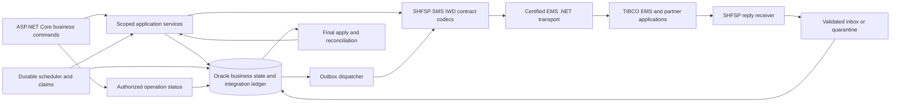
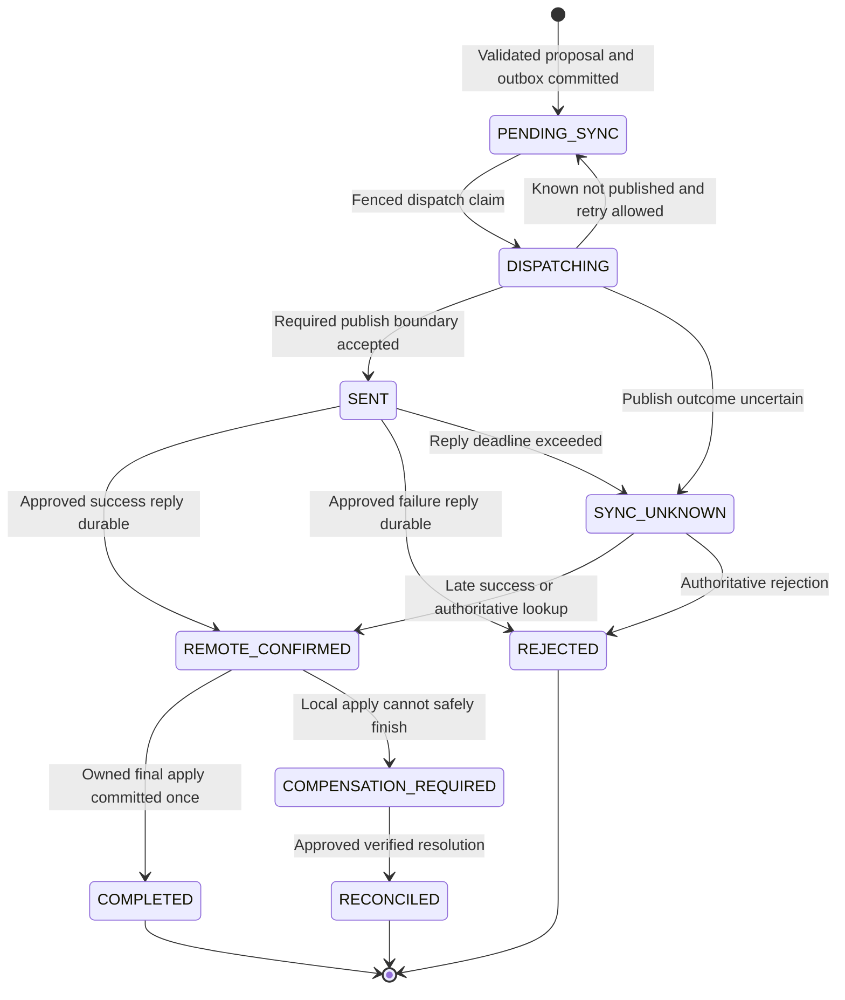

# SHF TIBCO Interfaces: .NET Rewrite Detailed Design

Document date: 2026-10-11

Reading guide: [transport](#2-existing-ems-transport-boundary),
[SHFSP XML](#3-shfsp-request-and-reply-contract),
[business orchestration](#4-shfsp-business-orchestration-and-persistence),
[SMS](#5-sms-envelope-and-reminder-contract),
[IWD](#6-iwd-learning-dispatch-contract),
[.NET components](#7-proposed-net-components-and-internal-contracts),
[recovery](#8-reliability-ordering-and-recovery),
[operations](#9-security-configuration-and-operations),
[tests and cutover](#10-characterization-contract-tests-and-cutover), and
[readiness gates](#11-evidence-decisions-and-readiness-gates).

## 1. Purpose and Evidence

This document specifies the TIBCO EMS integration boundary for rewriting SHF to
ASP.NET Core and independent .NET workers. It is a design deliverable, not an
implemented replacement, a broker configuration change, or a certified production
interface. No Java or WebSphere runtime is proposed for the replacement.

Evidence classifications:

- **Verified source:** readable application code, XML configuration, or schema.
- **Inferred:** interpretation requiring runtime or partner confirmation.
- **Proposed:** the .NET implementation contract, requiring the stated approvals.
- **Unverified:** missing runtime, partner, database, or vendor-support evidence.

The broader system baseline is in the
[technical design](SHF_REVERSE_ENGINEERED_TECHNICAL_DESIGN.md), with source indexes
in the [contract catalog](SHF_SOURCE_CONTRACT_CATALOG.md). Physical database
metadata must be recovered using the approved
[read-only discovery procedure](SHF_SCHEMA_DISCOVERY_READ_ONLY.sql), not by
executing application functions or advancing sequences.

### 1.1 Scope

The TIBCO boundary includes managed-break/shift requests and replies (SHFSP), SMS
publication, and learning-task publication (IWD). Actual-time HTTP callbacks are
an adjacent contract because they update the same break and reminder lifecycle;
they are not demonstrated to arrive through EMS. Noga SOAP, the extension-pool
HTTP API, SAP files, and BI publication are outside this document's rewrite scope.

Only documentation is changed. No database, broker, private endpoint, or business
service is contacted. Credentials, private hosts, and employee payloads must not
be copied into this deliverable or its examples.

## 2. Existing EMS Transport Boundary

### 2.1 Shared Queue Sender

[TibcoQueueMessageSender](../SHF/src/bzq/shf/utils/TibcoQueueMessageSender.java#L47)
directly controls the common SHFSP/IWD publication primitive:

| Concern | Verified implementation | .NET design implication |
| --- | --- | --- |
| Resource lookup | `InitialContext`, shared QCF lookup, destination cast to `Queue`. | Resolve approved physical queues and connection settings explicitly; Java JNDI names alone are not .NET connection configuration. |
| Session | `createQueueSession(false, Session.AUTO_ACKNOWLEDGE)`. | Existing send is non-transacted; do not claim Oracle/EMS atomicity or receive guarantees from this setting. |
| Payload | Reused JMS `TextMessage`; `setText`, then producer `send`. | Preserve the partner's text/XML message type; byte-message substitution needs approval. |
| Validation | Only null/empty text is rejected. | Put contract validation in the adapter before publication. |
| Producer policy | No explicit delivery mode, expiration, priority, correlation header, or deduplication property is set. | Discover effective producer/broker policies; make required target settings explicit after approval. |
| Lifecycle | Optional close after send; producer, session, and connection closed in sequence. | Target owns reconnect, cancellation, bounded calls, session isolation, and independently attempted disposal. |

The XML `transactionId` is a business correlation mechanism. It must not be
confused with a JMS correlation header or with the broker-generated message ID.
A successful send call proves neither partner application nor SMS delivery.

### 2.2 Transport Port

**Proposed:** application services depend on a small transport abstraction rather
than a vendor SDK. The transport publishes validated text and returns the broker
publication outcome; it does not commit SHF business changes. The consumer first
persists a validated reply or a durable quarantine decision, then completes the
broker delivery under the certified SDK's acknowledgment/transaction semantics.

Only a vendor-supported non-Java EMS client or gateway is admissible. Exact .NET
SDK APIs, target framework, operating system, architecture, acknowledgment support,
and broker interoperability remain release-blocking verification tasks.

### 2.3 Interface and Resource Inventory

The IDs below are local design identifiers, not existing XML fields.

| ID | Direction and owner | Source-visible routing | Completion evidence |
| --- | --- | --- | --- |
| TIB-01 | SHF -> SoftPhone/IVR, managed breaks and unit flags. | Request JNDI `jms/queue/shf.break.01.update`; shared QCF `jms/qcf/shfqcf`. | Application XML reply on TIB-02, not producer return alone. |
| TIB-02 | SoftPhone/IVR -> SHF, SHFSP response. | Response JNDI `jms/queue/shf.breakreply.01.update`; MDB listener port `SHFSPListenerPort`. | Current MDB updates the correlation ledger; target persists an inbox/result before acknowledging. |
| TIB-03 | SHF -> SMS broker. | Physical queue `shf.sendsms.01.update`; direct TIBCO factory, not the common JNDI lookup. | Only publication is observed; no SHF delivery-receipt consumer is established. |
| TIB-04 | SHF -> IWD, learning tasks. | JNDI `jms/queue/shf.backofficetask.01.update`; shared QCF. | Only publication and local sent/history updates are observed; learning completion is a different, unrecovered contract. |

The inspected additional configuration has SHFSP request/reply bindings in the
four named environments. IWD is present in local development, test, and production,
but absent in the inspected server-development additional configuration. SMS
configuration exposes scheme `tcp`, port `7222`, and an account label; values for
hosts and credentials are withheld. Similar queue names do not prove environment
isolation. Physical SHFSP/IWD destination names and QCF properties require a
sanitized runtime resource export.

Evidence: [test routing configuration](../SHFWeb/WebContent/WEB-INF/env/server-test/additional.xml),
[production routing configuration](../SHFWeb/WebContent/WEB-INF/env/server-prod/additional.xml),
[routing constants](../SHF/src/bzq/shf/utils/SHFConstants.java#L170), and
[MDB listener binding](../SHFEJB/ejbModule/META-INF/ibm-ejb-jar-bnd.xmi).

### 2.4 Receive Configuration and Routing Hazards

The [EJB descriptor](../SHFEJB/ejbModule/META-INF/ejb-jar.xml) specifies a queue,
bean-managed transactions, and `Auto-acknowledge`. Its `subscriptionDurability`
property says `Durable`; this is not evidence of a durable topic subscription
because the destination is a queue. The Java annotation comment instead says
container transactions. Effective WebSphere listener settings remain unverified.

[sendTibcoQueueMsg](../SHF/src/bzq/shf/model/BreakDataModel.java#L3035) ignores its
`qName` argument and always retrieves the SHFSP request path. It silently does
nothing for an empty destination. Do not port it as a generic routing function:
the target selects a validated logical interface, rejects missing configuration,
and prevents the IWD or SMS route from being used for SHFSP messages.

## 3. SHFSP Request and Reply Contract

### 3.1 TIB-01 Envelope and Field Order

Authoritative local schema:
[request XSD](../SharedLibraries/bzq/bzq/shfsp/request/SHFSPBreaks.xsd).
The root is `SHFSPBreaks`, with no target namespace. Child elements use
`xs:sequence`, in the following order. Unless stated otherwise, maximum occurrence
is one; required means `minOccurs=1`, not a nonempty or business-valid value.

| Order | Element | XSD type / minimum | Source value and .NET mapping |
| --- | --- | --- | --- |
| 1 | `interfaceId` | `xs:string`, optional. | Defaults to `00001`; nullable string in wire DTO. |
| 2 | `userId` | `xs:string`, optional. | Actor value set by the caller; some self-service paths use employee identity instead of manager identity. Server-derived string, never trusted from the browser. |
| 3 | `applicationId` | `xs:string`, optional. | Defaults to `SHF`. |
| 4 | `user` | `xs:string`, required. | Integration credential/account field. Current source hardcodes a value; target obtains the approved value from secret management. |
| 5 | `password` | `xs:string`, optional. | Current source hardcodes a credential value; never include it in logs, DTO responses, or this document. |
| 6 | `transactionId` | `xs:string`, required. | Decimal correlation ID returned by the database function and inserted into the final message. Preserve text exactly and verify the supported numeric range. |
| 7 | `actionId` | `xs:string`, required. | `0` flag ON, `1` flag OFF, `2` break delta in active code. Not an XSD enum. |
| 8 | `orgUnitId` | `xs:string`, optional. | Unit identifier for flag commands. Preserve leading zeros. |
| 9 | `breakInfo` | Complex type, zero to unbounded. | Ordered delta entries for action `2`; use an ordered collection, not a dictionary or set. |

Defaults and fragment serialization are verified in
[SHFUtils](../SHF/src/bzq/shf/utils/SHFUtils.java#L426). JAXB uses
`JAXB_FRAGMENT=true`, so the current common serializer omits the XML declaration.
It does not attach an XSD validator to the marshaller. A validation utility exists,
but its presence alone does not establish validation at these send sites.

### 3.2 Break Delta and Action Semantics

Each `breakInfo` has this exact child order:

| Order | Element | XSD type | Required target behavior |
| --- | --- | --- | --- |
| 1 | `mode` | `xs:string`. | Preserve `D` delete and `I` insert, uppercase; reject unknown modes before dispatch. |
| 2 | `employeeId` | `xs:string`. | Partner employee identity, not the internal employee surrogate. Full/short identity varies by source path and requires fixtures per path. |
| 3 | `agentDayId` | `xs:long`. | .NET `long` on the wire; check range before serialization. Day association can change during a shift swap. |
| 4 | `startDatePlanned` | `xs:string`. | Source format `yyyyMMddHHmmss`, 14 digits, without an offset or zone. |
| 5 | `duration` | `xs:int`. | .NET `int`, minutes. Preserve deletion preimage duration and insertion duration separately. |

**Compatibility exception:** XSD comments describe ON=`1` and OFF=`0`, while
[active constants](../SHF/src/bzq/shf/utils/SHFConstants.java#L180) intentionally
invert them following a partner request. Use a semantic `Enabled` boolean inside
.NET and map it only in the SHFSP adapter. Do not generate business enums from
these comments or "correct" the values during porting.

**Proposed application validation:** flag commands require a scoped `orgUnitId`
and no break entries; break commands require a nonempty delta list. XSD permits
other combinations and unlimited entries. Maximum payload/entry counts, empty
string handling, positive day IDs, and insert-duration limits must be approved
against existing reachable workflows; the three-break UI is not a universal
message-size limit. Zero/deletion-duration cases need characterization before
using a blanket positive-duration validator.

Do not change wire timestamps to ISO 8601. The domain accepts a timezone-qualified
instant plus business-zone policy, then produces partner wall-clock text. Use
invariant formatting, explicit timezone conversion, and a defined DST ambiguity
policy. Preserve seconds and leading zeros. The current server timezone and
partner timezone are not established solely by this formatter.

### 3.3 TIB-02 Response and Legacy Success Interpretation

Authoritative local schema:
[response XSD](../SharedLibraries/bzq/bzq/shfsp/response/SHFSPBreaks_response.xsd).
Root `SHFSPBreaks_response`, no target namespace; this exact sequence applies:

| Order | Element | XSD type / minimum | Meaning |
| --- | --- | --- | --- |
| 1-5 | `interfaceId`, `userId`, `applicationId`, `user`, `password` | Strings; only `user` is required. | Same envelope field names as the request. Do not treat payload credentials as proof of broker identity. |
| 6 | `transactionId` | Required string. | Matches request correlation; MDB parses it as a Java `long`. |
| 7 | `statusCode` | Required string. | XSD comments indicate `0` success and `1` failure; the MDB attempts integer parsing, not enum validation. |
| 8 | `statusDesc` | Optional string. | Partner explanation, potentially sensitive and not necessarily a stable business code. |

[The MDB](../SHFEJB/ejbModule/ejbs/SHFSPMDBBean.java#L167) accepts only
`TextMessage`, logs the entire text, unmarshals XML, and sets `UPDATE_DATE`,
`XML_RESPONSE`, and numeric `STATUS` by `ID`. It only sets `STATUS_DESCRIPTION`
when the received description has nonzero length. Missing-description getter
behavior is not visible, and `.length()` has no null guard. XML/database/other
errors are caught; an explicit rollback/redelivery path is not demonstrated.

[The shared poller](../SHF/src/bzq/shf/model/BreakDataModel.java#L3060) sleeps
before checking, up to four checks of three seconds each, plus database/send
time. It filters rows without either response XML or description, then returns
status-`0` rows with response XML. Inspected shift/break/swap callers additionally
require `STATUS_DESCRIPTION IS NULL`. Thus status `0` is not the complete legacy
success predicate. Flag-change polling uses a separate, less restrictive path.

**Proposed normalization, requiring partner/owner approval:** parse only agreed
status codes; persist missing/empty description as null in the normalized result,
retain a restricted original-response reference, and decide success from the
approved code policy rather than a stale description on the ledger. Unknown codes,
conflicting replies, or invalid correlations are reconciliation/quarantine cases,
not fabricated success or blindly retried commands.

### 3.4 Synthetic XSD Fixtures

These are schema-valid synthetic fixtures, not captured production messages,
valid business identities, or partner-approved golden samples. No credential
value from source is reproduced. Optional `password` is omitted deliberately.

Changed break, preserving delete-before-insert order:

```xml
<SHFSPBreaks>
	<interfaceId>00001</interfaceId>
	<userId>EXAMPLE-ACTOR</userId>
	<applicationId>SHF</applicationId>
	<user>EXAMPLE-INTEGRATION-USER</user>
	<transactionId>900001</transactionId>
	<actionId>2</actionId>
	<breakInfo>
		<mode>D</mode>
		<employeeId>000000000</employeeId>
		<agentDayId>900010</agentDayId>
		<startDatePlanned>20261012120000</startDatePlanned>
		<duration>20</duration>
	</breakInfo>
	<breakInfo>
		<mode>I</mode>
		<employeeId>000000000</employeeId>
		<agentDayId>900010</agentDayId>
		<startDatePlanned>20261012122000</startDatePlanned>
		<duration>25</duration>
	</breakInfo>
</SHFSPBreaks>
```

Flag ON with the implemented inverted mapping:

```xml
<SHFSPBreaks>
	<interfaceId>00001</interfaceId>
	<applicationId>SHF</applicationId>
	<user>EXAMPLE-INTEGRATION-USER</user>
	<transactionId>900002</transactionId>
	<actionId>0</actionId>
	<orgUnitId>00000001</orgUnitId>
</SHFSPBreaks>
```

Success without a description, followed by a distinct failure fixture:

```xml
<SHFSPBreaks_response>
	<user>EXAMPLE-INTEGRATION-USER</user>
	<transactionId>900001</transactionId>
	<statusCode>0</statusCode>
</SHFSPBreaks_response>
```

```xml
<SHFSPBreaks_response>
	<user>EXAMPLE-INTEGRATION-USER</user>
	<transactionId>900002</transactionId>
	<statusCode>1</statusCode>
	<statusDesc>EXAMPLE_PARTNER_REJECTION</statusDesc>
</SHFSPBreaks_response>
```

## 4. SHFSP Business Orchestration and Persistence

### 4.1 Caller-to-Message Mapping

Process IDs belong to the database ledger; they are not request `actionId` values
and are not serialized as a `processId` element. Every row below uses action `2`
except unit flags. Managed-break policy controls whether a delta is sent.

| Business command / controlling source | Actual ledger process ID | Observed outbound delta / obligation |
| --- | ---: | --- |
| [Break edit](../SHF/src/bzq/shf/model/BreakDataModel.java#L2470) | 1 | Changed break: `D` preimage followed by `I` replacement; new: `I`; removed: `D`. Up to three positions in this editor, with old/new time and duration fields. |
| [Shift edit](../SHF/src/bzq/shf/model/ShiftDataModel.java#L3969) | 2 | `fixBreaks` adjusts local breaks; equal-count time-shift branch deletes old then inserts new; differing-count branch selects deletions. Characterize its first-old-break comparison and count-based behavior before replacing it with a complete diff. |
| [Shift cancellation](../SHF/src/bzq/shf/model/ShiftDataModel.java#L3704) | 3 | Deletes existing managed breaks. Uses the constant named ADD_SHIFT, contrary to the constant's comment. |
| [Single-shift creation](../SHF/src/bzq/shf/model/ShiftDataModel.java#L5801) | 4 | New managed-break entries use insertion messages. Uses the constant named DEL_SHIFT, contrary to the constant's comment. |
| [Manager shift swap](../SHF/src/bzq/shf/model/SwitchModel.java#L294) | 5 | Both participants' managed-break state and employee/day reassignment must be characterized. This is separate from candidate-offer acceptance. |
| [Replacement-offer acceptance](../SHF/src/bzq/shf/dao/ReplaceByCritrionDao.java#L1940) | 5 | Deletes each managed employee's old day breaks and inserts the other day's breaks with the changed day association. Current insertion branches are nested under the existence of that employee's old breaks. |
| [Break swap](../SHF/src/bzq/shf/model/BreakDataModel.java#L2169) | 6 | Each managed participant gets `D` old and `I` offered timing/duration, preserving that participant's own day ID. The other participant can be unmanaged. |
| [Unit managed-break flag change](../SHF/src/bzq/shf/model/OptShfSpModel.java#L137) | 1 | One correlated request per changed unit, action `0`/`1`; no `breakInfo`. Current code first changes local flags, then reverses unsuccessful units through separate writes. |

Process `6` is also used by SMS reminders with destination `VAST`, whereas SHFSP
records use source `SHF` and destination `IVR`. Proposed operation types must be
explicit, such as `BreakEdit`, `ShiftCancel`, `ShiftCreate`, `ShiftSwap`,
`BreakSwap`, `UnitFlagChange`, and `BreakReminder`; never route solely by process
number. Retain the actual legacy process value for coexistence/audit until owners
approve any correction.

Single-shift creation sends only when managed breaks are enabled **and**
`addShiftForm.isSend()` is true; its comment states that file-import creation
suppresses dispatch. Preserve or explicitly approve that suppression policy.
Both manager and candidate-acceptance swap implementations nest insertion under
the participant's existing-break branch. Test zero-break/one-managed-participant
cases before replacing that behavior with a complete desired-state comparison.

### 4.2 Business Validation and Delta Construction

[Managed-break validation](../SHF/src/bzq/shf/model/BreakDataModel.java#L2991)
rejects start time minus current time **less than or equal to** the configured
lead time. Enablement is looked up at contact-center scope; this builder retrieves
the minimum-change parameter through department (`agaf`) scope. Neither the
seven-minute constant nor a comment overrides the actual parameter value.

Changed and newly inserted positions take different date-building/check paths;
delete-only entries do not run this same lead-time check. The builder receives
old database breaks, but its old/new form fields still influence deletion
preimages. The .NET service must reconstruct authoritative preimages from the
database and compare revisions, not trust browser-supplied old times or durations.
Any difference from characterized legacy boundary behavior requires approval.

Shift, break, swap, attendance, exception, and replacement-offer rules remain
application-service responsibilities. Recheck both participants, all affected
organizational scopes, begun/ended breaks, rest gaps, conflicting offers, and
effective-day ownership. A schema-valid XML message is not a valid shift command.

### 4.3 Existing Correlation Ledger

[createMessageTransaction](../SHF/src/bzq/shf/model/BreakDataModel.java#L3260)
calls `SHIFTER.SHF_INS_AND_RETURN_LASTID` using `SELECT ... FROM dual` with six
bound arguments, through a separate `DBAccess`:

| Argument order | Source input | Target obligation |
| --- | --- | --- |
| 1 | Process ID. | Preserve actual call-site value during coexistence; store semantic operation type separately. |
| 2 | Source. | SHFSP/SMS use `SHF`. |
| 3 | Destination. | SHFSP `IVR`; reminder SMS `VAST`. Not a physical queue name. |
| 4 | Current application timestamp. | Discover Oracle type/session-time semantics; target records an explicit audit instant. |
| 5 | Employee/account identity from caller. | Often the actor, not necessarily the employee in `breakInfo`; reminder uses a fixed system identity. |
| 6 | Initial request XML. | In inspected SHFSP callers this is serialized before assigning `transactionId`, then final transmitted XML is regenerated. Stored request and sent request can differ. |

The function returns `ID`; its body, initial status, commit/autonomous behavior,
uniqueness, grants, and numeric allocation range are unverified. Do not invoke it
as part of read-only discovery. The separate pool code's transaction-ID sequence
does not establish this function's implementation.

Observed ledger fields include `ID`, `TRANSACTION_ID`, `PROCESS_ID`, `SOURCE`, `DESTINATION`,
`EMPLOYEE_ID`, `CREATION_DATE`, `UPDATE_DATE`, `XML_REQUEST`, `XML_RESPONSE`,
`STATUS`, and `STATUS_DESCRIPTION`; physical types/keys remain unverified.
[TransactionBean](../SHF/src/bzq/shf/bean/TransactionBean.java) is a source mapping,
not a substitute for metadata. The MDB sets status by parsing response text as
an integer, while the application-side alternative update method has a different
description predicate and narrower integer parsing for correlation.

The SHFSP response's XML `transactionId` updates the ledger **`ID`**, not the
distinct mapped `TRANSACTION_ID` column. Do not join on the latter by name alone.

**Proposed:** retain numeric partner correlation via an approved shared allocator
while using a distinct opaque operation ID internally. Persist the final dispatch
intent, exact ordered delta, revisions, contract version, and restricted payload
reference. Do not blindly call an autonomous legacy function inside a new owned
transaction and claim that it is atomic with the outbox.

### 4.4 Existing Failure Windows

| Source-visible behavior | Rewrite decision |
| --- | --- |
| Shift/break/swap changes remain uncommitted while a servlet publishes and polls. | Replace long-held transactions with durable proposals and short database transactions; remote outcome and local application remain separate. |
| Partner may apply before local rollback or before a failing final commit. | Timeout is unknown, not proof of partner failure. Require status lookup, agreed compensation, or operator reconciliation. |
| Some send exceptions are caught and followed by polling; empty routing can skip publication. | Missing configuration is a pre-dispatch failure; ambiguous send is explicitly classified. |
| Polling deduplicates accumulated successes, not all observed non-success rows. | Maintain durable per-correlation results; do not reproduce reply counters as a state machine. |
| Unit flags are locally written before sending; successful units are retained while other units are reversed. | Model each unit as a child operation and report per-unit outcomes; no false all-or-nothing guarantee. |
| Description is conditionally updated and can survive later success. | Normalize approved status/description rules with append-only reply evidence and terminal-state protection. |
| Messages/history/cleanup can use independent connections. | Define owned final-apply writes and notification intents in one transaction, or document explicit repair phases. |

## 5. SMS Envelope and Reminder Contract

### 5.1 TIB-03 Transport and XML Shape

[SHFSmsSender](../SHF/src/bzq/shf/utils/SHFSmsSender.java#L96) constructs a
`TibjmsConnectionFactory` using the configured `hostName`, calls
`createConnection()` without explicit credentials, creates a non-transacted
`AUTO_ACKNOWLEDGE` session and physical queue, then publishes a `TextMessage`.
Although `scheme` and `port` are read, this method does not assemble them into the
factory argument. Recover the actual endpoint/factory behavior rather than
guessing it from individual XML attributes. Payload user/password values are
not demonstrated to authenticate the broker connection.

No authoritative SMS XSD is available in the inspected boundary. The DOM builder
provides the following source-visible shape and element order:

| Path, in document order | Verified source value / rule | Target contract |
| --- | --- | --- |
| `/Palo/Head/From` | Configured account label. | Approved sender account; configuration, not actor identity. |
| `/Palo/Head/App` | Text `App1`, attributes `User` and `Password` from configuration. | Preserve case/text; inject secrets at the adapter boundary. XML attribute ordering needs byte-fixture confirmation only if the partner incorrectly depends on it. |
| `/Palo/Head/Cmd` | `sendsms`. | Preserve exact command. |
| `/Palo/Head/ConfList/To` | One hardcoded HTTP confirmation URL outside this document. | Configure the approved callback; do not invent a SHF receipt receiver or change the endpoint without ownership approval. |
| `/Palo/Body/Sender` | Fixed sender telephone value in source, withheld here. | Approved sender configuration; not the recipient. |
| `/Palo/Body/Content` | Supplied message text, including Hebrew templates. | XML-escape using structured serialization; preserve Hebrew code points. |
| `/Palo/Body/DestList/To` | Repeated in recipient order; `972` plus local number with its first character removed. | This is legacy local-number conversion, not E.164 validation. Preserve via approved compatibility mapping and validate before conversion. |
| `/Palo/Optional/MsgId` | Constant `34801`, reused across messages. | Not a unique notification or correlation ID. Preserve until partner approves a unique-ID contract. |
| `/Palo/Optional/ServiceName` | `Bezeq_SHF`. | Preserve approved service routing. |

Despite its name, `Optional` is always emitted by the builder. The SMS ledger ID
is not inserted into this envelope. DOM serialization and JMS text do not prove
an external UTF-8 byte contract; recover downstream broker/provider transcoding,
SMS alphabet/segmentation, and Hebrew behavior with sanitized fixtures.

### 5.2 Existing Break-End Reminder Lifecycle

[SMSBreakEndReminderTask](../SHF/src/bzq/shf/servletListenersTasks/SMSBreakEndReminderTask.java#L49)
selects unsent rows whose `BREAK_END` is inclusively between database `SYSDATE`
and `SYSDATE + 5/1440`. It sends during that selection window, not necessarily at
the exact break end. Past-due rows are not selected by this query.

1. Load matching `SHF_BREAK_SMS` rows and close the selection connection.
2. Collect every recipient into one vector and create one XML envelope/ledger
	 record for the batch, process `6`, source `SHF`, destination `VAST`.
3. Rebuild the SMS XML in the sender and publish one message for that vector.
4. If the send call returns successfully, update `SMS_SENT_DATE` for the selected
	 `SMS_ID` values using a different database connection.

There is no durable claim, same-recipient deduplication, transactional coupling to
publication, or confirmed delivery state in this path. Multiple web instances
can select the same rows; a send-before-marker crash can duplicate reminders,
while downtime can leave rows outside the future-only window.

### 5.3 Proposed Notification Operation

Use a durable notification identity keyed by reminder ID, break/actual-event
identity, template version, and authorized schedule revision. For batched delivery,
persist an immutable recipient manifest and per-recipient child state. Changing
legacy batching to one message per recipient requires provider/rate-limit approval.

States: `READY`, `DISPATCHING`, `BROKER_ACCEPTED`, `SEND_UNKNOWN`, `EXPIRED`,
`FAILED`; add `PROVIDER_ACCEPTED`/`DELIVERED` only when an authenticated, correlated
receipt contract is obtained. Update compatibility `SMS_SENT_DATE` only at its
approved publication boundary; do not silently redefine it as actual delivery.

Configure deadline/late-reminder policy explicitly. Recheck break return/change,
recipient eligibility/preferences and expiry before dispatch under approved rules.
Suppress stale reminders after actual return when the owner approves that change.
Retain an ordered recipient manifest and normalized phone identity; never put
full phone numbers or content into routine logs.

A unique new broker property is not proof of SMS-provider deduplication. If the
partner supports neither deduplication nor delivery lookup, an ambiguous publish
requires operator/deadline policy; the outbox alone cannot guarantee no duplicate
human notification.

### 5.4 Other Callers Sharing the SMS Transport

These workflows use the same `Palo` envelope/queue but are not break reminders.
Do not omit them when retiring `SHFSmsSender` or the legacy web writers.

| Trigger and source | Verified selection/content behavior | Proposed .NET owner |
| --- | --- | --- |
| [Single replacement offer](../SHF/src/bzq/shf/model/ReplaceModel.java#L146) | Target employee's department SMS parameter, employee `ReceiveSwitchSMS=1`, and phone check; template inserts offered-shift date. SMS failure is logged after offer/message writes. | Replacement service writes a recipient-specific notification intent; failure does not falsely roll back an already accepted offer. |
| [Multiple replacement offers](../SHF/src/bzq/shf/model/ReplaceModel.java#L224) | Offering employee's department parameter, recipient preference, excludes offering employee; groups phones by `dd/MM` date before sending. | Persist recipient/offer manifest and date/template grouping. Characterize cross-unit scope differences before unifying policy. |
| [Manager swap](../SHF/src/bzq/shf/model/SwitchModel.java#L537) | SMS to each opted-in participant with nonempty phone after `switchSuccess`, using name/other employee/date. This occurs before the subsequent local commit. | Emit notification intent in final-apply transaction; publish only after local success, an explicit correctness change requiring approval. |
| [Extension-allocation result](../SHF/src/bzq/shf/model/ShiftDataModel.java#L7474) | Allocation success/already allocated, or first allocation error, can send SMS; release does not. Sends while the caller owns a database connection. | Pool application service emits notification intent after recording the owned allocation/error outcome; pool HTTP protocol itself stays outside TIBCO scope. |

The reminder is the inspected caller that explicitly uses the SHFSP-style
transaction function for SMS. Do not assume every direct SMS call has an equivalent
ledger record. Use source event plus notification type and recipient as a new
deduplication identity, preserving each caller's eligibility and failure policy.

### 5.5 Adjacent Actual-Time Callback and Reminder Creation

[SoftPhoneModel](../SHF/src/bzq/shf/model/SoftPhoneModel.java#L40) requires employee,
day, planned break time, and at least one actual time. It clears **seconds** on
planned lookup time, not explicitly milliseconds. Actual timestamps retain their
seconds. When both actual fields are supplied, start-time handling wins.

After break exit it separately inserts `SHF_BREAK_SMS`, setting
`BREAK_END = actual exit + planned break duration`, not the planned break end.
The phone condition uses non-null **OR** nonempty; null can be dereferenced and
empty values can pass. Exit can therefore be recorded while reminder creation
fails. [BreakSMSBean](../SHF/src/bzq/shf/bean/BreakSMSBean.java) also has a questionable
`SHIFT_DAY_ID` reflection binding; the target repository must map verified columns
explicitly rather than copying this property map.

**Proposed:** service-authenticated actual-time ingress writes the actual event
and reminder intent together in one short owned transaction, deduplicates by
partner event identity, validates employee/day/break association and phone policy,
and rejects ambiguous both-field input under partner approval. A replay of break
exit must not allocate a second reminder. Existing logout is logging-only and
does not prove cancellation of reminders, session termination, or EMS activity.

## 6. IWD Learning Dispatch Contract

### 6.1 TIB-04 Source-Derived Fields

[IwdScheduledSenderTask](../SHF/src/bzq/shf/servletListenersTasks/IwdScheduledSenderTask.java#L270)
constructs `bzq.shfiwd.SHFIWD` through its object factory and JAXB context.
Readable generated classes and an authoritative IWD XSD/WSDL are not available
in this boundary. **Exact XML root QName, namespaces, element case/order,
optionality, and types are unverified.** Setter names below are property evidence,
not a claim about exact serialized element names. Do not ship a hand-invented XML
schema derived only from these names.

| Java setter / property | Verified assignment | Proposed internal representation |
| --- | --- | --- |
| `setApplicationId` | `SHF`. | Approved application identifier. |
| `setUser` | Fixed system-user value from defaults; not the human actor. | Controlled integration identity; distinguish from worker authentication and employee. |
| `setLang` | `HEB`. | Partner language code; not browser locale. |
| `setIsTaskReturn` | `0`. | Preserve partner flag; semantic meaning requires partner confirmation. |
| `setHighTask` | `0`. | Preserve partner flag; semantic meaning requires partner confirmation. |
| `setService` | Default `IWD_PELE_LOMDA`, or unit-specific uppercase override. | Versioned routing value selected by the employee's contact center. |
| `setTaskID` | Module ID converted to string. | Preserve module identity; not a unique dispatch ID. |
| `setTaskType` | Module-type mapping below, converted to string. | Closed validated task-type policy. |
| `setTime` | One current time captured for the send batch, formatted `yyyyMMddHHmmss`. | Explicit message-created instant mapped to agreed partner wall time. |
| `setStartTreatTime` | Assignment `IWD_TIMING` formatted `yyyyMMddHHmmss`. | Scheduled start, distinct from actual send time. |
| `setEndTreatTime` | Scheduled start plus five minutes, same format. | Treatment window, not module duration. |
| `setAgentId` | Full assignment identity with final character removed. | Approved eight-character partner identity transformation; no generic unchecked substring. |

Defaults are in [SHFUtils](../SHF/src/bzq/shf/utils/SHFUtils.java#L433).
The same fragment serializer used by SHFSP omits the XML declaration. No
`transactionId` assignment or reply handling is demonstrated in this sender.
Final wire golden fixtures must come from the owner/approved runtime contract.

### 6.2 Task Types and Service Routing

| Module type, case-normalized by source | Sent task type |
| --- | --- |
| `scorm` | `5` |
| `quiz` | `6` |
| `questionnaire` | `7` |
| `choice` | `8` |
| `sign` | `9` |

Source uses `toLowerCase()` and looks up a map. An unknown non-null module type
can become literal string `null` through `String.valueOf`; the target must
quarantine unsupported types rather than publish that value. Use invariant or
ordinal comparison under the approved contract, not machine-locale casing.

[setIwdServiceField](../SHF/src/bzq/shf/servletListenersTasks/IwdScheduledSenderTask.java#L360)
finds the employee's contact-center code and matches
`SHF_PELE_IWD_SERVICE_CODES.ORG_UNIT_ID`, then uppercases `IWD_CODE`. It falls
back to the default when no matching override exists. Snapshot/version this
routing policy and validate destinations; do not let message input choose a queue.

### 6.3 Selection, Break Conflict, and Persistence

The initial query selects `IWD_STATUS=1` and `IWD_TIMING <= SYSDATE + 5/1440`.
Unlike reminders, it has no lower time bound, so overdue assignments are included.
The break query restricts employee days to `TRUNC(SYSDATE)` and break state. This
today-only break scope needs tests for overdue and cross-midnight assignments.

Conflict checks use the module's positive `MODULE_TIME_TO_COMPLETE`, otherwise
the department-scoped default. Both module endpoints must be strictly before a
break start, or strictly after a break end, to count as non-conflicting; equality
at an endpoint therefore enters the conflict branch.

- Reschedule disabled: conflicting work is held until the current time is strictly
	after break end, then may send with its original planned treatment timestamps.
- Reschedule enabled: clear `IWD_TIMING`, reset state to `0`, and return it for
	later scheduling. This sender does not set the defined `BREAK_PENDING=4` here.
- No matching employee break: the assignment stays eligible for this send pass.

The sender opens one common JMS sender and publishes each eligible assignment,
recording in-memory success/failure vectors. It closes the sender, then writes
successful assignments to `IWD_STATUS=2` in a separate explicitly committed
database transaction, then calls `insertToPeleEmpHistory` through another path.
A close/DB/history failure after successful sends can leave retryable local state.
There is no durable sent manifest or attempt identity in this implementation.

| Legacy status | Source constant | Meaning supported here |
| --- | --- | --- |
| 0 | `IWD_STATUS_NONE` | No schedule / returned for rescheduling. |
| 1 | `IWD_STATUS_PENDING` | Scheduled, pending dispatch. |
| 2 | `IWD_STATUS_SENT` | Producer call succeeded; not proof of task completion. |
| 3 | `IWD_STATUS_CANCELED` | Cancellation state defined elsewhere. |
| 4 | `IWD_STATUS_BREAK_PENDING` | Defined constant; do not infer this sender's transition to it. |

### 6.4 Proposed Learning Dispatch Operation

Key each dispatch by module, full employee identity, scheduled window, and an
enforced schedule revision. Keep partner short identity separate. Capture module
type, duration, service-route/configuration version, send deadline, and a stable
operation ID. Recheck effective shift, assignment revision, cancellation,
completion, break conflicts, and permission immediately before dispatch according
to approved eligibility rules.

Claim scheduling/dispatch work in short transactions; maintain assignment,
outbox, audit intent, and history intent consistently. After an accepted send,
record compatibility state `2` and history once under the same dispatch identity.
Do not update by module/employee alone if a concurrent reschedule changed revision.

Preserve five-minute wire treatment windows separately from the duration used for
break-overlap calculations. Unknown send outcome, cancelled-after-send handling,
late-send treatment times, new dispatch identity propagation, and partner
deduplication require owner agreements. A sent module cannot be declared completed
or safely unsent merely by changing a local status.

The [history writer](../SHF/src/bzq/shf/model/IWDModel.java#L670) inserts five
positional values without a column list: module, employee, scheduled timing,
status, and current timestamp. Discover physical column names/order, then use
explicit named columns. Its database errors are logged, not reliably surfaced
as an end-to-end dispatch failure. Existing local cancellation selects pending
assignments and sets state `3`; it sends no demonstrated EMS cancel message.

## 7. Proposed .NET Components and Internal Contracts

Everything in Sections 7-10 is **proposed**, except explicitly cited source or
vendor evidence. These interfaces are application-owned designs, not copied or
claimed TIBCO SDK signatures.

### 7.1 Runtime and Vendor Compatibility Decision

Use supported modern **.NET 10 LTS**, ASP.NET Core 10 for HTTP, and .NET Worker
Services for dispatch, receiving, scheduling, and reconciliation. ".NET Core" in
this request is treated as modern .NET, not unsupported .NET Core 3.1. Microsoft's
[support policy](https://dotnet.microsoft.com/en-us/platform/support/policy/dotnet-core)
lists .NET 10 as active LTS through 2028-11-14 on the document date. Pin supported
SDK/runtime patches and approved package versions at implementation kickoff.

The official [EMS 10.5.1 readme](https://docs.tibco.com/pub/ems/10.5.1/TIB_ems_10.5.1_readme.txt)
explicitly lists Microsoft .NET 10 under supported development tools and minimum
requirements. Its platforms include Windows 11 and Windows Server 2022/2025 on
x86-64, plus named x86-64 Linux distributions. **This verifies a candidate release,
not SHF's installed broker or an older client/server interoperability pairing.**
Historical local EMS `v43`/`v5.1.2` directories are not runtime version proof.

| Route | Decision and gate |
| --- | --- |
| Direct vendor .NET client | Preferred: isolate the approved EMS .NET client in the transport assembly/worker. Prove exact SDK, broker, OS, architecture, licensing, TLS, acknowledgment, and reconnect combination. |
| Separate certified non-Java adapter | Use only if the SDK requires an isolated supported environment or native dependency. Internal authenticated transport uses durable handoff and operation IDs; the same unknown-outcome rules still apply across HTTP/IPC. |
| Broker upgrade / partner-supported gateway | Required when no certified client can serve the current broker under the target runtime. Obtain partner/platform approval before adopting a new protocol. |
| Generic AMQP/STOMP/RabbitMQ client, Java JMS bridge, or .NET Framework-only port | Not acceptable as an assumed EMS/.NET Core solution. JMS is an API, not proof of an AMQP endpoint. Java is excluded from the target. |

Use an approved `Oracle.ManagedDataAccess.Core`/ODP.NET Core version only after
checking its .NET/runtime, Oracle server, character-set, and deployment support.
The modern application is not ready to write an unknown old database merely
because a driver loads. Retain Oracle semantics initially; a database migration
is outside this interface rewrite.

### 7.2 Component Responsibilities and Lifetimes

| Component | Responsibility | Lifetime / must not own |
| --- | --- | --- |
| `ShfSyncApplicationService` | Actor/scope, authoritative preimage, domain validation, revision/conflict guards, proposal, audit and outbox intent. | Request/job scope; no SDK session or long-held transaction while waiting. |
| `ShfSpContractMapper` | Semantic flag mapping, ordered break deltas, partner identity/time formatting. | Stateless; no database commit or browser-supplied actor authority. |
| `ShfSpXmlCodec` | No-namespace request serialization, schema validation, hardened response parsing. | Reusable immutable schema definitions; per-message readers and bounded buffers. |
| `SmsNotificationService` / `SmsXmlCodec` | Template/eligibility, ordered recipient manifest, `Palo` construction and privacy. | Application scope plus stateless codec; no claim that broker acceptance is delivery. |
| `IwdDispatchService` / `IwdXmlCodec` | Assignment revision, module type, service selection, conflict policy, recovered wire serialization. | Job scope; do not invent IWD schema, acknowledgment, or completion meaning. |
| `EmsTextPublisher` | One logical interface to an allowlisted physical queue; text publication and explicit acceptance classification. | Long-lived connection owner with isolated sessions/producers; no business changes. |
| `ShfSpReplyReceiver` | Receive text, capture broker metadata, validate, persist inbox/result or quarantine, then settle delivery. | Consumer session owner; no shared session between parallel handlers. |
| `OutboxDispatcher` | Durable claims, deadlines, payload/secret-version assembly, send, accepted/unknown bookkeeping. | Independent `BackgroundService`; no in-memory queue as the only durable state. |
| `SmsReminderScheduler` / `IwdScheduler` | Bounded selection, eligibility recheck, durable claims, due/expired/rescheduled work. | Separate loops/services; not hosted inside each API instance. |
| `OperationFinalizer` / `Reconciler` | Apply confirmed SHFSP proposal once, repair accepted-send bookkeeping, process late/conflicting replies and audited resolution. | Durable worker scope; no blind compensation or uncontrolled resend. |
| `IntegrationRepositories` | Bound SQL, explicit column/type mapping, one owned transaction and row-count checks. | Scoped connection/transaction, never a singleton open connection. |

Use Generic Host dependency injection, options validation, cancellation, logging,
and `BackgroundService`. Create a scoped service/transaction for each claimed
unit of work. `BackgroundService` and `PeriodicTimer` provide lifecycle/wakeup,
not durable scheduling or cluster-wide exclusion. Vendor blocking receive/send
APIs must run on controlled session-owned execution contexts with bounded
timeouts; do not hide an unbounded blocking SDK call behind a task per request.

### 7.3 Component Diagram



SMS and IWD have no demonstrated application reply in this diagram. An EMS
acknowledgment is not an invented partner acknowledgment. A split adapter adds a
process boundary but must not add an uncoordinated second source of business truth.

### 7.4 SHFSP Wire DTO Blueprint

Illustrative C# for the verified XSD structure, not an implementation file.
Validate required values before serialization and validate the final XML against
the trusted XSD. Nullable optional strings omit absent elements; do not emit
`xsi:nil`, which the schemas do not declare. No secret-bearing type should be
included in structured log destructuring or automatically generated record text.

```csharp
using System.Xml.Serialization;

[XmlRoot("SHFSPBreaks", Namespace = "")]
public sealed class ShfSpRequestXml
{
	[XmlElement("interfaceId", Order = 0)]
	public string? InterfaceId { get; set; }
	[XmlElement("userId", Order = 1)]
	public string? UserId { get; set; }
	[XmlElement("applicationId", Order = 2)]
	public string? ApplicationId { get; set; }
	[XmlElement("user", Order = 3)]
	public string User { get; set; } = string.Empty;
	[XmlElement("password", Order = 4)]
	public string? Password { get; set; }
	[XmlElement("transactionId", Order = 5)]
	public string TransactionId { get; set; } = string.Empty;
	[XmlElement("actionId", Order = 6)]
	public string ActionId { get; set; } = string.Empty;
	[XmlElement("orgUnitId", Order = 7)]
	public string? OrgUnitId { get; set; }
	[XmlElement("breakInfo", Order = 8)]
	public List<ShfSpBreakInfoXml> Breaks { get; set; } = [];
}

public sealed class ShfSpBreakInfoXml
{
	[XmlElement("mode", Order = 0)]
	public string Mode { get; set; } = string.Empty;
	[XmlElement("employeeId", Order = 1)]
	public string EmployeeId { get; set; } = string.Empty;
	[XmlElement("agentDayId", Order = 2)]
	public long AgentDayId { get; set; }
	[XmlElement("startDatePlanned", Order = 3)]
	public string StartDatePlanned { get; set; } = string.Empty;
	[XmlElement("duration", Order = 4)]
	public int Duration { get; set; }
}

[XmlRoot("SHFSPBreaks_response", Namespace = "")]
public sealed class ShfSpResponseXml
{
	[XmlElement("interfaceId", Order = 0)]
	public string? InterfaceId { get; set; }
	[XmlElement("userId", Order = 1)]
	public string? UserId { get; set; }
	[XmlElement("applicationId", Order = 2)]
	public string? ApplicationId { get; set; }
	[XmlElement("user", Order = 3)]
	public string User { get; set; } = string.Empty;
	[XmlElement("password", Order = 4)]
	public string? Password { get; set; }
	[XmlElement("transactionId", Order = 5)]
	public string TransactionId { get; set; } = string.Empty;
	[XmlElement("statusCode", Order = 6)]
	public string StatusCode { get; set; } = string.Empty;
	[XmlElement("statusDesc", Order = 7)]
	public string? StatusDescription { get; set; }
}
```

Use `XmlSerializerNamespaces` with an empty prefix/namespace, trusted compiled
`XmlSchemaSet`, and `XmlWriterSettings.OmitXmlDeclaration=true` for the SHFSP/IWD
fragment convention where verified. Confirm generated text against golden
messages, including empty-element form, optional fields, escaping, and namespace
declarations. Keep SMS serialization settings separate until its contract is
recovered. No regex-based XML construction or parsing is permissible in the port.

For readers set `DtdProcessing.Prohibit`, `XmlResolver=null`, `ValidationType.Schema`,
`MaxCharactersInDocument`, and configured limits. Enforce depth/collection bounds
while streaming because a character bound is not a depth bound. Load schemas only
from trusted packaged files; no remote schema resolution, document-supplied schema
download, or dynamically selected type deserialization.

Enable `ReportValidationWarnings` and fail validation events, and explicitly
check the expected root QName. Schema-validation mode alone can report an unknown
namespace as a warning rather than rejecting it. The local checker includes a
negative test for this behavior; the .NET codec must not silently accept it.

### 7.5 Application-Owned Transport Port

Separate publishing from receiving. This interface deliberately hides vendor API
names; each outcome must be backed by a tested SDK behavior, not an exception-name
guess. Definitions in this section are specifications for future implementation.

```csharp
public enum PublishOutcome
{
	Accepted,
	KnownNotPublished,
	Unknown
}

public sealed record PublishReceipt(
	PublishOutcome Outcome,
	string? BrokerMessageId,
	DateTimeOffset ObservedAtUtc,
	string? FailureCode);

public interface IEmsTextPublisher
{
	Task<PublishReceipt> PublishAsync(
		ValidatedTextEnvelope envelope,
		CancellationToken cancellationToken);
}

public interface IEmsReceiveChannel : IAsyncDisposable
{
	Task<InboundDelivery?> ReceiveAsync(CancellationToken cancellationToken);
	Task CompleteAsync(InboundDelivery delivery, CancellationToken cancellationToken);
	Task AbandonAsync(InboundDelivery delivery, CancellationToken cancellationToken);
}
```

| Proposed type | Required information and invariant |
| --- | --- |
| `ValidatedTextEnvelope` | Logical interface, stable operation/dispatch IDs, optional partner correlation, contract version, immutable business-payload fingerprint, ordered scope keys, approved delivery policy/deadline, restricted validated XML. Only trusted codecs construct it. |
| `InboundDelivery` | Opaque SDK-session delivery handle, source interface, broker message ID when available, received text reference, received UTC timestamp, redelivery metadata if supplied. Handle is not durable; inbox identity is. |
| `PublishReceipt` | `Accepted` only when the certified transport confirms its required publish boundary; pre-send validation/configuration failure is `KnownNotPublished`; cancellation/network uncertainty after send starts is `Unknown`. |
| `CompleteAsync` | Settle only the documented delivery after durable inbox/result commit. If SDK acknowledgment affects all session deliveries, enforce one outstanding delivery per session or use an approved transacted equivalent. |
| `AbandonAsync` | Tested rollback/recover/session-close path to request safe redelivery; exact SDK semantics and redelivery policy must be proven. |

Never place passwords or XML in `PublishReceipt`. Do not wrap send plus disposal
in one catch that converts a confirmed accepted publish into a safe-to-retry
failure. Optional JMS correlation/custom properties supplement the existing XML
contract only after partner/broker approval; they do not replace `transactionId`.

### 7.6 Internal HTTP and Business API Contract

Browser/machine callers submit business commands, not arbitrary destination names
or raw JMS/XML. Reuse the owning shift, replacement, administration, learning, and
notification services; no public generic "publish message" endpoint is proposed.

| Proposed API | Contract |
| --- | --- |
| `POST /api/v1/shifts/{id}/break-change-proposals`, `/change-proposals`, `/cancellations` | Scoped business validation, `Idempotency-Key`, `If-Match`, authoritative delta and reason. Return `202` with operation `Location` when synchronization is required. |
| `POST /api/v1/shifts`, `/shift-swaps` and replacement acceptance commands | Full shift/participant revision policy, including suppression for approved import scenarios; delegate to one owned application operation. |
| `POST /api/v1/administration/managed-break-policy-changes` | Per-unit child operations, source flag mapping hidden inside adapter; aggregate outcome can be partial. |
| `GET /api/v1/operations/{id}` | Authorized actor/scope, stage, final outcome, public failure code, as-of time; never expose credentials or raw partner text/XML. |
| `POST /api/v1/operations/{id}/reconciliation-decisions` | Operator-only, audited reason and expected revision; explicit confirmed evidence and allowed transition. No unrestricted resend. |

Same actor/scope, operation type, idempotency key and identical canonical command
return the original operation; changed command under the same key returns `409`.
Missing revision precondition returns `428`; stale revision `412`; invalid
business input `422`; missing required infrastructure before durable acceptance
`503`. Use stable problem codes and RFC 9457 error bodies. A saved proposal may
remain queued when the broker is unavailable; report it honestly as pending.

If using a separate EMS adapter, define an internal mTLS-authenticated dispatch
contract keyed by immutable dispatch ID. Repeated dispatch requests return the
durable accepted/unknown result and reject changed payload under the same ID.
A lost adapter HTTP response must not trigger a new EMS send without that lookup
and an approved duplicate-handling contract.

### 7.7 Proposed Integration Persistence

Names/types below are proposals, not discovered schema or executed DDL. Keep
integration intent/result in the **same Oracle transaction/database** as owned
SHF proposals, audit, and final apply. Physical types, keys, constraints, indexes,
encryption, and retention require DBA approval and an expand/contract migration.

| Proposed structure | Key data | Required invariant |
| --- | --- | --- |
| `SHF_INT_OPERATION` | Opaque operation ID, semantic type/interface, legacy process, actor/scope, entity revisions, proposal/preimage references, numeric correlation, status and timestamps. | Unique operation/idempotency scope; correlation cannot identify two active SHFSP operations; no silent terminal regression. |
| `SHF_INT_OUTBOX` | Dispatch ID, operation/child ID, sequence, contract/route/config version, canonical payload reference/hash, state, attempt and next eligible time. | Unique operation/message sequence; intent committed with the owned proposal. |
| `SHF_INT_ATTEMPT` | Dispatch/attempt, lease/fence, started/observed time, secret-version reference, protected sent-payload reference/hash, broker ID and acceptance classification. | Append attempt evidence; no assumed rollback of an unknown broker outcome. |
| `SHF_INT_INBOX` | Source/broker identity, correlation, raw restricted hash/reference, normalized result fingerprint, receive time and processing state. | Unique transport delivery where possible; business-result deduplication also enforced. |
| `SHF_INT_REPLY` | Correlation, normalized status/description, source/inbox reference, observed order and conflict resolution. | Append conflicting reply evidence instead of last-message-wins overwrite. |
| `SHF_INT_GUARD` | Resource key, operation, revision, owner/fence and claim expiry. | One active incompatible command per affected day/unit; multi-resource acquisition is deterministic. |
| `SHF_INT_NOTIFY` | Source event, notification type, recipient manifest, template/config version, expiry and provider state. | Unique recipient/event intent; delivery state is distinct from publication. |
| `SHF_INT_JOB_RUN` | Job/window, run identity, claim/fence, checkpoint, counts and result. | Durable restart/overlap exclusion for reminder and IWD scheduling. |

Use explicit ODP.NET transactions, `BindByName=true`, named column lists, bound
parameters, mapped numeric ranges, and expected affected-row counts. Bind times
according to verified Oracle `DATE`/`TIMESTAMP` semantics; do not implicitly turn
zone-less legacy dates into UTC. Choose CLOB/secure payload representation only
after physical metadata/size discovery, not from a Java string type.

For coexistence, update required `SHF_TRANSACTIONS` status fields in the same owned
reply transaction where authorized, but retain old/new-operation ownership and
approved success predicates. Do not let a new normalized response silently change
the meaning for a still-running legacy synchronous caller. One shared correlation
allocator is mandatory; random numeric conversion of a GUID is not acceptable.

### 7.8 Proposed Project and Package Boundaries

Future layout only, not files created by this task:

```text
src/
  Shf.Api/                       Scoped business HTTP commands and operation reads
  Shf.Integration.Application/    Orchestration, claims, policies and final apply
  Shf.Integration.Contracts/      Semantic commands and approved XML DTO/codecs
  Shf.Integration.Persistence/    Oracle mapping and integration transactions
  Shf.Integration.Ems/            Certified SDK or authenticated adapter transport
  Shf.Integration.Worker/         Hosted dispatch, receive, schedule and recovery loops
tests/
  Shf.Integration.UnitTests/      Mapping, policy and fake-transport cases
  Shf.Integration.ContractTests/  XSD and sanitized golden messages
  Shf.Integration.SystemTests/    Approved Oracle/EMS crash and coexistence cases
```

Use built-in XML APIs, `Microsoft.Extensions.Hosting`/options/logging, the approved
Oracle driver, and the vendor-distributed EMS SDK under its license. Do not pin an
invented public NuGet EMS package or assume a .NET Framework assembly is supported
on .NET 10. Reuse the rewrite project's test framework and persistence helpers;
do not create a parallel bespoke scheduler, message broker, or XML library.

## 8. Reliability, Ordering, and Recovery

### 8.1 SHFSP Operation State Machine



Pre-dispatch invalid requests use `VALIDATION_REJECTED`; permanent unsent failures
can use `FAILED`; deadline-expired unsent proposals use `EXPIRED`. A unit-flag
parent summarizes child outcomes, including `PARTIAL`, without overwriting them.
These are new operation states, not legacy numeric `STATUS` or IWD status values.

### 8.2 Short-Transaction Orchestration

1. Resolve trusted actor and scope; load current effective shift(s), breaks and
   policy versions. Validate command and prepare exact ordered partner delta.
2. In one short transaction, allocate approved correlation, store proposal,
   affected revisions/conflict guards, audit intent and outbox. Active schedule
   stays unchanged while a managed mutation awaits remote confirmation.
3. Dispatcher claims work, freezes an attempt/config/credential-version reference,
   validates final XML, and publishes outside the database transaction.
4. Record accepted or unknown publish evidence through a fenced transaction.
   Known not-published outcomes can retry within deadline; uncertain ones cannot
   be assumed unsent. A reply may arrive before accepted-send bookkeeping finishes.
5. Receive/validate and commit inbox plus normalized reply/operation observation
   in Oracle, then acknowledge or commit the broker-local receive transaction.
6. Finalizer rechecks ownership, revisions, permission and necessary invariants;
   atomically applies proposal, cleanup, audit and notification/history intents,
   completes the operation and releases guards. It can restart from durable reply
   evidence even if the broker message has already been acknowledged.
7. If remote success and local application cannot be reconciled automatically,
   retain guards/evidence under explicit recovery policy and escalate. Do not mark
   simple failure and invite a second identical real-world action.

No Oracle-plus-EMS distributed atomicity is claimed. A broker-local transacted
session can make its acknowledgment/publish boundary reliable without enlisting
Oracle in XA; the inbox/outbox and recovery protocol cover the remaining gap.
An outbox does not itself supply partner deduplication or compensation.

### 8.3 Failure and Recovery Matrix

| Failure point | Durable state / required action |
| --- | --- |
| Proposal transaction aborts before commit. | No dispatchable outbox; no EMS send. Return failure with no claimed partner effect. |
| Proposal commits, worker stops before publish. | Resume the original outbox/operation, not a new command/correlation. |
| Network breaks while send is in progress. | `SYNC_UNKNOWN`/`SEND_UNKNOWN`; reconcile or use approved partner deduplication before repeating. |
| Broker accepted send, attempt update fails. | Original publish can have happened; recover via stable operation/correlation and reply/provider lookup. |
| Producer close fails after accepted send. | Preserve accepted receipt; log transport cleanup separately, no automatic resend. |
| Reply arrives before outbox is marked sent. | Match the precommitted operation/correlation; durable reply is evidence of partner handling. Dispatch recovery must not regress or resend it. |
| Oracle inbox/result commit fails. | Do not acknowledge; tested broker rollback/recover and bounded redelivery. |
| Inbox commits, broker completion fails. | Redelivery finds durable identity/result and settles without repeated effects. |
| Inbox acknowledged, finalizer process stops. | Resume from pending final-apply work; acknowledgment did not remove durable business progress. |
| Malformed/non-text/oversized/unknown-code response. | Durable quarantine reason/reference or verified broker poison move; never silently discard or execute it. |
| Unknown correlation. | Quarantine or bounded deferred resolution for a verified coexistence race; no update to arbitrary ledger rows. |
| Two inconsistent replies for one correlation. | Preserve both observations, mark conflict and escalate; do not regress an applied operation. |
| Reply timeout followed by late success. | Reconcile original proposal/revisions; timeout was unknown, not proof of rollback at partner. |
| Remote success, local business commit fails. | Retry only idempotent local final apply when safe; otherwise `COMPENSATION_REQUIRED`. |
| Reminder/IWD sent, local marker/history fails. | Recover the same manifest/dispatch; partner deduplication/lookup required for a repeated publish. |
| Claim expires while an SDK call is still running. | Fence stale database writes, but do not assume the old worker cannot send. Stop/resolve the old attempt before takeover publication or require partner deduplication. |

### 8.4 Deduplication, Concurrency, and Ordering

Deduplicate transport delivery by source plus stable broker message ID when
available. Also deduplicate semantic reply effects by interface, correlation and
normalized result fingerprint; the same reply can be republished with a different
broker ID. Correlation alone is insufficient to distinguish conflicting results.
Raw payload hash is useful evidence, not sole business identity; credentials and
irrelevant formatting can change without changing meaning.

SHFSP commands acquire all affected day/unit guard keys in stable sorted order.
One command can own two days and both organizational scopes. Preserve each XML
delta's entry order; do not split it into independently committed messages without
a partner-approved atomicity/order contract. An aggregate success response does
not prove the partner applies each delta all-or-nothing.

Start conservatively with one outstanding receive per session and serialized
dispatch per incompatible resource group; scale only after measured broker/session
limits and partner ordering rules. A queue does not guarantee end-to-end order
across multiple consumers, reconnects, redelivery, or independently sent commands.

Optimistic concurrency must cover legacy writers too. New-only revisions and
guards do not stop Java code changing the same shift. Transfer exclusive writer
ownership or implement an approved shared protocol; never claim protection from
a column checked by .NET alone. An expired claim is not permission to ignore an
unknown remote outcome.

### 8.5 Retry, Deadline, and Poison Policy

Planning defaults, **not measured production policy**: known pre-send transient
failures may use five bounded retry attempts with exponential 1/2/4/8/16-second
delays and jitter, capped by the business deadline. Configuration/authentication,
schema, unsupported module type, and permanent authorization failures stop and
alert instead of retrying indefinitely. Record retry classification and next
eligible time durably.

Agree separate queue expiration, reply deadline, retention, and notification
expiry per interface. Preserve current no-explicit-TTL behavior until approved;
never drop late replies needed to reconcile an uncertain operation. Once a
proposal is expired without a proven unsent state, it remains a reconciliation
problem, not an ordinary discarded job.

Prefer a certified transacted receive session or verified individual delivery
acknowledgment. If only session-wide client acknowledgment is used, prohibit
multiple uncommitted deliveries. Test receive timeout, reconnect, failover and
abandon behavior against the actual SDK. No `NO_ACKNOWLEDGE`/lossy mode is proposed.

Broker redelivery limits, delay, persistence, and failed-message routing must be
exported and approved. Do not assume a default DLQ. If atomic broker quarantine
move is supported, test it; otherwise commit a restricted Oracle quarantine
record first, then settle, with an operator-controlled replay protocol.

### 8.6 Lifecycle and Worker Scheduling

Source [BackgroundJobManager](../SHF/src/bzq/shf/servletListeners/BackgroundJobManager.java#L23)
uses one executor: SMS starts after 30 seconds and repeats every 120; IWD starts
after 120 seconds and repeats every 120; pool starts after 30 and repeats every
240. These are source settings, not verified deployed schedules, because effective
web listener registration is unavailable.

Separate scheduler wakeups from durable work/claims. SMS future-only selection
and IWD overdue selection have different catch-up behavior; do not unify them
without approved deadline rules. Use database-authoritative claim time or verified
clock-skew handling, bounded batches, and durable checkpoints.

On shutdown stop claiming/receiving new work, drain bounded in-flight operations,
persist ambiguous outcomes, settle only committed inbox deliveries, then close
producer/consumer/session/connection independently. An abrupt restart recovers
from Oracle and broker state, not from an in-memory success vector. API restarts
must not start another copy of the scheduled sender.

## 9. Security, Configuration, and Operations

### 9.1 Validated Environment Configuration

| Proposed configuration | Requirement |
| --- | --- |
| Environment and resource identity | Explicit environment, approved database/broker identity, route/config version; reject production bindings in nonproduction unless authorized. |
| EMS client | Pinned SDK/package source, licensed binaries, supported OS/architecture, native dependency paths and startup verification. |
| EMS endpoints/failover | Approved endpoint set, connect/send/receive/reconnect timeouts; verify actual vendor behavior rather than assuming `tcp`/`ssl` syntax. |
| Broker identity/TLS | Separate producer/consumer credentials or client certificate references, trusted CA and hostname verification, rotation procedure. No values in committed configuration. |
| Destination map | Physical queues for four logical interfaces, no caller-provided queue name; record QCF/listener-derived policies and ACLs. |
| XML contract | Trusted XSD/schema checksum, namespace/version, maximum characters/depth/entries and optional-field policy. IWD/SMS schema gate must be resolved first. |
| Payload account secrets | SHFSP user/password and SMS App credential references distinct from broker credentials; approved value versions and redaction. |
| Delivery/recovery | Explicit persistent delivery requirement where supported, approved priority/TTL, reply deadline, retry budget, redelivery/DLQ/quarantine policy. Defaults are not runtime proof. |
| Business policy | Zone mapping, identity conversion, managed-break parameter versions, SMS templates/preferences/expiry, IWD duration/service routes and reschedule policy. |
| Database/claims | Approved ODP.NET version, pool budget, SQL/call timeout, batch size, lease/fence/heartbeat and shared revision ownership. |
| Monitoring/retention | Restricted payload storage, audit retention, log redaction, metrics/alerts, quarantine limits and operational contacts. |

Use `IOptions<T>` plus startup validation/`ValidateOnStart` for required settings.
A missing IWD route must disable/fail the owned capability explicitly, not silently
report a successful send. Connectivity probes must not enqueue business commands;
active SDK smoke tests use approved sandbox destinations and synthetic data.

### 9.2 Security and Privacy Controls

Use least-privilege queue ACLs: SHFSP request producer, SHFSP reply consumer, SMS
producer, and IWD producer, with restricted quarantine/replay permissions. A
broker-authenticated response still needs schema, correlation, expected interface,
operation ownership, and status validation. Partner text cannot grant authorization.

Vault-provided payload/broker secrets stay out of browser responses, logs, traces,
exceptions, metric labels, and configuration snapshots. Persist immutable
business intent without plaintext credentials; freeze secret-version reference
per attempt and restrict/encrypt the exact sent payload when needed for evidence.
Define rotation handling for unsent work and retry without changing operation
identity. Compatibility XML columns need an approved restricted-storage policy.

All XML examples in this document are synthetic. Sanitize golden messages for
passwords, employee identity, telephone/name, and private endpoints; retain
shape, leading-zero behavior, seconds, length classes, and mixed-language cases.
Use keyed fingerprints or masked values for low-entropy identities, not ordinary
hashes presented as anonymization. Restrict operator payload viewing and record it.

Hebrew message content must round-trip through XML/JMS/provider processing;
Windows-1255 UI source is not proof of SMS or database encoding. Recover templates
using the correct source encoding, then approved Unicode fixtures. Apply target
input bounds and XML escaping; no interpolated SQL or string-concatenated XML.

### 9.3 Monitoring and Runbooks

Structured events contain operation/dispatch/correlation IDs, logical interface,
contract/config version, attempt, normalized outcome, timing and failure category.
Do not record full payloads or raw partner explanations. Keep audit separate from
debug logging. Track low-cardinality metrics:

- Outbox count/age, known-not-published/unknown sends, broker reconnect duration.
- Reply latency, duplicate/conflicting/unmatched replies, inbox age and final-apply age.
- Quarantine/DLQ count and oldest item, claim/fence failures and lease overruns.
- Reminder due/expired/broker-accepted/delivery-unknown counts and recipient totals.
- IWD due/overdue/held/rescheduled/sent/history-repair counts and invalid task types.
- Oracle pool/lock waits, timeout rate, scheduling delay and graceful-drain failures.

Agree alert thresholds/SLOs with operational/partner owners after volume and
latency characterization; the old 12-second polling budget is not an SLO. Readiness
reports capability-specific database/broker/schema health without exposing secrets.
Liveness is not proof that a broker or partner is available.

| Runbook | Minimum operator action |
| --- | --- |
| Broker unavailable | Stop unsafe publication, inspect approved endpoint/TLS/ACL state, retain pending intents, recover stable attempts. |
| Unknown SHFSP operation | Inspect sanitized correlation/preimage/reply evidence; use partner lookup or approved business reconciliation, never blind replay. |
| Poison/unmatched reply | Restricted quarantine inspection, contract/owner resolution, original inbox identity on controlled replay. |
| Remote confirmed/local blocked | Verify revisions/permission/change history; idempotent local retry or approved compensation with new linked operation. |
| SMS/IWD ambiguous publication | Resolve original recipient/assignment manifest and deadline with owner; do not equate no local sent marker with no partner delivery. |
| Secret/certificate rotation | Validate new credential version/connection in sandbox, reconcile in-flight attempts, rotate without exposing secrets or duplicating effects. |
| Disaster recovery | Restore integration/business state consistently, reconcile broker retained messages and partner outcomes before allowing replay/ownership takeover. |

## 10. Characterization, Contract Tests, and Cutover

### 10.1 Test Layers and Required Fixtures

Use the rewrite team's existing .NET test framework, frozen `TimeProvider`,
versioned configuration, deterministic ID allocation and fake transport outcomes
for unit tests. Actual Oracle SQL and EMS semantics require approved Oracle/EMS
system tests, not SQLite or a different messaging product used as substitutes.

Golden fixture packs contain sanitized request/response text, business preimage,
ordered deltas, relevant policy, legacy outcome, proposed approved outcome and
ownership decision. Validate XML semantically and compare wire details when
partner compatibility depends on case/order/format. Do not infer IWD root or SMS
schema from synthetic guesses.

| Test ID | Slice and discriminating cases | Required result |
| --- | --- | --- |
| CT-01 | SHFSP roots/no namespace, sequence, optional fields, repeated deltas, 64/32-bit boundaries, XML metacharacters and invalid XML. | Approved final text validates; invalid bounded payload is not sent/applied. |
| CT-02 | Flag ON/OFF, action `2`, unknown action, empty delta and unit identifiers with leading zeros. | Implemented inversion preserved; semantic validation policy explicit. |
| CT-03 | Full/short employee identities across break edit, cancellation, creation, both swap paths, and IWD. | Exact partner format per workflow, no universal substring assumption. |
| CT-04 | Changed/new/deleted breaks, duration-only change, begun/ended breaks, equality at managed lead time, zero duration, midnight/DST/seconds. | Authoritative preimages and approved legacy rule parity. |
| CT-05 | Process IDs `3` cancellation/`4` creation, flag process `1`, process `6` SMS/break swap, import-suppressed sends. | Correct semantic operation and actual compatibility ledger value. |
| CT-06 | Shift edit equal/different break counts, first-break heuristic, zero-break participant, only one managed swap participant. | Characterized delta/list order; intentional corrections have owner-approved expectations. |
| CT-07 | Status `0`/`1`/unknown/non-integer, missing/empty/nonempty description, old failure then success and inverse ordering. | No stale-description false result or terminal regression under approved policy. |
| CT-08 | Numeric XML correlation maps to ledger `ID`, not `TRANSACTION_ID`; unknown ID, duplicate broker ID and republished semantic duplicate. | Only owned operation changes; duplicates settle once, conflicts retained. |
| CT-09 | DTD/XXE, remote schema location, deep XML, oversized list/text and wrong message type. | Hardened parser rejects without network fetch or business write; durable quarantine. |
| CT-10 | SMS `Palo` order/case/constants/attributes, repeated recipients, local phone conversion, Unicode/Hebrew and provider segmentation. | Owner-approved envelope/content/recipient contract preserved. |
| CT-11 | SMS actual-exit + duration, inclusive five-minute future window, overdue reminder, empty/null phone and duplicate actual callback. | Approved reminder creation/expiry; no duplicate intent or incorrect planned-end substitution. |
| CT-12 | Single/multi replacement offer department-policy differences, preferences/date grouping, manager swap commit failure, pool success/already/error notification. | All active SMS triggers migrated, emitted only at approved business boundary. |
| CT-13 | Recovered IWD QName/order/types, task types `5`-`9` and unsupported type, default/unit-uppercase service, `HEB` flags. | Authoritative schema/golden match; unsupported task quarantined. |
| CT-14 | IWD overdue/no lower bound, today's break scope, endpoint equality, default/module duration, both reschedule policies, five-minute wire window. | Timing, eligibility and sent-versus-completed distinction preserved/approved. |
| CT-15 | IWD send/close/marker/history failure, concurrent cancel/reschedule/complete, history named column mapping. | Same dispatch identity and revision; history once, no stale assignment overwrite. |
| ST-01 | Vendor .NET client text publish and receive against approved actual-version EMS; TLS/auth/ACL/failover/license/native dependencies. | Certified deployment combination and real broker metadata behavior recorded. |
| ST-02 | Receive/result commit failure, commit-before-ack crash, session-wide ack with another unfinished message, poison retry exhaustion. | Durable recovery and no accidental acknowledgment of unfinished work. |
| ST-03 | Publish accepted-before-ledger crash, ambiguous network send, late reply, early reply, failed final apply and claim-expiry during blocked send. | No false unsent/success claim; recovery follows matrix. |
| ST-04 | Concurrent different users/units, double offer acceptance, both-day edits, unit flag partial success and legacy writer interference. | Enforced actor/scope/revision/ownership; conflict guards not bypassed. |
| ST-05 | Peak measured send/response bursts, large recipient manifests, Oracle contention, shutdown/restart and disaster recovery. | Bounded resource use, agreed SLOs, complete recovery without blind replay. |

### 10.2 .NET EMS Compatibility Spike

Before implementing production orchestration, build an isolated spike with the
approved client distribution, target .NET SDK, supported OS/architecture and
sandbox broker/destinations. Record versions and licensing/redistribution details.

1. Publish one schema-valid synthetic SHFSP text message; inspect exact payload
   and broker properties with authorized tooling, with business processing disabled.
2. Receive a synthetic response, commit it to approved test Oracle, then settle.
   Force commit and acknowledgment failures separately and observe redelivery.
3. Confirm message type, delivery mode, ID/redelivery properties, session thread
   restrictions, consumer start/stop, timeout, reconnect and broker failover.
4. Repeat SMS/IWD publication only after their golden contracts are recovered.
5. Demonstrate accepted versus known-not-published versus unknown classifications;
   no generic retry policy is approved before these results.
6. Run the deployment without a JVM/WebSphere and confirm vendor native/runtime
   dependencies, TLS rotation, graceful stop and process restart.

No production queue publication or recipient delivery is part of contract discovery.

### 10.3 Implementation Work Packages

| Package | Deliverable | Dependency / exit gate |
| --- | --- | --- |
| WP-01 Contract recovery | Sanitized deployed-resource export, Oracle metadata/function behavior, partner schemas, identity/time/status/dedup decisions. | Required owners sign off first capability; no inferred wire contract remains. |
| WP-02 Certified transport | Version-pinned .NET EMS port, cancellation/disposal/reconnect, real acceptance/ack tests. | ST-01/ST-02 and vendor matrix pass. |
| WP-03 Wire codecs | SHFSP DTO/schema tests, SMS/IWD recovered codecs, templates and secure parsing. | CT-01/02/03/09/10/13 golden tests pass. |
| WP-04 Durable persistence | Approved integration structures, correlation/revision/guard ownership, outbox/inbox/attempt transactions. | Crash/duplicate/conflict tests and DBA migration/recovery approval. |
| WP-05 SHFSP orchestration | Scoped commands, ordered delta policies, async status/final apply, per-unit flag child operations. | CT-04/05/06/07/08 and ST-03/04 pass. |
| WP-06 Notification/learning | All SMS intents/reminders and IWD scheduler/dispatch/history/cancellation policies. | CT-11/12/14/15 with deadline/replay owner approval. |
| WP-07 Operations/security | Dashboards/alerts, payload redaction, vault/TLS/ACLs, quarantine/reconciliation and backup runbooks. | Security/load/recovery gates and operator rehearsal. |
| WP-08 Cutover/decommission | One-writer/one-consumer routing and verified retirement of legacy sender/task/MDB paths. | Watermarks/reconciliation and partner acceptance; zero unowned effects. |

### 10.4 Cutover and Rollback

Shadow only message construction and read-only comparisons, never dual-publish
real SHFSP commands, SMS, or IWD tasks. Move ownership by capability/unit/known
window with shared guards or exclusive writers, not just by changing UI routing.

Before switching, capture pending correlation IDs, unresolved replies, current
break/day revisions, unsent reminders, scheduled assignments, sent/history gaps,
worker claims and configuration versions. Reconcile all ambiguous partner effects.

There is one SHFSP response queue. Running MDB and .NET as independent competing
consumers is **not shadowing**: either may take a reply owned by the other. Use
one active receiver capable of approved routing by ledger ownership, or drain and
transfer exclusive consumption. Do not invent selectors absent from messages.
Disable legacy web scheduled senders and account for direct SMS calls in the pool,
replacement and swap flows as well as the reminder task.

Rollback requires stopping new claims/publication, draining or explicitly
reconciling original attempts and returning ownership under compatible data
contracts. Do not restart legacy workers over intents already accepted by new
workers. A rolled-back application deployment does not undo delivered SMS or
remotely applied breaks/tasks. Retain original operation/manifest identities.

### 10.5 Validation Performed for This Design

The local documentation checker validates links/anchors/source-line bounds and
fenced blocks. It also validates the four synthetic SHFSP XML fixtures in Section
3.4 against the two readable local XSDs using .NET XML schema validation with DTD
processing prohibited and external resolution disabled:

It also verifies rejection of three in-memory negative fixtures: missing required
correlation, an unexpected namespace, and a prohibited DTD. Validation warnings
are treated as failures, not ignored.

```powershell
.\docs\Inspect-ShfDesign.ps1 -Mode Validate
```

This checks local schema examples and documentation, not the illustrative C#
blueprint's compiled implementation or partner acceptance. No .NET application
was created or built, and no live Oracle query, EMS send/receive, deployed-resource
inspection, actual SMS/IWD delivery, or production callback was executed.

## 11. Evidence, Decisions, and Readiness Gates

### 11.1 Source Evidence Map

| Topic | Primary evidence |
| --- | --- |
| Shared JMS text/session/send behavior | [TibcoQueueMessageSender](../SHF/src/bzq/shf/utils/TibcoQueueMessageSender.java). |
| Request and response wire structure | [SHFSP request XSD](../SharedLibraries/bzq/bzq/shfsp/request/SHFSPBreaks.xsd), [response XSD](../SharedLibraries/bzq/bzq/shfsp/response/SHFSPBreaks_response.xsd). |
| Envelope defaults/fragment serialization | [SHFUtils](../SHF/src/bzq/shf/utils/SHFUtils.java#L426). Secret values deliberately not reproduced. |
| Process/action/routing constants | [SHFConstants](../SHF/src/bzq/shf/utils/SHFConstants.java#L170). |
| Break delta, routing, poller and ledger function | [BreakDataModel](../SHF/src/bzq/shf/model/BreakDataModel.java#L2745). |
| Shift edit/cancel/create/import suppression | [ShiftDataModel](../SHF/src/bzq/shf/model/ShiftDataModel.java#L3704), [single-shift creation](../SHF/src/bzq/shf/model/ShiftDataModel.java#L5801). |
| Manager and candidate swaps | [SwitchModel](../SHF/src/bzq/shf/model/SwitchModel.java#L294), [replacement DAO](../SHF/src/bzq/shf/dao/ReplaceByCritrionDao.java#L1940). |
| Multi-unit flags and partial reversal | [OptShfSpModel](../SHF/src/bzq/shf/model/OptShfSpModel.java#L137). |
| Response persistence and effective binding evidence | [SHFSPMDBBean](../SHFEJB/ejbModule/ejbs/SHFSPMDBBean.java#L167), [EJB descriptor](../SHFEJB/ejbModule/META-INF/ejb-jar.xml), [IBM binding](../SHFEJB/ejbModule/META-INF/ibm-ejb-jar-bnd.xmi). |
| SMS construction and direct factory | [SHFSmsSender](../SHF/src/bzq/shf/utils/SHFSmsSender.java#L96). |
| Reminder selection and sent marker | [SMSBreakEndReminderTask](../SHF/src/bzq/shf/servletListenersTasks/SMSBreakEndReminderTask.java#L49). |
| Actual-time reminder origin | [SoftPhoneModel](../SHF/src/bzq/shf/model/SoftPhoneModel.java#L40), [BreakSMSBean](../SHF/src/bzq/shf/bean/BreakSMSBean.java). |
| Other SMS triggers | [ReplaceModel](../SHF/src/bzq/shf/model/ReplaceModel.java#L146), [SwitchModel](../SHF/src/bzq/shf/model/SwitchModel.java#L537), [pool-result notification](../SHF/src/bzq/shf/model/ShiftDataModel.java#L7474). |
| IWD dispatch/defaults/type/service routing | [IwdScheduledSenderTask](../SHF/src/bzq/shf/servletListenersTasks/IwdScheduledSenderTask.java), [SHFUtils](../SHF/src/bzq/shf/utils/SHFUtils.java#L433). |
| Learning cancellation/history | [IWDModel](../SHF/src/bzq/shf/model/IWDModel.java#L577). |
| Timer ownership/schedule | [BackgroundJobManager](../SHF/src/bzq/shf/servletListeners/BackgroundJobManager.java#L23). |
| Environment routing | [local additional configuration](../SHFWeb/WebContent/WEB-INF/env/local-dvlp/additional.xml), [development additional configuration](../SHFWeb/WebContent/WEB-INF/env/server-dvlp/additional.xml), [test additional configuration](../SHFWeb/WebContent/WEB-INF/env/server-test/additional.xml), [production additional configuration](../SHFWeb/WebContent/WEB-INF/env/server-prod/additional.xml). |
| Local schema/documentation checks | [inspection script](Inspect-ShfDesign.ps1), [read-only schema SQL](SHF_SCHEMA_DISCOVERY_READ_ONLY.sql). |

### 11.2 Required Decisions and Owners

| Gate | Current evidence/status | Required owner and decision | Verification |
| --- | --- | --- | --- |
| G-01 .NET/EMS support | .NET 10 lifecycle and EMS 10.5.1 .NET 10 support verified in official pages; deployed combination unverified. | Messaging/platform/vendor: actual broker/client, supported OS/architecture, upgrade need, license/native dependencies. | ST-01 and version-pinned certified matrix. |
| G-02 Routing/security | Logical JNDI names, SMS physical name and listener port verified; effective resources/ACL/TLS unknown. | Messaging/security: physical queues, endpoints/QCF/listener overrides, identity, persistence, failover, redelivery and DLQ. | Sanitized export plus SDK smoke/recovery tests. |
| G-03 SHFSP contract | XSD/order/inverted flags verified; authoritative status/description/identity/atomic-delta/dedup semantics unresolved. | SoftPhone/CTI/business: approve existing values, corrections, success predicate, limits, ordering and compensation/status lookup. | CT-01-09 plus partner golden fixtures. |
| G-04 Oracle contract | Bound function call/ledger columns visible; DDL/function/commit/initial-status and allocator behavior unknown. | DBA/platform: physical metadata, shared allocation, ODP.NET compatibility, transaction and payload-storage policy. | Approved metadata and Oracle failure/concurrency tests. |
| G-05 SMS contract | Builder/constant fields and callers verified; schema/provider receipt/unique ID/deadline policy absent. | SMS/privacy/product: canonical envelope, templates/consent/phone rules, batching, receipt ownership, duplicate and expiry policy. | CT-10-12 plus provider sandbox tests. |
| G-06 IWD contract | Setter values and scheduling/history rules verified; wire QName/order/types and partner acknowledgment absent. | IWD/learning: authoritative schema/goldens, type/service maps, cancellation/completion owner, late-send and deduplication policy. | CT-13-15 plus sandbox publication. |
| G-07 Business ownership | Synchronous Oracle/partner gap and independently committed markers/history verified. | Business/platform: approve async pending semantics, preimage/delta corrections, one writer/shared revisions and per-unit partial outcomes. | ST-03/04 and workflow acceptance. |
| G-08 Operations/cutover | Local timer periods and MDB descriptor verified; effective job/consumer topology unknown. | Operations: enumerate all active consumers/senders, schedules, pending effects, SLOs, retention, DR, and controlled rollback. | ST-05, cutover rehearsal and ownership matrix. |

Open gates prevent production implementation assumptions and release, not further
source-backed design work. Prioritize G-01/G-02/G-04 and the selected partner
contract before scheduling its end-to-end rewrite package.

### 11.3 Official Platform References

Consulted on 2026-10-11; recheck versions/support at implementation kickoff:

- [.NET/ASP.NET Core support policy](https://dotnet.microsoft.com/en-us/platform/support/policy/dotnet-core).
- [.NET Worker Services and Generic Host](https://learn.microsoft.com/en-us/dotnet/core/extensions/workers).
- [TIBCO EMS documentation portal](https://docs.tibco.com/products/tibco-enterprise-message-service).
- [EMS 10.5.1 supported platform/runtime readme](https://docs.tibco.com/pub/ems/10.5.1/TIB_ems_10.5.1_readme.txt).
- [EMS 10.5.1 web help](https://docs.tibco.com/pub/ems/10.5.1/doc/html/Default.htm).

### 11.4 Completion and Readiness

The readable-source interface inventory, field mappings, controlling workflows,
.NET component/DTO blueprint, recovery/persistence design, tests and implementation
packages are documented. SHFSP synthetic fixtures have a reproducible local XSD
check. No application source/configuration or infrastructure was changed.

This is an implementation-planning baseline ready for contract recovery and
scoped .NET development, **not a production-certified integration specification**.
SMS/IWD authoritative contracts, deployed EMS/Oracle compatibility, and the stated
owner decisions must be completed before those business effects are enabled.